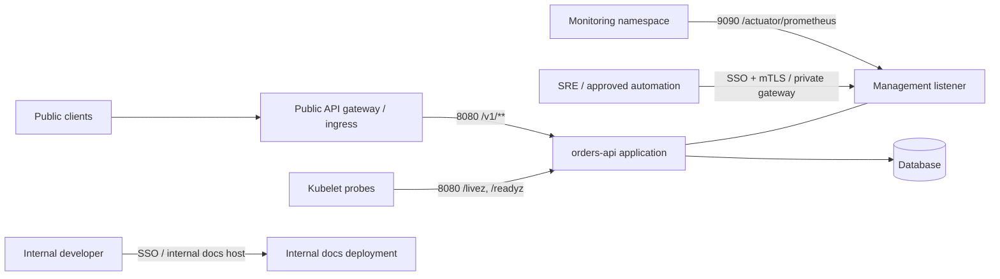

# Cô lập endpoint quản trị, metrics và tài liệu nội bộ

> **Chương:** Triển khai và vận hành  
> **Module:** **INTEGRATION_API_REST** — học thiết kế REST API theo resource, URI, HTTP method và status; xây dựng hợp đồng dữ liệu rõ ràng với Java/Spring, đồng thời thực hành phân trang, cache, idempotency, OpenAPI, xác thực, phân quyền, xử lý lỗi và kiểm thử.
>
> **Nguyên tắc:** Endpoint vận hành cũng là một **bề mặt tấn công**. Chức năng dành cho quản trị, metrics và tài liệu API nội bộ không nên vô tình trở thành tài nguyên công khai chỉ vì chúng nằm cùng ứng dụng REST hoặc trả kết quả thành công trên `localhost`. Cần bảo vệ đồng thời ở **lớp mạng, định danh, phân quyền, cấu hình exposure và kiểm thử triển khai**.

## 1. Tình huống thực tế và mục tiêu

Một service `orders-api` cung cấp API kinh doanh:

```http
GET /v1/orders/ord-1001 HTTP/1.1
Host: api.example.test
Authorization: Bearer <user-access-token>
Accept: application/json
```

Cùng JVM đó có thể cung cấp các endpoint:

```text
/actuator/health
/actuator/prometheus
/actuator/env
/actuator/loggers
/actuator/heapdump
/v3/api-docs
/swagger-ui/index.html
/internal/admin/cache/evictions
```

Nếu gateway chuyển tiếp `/**` đến ứng dụng và không có chính sách riêng, người ngoài có thể phát hiện URL quản trị, thu thập tên service/route, quan sát nhãn metrics, xem cấu hình hoặc thử tác động vào cache và log level. Một số endpoint chỉ tiết lộ **metadata**, nhưng một số có thể ảnh hưởng trực tiếp tới **bí mật, dữ liệu người dùng, tài nguyên JVM hoặc trạng thái ứng dụng**.

Sau bài này, người học có thể:

1. Phân loại endpoint kinh doanh, health/probes, metrics, tài liệu OpenAPI/Swagger UI và endpoint quản trị theo rủi ro.
2. Thiết kế nhiều lớp kiểm soát: exposure allowlist, listener/port riêng, routing/gateway, NetworkPolicy/firewall, mTLS/OAuth2, authorization và audit.
3. Cấu hình Spring Boot Actuator, Spring Security và tài liệu API theo môi trường mà không nhầm port riêng với “đã an toàn”.
4. Dùng HTTP status đúng cho health, authentication, authorization và quá tải; tránh lộ chi tiết nội bộ qua error body, metrics hoặc OpenAPI.
5. Kiểm thử từ **bên ngoài cluster**, **bên trong cluster**, **pod giám sát** và **tài khoản quản trị** để chứng minh các ranh giới thực sự có hiệu lực.

## 2. Inventory: endpoint nào phục vụ ai?

Trước khi viết cấu hình, hãy lập danh mục toàn bộ bề mặt HTTP mà ứng dụng có thể expose.

| Nhóm | Ví dụ | Người dùng hợp lệ | Mức rủi ro và chính sách |
|---|---|---|---|
| API kinh doanh | `/v1/orders/**` | Client đã xác thực và có quyền với resource | Public route có kiểm soát, OAuth2/JWT hoặc cơ chế xác thực phù hợp, object-level authorization. |
| Liveness | `/livez` hoặc `/actuator/health/liveness` | Kubelet/load balancer trong phạm vi được phép | Chỉ trả tình trạng tối thiểu, không tiết lộ hệ thống bên trong. |
| Readiness | `/readyz` hoặc `/actuator/health/readiness` | Kubelet/traffic controller | Xác định có nên nhận traffic; không đưa secrets hoặc chi tiết tenant. |
| Metrics | `/actuator/prometheus` | Prometheus/agent quan sát đã định danh | Chỉ nội bộ; giới hạn người scrape, nhãn dữ liệu và độ tốn kém. |
| Info | `/actuator/info` | Tùy chính sách: monitoring/support | Tránh build metadata nhạy cảm, commit URL/private config. |
| Diagnostics | `/actuator/env`, `/actuator/configprops`, `/actuator/beans`, `/actuator/mappings`, `/actuator/loggers` | SRE được ủy quyền cụ thể | **Không expose mặc định**; bật tạm với kiểm soát mạnh nếu thực sự cần. |
| Memory/debug | `/actuator/heapdump`, `/actuator/threaddump`, `/actuator/logfile` | Điều tra đặc biệt có phê duyệt | Rủi ro cao: heap có thể chứa token/PII; giới hạn quyền, thời gian, lưu trữ. |
| OpenAPI spec | `/v3/api-docs`, `/v3/api-docs.yaml` | Tác giả API, SDK build, reviewer phù hợp | Nếu tài liệu nội bộ, không đặt công khai; tài liệu cũng có thể tiết lộ API/role chưa công bố. |
| Swagger UI | `/swagger-ui/**`, `/swagger-ui.html` | Developer/tester có SSO | Đòi SSO + mạng nội bộ; không dùng token production trong browser UI tùy tiện. |
| Admin nghiệp vụ | `/internal/admin/**` | Nhân sự/automation có quyền hẹp | Yêu cầu xác thực mạnh, authorization theo action, audit, approval/rate limit nếu cần. |

**Exposure không giống authorization.** Nếu endpoint chỉ cần health và Prometheus, cấu hình đúng là **không đăng ký/không xuất bản** các endpoint Actuator nguy hiểm; sau đó còn giới hạn mạng và xác thực những gì được phép. “Tất cả endpoint đều có Basic Auth” thường là chính sách rộng, khó kiểm chứng và có nguy cơ rò credential.

### 2.1. Phân loại theo rủi ro thay vì chỉ tên URL

Một số nguy cơ:

- **Reconnaissance:** OpenAPI, mappings, beans hoặc thông tin version giúp attacker suy ra route và dependency.
- **Information disclosure:** `env`/`configprops`/`heapdump`/logs có thể chứa secrets, token, connection strings hoặc dữ liệu cá nhân dù đã có cơ chế masking.
- **Operational disruption:** điều chỉnh `loggers`, gửi yêu cầu shutdown nếu bật, vô hiệu cache hoặc kích hoạt tác vụ nặng.
- **Resource consumption:** scrape metrics quá dày, dump heap lớn, tạo quá nhiều admin jobs, gọi diagnostics đồng thời.
- **Cross-tenant leak:** metrics labels/logs hoặc admin endpoint hiển thị ID, thông tin hoạt động của tenant khác.
- **Credential misuse:** service account của Prometheus dùng chung quyền admin hoặc token bị ghi vào logs.

Vì vậy không chỉ bảo vệ những endpoint dùng method `POST`. Một `GET` read-only cũng có thể rò thông tin hoặc tạo tải nguy hiểm.

## 3. Kiến trúc cô lập: nhiều lớp và đúng điểm tin cậy

Một kiến trúc tham khảo:



**Các lớp bảo vệ:**

1. **Expose tối thiểu ở ứng dụng:** chỉ bật health/info/prometheus khi có nhu cầu, tắt diagnostics nguy hiểm. Tắt Swagger/OpenAPI trong public production deployment nếu chỉ dành cho nội bộ.
2. **Tách địa chỉ/cổng/đường đi:** listener management ở port riêng, hoặc deployment/host nội bộ riêng. Phân vùng giúp viết firewall/routing rõ nhưng **không tự là authorization**.
3. **Network isolation:** Ingress/Service/Load Balancer chỉ xuất public routes, NetworkPolicy/firewall cho phép management port từ những nguồn cần thiết, default deny khi phù hợp.
4. **Identity:** Prometheus/agent và SRE dùng danh tính dịch vụ/người riêng. Bảo vệ luồng bằng TLS/mTLS, OIDC/OAuth2 hoặc gateway auth được cấu hình đáng tin.
5. **Authorization:** quyền metrics đọc khác quyền đổi logger hoặc xóa cache; least privilege, kiểm method/action và resource.
6. **Audit và giám sát:** phát hiện cả truy cập thành công và cố gắng truy cập trái phép, không ghi raw bearer token vào log.

### 3.1. “Port 9090” chỉ là tổ chức route, không phải bí mật

Ví dụ triển khai:

```text
0.0.0.0:8080  -> /v1/**
0.0.0.0:9090  -> /actuator/**
```

Nếu 9090 vẫn được NodePort, LoadBalancer hoặc wildcard ingress expose, người ngoài có thể truy cập trực tiếp. Nếu monitoring service nằm cùng cluster, việc truy cập giữa pods vẫn phải bị chi phối bởi NetworkPolicy/service mesh đúng cách. Một Kubernetes `containerPort: 9090` tự nó **không** công khai cổng ra Internet, nhưng một `Service`, `Ingress`, `Gateway`, host networking hoặc firewall rule khác có thể làm điều đó.

**Bind `127.0.0.1`:** chỉ cho process trong cùng network namespace truy cập; hữu ích khi agent/sidecar cùng pod hoặc truy cập qua đường có kiểm soát. Tuy nhiên nếu Prometheus ở **pod khác** cần scrape trực tiếp Pod IP:9090, listener chỉ bind loopback sẽ **không truy cập được**. Không copy `management.server.address: 127.0.0.1` mà chưa quyết định topology.

### 3.2. Đừng dùng CORS làm biên bảo vệ

CORS là chính sách trình duyệt để hạn chế JavaScript đọc response cross-origin; `curl`, bot hoặc máy chủ khác không bị browser CORS enforcement. Tắt Swagger UI ở frontend hoặc thêm `Access-Control-Allow-Origin` **không bảo vệ** `/actuator/**`. Endpoint vận hành phải chịu kiểm soát mạng/identity/authorization ngay ở server.

### 3.3. DNS và đường dẫn khó đoán cũng không phải bảo mật

Tên như `ops-very-secret.example.test`, path `/internal/hidden/metrics` hoặc hostname chỉ lưu trong wiki **không thay thế** xác thực và giới hạn mạng. Scanner, log, source map, lịch sử proxy hoặc cấu hình bị rò có thể tiết lộ endpoint. URL path là contract định tuyến, không phải secret.

## 4. Spring Boot Actuator: bật ít, mặc định đóng

Với Spring Boot 3 / Java 17+, thêm Actuator và exporter Prometheus nếu thực sự cần endpoint Prometheus:

```kotlin
// build.gradle.kts - minh họa dependencies phù hợp Spring Boot BOM
dependencies {
    implementation("org.springframework.boot:spring-boot-starter-actuator")
    runtimeOnly("io.micrometer:micrometer-registry-prometheus")
}
```

Chỉ bổ sung dependency không tự cho phép mọi management endpoint qua HTTP. Actuator có hai khái niệm: **endpoint khả dụng/được bật** và **endpoint được expose qua web**. Chính sách phải xét cả hai.

### 4.1. Cấu hình production có cổng management riêng

```yaml
# application-production.yml
server:
  port: 8080

management:
  server:
    port: 9090
  endpoints:
    web:
      base-path: /actuator
      exposure:
        include: health,info,prometheus
  endpoint:
    health:
      show-details: never
      show-components: never
      probes:
        enabled: true
        add-additional-paths: true

springdoc:
  api-docs:
    enabled: false
  swagger-ui:
    enabled: false
```

**Đọc đúng từng dòng:**

- Port `8080` chạy API ứng dụng, `9090` chạy management web context khi cấu hình port riêng.
- `include: health,info,prometheus` là danh sách tối thiểu minh họa; **không** dùng `include: "*"` trong production theo phản xạ. Nếu không cần `info`, bỏ nó.
- `show-details: never` và `show-components: never` tránh biến health response thành sơ đồ hạ tầng. Cấu hình có thể thay bằng policy phù hợp nếu chỉ principal có quyền được xem chi tiết, nhưng vẫn cần mạng riêng.
- `probes.enabled: true` tạo các health groups cho liveness/readiness. `add-additional-paths: true` có thể expose `/livez` và `/readyz` trên **cổng ứng dụng chính**, rất hữu ích khi cổng management riêng vẫn khỏe nhưng cổng API không nhận traffic.
- `springdoc.api-docs.enabled: false` và `springdoc.swagger-ui.enabled: false` là cấu hình cho hệ thống dùng springdoc-openapi; **không** vô hiệu tài liệu nếu dự án dùng thư viện khác hoặc tự viết route docs. Kiểm thực tế trong build/triển khai.

**Cảnh báo riêng:** Management port riêng không bảo đảm các `SecurityFilterChain` khai báo trong application context mặc nhiên được áp dụng đúng như bạn nghĩ ở management context. Phải kiểm cấu hình security có mặt trong **context thực phục vụ 9090**, và test bằng HTTP từ những network zone khác nhau. Không dùng việc “app API có filter JWT” để suy ra 9090 cũng yêu cầu JWT.

### 4.2. Health, liveness và readiness không cùng ý nghĩa

| Endpoint | Nên phản ánh | Không nên làm |
|---|---|---|
| **Liveness** | JVM/app còn ở trạng thái có thể tiếp tục chạy. | Phụ thuộc DB/Redis/đối tác khiến outage tạm thời kích hoạt restart hàng loạt. |
| **Readiness** | Instance có thể nhận traffic ứng dụng lúc này. | Trả `UP` chỉ vì management listener sống trong khi cổng API ngừng phục vụ. |
| **Diagnostic health** | Tình trạng các dependency/group theo nhu cầu SRE. | Công khai component names, hostnames, versions và exception. |

Với health group, ví dụ thông thường:

```http
GET /readyz HTTP/1.1
Host: api.example.test
```

```http
HTTP/1.1 200 OK
Content-Type: application/vnd.spring-boot.actuator.v3+json

{"status":"UP"}
```

Khi readiness không đạt, Actuator có thể trả:

```http
HTTP/1.1 503 Service Unavailable
Content-Type: application/vnd.spring-boot.actuator.v3+json

{"status":"OUT_OF_SERVICE"}
```

**Chú ý:** Spring Boot cung cấp liveness/readiness state indicators; readiness **không tự động kiểm mọi DB/downstream**. Nếu ứng dụng phải loại khỏi traffic khi một dependency thiết yếu không dùng được, cấu hình health groups/availability state và chính sách tương ứng, nhưng tránh biến một outage chung thành liveness fail. Đọc đúng policy container orchestrator và kiểm phản hồi thật trong bài kiểm thử.

`/actuator/health`, `/actuator/health/liveness` và `/actuator/health/readiness` trên management port có thể phục vụ chẩn đoán nội bộ. Với Kubernetes probe, dùng `/livez`/`/readyz` ở application port khi đã bật additional paths, để probe kiểm chính server nhận traffic.

### 4.3. Không expose endpoint diagnostics vì tiện debug

Một số endpoint nhạy cảm:

| Endpoint | Rủi ro thực tế | Chính sách |
|---|---|---|
| `/actuator/env`, `/actuator/configprops` | Giá trị cấu hình, metadata và đôi khi bí mật nếu sanitizer/config sai. | Không expose mặc định; bật ngắn hạn theo thủ tục điều tra. |
| `/actuator/heapdump` | Heap có thể chứa token, password, PII, request/session objects. | Không cho tải tự do; dùng công cụ chẩn đoán qua quyền hạn đặc biệt và lưu trữ bảo mật. |
| `/actuator/threaddump` | Stack, tên lớp, cấu trúc mã, trạng thái runtime. | Quyền hạn cao, giới hạn truy cập/retention. |
| `/actuator/loggers` | Có thể đổi log level, tăng log volume hoặc vô tình lộ dữ liệu. | Không expose mặc định; nếu cần mutation, kiểm quyền hành động và audit. |
| `/actuator/mappings`/`beans` | Tiết lộ đường đi/chi tiết triển khai. | Không công khai. |
| `/actuator/logfile` | Nội dung log có thể chứa dữ liệu nhạy cảm. | Không cung cấp qua public HTTP. |
| `/actuator/shutdown` | Gây dừng service nếu chủ động bật. | Giữ tắt trong môi trường bình thường. |

Cơ chế che giá trị nhạy cảm của Actuator là **lớp hỗ trợ**, không chứng minh mọi loại thông tin bí mật đã được loại bỏ. Ngay cả khi `/actuator/env` hiển thị `******`, tên property, prefix, nguồn cấu hình và cấu trúc runtime vẫn có thể có giá trị với attacker.

## 5. Spring Security: xác thực đúng quyền theo endpoint

### 5.1. Chính sách cấp quyền

Ví dụ phân quyền:

| Caller | Health tối thiểu | Prometheus | API quản trị | OpenAPI/Swagger UI |
|---|---|---|---|---|
| Internet không xác thực | Chỉ qua đường probe thật sự cần; tốt nhất không expose management | Từ chối | Từ chối | Từ chối nếu docs nội bộ |
| Kubernetes probe | Có quyền gọi `/livez`, `/readyz` | Không | Không | Không |
| Monitoring service identity | Có thể | `SCOPE_metrics.read` | Không | Không |
| SRE ops identity | Có thể | Theo nhiệm vụ | `SCOPE_ops.admin` hoặc quyền hẹp theo operation | Có thể đọc tài liệu theo nhiệm vụ |
| Developer đã SSO | Theo chính sách | Thường không | Không | `ROLE_DOCS_VIEWER` / policy tương đương |
| Client kinh doanh | Không mặc định | Không | Không | Không nếu tài liệu nội bộ |

Với token JWT, resource server vẫn phải xác minh **signature/JWKS, issuer, audience, expiration và scopes**. Chỉ có `SCOPE_ops.admin` trong chuỗi JSON không đủ: token phải được xác thực từ issuer đáng tin và dành cho đúng API. Với mTLS/mesh, phải ràng buộc certificate identity/SPIFFE ID với role được phép, không chỉ tin header `X-User` do client có thể tự gửi.

**Nguyên tắc:** `metrics.read` chỉ được đọc số liệu, không được đổi log level, xóa cache hoặc tải heapdump. Admin endpoint thay đổi trạng thái cần quyền mạnh hơn read-only health.

### 5.2. Ví dụ SecurityFilterChain cho cách triển khai cùng web context

Ví dụ dưới đây áp dụng khi **Actuator và ứng dụng nằm trên cùng Servlet web context** (không tách management port), hoặc khi đã xác minh chain thật sự được tạo trong context xử lý endpoint. Đây là ví dụ **đối chiếu chính sách**, không đủ để suy ra cổng management 9090 ở phần 4 đã được bảo vệ.

```java
package example.orders.security;

import org.springframework.boot.actuate.autoconfigure.security.servlet.EndpointRequest;
import org.springframework.boot.actuate.health.HealthEndpoint;
import org.springframework.context.annotation.Bean;
import org.springframework.context.annotation.Configuration;
import org.springframework.core.annotation.Order;
import org.springframework.http.HttpMethod;
import org.springframework.security.config.Customizer;
import org.springframework.security.config.annotation.method.configuration.EnableMethodSecurity;
import org.springframework.security.config.annotation.web.builders.HttpSecurity;
import org.springframework.security.config.annotation.web.configurers.AbstractHttpConfigurer;
import org.springframework.security.config.http.SessionCreationPolicy;
import org.springframework.security.web.SecurityFilterChain;

@Configuration
@EnableMethodSecurity
public class ApiSecurity {

    @Bean
    @Order(1)
    SecurityFilterChain actuator(HttpSecurity http) throws Exception {
        return http
            .securityMatcher(EndpointRequest.toAnyEndpoint())
            .authorizeHttpRequests(auth -> auth
                .requestMatchers(EndpointRequest.to(HealthEndpoint.class))
                    .permitAll()
                .requestMatchers(EndpointRequest.to("prometheus"))
                    .hasAuthority("SCOPE_metrics.read")
                .anyRequest().denyAll())
            .oauth2ResourceServer(oauth -> oauth.jwt(
                Customizer.withDefaults()))
            .csrf(AbstractHttpConfigurer::disable)
            .sessionManagement(session -> session.sessionCreationPolicy(
                SessionCreationPolicy.STATELESS))
            .build();
    }

    @Bean
    @Order(2)
    SecurityFilterChain restrictedRoutes(HttpSecurity http) throws Exception {
        return http
            .securityMatcher("/internal/admin/**", "/v3/api-docs",
                "/v3/api-docs.yaml", "/v3/api-docs/**",
                "/swagger-ui", "/swagger-ui/**", "/swagger-ui.html")
            .authorizeHttpRequests(auth -> auth
                .requestMatchers("/internal/admin/**")
                    .hasAuthority("SCOPE_ops.admin")
                // Production không phục vụ docs từ public app deployment.
                .anyRequest().denyAll())
            .oauth2ResourceServer(oauth -> oauth.jwt(
                Customizer.withDefaults()))
            .csrf(AbstractHttpConfigurer::disable)
            .sessionManagement(session -> session.sessionCreationPolicy(
                SessionCreationPolicy.STATELESS))
            .build();
    }

    @Bean
    @Order(3)
    SecurityFilterChain businessApi(HttpSecurity http) throws Exception {
        return http
            .authorizeHttpRequests(auth -> auth
                .requestMatchers(HttpMethod.GET, "/v1/public-info")
                    .permitAll()
                .anyRequest().authenticated())
            .oauth2ResourceServer(oauth -> oauth.jwt(
                Customizer.withDefaults()))
            .csrf(AbstractHttpConfigurer::disable)
            .sessionManagement(session -> session.sessionCreationPolicy(
                SessionCreationPolicy.STATELESS))
            .build();
    }
}
```

**Cách đọc chính xác:**

- `EndpointRequest.toAnyEndpoint()` chỉ match Actuator endpoints trong context mà Spring nhận diện; vì vậy phải test **đúng listener/context** và router thực. Ở context có management port riêng, xem lại cấu hình security, actuator endpoint handlers và filter chain áp dụng.
- `HealthEndpoint` được `permitAll()` để probe hoạt động, nhưng chỉ an toàn khi health details/components đã hạn chế và public ingress không expose trái ý muốn. Nếu cần liveness/readiness riêng, áp dụng giới hạn mạng/route tối thiểu tương ứng.
- `prometheus` yêu cầu `SCOPE_metrics.read` — thích hợp với monitoring identity có Bearer token. Nếu Prometheus dùng mTLS/service mesh thay cho JWT, cấu hình security phải khớp cơ chế xác thực đó.
- `restrictedRoutes` bao phủ cả `/v3/api-docs`, `/v3/api-docs.yaml`, các grouped docs/config, Swagger UI và path quản trị. Chỉ match `/v3/api-docs/**` sẽ **bỏ sót** sibling URL `/v3/api-docs.yaml`; nếu chain mặc định cho user đã xác thực truy cập, đó có thể là đường bypass. Với docs production, **tắt route bằng cấu hình** còn quan trọng hơn việc trả 403.
- `businessApi` bảo vệ request kinh doanh, nhưng vẫn cần object-level authorization trong service; JWT scope không tự cấp quyền đọc đơn hàng của tenant khác.
- `csrf.disable()` trong ví dụ dành cho resource server **stateless dùng Bearer token**, không dùng cookie/session từ browser. Nếu thiết kế admin UI dùng cookie hoặc SSO session, cần CSRF protection và security chain/session policy riêng; không sao chép cấu hình tắt CSRF.
- `oauth2ResourceServer().jwt()` còn cần `JwtDecoder` và policy kiểm issuer/audience đúng token. Spring Security không mặc nhiên đảm bảo audience hợp lệ cho mọi identity provider nếu bạn chưa cấu hình validator.

**Quan trọng với Swagger UI:** Browser mở trang bằng top-level navigation không tự gắn Bearer token vào mọi request HTML/JS. Một UI docs nội bộ cần **đường SSO/browser session được thiết kế riêng**, thường đặt sau internal proxy với OIDC login, authorization theo group, CSRF/session/cookie đúng và deny-by-default. Không chỉ đổi `denyAll()` thành `hasAuthority("SCOPE_docs.read")` rồi kỳ vọng Swagger UI trên browser tự gửi JWT.

### 5.3. Endpoint admin do ứng dụng tự viết

Ví dụ `POST /internal/admin/cache/evictions` có tác động thay đổi trạng thái:

```http
POST /internal/admin/cache/evictions HTTP/1.1
Authorization: Bearer <ops-access-token>
Content-Type: application/json
Idempotency-Key: <operation-id>

{"cacheName":"order-summary","dryRun":true}
```

Các kiểm soát bắt buộc:

1. Dùng **POST** cho hành động thay đổi trạng thái, không dùng GET vì crawler/link preview/monitor có thể gọi vô ý.
2. Kiểm `SCOPE_ops.admin` **và** quyền trên đúng cache/tenant/environment; chỉ token có scope chung không đủ nếu admin action ảnh hưởng dữ liệu nhiều tenant.
3. Allowlist `cacheName` và action, giới hạn số lượng/chi phí; không cho client gửi tên class/command/script tùy ý.
4. Hỗ trợ `dryRun` khi rủi ro cao; với action phá hủy có thể cần approval/two-person rule tùy quy trình.
5. Áp idempotency/correlation/audit: ai thực hiện, mục đích, object, kết quả; không log raw access token hoặc payload chứa dữ liệu nhạy cảm.
6. Nếu vận hành yêu cầu SSO và browser cookie, bảo vệ CSRF. Nếu dùng service-to-service Bearer/mTLS, giữ nguyên cơ chế phù hợp.
7. Có rate limit/bulkhead và deadline để một thao tác admin không làm hệ thống sập.

Một lớp defense-in-depth ở method level nếu dùng Spring Security method security:

```java
package example.orders.admin;

import org.springframework.security.access.prepost.PreAuthorize;
import org.springframework.web.bind.annotation.*;

@RestController
@RequestMapping("/internal/admin")
public class CacheAdminController {
    private final CacheEvictionService service;

    public CacheAdminController(CacheEvictionService service) {
        this.service = service;
    }

    @PreAuthorize("hasAuthority('SCOPE_ops.admin')")
    @PostMapping("/cache/evictions")
    public EvictionReceipt evict(@RequestBody EvictionRequest request) {
        return service.validateAuthorizeAuditAndExecute(request);
    }
}
```

`CacheEvictionService`, `EvictionRequest`, `EvictionReceipt` là domain classes cần triển khai. `@PreAuthorize` yêu cầu bật `@EnableMethodSecurity` trong cấu hình phù hợp; chú thích không tự hoạt động nếu method security chưa được bật. Phần service phải kiểm business policy, tenant/resource và audit thật, không chỉ tin có annotation.

## 6. Tài liệu OpenAPI và Swagger UI: tách cách công bố khỏi cách triển khai

REST API có thể dùng OpenAPI làm contract để sinh client, review breaking changes hoặc chạy contract tests mà **không cần** công khai `/v3/api-docs` cho toàn Internet.

### 6.1. Ba cách phân phối tài liệu

| Cách | Phù hợp | Yêu cầu |
|---|---|---|
| **Artifact tĩnh trong CI** (`openapi.yaml` versioned) | Internal SDK generation, code review, contract test | Lưu trong repository/artifact registry có RBAC; diff/version theo commit. |
| **Portal tài liệu nội bộ** | Developer/self-service đã đăng nhập | SSO, group-based authorization, access logs, không chứa secrets/examples thật. |
| **Endpoint sinh spec lúc chạy** | Staging, dev hoặc môi trường nội bộ có nhu cầu debug | Chặn bằng mạng + identity; tắt trên public deployment nếu không cần. |

Nếu bắt buộc phục vụ runtime OpenAPI và Swagger UI trong môi trường riêng, có thể bật:

```yaml
# application-docs-internal.yml (chỉ dùng ở deployment nội bộ)
springdoc:
  api-docs:
    enabled: true
  swagger-ui:
    enabled: true
```

Đây **chỉ là tính năng bật**, không tự cấu hình SSO, firewall hoặc CORS an toàn. **Nếu tái sử dụng `ApiSecurity` production ở mục 5, `denyAll()` vẫn chặn docs dù springdoc đã bật**: deployment nội bộ phải có security chain riêng cho OIDC/session (hoặc proxy SSO có bảo vệ nguồn tới app), không bỏ `denyAll()` mà không thay bằng quyền truy cập thực sự. Bảo vệ bằng internal gateway/proxy và OIDC session hoặc đường xác thực mà browser có thể dùng. Đảm bảo UI không tự kết nối tới host production có token nhạy cảm hoặc thử các endpoint admin ngoài ý muốn.

### 6.2. OpenAPI có thể lộ gì?

- Endpoint chưa công bố, như `/internal/admin/**`, `/debug/**`, hoặc webhook handlers.
- Request/response fields nội bộ: customer IDs, error codes, feature flags.
- OAuth scopes, schema phân quyền, tên dependency, hosts và environment URLs.
- Example value chứa email/địa chỉ/token thật nếu không làm sạch.
- Generated HTML/JS docs hoặc `Try it out` làm tăng bề mặt browser/cookie/CORS.

Do đó tạo **public spec** và **internal spec** theo nhu cầu, lọc operation/servers/examples/extension phù hợp; không chỉ giấu UI rồi để `/v3/api-docs` công khai. Nếu public API có tài liệu chính thức, việc công bố OpenAPI có thể là **chủ đích hợp lệ** — nhưng phải review nội dung và bảo vệ **implementation**, không xem việc giấu schema là lớp an ninh chính.

### 6.3. Quyền dùng “Try it out”

Swagger UI có thể phát request từ trình duyệt, nên chịu SOP/CORS, CSP, cookie/SameSite và CSRF giống SPA khác. Không mặc định thêm wildcard CORS cho toàn API để demo chạy được. Dùng môi trường thử nghiệm, tài khoản/scope hạn chế, không lưu access token production vào local storage, và kiểm người dùng có quyền thực hiện operation đó.

## 7. Metrics: chỉ số vận hành cũng có dữ liệu nhạy cảm và chi phí

Prometheus endpoint thường trả text exposition format:

```http
GET /actuator/prometheus HTTP/1.1
Host: metrics.internal.example.test
Authorization: Bearer <metrics-token>
```

Ví dụ dữ liệu **minh họa**:

```text
http_server_requests_seconds_count{method="GET",uri="/v1/orders/{id}",status="200"} 8240
http_server_requests_seconds_count{method="POST",uri="/v1/orders",status="503"} 29
hikaricp_connections_active{pool="HikariPool-1"} 12
```

Metrics hữu ích nhưng có thể lộ tên endpoint, lưu lượng thanh toán, số connection, workload, tenant hoặc thời điểm một nghiệp vụ hoạt động. Bên cạnh quyền truy cập, cần có **data minimization**:

- Không dùng `orderId`, `userId`, email, bearer token, full path có ID hoặc `tenantId` tùy ý làm label.
- Dùng route template `/v1/orders/{id}` thay vì `/v1/orders/ord-1001`; giới hạn tập status/error codes, không đưa exception message vào label.
- Không để metrics endpoint tự gọi DB hoặc API ngoài chỉ để tạo số liệu mỗi lần scrape; dùng counters/gauges/histograms có chi phí tính toán được kiểm soát.
- Giới hạn số series/cardinality, retention, scrape interval và tổng volume; cấu hình metrics/collector phù hợp khả năng hệ thống.
- Scrape qua endpoint nội bộ được bảo vệ bằng mTLS hoặc Bearer token của **monitoring identity**, không dùng token admin chung.
- Nếu dùng Prometheus service discovery, đảm bảo credentials được lưu/đọc từ cơ chế bảo mật của hạ tầng, không nhúng vào ConfigMap công khai hoặc tài liệu.

**Đừng cấu hình authentication chỉ ở reverse proxy khi Pod IP:9090 còn có thể bị gọi trực tiếp** từ workload không được tin cậy trong cluster. Khi cần, triển khai thêm mTLS/service mesh, network policy và auth ở listener/agent để tránh đường đi vòng qua proxy.

## 8. Kubernetes: chỉ xuất public port, giới hạn nguồn vào management

### 8.1. Service và port

Ví dụ pod có application port 8080, management port 9090. Public `Service` chỉ khai báo 8080:

```yaml
apiVersion: v1
kind: Service
metadata:
  name: orders-api
  namespace: shop
spec:
  selector:
    app: orders-api
  ports:
    - name: http
      port: 80
      targetPort: 8080
  type: ClusterIP
```

`ClusterIP` không tự công khai ra Internet; Ingress/Gateway phía ngoài chọn public routes tương ứng. **Không khai báo management port vào public Service/Ingress** theo thói quen. Monitoring có thể scrape Pod IP:9090 qua service discovery được phép, hoặc dùng một private Service chỉ cho monitoring với network/mTLS controls bổ sung. `containerPort` trong Deployment chỉ là metadata về cổng container, không tự tạo firewall bảo vệ.

### 8.2. Ví dụ NetworkPolicy

NetworkPolicy áp vào **Pod**; ví dụ này cho phép ingress tới 8080 từ ingress controller trong namespace `ingress-system`, và tới 9090 từ Prometheus trong namespace `monitoring`:

```yaml
apiVersion: networking.k8s.io/v1
kind: NetworkPolicy
metadata:
  name: orders-api-ingress-policy
  namespace: shop
spec:
  podSelector:
    matchLabels:
      app: orders-api
  policyTypes:
    - Ingress
  ingress:
    - from:
        - namespaceSelector:
            matchLabels:
              kubernetes.io/metadata.name: ingress-system
          podSelector:
            matchLabels:
              app: ingress-controller
      ports:
        - protocol: TCP
          port: 8080
    - from:
        - namespaceSelector:
            matchLabels:
              kubernetes.io/metadata.name: monitoring
          podSelector:
            matchLabels:
              app.kubernetes.io/name: prometheus
      ports:
        - protocol: TCP
          port: 9090
```

**Điều kiện và giới hạn phải hiểu:**

- Các namespace/pod labels phải khớp cluster thật; tên/label bên trên chỉ là ví dụ. Nếu policy chọn sai label, scrape có thể lỗi hoặc traffic ứng dụng bị chặn.
- Kubernetes NetworkPolicies là **additive**: một policy khác cho phép tất cả traffic có thể làm 9090 vẫn truy cập được. Kiểm **tổng hợp mọi policy** áp dụng cho pod, không chỉ file này.
- Phải có CNI/network plugin thực thi NetworkPolicy; không giả định mọi cluster có enforcement giống nhau. Host network, node traffic và service mesh/proxy có thể có hành vi đặc biệt; kiểm bằng pod thử ở từng namespace.
- Pod/namespace labels và service account cần được bảo vệ bằng RBAC/admission phù hợp; không xem label là định danh mật mã.
- Policy này mô tả ingress; các giới hạn egress, API server access, DNS, health probe node-to-pod, Pod port-forward và sidecar cần đánh giá riêng.
- **Kubelet probes** gọi Pod IP theo cơ chế cluster; nếu policy hoặc CNI ảnh hưởng node-to-pod, phải xác minh liveness/readiness vẫn hoạt động. Ví dụ này dùng `/livez`/`/readyz` trên application port để không phải cấp kubelet quyền rộng lên management port.

### 8.3. Liveness/readiness qua application port

Khi đã bật `management.endpoint.health.probes.add-additional-paths: true`, Deployment có thể probe vào cổng chính:

```yaml
# Phần trích dẫn từ spec.containers[] trong Deployment
ports:
  - name: http
    containerPort: 8080
  - name: management
    containerPort: 9090
livenessProbe:
  httpGet:
    path: /livez
    port: http
  periodSeconds: 10
  timeoutSeconds: 2
  failureThreshold: 3
readinessProbe:
  httpGet:
    path: /readyz
    port: http
  periodSeconds: 5
  timeoutSeconds: 2
  failureThreshold: 2
```

Cấu hình probes cụ thể phải dựa trên startup time và cách ứng dụng báo trạng thái. Với service khởi động lâu, cân nhắc `startupProbe` để tránh liveness restart ngay khi JVM đang warm-up. Không đưa DB check dễ lỗi tạm thời vào liveness làm cả cụm restart khi DB outage. **Readiness là quyết định routing**, không phải cơ chế authentication.

### 8.4. Truy cập quản trị qua đường có kiểm soát

SRE cần debug `/actuator/health` trên 9090 có thể dùng một trong các đường đã quản trị:

- Private SRE gateway với SSO, mTLS, RBAC và audit.
- Agent/sidecar được xác thực, cung cấp số liệu tối thiểu qua collector.
- `kubectl port-forward` trong phiên khẩn cấp, **chỉ với Kubernetes RBAC phù hợp và ghi nhận điều tra**.

`kubectl port-forward` không biến management endpoint thành an toàn nếu ai cũng có quyền `pods/portforward`. Đây là đường truy cập được điều khiển bởi Kubernetes API RBAC; phải kiểm quyền này cùng quyền đọc secrets, exec và pod logs. Không dùng port-forward mở ra `0.0.0.0` một cách tùy tiện.

## 9. HTTP contract của endpoint vận hành

### 9.1. Status nên thể hiện đúng tình trạng

| Tình huống | Status thường phù hợp | Ghi chú |
|---|---|---|
| Health liveness `UP` | `200 OK` | Chỉ trả trạng thái cần thiết. |
| Readiness `DOWN/OUT_OF_SERVICE` | `503 Service Unavailable` | Kubelet ngừng gửi traffic theo cấu hình probe. |
| Thiếu credential khi endpoint yêu cầu xác thực | `401 Unauthorized` | Với Bearer, có `WWW-Authenticate` theo security framework. |
| Caller có credential nhưng thiếu authority | `403 Forbidden` | Không echo scopes/claims nhạy cảm của người khác. |
| Endpoint không expose/không tồn tại | `404 Not Found` hoặc bị security layer từ chối trước routing | Đừng suy ra “404 luôn chứng minh không có endpoint”. |
| Admin request sai body/operation | `400 Bad Request`/`422 Unprocessable Content` | Validation contract, không thực thi một phần ngoài ý muốn. |
| Admin action xung đột trạng thái | `409 Conflict` | Idempotency/concurrency rõ. |
| Quota admin/metrics bị vượt | `429 Too Many Requests` | Caller backoff, không retry storm. |
| Capacity toàn cụm hết | `503 Service Unavailable` | Có thể trả `Retry-After` khi phù hợp. |

Một ví dụ `403` cho metrics:

```http
HTTP/1.1 403 Forbidden
Content-Type: application/problem+json
Cache-Control: no-store

{
  "type": "https://api.example.test/problems/forbidden",
  "title": "Không có quyền truy cập endpoint này",
  "status": 403
}
```

Không trả stack trace hoặc tên config/bean bị cấm trong error body. Với `health` công khai, giữ body ngắn và ổn định; khác với response kinh doanh, `health` thường được kubelet dựa vào theo status code và body đơn giản.

### 9.2. HEAD/OPTIONS và các đường bypass

Kiểm cả GET, HEAD, OPTIONS và method không hợp lệ để chắc rằng gateway/security route không có cách đi vòng:

- `GET /actuator/prometheus` yêu cầu quyền metrics.
- `HEAD /actuator/prometheus` không được lộ header hoặc status phản ánh dữ liệu đặc quyền ngoài policy.
- `POST /actuator/loggers/...` không thể gọi khi endpoint chưa được expose, kể cả từ pod nội bộ không có quyền.
- Path biến thể (`//`, encoded slash, trailing slash, uppercase, reverse proxy rewrite) phải được normalize/deny theo cấu hình an toàn; không tin route pattern bảo vệ một kiểu URL nhưng proxy chuyển sang kiểu khác.
- Đảm bảo management path khác base path không vô tình được route bởi public wildcard `/**`.

Có thể dùng 404 để tránh tiết lộ tài nguyên không tồn tại, nhưng không dựa vào “ẩn endpoint bằng 404” thay authentication. Quan trọng là **caller không lấy được nội dung hoặc tác động ngoài quyền**.

## 10. Kiểm chứng từ nhiều vùng mạng: chỉ nhìn localhost là chưa đủ

Một kiểm thử cục bộ:

```bash
curl -i http://localhost:9090/actuator/prometheus
```

chỉ cho biết endpoint hoạt động từ nơi chạy lệnh. Nó **không** chứng minh bên ngoài cluster không thể truy cập 9090, hoặc service account khác trong cluster không thể đọc metrics.

### 10.1. Ma trận kiểm thử deployment

| Nguồn / danh tính | URL / action | Kết quả kỳ vọng |
|---|---|---|
| Internet ẩn danh | `https://api.example.test/v1/orders` | Bị auth yêu cầu hoặc theo API contract. |
| Internet ẩn danh | `https://api.example.test/actuator/prometheus` | **Không truy cập được** qua public gateway. |
| Internet ẩn danh | `https://api.example.test/v3/api-docs` | Không công bố docs nội bộ trong production. |
| Internet ẩn danh | `https://api.example.test/swagger-ui/index.html` | Không công bố UI nội bộ. |
| Pod bất kỳ ngoài monitoring | `http://orders-pod:9090/actuator/prometheus` | Bị network policy/mTLS/auth từ chối. |
| Pod monitoring đúng identity | `http://orders-pod:9090/actuator/prometheus` | Thành công theo policy scrape, có số liệu hợp lệ. |
| Pod monitoring thiếu identity | `GET /actuator/prometheus` | `401`/`403` ở auth layer nếu nối mạng được, hoặc blocked ở network. |
| Kubelet probe | `GET /livez` trên 8080 | `200` khi live, không tiết lộ component details. |
| Kubelet probe | `GET /readyz` trên 8080 | `200` khi ready; `503` khi không thể nhận traffic theo policy. |
| Developer có SSO | Docs host nội bộ | Có tài liệu đúng scope, không có secrets/example thật. |
| User kinh doanh thường | `POST /internal/admin/cache/evictions` | `403` hoặc bị chặn bởi network trước. |
| SRE scope admin đúng | `POST /internal/admin/cache/evictions` | Thực thi theo validation/approval và có audit. |
| SRE scope metrics nhưng không admin | Đổi logger/xóa cache | Bị từ chối. |
| Caller đã auth | `/actuator/env`, `/actuator/heapdump` | Không expose; vẫn không được đọc. |

**Cần test cả đường nội bộ và đường công khai.** Một `HTTP 404` ở public ingress có thể chỉ vì gateway không route path; đường Pod IP:9090 vẫn phải được kiểm. Ngược lại, một status 401/403 từ app chỉ chứng minh auth chain ở đường đã test, không chứng minh không có bypass ở Service/NodePort khác.

### 10.2. Ví dụ kiểm thử Spring MockMvc — cho cùng web context

Với cấu hình SecurityFilterChain ở mục 5, và **test deployment không tách management port**, sử dụng Spring Boot Test + Spring Security Test:

```java
package example.orders.security;

import static org.springframework.security.test.web.servlet.request.SecurityMockMvcRequestPostProcessors.jwt;
import static org.springframework.test.web.servlet.request.MockMvcRequestBuilders.get;
import static org.springframework.test.web.servlet.request.MockMvcRequestBuilders.post;
import static org.springframework.test.web.servlet.result.MockMvcResultMatchers.*;

import org.junit.jupiter.api.Test;
import org.springframework.beans.factory.annotation.Autowired;
import org.springframework.boot.test.autoconfigure.web.servlet.AutoConfigureMockMvc;
import org.springframework.boot.test.context.SpringBootTest;
import org.springframework.http.MediaType;
import org.springframework.security.core.authority.SimpleGrantedAuthority;
import org.springframework.test.web.servlet.MockMvc;

@SpringBootTest(properties = {
    "management.endpoints.web.exposure.include=health,info,prometheus",
    "springdoc.api-docs.enabled=false",
    "springdoc.swagger-ui.enabled=false"
})
@AutoConfigureMockMvc
class ManagementSecurityTest {
    @Autowired MockMvc mvc;

    @Test
    void minimalHealthIsReadable() throws Exception {
        mvc.perform(get("/actuator/health"))
           .andExpect(status().isOk())
           .andExpect(jsonPath("$.status").exists())
           .andExpect(jsonPath("$.components").doesNotExist());
    }

    @Test
    void metricsNeedMonitoringScope() throws Exception {
        mvc.perform(get("/actuator/prometheus"))
           .andExpect(status().isUnauthorized());

        mvc.perform(get("/actuator/prometheus")
                .with(jwt().authorities(
                    new SimpleGrantedAuthority("SCOPE_metrics.read"))))
           .andExpect(status().isOk());
    }

    @Test
    void scopeForMetricsCannotExecuteAdminOperation() throws Exception {
        mvc.perform(post("/internal/admin/cache/evictions")
                .contentType(MediaType.APPLICATION_JSON)
                .content("{\"cacheName\":\"order-summary\",\"dryRun\":true}")
                .with(jwt().authorities(
                    new SimpleGrantedAuthority("SCOPE_metrics.read"))))
           .andExpect(status().isForbidden());
    }

    @Test
    void internalDocsAreNotAccessible() throws Exception {
        mvc.perform(get("/v3/api-docs")
                .with(jwt().authorities(
                    new SimpleGrantedAuthority("SCOPE_metrics.read"))))
           .andExpect(status().isForbidden());
    }
}
```

**Đọc phạm vi test:** mẫu `MockMvc` kiểm security matcher trong cùng Servlet context, cần có Micrometer Prometheus registry và cấu hình JWT decoder phù hợp để application context khởi động. Test POST admin ở đây chỉ xác minh **monitoring scope bị từ chối**; cần test riêng scope ops.admin với domain service/fixture an toàn, validate input và audit. Nếu project chạy production với `management.server.port: 9090`, hãy dùng HTTP integration test thật khởi động cả hai listeners; `MockMvc` cho application context không tự chứng minh security của management listener.

`jwt()` của `spring-security-test` giả lập Authentication, **không kiểm chữ ký/issuer/audience của JWT thật**. Security tests dành cho token validation phải gọi qua decoder thật hoặc stub JWKS/introspection có kiểm soát; không để scope giả trong unit test thay mọi lớp xác thực.

**Lưu ý Spring Security matcher:** Trên ứng dụng có nhiều filter chains, một matcher quá rộng hoặc `@Order` sai có thể làm chain mặc định tiếp nhận URL quản trị. Bài test trên là một lớp; thêm kiểm tra mỗi endpoint đã qua **đúng chain và role** ở runtime.

### 10.3. Cách kiểm ở deployment thật

Từ một vị trí bên ngoài cluster (đã được phép kiểm):

```bash
# Public API phải phục vụ các business routes, không route nội bộ.
curl -i https://api.example.test/actuator/prometheus
curl -i https://api.example.test/v3/api-docs
curl -i https://api.example.test/swagger-ui/index.html
```

Từ monitoring pod đã xác thực:

```bash
# Ví dụ chỉ để minh họa; endpoint DNS, TLS và cơ chế token
# phải khớp deployment thực, tránh echo token vào terminal history.
curl -i \
  -H "Authorization: Bearer <monitoring-test-token>" \
  https://metrics.internal.example.test/actuator/prometheus
```

Khi kiểm độc lập qua Pod IP/service, phải dùng đường chỉ được cấp cho người điều tra và test đúng network policy. Không dùng `curl -k` để che lỗi TLS rồi tuyên bố truy cập an toàn; tắt xác minh certificate chỉ làm bài test không còn giống production.

### 10.4. Chống regressions bằng kiểm tra tự động

Trong pipeline triển khai, nên có:

1. Kiểm cấu hình: danh sách Actuator exposure allowlist, docs profile, service/ingress rules và security chain chính xác.
2. Static policy kiểm YAML/Kubernetes: không tạo public Service/Ingress cho 9090, không expose `env`/`heapdump`/`shutdown`.
3. Test HTTP trong build: health tối thiểu, metrics auth, admin scope, docs disabled, JWT audience validation.
4. Test network trên môi trường staging: từ Internet, pod lạ, monitoring pod và admin gateway.
5. Dynamic scan/binary config check: tìm endpoints ngoài dự kiến và đường bypass proxy path normalization.
6. So sánh traffic khi rollout: public 404/403/401, scrape errors, probe readiness 503, auth audit.
7. Có rollback nếu probe hỏng hoặc metrics lộ đường công khai; không chờ sự cố bảo mật mới sửa.

## 11. Observability và phản ứng khi có truy cập trái phép

Các event nên ghi có cấu trúc:

```json
{
  "event.name": "management.access.denied",
  "service.name": "orders-api",
  "http.route": "/actuator/prometheus",
  "http.request.method": "GET",
  "http.response.status_code": 403,
  "principal.class": "application-client",
  "reason": "missing_scope",
  "request.id": "req-24e5"
}
```

Đừng ghi raw token, client secret, cookie, tên file debug chứa PII hoặc request body quản trị. Với admin action thành công cần audit rõ **who/what/when/where/outcome**, tenant/resource và approval ID nếu có; audit log phải có integrity/retention/access control riêng so với debug log thông thường.

Metric/signal cần theo dõi:

- Số `401`/`403`/`404` trên admin/management/docs routes, theo route template (cardinality thấp).
- Số lần 2xx trên endpoint nhạy cảm, cảnh báo khi không thuộc maintenance window.
- Scrape success, scrape duration, missing target, cardinality và collector ingestion lag.
- Probe liveness/readiness chuyển trạng thái, số lần restart, vòng lặp readiness 503.
- Thay đổi Actuator exposure, docs profile, NetworkPolicy, Service/Ingress và JWT/SSO policy trong pipeline.
- Số lần bật diagnostics tạm, ai phê duyệt, TTL và việc tắt lại.

Khi phát hiện metrics mở công khai, xử lý như một sự cố cấu hình: chặn đường mạng trước, rà scope dữ liệu có thể đã bị đọc, xoay credential nếu có khả năng lộ, thu thập log/audit và thêm regression test. **Không** chỉ đổi path sang tên khó đoán.

## 12. Runbook triển khai và điều tra sự cố

### 12.1. Trước deploy

- Inventory toàn bộ URL do Actuator, springdoc, framework, custom controller, gateway và debug tooling tạo ra.
- Xác định từng endpoint thuộc public/internal/privileged, ai có quyền, phương thức, HTTP status và loại dữ liệu.
- Bật allowlist exposure tối thiểu và tắt docs nội bộ trên public production deployment.
- Rà listeners/ports, DNS, Service/Ingress/Gateway/NodePort/LoadBalancer, network policy và service mesh; không bỏ sót path rewrite.
- Áp OAuth2/mTLS/SSO theo loại client; kiểm issuer/audience/scopes và tenant/resource authorization.
- Cấu hình health liveness/readiness đúng ranh giới và probe qua cổng ứng dụng thực nhận traffic.
- Kiểm logging/metric labels không chứa secret/PII; lưu creds scraping trong secret manager.
- Chạy tests từ nhiều vùng mạng, không dừng ở `curl localhost`.

### 12.2. Sau deploy

- Xác nhận API business hoạt động mà management không xuất hiện qua public ingress.
- Monitoring scrape nhận `200` đúng identity và network path; caller sai bị block hoặc 401/403.
- Các trang docs internal đi qua SSO và không cho anonymous; bản production không expose docs.
- SRE có thể thực hiện thao tác được ủy quyền và audit ghi đúng, caller thiếu quyền không thể sửa state.
- Readiness phản ánh khả năng phục vụ trên ứng dụng chính, không có vòng restart do outage DB.
- Đặt cảnh báo/rollback nếu port hoặc route nội bộ xuất hiện ngoài dự kiến.

### 12.3. Nếu readiness liên tục 503

Điều tra theo thứ tự:

1. `/readyz` đang gọi đúng cổng 8080 và đã bật additional paths hay chưa?
2. App đang startup, draining/shutdown hay trong trạng thái `OUT_OF_SERVICE`? Có `startupProbe` phù hợp không?
3. Đã vô tình thêm DB/đối tác vào liveness khiến Kubernetes restart liên tục?
4. NetworkPolicy/proxy có chặn kubelet tới pod không? CNI cụ thể xử lý node-to-pod thế nào?
5. Management port 9090 `UP` nhưng app port 8080 bị deadlock/saturated? Kiểm JVM thread dump/traces theo đường quản trị bảo mật; đừng giả định hai listeners tương đương.
6. Nếu thay cấu hình probe sau rollout, rollback hoặc sửa health group/dependencies theo thiết kế, không tắt toàn bộ health check để giữ pod “xanh”.

### 12.4. Nếu Prometheus scrape bị 401/403 hoặc timeout

- Xác nhận endpoint được expose và Micrometer Prometheus registry đã cài.
- Kiểm URL/port/scheme: 9090 chỉ nội bộ; scrape đang gọi management route hay public gateway?
- Kiểm mTLS certificates, service identity/Bearer token, issuer/audience và quyền `metrics.read`; token của admin không nên dùng chung.
- Nếu timeout, kiểm NetworkPolicy labels/CNI, sidecar/mesh policy, scrape timeout, payload size, cardinality và CPU.
- Đừng giải quyết bằng `permitAll("/actuator/**")` hoặc mở toàn bộ management Service. Sửa đúng identity/policy/route của monitoring.

## 13. Bài tập tình huống

### Bài 1 — Phát hiện thiết kế nguy hiểm

Một production service có:

```yaml
management:
  endpoints:
    web:
      exposure:
        include: "*"
  endpoint:
    env:
      show-values: always

springdoc:
  api-docs:
    enabled: true
  swagger-ui:
    enabled: true
```

Public ingress route `/**`, không có network policy, chỉ controller kinh doanh có `@PreAuthorize`. Hãy lập threat model cho `env`, `heapdump`, `prometheus`, `loggers` và OpenAPI. Sửa cấu hình exposure, security, docs và ingress; nói rõ vì sao chỉ thêm `@PreAuthorize` vào controller không đủ.

**Tiêu chí:** Có sơ đồ các đường truy cập, allowlist Actuator, docs policy, authz theo service identity và kiểm thực tế port/Ingress.

### Bài 2 — Tạo topology hai cổng

Thiết kế Spring Boot 3 service dùng `8080` API, `9090` management; liveness/readiness `/livez`/`/readyz` trên 8080. Viết cấu hình YAML và mô tả Service/Ingress/NetworkPolicy. Prometheus chỉ được gọi 9090 từ namespace monitoring. Giải thích sự khác biệt giữa việc khai báo `containerPort: 9090` và public `LoadBalancer`.

**Tiêu chí:** Test được Internet → management **không**, monitoring identity → metrics **có**, random pod → management **không**; probe trên cổng chính vẫn hoạt động.

### Bài 3 — SecurityFilterChain và context

Cho một app có `management.server.port: 9090` nhưng team chỉ test `MockMvc` của cổng ứng dụng. Hãy giải thích vì sao test xanh chưa chứng minh endpoint 9090 được bảo vệ. Thiết kế HTTP test hai listeners và test JWT đúng issuer/audience, metrics scope, admin scope, anonymous và wrong-tenant. Kiểm `@Order` của filter chains nếu endpoint cùng context.

**Tiêu chí:** Có bằng chứng runtime thật ở management context; không phụ thuộc `with(jwt())` để kết luận JWT signature hợp lệ.

### Bài 4 — OpenAPI/Swagger UI nội bộ

Một đội muốn cung cấp Swagger UI cho developer qua browser và vẫn giữ public API. Hãy thiết kế portal docs với SSO, authorization theo group, CSRF/session an toàn, CORS đúng và spec artifact versioned. So sánh với cách bật `springdoc.swagger-ui.enabled=true` trên public production service rồi chỉ “ẩn link”.

**Tiêu chí:** UI browser thực sự đăng nhập được, không lộ spec nội bộ hoặc token production, không mở wildcard CORS.

### Bài 5 — Admin thao tác cache

Thiết kế `POST /internal/admin/cache/evictions` có body `cacheName` và `dryRun`, kiểm scope `ops.admin` và quyền tenant, validation, audit, rate limit/idempotency, hai cấp phê duyệt nếu thao tác nặng. Chọn HTTP 400/401/403/409/429/503 và Problem Details cho các lỗi tương ứng.

**Tiêu chí:** Request GET không gây mutation, caller thiếu quyền không làm đổi cache; request trùng không gây tác động lặp ngoài ý muốn.

### Bài 6 — Drill truy cập trái phép

Giả lập một nhầm lẫn deployment khiến `/actuator/prometheus` hiển thị qua public ingress. Lập checklist xác minh, chặn route an toàn, rà logs/metrics để đánh giá rò thông tin, kiểm các nhãn có PII, xoay secret nếu có nguy cơ, bổ sung regression test cho CI. Không lấy sự cố làm lý do vô hiệu monitoring lâu dài.

**Tiêu chí:** Có cách cô lập khẩn cấp, bằng chứng sự cố và kế hoạch ngăn tái diễn.

### Câu hỏi tự kiểm tra

1. Vì sao port 9090 riêng không tự bảo vệ management endpoints?
2. Sự khác biệt giữa Actuator **enabled** và **web exposed** là gì?
3. Vì sao `/actuator/health` không nên trả chi tiết DB/hostnames cho Internet?
4. Liveness và readiness phải dựa vào cùng danh sách dependency không?
5. Vì sao heapdump có rủi ro hơn `/actuator/health` tối thiểu?
6. Tại sao `CORS` và tên URL khó đoán không đủ bảo vệ metrics?
7. `SCOPE_metrics.read` có cho phép đổi log level hoặc xóa cache không?
8. `management.server.port` riêng ảnh hưởng thế nào tới phạm vi `SecurityFilterChain` và MockMvc tests?
9. Vì sao `springdoc.api-docs.enabled=false` và `swagger-ui.enabled=false` đều quan trọng với docs nội bộ?
10. Vì sao chỉ bảo vệ Swagger UI mà quên `/v3/api-docs` vẫn có thể lộ schema?
11. NetworkPolicies trong Kubernetes là additive có ý nghĩa gì đối với endpoint 9090?
12. Làm sao chứng minh Prometheus scrape được nhưng pod lạ không đọc metrics?
13. Vì sao probe nên chạy ở application port khi management listener nằm cổng khác?
14. `@PreAuthorize` có tự hoạt động khi chưa bật method security không?
15. Vì sao `with(jwt())` chưa chứng minh JWT issuer/audience/signature trong production được verify đúng?

**Điều kiện hoàn thành:** Có inventory, mạng và security architecture rõ; config Actuator/docs theo môi trường; test từ ngoài/vào trong; HTTP/error contract; giới hạn thông tin nhạy cảm; runbook và cảnh báo. Không chỉ dừng ở “đổi port”.

## 14. Checklist kiểm tra trước khi bàn giao

- [ ] Đã liệt kê đầy đủ endpoints business, health, metrics, diagnostics, docs, admin và đường đi của chúng.
- [ ] Chỉ expose Actuator endpoints cần thiết; không dùng `include="*"` ở production.
- [ ] Diagnostics nguy hiểm (`env`/`heapdump`/`loggers`/`shutdown`) không thể truy cập qua HTTP trong trạng thái bình thường.
- [ ] Health tối thiểu không lộ components/details; liveness/readiness đúng semantics, probe cổng app thật.
- [ ] Management listener/port không bị public Ingress/Service/NodePort/LoadBalancer expose.
- [ ] Có NetworkPolicy/firewall/mesh policy đúng nguồn và được kiểm **tổng hợp**, không tin một file YAML là đủ.
- [ ] Metrics có service identity riêng, mTLS/OAuth2 hoặc auth tương đương; chỉ quyền read, không dùng token ops admin.
- [ ] Spring Security filter chains/management context đã kiểm qua HTTP trong đúng deployment topology.
- [ ] JWT issuer/audience/signature/scope được verify; admin action có object/tenant authorization và audit.
- [ ] Admin mutation dùng method đúng, validation, deadline, quota/idempotency và CSRF nếu dùng session.
- [ ] OpenAPI/Swagger UI internal không xuất public; spec đã review không chứa secret hoặc thông tin không định công bố.
- [ ] Swagger UI/browser auth có SSO/session/CSP/CSRF đúng; không mở CORS tùy tiện.
- [ ] Metrics labels có cardinality thấp, không chứa PII/token, scrape overhead có giới hạn.
- [ ] Logging/audit không ghi credential, có cảnh báo truy cập trái phép và thay đổi policy.
- [ ] Kiểm 2xx, 401, 403, 404, 429, 503, path rewrite và các HTTP method ngoài dự kiến.
- [ ] Test từ Internet, random pod, monitoring pod, SRE gateway; không chỉ `curl localhost` hoặc MockMvc.
- [ ] Có runbook, rollback và quy trình bật/tắt diagnostics tạm thời.

## 15. Tài liệu tham khảo

- [Spring Boot — Production-ready Endpoints](https://docs.spring.io/spring-boot/reference/actuator/endpoints.html) — expose và bảo vệ Actuator.
- [Spring Boot — Kubernetes Probes](https://docs.spring.io/spring-boot/reference/actuator/endpoints.html#actuator.endpoints.kubernetes-probes) — liveness, readiness và additional paths.
- [Spring Security — Authorize HTTP Requests](https://docs.spring.io/spring-security/reference/servlet/authorization/authorize-http-requests.html) — matcher, authority và request authorization.
- [Spring Security — OAuth2 Resource Server](https://docs.spring.io/spring-security/reference/servlet/oauth2/resource-server/index.html) — Bearer tokens, JWT và access control.
- [Kubernetes — Network Policies](https://kubernetes.io/docs/concepts/services-networking/network-policies/) — mô hình lựa chọn pods, ingress rules và policy cộng gộp.
- [Kubernetes — Configure Liveness, Readiness and Startup Probes](https://kubernetes.io/docs/tasks/configure-pod-container/configure-liveness-readiness-startup-probes/) — health checks và lifecycle.
- [Prometheus — Configuration](https://prometheus.io/docs/prometheus/latest/configuration/configuration/) — jobs, scrape settings và service discovery.
- [Micrometer — Prometheus](https://docs.micrometer.io/micrometer/reference/implementations/prometheus.html) — registry và exposition.
- [springdoc-openapi — Getting Started](https://springdoc.org/) — cấu hình API docs và Swagger UI.
- [OWASP API Security Top 10 (2023)](https://owasp.org/API-Security/editions/2023/en/0x11-t10/) — authorization, misconfiguration, resource consumption.
- [RFC 9110 — HTTP Semantics](https://www.rfc-editor.org/rfc/rfc9110) — HTTP method, status code và semantics.
- [RFC 9457 — Problem Details for HTTP APIs](https://www.rfc-editor.org/rfc/rfc9457) — biểu diễn lỗi an toàn có cấu trúc.
