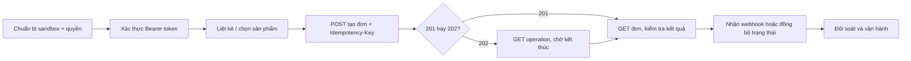
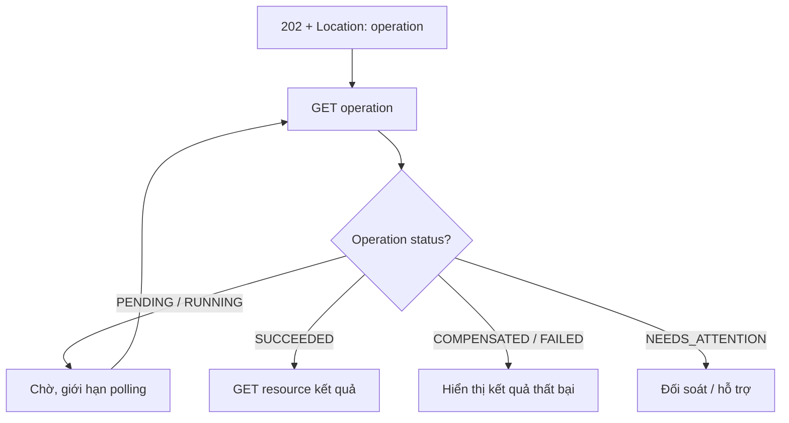
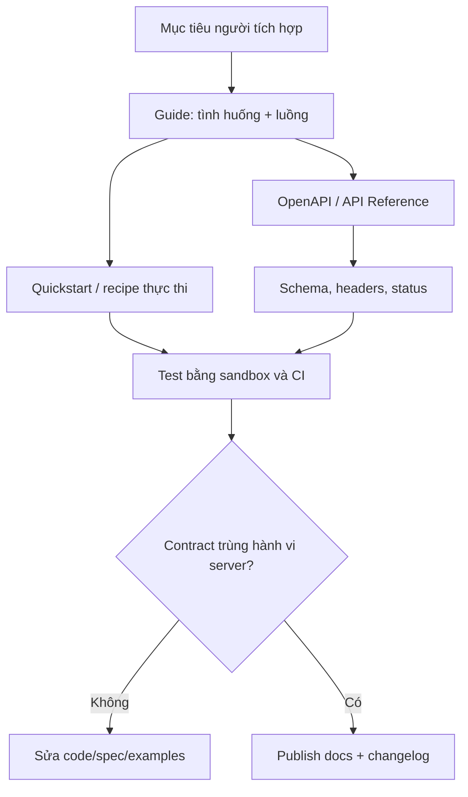

# Tài liệu theo hành trình sử dụng thay vì chỉ liệt kê endpoint

## Mục tiêu học tập

Sau bài này, bạn có thể:

- Phân biệt **API reference** (tra cứu phương thức, URI, schema, mã lỗi) với tài liệu **task-first / journey-first** (dẫn người tích hợp đi từ mục tiêu nghiệp vụ đến kết quả kiểm chứng được).
- Thiết kế hành trình tích hợp REST API có bước chuẩn bị, xác thực, phân trang, tạo tài nguyên, idempotency, theo dõi trạng thái, xử lý lỗi và kiểm tra kết quả.
- Viết **quickstart**, **how-to guide**, **recipe**, **concept**, **troubleshooting** và **reference** có liên kết đúng ngữ cảnh, không lặp nội dung vô ích.
- Sử dụng OpenAPI làm hợp đồng máy đọc được, đồng bộ ví dụ HTTP, Java/Spring, SDK và tài liệu với hành vi server thực tế.
- Đánh giá developer experience bằng thời gian tới lần gọi API thành công, tỷ lệ hoàn thành tác vụ, số lượt tìm trợ giúp và độ tin cậy của ví dụ.
- Xây dựng kiểm thử tài liệu trong CI và quy trình cập nhật tài liệu đi cùng thay đổi contract/version của REST API.

## 1. Vấn đề: có đủ endpoint nhưng vẫn không tích hợp được

Hãy tưởng tượng một đối tác muốn tích hợp hệ thống cửa hàng với REST API. Tài liệu hiện tại có các trang:

```text
GET    /api/v1/products
GET    /api/v1/products/{id}
POST   /api/v1/orders
GET    /api/v1/orders/{id}
GET    /api/v1/operations/{id}
POST   /api/v1/webhook-subscriptions
```

Mỗi trang có bảng query parameter, JSON schema và các mã trạng thái HTTP. Về mặt kỹ thuật, đây là nguồn tham chiếu hữu ích; nhưng nó chưa trả lời những câu hỏi **người tích hợp thực sự phải quyết định**:

- Tôi phải đăng ký ứng dụng, lấy credential và dùng sandbox ở đâu?
- Làm thế nào để liệt kê sản phẩm, chọn đúng ID rồi tạo đơn đầu tiên?
- `POST /orders` trả `201` hay `202`? Đến lúc nào đơn mới thực sự hoàn tất?
- Nếu mạng mất kết nối ngay sau khi gửi lệnh, gọi lại có tạo đơn trùng không?
- Tôi lấy hết các sản phẩm qua nhiều trang bằng cách nào mà không bị thiếu hoặc lặp?
- Tôi nhận thay đổi trạng thái qua polling hay webhook? Làm sao xác minh webhook không giả mạo?
- Nếu nhận `401`, `403`, `409`, `422` hoặc `429` thì bước tiếp theo là gì?

**Tài liệu chỉ liệt kê endpoint trả lời “API có gì”; tài liệu theo hành trình còn trả lời “tôi làm xong việc của mình thế nào”.**

Một nền tảng REST API tốt vẫn cần reference chuẩn xác: resource/URI, method, status code, schema, authorization, phân trang, cache và idempotency. Điểm khác biệt là người đọc không phải tự ghép hàng chục trang tham chiếu để khám phá trình tự nghiệp vụ.

## 2. Nghĩ theo mục tiêu của người tích hợp

Trước khi viết tài liệu, hãy xác định **đối tượng, tình huống, đầu vào, kết quả và tiêu chí thành công**. Một endpoint có thể phục vụ nhiều hành trình; một hành trình thường cần nhiều endpoint.

| Đối tượng | Họ muốn làm gì? | Cần biết thêm ngoài danh sách endpoint |
| --- | --- | --- |
| Developer mới | Gọi API lần đầu trong sandbox | Base URL, cách lấy credential thử nghiệm, HTTP request tối thiểu, kết quả mong đợi |
| Backend integrator | Đồng bộ catalog, tạo đơn an toàn | Pagination, retry, idempotency, trạng thái cuối, timeout, mapping ID |
| Frontend/mobile developer | Hiển thị trạng thái đơn | Browser/CORS, an toàn token, polling, error UX, cache |
| Partner vận hành | Nhận webhook và đối soát lỗi | Signature, event ID, replay, timestamp, retry, dashboard, hỗ trợ |
| Người nâng cấp phiên bản | Chuyển từ contract cũ sang mới | Breaking changes, migration path, thời điểm deprecation, ví dụ trước/sau |

Để viết một hành trình, ghi rõ sáu thành phần:

1. **Kết quả:** ví dụ “một đơn hàng thử nghiệm được tạo đúng một lần và xem được trạng thái”.
2. **Điều kiện đầu vào:** tenant, quyền truy cập, môi trường, credential test, sản phẩm thử.
3. **Thứ tự thao tác:** những request nào phải chạy, những request nào tùy chọn.
4. **Dấu hiệu thành công:** status HTTP, ID, response field, sự kiện hoặc điều kiện cuối.
5. **Nhánh thất bại:** mã lỗi, retry an toàn, điều gì cần kiểm tra trước khi gửi lại.
6. **Bước tiếp theo:** tải kết quả, nhận webhook, triển khai production hoặc xử lý case khác.

### Hành trình là một đồ thị, không phải danh sách URL



Luồng trên mô tả **một API giả định dùng để học**; tên resource, schema và URL chỉ là ví dụ, không phải một dịch vụ production đang tồn tại. Tài liệu thực tế phải dùng chính contract của API và giải thích những nhánh không có trong sản phẩm.

## 3. Kiến trúc tài liệu: đưa hành trình lên trước, reference ở đúng chỗ

Một cấu trúc hữu ích cho developer portal:

```text
Getting started
  - Tổng quan sản phẩm và hành trình tích hợp
  - Tạo app / credential sandbox
  - Quickstart: tạo đơn đầu tiên

Guides / Recipes
  - Đồng bộ catalog qua cursor pagination
  - Tạo đơn không trùng khi retry
  - Theo dõi đơn bất đồng bộ
  - Nhận và xác minh webhook
  - Xử lý lỗi / rate limit / timeout

Concepts
  - Resource và lifecycle
  - Authentication và authorization
  - Idempotency, consistency và webhook delivery
  - Pagination, caching, versioning

API Reference
  - Endpoints / HTTP methods / status
  - Schemas / headers / query parameters
  - Error model, security requirements
  - OpenAPI download

Operations
  - Environments, changelog, deprecation
  - Troubleshooting, incident status, support
```

| Loại trang | Câu hỏi trả lời | Nội dung nên có |
| --- | --- | --- |
| **Quickstart** | “Trong vài phút tôi có thể làm gì?” | Một happy path tối thiểu, prerequisites, lệnh chạy, phản hồi kỳ vọng |
| **How-to** | “Tôi giải quyết một tác vụ cụ thể thế nào?” | Trình tự bước, quyết định nhánh, retry/error, tiêu chí kiểm chứng |
| **Concept** | “Tại sao API hoạt động như vậy?” | Lifecycle, boundary, consistency, bảo mật, giới hạn |
| **Reference** | “Field/header/status này chính xác là gì?” | Hợp đồng đầy đủ, schema, ví dụ, ràng buộc |
| **Troubleshooting** | “Tại sao nó không chạy?” | Triệu chứng → khả năng nguyên nhân → cách xác minh → cách khắc phục |
| **Migration** | “Đổi sang phiên bản mới ra sao?” | Mapping cũ/mới, tương thích, deadline, rollback |

Không cần copy nguyên schema vào tất cả how-to. Hãy dẫn đến trang reference liên quan ngay tại bước người đọc cần tra cứu. Ngược lại, reference nên có liên kết về hành trình điển hình (“Dùng endpoint này để tạo đơn đầu tiên”, “Xem guide xử lý 409”) để không trở thành trang cụt.

### Thiết kế theo ngữ cảnh, không theo tổ chức nội bộ

Tránh đặt navigation chỉ theo tên microservice nội bộ như `inventory-worker` hoặc `order-command-service` nếu đối tác không biết chúng là gì. Ưu tiên nhu cầu: “Đồng bộ danh mục”, “Tạo đơn”, “Theo dõi giao hàng”, “Xử lý sự cố”. Boundary kỹ thuật vẫn có trong reference, sơ đồ kiến trúc hoặc tài liệu vận hành dành cho nhóm phù hợp.

Tài liệu phải giải thích rõ **môi trường sandbox và production**, nhưng không dán credential thực hoặc tạo cảm giác rằng token demo là hợp lệ ở production. Nếu sandbox không có payment/ship thực, phải nói rõ mô phỏng nào xảy ra để người tích hợp không tự suy luận.

## 4. Quickstart: từ chưa có request tới đơn hàng đầu tiên

Một quickstart tốt phải **chạy theo thứ tự được**, có đầu ra mà người mới so sánh được, và không bắt người đọc mở mười trang trước khi làm thử.

### 4.1. Chuẩn bị

Ví dụ dành cho đối tác có quyền truy cập sandbox:

- Một ứng dụng test được tạo trong developer portal và có quyền `products:read`, `orders:write` và `orders:read`, hoặc các quyền tương đương theo hệ thống thực tế.
- Credential sandbox hợp lệ: ví dụ một Bearer token ngắn hạn do cơ chế identity của hệ thống phát hành. API thực tế phải ghi chính xác cách lấy token (OAuth2/OIDC, API key hoặc cơ chế khác); **không tự giả định có endpoint đăng nhập**.
- Công cụ gửi HTTP như `curl`, Postman/Insomnia hoặc mã Java/JavaScript.
- Base URL minh họa: `https://sandbox.api.example.com`.

Trong ví dụ, `ACCESS_TOKEN` đại diện cho secret hợp lệ do người học lấy trong sandbox; không chép vào Git, ảnh chụp, log công khai hay lệnh terminal được ghi lại trong ticket. Các ID, token và response dưới đây đều là **giá trị mô phỏng**.

### 4.2. Kiểm tra kết nối và phân quyền

```bash
  # Các giá trị này phải do môi trường sandbox thực tế cung cấp.
API_BASE="https://sandbox.api.example.com"
ACCESS_TOKEN="<sandbox-access-token>"

curl --fail-with-body --silent --show-error \
  -H "Authorization: Bearer $ACCESS_TOKEN" \
  -H "Accept: application/json" \
  "$API_BASE/api/v1/products?limit=2"
```

Response minh họa:

```http
HTTP/1.1 200 OK
Content-Type: application/json
Cache-Control: private, max-age=30

{
  "items": [
    {"id": "prod-101", "name": "Keyboard"},
    {"id": "prod-102", "name": "Mouse"}
  ],
  "page": {
    "nextCursor": "eyJwYWdlIjoyfQ"
  }
}
```

Điều cần xác minh: `200 OK`, `items` là mảng, mỗi sản phẩm có `id`; có `nextCursor` nghĩa là còn trang tiếp theo **theo hợp đồng ví dụ**. Không dùng mã cursor mô phỏng làm dữ liệu thật hoặc cố tự giải mã cursor nếu API quy định cursor là opaque.

Nếu trả `401`, kiểm tra token, expiry, audience/issuer và môi trường; nếu `403`, kiểm tra scope/role và tenant; nếu `404`, kiểm tra base URL và path trước khi sửa code. CORS chỉ là vấn đề khi script từ browser gọi khác origin, không phải lời giải chung cho lỗi `curl`.

### 4.3. Tạo đơn bằng khóa idempotency

Đây là điểm thường quyết định người tích hợp có thể đưa API vào production hay không: xử lý request lặp khi mạng chập chờn.

```bash
IDEMPOTENCY_KEY="case-order-20261118-001"

curl --fail-with-body --silent --show-error \
  -X POST "$API_BASE/api/v1/orders" \
  -H "Authorization: Bearer $ACCESS_TOKEN" \
  -H "Content-Type: application/json" \
  -H "Idempotency-Key: $IDEMPOTENCY_KEY" \
  -d '{"items":[{"productId":"prod-101","quantity":1}]}'
```

Phản hồi nếu API tạo đơn ngay và trả resource:

```http
HTTP/1.1 201 Created
Location: /api/v1/orders/ord-501
Content-Type: application/json

{
  "id": "ord-501",
  "status": "PENDING",
  "items": [{"productId":"prod-101","quantity":1}]
}
```

`201 Created` cho biết server đã tạo resource theo hợp đồng; nó **không tự chứng minh** thanh toán, vận chuyển hay fulfillment đã hoàn tất. Trạng thái `PENDING` còn phải được theo dõi nếu nghiệp vụ có xử lý bất đồng bộ.

**Đánh giá thành công:** lưu được `id`, đọc `Location` và tra cứu được đơn của chính người dùng. Khi retry **cùng ý định** với `Idempotency-Key` cũ, hệ thống đã triển khai idempotency phải tránh tạo đơn thứ hai. API cần ghi rõ phạm vi khóa, thời gian lưu, phản hồi replay và trường hợp cùng key nhưng payload khác (ví dụ `409 Conflict`); không coi header tự động đem lại bảo đảm này nếu backend chưa thực thi.

### 4.4. Đọc lại tài nguyên và xác minh trạng thái

```bash
curl --fail-with-body --silent --show-error \
  -H "Authorization: Bearer $ACCESS_TOKEN" \
  "$API_BASE/api/v1/orders/ord-501"
```

Ví dụ:

```http
HTTP/1.1 200 OK
Content-Type: application/json
ETag: "order-v2"

{
  "id": "ord-501",
  "status": "CONFIRMED",
  "items": [{"productId":"prod-101","quantity":1}]
}
```

Không kỳ vọng chuyển `PENDING → CONFIRMED` xảy ra tức thời chỉ vì request GET tiếp theo. Nếu API hỗ trợ event hoặc operation resource, hướng dẫn phải nêu rõ **đợi khi nào, đọc endpoint nào, trạng thái nào là kết thúc** và cách xử lý khi status không đổi lâu hơn deadline.

Nếu việc tạo đơn trả `202 Accepted` thay cho `201`, tài liệu phải dạy luồng thay thế: lấy `Location: /api/v1/operations/{id}`, `GET` operation cho đến `SUCCEEDED` hoặc kết quả thất bại đã bù, rồi truy cập order resource. Không được dùng một ví dụ `201` để hứa rằng mọi triển khai đều đồng bộ.

### 4.5. Từ sandbox sang production

Quickstart kết thúc ở thời điểm người tích hợp đã **kiểm chứng một kết quả**, không chỉ chạy lệnh cuối cùng. Trang “Bước tiếp theo” nên đưa họ tới: kiểm thử hết hạn token, xử lý pagination, rate limit, idempotency, webhook signature, kiểm tra sandbox/production khác biệt, và quy trình xin quyền production.

## 5. Guide: đồng bộ toàn bộ catalog không thiếu hoặc lặp dữ liệu

Thay vì chỉ nói `GET /products` hỗ trợ `limit` và `cursor`, một guide phải trả lời: “Tôi cần chạy vòng lặp nào, khi nào dừng và làm gì nếu request lỗi?”

### Hợp đồng pagination trong ví dụ

- `limit` là số item tối đa mỗi trang; backend có thể áp giới hạn riêng.
- `cursor` là token opaque do server cấp, không phải số thứ tự trang hay ID tự tính.
- `page.nextCursor` bằng `null` nghĩa là không còn trang tiếp, **nếu contract định nghĩa như vậy**.
- Thứ tự ổn định và semantics khi dữ liệu thay đổi phải được tài liệu hóa; nếu cần snapshot tuyệt đối, API phải hỗ trợ snapshot/cursor nhất quán hoặc một export job.

Ví dụ Java 17+ dùng `java.net.http.HttpClient` (giản lược JSON parsing bằng Jackson):

```java
import com.fasterxml.jackson.databind.JsonNode;
import com.fasterxml.jackson.databind.ObjectMapper;
import java.net.URI;
import java.net.URLEncoder;
import java.net.http.HttpClient;
import java.net.http.HttpRequest;
import java.net.http.HttpResponse;
import java.nio.charset.StandardCharsets;
import java.time.Duration;

class CatalogSyncExample {
    private final HttpClient http = HttpClient.newBuilder()
        .connectTimeout(Duration.ofSeconds(3))
        .build();
    private final ObjectMapper json = new ObjectMapper();

    void sync(String baseUrl, String bearerToken) throws Exception {
        String cursor = null;
        do {
            String path = "/api/v1/products?limit=100";
            if (cursor != null) {
                path += "&cursor=" + URLEncoder.encode(
                    cursor, StandardCharsets.UTF_8);
            }
            HttpRequest request = HttpRequest.newBuilder(
                    URI.create(baseUrl + path))
                .timeout(Duration.ofSeconds(10))
                .header("Authorization", "Bearer " + bearerToken)
                .header("Accept", "application/json")
                .GET()
                .build();

            HttpResponse<String> response = http.send(
                request, HttpResponse.BodyHandlers.ofString());
            if (response.statusCode() != 200) {
                throw new IllegalStateException(
                    "Catalog API status=" + response.statusCode());
            }

            JsonNode page = json.readTree(response.body());
            for (JsonNode item : page.path("items")) {
                upsertProduct(item); // Idempotent theo product ID/version.
            }
            JsonNode next = page.path("page").path("nextCursor");
            cursor = next.isMissingNode() || next.isNull()
                ? null : next.asText();
        } while (cursor != null && !cursor.isEmpty());
    }

    void upsertProduct(JsonNode item) {
        // Triển khai ghi/upsert dữ liệu tại đây.
    }
}
```

Ví dụ chỉ tập trung vào **vòng lặp pagination**: mã production cần thêm token refresh, retry có ngân sách/jitter khi `429/503`, xử lý `Retry-After`, validation response, checkpoint/resume và backpressure khi lưu dữ liệu. Không tự ghi token hoặc full response có PII vào log. Nếu API có `nextCursor` nhưng client không lưu checkpoint, lỗi giữa quá trình có thể buộc đồng bộ lại từ đầu; upsert idempotent giúp giảm tác hại, nhưng không đảm bảo snapshot nhất quán.

**Tiêu chí hoàn thành của guide:** client dừng khi hết cursor, mỗi page được xử lý, các bản ghi được upsert theo khóa ổn định, có quy trình restart và số lượng bản ghi được đối soát; không chỉ có một ví dụ GET trả `200`.

## 6. Guide: hoàn tất tác vụ bất đồng bộ và nhận webhook

Một trang reference cho `GET /api/v1/operations/{id}` có thể liệt kê các trạng thái `PENDING`, `RUNNING`, `SUCCEEDED`, `COMPENSATED`. Nhưng người tích hợp còn cần một **cây quyết định**: nếu lệnh trả `202`, nên poll ra sao, khi nào dừng và điều gì xảy ra nếu client timeout?

### 6.1. Tác vụ bất đồng bộ

Giả sử một yêu cầu tạo đơn cần đối soát tồn kho và thanh toán trước khi hoàn tất:

```http
POST /api/v1/orders HTTP/1.1
Host: sandbox.api.example.com
Authorization: Bearer <sandbox-access-token>
Content-Type: application/json
Idempotency-Key: 0f49b33c-05d8-4b4f-8f5f-223df0415966

{"items":[{"productId":"prod-101","quantity":1}]}

HTTP/1.1 202 Accepted
Content-Type: application/json
Location: /api/v1/operations/op-789

{"id":"op-789","status":"PENDING","pollAfterSeconds":2}
```

Tài liệu hướng dẫn tiếp:

1. Giữ lại `operationId` và `Idempotency-Key`; nếu không chắc server đã nhận lệnh vì mất response, **retry cùng key** theo hợp đồng thay vì tạo ý định mới.
2. Gọi `GET /api/v1/operations/op-789` với credential hợp lệ. Nếu trả `RUNNING`, chờ khoảng thời gian server khuyến nghị trước khi gọi tiếp.
3. Khi `SUCCEEDED`, đọc `result.orderId` và `GET /api/v1/orders/{id}` để xác nhận resource nghiệp vụ.
4. Khi `COMPENSATED` hoặc trạng thái thất bại terminal khác, hiển thị **mã lỗi nghiệp vụ** và hướng dẫn người dùng, không xem `200` của GET là “đơn thành công”.
5. Khi `NEEDS_ATTENTION` hoặc quá deadline, không tự tạo một đơn mới: tra cứu/đối soát tiến trình hoặc dùng kênh hỗ trợ theo quy trình.



**Điểm mấu chốt của tài liệu hành trình:** một HTTP response `202` có thể là thành công ở tầng tiếp nhận, nhưng **không phải** thành công của nghiệp vụ; tương tự `GET` operation trả `200` dù trạng thái cuối là `COMPENSATED`. Phải trình bày rõ khác biệt giữa mã HTTP và field trạng thái.

### 6.2. Nhận thay đổi trạng thái qua webhook

Polling không phải cách duy nhất. Nếu nền tảng hỗ trợ webhook, guide phải giải thích cả việc **đăng ký, xác thực, phản hồi ACK, retry, deduplication và recovery**. Không chỉ liệt kê endpoint đăng ký subscription.

Một hành trình webhook nên có:

- Đăng ký URL HTTPS và loại event muốn nhận, ví dụ `order.updated`; xác minh quyền sở hữu endpoint theo cơ chế của nền tảng.
- Lưu **webhook signing secret** trong secret manager; không hiển thị toàn bộ secret trong log hoặc dashboard.
- Kiểm tra chữ ký dựa trên **raw request body bytes** và định dạng signature/timestamp được nhà cung cấp công bố. Không giả định mọi provider dùng cùng header hay thuật toán.
- Chống replay theo timestamp window và event ID; giới hạn kích thước body, timeout, xử lý event không hợp lệ.
- Chỉ trả `2xx` khi event đã được **chấp nhận bền vững** theo contract, chẳng hạn ghi vào inbox/queue an toàn. Xử lý nghiệp vụ lâu ở worker, không giữ webhook HTTP mở vô hạn.
- Event có thể đến **trùng hoặc không đúng thứ tự**; dùng event ID/sequence và tra cứu source of truth khi cần.
- Với event giao không thành công: ghi rõ lịch retry/backoff, cơ chế replay/manual redelivery, retention và cách đối soát trạng thái qua GET.

Ví dụ webhook giả định:

```http
POST /webhooks/orders HTTP/1.1
Content-Type: application/json
X-Webhook-Id: evt-2026-001
X-Webhook-Timestamp: 1795000000
X-Webhook-Signature: <provider-signature>

{
  "id": "evt-2026-001",
  "type": "order.updated",
  "data": {
    "orderId": "ord-501",
    "status": "CONFIRMED"
  }
}
```

Header `X-Webhook-*` chỉ để minh họa. Trang tài liệu của API thực tế phải **định nghĩa chính xác cách tạo chuỗi ký**, thuật toán/HMAC, encoding, tolerance cho timestamp, cách xoay secret và trường hợp event được gửi lại. Không lấy HMAC trên JSON được parse rồi serialize lại nếu bên gửi ký **raw bytes**: whitespace, thứ tự trường và encoding có thể khiến chữ ký khác đi.

### 6.3. Quy trình fallback khi webhook bị mất

Webhook giúp cập nhật nhanh nhưng không nên là nguồn duy nhất xác nhận trạng thái nếu contract không bảo đảm exactly-once delivery. Guide phải chỉ cách:

1. Ghi nhận lần cuối nhận event và trạng thái tài nguyên đã đồng bộ.
2. Sau khi phát hiện khoảng trống/đứt kết nối, gọi `GET /api/v1/orders/{id}` hoặc endpoint list/filter theo `updatedSince` nếu API hỗ trợ.
3. Đối chiếu version/sequence/timestamp được server công bố; cập nhật local database theo quy tắc tránh lùi trạng thái.
4. Khi cần, yêu cầu replay event trong phạm vi thời gian provider cho phép.

Nội dung như timestamp ordering, event replay, ký nhận và quota **phải đúng contract của từng API**, không tự thêm lời hứa mà server không hỗ trợ.

## 7. Đặt lỗi, retry, rate limit và bảo mật ngay trên đường đi

Một developer journey chỉ có happy path sẽ khiến người đọc mắc kẹt đúng lúc đem tích hợp sang môi trường thật. Hãy đặt **nhánh lỗi ở nơi request có thể thất bại**, và có trang troubleshooting tập trung để giải thích sâu hơn.

| Tình huống | HTTP / dấu hiệu | Việc người tích hợp nên làm |
| --- | --- | --- |
| Token thiếu/hết hạn/sai audience | `401 Unauthorized` | Lấy token mới, xác nhận issuer/audience/base URL; không vô hạn retry với token cũ |
| Đã xác thực nhưng thiếu quyền/tenant | `403 Forbidden` | Kiểm tra scope/role, tenant, quyền trên resource; không sửa bằng cách bỏ auth |
| Path/resource không tồn tại hoặc không được bộc lộ | `404 Not Found` | Kiểm tra ID, route, môi trường; có thể do chính sách ẩn resource |
| Dùng lại idempotency key với nội dung khác | Thường `409 Conflict` theo contract | Dừng, đối chiếu ý định và payload; không tự sinh key khác để “vượt lỗi” |
| Sai dữ liệu nghiệp vụ | `400` hoặc `422` theo hợp đồng | Sửa field/code; không retry cùng body vô hạn |
| Vượt quota theo user/API key | `429 Too Many Requests` | Đọc `Retry-After` khi có, backoff + jitter, giảm tốc |
| Backend tạm quá tải | `503 Service Unavailable` | Retry có hạn khi operation an toàn/idempotent, tính deadline |
| Gateway chờ upstream quá lâu | `504 Gateway Timeout` | Kết quả side effect có thể chưa rõ; dùng idempotency/operation để xác minh |
| API có lỗi hoặc contract sai | `5xx`, lỗi parse/field thiếu | Thu trace ID, request metadata không nhạy cảm, liên hệ hỗ trợ; không log token/body |

Kèm một mẫu Problem Details được tài liệu hóa:

```http
HTTP/1.1 409 Conflict
Content-Type: application/problem+json
Cache-Control: no-store

{
  "type": "https://sandbox.api.example.com/problems/idempotency-conflict",
  "title": "Idempotency conflict",
  "status": 409,
  "code": "IDEMPOTENCY_KEY_REUSED",
  "detail": "Khóa đã được dùng cho một yêu cầu có nội dung khác.",
  "traceId": "5a65d2f3af914f729836cad8d12bb5f2"
}
```

`application/problem+json` dựa trên RFC 9457. Trường `code` và `traceId` là extension theo ví dụ API, **không phải field bắt buộc của mọi Problem Details**. Dùng error code ổn định để viết flow/kiểm thử thay vì so khớp chuỗi `detail` có thể thay đổi theo ngôn ngữ.

### Retry an toàn và idempotency

Đưa vào guide một bảng nhỏ theo tình huống:

| Yêu cầu | Có thể retry? | Cần lưu ý |
| --- | --- | --- |
| `GET /products` | Thường có, với giới hạn | Cache, deadline, tránh nhân tải khi `429/503` |
| `GET /orders/{id}` | Thường có | Đảm bảo phân quyền, không biến GET thành command |
| `POST /orders` | Chỉ an toàn khi API thực thi idempotency phù hợp | Dùng lại **cùng key** khi retry cùng ý định; tránh tạo đơn mới |
| `POST /payments` | Phụ thuộc hợp đồng provider | Kết quả timeout có thể mơ hồ; tra cứu transaction trước khi làm lại |
| `POST webhook ACK/inbox` | Nên idempotent theo event ID | Một event có thể nhận nhiều lần |

Client cần **tổng deadline**, số lượt thử tối đa, backoff có jitter và ngân sách retry giữa các tầng. Header `Retry-After` có thể là số giây hoặc HTTP-date, và không hứa request sẽ thành công chính xác ở thời điểm đó. Nếu vừa gateway vừa SDK vừa service A retry, số request thực tế có thể tăng rất nhanh.

### Bảo mật trong tài liệu theo hành trình

Đừng đặt Bearer token thật, API key thật, session cookie, email khách hàng hay dữ liệu thẻ vào code sample. Ví dụ dùng placeholder và test data giả; tránh gắn token vào URL/query vì có thể rò qua access log và history. Phải phân biệt frontend browser với backend server: secret client không được nhúng vào JavaScript phát cho trình duyệt; `HttpOnly` cookie và bearer header có threat model khác nhau.

Trong quickstart, xác thực và phân quyền là **prerequisites** chứ không phải thủ tục gây phiền bỏ qua được. Tài liệu cần chỉ rõ:

- Môi trường nào phát credential, quyền tối thiểu nào cần thiết.
- Credential được gửi qua HTTPS và nơi nên lưu an toàn.
- Lỗi `401` khác `403` như thế nào.
- Phần dữ liệu nào thuộc tenant/resource và phải được server kiểm tra phân quyền.
- Các thao tác CORS/CSRF khi gọi API từ browser (nếu hỗ trợ).

## 8. OpenAPI là hợp đồng, không phải toàn bộ trải nghiệm

OpenAPI rất hữu ích để mô tả endpoint, method, parameters, schema, response và security; có thể dùng để tạo reference, contract test và SDK. Nhưng OpenAPI **không tự kể** câu chuyện “đặt đơn rồi theo dõi tới khi thành công” hoặc “timeout sau payment phải làm gì”.

Ví dụ một phần OpenAPI 3.1 (schema giản lược):

```yaml
openapi: 3.1.0
info:
  title: Example Shop REST API
  version: 1.0.0
servers:
  - url: https://sandbox.api.example.com
    description: Sandbox
  - url: https://api.example.com
    description: Production
security:
  - bearerAuth: []
paths:
  /api/v1/orders:
    post:
      operationId: createOrder
      summary: Tạo đơn hàng
      description: |
        Xem guide "Tạo đơn đầu tiên" để biết thứ tự gọi API,
        ý nghĩa của status PENDING và xử lý retry.
      parameters:
        - name: Idempotency-Key
          in: header
          required: true
          schema:
            type: string
            minLength: 8
          description: Khóa ổn định cho cùng một ý định tạo đơn.
      requestBody:
        required: true
        content:
          application/json:
            schema:
              $ref: '#/components/schemas/CreateOrderRequest'
            examples:
              singleItem:
                value:
                  items:
                    - productId: prod-101
                      quantity: 1
      responses:
        '201':
          description: Đã tạo tài nguyên đơn hàng.
          headers:
            Location:
              description: Đường dẫn đến tài nguyên đơn vừa tạo.
              schema:
                type: string
          content:
            application/json:
              schema:
                $ref: '#/components/schemas/Order'
        '409':
          description: Xung đột, ví dụ key được dùng với payload khác.
          content:
            application/problem+json:
              schema:
                $ref: '#/components/schemas/ApiProblem'
        '422':
          description: Yêu cầu hợp lệ về cú pháp nhưng sai nghiệp vụ.
        '429':
          description: Vượt chính sách rate limit.
components:
  securitySchemes:
    bearerAuth:
      type: http
      scheme: bearer
  schemas:
    CreateOrderRequest:
      type: object
      required: [items]
      properties:
        items:
          type: array
          minItems: 1
          items:
            type: object
            required: [productId, quantity]
            properties:
              productId:
                type: string
              quantity:
                type: integer
                minimum: 1
    Order:
      type: object
      required: [id, status]
      properties:
        id:
          type: string
        status:
          type: string
          enum: [PENDING, CONFIRMED, CANCELLED]
    ApiProblem:
      type: object
      properties:
        type:
          type: string
          format: uri
        title:
          type: string
        status:
          type: integer
        detail:
          type: string
        code:
          type: string
```

Đây là một **hợp đồng minh họa** để dạy cấu trúc, chưa bao gồm mọi endpoint, `202`, `GET operation`, `GET products`, mọi error code hay semantics về webhook. Nếu server thực sự có cả nhánh xử lý `202`, OpenAPI phải khai báo response đó và guide phải giải thích; đừng để một bên nói `201`, bên kia nói `202`. Với API production còn cần `GET`, pagination, validation (bao gồm `additionalProperties`/schema details theo lựa chọn), error model, security scope, response examples và link tới guide.

### Ranh giới “source of truth”

Một cách tổ chức thực tế:

- **OpenAPI** là nguồn kiểm chứng machine-readable cho URL/method, headers, JSON schema, status, security scheme và example cơ bản.
- **Business rules** phải được lưu trong code/contract tests và mô tả ở guide: lifecycle, idempotency semantics, eventual consistency, hủy, webhook ordering.
- **Guides** giải thích mục tiêu, lựa chọn và thứ tự sử dụng những endpoint đã được OpenAPI mô tả.
- **Generated SDK** giảm thao tác tạo request/parse response nhưng không thay thế trang hướng dẫn hành trình và error handling.

Nếu server dùng Spring MVC, controller annotations, DTO, validation và error handler phải thống nhất với tài liệu. Một số công cụ có thể sinh OpenAPI từ annotations (hoặc sinh server stub từ OpenAPI), nhưng **không nên vừa sửa tay spec vừa sửa tay DTO mà không có kiểm tra drift**. Chọn một nguồn chính và thiết lập diff/test trước release.

### Sơ đồ hành trình và reference bổ trợ nhau



## 9. Java/Spring: hợp đồng phải phản ánh hành vi server

Với Spring MVC, hãy mô tả một endpoint từ góc nhìn người tích hợp, rồi đối chiếu với controller, validation và error handler thật. Ví dụ:

```java
import jakarta.validation.Valid;
import jakarta.validation.constraints.Min;
import jakarta.validation.constraints.NotBlank;
import jakarta.validation.constraints.NotEmpty;
import java.net.URI;
import java.util.List;
import org.springframework.http.ResponseEntity;
import org.springframework.security.core.Authentication;
import org.springframework.web.bind.annotation.*;

record CreateOrderItem(
    @NotBlank String productId,
    @Min(1) int quantity
) {}

record CreateOrderRequest(
    @NotEmpty List<@Valid CreateOrderItem> items
) {}

record OrderView(
    String id, String status, List<CreateOrderItem> items
) {}

@RestController
@RequestMapping("/api/v1/orders")
class OrderController {
    private final OrderService orders;

    OrderController(OrderService orders) {
        this.orders = orders;
    }

    @PostMapping
    ResponseEntity<OrderView> create(
            @RequestHeader("Idempotency-Key") String key,
            @Valid @RequestBody CreateOrderRequest request,
            Authentication authentication) {

        // Service lấy tenant/quyền từ identity đã được xác thực,
        // ghi idempotency record và tạo resource an toàn theo transaction.
        OrderView created = orders.create(
            authentication, key, request);

        return ResponseEntity
            .created(URI.create("/api/v1/orders/" + created.id()))
            .body(created);
    }

    @GetMapping("/{id}")
    ResponseEntity<OrderView> get(
            @PathVariable String id,
            Authentication authentication) {

        return ResponseEntity.ok(
            orders.findVisibleTo(authentication, id));
    }
}
```

`OrderService` là lớp nghiệp vụ cần triển khai, không được chỉ dựa vào header hoặc controller để bảo đảm idempotency/authorization. Mẫu này dành cho **nhánh `201 Created`** của API minh họa. Nếu server chấp nhận công việc bất đồng bộ bằng `202` thì controller, response type, `Location` và OpenAPI phải thay đổi theo; không trộn hai contract mà không giải thích.

Những chi tiết tài liệu phải phản ánh:

- `@RequestHeader("Idempotency-Key")` khiến header này là bắt buộc trong thiết kế hiện tại; phải thể hiện đúng trong OpenAPI.
- `@NotBlank`, `@Min(1)`, `@NotEmpty`/`@Valid` tạo validation ở tầng đầu vào; khi lỗi cần error handler rõ status, cấu trúc Problem Details và mã ổn định.
- `Authentication` cung cấp danh tính đã xác thực, nhưng service vẫn phải kiểm tra quyền theo resource/tenant. `GET /orders/{id}` không được trả đơn hàng của tenant khác.
- Tài nguyên được tạo ở `POST` phải có `Location` nhất quán với `GET`; ID trong response và path phải khớp.
- Nếu một response có thêm `ETag`, `Cache-Control` hoặc rate-limit headers, contract và example cần phản ánh đúng.

### Kiểm thử hành trình qua MockMvc, không chỉ kiểm thử từng method

Test tích hợp cần xác nhận **chuỗi hành động thực tế**:

```java
import static org.springframework.security.test.web.servlet.request
    .SecurityMockMvcRequestPostProcessors.user;
import static org.springframework.security.test.web.servlet.request
    .SecurityMockMvcRequestPostProcessors.csrf;
import static org.springframework.test.web.servlet.request
    .MockMvcRequestBuilders.get;
import static org.springframework.test.web.servlet.request
    .MockMvcRequestBuilders.post;
import static org.springframework.test.web.servlet.result
    .MockMvcResultMatchers.*;

@Test
void createThenReadOrderFollowsDocumentedJourney() throws Exception {
    // Ví dụ giả định app đã có security, test database và mockMvc.
    // User "partner" có đủ quyền trên order test.
    String payload =
        "{\"items\":[{\"productId\":\"prod-101\",\"quantity\":1}]}";

    MvcResult created = mockMvc.perform(post("/api/v1/orders")
            .with(user("partner"))
            .with(csrf())
            .header("Idempotency-Key", "doc-journey-test-001")
            .contentType("application/json")
            .content(payload))
        .andExpect(status().isCreated())
        .andExpect(header().exists("Location"))
        .andExpect(jsonPath("$.status").value("PENDING"))
        .andReturn();

    String location = created.getResponse().getHeader("Location");

    mockMvc.perform(get(location).with(user("partner")))
        .andExpect(status().isOk())
        .andExpect(jsonPath("$.id").exists());
}
```

Đây là **sườn test**, không phải một class độc lập đã đủ import và cấu hình: cần `MvcResult`, `@Test`, `MockMvc`, test data, Spring Security Test, transaction/database và `OrderService` thật hoặc fake theo mục tiêu test. `with(user(...))` và `with(csrf())` minh họa ứng dụng dùng cơ chế session/CSRF; nếu sản phẩm dùng OAuth Bearer/JWT thì cần thiết lập `jwt()` và security chain tương ứng. **Không bỏ CSRF trong production chỉ để ví dụ chạy.**

Trong test, assert thêm rằng retry `POST` với cùng key/payload không tạo order thứ hai, đổi payload cùng key được từ chối, user khác không đọc được resource và response body/headers khớp OpenAPI. Với hành trình `202`, test `POST → GET operation → GET result` thay vì chỉ gọi trực tiếp controller.

Test endpoint và tài liệu vẫn cần **browser/E2E tests** khi hành trình phụ thuộc CORS, cookie, SSE hoặc webhook tunnel: MockMvc không chứng minh browser cho phép đọc cross-origin response hay webhook có thực sự được delivery qua Internet.

## 10. “Docs as code”: kiểm thử ví dụ và contract trong CI

Tài liệu API là một phần của sản phẩm. Một ví dụ từng chạy được có thể hỏng khi field đổi tên, authentication thay đổi hoặc API chuyển sang xử lý bất đồng bộ. Nếu người đọc copy lệnh mà nhận lỗi, developer experience suy giảm ngay cả khi mã nguồn server “đúng”.

### Những lớp kiểm tra nên có

| Lớp | Thứ cần kiểm | Ví dụ |
| --- | --- | --- |
| **Markdown/lint/link** | Heading, broken links, code fences, URL docs | Link tới endpoint/reference tồn tại |
| **OpenAPI validation** | Cú pháp, `$ref`, schema, operationId trùng | Spec build và parse được |
| **Breaking-change detection** | Endpoint, response, field, security, enum thay đổi | CI cảnh báo khi xóa response hoặc thêm trường bắt buộc |
| **Schema examples** | Request/response example khớp schema | `quantity` là số nguyên dương, `status` thuộc enum |
| **Contract/integration** | Server thực trả status, header, body theo spec | `POST orders` có `201 + Location` |
| **Runnable quickstart** | Lệnh trong guide chạy trên sandbox/test service | GET products, POST, GET order thành công |
| **Failure recipes** | `401`, `403`, `409`, `422`, `429` đúng error model | Đổi payload cùng idempotency key trả mã đã công bố |
| **Security scanning** | Không có token/key/PII thật trong docs/test log | Secret scan và test data giả |
| **Release publication** | Site docs đúng phiên bản đã deploy | Link changelog, spec, SDK và môi trường phù hợp |

Một pipeline dạng khái niệm:

```text
Change to controller/DTO/OpenAPI/guide
            |
            v
Lint Markdown + validate OpenAPI + check links
            |
            v
Check backward compatibility / examples schema
            |
            v
Start isolated test API + seed sandbox fixtures
            |
            v
Run documented HTTP journey end-to-end
            |
            v
Assert status/header/body + failure paths
            |
            v
Review docs diff + changelog + version
            |
            v
Publish docs matched to deployed API
```

Không nhất thiết mọi kiểm thử phải chạy với một vendor thật. Với payment hoặc shipping, dùng sandbox/fake provider có hành vi được mô phỏng rõ, tránh ghi phí thực hoặc gửi email/đơn thật trong CI. Nếu quickstart cần OAuth, cấp test token ngắn hạn qua cơ chế bảo vệ secret của CI, không hardcode credential vào Markdown.

### Kiểm tra request/response example bằng schema

Ví dụ viết `request-body.json` cho `POST /orders` rồi validate với `CreateOrderRequest` trong OpenAPI. Nếu tài liệu dùng `productId` nhưng DTO đổi thành `sku`, validation phải phát hiện. Nhưng schema pass **không đủ**: example vẫn có thể dùng ID không tồn tại trong sandbox, status sai hoặc không có quyền truy cập.

Vì vậy, kiểm thử mạnh nhất gồm hai lớp:

1. **Static:** example được parse và thỏa schema, link và reference đầy đủ.
2. **Runtime:** gửi request tới một test deployment thật, assert response/status/side effect và chuỗi bước.

Tương tự, test `429` chỉ nên chạy trong môi trường kiểm thử có rate limiter kiểm soát được; đừng cố tình spam production để kiểm tra tài liệu. Nếu API public sandbox có quota hạn chế, dùng test server hoặc fixture/contract test thay thế.

### Tránh “ví dụ chụp ảnh màn hình rồi bỏ quên”

Các file minh họa nên được trích xuất/tái sử dụng từ mẫu request có thể chạy, hoặc có cơ chế kiểm chứng rằng code block trong tài liệu vẫn đồng bộ với test. Đừng duy trì ba bản độc lập của cùng JSON payload ở docs, Postman collection và test mà không có nguồn chính hoặc kiểm tra drift.

Với generated SDK, chạy smoke test tối thiểu qua version mới nhất và phiên bản được hỗ trợ. Tài liệu không nên hứa function/signature chưa tồn tại trong SDK release đã phát hành.

## 11. Hướng dẫn troubleshooting theo triệu chứng

Một trang “Error codes” chỉ liệt kê `401 Unauthorized` chưa đủ. Người đọc muốn đi từ triệu chứng tới hành động có thể xác minh.

### Tình huống A: “curl trả 401 nhưng tôi đã có token”

Kiểm tra lần lượt:

1. Base URL đúng sandbox hay production? Token có đúng issuer/audience và đã hết hạn chưa?
2. Header có đúng `Authorization: Bearer <token>` không? Không vô tình thêm dấu ngoặc hoặc khoảng trắng vào token.
3. Ứng dụng có sử dụng đúng phương thức auth theo spec không? API key và Bearer token không hoán đổi tùy ý.
4. Response có `WWW-Authenticate` hoặc error code được tài liệu hóa không?
5. Nếu vẫn không được, ghi lại **trace ID, route template, status, thời điểm** để hỗ trợ; không gửi token thật vào ticket.

Nếu nhận `403`, token có thể hợp lệ nhưng thiếu quyền hoặc resource thuộc tenant khác. **Không gợi ý tắt kiểm tra quyền** để vượt lỗi trong quickstart.

### Tình huống B: “POST timeout, tôi không biết đơn được tạo chưa”

Đây là lỗi nghiệp vụ nguy hiểm:

- Không tạo một yêu cầu mới với key mới ngay lập tức.
- Tra cứu operation hoặc order theo ID đã biết; nếu API quy định idempotency, retry **cùng key và payload** trong thời hạn khóa còn hợp lệ.
- Nếu gateway trả `504`, side effect có thể đã xảy ra; không coi timeout là rollback.
- Nếu trạng thái cần đối soát, liên hệ kênh hỗ trợ với trace ID/key tham chiếu **không nhạy cảm**, theo chính sách dữ liệu của nền tảng.

### Tình huống C: “Tôi thấy 429 khi đồng bộ catalog”

- Đọc `Retry-After` (nếu có), tuân thủ rate-limit policy, giảm số job song song.
- Áp dụng exponential backoff có jitter và tổng deadline.
- Tiếp tục từ cursor/checkpoint đã lưu, không tự tạo lại mọi tác vụ có side effect.
- Phân biệt quota theo tenant với `503` do backend tạm quá tải.

### Tình huống D: “Webhook nhận trùng hoặc sai thứ tự”

- Kiểm tra đã xác minh signature trên raw body chưa.
- Deduplicate theo event ID và lưu dấu đã xử lý bền vững.
- Khi event cũ đến muộn, tránh ghi đè trạng thái mới bằng trạng thái cũ.
- Dùng GET resource để đối soát; nếu hỗ trợ sequence/version, áp dụng theo contract.
- Nếu cần replay, chỉ dùng endpoint/quy trình được nhà cung cấp công bố.

### Tình huống E: “Browser báo CORS nhưng curl hoạt động”

`curl` không áp dụng Same-Origin Policy như browser. Xem origin frontend, response `Access-Control-Allow-Origin`, `Access-Control-Allow-Credentials` khi dùng cookie, OPTIONS preflight, `Content-Type` và custom headers. CORS không phải authorization và không sửa được token thiếu quyền. Không khuyên đặt `Access-Control-Allow-Origin: *` với request dùng credentials; đây là cấu hình không hợp lệ trong browser. Nếu cần cookie, phải xét cả `SameSite`/`Secure`, CSRF và third-party cookie policy.

Mỗi trang xử lý lỗi nên có **triệu chứng có thể tìm kiếm → kiểm tra cụ thể → cách sửa → khi nào liên hệ hỗ trợ**, kèm request ID/trace ID, môi trường và thời điểm. Tránh chỉ ghi “liên hệ support” mà không có bước tự chẩn đoán.

## 12. Versioning, thay đổi contract và migration journey

Tài liệu là một phần của khả năng tương thích. Nếu `/api/v1/orders` có behavior mới, trang guide, OpenAPI, SDK và error recipes cần cập nhật cùng release.

Các thay đổi thường đòi hỏi đánh giá:

- Thay đổi URI, method, authentication, field bắt buộc, status/error code hoặc ý nghĩa state.
- Thay đổi default pagination, sorting, cursor lifetime, giới hạn `limit`.
- Thay đổi idempotency scope/TTL, retry semantics, webhook event schema/delivery.
- Thay đổi environment, domain, certificate, quota, timeout hoặc policy.
- Thêm enum value: có thể không gây lỗi schema về lý thuyết nhưng gây lỗi với client dùng switch exhaustiveness; cần tài liệu hóa compatibility expectation.

Một trang migration nên có:

| Nội dung | Câu hỏi phải được trả lời |
| --- | --- |
| Ai bị ảnh hưởng? | Version/SDK/client nào dùng behavior cũ? |
| Khi nào? | Ngày thông báo, thời điểm áp dụng, deprecation và sunset nếu có |
| Điều gì đổi? | HTTP contract, trường, auth, status, event, quota |
| Tôi cần sửa gì? | Mapping request/response và ví dụ code trước/sau |
| Làm sao kiểm tra? | Sandbox/test case xác nhận đã chuyển |
| Có rollback/fallback không? | Cách quay lại phiên bản được hỗ trợ trong thời gian cho phép |

Ví dụ biến một thay đổi nhỏ thành hướng dẫn:

```text
Trước: GET /api/v1/products?page=2&pageSize=50
Sau:   GET /api/v2/products?limit=50&cursor=<opaque-cursor>

Hành động:
1. Dùng response.page.nextCursor từ trang trước.
2. Không tự tính page + 1 hoặc decode cursor.
3. Đừng dùng cursor v1 trên v2.
4. Dùng fixture có insert/update đồng thời để xác minh quy tắc snapshot.
```

Ví dụ trên không tuyên bố rằng một API cụ thể đã đổi version. Mục đích là cho thấy migration guide phải dạy **cách thay đổi vòng lặp đồng bộ**, chứ không chỉ gạch bỏ một query parameter ở trang reference.

Không nên tạo một loạt trang cũ không có cảnh báo version và để công cụ tìm kiếm dẫn developer tới ví dụ đã hết hiệu lực. Sử dụng banner version, canonical links, changelog và đường chuyển đổi rõ ràng; liên kết guide tới đúng snapshot OpenAPI/SDK tương ứng.

## 13. Đo developer experience bằng kết quả, không bằng số trang

Số trang Markdown, số endpoint có mô tả hay lượng truy cập docs **không tự chứng minh** developer đã tích hợp thành công. Hãy đo những tín hiệu gần với hành trình:

| Chỉ số | Cách định nghĩa | Cảnh báo khi diễn giải |
| --- | --- | --- |
| **Time to first successful call** | Từ lúc bắt đầu quickstart tới request test đầu nhận status và body mong đợi | Cần phân biệt thiếu quyền/tạo tài khoản với khó hiểu tài liệu |
| **Time to first end-to-end success** | Từ lúc bắt đầu tới khi tạo và tra cứu được resource theo mục tiêu | Đo cả bước phụ thuộc và xử lý lỗi, không chỉ một GET |
| **Task completion rate** | Tỷ lệ người thử hoàn thành hành trình theo kịch bản | Phải định nghĩa rõ nhóm người và điều kiện thành công |
| **Retry/error recovery success** | Tỷ lệ hoàn thành sau các lỗi có chủ đích trong sandbox | Test cùng key, cursor, token hết hạn, 429 |
| **Search refinement / dead-end rate** | Người đọc tìm liên tục nhưng không mở đúng guide/reference | Đừng suy luận mọi lượt tìm kiếm lại là tài liệu kém |
| **Support tickets per integration stage** | Số vụ hỏi lặp lại khi auth, pagination, webhook, migration | Phải phân loại nội dung; nhiều ticket có thể do API lỗi |
| **Example pass rate trong CI** | Tỷ lệ code snippet/HTTP journey còn chạy đúng | Green pipeline không bao phủ mọi tình huống thực tế |
| **Docs freshness/contract drift** | Thời gian từ lúc server đổi đến lúc docs/spec/SDK khớp | Cần liên kết theo release/version |

### Thiết kế một bài usability test ngắn

Mời người chưa biết API hoàn thành nhiệm vụ: “Dùng sandbox tạo đơn cho sản phẩm có sẵn và kiểm tra trạng thái”. Chỉ đưa cho họ điểm bắt đầu ở developer portal và quyền test phù hợp. Quan sát:

1. Họ tìm quickstart ở đâu, hiểu prerequisite hay gặp ngõ cụt?
2. Họ xác thực thành công mà không phải đoán cách gửi header?
3. Họ biết chọn ID sản phẩm từ API thay vì hardcode ID không tồn tại?
4. Họ nhận biết `201` khác `202` và biết khi nào đã hoàn thành?
5. Nếu gặp lỗi có chủ đích `401` hoặc timeout, họ tìm được hướng dẫn tiếp theo trong bao lâu?
6. Họ có sao chép token thật vào log/ticket trong lúc debug không?

Đo kết quả theo nhiệm vụ và thu phản hồi định tính. Chẳng hạn, nếu 8/10 người hoàn thành request GET đầu nhưng chỉ 2/10 tạo được đơn vì không hiểu `Idempotency-Key`, ưu tiên sửa **guide tạo đơn**, không chỉ thêm một dòng mô tả cho header ở reference.

### Developer experience còn nằm ngoài tài liệu chữ

Các yếu tố bổ trợ gồm: sandbox ổn định, fixture dễ tái lập, self-service credentials, lỗi có mã chuẩn, webhook test delivery, example repo, SDK version rõ ràng, sample Postman/Insomnia collection, search và navigation tốt, support/changelog có SLA phù hợp. Tài liệu tốt không thể bù cho một API thiếu quyền sandbox hoặc hành vi server khác contract; ngược lại, API tốt nhưng docs làm người dùng phải phỏng đoán cũng khó được tích hợp.

## 14. Checklist biên tập cho một hành trình REST API

Trước khi đưa trang how-to vào developer portal, rà soát:

| Câu hỏi | Tiêu chí đạt |
| --- | --- |
| Người đọc biết đang hoàn thành **mục tiêu gì**? | Có câu mô tả kết quả và đối tượng sử dụng |
| Điều kiện đầu vào đã rõ chưa? | Môi trường, quyền, secret test, dữ liệu mẫu, công cụ |
| Bước đầu tiên có chạy được không? | Base URL và request chính xác, không có endpoint tưởng tượng |
| Mỗi bước có đầu ra để tự kiểm chứng? | Status, header, ID, field/giá trị mẫu khớp contract |
| Có nhánh xử lý bất đồng bộ không? | `201/202`, operation status và completion semantics rõ |
| Có hướng dẫn retry/idempotency? | Không tạo side effect trùng do timeout/retry |
| Pagination/caching có được giải thích đúng? | Cursor/snapshot, ETag/Cache-Control theo hành vi thật |
| Bảo mật được đưa vào bối cảnh? | Auth, authorization, CORS/CSRF nếu cần, không log secret |
| Error và rate limit có cách xử lý? | Các nhánh `401/403/409/422/429/503/504` theo contract |
| Đoạn code/test có thể tái lập? | Schema hợp lệ, dữ liệu sandbox, CI chạy lại |
| Có liên kết tới reference đúng version? | Người đọc mở sâu mà không mất ngữ cảnh |
| Có chỗ tiếp tục sau quickstart? | Guide nâng cao, vận hành, changelog, hỗ trợ |

### Mẫu khung để viết một guide mới

```markdown
  # [Mục tiêu có thể kiểm chứng: ví dụ Đồng bộ sản phẩm]

## Khi nào dùng hướng dẫn này?
Mô tả người đọc, tình huống, kết quả.

## Trước khi bắt đầu
Quyền, môi trường, dữ liệu test, secret được bảo vệ.

## Bước 1 — [Hành động]
HTTP/curl/Java hoặc SDK snippet chạy được.
Kết quả mong đợi: status, response fields, ví dụ.

## Bước 2 — [Hành động tiếp theo]
Tham chiếu endpoint/schema; xử lý state trung gian.

## Nếu thất bại
Triệu chứng, mã lỗi, retry/rollback/đối soát, trace ID.

## Xác nhận hoàn thành
Cách kiểm tra resource và side effect.

## Bước tiếp theo
Guide nâng cao, API reference, migration/troubleshooting.
```

Mẫu trên không buộc trang nào cũng dài: quickstart nên đi theo **happy path ngắn nhất** và dẫn tới guide nâng cao; guide payment/webhook có thể cần nhiều nhánh kỹ thuật hơn vì rủi ro lớn. Điểm cố định là **kết quả kiểm chứng được và đường đi rõ ràng**.

## 15. Bài tập thực hành

**Bài 1 — Chuyển reference thành user journey.** Một bộ docs chỉ có `GET /products`, `POST /orders` và `GET /orders/{id}` cùng JSON schema. Hãy viết quickstart tạo đơn đầu tiên cho đối tác backend: prerequisite, credential sandbox, request, response, status, header `Location` và cách xác minh. Nêu rõ khi nào cần hướng dẫn `202 + operation`.

**Bài 2 — Ma trận tình huống và điểm nghẽn.** Với bốn persona (developer mới, backend integrator, mobile developer và partner vận hành), lập ma trận **mục tiêu → endpoint → rủi ro → tài liệu cần đọc → tiêu chí hoàn thành**. Chỉ rõ hai chủ đề phải viết riêng thành concept/reference thay vì copy vào mọi guide.

**Bài 3 — Pagination có lỗi.** API dùng `nextCursor`, mỗi trang tối đa 100 sản phẩm. Một client tải được 4 trang rồi nhận `429 Retry-After: 3`. Thiết kế pseudocode tiếp tục từ cursor hợp lệ với retry budget, jitter, checkpoint và upsert idempotent. Phân tích chuyện gì xảy ra nếu catalog thay đổi giữa hai trang, và thông tin nào server cần công bố để bảo đảm snapshot.

**Bài 4 — Timeout sau POST.** Client gửi tạo đơn, gateway timeout sau khi server đã ghi order. Người tích hợp bấm gửi lại với một `Idempotency-Key` mới và tạo ra đơn thứ hai. Viết guide ngắn giải thích nguyên nhân, cách dùng lại key, cách tra cứu operation/order và cách kiểm thử bằng hai POST cùng key.

**Bài 5 — Webhook.** Viết recipe nhận `order.updated` qua HTTPS, xác minh signature trên raw body, chặn replay, ghi inbox bền vững và ACK nhanh. Thử duplicate delivery và out-of-order event. Nêu phần nào phải lấy từ tài liệu provider, không tự giả định.

**Bài 6 — Đồng bộ OpenAPI và Spring.** Giả sử controller đổi `@PostMapping("/orders")` để trả `202` và `Location` trỏ operation. Hãy sửa OpenAPI, response example, quickstart, test MockMvc và SDK expectation. Thiết kế CI gate để phát hiện nếu một trong những phần này chưa được cập nhật.

**Bài 7 — Đánh giá tài liệu.** Quan sát 10 người dùng mới thử hoàn thành “tạo đơn và xem trạng thái”. Có 7 người gọi GET products thành công, 4 người tạo được đơn, chỉ 2 người biết phải poll operation. Bạn sẽ sửa trang nào trước và dùng chỉ số nào để đánh giá bản sửa? Đề xuất một usability test tiếp theo có lỗi `401` và `429`.

### Câu hỏi tự đánh giá

Bạn có thể trả lời: **Sau khi đọc một trang guide, người tích hợp làm xong được việc gì?** Có prerequisite, sample data, dấu hiệu thành công, xử lý timeout/idempotency, nhánh lỗi và đường sang reference không? Code sample có được chạy lại sau mỗi thay đổi API không? Nếu người đọc gặp lỗi ở bước thứ ba, họ có thể tự quyết định hành động tiếp theo hay phải đoán?

## Tài liệu tham khảo

- [OpenAPI Specification — Official](https://spec.openapis.org/oas/latest.html)
- [RFC 9110 — HTTP Semantics](https://www.rfc-editor.org/rfc/rfc9110)
- [RFC 9457 — Problem Details for HTTP APIs](https://www.rfc-editor.org/rfc/rfc9457)
- [RFC 6585 — Additional HTTP Status Codes (429)](https://www.rfc-editor.org/rfc/rfc6585)
- [Spring Framework — Spring MVC Annotated Controllers](https://docs.spring.io/spring-framework/reference/web/webmvc/mvc-controller.html)
- [Spring Security — Authorization Architecture](https://docs.spring.io/spring-security/reference/servlet/authorization/architecture.html)
- [OWASP — REST Security Cheat Sheet](https://cheatsheetseries.owasp.org/cheatsheets/REST_Security_Cheat_Sheet.html)
- [Diátaxis — A systematic approach to technical documentation](https://diataxis.fr/)
