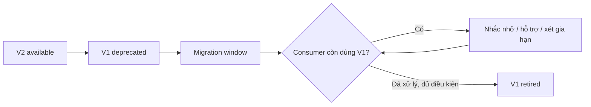
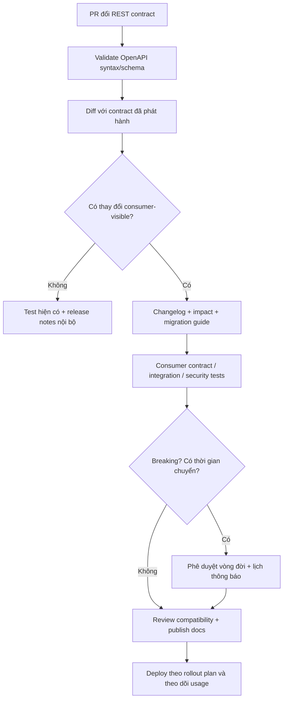

# Changelog, thông báo thay đổi và hướng dẫn chuyển phiên bản

Một API có thể được triển khai thành công nhưng vẫn gây sự cố cho người tích hợp nếu nhà cung cấp không nói rõ **đã thay đổi gì, ai bị ảnh hưởng và phải sửa client thế nào**. Ví dụ, phiên bản mới của `GET /orders` chuyển từ phân trang `page/size` sang `cursor`; phía server hoạt động bình thường nhưng ứng dụng di động cũ vẫn trông đợi `totalPages`, dẫn đến danh sách trống hoặc lặp đơn hàng. Một thông báo chung chung "API đã được cải thiện" không giúp đối tác phát hiện và sửa lỗi trước ngày chuyển đổi.

Trong chương **Tài liệu và trải nghiệm** của module **INTEGRATION_API_REST**, bài học kết nối thiết kế hợp đồng REST (resource, URI, phương thức, mã trạng thái HTTP, OpenAPI, xác thực, phân quyền, phân trang, idempotency và xử lý lỗi) với ba tài liệu dành cho người tích hợp:

- **Changelog:** lịch sử thay đổi có cấu trúc, theo phiên bản và phạm vi ảnh hưởng.
- **Thông báo thay đổi:** thông điệp có thời điểm, đối tượng nhận, mức độ khẩn cấp và hành động cần thực hiện.
- **Hướng dẫn chuyển phiên bản (migration guide):** quy trình cụ thể, có ví dụ request/response, code, kiểm thử và cách xác minh hoàn tất.

Ba thành phần bổ sung cho nhau. Một changelog đầy đủ chưa thay thế được việc gửi thông báo đúng lúc; một thông báo có deadline chưa đủ nếu thiếu cách chuyển mã nguồn và dữ liệu.

## 1. Mục tiêu học tập

Sau bài này, bạn có thể:

1. Phân loại thay đổi REST API theo mức độ tương thích với client và dữ liệu đã tồn tại.
2. Viết changelog có tác động, phiên bản, endpoint, thay đổi hợp đồng, trạng thái vòng đời và đường dẫn tài liệu.
3. Lập kế hoạch thông báo, deprecation và sunset cho các nhóm consumer khác nhau.
4. Soạn migration guide có ví dụ HTTP và Java/Spring, thứ tự thao tác, kiểm thử hồi quy, tiêu chí chuyển đổi và phương án khôi phục.
5. Áp dụng OpenAPI diff, consumer contract tests, các tiêu chí kiểm tra trong CI và telemetry sử dụng phiên bản.
6. Phân biệt việc **deploy phiên bản server mới** với việc **consumer đã chuyển sang hợp đồng mới**.

## 2. Phân biệt ba sản phẩm tài liệu

| Tài liệu | Trả lời câu hỏi | Đơn vị tổ chức | Khi nào cần cập nhật? |
|---|---|---|---|
| **Changelog** | "Từ bản trước tới bản này, hành vi công khai nào đã đổi?" | Theo release, ngày và nhóm thay đổi | Mỗi lần phát hành hoặc thay đổi hợp đồng có ý nghĩa |
| **Thông báo thay đổi** | "Tôi có bị ảnh hưởng không? Phải làm gì trước khi nào?" | Theo thay đổi/campaign và nhóm consumer | Trước, trong và sau thay đổi có tác động |
| **Migration guide** | "Tôi sửa request, response, SDK, dữ liệu và test ra sao?" | Theo đường chuyển V1 → V2 hoặc tính năng thay thế | Trước khi bắt đầu yêu cầu consumer chuyển đổi |

Ví dụ, khi thay `GET /v1/orders?page=0&size=20` bằng `GET /v2/orders?limit=20&cursor=...`:

- **Changelog** ghi rằng V2 bổ sung cursor pagination, `totalPages` không còn trong contract V2 và V1 được lên kế hoạch ngừng cung cấp.
- **Thông báo** nêu ai đang gọi V1, mốc thời gian hỗ trợ, rủi ro nếu không chuyển và địa chỉ hướng dẫn.
- **Migration guide** cung cấp ánh xạ tham số, JSON trước/sau, ví dụ lặp trang, lỗi cursor, checklist test và cách vận hành khi có hai phiên bản đồng thời.

Một API tài liệu tốt còn có **reference documentation** (OpenAPI/endpoint reference) mô tả trạng thái hiện tại. Changelog và migration guide giải thích *sự khác biệt theo thời gian* mà reference hiện tại thường không thể hiện.

### 2.1. Phân biệt phát hành ứng dụng và phát hành API

Một bản build service mới có thể chỉ sửa SQL index, tăng tốc response mà không đổi contract. Ngược lại, thay rule phân quyền hoặc giới hạn rate limit có thể thay đổi trải nghiệm client ngay cả khi URI và JSON schema giữ nguyên.

Không đồng nhất:

```text
Build version:        orders-service 3.8.14
API contract version: v1 hoặc v2
SDK version:          java-client 2.4.0
Database schema:      migration 028
Consumer version:     mobile-app 5.1
```

Changelog dành cho người tích hợp nên nhấn mạnh **hành vi/hợp đồng mà consumer nhìn thấy**; release notes nội bộ có thể liệt kê build, commit, deployment và thay đổi vận hành. Nếu dự án dùng Semantic Versioning, ghi rõ **đối tượng đang được version hóa** và chính sách của sản phẩm. Tăng major version thường báo hiệu thay đổi không tương thích nhưng không tự khiến client an toàn, cũng không chứng minh mọi thay đổi trong minor đều tương thích về ngữ nghĩa.

## 3. Phân loại thay đổi theo khả năng tương thích

### 3.1. "Không đổi URI" vẫn có thể là breaking change

Cần đánh giá cả **request, response, HTTP status/header, security, semantics và dữ liệu phía sau**.

| Thay đổi | Tác động điển hình | Câu hỏi phải kiểm tra |
|---|---|---|
| Thêm endpoint mới | Thường additive | Client mới có gọi khi vẫn còn server V1 không hỗ trợ không? |
| Thêm field tùy chọn vào JSON response | Có thể tương thích | Client cũ có bỏ qua unknown properties hay dùng strict decoder? |
| Thêm request field tùy chọn | Có thể tương thích | Giá trị mặc định của request cũ có giữ nguyên ý nghĩa không? |
| Biến request field tùy chọn thành bắt buộc | Breaking | Những client cũ không gửi field sẽ nhận `400/422`? |
| Xóa/đổi tên field hoặc đổi kiểu JSON | Breaking | Client có deserialize sai hoặc mất dữ liệu không? |
| Thêm giá trị enum `RETURNING` | Có rủi ro breaking | SDK dùng exhaustive switch, enum strict hay validator đóng không? |
| Đổi `200 OK` sang `202 Accepted` | Có thể breaking | Client có đang coi request đồng bộ đã hoàn thành không? |
| Đổi `GET /orders?page=...` sang cursor | Breaking nếu thay tại chỗ | Client có phụ thuộc page number, `totalElements`, `totalPages`? |
| Thay `404` bằng `403` hoặc đổi error body | Có thể breaking | UI/retry logic có rẽ nhánh theo status/problem code không? |
| Thay scope `orders:read` bằng scope khác | Có thể breaking | Token cũ có còn được chấp nhận trong giai đoạn chuyển đổi? |
| Thêm `429` hoặc thay chính sách giới hạn | Có thể gây lỗi chức năng | Client có xử lý `Retry-After`, backoff và budget đúng không? |
| Thay thời hạn `Idempotency-Key` | Có thể breaking | Retry của client sau timeout có thể tạo trùng effect không? |
| Thay mặc định sort/filter | Có thể breaking dù JSON không đổi | Client có dựa vào thứ tự hoặc tập kết quả trước đây không? |
| Đổi cache headers/ETag semantics | Có thể breaking | Client có lưu dữ liệu quá hạn hoặc gửi `If-Match` sai không? |
| Thêm trường DB nullable | Thường có thể rollout an toàn | Bản V1/V2 cùng đọc/ghi được dữ liệu qua mixed deployment không? |
| Xóa cột, đổi enum dữ liệu ngay | Nguy hiểm cho rollback | Worker và binary cũ có đọc được record do V2 ghi không? |

"Thường" và "có thể" là chủ ý: tính tương thích phụ thuộc **consumer thực tế và hợp đồng đã công bố**. Ví dụ, JSON cho phép thêm field nhưng Java client có thể bật `FAIL_ON_UNKNOWN_PROPERTIES`. Vì thế phải kết hợp schema diff với kiểm thử consumer.

### 3.2. Các chiều tương thích cần công bố

Đánh giá riêng từng chiều:

```text
Client V1 ─request cũ─> Server V2    (backward compatibility)
Client V2 ─request mới─> Server V1    (forward compatibility khi mixed-version)
Server V1 ─đọc─> dữ liệu do V2 ghi
Server V2 ─đọc─> dữ liệu do V1 ghi
Worker/SDK cũ ─đọc─> message do producer mới phát
```

Một release có thể **backward-compatible với client** nhưng không tương thích với dữ liệu rollback: chẳng hạn server V2 vẫn nhận request V1, song bắt đầu ghi enum mà V1 không hiểu. Trong tài liệu thay đổi, nói rõ phạm vi cam kết; không chỉ gắn một nhãn "non-breaking" chung cho mọi hệ thống.

### 3.3. Thay đổi bảo mật cần truyền đạt cẩn thận

Nâng tiêu chuẩn xác thực, thay scope, xoay JWT/JWKS hoặc sửa lỗ hổng phân quyền có thể buộc consumer đổi cấu hình. Đừng trì hoãn vá lỗ hổng nghiêm trọng chỉ vì đang theo lịch deprecation thông thường; cần cơ chế thông báo bảo mật với thời hạn phù hợp. Nhưng cũng không công bố thông tin khai thác chi tiết hoặc bí mật truy cập trong changelog công khai.

Ví dụ thông tin đủ hành động: "Từ ngày X, endpoint export yêu cầu scope `reports:export`; hãy cấp lại quyền cho service account theo hướng dẫn Y." Tránh đưa access token thật, secret hoặc cấu hình tenant cụ thể vào bài public.

## 4. Dữ liệu tối thiểu của một bản ghi thay đổi

Trước khi viết văn, lập **change record** để mọi kênh dùng cùng một sự thật.

| Trường | Mục đích |
|---|---|
| `change_id` | Mã duy nhất để trao đổi giữa phát triển, tài liệu, hỗ trợ và vận hành |
| `release_date` và `release_version` | Khi nào và phiên bản nào chứa thay đổi |
| `api_version` / `environment` | V1 hay V2; sandbox, staging, production |
| `change_type` | Added, Changed, Deprecated, Removed, Fixed, Security… |
| `affected_endpoints` | URI template, method, media type và component liên quan |
| `before/after` | Điểm khác biệt của request, response, status, header, semantics |
| `compatibility` | Tương thích hay breaking, chiều nào và điều kiện nào |
| `impacted_consumers` | SDK, đối tác, tenant, nhóm ứng dụng hoặc use case |
| `required_action` | Consumer có phải sửa code/cấu hình/dữ liệu không? |
| `milestones` | Ngày thông báo, deprecation, khóa tính năng cũ, sunset |
| `migration_guide` | URL hướng dẫn chuyển đổi, ví dụ và công cụ |
| `verification` | Cách consumer biết mình đã chuyển xong |
| `rollout_status` | Planned, Canary, Available, Deprecated, Retired |
| `owner/support` | Đội chịu trách nhiệm, đường liên hệ và escalation |

Ngày tháng phải có **múi giờ/UTC** và áp dụng nhất quán. "Tháng sau" hoặc "cuối quý" có thể khiến các đối tác ở múi giờ khác hiểu sai. Nếu ngày chưa được phê duyệt, ghi "dự kiến" thay vì trình bày như một cam kết không thể thay đổi.

Cần phân biệt **ngày có mặt V2**, **ngày V1 bị đánh dấu deprecated** và **ngày V1 thực sự ngừng trả lời**. Đây có thể là ba mốc cách nhau nhiều tháng.

## 5. Viết changelog dễ quét và có thể kiểm chứng

Một cấu trúc tham khảo là nhóm theo release và loại thay đổi:

```markdown
# API Changelog

## [v2.0] - 2027-01-15

### Added
- GET /api/v2/orders hỗ trợ cursor pagination bằng
  \`limit\` và \`cursor\`; phản hồi có \`items\`, \`hasNext\`, \`nextCursor\`.

### Changed
- Danh sách orders V2 không có \`page\`, \`totalPages\`.
- Cursor của V2 chỉ hợp lệ với filter và sort đã tạo ra nó.

### Deprecated
- GET /api/v1/orders vẫn hoạt động nhưng sẽ ngừng hỗ trợ
  theo lịch công bố.

### Action required
- Consumer đang sử dụng \`page\`/\`size\` và \`totalPages\`
  cần chuyển sang lặp bằng \`nextCursor\` trước 2027-07-01.

### Links
- Migration: https://docs.example.invalid/migrations/orders-v2
- OpenAPI: https://docs.example.invalid/openapi/orders-v2.yaml
- Support: https://docs.example.invalid/support
```

Các URL `example.invalid` là **địa chỉ minh họa, không phải tài liệu thật**. Changelog công khai không nên chứa ID tenant, tên khách hàng, token, thông tin nội bộ về sự cố chưa được công bố hay payload nhạy cảm.

### 5.1. Viết theo tác động thay vì tên task nội bộ

So sánh:

| Mơ hồ, khó hành động | Có ích cho consumer |
|---|---|
| "Refactor order pagination" | "V2 thay `page/size` bằng `limit/cursor`; `totalPages` không còn. Client phải duyệt `nextCursor`." |
| "Improve auth" | "Endpoint export yêu cầu scope `reports:export`; token cũ thiếu scope nhận `403`." |
| "Update errors" | "Lỗi validation trả `application/problem+json` với `status=422` và `errors[]`; không còn field `message` ở V2." |
| "Fix retry bug" | "Request `POST /payments` gửi lại cùng `Idempotency-Key` và payload sẽ nhận kết quả đã lưu; khóa dùng lại với payload khác bị từ chối." |

Người đọc cần biết **trạng thái trước/sau, hành động sửa và cách thử**. Mã issue hoặc commit có thể bổ sung để truy vết nhưng không thay cho phần mô tả tác động.

### 5.2. Khi nào nên tách release notes và changelog?

Changelog là lịch sử ổn định theo phiên bản. Release notes có thể giải thích sâu hơn về mục tiêu, migration risk, rollout theo vùng/tenant, thay đổi SDK và quyết định vận hành. Nếu sản phẩm công khai nhiều API, có thể xuất bản changelog tổng kèm bộ lọc theo service/nhóm endpoint. Luôn có một **nguồn sự thật** để tránh website nói tháng Sáu, email nói tháng Bảy và HTTP header nói mốc khác.

## 6. Chính sách vòng đời: Available → Deprecated → Retired

Một thay đổi lớn cần có lifecycle rõ:



**Deprecation** báo rằng endpoint/hành vi cũ vẫn có thể hoạt động nhưng không còn là lựa chọn nên tích hợp mới và đang được lên kế hoạch thay thế. **Sunset/retirement** là thời điểm dự kiến hoặc thực tế chấm dứt khả năng sử dụng của hành vi cũ theo chính sách.

Đây là ví dụ lịch minh họa, không phải thời gian bắt buộc:

| Mốc | Ngày UTC mẫu | Công việc |
|---|---|---|
| Thông báo đầu tiên | 2026-12-01 | Công bố tác động, hướng dẫn chuyển, sandbox và người hỗ trợ |
| V2 available, V1 deprecated | 2027-01-15 | V2 production, phát tín hiệu deprecation trên V1 |
| Nhắc trước sunset | 2027-04-01 | Gửi trạng thái usage theo nhóm consumer, xử lý blocker |
| Nhắc cuối | 2027-06-01 | Xác nhận còn/không còn client V1; tập dượt chuyển traffic |
| V1 sunset dự kiến | 2027-07-01 00:00 UTC | Chỉ retired khi đủ điều kiện phê duyệt và có runbook |

Với hệ thống có consumer không kiểm soát được (đối tác, app mobile chưa được cập nhật), cần khoảng chuyển tiếp phù hợp, hỗ trợ nhiều kênh và đường xác nhận. Với vấn đề bảo mật khẩn cấp, thời gian thông báo có thể khác; nêu rõ căn cứ quyết định.

### 6.1. Tín hiệu HTTP: Deprecation, Sunset và Link

Ngoài website và email, một endpoint cũ có thể trả header để tool/SDK phát hiện:

```http
HTTP/1.1 200 OK
Content-Type: application/json
Deprecation: @<unix-seconds>
Sunset: Thu, 01 Jul 2027 00:00:00 GMT
Link: <https://docs.example.invalid/migrations/orders-v2>; rel="deprecation"
Cache-Control: private, no-store

{"content":[],"page":0,"size":20}
```

Dòng `Deprecation` ở đây biểu diễn **cú pháp minh họa**: giá trị thực cần là timestamp dạng Structured Field Date (dấu `@` theo sau số giây Unix, *không* giữ placeholder). Header `Sunset` dùng HTTP-date. Chúng mang nghĩa tín hiệu vòng đời, không tự dừng endpoint, không tự buộc client hiển thị cảnh báo và không thay thế thông báo trực tiếp.

Cần lưu ý:

- `Deprecation` thể hiện thời điểm tài nguyên được coi là deprecated theo chính sách, còn `Sunset` thể hiện thời điểm dự kiến không còn sẵn dùng.
- Đảm bảo header có trên những phản hồi phù hợp của endpoint cũ, kể cả trạng thái lỗi khi chính sách cần; tránh để gateway/cache làm mất header.
- Nếu thời hạn thay đổi, cập nhật **cùng lúc** policy nguồn, docs, email và header.
- `Link rel="deprecation"` trỏ tới mô tả/migration; tài liệu có thể dùng nhiều ngôn ngữ.
- Không đưa định danh client/tenant hoặc token vào header hay URL tài liệu công khai.

#### Ví dụ Java/Spring sinh đúng định dạng header

```java
@RestController
@RequestMapping("/api/v1/orders")
public class LegacyOrderController {
    private static final Instant DEPRECATED_AT =
            Instant.parse("2027-01-15T00:00:00Z");
    private static final Instant SUNSET_AT =
            Instant.parse("2027-07-01T00:00:00Z");

    private final OrderQueryService orders;

    public LegacyOrderController(OrderQueryService orders) {
        this.orders = orders;
    }

    @GetMapping
    public ResponseEntity<LegacyOrderPage> list(
            @RequestParam(defaultValue = "0") @Min(0) int page,
            @RequestParam(defaultValue = "20") @Min(1) @Max(100) int size,
            Authentication principal) {

        LegacyOrderPage result =
                orders.listLegacy(principal, page, size);

        String sunsetHttpDate = DateTimeFormatter.RFC_1123_DATE_TIME
                .format(SUNSET_AT.atZone(ZoneOffset.UTC));

        return ResponseEntity.ok()
                .header("Deprecation",
                        "@" + DEPRECATED_AT.getEpochSecond())
                .header("Sunset", sunsetHttpDate)
                .header("Link",
                        "<https://docs.example.invalid/migrations/orders-v2>"
                        + "; rel=\"deprecation\"")
                .body(result);
    }
}
```

Ví dụ giả định các class `OrderQueryService`, `LegacyOrderPage` và phân quyền đã được triển khai; thêm imports Spring, Jakarta Validation, Java Time tương ứng. `@Min/@Max` cần cấu hình method validation phù hợp; giới hạn tương tự vẫn phải nằm ở service. Header deprecation chỉ bổ sung metadata, **không làm giảm nghĩa vụ xác thực/authorization** của endpoint cũ.

Khi V1 retired, hợp đồng có thể trả `410 Gone` đối với một endpoint đã biết bị gỡ, hoặc `404` theo policy; không dùng `426 Upgrade Required` như một mã tùy tiện báo "đã có API V2" vì mã này có ngữ nghĩa nâng cấp giao thức. Nếu trả `410`, vẫn cần tránh làm rò sự tồn tại của resource riêng tư.

## 7. Thông báo thay đổi đến đúng consumer

### 7.1. Gửi thông tin gì?

Một thông báo có thể dùng cấu trúc sau:

1. **Tiêu đề cụ thể:** "Cần chuyển API danh sách đơn hàng từ V1 sang V2 trước 01/07/2027".
2. **Ai bị ảnh hưởng:** ứng dụng đang gọi `GET /api/v1/orders`, SDK cũ hoặc tenant/cụm dịch vụ có sử dụng contract này.
3. **Điều gì thay đổi:** tham số `page/size`, cấu trúc response, hành vi khi filter/sort thay đổi; những gì vẫn được giữ.
4. **Hạn chót và giai đoạn:** ngày V2 sẵn sàng, ngày deprecated, ngày sunset và timezone.
5. **Cần làm gì:** sửa client, kiểm thử sandbox, xác nhận telemetry V2 và hoàn tất chuyển traffic.
6. **Rủi ro nếu không làm:** sau khi retired, request V1 có thể bị từ chối/không còn được phục vụ theo hợp đồng.
7. **Tài liệu và hỗ trợ:** migration guide, OpenAPI, SDK, môi trường test, kênh liên hệ.
8. **Cách xác nhận:** metric usage, checklist hoặc xác nhận từ đối tác; yêu cầu phản hồi nếu có blocker.

Thông báo có thể qua developer portal, email đăng ký, dashboard, webhook thông báo chính thức, mục release notes hoặc cập nhật SDK. Không chỉ đăng lên một kênh rồi mặc định mọi consumer đã đọc.

### 7.2. Phân nhóm để thông báo có ích

| Nhóm | Cần quan tâm | Kênh/định dạng gợi ý |
|---|---|---|
| Developer tích hợp trực tiếp | Before/after HTTP, code, error, deadline | Developer portal + email kỹ thuật + SDK notes |
| Đối tác có nhiều môi trường | Sandbox readiness, credential/scope, test case | Thông báo đầu mối kỹ thuật và checklist xác nhận |
| Mobile app cũ khó ép cập nhật | Thời gian hỗ trợ, feature flag, compatibility | Kế hoạch phát hành app và telemetry theo client version |
| SRE/operations | Timeline, canary, rollback, cảnh báo usage V1 | Runbook, dashboard, review thay đổi |
| Product/customer support | Thông điệp cho khách hàng, câu hỏi thường gặp | FAQ, lịch áp dụng, người chịu trách nhiệm escalation |
| Security/compliance | Auth, scope, dữ liệu và hạn lưu | Risk review và thông báo hạn chế đúng đối tượng |

Không gửi nội dung nội bộ/nhạy cảm cho tất cả nhóm. Một thông báo public có thể mô tả thay đổi contract; log chi tiết sử dụng theo tenant hoặc danh sách khách hàng bị ảnh hưởng cần quản lý truy cập riêng.

### 7.3. Tránh "đã gửi = đã chuyển xong"

Email có thể không được mở, người nhận không còn phụ trách, SDK được cài từ lâu nhưng đang chạy như một bản copy trong ứng dụng. Vì vậy kết hợp thông báo với **telemetry phiên bản**. Đo request V1/V2 theo endpoint, môi trường và nhóm consumer khi được phép; thống kê số consumer còn hoạt động và xu hướng giảm. Không suy ra "an toàn để xóa" chỉ vì không có request trong một giờ yên tĩnh; batch job hàng tháng có thể vẫn dùng V1.

## 8. Migration guide mẫu: Phân trang orders V1 → V2

Giả sử V1 hỗ trợ `page/size` và V2 chọn cursor pagination để xử lý danh sách lớn. Hai contract **cùng tồn tại** trong cửa sổ chuyển đổi; không sửa hành vi V1 tại chỗ.

### 8.1. Trước khi chuyển

**V1 request:**

```http
GET /api/v1/orders?page=0&size=2&status=PAID HTTP/1.1
Authorization: Bearer <token>
Accept: application/json
```

**V1 response:**

```http
HTTP/1.1 200 OK
Content-Type: application/json

{
  "content": [
    {"id":"O-101","status":"PAID"},
    {"id":"O-102","status":"PAID"}
  ],
  "page": 0,
  "size": 2,
  "totalElements": 325,
  "totalPages": 163
}
```

Client V1 có thể tăng `page=1,2,3...`; số trang tổng có thể thay đổi khi dữ liệu liên tục được thêm/xóa. Thứ tự phải được định nghĩa trong tài liệu V1; nếu trước đây không định nghĩa, không thể hứa V2 duy trì một thứ tự V1 vốn chưa ổn định.

### 8.2. Sau khi chuyển

**V2 request trang đầu:**

```http
GET /api/v2/orders?limit=2&status=PAID HTTP/1.1
Authorization: Bearer <token>
Accept: application/json
```

**V2 response trang đầu (minh họa):**

```http
HTTP/1.1 200 OK
Content-Type: application/json

{
  "items": [
    {"id":"O-101","status":"PAID"},
    {"id":"O-102","status":"PAID"}
  ],
  "pageSize": 2,
  "hasNext": true,
  "nextCursor": "opaque-token-from-server"
}
```

**V2 request trang kế tiếp:**

```http
GET /api/v2/orders?limit=2&status=PAID&cursor=opaque-token-from-server HTTP/1.1
Authorization: Bearer <token>
Accept: application/json
```

Các giá trị `O-101` và `opaque-token-from-server` chỉ minh họa: trong hệ thống thật, ID và cursor do server trả. Cursor phải được ký/kiểm tra toàn vẹn và ràng buộc với tenant, filter, sort và page size; client không chỉnh nội dung và không dùng cursor làm bằng chứng phân quyền.

### 8.3. Bảng ánh xạ V1 → V2

| V1 | V2 | Hành động ở client |
|---|---|---|
| `page=0` | Bỏ `cursor` | Bắt đầu từ trang đầu |
| `page=n` | `cursor` của trang trước | Lặp tuần tự qua `nextCursor`; không nhảy ngẫu nhiên tới trang n theo cách cũ |
| `size=20` | `limit=20` | Đổi tên parameter; tuân thủ mức tối đa |
| `content[]` | `items[]` | Đổi mapper/deserializer |
| `totalPages` | Không cung cấp | Sửa UI từ số trang sang "Load more"/infinite scroll hoặc dùng API đếm riêng nếu có hợp đồng |
| `totalElements` | Không mặc định có | Bỏ logic phụ thuộc total tức thì; cần thiết kế lại nếu product thực sự cần |
| `page + 1` | `nextCursor` | Chỉ gọi khi `hasNext=true` và cursor có giá trị |
| Lỗi V1 theo hợp đồng cũ | `application/problem+json` nếu V2 quy định | Cập nhật parser lỗi, phân biệt `400/401/403/429/5xx` |

Các ví dụ V2 ở đây giả định **sort mặc định cố định** (ví dụ `createdAt DESC, id DESC`) và giới hạn `limit` đã được công bố. Nếu V2 có filter/sort tùy chọn, thay filter giữa hai trang phải **bắt đầu lại từ trang đầu**, không reuse cursor cũ.

### 8.4. Thay đổi Java client

Client kiểu V1:

```java
int page = 0;
while (true) {
    LegacyOrderPage result = client.get()
        .uri(uri -> uri.path("/api/v1/orders")
            .queryParam("status", "PAID")
            .queryParam("page", page)
            .queryParam("size", 50)
            .build())
        .retrieve()
        .body(LegacyOrderPage.class);

    process(result.content());

    if (page + 1 >= result.totalPages()) {
        break;
    }
    page++;
}
```

Client kiểu V2:

```java
String cursor = null;

do {
    String currentCursor = cursor;
    OrderSlice result = client.get()
        .uri(uri -> {
            UriBuilder b = uri.path("/api/v2/orders")
                .queryParam("status", "PAID")
                .queryParam("limit", 50);
            if (currentCursor != null) {
                b.queryParam("cursor", currentCursor);
            }
            return b.build();
        })
        .retrieve()
        .body(OrderSlice.class);

    process(result.items());

    if (!result.hasNext()) {
        break;
    }
    cursor = result.nextCursor();
    if (cursor == null || cursor.isBlank()) {
        throw new IllegalStateException(
            "API returned hasNext=true without a cursor");
    }
} while (true);
```

`client` ở hai đoạn là `RestClient` đã có cấu hình base URL, bearer auth, connect/read timeout và error handling; `LegacyOrderPage`/`OrderSlice` là DTO minh họa với accessor tương ứng. Cần thêm imports thích hợp (`UriBuilder` của Spring Web, `RestClient`, DTO). Mã mang tính hướng dẫn chuyển logic, không phải một chương trình độc lập có thể chạy ngay.

**Điểm quan trọng:** đừng lưu cursor để sử dụng vô thời hạn hoặc chia sẻ sang tenant khác. API nên quy định TTL và lỗi cursor hết hạn; khi gặp lỗi `CURSOR_EXPIRED`, client có thể khởi động lại từ trang đầu theo use case, kèm cơ chế dedup nếu luồng xử lý không được phép xử lý một đơn hai lần.

Nếu client dùng vòng lặp để phát sinh side effect (gửi email, tính tiền), keyset paging không tự cung cấp exactly-once. Cần đánh dấu xử lý/idempotency theo ID nghiệp vụ và xác định consistency semantics khi dữ liệu thay đổi.

### 8.5. Hướng dẫn chuyển giao diện và hành vi

Không thể thay `page/size` bằng `cursor` trong code mà giữ nguyên UI chọn trang số. Product cần quyết định một trong các hướng:

- Giao diện "Xem thêm" hoặc cuộn vô hạn dùng cursor.
- Nếu cần nhảy thẳng tới trang số, tiếp tục dùng endpoint offset tương thích trong giai đoạn chuyển, hoặc thiết kế riêng API hỗ trợ random access với chi phí được đo.
- Nếu cần tổng số đơn, cung cấp endpoint count riêng (có thể approximate, cached hoặc được giới hạn truy vấn), ghi rõ độ chính xác và thời điểm.
- Nếu cần export đầy đủ dữ liệu tại một thời điểm, dùng export job/snapshot thay vì giữ cursor qua nhiều giờ và ngầm xem nó là snapshot.

Guide phải nêu sự khác biệt **về hành vi**; ví dụ JSON trước/sau là cần nhưng chưa đủ.

### 8.6. Các lỗi V2 mà consumer phải xử lý

| Tình huống | HTTP/ứng xử mẫu | Client nên làm |
|---|---|---|
| `limit` ngoài phạm vi | `400 Bad Request` | Sửa request; không retry nguyên trạng |
| Cursor sai chữ ký/khác filter | `400 INVALID_CURSOR` theo contract | Bỏ cursor, bắt đầu chuỗi mới nếu phù hợp |
| Cursor hết hạn | `400 CURSOR_EXPIRED` theo contract | Thông báo/làm mới chuỗi, dedup nếu cần |
| Token hết hạn hoặc sai | `401 Unauthorized` | Thực hiện luồng xác thực hợp lệ |
| Thiếu quyền trên tenant | `403` hoặc `404` theo policy | Không đoán ID; kiểm tra membership/quyền |
| Rate limit | `429 Too Many Requests` và `Retry-After` nếu có | Backoff theo hướng dẫn, deadline và retry budget |
| Lỗi tạm thời upstream | Có thể `502/503/504` | Retry có giới hạn với GET an toàn, backoff+jitter |
| V1 đã retired | `410` hoặc `404` theo hợp đồng mới | Không tiếp tục dùng V1; phát cảnh báo chuyển đổi |

Không hứa tất cả API sẽ dùng cùng một mã lỗi chi tiết: ví dụ `INVALID_CURSOR` và `CURSOR_EXPIRED` là lựa chọn của hợp đồng mẫu, cần được ghi trong OpenAPI và test.

## 9. Thứ tự chuyển đổi cho consumer trong production

Migration guide có thể trình bày các bước có điều kiện hoàn thành rõ ràng:

1. **Khảo sát usage:** xác nhận các thành phần đang gọi V1, SDK, batch job, mobile app, môi trường và quyền truy cập; tìm logic phụ thuộc `totalPages`.
2. **Tải contract V2:** đọc OpenAPI mới, changelog và bảng ánh xạ; xác nhận endpoint, response DTO, auth scope, rate limit và error schema.
3. **Nâng cấp client trong môi trường test:** sửa query builder, vòng lặp, UI và error handling; dùng sandbox/staging có dữ liệu nhiều trang.
4. **Chạy contract/integration tests:** trang trống, một trang, nhiều trang, cursor hết hạn, filter thay đổi, trùng timestamp, data update giữa hai lần gọi, tenant access.
5. **Bật V2 qua feature flag hoặc cấu hình:** bắt đầu bằng một nhóm consumer/tenant được phép, đo lỗi, latency và kết quả nghiệp vụ; hỗ trợ quay về V1 trong giai đoạn còn tương thích.
6. **Đối chiếu output:** với một bộ dữ liệu cố định, so danh sách ID của V1 và V2 theo quy tắc sort và quyền tương đương. Khi dữ liệu thay đổi liên tục, đánh giá theo consistency contract thay vì so bằng nhau tuyệt đối.
7. **Chuyển toàn bộ traffic:** đảm bảo SDK, batch, cron, job nền và integration ít chạy cũng đã được cập nhật. Theo dõi lượng request V1 giảm về ngưỡng cho phép trong cả chu kỳ sử dụng.
8. **Xác nhận hoàn tất và dọn code:** bỏ feature flag tạm, loại DTO/parser cũ khi hết rollback window, cập nhật tài liệu nội bộ và runbook.

**Rollback client** chỉ an toàn khi V1 vẫn được hỗ trợ và V2 không tạo dữ liệu/ý nghĩa mới mà V1 không xử lý được. Phân trang GET trong ví dụ ít side effect, nhưng cùng nguyên tắc phải được xét kỹ hơn với `POST /payments` hoặc thay enum status: quay lại client cũ không thể xóa những thay đổi đã commit.

## 10. Dùng OpenAPI làm hợp đồng có thể kiểm tra

OpenAPI giúp biết chính xác method, path, parameters, request/response body, security scheme và status codes hiện có. Nó nên đồng hành với changelog và migration guide.

Ví dụ phần rút gọn của OpenAPI 3.1 cho API V2:

```yaml
openapi: 3.1.0
info:
  title: Orders API
  version: "2.0"
paths:
  /api/v2/orders:
    get:
      operationId: listOrdersV2
      summary: List orders using a cursor
      security:
        - bearerAuth: []
      parameters:
        - name: status
          in: query
          schema:
            type: string
            enum: [PENDING, PAID, CANCELLED]
        - name: limit
          in: query
          schema:
            type: integer
            minimum: 1
            maximum: 100
            default: 20
        - name: cursor
          in: query
          schema:
            type: string
          description: Opaque continuation token.
      responses:
        "200":
          description: A slice of authorized orders
          content:
            application/json:
              schema:
                $ref: "#/components/schemas/OrderSlice"
        "400":
          description: Invalid parameters or cursor
        "401":
          description: Authentication required
        "403":
          description: Insufficient permissions
        "429":
          description: Rate limited
components:
  securitySchemes:
    bearerAuth:
      type: http
      scheme: bearer
      bearerFormat: JWT
  schemas:
    OrderSlice:
      type: object
      required: [items, pageSize, hasNext]
      properties:
        items:
          type: array
          items:
            type: object
            required: [id, status]
            properties:
              id:
                type: string
              status:
                type: string
        pageSize:
          type: integer
        hasNext:
          type: boolean
        nextCursor:
          type: [string, "null"]
```

Đây là ví dụ YAML rút gọn, không thay thế spec production: cần thêm định nghĩa item đầy đủ, error schemas (`application/problem+json` khi dùng), media types, scopes và ví dụ chi tiết. OpenAPI 3.1 hỗ trợ cách biểu diễn nullable qua union type như `type: [string, "null"]`.

Ở mô tả V1 có thể đánh dấu operation `deprecated: true`, kèm description/link tới migration guide. Thuộc tính này giúp tool phát hiện, nhưng không thay cho HTTP headers hoặc thông báo trực tiếp.

### 10.1. Điều gì OpenAPI diff phát hiện tốt?

- Đường dẫn/method bị xóa hoặc thêm, parameter đổi tên/vị trí/required.
- Request/response schema đổi kiểu, field required mới, field bị xóa.
- Thay đổi status codes, content type, security declaration.
- Enum bị đổi và các constraint như `minLength`, `minimum`, `maxItems`.

### 10.2. Điều gì diff chưa đủ chứng minh?

- Mặc định sort chuyển từ tăng sang giảm, dù schema giống nhau.
- Rate limit hoặc retry/idempotency semantics thay đổi.
- Tenant authorization sai ở một endpoint.
- Response vẫn `200` nhưng dữ liệu trả chậm hoặc bị stale.
- Bản V2 ghi dữ liệu khiến worker V1 không deserialize được.
- Client cũ thực tế dùng custom parser không chịu được field bổ sung.

Vì vậy cần **contract tests chạy thật** và kiểm thử đồng tồn tại V1/V2 khi rollout. Kết quả diff là tín hiệu để review, không phải phán quyết tuyệt đối về backward compatibility.

## 11. Tích hợp kiểm tra tài liệu vào CI và review

Một pipeline mẫu:



Những gate nên hiện thực ở mức hợp lý:

| Gate | Điều kiện |
|---|---|
| Spec validation | OpenAPI parse được, schema/example hợp lệ |
| Diff | Có báo cáo machine-readable về thay đổi so bản published |
| Changelog | PR có entry cho thay đổi consumer-visible, ghi category và impact |
| Migration | Breaking change có hướng dẫn chuyển, before/after và deadline được duyệt |
| Test | Provider contract, consumer contract và regression tests phù hợp đã chạy |
| Security | Thay đổi scope/auth/error không gây cấp quyền nhầm; không lộ bí mật trong docs |
| Publish | Docs/changelog công bố đồng thời hoặc trước thay đổi có tác động |
| Rollout | Có metric, owner, tiêu chí dừng/rollback và usage dashboard |

Không nên để tool tự tuyên bố "minor version" là luôn non-breaking. Trường hợp exception phải có review/ghi lý do, điều kiện hỗ trợ consumer và người chịu trách nhiệm, thay vì tắt toàn bộ cảnh báo diff.

### 11.1. Một quy tắc CI minh họa

Ví dụ logic *pseudo-code*, không phụ thuộc một công cụ OpenAPI diff cụ thể:

```text
diff = compare(published_openapi, proposed_openapi)

validate(proposed_openapi)
run_provider_contract_tests()
run_consumer_contract_tests()

if diff.has_consumer_visible_change:
    require(changelog_entry_with_change_id)

if diff.has_breaking_change or change_record.semantic_break:
    require(migration_guide)
    require(approved_deprecation_or_versioning_plan)
    require(compatibility_test_matrix)

if change_record.security_impact:
    require(security_review)

publish_docs_before_or_with_release()
```

Đặt `published_openapi` từ artifact đã phát hành và có kiểm soát phiên bản; đừng diff với branch đang chạy mới nhất không đại diện cho hợp đồng công khai. Release note được phát hành cần liên kết với đúng version/spec để consumer không bị dẫn sang tài liệu tương lai chưa hoạt động.

## 12. Kiểm thử bằng Java/Spring: V1 còn hợp đồng cũ, V2 có hợp đồng mới

Một nhóm test nhỏ dùng `MockMvc` có thể xác minh header deprecation, shape response và contract V2. Đoạn code minh họa giả định fixture có hai đơn `PAID` của Alice và một đơn của tenant khác; `jwt()` dùng Spring Security Test để mô phỏng principal, chưa phải phép thử chữ ký JWT thực.

```java
@SpringBootTest
@AutoConfigureMockMvc
class OrdersMigrationContractIT {
    @Autowired MockMvc mvc;

    private RequestPostProcessor alice() {
        return jwt()
            .jwt(jwt -> jwt.subject("alice"))
            .authorities(new SimpleGrantedAuthority(
                    "SCOPE_orders:read"));
    }

    @Test
    void v1StillHasLegacyShapeAndDeprecationSignal()
            throws Exception {
        mvc.perform(get("/api/v1/orders")
                .param("page", "0")
                .param("size", "2")
                .with(alice()))
            .andExpect(status().isOk())
            .andExpect(header().exists("Deprecation"))
            .andExpect(header().exists("Sunset"))
            .andExpect(jsonPath("$.content").isArray())
            .andExpect(jsonPath("$.page").value(0))
            .andExpect(jsonPath("$.totalPages").exists());
    }

    @Test
    void v2HasCursorContractWithoutTotalPages()
            throws Exception {
        mvc.perform(get("/api/v2/orders")
                .param("status", "PAID")
                .param("limit", "2")
                .with(alice()))
            .andExpect(status().isOk())
            .andExpect(jsonPath("$.items").isArray())
            .andExpect(jsonPath("$.pageSize").value(2))
            .andExpect(jsonPath("$.hasNext").isBoolean())
            .andExpect(jsonPath("$.totalPages").doesNotExist());
    }

    @Test
    void unauthenticatedConsumerCannotBypassV2Permissions()
            throws Exception {
        mvc.perform(get("/api/v2/orders")
                .param("limit", "2"))
            .andExpect(status().isUnauthorized());
    }
}
```

Trong dự án thật, thêm imports JUnit 5, Spring Test, Spring Security Test và cấu hình security. Test này chỉ là **khung kiểm thử contract**; phải bổ sung fixture, lớp service, route, header và logic V2 thực tế. Nếu V1 yêu cầu `status` hoặc tenant trong URI, điều chỉnh test theo chính hợp đồng công khai đó. Test `jwt()` không thay thế integration test xác minh issuer, audience, signature và expiry qua `JwtDecoder`.

### 12.1. Ma trận kiểm thử khi chuyển V1/V2

| Kịch bản | Kỳ vọng |
|---|---|
| Client V1 gọi server V1 | Hợp đồng cũ ổn định |
| Client V1 gọi server V2 nếu dùng cùng route V1 | Server V2 vẫn phục vụ đúng V1 khi overlap |
| Client V2 gọi endpoint V2 | Schema mới, `hasNext/nextCursor` nhất quán |
| Request V1 có field đã deprecated | Hành vi được document, không tự bỏ qua side effect |
| Response V2 có field mới | SDK/consumer mới parse được; client cũ chỉ gặp nếu tương thích được xác nhận |
| Request thiếu token | `401`; docs không đưa token thật vào sample |
| Token sai quyền/tenant | `403/404` theo hợp đồng; không rò dữ liệu |
| Cursor bị sửa, hết hạn, khác filter | Trả lỗi đã document, không lấy dữ liệu ngoài quyền |
| `429` kèm `Retry-After` | SDK/client xử lý chờ/backoff có giới hạn |
| Ứng dụng V2 rollback về V1 | V1 vẫn đọc được dữ liệu/event do V2 đã ghi nếu rollback được quảng bá là an toàn |
| Consumer ngừng dùng V1 | Telemetry chỉ ra không còn các lần gọi có ý nghĩa theo chu kỳ sử dụng |
| Link/header thông báo sai ngày | Test phát hiện khác biệt so change record chính thức |

Muốn kiểm chứng mixed-version thật, phải chạy **binary V1 và V2** cùng database/queue tương thích, không thể dùng duy nhất unit test của class V2. Với thay đổi write semantics, thêm test retry qua V2 → V1 với cùng idempotency key và kiểm tra không tạo hiệu ứng trùng.

## 13. Đo việc chuyển phiên bản bằng telemetry

Thay vì đợi tới ngày sunset mới biết đối tác chưa chuyển, hãy theo dõi:

- Request rate theo `api_version`, endpoint/method, status và môi trường.
- Số consumer đang gọi V1 theo chu kỳ thực tế được phép quan sát.
- Tỷ lệ `4xx/5xx` và latency khi consumer chuyển V2.
- Số lỗi `INVALID_CURSOR`, `401/403`, `429`, deserialization/contract error.
- Tỷ lệ nghiệp vụ hoàn tất (ví dụ đơn được tạo thành công, export hoàn tất), không chỉ HTTP 2xx.
- Số ticket hỗ trợ còn mở liên quan migration, đối tác cần gia hạn và các đợt rollout còn pending.

Không đưa user ID, API key thô, request ID hay tenant ID số lượng lớn vào nhãn metric có cardinality cao. Nếu cần thống kê từng consumer, dùng hệ thống báo cáo có phân quyền và aggregation phù hợp; token/secret cần được che/không lưu.

Một dashboard hữu ích có thể có ba câu hỏi: **V1 còn ai sử dụng? V2 có lỗi mới gì? Có đủ bằng chứng để retirement?** Tách consumer có một request thử nghiệm với consumer chạy job thực hàng tuần/tháng. Không coi 0 RPS trong một vài phút là bằng chứng đã chuyển hết.

### 13.1. Tiêu chí quyết định ngừng hỗ trợ V1

Một checklist ra quyết định có thể gồm:

1. Không còn consumer V1 quan trọng trong cửa sổ quan sát đủ dài cho batch/job ít chạy, hoặc có kế hoạch ngoại lệ được phê duyệt.
2. Các nhóm đối tác đã nhận thông báo và có hướng dẫn chuyển được kiểm chứng.
3. V2 đạt SLO/SLI và không gây lỗi data/security; tỷ lệ chuyển được đo.
4. Đã kiểm tra callback, background worker, SDK, mobile và hệ thống tích hợp gián tiếp.
5. Phương án rollback/khôi phục rõ ràng, kể cả sau khi V2 ghi dữ liệu.
6. Ngày `Sunset` trong header, docs, changelog và thông báo phù hợp.
7. Đội hỗ trợ có runbook cho các client vẫn gọi V1 sau sunset.

Retirement là một quyết định vận hành dựa trên bằng chứng, không chỉ là công việc xóa controller.

## 14. Một mẫu migration guide có thể tái sử dụng

Khi soạn guide cho bất kỳ thay đổi REST API nào, dùng bố cục sau:

```markdown
# Migration: <API/function> V1 → V2

## Phạm vi và tác động
- Endpoint, HTTP method, SDK/client bị ảnh hưởng
- Tóm tắt breaking changes và các hành vi giữ nguyên

## Mốc thời gian
- Ngày V2 sẵn sàng
- Ngày V1 deprecated
- Ngày sunset và timezone

## Yêu cầu trước khi chuyển
- Credential, scope, SDK, dữ liệu test và feature flags

## Trước/Sau
- HTTP request/response/error trước và sau
- Bảng ánh xạ field, enum, status, header, pagination

## Các bước thực hiện
1. Cập nhật client, DTO, auth/cấu hình
2. Test sandbox, CI, rollout nhỏ
3. Quan sát và chuyển toàn bộ traffic

## Kiểm chứng
- Test cases, metric, điều kiện "đã xong"

## Rollback và giới hạn
- Điều kiện có thể quay về V1
- Dữ liệu, job, side effect cần đối soát

## Hỗ trợ
- Changelog, OpenAPI, FAQ, kênh liên hệ
```

Tránh mẫu chỉ có "Thay `v1` thành `v2` trong URL": với nhiều migration, vấn đề quan trọng nằm ở **ngữ nghĩa**, đặc biệt là status HTTP, field yêu cầu, bảo mật, pagination, idempotency và error handling.

## 15. Những sai lầm phổ biến

| Sai lầm | Vì sao nguy hiểm | Cách sửa |
|---|---|---|
| Changelog chỉ là commit messages | Consumer không biết tác động và hành động cần làm | Nhóm theo hợp đồng, có before/after và migration link |
| Chỉ cập nhật OpenAPI mới | Không diễn giải điều đã đổi từ bản cũ | Changelog/diff và hướng dẫn chuyển |
| Thêm JSON field rồi mặc định non-breaking | Client strict parser có thể lỗi | Kiểm thử consumer/SDK thật |
| Chỉ dùng SemVer major/minor | Không diễn tả lifecycle endpoint và data compatibility | Công bố chính sách version rõ ràng |
| Thông báo sau khi deploy breaking change | Consumer bị lỗi trước khi có thời gian chuẩn bị | Version/dual-run, thông báo trước và rollout theo mốc |
| Chỉ nêu "Q3" hoặc "sớm" | Không có deadline xác định, khó lập kế hoạch | Ghi ngày UTC, mốc và owner |
| Sunset date ở email khác header | Consumer tự động và con người thấy thời hạn khác nhau | Một change record làm nguồn chuẩn |
| Chỉ gửi email, không đo usage | Không biết consumer nào còn ở V1 | Telemetry theo version và cửa sổ sử dụng |
| Ví dụ chỉ có happy path | Client gặp `401/403/429`, cursor hết hạn và timeout thì lỗi | Thêm error handling và negative tests |
| Rollback image khi schema đã phá V1 | Binary cũ không đọc được dữ liệu mới | Expand–migrate–contract và rollback matrix |
| Hướng dẫn chứa token thật hoặc dữ liệu khách hàng | Rò rỉ bí mật trong docs | Placeholder và dữ liệu tổng hợp |
| Dùng `410`/`426` tùy tiện | Sai ngữ nghĩa HTTP hoặc làm lộ resource | Chọn status đúng hợp đồng, kiểm tra bảo mật |
| Gọi `202` là hoàn tất thành công | Client hiểu sai tác vụ async | Nêu rõ accepted và status endpoint |
| Chỉ test trên server V2 | Không kiểm chứng V1/V2 overlap và consumer cũ | Contract tests + mixed-version integration |
| Đánh dấu migration "done" khi code đã merge | Traffic thật vẫn gọi V1 | Theo dõi usage, xác nhận chuyển và dọn phụ thuộc |

## 16. Bài tập thực hành

### Bài tập 1 — Phân loại thay đổi

Hệ thống V2 thực hiện năm thay đổi: thêm `deliveryNote` tùy chọn vào response; xóa `totalPages`; thêm status `RETURNING`; thay `POST /payments` trả `202` thay vì `201`; thêm `Retry-After` cho `429`. Với từng thay đổi, xác định phạm vi consumer, mức độ breaking, ca kiểm thử tối thiểu và phần nên viết trong changelog.

*Gợi ý:* có thể cùng là additive về schema nhưng breaking với strict client; cần đánh giá hành vi thực chứ không chỉ hình thức JSON.

### Bài tập 2 — Viết thông báo có deadline

Soạn thông báo cho đối tác đang dùng `GET /v1/orders`, với ngày V2 sẵn sàng 15/01/2027 và dự kiến ngừng V1 lúc 00:00 UTC ngày 01/07/2027. Bắt buộc có đối tượng bị ảnh hưởng, before/after ngắn, hành động, sandbox, link hướng dẫn và kênh hỗ trợ. Sau đó đọc thông báo với tư cách developer không biết dự án nội bộ và kiểm tra có thể lập kế hoạch chuyển không.

### Bài tập 3 — Tạo migration guide và Java client

Dựa trên hai JSON V1/V2 ở mục 8, viết DTO và client mới với `RestClient`. Kiểm thử chuỗi trang có 0, 1, 2 và 3 trang, cursor hết hạn, thay filter giữa các trang và token không hợp lệ. Xác minh client không dựa vào `totalPages`.

### Bài tập 4 — Thiết kế CI gate

Giả sử PR xóa property `customerId` khỏi response `GET /orders/{id}` và tăng scope `orders:read` lên `orders:read:all`. Đề xuất rule OpenAPI diff, contract tests, review bảo mật, changelog entry, migration guide và tiêu chí chặn release. Vì sao linter schema đơn thuần không chứng minh tenant authorization đúng?

### Bài tập 5 — Lập kế hoạch sunset theo số liệu

Sau thông báo V1 deprecated, telemetry cho thấy 95% traffic đã tới V2 nhưng một batch job chỉ chạy ngày đầu mỗi tháng vẫn gọi V1. Hãy xác định mốc quan sát phù hợp, cách nhận diện owner, cách thông báo và điều kiện hoãn/tiếp tục retirement. Trình bày vì sao "95% request đã chuyển" chưa chắc đủ an toàn.

## 17. Checklist cho một thay đổi API được công bố tốt

- [ ] Có change record với ID, owner, API/service version, affected endpoint, mức độ tương thích và mốc thời gian UTC.
- [ ] Changelog mô tả hành vi trước/sau và hành động cần làm; không chỉ là tên commit.
- [ ] OpenAPI reference được cập nhật và diff với phiên bản đã công bố.
- [ ] Breaking change có migration guide với HTTP examples, DTO/SDK mapping, error handling và test cases.
- [ ] Có kế hoạch deprecation/sunset phù hợp, bao gồm HTTP headers khi áp dụng và đường dẫn docs.
- [ ] Thông báo gửi đúng người phụ trách, đủ sớm và theo nhiều kênh cần thiết.
- [ ] Có song song V1/V2 hoặc cách versioning tương thích trong giai đoạn consumer chuyển.
- [ ] Những thay đổi JWT/scope, tenant permissions, enum, status, idempotency, rate limit và cache đều được xem xét.
- [ ] Consumer-driven contract tests, integration tests và mixed-version tests đã được chạy ở phạm vi cần thiết.
- [ ] Có telemetry thực về usage V1/V2, lỗi V2 và consumer còn phụ thuộc V1.
- [ ] Ngày trong changelog, docs, email và response headers được đối chiếu với cùng nguồn.
- [ ] Có điều kiện rollback và giải thích giới hạn khi phiên bản mới đã ghi dữ liệu hoặc tạo side effect.
- [ ] Việc retire V1 chỉ tiến hành khi đã có bằng chứng và runbook cho consumer đến muộn.

**Nguyên tắc cần nhớ:** Một API thay đổi có trách nhiệm phải để consumer trả lời được **đã đổi gì**, **tôi có bị ảnh hưởng không**, **phải làm gì**, **hạn chót là khi nào** và **làm sao biết đã chuyển thành công**. Changelog cung cấp lịch sử, thông báo đưa thông tin tới đúng người, còn migration guide biến thay đổi thành những bước kỹ thuật có thể kiểm thử và triển khai an toàn.
