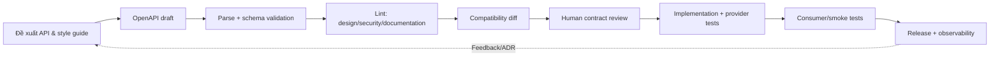
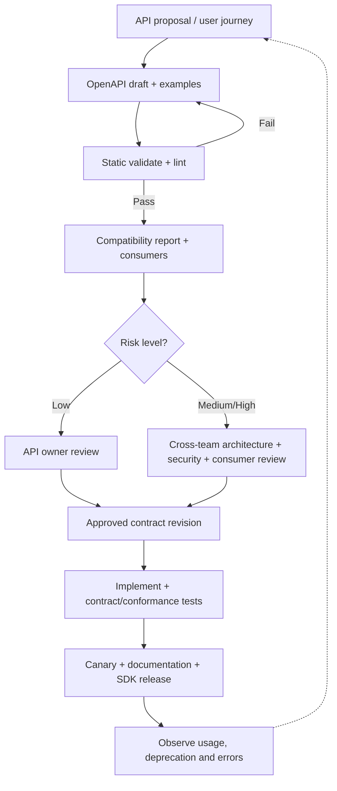

# Quy tắc thiết kế, kiểm tra tự động và rà soát hợp đồng REST API

Một API có thể chạy đúng unit test mà vẫn gây khó khăn cho người tích hợp: endpoint dùng động từ trong URI thay vì tài nguyên, cùng một kiểu lỗi nhưng trả nhiều cấu trúc JSON khác nhau, `POST` tạo đơn hàng mà không có `Location`, `401` thiếu `WWW-Authenticate`, hoặc thay một thuộc tính response từ `string` thành `number` khiến client cũ hỏng. Nếu chỉ rà soát bằng mắt vào ngày phát hành, mỗi nhóm thường áp dụng quy ước riêng và nhiều thay đổi phá vỡ hợp đồng chỉ được phát hiện khi client đã triển khai.

**Quy tắc thiết kế (design guidelines)** xác định API *nên trông như thế nào*; **kiểm tra tự động (lint, schema validation, compatibility checks, contract tests)** biến các quy tắc có thể máy hóa thành tiêu chí bắt buộc; **rà soát hợp đồng (contract review)** giải quyết phần máy không thể kết luận: ý nghĩa nghiệp vụ, an toàn, khả năng nâng cấp và trải nghiệm của người dùng API. Ba hoạt động này bổ sung nhau, không phải ba tên gọi cho cùng một công việc.

Bài học thuộc chương **Tài liệu và trải nghiệm** trong module `INTEGRATION_API_REST`: thiết kế REST theo resource, URI, HTTP method/status, hợp đồng dữ liệu rõ ràng, phân trang, cache, idempotency, OpenAPI, xác thực, phân quyền, lỗi và kiểm thử bằng Java/Spring hoặc công nghệ tương đương. Ví dụ xuyên suốt là `orders-api` phục vụ ứng dụng web, mobile và đối tác: `GET /v1/orders`, `GET /v1/orders/{orderId}`, `POST /v1/orders`, `PATCH /v1/orders/{orderId}`. Bài tập và công cụ là **mẫu áp dụng**, không có một bộ rule duy nhất đúng cho tất cả tổ chức.

## 1. Mục tiêu học tập

Sau bài này, người học có thể:

1. Xây một **API style guide** có mức ưu tiên, ví dụ đúng/sai và cách áp dụng cho URI, method, status, headers, media types, pagination, authentication, error và versioning.
2. Viết hợp đồng OpenAPI 3.1 mô tả request/response, status, header, schema, security và ví dụ nhất quán.
3. Phân biệt **valid OpenAPI**, **đạt lint**, **không gây breaking change** và **hành vi server thực sự tuân thủ hợp đồng**.
4. Sử dụng linter như Spectral, kiểm soát quy tắc nội bộ, report lỗi trong PR và xây cổng chất lượng CI có đường xử lý ngoại lệ rõ.
5. Đánh giá tác động tương thích ngược với client đã tồn tại, kể cả thay đổi tưởng chừng “chỉ sửa tài liệu”.
6. Viết contract/conformance tests trên Java/Spring MockMvc và HTTP thực, kết hợp kiểm thử xác thực, phân quyền, idempotency và xử lý lỗi.
7. Tổ chức review theo rủi ro, lưu quyết định, evidence và các bước rollout/rollback trước khi công bố API.

## 2. Vì sao một bộ quy tắc phải gắn với vòng đời API?

Giả sử ba nhóm cùng viết `orders-api`:

- Nhóm A đặt `GET /v1/orders/{id}`, trả `404` nếu không có order, `application/problem+json` cho lỗi.
- Nhóm B đặt `POST /v1/getOrder`, trả `200` kèm `{"success":false,"error":"NOT_FOUND"}`.
- Nhóm C yêu cầu `X-Api-Key` cho một số URI nhưng OpenAPI lại chỉ mô tả OAuth bearer.

Mỗi đoạn code có thể hoạt động độc lập, nhưng SDK/client phải viết nhiều nhánh đặc biệt, tài liệu khó đoán, monitoring không thống nhất và việc đổi server trở nên rủi ro. Một quy tắc tốt phải tạo ra **tính dự đoán** cho người dùng API; một cổng kiểm tra tốt phải phát hiện sai lệch **sớm**, trước khi client phụ thuộc vào chúng.

### 2.1. Bốn lớp bảo đảm

| Lớp | Câu hỏi cần trả lời | Ví dụ | Tầng triển khai |
|---|---|---|---|
| **Design guide** | URI, method, lỗi, phân trang, auth nên theo mẫu nào? | “Tài nguyên là danh từ số nhiều; dùng `PATCH` cho cập nhật từng phần” | Tài liệu quy ước, ADR, ví dụ |
| **Static checks** | Spec có hợp lệ/có đủ phần máy kiểm được? | Mọi operation có `operationId`, response 401/403 được mô tả, schema có type | OpenAPI parser/schema validator, linter |
| **Compatibility checks** | Client cũ có thể bị phá vỡ do thay đổi contract? | Xóa response field, đổi field type, bỏ status/header, thắt chặt auth | Diff hai phiên bản OpenAPI, policy về version |
| **Runtime conformance** | API thực sự trả như hợp đồng đã công bố? | `POST` trả `201` cùng `Location`, lỗi 401 có challenge | MockMvc, integration tests, consumer/provider tests |

**Contract review** nằm xuyên qua bốn lớp: con người quyết định có nên thêm method, response mới hay đổi business semantics; một rule tự động khó biết rằng “đơn hàng CONFIRMED có thể hủy” là đúng hay sai với nghiệp vụ.



Không nên dùng trạng thái “OpenAPI valid” để kết luận API đạt chuẩn. Ví dụ spec sau có thể hợp lệ về cú pháp nhưng vẫn khó sử dụng:

```yaml
paths:
  /v1/doAction:
    post:
      responses:
        "200":
          description: OK
```

Nó không nói action gì, body gì, auth gì, response có nội dung không và lỗi theo hợp đồng nào. Linter có thể bắt thiếu `operationId`, tag, schema hoặc security, nhưng reviewer vẫn phải xác định **resource và semantics**.

### 2.2. Rule ID, lý do, mức độ và khả năng ngoại lệ

Một quy tắc nên có cấu trúc:

| Thuộc tính | Ví dụ |
|---|---|
| Rule ID | `REST-URI-001` |
| Tên | URI tài nguyên, không dùng động từ RPC tùy tiện |
| Lý do | Giảm số trường hợp đặc biệt của client, tận dụng method HTTP |
| Mức độ | `MUST` cho API mới; `SHOULD` cho legacy |
| Phạm vi | Public REST JSON API, loại trừ webhook callback đã được phê duyệt |
| Kiểm tự động? | Một phần: kiểm naming/path syntax; semantics cần reviewer |
| Ví dụ đạt | `POST /v1/orders` |
| Ví dụ vi phạm | `POST /v1/createOrder` |
| Owner/ngoại lệ | API governance; ADR có hạn xử lý |

Phân biệt **MUST** (merge blocker trừ khi có ngoại lệ chính thức), **SHOULD** (khuyến nghị, warning có owner) và **MAY** (tùy chọn). Không tạo hàng trăm rule chỉ vì công cụ hỗ trợ; ưu tiên các rule cải thiện tính đúng đắn, bảo mật và DX một cách có thể đo được.

## 3. Style guide tối thiểu cho REST API

Style guide phải nhất quán từ tài nguyên đến tình huống HTTP. Bảng dưới là một **baseline tham khảo** để áp dụng cho `orders-api`.

| Chủ đề | Quy tắc đề xuất | Ví dụ tốt | Lỗi thường gặp |
|---|---|---|---|
| Resource/URI | Danh từ, danh sách số nhiều, dùng path ID cho thành viên | `/v1/orders/{orderId}` | `/getOrder`, `/orders/delete/42` |
| Method | Chọn theo ngữ nghĩa HTTP | `GET` đọc, `POST` tạo, `PATCH` cập nhật, `DELETE` xóa | Dùng GET thay đổi trạng thái |
| Success status | Mã phản ánh kết quả thật | `201 + Location` khi tạo, `202` khi accepted async, `204` khi không body | Mọi response đều `200` |
| Error status | Phân biệt 400, 401, 403, 404, 405, 409, 412, 415, 422, 429, 5xx | `401 + WWW-Authenticate` | Trả `200 {"success":false}` |
| Media type | JSON thành công, Problem Details cho lỗi theo hợp đồng | `application/json`, `application/problem+json` | Body là JSON nhưng `text/plain` |
| Headers | Dùng header chuẩn và tài liệu hóa ý nghĩa | `Location`, `ETag`, `If-Match`, `Cache-Control`, `Vary` | Đưa ETag chỉ trong body |
| Pagination | Stable order, cursor/offset rõ semantics và giới hạn | `GET /v1/orders?limit=20&cursor=...` | Không giới hạn size, thứ tự bất định |
| Filtering/sorting | Tham số có schema và allowlist trường hợp lệ | `sort=createdAt:desc` (nếu contract định nghĩa) | Dùng raw SQL field name không kiểm |
| Idempotency | Mutation không tự nhiên idempotent có key khi cần retry an toàn | `Idempotency-Key` trên tạo payment/order | Dùng `X-Request-ID` làm key chống trùng |
| Authentication | Mô tả bearer scheme, validate issuer/audience/scope | `Authorization: Bearer ...` | Tin `Origin`/client-supplied role |
| Authorization | Kiểm ở resource/tenant, không chỉ scope tổng quát | User chỉ đọc order thuộc tenant của mình | Có scope là được đọc mọi order |
| Version/deprecation | Quy định compatibility window, sunset, migration | `/v1` và changelog migration | Đổi schema âm thầm |
| Observability | Correlation ID; trace context; structured error | `X-Correlation-ID`, W3C `traceparent` | In JWT và body nhạy cảm vào log |

### 3.1. URI không gói action, method không thay status

```http
GET /v1/orders/ord_42 HTTP/1.1
Accept: application/json
Authorization: Bearer <token>
```

```http
HTTP/1.1 200 OK
Content-Type: application/json
ETag: "order-7"
Cache-Control: private, no-store

{"id":"ord_42","status":"PENDING","version":7}
```

`GET` có ngữ nghĩa safe; nếu server thực thi một mutation nghiệp vụ chỉ vì có `GET /v1/orders/{id}?cancel=true`, client prefetch/crawler/cache có thể gây side effects ngoài dự kiến. Hãy sử dụng operation thay đổi trạng thái theo method/hợp đồng riêng, ví dụ `POST /v1/orders/{id}/cancellation-requests` nếu cancellation là một resource nghiệp vụ.

Với `POST /v1/orders`:

```http
POST /v1/orders HTTP/1.1
Content-Type: application/json
Accept: application/json
Authorization: Bearer <token>
Idempotency-Key: 8d1b8c40-5048-41da-a909-030e6436f9cb

{"items":[{"sku":"SKU-42","quantity":2}]}
```

```http
HTTP/1.1 201 Created
Location: /v1/orders/ord_43
Content-Type: application/json
ETag: "order-1"
Cache-Control: private, no-store

{"id":"ord_43","status":"PENDING","version":1}
```

`Location` là URI reference tới resource vừa tạo; có thể tương đối, nhưng phải resolve đúng đối với public URL khi API ở sau reverse proxy. Backend phải **thực thi** idempotency key (scope theo người gọi/tenant, fingerprint payload, lưu kết quả/TTL, xử lý concurrent attempts). Chỉ document một header mà không lưu kết quả là lời hứa không có bảo đảm.

### 3.2. Header và status lỗi là một phần hợp đồng

Các trường hợp phải được phân biệt:

- `400 Bad Request`: JSON sai, tham số cú pháp sai hoặc validation request theo hợp đồng.
- `401 Unauthorized`: không có/sai credential; khi dùng HTTP Bearer, phải có challenge `WWW-Authenticate` phù hợp.
- `403 Forbidden`: đã có credential hợp lệ nhưng không đủ quyền; có thể dùng 404 để tránh tiết lộ tồn tại resource theo chính sách.
- `404 Not Found`: resource không có hoặc chủ ý che tồn tại.
- `405 Method Not Allowed`: có `Allow` chỉ method hiện được hỗ trợ.
- `406 Not Acceptable`: không thể tạo representation phù hợp `Accept`.
- `409 Conflict`: xung đột trạng thái nghiệp vụ.
- `412 Precondition Failed`: `If-Match` không khớp representation validator hiện tại.
- `415 Unsupported Media Type`: request `Content-Type` không được hỗ trợ.
- `422 Unprocessable Content`: nội dung hợp lệ về cú pháp nhưng không xử lý được theo quy tắc semantic đã định nghĩa.
- `428 Precondition Required`: yêu cầu điều kiện cập nhật nhưng client không gửi (nếu API áp dụng).
- `429 Too Many Requests`: vượt rate limit; `Retry-After` nếu có thời gian thử lại hợp lý.
- `502/503/504`: lỗi gateway, tạm không phục vụ hoặc upstream timeout tùy vai trò thật của component; không đổi lỗi credential backend thành 401 của client.

Ví dụ Problem Details theo RFC 9457:

```http
HTTP/1.1 412 Precondition Failed
Content-Type: application/problem+json
Cache-Control: no-store
X-Correlation-ID: 3d712af1-cae8-4e96-b29e-2ad0c8f960b8

{
  "type": "https://api.example.com/problems/version-conflict",
  "title": "Order version changed",
  "status": 412,
  "detail": "Refresh the order before applying a new change"
}
```

Problem Details **không** thay status HTTP: `status` trong body phải nhất quán với HTTP status, và server không được gửi stack trace, JWT, secret hoặc hostname nội bộ trong `detail`. Client cần xử lý response status/header chính xác, không chỉ kiểm trường `success`.

### 3.3. Phân trang, cache, concurrency là quy tắc về semantics

Một `GET /v1/orders?limit=20&cursor=...` cần quy định:

- `limit` có miền hợp lệ, default và max; cursor opaque và có policy expiry/validation rõ.
- Sort order được xác định và ổn định. Nếu dựa vào `createdAt` mà các order có cùng timestamp, phải thêm tie-breaker như ID để tránh trùng/bỏ sót.
- Cursor phải được tạo/kiểm ở backend, không tin raw query expression hoặc client-supplied SQL. Quyền tenant/owner phải được áp trên **mọi trang**.
- Body và link trang tiếp theo/`nextCursor` có schema và semantics; không đổi từ cursor sang offset âm thầm.
- `ETag`/`If-None-Match` cho GET và `ETag`/`If-Match` cho PATCH/PUT là hai use case khác nhau. `If-Match` áp **strong comparison**; tránh kiểm version ngoài transaction rồi update sau (TOCTOU).
- Cache private/no-store phù hợp dữ liệu người dùng; `Vary` được thêm khi representation thực sự phụ thuộc request headers, đặc biệt `Origin` ở CORS. Không giả định mọi ETag làm response cache public.

Rule tự động có thể phát hiện thiếu schema cho `cursor`, thiếu giới hạn của `limit`, thiếu `ETag` trong response contract; nó **không thể chứng minh** phân trang ổn định hay optimistic locking là atomic nếu không có integration tests.

## 4. Viết một hợp đồng OpenAPI 3.1 có thể kiểm tra

OpenAPI là giao diện giữa người thiết kế, implementer, client, SDK generator, test harness và review tool. Một file OpenAPI **không phải implementation**: nó cần đủ chính xác để người khác gọi API mà không phải đoán, và phải được kiểm với hành vi server.

Ví dụ rút gọn nhưng nhất quán dưới đây mô tả tạo và đọc order. Domain `example.com`, key và dữ liệu là giả lập, không phải endpoint sản xuất.

```yaml
openapi: 3.1.0
info:
  title: Orders API
  version: 1.0.0
  description: REST API for creating and reading orders.
servers:
  - url: https://api.example.com
security:
  - bearerAuth: []
tags:
  - name: Orders
    description: Order resources and their lifecycle.
paths:
  /v1/orders:
    post:
      tags: [Orders]
      operationId: createOrder
      summary: Create an order
      description: >
        Idempotency-Key is required for safe retries; the server scopes
        the key to the authenticated caller and request fingerprint.
      parameters:
        - name: Idempotency-Key
          in: header
          required: true
          description: Opaque idempotency key; reuse for retrying the same request.
          schema:
            type: string
            minLength: 8
            maxLength: 128
      requestBody:
        required: true
        content:
          application/json:
            schema:
              $ref: '#/components/schemas/CreateOrder'
            example:
              items:
                - sku: SKU-42
                  quantity: 2
      responses:
        '201':
          description: Order created
          headers:
            Location:
              required: true
              description: Relative or absolute URI of the created resource.
              schema:
                type: string
            ETag:
              description: Current strong representation validator.
              schema:
                type: string
          content:
            application/json:
              schema:
                $ref: '#/components/schemas/Order'
        '400':
          $ref: '#/components/responses/Problem400'
        '401':
          $ref: '#/components/responses/Problem401'
        '403':
          $ref: '#/components/responses/Problem403'
        '409':
          $ref: '#/components/responses/Problem409'
        '429':
          $ref: '#/components/responses/Problem429'
  /v1/orders/{orderId}:
    parameters:
      - name: orderId
        in: path
        required: true
        description: Opaque order identifier.
        schema:
          type: string
          minLength: 1
    get:
      tags: [Orders]
      operationId: getOrder
      summary: Get one order
      description: Only the order owner or authorized tenant member can read it.
      responses:
        '200':
          description: Order representation
          headers:
            ETag:
              description: Current representation validator.
              schema:
                type: string
          content:
            application/json:
              schema:
                $ref: '#/components/schemas/Order'
        '401':
          $ref: '#/components/responses/Problem401'
        '403':
          $ref: '#/components/responses/Problem403'
        '404':
          $ref: '#/components/responses/Problem404'
components:
  securitySchemes:
    bearerAuth:
      type: http
      scheme: bearer
      bearerFormat: JWT
  schemas:
    CreateOrder:
      type: object
      additionalProperties: false
      required: [items]
      properties:
        items:
          type: array
          minItems: 1
          items:
            type: object
            additionalProperties: false
            required: [sku, quantity]
            properties:
              sku:
                type: string
                minLength: 1
              quantity:
                type: integer
                minimum: 1
    Order:
      type: object
      additionalProperties: false
      required: [id, status, version]
      properties:
        id:
          type: string
        status:
          type: string
          enum: [PENDING, CONFIRMED, CANCELLED]
        version:
          type: integer
          minimum: 1
    Problem:
      type: object
      required: [type, title, status]
      properties:
        type:
          type: string
          format: uri-reference
        title:
          type: string
        status:
          type: integer
        detail:
          type: string
        instance:
          type: string
          format: uri-reference
  responses:
    Problem400:
      description: Invalid request
      content:
        application/problem+json:
          schema:
            $ref: '#/components/schemas/Problem'
    Problem401:
      description: Missing or invalid bearer token
      headers:
        WWW-Authenticate:
          description: Bearer authentication challenge.
          schema:
            type: string
      content:
        application/problem+json:
          schema:
            $ref: '#/components/schemas/Problem'
    Problem403:
      description: Authenticated caller lacks permission
      content:
        application/problem+json:
          schema:
            $ref: '#/components/schemas/Problem'
    Problem404:
      description: Order not found or not visible
      content:
        application/problem+json:
          schema:
            $ref: '#/components/schemas/Problem'
    Problem409:
      description: Order state or idempotency conflict
      content:
        application/problem+json:
          schema:
            $ref: '#/components/schemas/Problem'
    Problem429:
      description: Rate limit exceeded
      headers:
        Retry-After:
          description: Retry guidance when available.
          schema:
            type: string
      content:
        application/problem+json:
          schema:
            $ref: '#/components/schemas/Problem'
```

Đây là hợp đồng học tập có độ sâu vừa đủ để làm lint và contract test, **không phải spec của một hệ thống thanh toán thật**. Ví dụ `Order.additionalProperties: false` chặn property mới trên response đối với validator/consumer tuân schema nghiêm ngặt, vì vậy **thêm response field cũng có thể là breaking change** khi client đã dựa vào schema đóng. Tổ chức phải quyết định chính sách mở rộng response và test client thực tế, không mặc định “thêm field luôn tương thích”.

### 4.1. Những phần spec nên được review bằng mắt

| Phần OpenAPI | Câu hỏi review |
|---|---|
| `paths`/method | URI thể hiện resource, method có đúng safe/idempotent semantics? |
| `operationId` | Tên duy nhất, ổn định với SDK/codegen? |
| `tags`/summary/description | Người dùng hiểu operation và side effects không? |
| `parameters` | Path/query/header có kiểu, required/default/limit và ví dụ hợp lệ? |
| `requestBody` | Media type, schema, validation, idempotency và dữ liệu nhạy cảm? |
| `responses` | Có đủ success/error statuses, headers và schema? |
| `components.securitySchemes`/`security` | Cơ chế auth được mô tả; quyền theo resource có được giải thích? |
| `schemas` | Optional/required/null, enum, format, constraints, forward compatibility? |
| `examples` | Hợp lệ theo schema, không chứa token/PII/production secret? |
| `servers` | Không lộ hostname DB/nội bộ; URL công khai đúng môi trường? |

Một tính năng có thể là breaking change dù OpenAPI diff trông “additive”: server giới hạn `limit` nhỏ hơn, thay thứ tự phân trang, chuyển mặc định cache, đổi hành vi 404/403, tăng bắt buộc idempotency key, hoặc chỉnh retry semantics. Reviewer phải xét **hành vi thực** bên cạnh schema.

## 5. Kiểm tra tự động: lint khác validation và contract test

Một pipeline hiệu quả tách các câu hỏi để thông báo lỗi dễ hành động:

1. **Parse YAML/JSON:** cấu trúc văn bản có đọc được không? Duplicate key có bị parser chấp nhận âm thầm không? Nên dùng parser/validator có chính sách rõ về duplicate key.
2. **OpenAPI schema validation:** có đúng mô hình OpenAPI 3.1 không, `$ref`/schema/operation object có hợp lệ, path parameter có được khai báo nhất quán?
3. **Style lint:** tài liệu có tuân rule đặt tên, operationId, summary, security, status/header, media type và giới hạn phân trang?
4. **Security policy scanning:** có HTTP server URL không TLS ngoài ngoại lệ; lộ secret trong examples; thiếu khai báo security hoặc response auth? Các phát hiện static cần review thủ công để tránh false positive.
5. **Compatibility diff:** thay đổi so với **bản đã phát hành cho client**, không phải chỉ so với branch của developer?
6. **Runtime contract tests:** implementation có trả đúng method/status/header/body được spec hứa không? Có side effect, auth/tenant và retry đúng nghiệp vụ không?

Đạt bước 1–5 **không chứng minh** bước 6; test runtime xanh **cũng không chứng minh** thay đổi tương thích với client cũ nếu đã bỏ một response field cần thiết.

### 5.1. Spectral: kế thừa rule mặc định và thêm quy tắc nội bộ

Ví dụ một ruleset tên `.spectral.yaml` (đây là nội dung minh họa trong tài liệu, không yêu cầu bạn tạo file khi đọc bài):

```yaml
extends:
  - spectral:oas

rules:
  orders-operation-summary:
    description: Each REST operation must have a human-readable summary.
    severity: error
    given: "$.paths[*][get,post,put,patch,delete]"
    then:
      field: summary
      function: truthy

  orders-operation-id:
    description: Each operation needs a stable operationId for SDKs.
    severity: error
    given: "$.paths[*][get,post,put,patch,delete]"
    then:
      field: operationId
      function: truthy

  orders-operation-tags:
    description: API operations must be grouped for documentation.
    severity: warn
    given: "$.paths[*][get,post,put,patch,delete]"
    then:
      field: tags
      function: length
      functionOptions:
        min: 1
```

Ví dụ được chủ ý giữ nhỏ: `spectral:oas` có các rule chuẩn tùy phiên bản, và hai rule nội bộ về summary/operationId có thể **trùng** rule built-in. Trong dự án thực, kiểm ruleset mặc định, chỉ giữ rule custom có khác biệt về phạm vi/severity để tránh cảnh báo lặp. Cú pháp JSONPath và rule functions phải được xác minh bằng phiên bản Spectral **đã pin**, không copy file rồi giả định mọi bản tương thích.

Thực thi trong pipeline đã cài và lock CLI:

```bash
# Được thực hiện trong CI hay môi trường dev của dự án.
spectral lint -r .spectral.yaml api/openapi.yaml
```

Ý nghĩa kết quả: linter đưa ra line/path, rule ID, severity và thông điệp. Với warning, hệ thống có thể yêu cầu owner/waiver hoặc chỉ comment PR; với error, CI fail. Một quy tắc **không machine-checkable** như “URI có phù hợp business domain không” phải được đưa vào reviewer checklist chứ không tạo một regex rồi coi nó đã được bảo đảm.

#### Quy tắc custom tốt phải có ví dụ âm/dương

| Kiểm tra | Ví dụ đạt | Ví dụ không đạt | Giới hạn |
|---|---|---|---|
| `operationId` có mặt, duy nhất | `getOrder` | Thiếu/nhân đôi `getOrder` | Tính ổn định qua phiên bản cần diff |
| `summary` không rỗng | “Get one order” | `summary: ""` | Chất lượng câu chữ cần review |
| `tags` có nhóm | `tags: [Orders]` | Thiếu tags | Tag group phải đúng domain |
| Response lỗi có schema | `application/problem+json` | Chỉ có `description` cho lỗi cần body | Rule phải biết endpoint nào dùng body |
| `servers` tin cậy | `https://api.example.com` | `http://public-api...` ngoài ngoại lệ | Không so được topology thực |
| `GET` không khai request body theo policy | GET chỉ query/path | GET body để lọc phức tạp | HTTP semantics/compatibility có ngoại lệ; review |
| `POST 201` có `Location` | Header được mô tả | Tạo resource nhưng thiếu header | Rule static không biết implementation thực |

Không ép tất cả API vào “một số status cố định”. Một endpoint tìm kiếm `GET` và một job `POST` bất đồng bộ có hợp đồng khác nhau. Policy lint phải có scope/exception, không cho phép `security: []` bị chặn sai trên endpoint public được phê duyệt.

### 5.2. Quality gates: cái gì fail merge, cái gì chỉ cảnh báo?

| Gate | Mức khuyến nghị | Ví dụ kết quả |
|---|---|---|
| YAML/JSON không parse, `$ref` hỏng, OAS schema không hợp lệ | **Block** | Spec không dùng được |
| Lộ API key/private key/token thực trong spec/examples | **Block + xử lý secret** | Không chỉ xóa ví dụ: rotate nếu đã lộ |
| Bỏ endpoint/response field đang được consumer dùng | **Block cho cùng API version**, trừ migration phê duyệt | Breaking change |
| Thiếu `operationId`/request/response schema quan trọng | **Block** với API mới | SDK/codegen và contract không ổn định |
| Thiếu summary/tag hoặc ví dụ ít hữu ích | Warning hoặc block theo maturity | DX giảm; cần owner |
| Phân tích semantics không thể kết luận tự động | Human review bắt buộc | Cần quyết định về side effects, permission, cache |
| Test conformance hoặc security fail | **Block** | Implementation khác contract hoặc rủi ro |
| Chưa thử consumer quan trọng khi sửa schema | Block hoặc điều kiện phát hành | Nguy cơ phá vỡ client |

Chọn severity dựa trên rủi ro và độ tin cậy của rule. Với API legacy đã có nợ, không nên tự đổi toàn bộ rule sang error một lần rồi tắt linter khi không merge được. Có thể áp **baseline/budget giảm nợ**: legacy violations được ghi nhận có owner; thay đổi mới không được thêm vi phạm; từng giai đoạn chuyển warning → error. Nhưng phải cấm ngoại lệ vô thời hạn và các vi phạm bảo mật nghiêm trọng.

### 5.3. Ngoại lệ có kiểm soát, không tắt rule âm thầm

Một ngoại lệ nên nêu:

```yaml
# Ví dụ một bản ghi waiver trong quy trình governance.
ruleId: REST-URI-001
scope: POST /v1/payments/{paymentId}/capture
reason: Existing client protocol treats capture as an explicit command.
owner: payments-platform
approvedBy: api-architecture-reviewer
trackingIssue: API-742
expiresOn: 2027-02-01
mitigation: Document side effects and require idempotency.
```

Đây **không phải** một schema waiver chuẩn của Spectral; phải định nghĩa cách CI đọc các bản ghi ngoại lệ và ánh xạ sang lint findings nếu muốn tự động áp. Không coi việc thêm `# spectral:disable` hay bỏ file khỏi scan là “đã được review”. Với security rule, ngoại lệ cần thêm security reviewer và bằng chứng kiểm soát thay thế; các secret đã lộ **không thể waiver** bằng giấy tờ.

## 6. Kiểm tra tính tương thích ngược trước khi merge

OpenAPI diff phải so sánh hai **hợp đồng có ý nghĩa**: bản `baseline` đang được client sử dụng và bản `candidate`. Nếu chỉ so với main branch đã chứa thay đổi chưa phát hành, có thể bỏ sót tác động tới mobile app/SDK cũ. Một client thường nâng cấp chậm hơn server, nên compatibility window và hỗ trợ phiên bản cần được công bố rõ.

### 6.1. Ma trận tác động thay đổi

| Thay đổi | Rủi ro với consumer cũ | Điều kiện/phương án xử lý |
|---|---|---|
| Bỏ `GET /v1/orders/{id}` | **Breaking** | Cần version/migration; không xóa âm thầm |
| Đổi `200` sang `204` cho GET | **Breaking** nếu client đợi JSON | Giữ status cũ hoặc version mới |
| Đổi `Order.version` từ integer sang string | **Breaking** | Tạo field/version mới, rollout chuyển đổi |
| Làm request field trước đây optional thành required | **Breaking** | Thêm default/server fallback hoặc version |
| Bỏ response property mà client đọc | **Breaking** | Giữ/deprecate, cung cấp migration |
| Thêm required response field vào object đóng `additionalProperties:false` | **Có thể breaking** | Test validator/SDK cũ; cân nhắc response extensibility |
| Thêm optional response field trong object mở | Thường ít rủi ro hơn nhưng **không bảo đảm** | Consumer exhaustive decoder có thể lỗi |
| Thêm enum value `ON_HOLD` | Có thể breaking với client switch exhaustive | Xác định open/closed enum policy và test consumer |
| Thu hẹp allowed query `limit` tối đa 100 → 20 | Có thể breaking về hành vi | Kiểm client sử dụng limit 100 |
| Thêm requirement `If-Match`/idempotency key | **Breaking** cho client chưa gửi | Migration/deprecation/feature handshake |
| Tăng rate limiting hoặc đổi `Retry-After` semantics | Rủi ro vận hành | Theo dõi telemetry và thỏa thuận SLA |
| Thêm endpoint mới | Thường additive | Kiểm xung đột path/routing/security |
| Thêm status 202 bên cạnh 201 cho cùng operation | Có thể breaking | Client cũ có xử lý async polling không? |
| Mở quyền (thiếu kiểm tenant) | **Security regression**, không phải compatibility “tốt” | Phải block và sửa |
| Sửa typo trong description | Thường non-breaking runtime | Vẫn cần lint/style, có thể ảnh hưởng generated docs |

**Đối xứng request/response quan trọng:** với **request**, server chấp nhận thêm giá trị/optional field thường tăng tương thích; với **response**, server phát thêm field/enum value có thể làm consumer nghiêm ngặt lỗi. Không có công cụ diff nào hiểu hết code client đang dùng, nên cần **consumer tests** và policy rõ.

### 6.2. Schema evolution OpenAPI 3.1

OpenAPI 3.1 dựa trên JSON Schema 2020-12 cho schema semantics. Khi dùng null, ví dụ:

```yaml
properties:
  deliveryNote:
    type: [string, "null"]
    description: Optional note; null means it was explicitly cleared.
```

Phải phân biệt:

- **Missing property:** không có key `deliveryNote` trong object, có thể nghĩa là không thay đổi.
- **Present property với `null`:** key có mặt, giá trị null, có thể nghĩa là xóa note.
- **Empty string `""`:** một string tồn tại, có thể vi phạm validation.

Thay đổi ý nghĩa của `null`/missing là **behavioral breaking change** ngay cả khi schema chấp nhận cả hai. Trong OpenAPI 3.0 thường gặp `nullable: true`; không trộn bừa 3.0/3.1 schema syntax. Validator/code generator phải hỗ trợ đúng dialect, và test JSON serialization của Java/Jackson phải xác định có omit null hay không.

### 6.3. API versioning và vòng đời deprecation

Ví dụ URI version `/v1` đơn giản để client nhận biết major contract; một số hệ thống dùng header/media type versioning. **Không có một cách versioning duy nhất là bắt buộc cho mọi REST API.** Điều quan trọng là contract rõ, không lạm dụng major version cho mọi field mới, và có chính sách duy trì hỗ trợ.

Một quy trình:

1. Đánh dấu operation/field sẽ ngừng dùng trong OpenAPI (`deprecated: true`), giải thích API thay thế và ngày dự kiến.
2. Thông báo trong changelog, developer portal, SDK release notes, support channels; theo dõi consumer usage và support window.
3. Nếu dùng HTTP `Deprecation`/`Sunset` headers, tuân cú pháp chuẩn tương ứng và document policy; chúng **không tự thực thi** việc client migrate.
4. Trong giai đoạn chuyển tiếp, hỗ trợ contract cũ hoặc adapter rõ ràng; thử nghiệm song song ở staging/canary.
5. Chỉ gỡ field/endpoint khi đã có bằng chứng về consumer và quyết định rollback/phiên bản được phê duyệt.

Một sửa đổi chỉ được merge vì diff tool không tìm ra breaking changes **chưa đủ** để rollout an toàn; phải xem analytics/SDK behavior, auth scope, caching, pagination và các tác động ngoài schema.

## 7. Bảo mật API trong style guide và static review

Security rule phải dựa trên threat model chứ không chỉ có `securitySchemes` trong OpenAPI. Ví dụ `security: - bearerAuth: []` nói client gửi Bearer, **không chứng minh** server kiểm JWT signature/issuer/audience/expiry và object ownership.

| Quy tắc | Kiểm static được gì? | Runtime/security test bắt buộc |
|---|---|---|
| Mọi private operation có security declaration | Phát hiện operation không có auth docs (cần xét global security) | 401 thiếu token/sai token |
| JWT issuer/audience/key policy được mô tả | Có tài liệu và config reference | Token ký sai/issuer lạ/audience sai bị 401 |
| Phân quyền resource | Description nêu tenant/owner/scope | 403/404 khi truy cập order tenant khác |
| Mutation yêu cầu idempotency | Header/description có trong contract | Retry cùng key, payload conflict, concurrency không tạo trùng |
| Input validation | Schema type/format/min/max | Backend enforce và trả 400/422 đúng |
| Query/filter safe | Param được typed và allowlist | Không SQL injection/SSRF/URL fetch tùy ý |
| CORS policy theo origin | Mô tả trusted origins và required headers | OPTIONS/actual response ở origin được phép/lạ; không wildcard + credentials |
| Error không lộ nội bộ | Schema Problem Details, example không có secret | 4xx/5xx thực không trả stack trace/token |
| Rate limiting | Contract có 429 và retry guidance phù hợp | Quota theo identity/tenant, không bypass qua header giả |
| Cache dữ liệu nhạy cảm | 200/304 và header được document khi liên quan | `Cache-Control`/`Vary` thực; CDN không cache lẫn tenant |

**Nên scan examples và file spec để phát hiện token/private key**, nhưng dùng secret scanner phù hợp với Git/CI chứ không chỉ regex `"password"`. Nếu phát hiện secret thật đã commit, phải revoke/rotate theo incident process; xóa khỏi example không khôi phục bí mật đã lộ.

Một “security waiver” như cho phép `GET /v1/orders/{id}` không auth vì “đối tác cần demo” là thay đổi ranh giới bảo mật, không phải sở thích style. Nên dùng public demo endpoint với dữ liệu giả, sandbox identity và scope riêng thay vì tắt auth cho production.

## 8. Rà soát hợp đồng: ai review gì, lúc nào và dựa vào bằng chứng nào?

Một API contract review hiệu quả bắt đầu **trước khi coding** các quyết định ảnh hưởng client. Code review chỉ sau khi implementation hoàn tất thường dẫn đến hai lựa chọn tệ: phá client theo thiết kế chưa kiểm hoặc sửa vội sau khi đã viết nhiều mã.

### 8.1. Quy trình từ đề xuất đến phát hành



Một đề xuất thay đổi nên cung cấp ít nhất:

1. **Mục tiêu và consumer:** ai cần tính năng, ứng dụng web/mobile/đối tác nào tiêu thụ, có use case bất đồng bộ không?
2. **API diff:** method/URI mới, các status, request/response schemas, error contract, headers, bảo mật và ví dụ cụ thể.
3. **Behavioral semantics:** side effects, ordering/pagination, idempotency, cache/ETag, retry, timeout budget, rate limiting, consistency và transaction boundary.
4. **Compatibility analysis:** baseline phát hành, client/SDK hiện tại, breaking diff của tool và danh sách rủi ro không hiện trong schema.
5. **Security/privacy:** authentication, scopes, object-level authorization, tenant isolation, data classification, log/baggage/trace redaction, CORS.
6. **Evidence:** lint/schema check, tests dự kiến, API mock/prototype, rollout/canary, migration/rollback plan, quyết định hoặc waiver có owner.

### 8.2. Vai trò và trách nhiệm

| Vai trò | Câu hỏi chính | Dấu hiệu hoàn thành |
|---|---|---|
| **API owner** | Resource model, semantics, SLO, bảo trì và version? | Quyết định endpoint, status, migration |
| **Consumer representative** (web/mobile/partner) | Client có thể gọi không cần suy đoán? SDK/generator có bị phá? | Use case, examples và contract tests phù hợp |
| **Security reviewer** | Ai được gọi, tenant isolation, PII/secrets, auth và abuse? | Threat model/test security đủ |
| **Architecture/API governance** | Consistency với style guide, version/deprecation, ngoại lệ? | ADR/waiver/review kết luận |
| **QA/SDET** | Negative cases, contract coverage, CI reliability, side effects? | Plan/test evidence rõ |
| **SRE/platform** | Rate limits, cache, timeouts, 5xx, telemetry, rollout? | SLO, canary, runbook và rollback khả thi |
| **Documentation/DX owner** | Examples, quickstart, changelog, error/help pages? | Spec và portal đồng bộ |

Không phải thay đổi nào cũng cần bảy người duyệt. Một sửa typo trong mô tả có thể qua owner + lint; thay authentication, bỏ field/endpoint, đổi payment idempotency hoặc phân quyền tenant cần review liên chức năng.

### 8.3. Phân loại mức độ thay đổi

| Mức | Ví dụ | Review/gate |
|---|---|---|
| **Low** | Sửa description, thêm example không nhạy cảm, làm rõ FAQ | Lint + owner review |
| **Medium** | Thêm endpoint, thêm optional request parameter, thay rate limit có thông báo | Owner + consumer + conformance tests |
| **High** | Đổi status/response enum, thêm required field, đổi pagination/cache/error semantics | Compatibility review, migration và test client |
| **Critical** | Bỏ auth, đổi issuer/key policy, thay quyền tenant, API thanh toán/idempotency, lộ dữ liệu | Security approval, threat model, canary/incident readiness |

Đánh giá nên dựa trên **mức tác động tiềm tàng**, không chỉ số dòng YAML. Một thay đổi một dòng như `security: []` có thể nghiêm trọng hơn thêm 200 dòng schema cho một endpoint mới.

### 8.4. Mẫu nội dung PR/ADR

```markdown
## API change
- Contract: Orders API, /v1/orders/{orderId}
- Change: Add optional deliveryNote to Order response
- Motivation / consumers: Mobile checkout + partner dashboard

## Compatibility
- Baseline: OpenAPI artifact from last production release
- Automated diff: No structural breaking changes reported
- Behavioral risk: Strict decoders may reject new response property
- Clients tested: Android N-1, iOS N-2, Web current, partner sandbox

## Security and behavior
- Auth: Bearer JWT, orders:read, tenant ownership enforced
- Cache: private/no-store unchanged
- Error contract: Problem Details unchanged
- Idempotency/pagination: not affected

## Evidence
- OpenAPI validation/lint: pass
- Provider/consumer tests: pass
- Security checks: pass
- Rollout/rollback: enable in canary; monitor 4xx, 5xx, client parse errors
- Reviewers: API owner, mobile representative
```

Phần trên là ví dụ PR description; “No structural breaking changes” không phải lời bảo đảm tuyệt đối. Reviewer phải xem những client nghiêm ngặt đã được test chưa và liệu `additionalProperties:false` có trong schema cũ hay không.

## 9. Tích hợp quality gates vào CI và developer workflow

Mục tiêu là **feedback sớm và có thể tái hiện**: developer thấy lỗi lint ngay ở máy mình hoặc PR trước khi viết implementation; reviewer không phải nhớ mọi tiểu tiết `operationId`/status; CI kiểm spec và code cùng một bản revision.

### 9.1. Cấu trúc tham khảo cho repository

```text
orders-api/
  api/
    openapi.yaml              # Contract ứng viên
    released-openapi.yaml     # Baseline minh họa; thực tế lấy từ release registry
    examples/
      create-order.json
      order.json
  docs/
    api-style-guide.md
    changelog.md
    adr/
  .spectral.yaml
  package.json
  package-lock.json
  pom.xml                     # Hoặc build.gradle(.kts)
  src/
    main/java/...
    test/java/...
```

Đây là cấu trúc **ví dụ**, không phải yêu cầu tạo thêm file trong nhiệm vụ Step 4 này. Một tổ chức có thể giữ OpenAPI trong repo riêng và import vào service. Điểm quan trọng là baseline phát hành được lưu/phát hành có dấu phiên bản hoặc digest bất biến, không ngẫu nhiên chọn một commit khác.

### 9.2. Ví dụ script CI có kiểm soát version

```bash
#!/usr/bin/env bash
set -euo pipefail

# Cài từ lockfile, không dùng "latest" nổi.
npm ci

# 1. Validate/lint OpenAPI với ruleset nội bộ.
./node_modules/.bin/spectral lint \
  -r .spectral.yaml api/openapi.yaml

# 2. Kiểm breaking changes với released baseline.
# Ví dụ dùng oasdiff CLI đã pin trong CI image.
# Cú pháp/flag --fail-on cần xác nhận theo phiên bản đang cài.
oasdiff breaking \
  --fail-on ERR \
  api/released-openapi.yaml \
  api/openapi.yaml

# 3. Kiểm implementation và conformance (nếu dự án dùng Maven).
./mvnw -B verify
```

**Cần chuẩn bị trước:** `@stoplight/spectral-cli` là dependency dev trong `package.json` có version lock; `oasdiff` được cung cấp bởi binary/container image đã pin; `released-openapi.yaml` phải phản ánh **bản đã phát hành**, không phải bản mới nhất tùy ý. Kiểm riêng OpenAPI document/schema validity bằng tool phù hợp với dialect 3.1 (nếu linter không bao phủ yêu cầu), và không giả định mọi lệnh diff dùng cùng flag giữa các phiên bản.

Một pipeline thực có thể có:

```yaml
# Pseudocode CI dạng YAML, không phụ thuộc nhà cung cấp cụ thể.
stages:
  - validate-source-and-secrets
  - validate-openapi-schema
  - lint-design-rules
  - check-release-compatibility
  - test-server-http-contract
  - test-consumer-compatibility
  - publish-preview-docs
  - review-and-approve
  - publish-versioned-contract
```

Không publish OpenAPI đã thay đổi trước khi implementation, security tests và consumer gates đạt, trừ khi đó là một **preview** được đánh dấu rõ. Nếu API theo design-first, có thể publish **draft/spec preview** cho review/mock trước code, nhưng không trình bày draft như contract production đã có hiệu lực.

### 9.3. Developer feedback: lỗi phải hữu ích

Một lint report tốt không chỉ nói “rules failed”. Nó nên có:

```text
api/openapi.yaml: path /v1/orders, method POST
ERROR REST-OP-001: operationId is required.
WHY: Generated SDKs and client references need a stable operation name.
FIX: Add operationId: createOrder (unique, stable).
DOC: API style guide / operations / operationId.
```

Công cụ có thể đăng annotation vào dòng PR, tạo preview docs và changelog diff. Cần ổn định output giữa local/CI bằng pin tool versions và ruleset revision, tránh tình trạng developer chạy khác version Spectral sẽ thấy kết quả khác. Khi nâng version linter/OpenAPI validator, chạy dry-run/baseline để biết số false positives trước khi bật block trên toàn repository.

### 9.4. Diff report phải tách ba loại phát hiện

- **Structural changes:** thêm/xóa operation, request/response property, type, required, enum, security declaration, status/media type.
- **Potential breaking changes:** diff tool đánh dấu client có thể bị ảnh hưởng; reviewer phân loại theo request/response và consumer sử dụng.
- **Behavioral/security changes:** thay quyền tenant, idempotency, cursor semantics, error mapping, rate-limit, cache TTL, transaction side effects. Thường cần test và human review dù OpenAPI diff không phát hiện.

Không viết một quy tắc CI “diff không có error ⇒ tự động publish production” cho API có người dùng thật. Diff chỉ là một tín hiệu trong quyết định release.

## 10. Kiểm thử Java/Spring: spec phải khớp với HTTP thực

Linter kiểm YAML, không kiểm code. Một controller Spring có thể trả đúng JSON schema nhưng sai `201/Location` hoặc `401/WWW-Authenticate`; đồng thời spec có thể đúng nhưng service thực không kiểm quyền tenant. Cần test ở **giao diện HTTP quan sát được**, kết hợp test nghiệp vụ.

### 10.1. Controller mẫu cho một phần hợp đồng

```java
package com.example.orders.api;

import jakarta.validation.Valid;
import jakarta.validation.constraints.Min;
import jakarta.validation.constraints.NotBlank;
import java.net.URI;
import java.util.List;
import org.springframework.http.CacheControl;
import org.springframework.http.MediaType;
import org.springframework.http.ResponseEntity;
import org.springframework.web.bind.annotation.GetMapping;
import org.springframework.web.bind.annotation.PathVariable;
import org.springframework.web.bind.annotation.PostMapping;
import org.springframework.web.bind.annotation.RequestBody;
import org.springframework.web.bind.annotation.RequestMapping;
import org.springframework.web.bind.annotation.RestController;

record OrderItem(@NotBlank String sku, @Min(1) int quantity) {}
record CreateOrderRequest(List<@Valid OrderItem> items) {}
record OrderView(String id, String status, long version) {}

interface OrderService {
    OrderView create(CreateOrderRequest request);
    OrderView get(String orderId);
}

@RestController
@RequestMapping("/v1/orders")
public class OrderController {
    private final OrderService orders;

    public OrderController(OrderService orders) {
        this.orders = orders;
    }

    @PostMapping(
        consumes = MediaType.APPLICATION_JSON_VALUE,
        produces = MediaType.APPLICATION_JSON_VALUE)
    public ResponseEntity<OrderView> create(
            @Valid @RequestBody CreateOrderRequest input) {
        OrderView created = orders.create(input);
        return ResponseEntity
                .created(URI.create("/v1/orders/" + created.id()))
                .eTag("\"order-" + created.version() + "\"")
                .cacheControl(CacheControl.noStore())
                .body(created);
    }

    @GetMapping(value = "/{orderId}",
                produces = MediaType.APPLICATION_JSON_VALUE)
    public ResponseEntity<OrderView> get(
            @PathVariable String orderId) {
        OrderView view = orders.get(orderId);
        return ResponseEntity.ok()
                .eTag("\"order-" + view.version() + "\"")
                .cacheControl(CacheControl.noStore())
                .body(view);
    }
}
```

Controller này minh họa `201`/`Location`/`ETag`, `200` và media types; **chưa phải implementation hoàn chỉnh** của spec ở mục 4. Cần thêm `@NotEmpty` cho `items` để khớp `minItems: 1`, ràng buộc field `sku`/quantity, yêu cầu `Idempotency-Key`, status mapping và Problem Details. Đây chính là lợi ích của conformance test: sự khác biệt **giữa spec và code** phải bị phát hiện trước khi release. Nếu test cho `POST` chưa kiểm header idempotency thì dù test 201 xanh, server vẫn chưa đáp ứng hợp đồng chống retry trùng.

Nếu sử dụng `@Valid` cho phần tử list, cần Jakarta Bean Validation provider (ví dụ `spring-boot-starter-validation`). Jackson JSON serialization của record và điều kiện null/missing phải được test thực tế; Java types đơn thuần không đảm bảo tất cả constraints OpenAPI đã được enforce.

### 10.2. MockMvc: test HTTP contract, không chỉ gọi service method

Ví dụ dưới đây giả định Spring Boot 3.4+/Spring Framework 6.2+ (dùng `@MockitoBean`); với phiên bản Boot cũ hơn, sử dụng công cụ mock bean phù hợp. `@AutoConfigureMockMvc(addFilters=false)` **chỉ dành cho nhóm test MVC contract độc lập**: nó không kiểm JWT/CORS/Security filter. Có bộ test bảo mật khác với filter thật ở mục 10.4.

```java
package com.example.orders.api;

import static org.mockito.ArgumentMatchers.any;
import static org.mockito.Mockito.when;
import static org.springframework.test.web.servlet.request.MockMvcRequestBuilders.*;
import static org.springframework.test.web.servlet.result.MockMvcResultMatchers.*;

import org.junit.jupiter.api.Test;
import org.springframework.beans.factory.annotation.Autowired;
import org.springframework.boot.test.autoconfigure.web.servlet.AutoConfigureMockMvc;
import org.springframework.boot.test.autoconfigure.web.servlet.WebMvcTest;
import org.springframework.http.HttpHeaders;
import org.springframework.http.MediaType;
import org.springframework.test.context.bean.override.mockito.MockitoBean;
import org.springframework.test.web.servlet.MockMvc;

@WebMvcTest(OrderController.class)
@AutoConfigureMockMvc(addFilters = false)
class OrdersHttpContractTest {
    @Autowired MockMvc mvc;
    @MockitoBean OrderService orders;

    @Test
    void postCreatesResourceAndReturnsLocation() throws Exception {
        when(orders.create(any(CreateOrderRequest.class)))
            .thenReturn(new OrderView("ord_43", "PENDING", 1));

        mvc.perform(post("/v1/orders")
                .contentType(MediaType.APPLICATION_JSON)
                .accept(MediaType.APPLICATION_JSON)
                .header("Idempotency-Key", "8d1b8c40-5048-41da-a909-030e6436f9cb")
                .content("""
                    {"items":[{"sku":"SKU-42","quantity":2}]}
                    """))
            .andExpect(status().isCreated())
            .andExpect(header().string(HttpHeaders.LOCATION,
                    "/v1/orders/ord_43"))
            .andExpect(header().string(HttpHeaders.ETAG,
                    "\"order-1\""))
            .andExpect(content().contentTypeCompatibleWith(
                    MediaType.APPLICATION_JSON))
            .andExpect(jsonPath("$.id").value("ord_43"));
    }

    @Test
    void getReturns200JsonAndEtag() throws Exception {
        when(orders.get("ord_43"))
            .thenReturn(new OrderView("ord_43", "PENDING", 1));

        mvc.perform(get("/v1/orders/ord_43")
                .accept(MediaType.APPLICATION_JSON))
            .andExpect(status().isOk())
            .andExpect(content().contentTypeCompatibleWith(
                    MediaType.APPLICATION_JSON))
            .andExpect(header().string(HttpHeaders.ETAG,
                    "\"order-1\""))
            .andExpect(jsonPath("$.status").value("PENDING"));
    }

    @Test
    void rejectsUnsupportedRequestMediaType() throws Exception {
        mvc.perform(post("/v1/orders")
                .contentType(MediaType.TEXT_PLAIN)
                .content("not-json"))
            .andExpect(status().isUnsupportedMediaType());
    }

    @Test
    void rejectsUnsupportedAccept() throws Exception {
        mvc.perform(get("/v1/orders/ord_43")
                .accept(MediaType.APPLICATION_XML))
            .andExpect(status().isNotAcceptable());
    }

    @Test
    void rejectsUnsupportedMethodWithAllow() throws Exception {
        mvc.perform(put("/v1/orders/ord_43")
                .contentType(MediaType.APPLICATION_JSON)
                .content("{}"))
            .andExpect(status().isMethodNotAllowed())
            .andExpect(header().exists(HttpHeaders.ALLOW));
    }
}
```

Với `405`, production test nên parse `Allow` thành **tập method** (ví dụ GET/HEAD và những method framework thực hỗ trợ), không so một chuỗi có thứ tự cố định. `406` được kiểm khi client yêu cầu XML nhưng controller chỉ `produces=application/json`; `415` khi body request `text/plain` mà controller chỉ `consumes=application/json`. Đừng nhầm lỗi `Accept` với lỗi `Content-Type`.

### 10.3. Red test: phát hiện khoảng cách giữa spec và implementation

Nhìn lại OpenAPI ở mục 4: `Idempotency-Key` được yêu cầu; `CreateOrder.items` có `minItems: 1`. Nhưng controller mẫu chưa khai `@RequestHeader` và `@NotEmpty`. Hai test **kỳ vọng thất bại đối với code cố tình chưa hoàn chỉnh**:

```java
@Test
void missingIdempotencyKeyMustFailContract() throws Exception {
    mvc.perform(post("/v1/orders")
            .contentType(MediaType.APPLICATION_JSON)
            .content("""
                {"items":[{"sku":"SKU-42","quantity":2}]}
                """))
        .andExpect(status().isBadRequest());
}

@Test
void emptyItemsMustFailContract() throws Exception {
    mvc.perform(post("/v1/orders")
            .header("Idempotency-Key", "contract-test-key-42")
            .contentType(MediaType.APPLICATION_JSON)
            .content("{\"items\":[]}"))
        .andExpect(status().isBadRequest());
}
```

Trong cấu hình controller chưa hoàn chỉnh, nếu service mock được gọi mà chưa stub, lỗi có thể xuất hiện thành 500 thay vì 201; test vẫn cho biết hợp đồng chưa được enforce nhưng cần xem nguyên nhân để tránh false diagnosis. Một cách sửa:

```java
// Với Jakarta Validation:
record CreateOrderRequest(
    @jakarta.validation.constraints.NotEmpty
    List<@Valid OrderItem> items) {}

// Thêm vào chữ ký phương thức create, cùng @Valid @RequestBody input:
@RequestHeader("Idempotency-Key") String idempotencyKey
```

Đây là **fragment thay đổi**, không phải một method Java hoàn chỉnh. Sau khi sửa, service phải thực sự sử dụng `idempotencyKey` để bảo đảm retry an toàn, không chỉ kiểm sự có mặt của header. Test cần thêm:

- Cùng user/tenant + cùng key + payload → cùng một kết quả, **không tạo thêm order**.
- Cùng key + payload khác → conflict theo hợp đồng, không phát sinh side effect.
- Hai request song song cùng key → chỉ một lần thực hiện side effect (atomic idempotency).
- Key không hợp lệ/quá dài → lỗi validation được mô tả; không dùng key làm quyền truy cập.

Như vậy **contract review + automated test** tìm thấy lỗi mà test “POST trả JSON” chưa chắc phát hiện.

### 10.4. Security contract cần test với filter thật

Một bộ test khác chạy `@SpringBootTest + @AutoConfigureMockMvc`, giữ SecurityFilterChain thật:

```java
// Đây là fragment trong integration test đã inject mockMvc
// và cấu hình resource server + spring-security-test.
mockMvc.perform(get("/v1/orders/ord_43"))
    .andExpect(status().isUnauthorized())
    .andExpect(header().string(
            HttpHeaders.WWW_AUTHENTICATE,
            org.hamcrest.Matchers.startsWith("Bearer")));

mockMvc.perform(post("/v1/orders")
        .with(jwt().authorities(
            new SimpleGrantedAuthority("SCOPE_orders:read")))
        .contentType(MediaType.APPLICATION_JSON)
        .header("Idempotency-Key", "contract-test-key-42")
        .content("{\"items\":[{\"sku\":\"SKU-42\",\"quantity\":1}]}"))
    .andExpect(status().isForbidden());
```

`jwt()` của `spring-security-test` mock Authentication cho một số test; nó **không xác minh chữ ký JWT/JWKS thực**. Cần riêng test token thật với key/issuer/audience/expiry, kiểm scope và **order ownership/tenant** tại service. Nếu API dùng session cookie, đánh giá CSRF và cookie attributes, không tắt CSRF toàn bộ chỉ để test POST dễ hơn.

Các lỗi domain như resource không tồn tại, version `If-Match` stale, idempotency conflict và rate limiting cần exception handler thống nhất Problem Details. Test `401/403/404/409/412/429` với status, `Content-Type: application/problem+json` theo contract, headers `WWW-Authenticate`/`Retry-After` tương ứng và **không để lộ token/stack trace**. Với frontend cross-origin, kiểm CORS trên preflight lẫn actual error response.

### 10.5. Provider và consumer tests khác nhau

| Loại test | Ai chạy | Phát hiện gì? | Không thể thay thế |
|---|---|---|---|
| **Provider conformance** | Server team | Status/header/media type/schema thực khớp OpenAPI | Business authorization/idempotency nếu không test |
| **Consumer-driven contract** | Client/partner + provider verification | Những request/response mà consumer thực sự dựa vào | Toàn bộ spec và client chưa đăng ký |
| **Schema-based response validator** | API test pipeline | Body khớp JSON Schema (type/required/enum) | Meaning/ownership và transaction |
| **Security integration** | Backend/security | JWT/tenant/scope, abuse, data leakage | Client parsing compatibility |
| **Browser/gateway E2E** | Frontend/platform | CORS, redirect, CDN, `Location`, lỗi ở edge | Full coverage trên mọi endpoint |

Ví dụ client mobile cũ chỉ chấp nhận enum `PENDING|CONFIRMED|CANCELLED`. Provider thêm `ON_HOLD` vào response; một diff tool có thể báo compatibility risk nhưng **consumer test** mới xác nhận parser/switch của mobile cũ có an toàn không. Ngược lại, consumer test xanh cho vài màn hình không chứng minh API đã kiểm quyền của mọi tenant và không bị BOLA.

Một mock server được sinh từ OpenAPI giúp frontend phát triển sớm, nhưng **mock xanh không chứng minh backend thật** đã implement đúng. Sau khi triển khai, provider verification phải chạy với cùng contract revision; ở release candidate cần test đối tác/SDK quan trọng bằng HTTP thực.

### 10.6. Đo drift giữa generated OpenAPI và spec thiết kế

Có hai mô hình hợp lệ:

- **Design-first:** viết và review OpenAPI trước; implementation/tests dựa trên contract được phê duyệt, có thể generate interface/server stubs nhưng vẫn cần conformance.
- **Code-first:** generate OpenAPI từ annotation/schema thực; review spec diff được sinh, không coi annotation là bằng chứng business semantics đúng.

Rủi ro **source of truth kép**: một file OpenAPI được sửa thủ công nhưng docs portal lại generate từ Spring code cũ; CI chỉ lint file nên phát hành documentation không phản ánh server. Quy định một đường xuất bản: API definition → validated build artifact → preview → production API registry/portal, với version/digest gắn cùng release. Nếu dùng code-first, diff generated spec với baseline được công bố; nếu design-first, test runtime với spec được chấp thuận.

## 11. Rà soát hợp đồng khi API có pagination, cache và async job

Các chủ đề sau dễ bị bỏ sót nếu chỉ kiểm method/status/header ở CRUD đơn giản.

### 11.1. Pagination và filter

Ví dụ:

```http
GET /v1/orders?limit=20&cursor=eyJvZmZzZXQiOj... HTTP/1.1
Accept: application/json
Authorization: Bearer <token>
```

```http
HTTP/1.1 200 OK
Content-Type: application/json
Cache-Control: private, no-store

{
  "items": [{"id":"ord_42","status":"PENDING","version":7}],
  "nextCursor": "eyJjdXJzb3IiOi4uLiJ9"
}
```

Contract review phải hỏi:

1. `limit` tối đa/min/default là bao nhiêu; vượt max trả 400/422 hay bị clamp? Hãy chọn và document.
2. Cursor có opaque/signature/TTL/tenant scope không? Client có được xem/sửa nội dung cursor không? Không coi base64 là biện pháp bảo mật.
3. Thứ tự sort và tie-breaker có giúp không trùng/bỏ sót khi dữ liệu thay đổi? Có snapshot consistency hay eventual consistency được công bố?
4. Nếu filter/sort đổi giữa các page, cursor có bị từ chối như thế nào? Có lỗi Problem Details được định nghĩa?
5. Client được phép `nextCursor:null` hay omit field khi hết trang? Đây là vấn đề schema, test và backward compatibility.

Linter có thể kiểm query params có `schema.minimum/maximum` và response có `nextCursor`. Chỉ integration test với dữ liệu thêm/xóa đồng thời mới kiểm được stability và tenant isolation.

### 11.2. Cache, ETag và conditional requests

```http
GET /v1/orders/ord_42 HTTP/1.1
If-None-Match: "order-7"
Authorization: Bearer <token>
```

Nếu representation không đổi theo validator và policy cho phép, server có thể trả `304 Not Modified` không body cùng headers thích hợp. Khi cập nhật:

```http
PATCH /v1/orders/ord_42 HTTP/1.1
Content-Type: application/json
If-Match: "order-7"
Authorization: Bearer <token>

{"deliveryNote":"Gate B"}
```

Nếu đã đổi version, trả `412`, **không thực hiện mutation**. Review phải kiểm strong ETag semantics, atomic concurrency, cache key và `Vary`; đừng cho CDN cache công khai dữ liệu đơn hàng theo URL mà bỏ auth context. Contract test kiểm status/ETag; integration test kiểm cạnh tranh cập nhật thật. Linter không thể xác nhận transaction atomic.

### 11.3. Jobs bất đồng bộ

Với báo cáo dài:

```http
POST /v1/report-jobs HTTP/1.1
Content-Type: application/json
Authorization: Bearer <token>
Idempotency-Key: report-42

{"reportType":"SALES","period":"2026-11"}
```

```http
HTTP/1.1 202 Accepted
Location: /v1/report-jobs/job_42
Content-Type: application/json

{"id":"job_42","status":"QUEUED"}
```

`202` nói request được nhận xử lý bất đồng bộ, không bảo đảm đã hoàn thành. Review cần xác định `GET /v1/report-jobs/{id}`, trạng thái, retry, timeout/expiration, cancel API, security owner/tenant và idempotency khi submit lại. Không biến một `POST` có thể chạy 10 phút thành request đồng bộ chỉ bằng cách tăng gateway timeout. Worker background cần deadline/job policy riêng và telemetry xuyên queue.

## 12. Những lỗi governance thường gặp và cách xử lý

### 12.1. Linter báo xanh nhưng production vẫn vỡ

| Triệu chứng | Nguyên nhân gốc có thể xảy ra | Cách khắc phục |
|---|---|---|
| OpenAPI valid nhưng server trả `200` thay `201` | Chỉ lint spec, không có provider HTTP conformance | Test status/Location với MockMvc và HTTP thực |
| Diff tool không báo breaking nhưng mobile crash | Client switch exhaustively trên enum mới; response schema đóng | Consumer tests trên SDK/mobile cũ, policy mở rộng response |
| Gateway trả 401 cho preflight | CORS xử lý sau auth hoặc ingress chặn OPTIONS | Test preflight qua gateway; cấu hình thứ tự CORS/Security |
| `401` trả HTML thay Problem Details | Error handler/framework khác đường success | Test error path, content type, WWW-Authenticate |
| Đổi `limit` và pagination trùng bản ghi | Diff chỉ xét schema, không biết ordering semantics | Integration test concurrent inserts/cursor contract |
| Hai request POST retry tạo hai payment | Chỉ document Idempotency-Key, backend không lưu key | Atomic idempotency store và concurrency test |
| `ETag` stale vẫn update DB | Kiểm If-Match trước transaction, TOCTOU | Conditional atomic update và race tests |
| Spec public chứa internal host/token thử nghiệm thật | CI không scan examples/secrets | Secret scanning, redaction, revoke key đã lộ |
| `GET /v1/orders/{id}` lộ order tenant khác | Scope-only auth, không kiểm BOLA | Test object-level ownership với hai tenant |
| 503/504 tăng sau release dù API lint xanh | Timeout budget/retry storm/circuit breaker không được review | SLO, load tests, gateway/latency monitoring |
| Tài liệu nói `deprecated` nhưng SDK vẫn gọi endpoint cũ | Không có consumer migration/changelog | Usage metrics, deprecation window, SDK release plan |

Những lỗi này chứng minh giới hạn tự nhiên của static checking. Tự động hóa giúp **không quên những điều kiểm được**; reviewer và runtime tests bảo đảm **ý nghĩa được thực thi**. Cố ép mọi ngữ nghĩa vào một quy tắc JSONPath thường dẫn đến false positives, lạm dụng waiver và mất niềm tin vào pipeline.

### 12.2. Rule mới tạo quá nhiều vi phạm legacy

Một cách rollout khả thi:

1. Chạy rule ở chế độ **report-only** trên API đã phát hành; phân loại kết quả theo criticality và tần suất.
2. Sửa rule không chính xác và cung cấp ví dụ “đạt/không đạt”; đảm bảo scope đúng, không báo lỗi trên endpoint public có chủ đích.
3. Chốt baseline cho violations còn tồn, có owner, lý do và thời hạn; cấm **vi phạm mới** trong PR.
4. Đổi một nhóm rule quan trọng từ warning sang error khi có hướng dẫn sửa và budget xử lý legacy.
5. Theo dõi số waiver hết hạn và repeat incidents; sau một chu kỳ, thu hẹp ngoại lệ dần.

Riêng **credential exposure, auth bypass, tenant isolation** không nên được coi là “nợ style legacy chấp nhận vĩnh viễn”. Phát hiện có thể cần xử lý bảo mật khẩn cấp hoặc chặn publish.

### 12.3. CI fail do schema validator/linter khác nhau

Khi máy dev pass nhưng CI fail:

- Xác nhận tool/package lock/container digest; **cùng phiên bản parser và OpenAPI dialect**.
- Xác nhận đường dẫn `$ref` được resolve đúng từ working directory, không phụ thuộc filesystem path cá nhân hoặc case-insensitive OS.
- Kiểm OpenAPI 3.1 so với 3.0: `type: [string, "null"]` và JSON Schema 2020-12 có thể không được công cụ cũ hỗ trợ.
- Kiểm ruleset custom có được load không; không để CI lặng lẽ chạy default ruleset khi thiếu file.
- Kiểm baseline diff thực sự là released contract chứ không phải candidate. Nếu diff tool ra mã exit 0 dù báo thay đổi breaking, phải cấu hình đúng fail threshold.
- Nếu có false positive, lưu specimen tối thiểu, issue cho rule owner và waiver có thời hạn; không bỏ qua toàn bộ job.

**Không chỉnh tool hoặc ruleset bằng commit âm thầm để làm pipeline xanh.** Thay đổi rule severity, list exceptions hay compatibility policy cũng là một thay đổi governance cần review.

### 12.4. Drift giữa tài liệu và thực tế

Các nguyên nhân phổ biến: spec design-first không cập nhật khi code đổi; code-first generate OpenAPI từ annotation nhưng mất description về nghiệp vụ; gateway sửa `Location`/CORS/status; staging deployment dùng API khác production; CI publish docs từ nhánh trước.

Biện pháp:

1. Công bố contract có **version/digest** gắn release của service, lưu baseline immutable.
2. Provider conformance dùng đúng artifact contract được publish; test qua gateway cho endpoints rủi ro cao.
3. Preview docs trong PR phải ghi rõ “draft/unreleased”, không dùng cho SDK production khi chưa có approval.
4. Consumer tests/Pact tương đương sử dụng consumer đang được hỗ trợ; không chỉ validate một bản mock lý tưởng.
5. Theo dõi sự cố HTTP drift (khác status/media type/headers), và tạo regression test từ sự cố cụ thể.

### 12.5. Cải thiện trải nghiệm developer, không chỉ đạt điểm lint

Một bộ tài liệu thật sự hữu ích còn cần:

- **Quickstart**: endpoint đầu tiên, token sandbox lấy thế nào, ví dụ curl/JavaScript/Java, môi trường test và thông điệp lỗi phổ biến.
- **Reference từ OpenAPI**: schemas, parameters, media types, response headers, pagination, rate limits và authentication được render nhất quán.
- **Changelog và migration guide**: thay đổi nào tác động tới client, SDK version nào cần nâng, ngày deprecation.
- **Examples đã kiểm thử**: JSON request/response khớp schema, không chứa token/PII/URL production nhạy cảm.
- **Support model**: correlation ID trong response, cách báo lỗi, error code, SLA và kênh liên hệ.
- **Sandbox/try-it**: giới hạn, dữ liệu giả, không vô tình bắn giao dịch thật hoặc quyền admin.

Đừng dùng `operationId`/tag/summary có mặt làm bằng chứng tài liệu đã tốt. Reviewer phải thử một use case **từ đầu đến cuối** như người dùng mới: từ cấp token sandbox, POST tạo order, xem Location, GET lại, xử lý 409/429 và retry an toàn.

## 13. Đo hiệu quả của chương trình API contract governance

Không nên chỉ đếm số rule hoặc số lỗi lint, vì càng nhiều rule chưa chắc API càng dễ tích hợp. Một số chỉ số có thể dùng để điều chỉnh:

| Tín hiệu | Điều muốn biết | Cách diễn giải thận trọng |
|---|---|---|
| **PR feedback lead time** | Developer mất bao lâu để thấy lỗi contract? | Cần phân biệt CI time với thời gian review |
| **New lint violations per PR** | Quy tắc có được áp sớm không? | Nhiều lỗi cũng có thể do rule mới/noisy |
| **Open high-risk waivers** | Có rủi ro tồn đọng cần xử lý? | Theo owner/expiry/risk, không xem mọi waiver ngang nhau |
| **Breaking changes caught before release** | Diff/consumer tests có giúp giảm incident không? | Đối chiếu với incident thực, không tối ưu số lượng report |
| **Contract-related production incidents** | Status/schema/header drift thực tế ra sao? | Cần root-cause và mức độ ảnh hưởng |
| **SDK/client upgrade friction** | Client có dễ migrate không? | Theo support tickets, thời gian và lỗi nâng version |
| **Provider/consumer test coverage** | Use cases thật được bảo vệ đến đâu? | Số test lớn không bảo đảm security/semantics |
| **Docs usability** | Người mới có tích hợp thành công? | Thử nghiệm task-based, không chỉ page views |

Mục tiêu là **ít sự cố hợp đồng hơn và trải nghiệm tích hợp tốt hơn**. Nếu mọi đội liên tục thêm waiver vì rule sai, cần sửa rule/thực thi, không chỉ tăng mức phạt. Nếu static check toàn xanh nhưng client gặp lỗi 401/405/406/415, cần bổ sung conformance cases.

## 14. Bài tập thực hành

### Bài 1 — Viết style guide có mức độ và ví dụ

Một dự án mới có các endpoint:

```text
GET  /v1/getAllOrders
POST /v1/createOrder
GET  /v1/orders/{orderId}
POST /v1/orders/{orderId}/delete
POST /v1/payments/{paymentId}/capture
```

Hãy đề xuất quy tắc resource/URI/method cho từng endpoint, nêu `MUST`/`SHOULD`, ví dụ hợp lệ, status/headers cần kiểm và trường hợp nào cần review ngoại lệ. Với `capture`, thảo luận vì sao nó là một command có side effect và cách diễn đạt bằng tài nguyên (ví dụ capture request) nếu tổ chức ưu tiên resource modeling.

*Gợi ý đánh giá:* `GET /v1/orders`, `POST /v1/orders`, `DELETE /v1/orders/{orderId}` là các lựa chọn thường thấy; payment capture cần xét nghiệp vụ/idempotency, không tùy tiện đổi thành GET vì client retry. Rule regex tên URI không thể tự chứng minh an toàn khi có side effects.

### Bài 2 — Sửa OpenAPI chưa đạt hợp đồng

Xem bản nháp:

```yaml
openapi: 3.1.0
info:
  title: Orders API
  version: 1.0.0
paths:
  /v1/createOrder:
    post:
      summary: Create
      requestBody:
        content:
          text/plain:
            schema:
              type: string
      responses:
        '200':
          description: OK
```

Yêu cầu: thiết kế lại cho `POST /v1/orders` tạo resource JSON; bổ sung `operationId`, tags, `requestBody.required` và schema, `201 + Location + JSON response`, ít nhất 400/401/403/409/429 với Problem Details theo hợp đồng, bearer security, idempotency key và examples hợp lệ. Chỉ rõ rule nào linter kiểm được và rule nào cần human review.

*Tiêu chí đạt:* spec 3.1 hợp lệ, resource model dễ hiểu, không nói “POST luôn idempotent” khi chưa có store, không đặt token thật vào examples. Phải có test runtime cho Location/201 và idempotency chứ không dừng ở YAML.

### Bài 3 — Viết Spectral ruleset và test âm/dương

Tạo các rule riêng kiểm `operationId`, `summary`, `tags` và ít nhất một rule về schema/header/error. Với mỗi rule viết hai fixture OpenAPI tối thiểu: một pass, một fail; dùng CLI Spectral đã pin version để kiểm. Thảo luận tình huống rule “mọi operation phải có 401” gây false positive trên endpoint public.

*Gợi ý đánh giá:* rule dùng `given`/`then` đúng JSONPath và function, message actionable; xét OpenAPI global `security` và operation override `security: []`; không chặn public health endpoint chỉ vì một quy tắc quá tổng quát. Cần cập nhật rule owner/docs và biết khi nào dùng warning/waiver.

### Bài 4 — Phân tích breaking change không nằm trong schema

Phiên bản `v1` hiện tại: `GET /v1/orders?limit=100` được phép, mỗi page sort `createdAt asc, id asc`. Đội backend muốn đổi max limit thành 20, sort thành `updatedAt desc`, response giữ nguyên JSON schema và status 200.

Yêu cầu: giải thích tại sao diff schema có thể báo “không breaking” nhưng client có thể bỏ sót/nhân đôi order; thiết kế migration/compatibility policy và integration tests với dữ liệu chèn/cập nhật đồng thời.

*Gợi ý đánh giá:* max limit, thứ tự sort/cursor và semantics consistency là một phần contract dù schema không đổi. Cần consumer telemetry, changelog, lựa chọn endpoint/version mới hoặc giữ behavior cũ, và test pagination ổn định.

### Bài 5 — Viết MockMvc conformance tests

Với `OrderController` ở mục 10, hãy bổ sung điều kiện bắt buộc `Idempotency-Key`, `items` không rỗng và xử lý lỗi Problem Details. Viết test cho:

1. POST thành công → 201, Location đúng resource, `Content-Type: application/json`, ETag và body hợp lệ.
2. POST thiếu key → 400 theo contract, không gọi service tạo order.
3. POST body sai media type → 415.
4. GET `Accept: application/xml` khi chỉ hỗ trợ JSON → 406.
5. PUT vào endpoint chỉ có GET/HEAD → 405 kèm Allow.
6. PATCH If-Match stale → 412, version trong DB không đổi.
7. JWT thiếu scope → 403 khi có filter thật.

*Tiêu chí đạt:* test MVC và test Security tách mục tiêu; không xem `jwt()` giả là verify chữ ký thật; integration test song song chứng minh If-Match và idempotency atomic. Khi lệnh test lỗi, phân loại rõ spec mismatch, handler mapping, validation hay auth.

### Bài 6 — Review mở rộng enum và nullable field

Mobile N-2 chỉ biết `Order.status` là `PENDING`, `CONFIRMED`, `CANCELLED` và parser từ chối giá trị lạ. Đội backend muốn thêm `ON_HOLD` và biến `deliveryNote` từ optional string thành required nullable string.

Yêu cầu: phân tích breaking risk với cả response lẫn request, đề xuất chiến lược duy trì contract cũ hoặc version mới, document `null`/missing semantics và kiểm client N-2 bằng consumer contract tests.

*Gợi ý đánh giá:* enum expansion có thể phá exhaustive switch; required response field/nullable khác optional về schema/meaning; server phải cân nhắc clients không nâng cấp nhanh. Diff tool là tín hiệu, còn consumer tests chứng minh behavior cụ thể.

### Bài 7 — Tổ chức contract review cho payment API

Nhóm payment đề xuất thêm `POST /v1/payments/{paymentId}/capture`, trả 200/409/503 nhưng chưa có idempotency; token chỉ cần scope `payments:write` và không kiểm merchant ownership; muốn phát hành ngay trong tuần.

Yêu cầu: phân loại risk, chỉ định reviewer bắt buộc và evidence trước merge. Viết PR checklist cho payment semantics, IAM/merchant authorization, idempotency, retry khi timeout, webhook/event reconciliation, 409 và 5xx error contract, canary/rollback.

*Gợi ý đánh giá:* đây là **critical change**; phải kiểm object-level ownership, đảm bảo lệnh capture không chạy hai lần, lập nguồn sự thật cho trạng thái giao dịch và audit. Không waiver security chỉ vì thời hạn giao hàng.

### Bài 8 — Xây quality gate và cơ chế ngoại lệ có hạn

Một tổ chức có 50 public/partner APIs, 30% operation thiếu `operationId`, một số endpoint legacy dùng verb URI và một endpoint có response example vô tình chứa API key thật. Hãy thiết kế kế hoạch 3 giai đoạn áp dụng lint/compatibility review và đưa ra quy tắc ngoại lệ.

*Gợi ý đánh giá:* secret leak phải revoke/rotate và block publication; rule khó sửa legacy có thể baseline + new-violations blocking, owner/expiry, warning rồi chuyển error có kế hoạch; critical security không waiver vô hạn. Lưu released baseline, pin tooling, test consumer, báo kết quả PR rõ ràng.

### Bài 9 — Tìm nguyên nhân “spec đúng nhưng frontend lỗi”

OpenAPI nói `POST /v1/orders` trả 201 cùng Location; Spring app thật trả 201 và Location khi gọi bằng curl. Browser ở `https://app.example.com` lại báo CORS error; gateway thêm `Access-Control-Allow-Origin: *` nhưng frontend dùng `credentials: include` và server trả 401 ở preflight.

Yêu cầu: tách các lớp lỗi, đề xuất test browser/gateway, sửa policy mà không vô tình mở tài nguyên cho mọi origin. Giải thích vì sao spec lint + curl pass không chứng minh tích hợp browser đúng.

*Gợi ý đánh giá:* preflight OPTIONS phải đi qua CORS handler trước authentication; credentialed CORS cần exact ACAO + ACAC khi policy thật sự dùng cookie; gateway không nên ghi header trùng. JWT/session/CSRF phải được bảo vệ độc lập. Test actual error 401/403 cũng cần CORS headers phù hợp cho allowed origin.

### Bài 10 — Thiết kế developer onboarding từ OpenAPI

Bạn được giao tài liệu cho một đối tác lần đầu gọi `orders-api`. Hãy viết “happy path 10 phút” và “error path 10 phút”: lấy token sandbox, GET danh sách phân trang, POST tạo đơn hàng cùng Idempotency-Key, theo Location tới resource, xử lý 409 và 429, ghi correlation ID khi liên hệ support. Kiểm các HTTP examples bằng mock server hoặc test sandbox.

*Tiêu chí đạt:* không đưa secret production vào docs, status/headers/schema nhất quán với OpenAPI, tenant permission đúng, không khuyên retry mù một mutation và có đường xử lý khi token/scope sai.

## 15. Checklist review và bàn giao hợp đồng

| Nhóm | Câu hỏi trước khi approve |
|---|---|
| **Resource/URI** | Đúng danh từ, method, semantics safe/idempotent? Không lộ database design qua path? |
| **HTTP status** | Thành công dùng 200/201/202/204 đúng; lỗi dùng 400/401/403/404/405/406/409/412/415/422/428/429/5xx theo contract? |
| **Headers** | 201 có Location; 401 có WWW-Authenticate; 405 có Allow; ETag/If-Match/Cache-Control/Vary/Retry-After đúng khi liên quan? |
| **Media types** | Accept khác Content-Type; JSON thành công và Problem Details lỗi, không trả 200 với error trong body? |
| **Schemas** | Type/required/null/default/enum/min/max/additionalProperties đúng, examples hợp lệ và không có PII/secret? |
| **Pagination/cache** | Limit/default/max, cursor ordering/tie-breaker/tenant scope, ETag/cache key/public-private policy rõ? |
| **Idempotency** | Có key khi cần; scope/fingerprint/TTL/atomic commit/retry behavior có tài liệu và test? |
| **Security** | JWT issuer/audience/signature/expiry/scope, object ownership, CORS/CSRF và rate limits được kiểm thực? |
| **OpenAPI quality** | Parse/OAS 3.1 schema/ref hợp lệ; operationId/tags/summary/security/responses đủ; tool và ruleset version pinned? |
| **Compatibility** | So với released baseline; breaking và behavioral review; consumer/SDK versions được thử? |
| **Review** | Owner, consumer, security, SRE/DX reviewer theo risk; ADR/waiver có expiry và mitigation? |
| **Provider tests** | MockMvc và HTTP thực kiểm status/headers/body/error/security/side effects? Có gateway/CORS tests khi cần? |
| **Docs** | Preview khác production; changelog/migration, quickstart, examples và SDK docs đồng bộ? |
| **Rollout** | Canary, SLO alerts, fallback/rollback và deprecation period đủ cho consumer? |
| **Traceability** | Contract revision/digest gắn với service build; lưu lint/diff/test evidence và decision trong PR? |

### 15.1. Điều kiện “Definition of Done” cho một thay đổi API

Một thay đổi hoàn thành không chỉ vì PR đã merge. Nên có:

1. OpenAPI được review và lưu revision; tài liệu API và changelog/SDK guide đã đồng bộ.
2. Các static gates đạt hoặc ngoại lệ có owner, risk, expiry được phê duyệt; không có secret leak/security blocker.
3. Compatibility diff chạy trên **released baseline** và risk behavior đã được consumer xem.
4. Provider runtime tests, security/object-level auth và các consumer tests quan trọng đạt.
5. Canary/production rollout có telemetry, rollback và thông báo deprecation nếu có.
6. Evidence và người chịu trách nhiệm còn truy xuất được sau release để xử lý incident.

**Không tự động hóa quyết định nghiệp vụ bằng việc chỉ đếm dấu tích.** Review vẫn phải hỏi một client có thể sử dụng API an toàn, ổn định và dự đoán được hay không.

## 16. Tài liệu đọc thêm và tiêu chuẩn liên quan

- **OpenAPI Specification 3.1** — operation, `requestBody`, `responses`, `headers`, `schemas`, `securitySchemes`, `$ref` và khả năng kết hợp JSON Schema.
- **JSON Schema 2020-12** — `type`, `required`, `enum`, `additionalProperties`, constraints và semantics null/missing.
- **RFC 9110 — HTTP Semantics** — methods, status codes, `Allow`, `Location`, conditional requests và content negotiation.
- **RFC 9111 — HTTP Caching** — `Cache-Control`, `ETag` và `Vary` trong caching.
- **RFC 9457 — Problem Details for HTTP APIs** — `application/problem+json` và cấu trúc lỗi có thể máy xử lý.
- **RFC 6750 — OAuth 2.0 Bearer Token Usage** — `Authorization: Bearer` và `WWW-Authenticate`.
- **W3C Trace Context** — `traceparent`/`tracestate` khi correlation và tracing cần nối qua HTTP.
- **Spectral documentation — Rulesets / JSONPath / Functions** — lint OpenAPI và viết custom style rules.
- **oasdiff documentation — Changelog / Breaking Changes** — so sánh contract giữa hai phiên bản theo quy tắc công cụ.
- **Spring Framework Reference — Web MVC and Testing / MockMvc** — mapping, validation, media types, HTTP contract assertions.
- **Spring Security Reference — OAuth2 Resource Server and Testing** — Bearer/JWT/authorization và test security chain.
- **Consumer-driven contract testing guides** (ví dụ Pact) — phối hợp producer–consumer, provider verification và kỳ vọng của client thật.
- **OWASP API Security Top 10** — object-level authorization, authentication, resource consumption và security misconfiguration.

**Kết luận:** Style guide định nghĩa “thiết kế API tốt” theo mục tiêu của tổ chức; schema validation, lint và compatibility diff biến một phần quy tắc thành feedback sớm trong CI; contract tests kiểm implementation thật; còn contract review giải quyết những quyết định semantic, bảo mật và khả năng chuyển đổi mà tool không thể suy ra. Với module `INTEGRATION_API_REST`, hãy luôn đánh giá thay đổi như một **hợp đồng HTTP đầy đủ** — resource, URI, method, status, header, media type, schema, quyền truy cập, caching, retry và side effects — rồi chỉ phát hành khi có bằng chứng từ cả **máy và người**.
