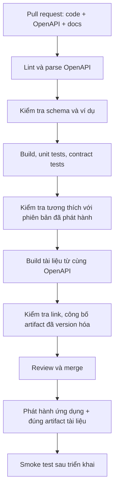

# Đảm bảo tài liệu, ví dụ và triển khai khớp nhau qua CI

Trong module **INTEGRATION_API_REST**, một REST API chỉ dễ tích hợp khi tài liệu mô tả đúng những gì server thực sự nhận và trả về. URI, phương thức HTTP, mã trạng thái, schema dữ liệu, phân trang, cache, idempotency, xác thực và xử lý lỗi đều là một phần của **hợp đồng API**. Nếu tài liệu nói `GET /v1/books/42` trả `200` với thuộc tính `title` nhưng ứng dụng trả `200` với `name`, client vẫn hỏng dù server biên dịch và triển khai thành công.

Bài này hướng dẫn biến tài liệu API, ví dụ request/response và hành vi triển khai thành các **đối tượng có thể kiểm tra tự động trong Continuous Integration (CI)**. Trọng tâm là xác định nguồn dữ liệu chuẩn, thiết kế các lớp kiểm tra có khả năng phát hiện sai lệch, xử lý thay đổi phá vỡ tương thích và đưa tài liệu được kiểm chứng vào cùng quy trình phát hành phần mềm Java/Spring.

## 1. Mục tiêu và tiêu chí thành công

Sau khi học, bạn có thể:

1. Phân biệt sai lệch giữa **đặc tả (contract)**, **ví dụ (examples)**, **tài liệu trình bày (documentation)** và **triển khai chạy thực tế (runtime behavior)**.
2. Tổ chức kho mã để OpenAPI và ví dụ có chủ sở hữu rõ ràng, tránh duy trì nhiều bản nội dung thủ công.
3. Viết kiểm thử dùng cùng một ví dụ từ OpenAPI để đối chiếu với phản hồi thực tế của ứng dụng Spring.
4. Thiết kế pipeline CI kiểm tra cú pháp OpenAPI, hành vi endpoint, tài liệu được dựng và tính tương thích trước khi cho phép merge.
5. Điều tra một lần CI thất bại, xác định cần sửa hợp đồng, code hay ví dụ và tránh việc sửa kỳ vọng kiểm thử chỉ để làm pipeline xanh.

**Định nghĩa hoàn thành:** với mỗi hành vi API được công bố, CI phải có bằng chứng tương ứng rằng (a) hợp đồng hợp lệ, (b) ví dụ đúng cấu trúc và đúng ngữ nghĩa, (c) triển khai đáp ứng những trường hợp đã cam kết, và (d) trang tài liệu được phát hành lấy từ đúng phiên bản hợp đồng đã kiểm tra.

## 2. Vì sao có thể lệch dù unit test vẫn xanh?

Một unit test chỉ xác nhận điều người viết test đã mã hóa. Nếu cả controller và unit test cùng đổi `title` thành `name` mà OpenAPI và tài liệu client vẫn công bố `title`, test có thể xanh trong khi tích hợp thực tế bị phá vỡ.

| Dạng sai lệch | Biểu hiện | Cổng CI nên phát hiện |
| --- | --- | --- |
| **Endpoint** | OpenAPI ghi `GET /v1/books/{bookId}` nhưng server đổi thành `GET /v1/items/{id}` | Kiểm thử request/response dựa trên OpenAPI; phát hiện route không tồn tại |
| **Schema / serialization** | Tài liệu yêu cầu `id` kiểu số; server trả chuỗi hoặc thiếu `title` | JSON Schema / OpenAPI response validator và kiểm thử dữ liệu |
| **Status / media type** | Tài liệu ghi `404 application/problem+json`, server trả `200` hoặc HTML | Kiểm thử mã trạng thái, `Content-Type` và cấu trúc lỗi |
| **Ví dụ lỗi thời** | Ví dụ trong hướng dẫn dùng thuộc tính đã bỏ | Nạp ví dụ từ cùng nguồn chuẩn, đối chiếu với schema và phản hồi ứng dụng |
| **Quy tắc vận hành** | Tài liệu hứa `Idempotency-Key` chống tạo trùng; code không bảo đảm | Kiểm thử hành vi gửi lặp và điều kiện đồng thời, không chỉ kiểm tra schema |
| **Bản phát hành** | Site tài liệu bản mới trong khi production vẫn chạy bản cũ | Gắn version/revision của tài liệu, OpenAPI và ứng dụng trong release |

Có ba lớp kiểm tra khác nhau:

- **Kiểm tra tĩnh:** đặc tả đúng cú pháp, có quy tắc đặt tên, định nghĩa status, schema và security hợp lệ.
- **Kiểm tra hợp đồng động:** request thật gửi tới ứng dụng và response thật được so với OpenAPI; cần kiểm tra cả trường hợp thành công lẫn lỗi.
- **Kiểm tra ngữ nghĩa:** ví dụ và quy tắc nghiệp vụ đúng, chẳng hạn cursor phân trang không lặp bản ghi, `ETag` dùng đúng với `304`, retry cùng idempotency key không tạo hai đơn hàng. OpenAPI đơn thuần không thể chứng minh toàn bộ các quy tắc này.

## 3. Xác định nguồn dữ liệu chuẩn

Có hai chiến lược phổ biến:

| Chiến lược | Nguồn chuẩn | Cách chống sai lệch |
| --- | --- | --- |
| **Contract-first** | File OpenAPI được review trong git | Sinh tài liệu từ OpenAPI; validate mọi response của triển khai theo đặc tả; có thể sinh interface/SDK |
| **Code-first** | Annotation/controller hoặc metadata trong code | Sinh OpenAPI trong build; so sánh với bản đã công bố và snapshot của phiên bản trước; kiểm tra ví dụ và tài liệu theo bản sinh ra |

Chọn **một** chiến lược làm đường đi chính. Ví dụ xuyên suốt bài này dùng **contract-first**: `api/openapi.yaml` là bản hợp đồng được review, phản hồi mẫu nằm trong chính OpenAPI, website tài liệu được dựng từ OpenAPI, còn test dùng phản hồi mẫu đó để kiểm chứng Spring controller. Không sao chép và chỉnh độc lập cùng một JSON response ở bốn nơi.

Cấu trúc tham khảo:

```text
project/
├── api/
│   └── openapi.yaml                 # Hợp đồng được review
├── src/
│   ├── main/java/.../BookController.java
│   └── test/java/.../BookContractTest.java
├── docs/
│   └── integration-guide.md         # Giải thích luồng; dẫn tới API reference
├── package.json                      # Lệnh lint và build tài liệu
├── package-lock.json                 # Khóa phiên bản công cụ Node
├── pom.xml                           # Kiểm thử Java và các dependency đã pin
├── mvnw
└── .github/workflows/api-ci.yml
```

Với nội dung giải thích dài hoặc quy trình nghiệp vụ phải viết thủ công, dùng đường dẫn/đoạn dữ liệu tham chiếu tới OpenAPI đã kiểm tra; nếu buộc phải nhúng ví dụ request/response trong Markdown, cần công cụ trích xuất và kiểm tra đoạn đó trong CI. Tài liệu được sinh tự động giảm công việc đồng bộ nhưng không thay thế phần giải thích ngữ nghĩa.

## 4. Thiết kế pipeline theo bằng chứng



Mỗi cổng cần một đầu vào rõ ràng, cách chạy lặp lại được và dấu hiệu thất bại có thể hành động:

| Cổng | Đầu vào | Khi nào fail? |
| --- | --- | --- |
| 1. Lint/parse | `api/openapi.yaml` | YAML sai, `$ref` không resolve, thiếu mô tả/status theo quy tắc dự án |
| 2. Example/schema | Các `example` và `schema` trong OpenAPI | Ví dụ thiếu trường bắt buộc, sai kiểu, vi phạm enum hoặc format |
| 3. Runtime contract | Server được khởi động trong test, OpenAPI | Path, method, status, header, content type hoặc body không khớp |
| 4. Semantic test | Quy tắc nghiệp vụ đã công bố | Retry không idempotent, phân trang mất bản ghi, cache trả sai, scope không được kiểm tra |
| 5. Compatibility diff | OpenAPI phiên bản đang công bố và bản mới | Đổi gây phá vỡ theo chính sách tương thích mà chưa có kế hoạch version/migration |
| 6. Docs build | Chính OpenAPI đã qua test và trang hướng dẫn | Không dựng được trang, tham chiếu hỏng, nội dung đòi file không tồn tại |
| 7. Post-deploy | Bản chạy ở staging/production và release metadata | Bản thực tế chưa sẵn sàng hoặc khác version hợp đồng/tài liệu đã phát hành |

**Thứ tự có chủ ý:** kiểm tra rẻ, tĩnh chạy trước; test tích hợp chạy sau. Merge phải bị chặn nếu cổng bắt buộc fail. Khi triển khai theo nhiều môi trường, so sánh với **bản hợp đồng đang phục vụ client**, không chỉ với commit mới nhất trên nhánh mặc định.

## 5. Ví dụ xuyên suốt: hợp đồng OpenAPI

Giả sử dịch vụ thư viện công bố `GET /v1/books/{bookId}`. Sách có `id` và `title`; sách không tồn tại trả `404` theo định dạng Problem Details (RFC 9457).

Đặt nội dung minh họa sau tại `api/openapi.yaml` trong dự án thực hành:

```yaml
openapi: 3.0.3
info:
  title: Library API
  version: 1.0.0
servers:
  - url: http://localhost:8080
paths:
  /v1/books/{bookId}:
    get:
      operationId: getBook
      summary: Lấy thông tin một sách
      parameters:
        - name: bookId
          in: path
          required: true
          description: Mã sách
          schema:
            type: integer
            format: int64
      responses:
        '200':
          description: Tìm thấy sách
          content:
            application/json:
              schema:
                $ref: '#/components/schemas/Book'
              example:
                id: 42
                title: REST thực chiến
        '404':
          description: Không tìm thấy sách
          content:
            application/problem+json:
              schema:
                $ref: '#/components/schemas/Problem'
              example:
                type: about:blank
                title: Book not found
                status: 404
                detail: Không tìm thấy sách 999
components:
  schemas:
    Book:
      type: object
      additionalProperties: false
      required: [id, title]
      properties:
        id:
          type: integer
          format: int64
        title:
          type: string
    Problem:
      type: object
      required: [type, title, status, detail]
      properties:
        type:
          type: string
        title:
          type: string
        status:
          type: integer
        detail:
          type: string
        instance:
          type: string
```

Các điểm đáng chú ý:

- `operationId` là tên ổn định khi sinh client; sửa tên cũng có thể ảnh hưởng SDK dù HTTP path giữ nguyên.
- `required` và `additionalProperties: false` giúp phát hiện response thiếu trường hoặc trả thuộc tính ngoài hợp đồng. Khi muốn client chịu được việc thêm trường, hãy quyết định chính sách tiến hóa schema trước khi siết quy tắc.
- Ví dụ phản hồi nằm ngay cạnh `schema` và `response` tương ứng. CI phải kiểm tra ví dụ **phù hợp schema**, vì OpenAPI cho phép viết ví dụ sai mà YAML vẫn parse thành công.
- `404` dùng `application/problem+json`. Không thể thay bằng `200` chứa `{"error":"not found"}` mà vẫn coi là tương thích.

Trong hệ thống thật, còn phải khai báo chính xác `401`, `403`, `400`, `429` và các header như `Retry-After`, `ETag` hay `Cache-Control` khi endpoint có các hành vi đó. Không thêm status giả chỉ để đạt checklist; hãy mô tả hành vi đã được thiết kế và kiểm thử.

## 6. Triển khai Spring và kiểm tra ví dụ

Controller minh họa dưới đây sử dụng Spring Framework 6 / Spring Boot 3 và Java 17 trở lên:

```java
import org.springframework.http.HttpStatus;
import org.springframework.http.MediaType;
import org.springframework.http.ProblemDetail;
import org.springframework.http.ResponseEntity;
import org.springframework.web.bind.annotation.GetMapping;
import org.springframework.web.bind.annotation.PathVariable;
import org.springframework.web.bind.annotation.RequestMapping;
import org.springframework.web.bind.annotation.RestController;

@RestController
@RequestMapping("/v1/books")
class BookController {
    @GetMapping("/{bookId}")
    ResponseEntity<?> getBook(@PathVariable long bookId) {
        if (bookId == 42L) {
            return ResponseEntity.ok(
                new BookDto(42L, "REST thực chiến")
            );
        }

        ProblemDetail error = ProblemDetail.forStatusAndDetail(
            HttpStatus.NOT_FOUND, "Không tìm thấy sách " + bookId
        );
        error.setTitle("Book not found");

        return ResponseEntity.status(HttpStatus.NOT_FOUND)
            .contentType(MediaType.APPLICATION_PROBLEM_JSON)
            .body(error);
    }

    record BookDto(long id, String title) {}
}
```

Mẫu code minh họa dữ liệu cố định để có kết quả xác định; khi dùng database, test nên tạo fixture thay vì phụ thuộc vào thứ tự bản ghi hoặc dữ liệu của môi trường chia sẻ. Nếu API áp dụng validation cho `bookId` hoặc trả mã `400` khi chuỗi không thể chuyển thành số, bổ sung response đó vào hợp đồng và test của endpoint.

**Điểm mấu chốt:** không nên viết chuỗi kỳ vọng `{"id":42,"title":"REST thực chiến"}` lần thứ hai trong test. Đọc chính `example` của bản OpenAPI đã review, rồi so với response của ứng dụng.

Ví dụ với JUnit 5, Spring MockMvc, Jackson và `io.swagger.parser.v3:swagger-parser` (khóa phiên bản dependency trong `pom.xml`):

```java
import com.fasterxml.jackson.databind.ObjectMapper;
import io.swagger.v3.oas.models.OpenAPI;
import io.swagger.v3.parser.OpenAPIV3Parser;
import org.junit.jupiter.api.Test;
import org.springframework.beans.factory.annotation.Autowired;
import org.springframework.boot.test.autoconfigure.web.servlet.AutoConfigureMockMvc;
import org.springframework.boot.test.context.SpringBootTest;
import org.springframework.http.MediaType;
import org.springframework.test.web.servlet.MockMvc;

import static org.junit.jupiter.api.Assertions.assertNotNull;
import static org.springframework.test.web.servlet.request.MockMvcRequestBuilders.get;
import static org.springframework.test.web.servlet.result.MockMvcResultMatchers.content;
import static org.springframework.test.web.servlet.result.MockMvcResultMatchers.status;

@SpringBootTest
@AutoConfigureMockMvc
class BookContractTest {
    @Autowired MockMvc mvc;
    @Autowired ObjectMapper mapper;

    private Object documentedExample(String code, String mediaType) {
        OpenAPI api = new OpenAPIV3Parser().read("api/openapi.yaml");
        assertNotNull(api, "Không đọc được api/openapi.yaml");

        Object example = api.getPaths()
            .get("/v1/books/{bookId}").getGet()
            .getResponses().get(code)
            .getContent().get(mediaType).getExample();
        assertNotNull(example, "Thiếu example cho HTTP " + code);
        return example;
    }

    @Test
    void successMatchesPublishedExample() throws Exception {
        String expected = mapper.writeValueAsString(
            documentedExample("200", "application/json")
        );

        mvc.perform(get("/v1/books/{bookId}", 42))
            .andExpect(status().isOk())
            .andExpect(content().contentTypeCompatibleWith(
                MediaType.APPLICATION_JSON
            ))
            .andExpect(content().json(expected, true));
    }

    @Test
    void notFoundMatchesPublishedExample() throws Exception {
        String expected = mapper.writeValueAsString(
            documentedExample("404", "application/problem+json")
        );

        mvc.perform(get("/v1/books/{bookId}", 999))
            .andExpect(status().isNotFound())
            .andExpect(content().contentTypeCompatibleWith(
                MediaType.APPLICATION_PROBLEM_JSON
            ))
            .andExpect(content().json(expected, false));
    }
}
```

Ở test `200`, chế độ so sánh JSON *strict* kiểm tra cấu trúc kỳ vọng, giúp phát hiện việc vô tình đổi tên hoặc thêm trường. Ở `404`, chế độ *lenient* chấp nhận trường `instance` nếu framework tự bổ sung; vẫn kiểm tra các trường trong ví dụ. Với dữ liệu thay đổi theo request (timestamp, trace ID, URL), dùng matcher cho **định dạng và tính chất** thay vì ghi cứng một giá trị ngẫu nhiên.

Test này minh họa **đồng bộ ví dụ và hành vi ở hai tình huống cụ thể**; nó chưa chứng minh mọi response đều tuân schema OpenAPI. Trong một dự án thật, thêm bộ kiểm tra request/response theo OpenAPI (chẳng hạn một OpenAPI validator tích hợp MockMvc/RestAssured hoặc kiểm thử contract against running service), chạy với các mẫu dữ liệu gồm success, validation error, authorization error, null/optional fields và boundary values. Validator cần xem được path, query, body, status, media type và headers; chỉ kiểm tra JSON body là chưa đủ.

Để kiểm chứng ví dụ độc lập với controller, thêm một test/CI script duyệt từng `MediaType.example` hoặc `MediaType.examples[*].value` trong OpenAPI, rồi validate dữ liệu theo schema tương ứng (bao gồm `$ref`, `required`, `enum` và giới hạn). Parser mở được YAML chỉ xác nhận **hợp lệ về cấu trúc**, không tự động xác nhận ý nghĩa mọi example.

## 7. Biến kiểm tra thành cổng CI

Một cách triển khai đơn giản là dùng Redocly CLI cho lint và dựng tài liệu, dùng Maven cho kiểm thử Java. Cài Redocly CLI làm *dev dependency* với phiên bản cụ thể và commit `package-lock.json` để `npm ci` lặp lại đúng phiên bản. Khai báo scripts trong `package.json`:

```json
{
  "private": true,
  "scripts": {
    "api:lint": "redocly lint api/openapi.yaml",
    "docs:build": "redocly build-docs api/openapi.yaml -o build/docs/api.html"
  }
}
```

Đồng thời, `pom.xml` cần các dependency test của Spring Boot, thư viện đọc OpenAPI dùng ở trên và cơ chế để `mvn verify` chạy các bài kiểm thử contract. Nếu test đặt tên `*IT` và chạy qua Maven Failsafe, cấu hình plugin chạy ở pha `integration-test` và `verify`; nếu đặt tên `*Test` như ví dụ, Surefire thông thường sẽ chạy. Hãy pin phiên bản plugin phù hợp với BOM của dự án.

Workflow tham khảo tại `.github/workflows/api-ci.yml`:

```yaml
name: REST API contract and docs

on:
  pull_request:
  push:
    branches: [main]

permissions:
  contents: read

jobs:
  verify:
    runs-on: ubuntu-latest
    steps:
      - uses: actions/checkout@v4

      - uses: actions/setup-java@v4
        with:
          distribution: temurin
          java-version: '21'
          cache: maven

      - uses: actions/setup-node@v4
        with:
          node-version: '22'
          cache: npm

      - name: Cài công cụ tài liệu đúng phiên bản đã khóa
        run: npm ci

      - name: Kiểm tra OpenAPI
        run: npm run api:lint

      - name: Build và chạy unit/contract tests
        run: ./mvnw -B -ntp verify

      - name: Tạo API reference từ bản OpenAPI đã kiểm tra
        run: |
          mkdir -p build/docs
          npm run docs:build

      - name: Lưu tài liệu đã kiểm tra
        uses: actions/upload-artifact@v4
        with:
          name: api-reference
          path: build/docs/api.html
          if-no-files-found: error
```

Đây là **khung CI minh họa**, cần ghép với ứng dụng Spring, `pom.xml` và `package-lock.json` thực tế. Tác dụng của từng bước:

1. `npm ci` dùng lockfile và thất bại khi package/lock lệch nhau; tránh việc lần chạy sau vô tình dùng bản validator khác.
2. `api:lint` phát hiện vấn đề OpenAPI theo ruleset. Nên bổ sung ruleset nội bộ để bắt buộc `operationId`, security schemes, mô tả lỗi và naming convention.
3. `mvn verify` chạy test trực tiếp đối chiếu response thực tế với example ở cùng `api/openapi.yaml`. Cần thêm test schema và ngữ nghĩa để bao phủ những phần contract khác.
4. `docs:build` tạo tài liệu từ **cùng file OpenAPI** đã được lint và dùng ở test; không duy trì riêng một bản Swagger/OpenAPI cho website.
5. Artifact được tạo trong CI là đối tượng có thể đưa sang bước phát hành. Khi publish, nên gắn git SHA, service version và version của OpenAPI để người dùng biết tài liệu mô tả bản nào.

Trong repository có nhiều module Maven hoặc frontend riêng, đặt `working-directory`/đường dẫn `-f` phù hợp. Với API được xác thực, tạo identity test với scope tối thiểu trong môi trường thử nghiệm; không đặt token thật vào OpenAPI example, Markdown, log hay artifact.

**Hai cổng quan trọng cần thêm vào pipeline production:** (a) một bước duyệt/validate **tất cả** example theo schema; (b) một bước **compatibility diff** so OpenAPI thay đổi với bản công bố gần nhất. Hai cổng này không được thực thi chỉ bằng workflow tối giản phía trên; phải tích hợp công cụ hoặc test riêng và đánh dấu là required check.

## 8. Kiểm tra tương thích khi hợp đồng thay đổi

Giả sử `GET /v1/books/{bookId}` đang trả:

```json
{"id":42,"title":"REST thực chiến"}
```

Một PR đổi `title` thành `name`. Controller và test cùng thay đổi có thể vẫn xanh; nhưng client cũ đang đọc `title` sẽ gặp lỗi. So sánh OpenAPI của PR với **bản đã phát hành** để phát hiện thay đổi phá vỡ tương thích.

| Thay đổi | Đánh giá ban đầu | Cách xử lý |
| --- | --- | --- |
| Xóa path, method, response code hoặc thuộc tính response cần thiết | Thường phá vỡ client | Cần version mới hoặc giai đoạn deprecation/migration |
| Biến thuộc tính response tùy chọn thành bắt buộc | Cần xét khả năng deserialization của client | Chạy kiểm thử client và xem chính sách tương thích |
| Thêm thuộc tính response | Thường tương thích với client bỏ qua trường lạ, nhưng có ngoại lệ | Xác nhận cách sinh SDK/JSON parser của client; test với consumer quan trọng |
| Đổi kiểu dữ liệu, media type, cơ chế auth hoặc ý nghĩa mã lỗi | Có khả năng phá vỡ | Đánh giá contract diff và migration |
| Thêm tham số request bắt buộc | Phá vỡ request cũ | Cung cấp default, giai đoạn chuyển đổi hoặc endpoint phiên bản mới |
| Thêm response `429` theo rate limit mới | Có thể thay đổi hành vi client | Công bố `Retry-After`, test retry/backoff và thông báo rollout |

Một công cụ OpenAPI diff giúp phân loại thay đổi, nhưng phân loại **không thay thế quyết định của nhóm**: thay đổi mô tả có thể không phá kỹ thuật, còn đổi ý nghĩa trường vẫn có thể phá dù schema giữ nguyên. Nên kết hợp diff, test của consumer/Pact khi phù hợp, quy tắc versioning và review có chủ sở hữu.

Nếu chấp nhận breaking change có chủ đích, cần lưu lý do, phiên bản áp dụng, kế hoạch chuyển đổi, thời điểm xóa phiên bản cũ và đường dẫn tài liệu migration. Không tắt check toàn cục hoặc cập nhật snapshot vô điều kiện chỉ để PR được merge.

## 9. Các hành vi REST cần kiểm thử ngoài schema

Schema chỉ mô tả hình dạng dữ liệu. Với REST API, một tài liệu đáng tin còn phải được đối chiếu ở những hành vi sau:

| Chủ đề | Ví dụ lời hứa trong tài liệu | Kiểm tra CI cần thực hiện |
| --- | --- | --- |
| Phân trang | `limit`, `cursor`, thứ tự và `nextCursor` | Gọi nhiều trang, không mất/lặp bản ghi, xử lý cursor hết hạn và giới hạn kích thước |
| Cache | `ETag` và `If-None-Match` | Cùng phiên bản trả `304` không body khi điều kiện thỏa; thay đổi dữ liệu làm ETag đổi |
| Idempotency | Retry `POST` với cùng `Idempotency-Key` | Hai lần gửi cùng khóa + payload chỉ tạo một resource; khóa trùng nhưng payload khác xử lý theo hợp đồng |
| Xác thực | Thiếu token trả `401`, thiếu quyền trả `403` | Test từng scope/role, header `WWW-Authenticate` khi áp dụng và tránh rò dữ liệu |
| Lỗi chuẩn hóa | `application/problem+json` | Kiểm tra status HTTP khớp `status` trong body, mã lỗi ổn định, không lộ stack trace |
| Rate limit/retry | `429` với `Retry-After` | Test header, retry có backoff và giới hạn tổng số lần thử |
| Versioning/deprecation | Sunset hoặc deprecation được công bố | Test vẫn phục vụ bản cũ trong thời gian chuyển đổi và tài liệu đúng version |

Dùng test data xác định, clock có thể kiểm soát và môi trường cô lập. Để kiểm tra race condition của idempotency, phải có test gửi đồng thời, vì test tuần tự không phát hiện mọi lỗi.

## 10. Từ PR đến production: giữ đúng phiên bản

CI xanh ở commit A chưa tự bảo đảm tài liệu đang hiển thị cho người dùng khớp binary chạy production ở commit B. Vì thế cần có một **dấu vết phát hành**:

- Build ứng dụng và API reference từ cùng git SHA hoặc cùng build pipeline.
- Ghi rõ `serviceVersion`, `openapiVersion` và `gitSha` trong metadata nội bộ của artifact/release. Không phụ thuộc riêng vào phiên bản trong `info.version` nếu nhiều bản build cùng thay đổi bản patch.
- Publish tài liệu theo version, ví dụ `/docs/api/v1/`, và giữ trang của các phiên bản server còn phục vụ; tránh thay nội dung “latest” trước khi rollout tương ứng.
- Khi deploy staging, chạy smoke test trên URL thật của môi trường đó: health/readiness, request 200/404, content type, auth và vài endpoint quan trọng. Dùng API tester/validator để kiểm tra phản hồi thực tế so với contract của **cùng release**.
- Trong canary/rolling deployment, chấp nhận có nhiều bản server đồng thời. Contract chung cần tương thích trong giai đoạn chuyển tiếp; không quảng bá tính năng mới cho toàn bộ client trước khi mọi instance hỗ trợ.
- Sau release, giám sát lỗi `4xx/5xx` bất thường, schema drift (nếu có runtime validator) và phản hồi từ consumer. CI không thay thế theo dõi production.

Mối quan hệ có thể ghi dưới dạng:

```text
commit SHA
   ├── app artifact / image digest
   ├── api/openapi.yaml (contract)
   ├── API reference đã build
   └── kết quả contract + semantic + compatibility tests
```

Nếu tài liệu và ứng dụng được deploy độc lập, bước phát hành tài liệu nên đọc metadata của **phiên bản ứng dụng đang chạy** và chọn đúng artifact. Không suy từ “nhánh main hiện tại” rằng production đã cập nhật xong.

## 11. Điều tra pipeline đỏ: sửa đúng nguồn

Một tình huống thường gặp:

1. Dev đổi DTO từ `title` sang `name`, build Java thành công.
2. Test `successMatchesPublishedExample` fail do OpenAPI vẫn yêu cầu `title`. Đây là tín hiệu tích cực: CI bắt được thay đổi mà client sẽ thấy.
3. Nhóm xác minh ý định. Nếu thay đổi vô tình, khôi phục `title` trong response. Nếu thay đổi có chủ đích, kiểm tra mức phá vỡ tương thích, quyết định phiên bản/migration và cập nhật đầy đủ hợp đồng, client test, tài liệu.
4. Chạy lại lint, example/schema tests, runtime contract, compatibility diff và build docs. Xem diff đầu ra để chắc rằng lỗi được sửa tại nguồn.
5. Chỉ merge khi check bắt buộc xanh hoặc ngoại lệ được review với phạm vi/hạn dùng rõ ràng.

Dùng các nguyên tắc chẩn đoán:

| Dấu hiệu | Nguyên nhân có thể | Bước kiểm tra |
| --- | --- | --- |
| Lint fail ở `$ref` | Schema đổi tên hoặc path sai | Xem đường dẫn và vị trí tham chiếu trong OpenAPI |
| Example/schema fail | Example thiếu trường hoặc type sai | Đối chiếu `required`, enum, numeric/string format |
| Runtime trả `404` thay `200` | Route lệch, fixture không có, auth chặn request | Xem method/path, dữ liệu test và middleware |
| Contract fail vì header | Content negotiation, cache, CORS hoặc error handler thay đổi | Đối chiếu request `Accept` và header response |
| Docs build xanh nhưng link hỏng | Đường dẫn liên kết thủ công không được kiểm tra | Thêm link checker hoặc test route của site |
| Diff báo breaking change | Schema, status, auth hoặc endpoint bị thay đổi | Đối chiếu baseline đã phát hành, không tự động bỏ qua |

Không “fix” test bằng cách thay expected JSON bằng response hiện tại trước khi xác định rằng response đó đúng theo hợp đồng. Không xóa example hoặc nới schema vô điều kiện; chúng là cam kết công khai với client.

## 12. Checklist triển khai cho một API thật

Trước khi coi pipeline đã bảo vệ tài liệu và hành vi, nhóm có thể kiểm tra:

- [ ] Có một nguồn chuẩn được review cho path, method, request, response, status, auth, headers và version.
- [ ] Tất cả `$ref` resolve; OpenAPI lint và ruleset bắt buộc chạy trong PR.
- [ ] Ví dụ request/response được validate theo schema và có trường hợp thực thi tương ứng.
- [ ] Contract tests thực sự gửi request qua tầng HTTP/MVC, xác minh status, media type, body và header; có dữ liệu thành công, lỗi và boundary.
- [ ] Các cam kết không thể mô tả bằng schema như phân trang, cache, idempotency và phân quyền có semantic tests.
- [ ] Có compatibility diff với contract đang phục vụ client, với chính sách đánh giá breaking changes.
- [ ] Docs build từ đúng contract đã được test, có kiểm tra liên kết/đoạn code thủ công nếu có.
- [ ] Toolchain và test data có thể tái lập, không cần secret production.
- [ ] Build artifact, tài liệu và OpenAPI gắn chung release identifier; post-deploy smoke test xác nhận version tương ứng.
- [ ] Branch protection chỉ cho merge khi check bắt buộc đã thành công.

**Bài thực hành gợi ý:** tạo endpoint `GET /v1/books/{bookId}` và pipeline mẫu. Sau đó cố ý đổi `title` thành `name` trong controller nhưng giữ OpenAPI cũ; xác nhận contract test đỏ. Đổi `200` thành `204` và xem cổng nào phát hiện. Cuối cùng thay cả OpenAPI lẫn controller, chạy compatibility diff với bản phát hành cũ và giải thích vì sao tất cả unit test xanh vẫn chưa đủ để cho phép phát hành.

## 13. Câu hỏi ôn tập

1. Vì sao “OpenAPI lint thành công” chưa chứng minh server tuân thủ hợp đồng?
2. Khi OpenAPI, ví dụ và controller bất đồng, nên dùng điều gì để xác định thay đổi nào là đúng?
3. Tại sao cần kiểm tra `Content-Type` và mã HTTP bên cạnh JSON body?
4. Test so sánh response với `example` đã bảo đảm toàn bộ schema chưa? Cần bổ sung gì?
5. Vì sao compatibility diff cần so với contract đang phát hành thay vì chỉ so với commit liền trước?
6. Cách nào bảo đảm website tài liệu “latest” không quảng bá tính năng mà production chưa hỗ trợ?
7. Nêu một hành vi idempotency hoặc cache có thể sai dù schema của tất cả response đều hợp lệ.

**Ghi nhớ:** tài liệu đáng tin cậy phải trở thành một phần của build và release. Lint bảo vệ đặc tả, schema/exemplar tests bảo vệ ví dụ, contract và semantic tests bảo vệ hành vi triển khai, còn versioning và smoke test bảo vệ sự đồng bộ sau khi phát hành. Chỉ khi các bằng chứng này cùng liên kết đến một phiên bản cụ thể, client mới có thể dựa vào tài liệu để tích hợp ổn định.
