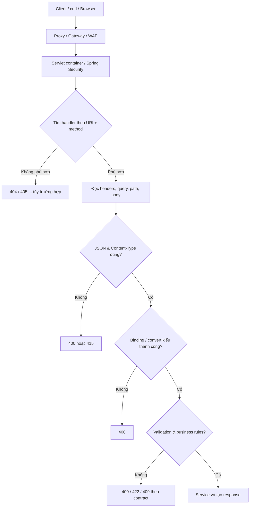
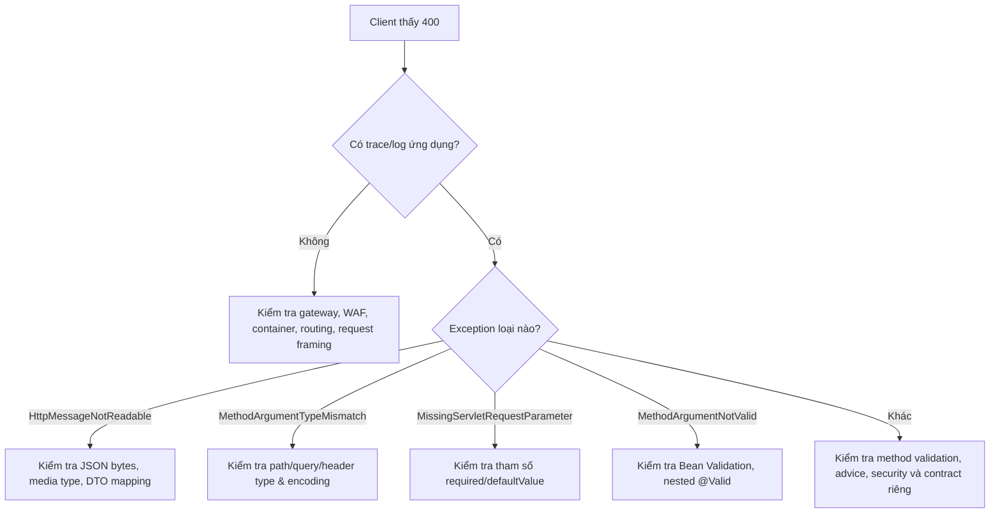

# 400 do binding, JSON không hợp lệ hoặc tham số sai kiểu

## Mục tiêu học tập

Sau bài này, bạn có thể:

- Chẩn đoán `400 Bad Request` của REST API theo đúng tầng xử lý: HTTP request, mapping, JSON deserialization, chuyển đổi kiểu tham số, binding và Bean Validation.
- Phân biệt **JSON sai cú pháp**, **JSON đúng cú pháp nhưng không khớp kiểu Java**, **thiếu tham số bắt buộc**, **path/query parameter sai kiểu** và **vi phạm validation**.
- Nhận biết khi nào lỗi phải là `400`, khi nào thường là `404`, `405`, `406`, `413`, `415` hoặc `422` tùy hợp đồng API.
- Dùng `curl`, DevTools, log/trace an toàn và các exception Spring MVC để tìm nguyên nhân mà không ghi lộ token, cookie hay dữ liệu cá nhân.
- Thiết kế phản hồi theo **Problem Details** với mã lỗi ổn định, thông báo an toàn và `traceId`, thay vì trả nguyên exception message.
- Tạo kiểm thử `MockMvc` cho lỗi binding, deserialization, validation và happy path để ngăn lỗi tái diễn khi thay đổi DTO hoặc contract OpenAPI.

## 1. Tình huống: cùng là 400 nhưng nguyên nhân khác nhau

Giả sử REST API đặt hàng có hợp đồng:

```http
POST /api/orders HTTP/1.1
Host: api.example.com
Authorization: Bearer <test-access-token>
Content-Type: application/json
Accept: application/json

{"sku":"keyboard-01","quantity":2}
```

API mong đợi một `sku` không rỗng và `quantity` là số nguyên dương. Những request dưới đây có thể cùng nhận `400` nhưng cần cách khắc phục khác nhau:

| Request không hợp lệ | Nhóm vấn đề | Giải thích |
| --- | --- | --- |
| `{"sku":"keyboard-01","quantity":2` | JSON sai cú pháp | Thiếu dấu `}`, parser không tạo được object |
| `{"sku":"keyboard-01","quantity":"abc"}` | JSON không khớp kiểu Java | `quantity` là chuỗi không thể chuyển thành `Integer` |
| `{"sku":"keyboard-01","quantity":0}` | Bean Validation | JSON parse được; `@Min(1)` bị vi phạm |
| `{"sku":"","quantity":2}` | Bean Validation | `@NotBlank` không chấp nhận chuỗi rỗng |
| `{"sku":"keyboard-01"}` | Thiếu field bắt buộc về nghiệp vụ | Nếu DTO dùng `Integer` + `@NotNull`, lỗi validation; cách xử lý khác nếu DTO dùng primitive `int` |
| `GET /api/orders/{id}?limit=abc` | Chuyển đổi query parameter thất bại | `limit` khai báo là `Integer` hoặc `int` |
| `GET /api/orders/not-a-uuid` | Chuyển đổi path variable thất bại | Controller khai báo `@PathVariable UUID id` |

**Đừng xử lý mọi `400` bằng “JSON sai”.** Hãy tìm **request nào** gây lỗi, **tầng nào** từ chối và **quy tắc contract nào** bị vi phạm. Sửa sai tầng có thể gây hậu quả: bỏ `@Valid` để tránh lỗi 400 khiến dữ liệu sai đi vào nghiệp vụ; đổi tất cả lỗi thành 500 che giấu lỗi phía client và làm dashboard sai.

## 2. Đường đi của một request trong Spring REST API

Hình dung một request đi qua các tầng:



Đây là sơ đồ tư duy, **không phải thứ tự tuyệt đối** của mọi filter và resolver. Ví dụ Spring Security có thể trả `401` hoặc `403` trước khi request tới controller; gateway có thể trả `400` vì request line/header sai. Spring MVC cũng kiểm tra media type khi chọn handler; nhiều exception được chuyển thành response bởi `HandlerExceptionResolver` hoặc `@ControllerAdvice`.

Một sơ đồ chẩn đoán ngắn gọn:

1. **Ai sinh response?** Gateway, WAF, Servlet container hay ứng dụng Spring? Xem response headers, trace/correlation ID và log từng tầng.
2. **Có match endpoint không?** URI, HTTP method và `Content-Type` có đúng hợp đồng không?
3. **Lỗi xảy ra trước khi gọi service?** Nếu controller/service chưa chạy, kiểm tra argument resolver, Jackson, conversion và validation.
4. **Có mã lỗi ứng dụng?** Dùng `code`/`type` trong Problem Details để phân biệt `INVALID_JSON_BODY`, `INVALID_PARAMETER_TYPE`, `MISSING_PARAMETER`, `VALIDATION_FAILED`.
5. **Tái hiện bằng request tối thiểu** với dữ liệu giả và so sánh happy path, không vội thay mã trạng thái của tất cả lỗi.

## 3. Phân biệt 400 với những mã HTTP gần kề

| Mã | Ý nghĩa thường gặp | Ví dụ trong REST API |
| --- | --- | --- |
| `400 Bad Request` | Request có cú pháp, framing hoặc tham số đầu vào không xử lý được | JSON malformed; query `limit=abc`; UUID không thể parse |
| `401 Unauthorized` | Chưa được xác thực hợp lệ | Thiếu/hết hạn Bearer token, sai scheme |
| `403 Forbidden` | Đã được xác thực hoặc có danh tính nhưng không được phép | Thiếu scope, không được đọc order của tenant khác |
| `404 Not Found` | Không tìm thấy resource/handler hoặc server chọn không tiết lộ sự tồn tại | URI sai, order không tồn tại |
| `405 Method Not Allowed` | URI có handler nhưng không hỗ trợ HTTP method yêu cầu | `PATCH` vào route chỉ khai báo `GET` |
| `406 Not Acceptable` | Không thể tạo representation phù hợp với `Accept` | Client chỉ chấp nhận media type API không sinh ra |
| `409 Conflict` | Xung đột với trạng thái hiện tại | Dùng lại `Idempotency-Key` cho payload khác |
| `413 Content Too Large` | Request body vượt giới hạn được đặt | Upload quá dung lượng |
| `415 Unsupported Media Type` | Server không hỗ trợ `Content-Type` của body | Gửi `text/plain` vào endpoint `consumes=application/json` |
| `422 Unprocessable Content` | Cú pháp/media type hiểu được nhưng nội dung không thể xử lý theo quy tắc nghiệp vụ | Số lượng vượt giới hạn mua, nếu API quy định trả `422` |
| `500 Internal Server Error` | Lỗi không dự kiến ở server | Null dereference, DB/config lỗi, exception không được xử lý |

**Không có quy tắc bắt buộc rằng mọi lỗi Bean Validation phải trả `422`.** Spring MVC thường trả `400` cho lỗi `@Valid @RequestBody` và một số lỗi method validation; một API khác có thể chọn `422` cho nhóm lỗi nghiệp vụ theo hợp đồng. Điều quan trọng là **nhất quán giữa behavior, OpenAPI, tests và tài liệu**.

`400` không dùng để thay cho `401/403` vì nguyên nhân auth; cũng không được đổi validation error thành `500` chỉ vì một exception xảy ra. Lưu ý status thực tế có thể thay đổi theo phiên bản Spring, kiểu handler và cấu hình riêng.

## 4. Bốn giai đoạn đầu vào dễ gây 400

### 4.1. JSON không đúng cú pháp: Jackson không deserialize được

Ví dụ thiếu dấu ngoặc và dấu phẩy:

```http
POST /api/orders HTTP/1.1
Content-Type: application/json

{"sku":"keyboard-01" "quantity":2
```

Jackson không đọc được JSON. Với Spring MVC dùng `@RequestBody`, lỗi thường được đóng gói thành `HttpMessageNotReadableException`, có thể bắt nguồn từ `JsonParseException`. Mã phản hồi mặc định thường là `400`.

Ví dụ đã sửa:

```json
{"sku":"keyboard-01","quantity":2}
```

Cách chẩn đoán: gửi lại **đúng byte body**, xác nhận `Content-Type: application/json`, kiểm tra cú pháp bằng JSON parser và so sánh vị trí lỗi. Đừng chỉ nhìn object JavaScript trước khi serialize: lỗi có thể do client tự nối chuỗi, double-encode JSON, cắt body hoặc dùng sai encoding.

### 4.2. JSON hợp lệ nhưng không khớp kiểu DTO

Giả sử DTO:

```java
record CreateOrderRequest(String sku, Integer quantity) {}
```

Request:

```json
{"sku":"keyboard-01","quantity":"abc"}
```

Đây là **JSON hợp lệ**. Tuy nhiên `"abc"` không chuyển thành số nguyên cho `quantity`; lỗi có thể là `MismatchedInputException`/`InvalidFormatException` bên trong `HttpMessageNotReadableException` tùy đường deserialization và phiên bản Jackson.

Một số cấu hình Jackson chấp nhận chuyển chuỗi số như `"2"` thành `2`; cấu hình khác từ chối coercion. **Đừng dựa vào sự chuyển đổi ngầm không được công bố**. Contract OpenAPI `type: integer` nên được client tuân thủ bằng giá trị JSON number:

```json
{"sku":"keyboard-01","quantity":2}
```

Các ví dụ tương tự: field `LocalDate` nhận ngày sai định dạng, enum không có giá trị tương ứng, UUID nhận chuỗi không hợp lệ trong body, cấu trúc object/list bị đảo, số vượt miền `Integer`, nested object không đúng schema. JSON parser có thể đọc được chuỗi nhưng quá trình **mapping sang Java type** vẫn thất bại.

### 4.3. Query, path và header parameter sai kiểu

Ví dụ controller:

```java
@GetMapping("/api/orders/{id}")
OrderView getOrder(
        @PathVariable UUID id,
        @RequestParam Integer limit) {
    // ...
}
```

Các request:

```http
GET /api/orders/not-a-uuid?limit=10 HTTP/1.1
GET /api/orders/11111111-1111-1111-1111-111111111111?limit=abc HTTP/1.1
GET /api/orders/11111111-1111-1111-1111-111111111111 HTTP/1.1
```

- `id=not-a-uuid`: `ConversionService` không chuyển được sang `UUID`, thường là `MethodArgumentTypeMismatchException` → `400`.
- `limit=abc`: giá trị không chuyển được sang `Integer` → `400`.
- Thiếu hẳn `limit`: `MissingServletRequestParameterException` → `400` nếu `@RequestParam` mặc định bắt buộc.
- `@RequestHeader("X-Requested-Version") Integer version` cũng có thể thất bại khi header sai kiểu; thiếu header bắt buộc có exception riêng.

Đừng nhầm **sai path variable type** với **route không match**: `/api/orders/not-a-uuid` có thể match route template `/api/orders/{id}` rồi thất bại khi convert. Trong một cấu hình khác có pattern ràng buộc số/UUID ngay khi mapping, path có thể không match và trả `404`. Cần xem chữ ký method và routing configuration.

Với date:

```java
@GetMapping("/api/orders")
List<OrderView> list(
        @RequestParam
        @DateTimeFormat(iso = DateTimeFormat.ISO.DATE)
        LocalDate from) {
    // ...
}
```

`from=2026-11-18` phù hợp định dạng ISO date; `from=18/11/2026` thường không parse được với cấu hình này và gây `400`. Ghi định dạng chính xác trong OpenAPI/docs và ví dụ query. Với số thập phân, dấu phẩy/dấu chấm và URL encoding cũng cần được xác định; không để frontend ngầm dùng locale máy người dùng khi API mong đợi định dạng máy đọc được.

### 4.4. Bean Validation: parse được nhưng giá trị không hợp lệ

DTO:

```java
import jakarta.validation.constraints.Min;
import jakarta.validation.constraints.NotBlank;
import jakarta.validation.constraints.NotNull;

record CreateOrderRequest(
    @NotBlank String sku,
    @NotNull @Min(1) Integer quantity
) {}
```

Controller dùng:

```java
@PostMapping("/api/orders")
ResponseEntity<OrderView> create(
        @Valid @RequestBody CreateOrderRequest request) {
    // ...
}
```

Request `{"sku":"","quantity":0}` chuyển được sang DTO, nhưng vi phạm `@NotBlank` và `@Min(1)`. Với Spring MVC Bean Validation thông thường, có thể nhận `MethodArgumentNotValidException` và response `400`.

Nếu gửi `{"sku":"keyboard-01"}`, field `quantity` là `null` và `@NotNull` phát hiện thiếu dữ liệu. Dùng `Integer` giúp phân biệt field không có với giá trị `0`; dùng primitive `int` có thể khiến field vắng mặt được gán giá trị mặc định `0`, khiến thông báo lỗi kém rõ ràng. Cần hiểu cấu hình Jackson, constructor và validation; `@NotNull` trên primitive không có ý nghĩa như trên wrapper.

Đối với method parameter validation (`@Min` trực tiếp trên `@RequestParam`, `@PathVariable`), exception có thể thuộc `HandlerMethodValidationException` ở Spring Framework hiện đại hoặc cơ chế validation qua proxy trong cấu hình khác. **Không chỉ bắt một exception rồi kết luận đã xử lý mọi validation error.**

### 4.5. JSON trống, sai tên field và cấu hình Jackson

Các case hay gặp:

- `@RequestBody` bắt buộc nhưng body trống: có thể dẫn đến `HttpMessageNotReadableException` → `400`.
- Client gửi `quantityValue` trong khi DTO khai báo `quantity`: tùy Jackson, unknown property có thể được bỏ qua hoặc tạo lỗi; nếu bị bỏ qua, `quantity` có thể thành `null` và bị `@NotNull` bắt.
- Backend bật `FAIL_ON_UNKNOWN_PROPERTIES`: field dư có thể khiến deserialization thất bại và trả `400`. Không khẳng định mặc định luôn bật/tắt ở mọi ứng dụng vì Spring Boot và ObjectMapper có thể tùy chỉnh.
- Client gửi body là một JSON string chứa chuỗi JSON, ví dụ `"{\"sku\":\"x\"}"`, thay vì JSON object: JSON hợp lệ nhưng root token không đúng kiểu DTO.
- API yêu cầu `application/json` nhưng client dùng `multipart/form-data` hoặc `text/plain`: ưu tiên kiểm tra lỗi `415`, không tự quy toàn bộ về `400`.

**Quy tắc chẩn đoán:** xem exception class và nguyên nhân bên trong tại tầng server an toàn, sau đó phân loại thành lỗi cú pháp, mapping/coercion, missing parameter hay validation. Không đưa raw exception/payload nhạy cảm vào response cho client.

## 5. Runbook: tái hiện 400 một cách có hệ thống

Đừng bắt đầu bằng việc đổi code. Trước hết thu thập **bằng chứng không chứa bí mật**:

| Cần ghi nhận | Tại sao hữu ích | Chú ý bảo mật |
| --- | --- | --- |
| Thời điểm UTC, môi trường, version API | Đối chiếu deploy/config thay đổi | Không lấy tên máy người dùng làm khóa tìm kiếm nếu không cần |
| HTTP method và route template | Xác minh request đi tới đúng endpoint | Tránh ghi raw URL có token/query chứa PII |
| `Content-Type` và `Accept` | Phân biệt `400` với `415/406` | Không thu thập mọi header |
| HTTP status và mã lỗi ổn định | Biết lỗi parse, binding hay validation | Không trả raw exception message |
| Trace ID/request ID do server cấp | Liên kết frontend, gateway và Spring | Không tin mù `X-Request-Id` do client tự tạo |
| Loại dữ liệu không hợp lệ | Ví dụ “query limit không là integer” | Không log giá trị thô nếu có thể chứa thông tin nhạy cảm |
| Điểm xuất hiện lỗi | Gateway, security filter, MVC hay service | Dữ liệu trong log có phân quyền và retention |

### 5.1. Dựng request thành công tối thiểu

Các lệnh sau minh họa trên **API test/local**, không dùng credential production:

```bash
BASE="http://localhost:8080"

  # JSON hợp lệ, kiểu phù hợp.
curl -i --silent --show-error \
  -X POST "$BASE/api/orders" \
  -H "Content-Type: application/json" \
  -H "Accept: application/json" \
  --data-binary '{"sku":"keyboard-01","quantity":2}'
```

Nếu endpoint có security, phải gửi credential test theo đúng cơ chế được triển khai. Không đưa token thật vào ví dụ, test fixture, shell history được chia sẻ hay bản log hỗ trợ. Các lệnh trên dùng cách quote của Bash/POSIX; trên **Windows PowerShell** nên gọi `curl.exe` để tránh alias của Windows PowerShell 5.1, đồng thời điều chỉnh dấu quote/escape JSON theo quy tắc shell.

Response success có thể là:

```http
HTTP/1.1 201 Created
Location: /api/orders/11111111-1111-1111-1111-111111111111
Content-Type: application/json

{"id":"11111111-1111-1111-1111-111111111111","status":"PENDING"}
```

Nếu lệnh thành công cũng nhận `400`, kiểm tra lại contract thực, auth, route, filter và phiên bản đang chạy trước khi phân tích malformed JSON.

### 5.2. Chỉ thay một biến số mỗi lần

```bash
  # (A) Sai cú pháp JSON: thiếu dấu đóng }.
curl -i --silent --show-error \
  -X POST "$BASE/api/orders" \
  -H "Content-Type: application/json" \
  --data-binary '{"sku":"keyboard-01","quantity":2'

  # (B) JSON hợp lệ, nhưng quantity là chuỗi không parse thành int.
curl -i --silent --show-error \
  -X POST "$BASE/api/orders" \
  -H "Content-Type: application/json" \
  --data-binary '{"sku":"keyboard-01","quantity":"abc"}'

  # (C) Parse và mapping được, nhưng không thỏa @Min(1).
curl -i --silent --show-error \
  -X POST "$BASE/api/orders" \
  -H "Content-Type: application/json" \
  --data-binary '{"sku":"keyboard-01","quantity":0}'

  # (D) Query parameter không đổi được sang Integer.
curl -i --silent --show-error \
  "$BASE/api/orders/11111111-1111-1111-1111-111111111111?limit=abc"

  # (E) Thiếu query parameter bắt buộc.
curl -i --silent --show-error \
  "$BASE/api/orders/11111111-1111-1111-1111-111111111111"
```

Khi so sánh, kiểm tra đồng thời `status`, `Content-Type: application/problem+json` và `code` trong body. Nếu các lỗi cùng có thông điệp chung “Invalid request” thì trace/log theo nhóm exception vẫn cần đủ để chẩn đoán phía server.

### 5.3. Đừng bỏ sót Content-Type/Accept và request bytes

Một lỗi rất phổ biến là:

```bash
  # KHÔNG có Content-Type JSON: curl -d thông thường gửi dạng form.
curl -i -X POST "$BASE/api/orders" \
  -d '{"sku":"keyboard-01","quantity":2}'
```

Với controller khai báo `consumes = application/json`, request này thường bị từ chối bằng `415 Unsupported Media Type`. Hãy sửa:

```bash
curl -i -X POST "$BASE/api/orders" \
  -H "Content-Type: application/json" \
  --data-binary '{"sku":"keyboard-01","quantity":2}'
```

`Content-Type` mô tả representation **client gửi vào**; `Accept` mô tả representation **client muốn nhận lại**. Đổi `Accept` không khắc phục một JSON body malformed. Và sửa `Content-Type` sang JSON không thể tự biến một body JSON sai thành đúng.

Trong browser DevTools → Network, xem:

1. URL/method, request headers (chú ý không sao chép credential ra ngoài), payload ở dạng thực đã gửi.
2. `Content-Type` có phải JSON và `Accept` có phù hợp response không.
3. Status và Problem Details body, trace ID; có preflight `OPTIONS` bị lỗi riêng không.
4. Cách JavaScript serialize body: `JSON.stringify(data)` hay gửi trực tiếp object/`FormData`? Với `FormData`, không tự đặt boundary thủ công.
5. URL encoding cho query: ngày tháng, dấu cách, phần trăm, ký tự đặc biệt và cách client ghép path.

**Bảo vệ dữ liệu trong quá trình debug:** `curl -v` và chế độ full wire log có thể in Authorization, Cookie, body và thông tin cá nhân. Nếu cần verbose, dùng dữ liệu giả trong môi trường test và redact trước khi chia sẻ. Không bật request-body logging toàn bộ production chỉ để điều tra một lỗi `400`.

## 6. Mẫu Spring MVC có hợp đồng đầu vào rõ ràng

Ví dụ Spring Boot 3.x / Spring Framework 6.x, Java 17+, với Jakarta Validation:

```java
import jakarta.validation.Valid;
import jakarta.validation.constraints.Min;
import jakarta.validation.constraints.NotBlank;
import jakarta.validation.constraints.NotNull;
import java.net.URI;
import java.util.Map;
import java.util.UUID;
import org.springframework.http.MediaType;
import org.springframework.http.ResponseEntity;
import org.springframework.web.bind.annotation.GetMapping;
import org.springframework.web.bind.annotation.PathVariable;
import org.springframework.web.bind.annotation.PostMapping;
import org.springframework.web.bind.annotation.RequestBody;
import org.springframework.web.bind.annotation.RequestMapping;
import org.springframework.web.bind.annotation.RequestParam;
import org.springframework.web.bind.annotation.RestController;

record CreateOrderRequest(
    @NotBlank String sku,
    @NotNull @Min(1) Integer quantity
) {}

record CreatedOrder(UUID id, String status) {}

@RestController
@RequestMapping("/api/orders")
class OrdersDemoController {

    @PostMapping(consumes = MediaType.APPLICATION_JSON_VALUE)
    ResponseEntity<CreatedOrder> create(
            @Valid @RequestBody CreateOrderRequest request) {

        UUID id = UUID.randomUUID();
        CreatedOrder result = new CreatedOrder(id, "PENDING");
        return ResponseEntity.created(
            URI.create("/api/orders/" + id)
        ).body(result);
    }

    @GetMapping("/{id}")
    ResponseEntity<Map<String, Object>> find(
            @PathVariable UUID id,
            @RequestParam Integer limit) {
        return ResponseEntity.ok(Map.of(
            "id", id.toString(),
            "limit", limit
        ));
    }
}
```

Đây là controller **giả lập để tập trung vào đầu vào**; chưa có repository, auth, authorization theo owner/tenant hoặc logic order thật. Không đưa ví dụ thẳng vào production. Trong dự án thực tế, `CreateOrderRequest` và schema OpenAPI phải cùng quy định tính bắt buộc, kiểu, giới hạn và ý nghĩa field; `OrdersDemoController` là endpoint test không tạo side effect thanh toán.

Các nguyên tắc:

- `@Valid @RequestBody` kích hoạt validation cho DTO nếu Bean Validation provider được cấu hình (ví dụ dependency `spring-boot-starter-validation`).
- `@NotBlank` phù hợp chuỗi không chứa toàn khoảng trắng; `@NotNull` bắt field số không có/null; `@Min` kiểm tra giới hạn dưới.
- `@RequestParam Integer limit` mặc định bắt buộc; client không gửi sẽ lỗi trước khi vào thân method. Nếu muốn tùy chọn, dùng `required = false`/`Optional` hoặc `defaultValue` có kiểm soát.
- `@PathVariable UUID id` thực hiện conversion trước khi method được gọi.
- `consumes = application/json` khiến media type không tương thích bị xử lý khác với lỗi parse trong JSON, thường là `415`.

**Đừng chữa lỗi 400 bằng cách nới tất cả kiểu thành `String` hoặc bỏ validator.** Nếu thực sự muốn cho phép nhiều định dạng input, hãy thiết kế parser/DTO công khai và ghi rõ rule; thay đổi đó là thay đổi hợp đồng, cần tests và API docs.

## 7. Chuẩn hóa 400 bằng Problem Details

Spring Framework hiện đại có `ProblemDetail` để biểu diễn HTTP API error theo RFC 9457. Mục tiêu của response:

- Có status HTTP đúng; `status` trong body khớp `400`.
- Có `type` và `code` ổn định cho machine client; `detail` an toàn, dễ hiểu và không tiết lộ input/stack trace.
- Có thể có `traceId` do tracing backend cấp, không lấy trực tiếp từ header client chưa kiểm chứng.
- Không echo body, bearer token, cookie, số tài khoản, email hay `exception.getMessage()` nguyên bản.

Ví dụ:

```http
HTTP/1.1 400 Bad Request
Content-Type: application/problem+json
Cache-Control: no-store

{
  "type": "https://api.example.com/problems/invalid-json-body",
  "title": "Invalid request",
  "status": 400,
  "detail": "JSON body không hợp lệ hoặc không đúng cấu trúc yêu cầu.",
  "code": "INVALID_JSON_BODY",
  "traceId": "1b628167f4a54e50bc3e6f8d469313cc"
}
```

`type`, `title`, `status` và `detail` thuộc mô hình Problem Details; `code` và `traceId` là **extension do API định nghĩa**, không phải trường bắt buộc của RFC. Nếu không có trace ID hợp lệ, có thể bỏ field này. Một `type` URL được phép là tài liệu giải thích loại lỗi; nó không phải URL chứa thông tin request cá nhân.

### 7.1. @RestControllerAdvice cho các lỗi phổ biến

```java
import java.net.URI;
import org.slf4j.MDC;
import org.springframework.http.CacheControl;
import org.springframework.http.HttpStatus;
import org.springframework.http.MediaType;
import org.springframework.http.ProblemDetail;
import org.springframework.http.ResponseEntity;
import org.springframework.http.converter.HttpMessageNotReadableException;
import org.springframework.web.bind.MissingServletRequestParameterException;
import org.springframework.web.bind.annotation.ExceptionHandler;
import org.springframework.web.bind.annotation.RestControllerAdvice;
import org.springframework.web.bind.MethodArgumentNotValidException;
import org.springframework.web.method.annotation.MethodArgumentTypeMismatchException;

@RestControllerAdvice
class ApiBadRequestAdvice {

    @ExceptionHandler(HttpMessageNotReadableException.class)
    ResponseEntity<ProblemDetail> unreadable(
            HttpMessageNotReadableException ignored) {
        return badRequest(
            "INVALID_JSON_BODY",
            "JSON body không hợp lệ hoặc không đúng cấu trúc yêu cầu.");
    }

    @ExceptionHandler(MethodArgumentTypeMismatchException.class)
    ResponseEntity<ProblemDetail> wrongParameterType(
            MethodArgumentTypeMismatchException ignored) {
        return badRequest(
            "INVALID_PARAMETER_TYPE",
            "Path hoặc query parameter không đúng kiểu được hỗ trợ.");
    }

    @ExceptionHandler(MissingServletRequestParameterException.class)
    ResponseEntity<ProblemDetail> missingParameter(
            MissingServletRequestParameterException ignored) {
        return badRequest(
            "MISSING_PARAMETER",
            "Thiếu query parameter bắt buộc.");
    }

    @ExceptionHandler(MethodArgumentNotValidException.class)
    ResponseEntity<ProblemDetail> invalidBody(
            MethodArgumentNotValidException ignored) {
        return badRequest(
            "VALIDATION_FAILED",
            "Dữ liệu đầu vào không đáp ứng quy tắc validation.");
    }

    private ResponseEntity<ProblemDetail> badRequest(
            String code, String detail) {
        ProblemDetail problem = ProblemDetail.forStatusAndDetail(
            HttpStatus.BAD_REQUEST, detail);
        problem.setType(URI.create(
            "https://api.example.com/problems/" +
                code.toLowerCase(java.util.Locale.ROOT)
                    .replace('_', '-')));
        problem.setTitle("Invalid request");
        problem.setProperty("code", code);

        String traceId = MDC.get("traceId");
        if (traceId != null && !traceId.isBlank()) {
            problem.setProperty("traceId", traceId);
        }

        return ResponseEntity.status(HttpStatus.BAD_REQUEST)
            .contentType(MediaType.APPLICATION_PROBLEM_JSON)
            .cacheControl(CacheControl.noStore())
            .body(problem);
    }
}
```

Đoạn trên không sử dụng text nguyên bản của exception để tránh rò thông tin. `MDC.get("traceId")` phụ thuộc cơ chế tracing thực tế và ngữ cảnh thread; nếu không có tracing, chỉ bỏ traceId, không tự tin một ID do client gửi. Tên error code và URL là **quy ước minh họa**, hãy dùng domain public của hệ thống trong tài liệu thật.

**Giới hạn của mẫu:** nó xử lý một nhóm exception được chọn để dạy chẩn đoán, **không bao phủ mọi lỗi binding/method validation**. Với Spring Framework 6.1+ có `HandlerMethodValidationException`; các `@RequestHeader` thiếu, lỗi parameter binding đặc thù, lỗi chuyển đổi trong form/model attribute, `NoHandlerFoundException` và lỗi media type cần chính sách riêng. Không thêm `@ExceptionHandler(Exception.class)` để ép **mọi lỗi** về 400, vì như vậy sẽ che lỗi authorization và lỗi server thực sự.

Nếu hệ thống đã có `ResponseEntityExceptionHandler` hoặc advice khác, cần xem **thứ tự xử lý exception** để tránh nhiều handler xung đột. Các override signature, hành vi và cấu hình Problem Details của Spring Boot khác nhau theo version; kiểm tra version dự án trước khi sao chép code vào ứng dụng thật.

### 7.2. Có nên trả tên field lỗi?

Với form nhập liệu, client có thể muốn biết lỗi tại `sku` hay `quantity`. Có thể trả một **danh sách tên field theo allowlist**, chẳng hạn:

```json
{
  "type": "https://api.example.com/problems/validation-failed",
  "title": "Invalid request",
  "status": 400,
  "detail": "Một số trường không hợp lệ.",
  "code": "VALIDATION_FAILED",
  "invalidFields": ["sku", "quantity"]
}
```

Nhưng không trả `FieldError.getRejectedValue()` cho các field mật khẩu, OTP, token hoặc PII. Không ghép trực tiếp text do validator/custom annotation/provider sinh ra vào response nếu message có thể chứa input người dùng. Trong một hệ thống có nhiều ngôn ngữ, client nên dịch UI theo `code`/field code, không parse `detail`.

## 8. Kiểm thử MockMvc: giữ nguyên mã lỗi qua mỗi lần sửa DTO

Ví dụ với Spring Boot Test, Spring MVC Test và JUnit Jupiter. Test dùng controller và advice ở phần trên:

```java
import org.junit.jupiter.api.Test;
import org.springframework.beans.factory.annotation.Autowired;
import org.springframework.boot.test.autoconfigure.web.servlet.AutoConfigureMockMvc;
import org.springframework.boot.test.autoconfigure.web.servlet.WebMvcTest;
import org.springframework.context.annotation.Import;
import org.springframework.http.MediaType;
import org.springframework.test.web.servlet.MockMvc;

import static org.hamcrest.Matchers.startsWith;
import static org.springframework.test.web.servlet.request
    .MockMvcRequestBuilders.get;
import static org.springframework.test.web.servlet.request
    .MockMvcRequestBuilders.post;
import static org.springframework.test.web.servlet.result
    .MockMvcResultMatchers.*;

@WebMvcTest(OrdersDemoController.class)
@Import(ApiBadRequestAdvice.class)
@AutoConfigureMockMvc(addFilters = false)
class RequestInputContractTest {
    @Autowired MockMvc mvc;

    @Test
    void malformedJsonReturns400() throws Exception {
        mvc.perform(post("/api/orders")
                .contentType(MediaType.APPLICATION_JSON)
                .content("{\"sku\":\"keyboard-01\",\"quantity\":2"))
            .andExpect(status().isBadRequest())
            .andExpect(jsonPath("$.code").value("INVALID_JSON_BODY"))
            .andExpect(content().contentTypeCompatibleWith(
                MediaType.APPLICATION_PROBLEM_JSON));
    }

    @Test
    void incompatibleJsonTypeReturns400() throws Exception {
        mvc.perform(post("/api/orders")
                .contentType(MediaType.APPLICATION_JSON)
                .content("{\"sku\":\"keyboard-01\",\"quantity\":\"abc\"}"))
            .andExpect(status().isBadRequest())
            .andExpect(jsonPath("$.code").value("INVALID_JSON_BODY"));
    }

    @Test
    void invalidBeanValidationReturns400() throws Exception {
        mvc.perform(post("/api/orders")
                .contentType(MediaType.APPLICATION_JSON)
                .content("{\"sku\":\"\",\"quantity\":0}"))
            .andExpect(status().isBadRequest())
            .andExpect(jsonPath("$.code").value("VALIDATION_FAILED"));
    }

    @Test
    void missingDtoFieldIsValidationError() throws Exception {
        mvc.perform(post("/api/orders")
                .contentType(MediaType.APPLICATION_JSON)
                .content("{\"sku\":\"keyboard-01\"}"))
            .andExpect(status().isBadRequest())
            .andExpect(jsonPath("$.code").value("VALIDATION_FAILED"));
    }

    @Test
    void wrongQueryTypeReturns400() throws Exception {
        mvc.perform(get("/api/orders/" +
                "11111111-1111-1111-1111-111111111111")
                .param("limit", "abc"))
            .andExpect(status().isBadRequest())
            .andExpect(jsonPath("$.code")
                .value("INVALID_PARAMETER_TYPE"));
    }

    @Test
    void missingQueryParameterReturns400() throws Exception {
        mvc.perform(get("/api/orders/" +
                "11111111-1111-1111-1111-111111111111"))
            .andExpect(status().isBadRequest())
            .andExpect(jsonPath("$.code").value("MISSING_PARAMETER"));
    }

    @Test
    void wrongPathUuidReturns400() throws Exception {
        mvc.perform(get("/api/orders/not-a-uuid")
                .param("limit", "10"))
            .andExpect(status().isBadRequest())
            .andExpect(jsonPath("$.code")
                .value("INVALID_PARAMETER_TYPE"));
    }

    @Test
    void unsupportedMediaTypeIs415Not400() throws Exception {
        mvc.perform(post("/api/orders")
                .contentType(MediaType.TEXT_PLAIN)
                .content("{\"sku\":\"keyboard-01\",\"quantity\":2}"))
            .andExpect(status().isUnsupportedMediaType());
    }

    @Test
    void validBodyStillCreatesResource() throws Exception {
        mvc.perform(post("/api/orders")
                .contentType(MediaType.APPLICATION_JSON)
                .content("{\"sku\":\"keyboard-01\",\"quantity\":2}"))
            .andExpect(status().isCreated())
            .andExpect(header().string("Location",
                startsWith("/api/orders/")))
            .andExpect(jsonPath("$.status").value("PENDING"));
    }
}
```

**Điều kiện để chạy:** Java 17+, Spring Boot 3.x, `spring-boot-starter-web`, `spring-boot-starter-validation`, `spring-boot-starter-test` và nếu dùng Spring Security thì cần cấu hình tương ứng. Ở mẫu test này, `addFilters = false` **chỉ giới hạn mục tiêu kiểm thử cho MVC binding/validation**; không được sao chép lựa chọn này sang production hoặc coi rằng các test đã kiểm chứng authentication, authorization và CSRF. Hãy có bộ integration/security tests riêng bật filter chain đầy đủ, dùng credential test hợp lệ.

Nếu ứng dụng dùng `ResponseEntityExceptionHandler` thay vì advice minh họa, điều chỉnh expected `code` theo hợp đồng thật. Khi nâng version Spring/Jackson, chạy test lại vì tên exception, coercion và cách xử lý argument validation có thể thay đổi. Mục tiêu không phải “mọi thứ trả đúng một mã 400”, mà là **phân biệt chính xác các nhóm lỗi** và giữ response contract ổn định cho client.

### Kiểm thử vượt ngoài đường đi đơn giản

Ngoài ma trận trên, thêm case theo API:

| Test case | Kỳ vọng |
| --- | --- |
| Body rỗng nhưng `@RequestBody` bắt buộc | `400` theo hợp đồng, không gọi service |
| `quantity=null` | Bị `@NotNull` phát hiện |
| `quantity=-1` | Bị `@Min(1)` phát hiện |
| `quantity=2147483648` | Không fit `Integer`, phải có lỗi mapping được kiểm soát |
| `sku` chỉ toàn whitespace | Bị `@NotBlank` phát hiện |
| Body là JSON array thay vì object | Lỗi deserialization nếu DTO yêu cầu object |
| JSON nested sai kiểu | Thông báo an toàn, không echo payload |
| Query ngày sai định dạng | `400` đúng nhóm chuyển đổi |
| Header bắt buộc thiếu | Status/error code theo contract |
| Một số field lạ ở JSON | Theo đúng chính sách Jackson đã công bố |
| Body vượt giới hạn proxy/server | `413` hoặc status tầng nhận request quy định, không nhầm validation |
| JSON hợp lệ và tham số phù hợp | Happy path vẫn đúng sau khi thêm advice |

Sử dụng **test data giả** và một mã canary để chắc chắn `Authorization`/`Cookie`/field nhạy cảm không lọt vào response error hoặc telemetry. Không dùng phản hồi `detail` để echo chính xác giá trị sai mà client đã gửi.

## 9. Phân biệt 400 từ gateway với 400 từ ứng dụng

Một `400` có thể được trả về **trước khi request chạm Spring MVC**:

- Proxy/server từ chối request line hoặc header không hợp lệ.
- URL chứa ký tự không được phép, header quá lớn hoặc encoding không phù hợp chính sách.
- WAF chặn pattern bị xem là nguy hiểm.
- Reverse proxy hoặc load balancer không chấp nhận request framing theo cấu hình.
- Spring Security HTTP firewall có thể từ chối request bất thường trước controller; status cụ thể phụ thuộc handler/filter.

Khi đó `@RestControllerAdvice` **không nhất thiết bắt được lỗi**, vì exception xảy ra ngoài pipeline xử lý controller.

### Mô hình kiểm tra theo tầng



**Không có log ứng dụng chưa đủ kết luận gateway đã gây lỗi**: có thể log sampling, trace propagation bị thiếu, application logging chưa bao phủ error path hoặc filter xử lý trước interceptor. Cần đối chiếu access log có cấu trúc tại gateway và servlet, trace ID cùng timestamp. Không công khai toàn bộ request thô để truy tìm.

Với `400` có `Content-Type: text/html` từ một proxy, trong khi API chuẩn trả `application/problem+json`, đây là **dấu hiệu** response có thể đến từ tầng khác; không phải bằng chứng tuyệt đối vì proxy cũng có thể được cấu hình trả JSON. Xác minh bằng logs/metrics ở đường đi thực tế.

### Một lỗi 400 chỉ xảy ra trên browser

Nếu `curl` chạy được mà frontend không chạy:

- So sánh payload JSON do frontend **thực sự gửi**, không chỉ object trong state.
- Kiểm tra `JSON.stringify`, header `Content-Type`, `fetch` có đang gửi `FormData` hoặc body rỗng không.
- So sánh path/query encoding và các giá trị number/date được format theo locale.
- Kiểm tra frontend có gửi `undefined` khiến field biến mất khỏi JSON không; `null` là một giá trị JSON khác với field thiếu.
- Xem OPTIONS/CORS preflight riêng. Một lỗi CORS có thể khiến JavaScript không đọc được response, nhưng **CORS không có nghĩa** rằng backend đã sinh `400` do JSON.

Nếu chỉ xảy ra sau khi nâng cấp SDK/frontend, kiểm tra DTO/client serialization và version OpenAPI của backend. Một client cũ có thể gửi field/formats mà server mới không còn chấp nhận; đây là vấn đề **compatibility** cần đánh giá chứ không chỉ “input sai”.

## 10. Observability an toàn cho nhóm lỗi 400

Một event đủ dùng cho vận hành:

```json
{
  "event": "http.request.rejected",
  "method": "POST",
  "route": "/api/orders",
  "status": 400,
  "code": "INVALID_JSON_BODY",
  "trace_id": "1b628167f4a54e50bc3e6f8d469313cc"
}
```

**Không ghi** raw `Authorization`, cookie, request body, query chứa PII, email, số thẻ hoặc toàn `exception.getMessage()`. Với exception của Jackson, thông báo debug có thể chứa đoạn source gây lỗi, tên field hoặc vị trí offset; dùng ở kênh điều tra hạn chế truy cập nếu thực sự cần, không đẩy mặc định vào log phổ thông.

Các metric nên có:

| Metric | Nhãn được duyệt | Mục đích |
| --- | --- | --- |
| Tổng request theo status | Method, route template, status class | Phát hiện spike `400` tại endpoint nào |
| Lỗi 400 theo nguyên nhân | `code` enum như `INVALID_JSON_BODY`/`VALIDATION_FAILED` | Biết do thay đổi DTO hay client nhập sai |
| Latency request bị từ chối | Route, status, error enum | Phát hiện request gây tốn nhiều tài nguyên trước khi bị từ chối |
| Tỉ lệ lỗi theo API version | Version đã chuẩn hóa | Xác định client phiên bản cũ gây lỗi |

Tránh đưa `userId`, raw path, token hay giá trị parameter vào metric labels vì vừa lộ dữ liệu vừa tăng cardinality. Khi thấy tỉ lệ `400` tăng sau deploy, hãy so sánh **thời điểm phát hành + thay đổi OpenAPI/DTO + nhóm exception**, rồi ưu tiên sửa contract drift hoặc lỗi serialization của SDK nếu có.

### Kiểm tra tiêu chí thành công của fix

Một lỗi chỉ thật sự được giải quyết khi:

1. Request hợp lệ được xử lý thành công, không phải bằng cách tắt validation toàn bộ.
2. Request sai tiếp tục bị từ chối ở **đúng nhóm status/code** và không gây side effect.
3. Logs/trace đủ để phân loại lỗi, nhưng không lộ raw input/credential.
4. OpenAPI, SDK, example `curl` và backend có cùng hợp đồng.
5. Có regression test chạy trong CI để ngăn lỗi quay lại khi nâng version Spring/Jackson.

## 11. Các ca chẩn đoán điển hình

### Ca A — Field `quantity` có giá trị trông như số nhưng vẫn 400

Client gửi:

```json
{"sku":"keyboard-01","quantity":"2"}
```

Server mong đợi `Integer`. Với cấu hình Jackson A, `"2"` có thể được chuyển thành số; với cấu hình chặt B, request có thể bị từ chối. Đừng gỡ lỗi bằng cách nói “chuỗi số luôn hợp lệ”. Sửa client gửi:

```json
{"sku":"keyboard-01","quantity":2}
```

Và dùng schema OpenAPI `type: integer` cùng contract test để xác nhận behavior đã chọn.

### Ca B — JSON đúng cú pháp nhưng service chưa được gọi

Payload:

```json
{"sku":"keyboard-01","quantity":0}
```

Jackson deserialize thành công; `@Min(1)` từ chối trước khi vào body method. Nếu breakpoint ở service không chạy, đó là điều **mong đợi**. Xem `MethodArgumentNotValidException` và phản hồi `VALIDATION_FAILED`, không vội sửa repository hoặc transaction.

### Ca C — Client đổi dấu ngày và chỉ production lỗi

Frontend local gửi `from=2026-11-18`; trên một trình duyệt/locale khác gửi `from=18%2F11%2F2026`. Server dùng `@DateTimeFormat(iso = ISO.DATE) LocalDate` nên chỉ nhận ISO date. Sửa serializer phía client dùng `YYYY-MM-DD`, ghi contract và test với nhiều locale. Không dùng `Date.toString()` phụ thuộc địa phương để xây query.

### Ca D — 400 sau khi nâng phiên bản Spring Boot

Một endpoint cũ kiểm tra query `limit` bằng annotation validation nhưng exception handler chỉ bắt `MethodArgumentNotValidException`. Sau khi nâng framework, lỗi method parameter validation đi qua handler khác, response JSON đổi cấu trúc. Cần kiểm tra `HandlerMethodValidationException` hoặc exception của cơ chế proxy tùy phiên bản, cập nhật centralized advice và tests. **Không xử lý bằng cách buộc mọi exception trả 400**, vì sẽ ẩn lỗi server/bảo mật.

### Ca E — Gateway trả HTML 400 và không có log controller

Một request chứa URL sai encoding hoặc header bị proxy/WAF từ chối. Không thấy `ApiBadRequestAdvice` chạy. So sánh response từ đường proxy và đường test nội bộ (được ủy quyền), dùng trace/log access theo tầng, kiểm tra quy tắc gateway và header limits. Chỉ thay app controller sẽ không sửa được lỗi trước MVC.

## 12. Bài tập thực hành

**Bài 1 — Phân loại nguyên nhân.** Cho controller nhận `@RequestParam Integer page` và `@Valid @RequestBody CreateOrderRequest`. Với mỗi request, hãy dự đoán tầng lỗi, exception thường gặp, status và cách sửa: JSON thiếu dấu `}`, `quantity:"abc"`, `quantity:0`, `page=abc`, thiếu `page`, `Content-Type: text/plain`.

**Bài 2 — Thiết kế error contract.** Viết ba response `application/problem+json` cho `INVALID_JSON_BODY`, `INVALID_PARAMETER_TYPE` và `VALIDATION_FAILED`. Cần có status, title, detail, code, traceId nếu sẵn có; không echo token, Cookie, body hoặc rejected value. Giải thích vì sao machine client nên đọc `code` thay vì parse `detail`.

**Bài 3 — Spring MVC/MockMvc.** Dùng `OrdersDemoController` và `ApiBadRequestAdvice`, viết test cho 4 request sai và 1 request đúng. Bổ sung `@NotNull`, `@Min`, nested `@Valid` rồi chứng minh validation vẫn chạy. Thử tắt `spring-boot-starter-validation` trong môi trường test riêng và giải thích vì sao behavior thay đổi.

**Bài 4 — URL và date query.** Endpoint `GET /api/orders?from=...` nhận ISO `LocalDate`. Thử `from=2026-11-18`, `from=18/11/2026` và query đã URL encode. Mô tả sự khác biệt giữa URL encoding và date formatting; tạo unit/integration test để không phụ thuộc locale frontend.

**Bài 5 — Điều tra lỗi sau deploy.** Sau triển khai, metric `http.response.status=400` tăng mạnh ở `POST /api/orders`. Hãy lập trình tự kiểm tra: gateway/controller ownership, error code, exception class, DTO/OpenAPI diff, payload canary trong test, patch và regression CI. Không bật raw body/header logging của production.

**Bài 6 — Phân biệt status.** Viết kịch bản và status cho: JSON sai cú pháp, sai media type, body quá lớn, tài nguyên không tồn tại, thiếu scope, xung đột idempotency và lỗi validation nghiệp vụ. Giải thích vì sao dùng `400` cho tất cả là không đủ thông tin cho người tích hợp.

### Câu hỏi tự đánh giá

Bạn có thể trả lời rõ: **Ai trả 400? Tại bước parse, bind/convert hay validate? Có khác gì với 415 và 422?** Nếu DTO Java thay đổi, vì sao phải kiểm tra OpenAPI và client serializer? Khi gặp exception, bạn có thể cho client một lỗi có cấu trúc mà không tiết lộ request nhạy cảm không? Và có test nào chứng minh cả trường hợp sai lẫn đúng vẫn hoạt động?

## Tài liệu tham khảo

- [RFC 9110 — HTTP Semantics (400, 415, 422)](https://www.rfc-editor.org/rfc/rfc9110)
- [RFC 9457 — Problem Details for HTTP APIs](https://www.rfc-editor.org/rfc/rfc9457)
- [Spring Framework — MVC Annotated Controllers](https://docs.spring.io/spring-framework/reference/web/webmvc/mvc-controller.html)
- [Spring Framework — Validation](https://docs.spring.io/spring-framework/reference/core/validation/beanvalidation.html)
- [Spring Framework — Error Responses](https://docs.spring.io/spring-framework/reference/web/webmvc/mvc-ann-rest-exceptions.html)
- [Jakarta Bean Validation Specification](https://jakarta.ee/specifications/bean-validation/)
- [Jackson — Databind](https://github.com/FasterXML/jackson-databind)
- [OWASP — REST Security Cheat Sheet](https://cheatsheetseries.owasp.org/cheatsheets/REST_Security_Cheat_Sheet.html)
