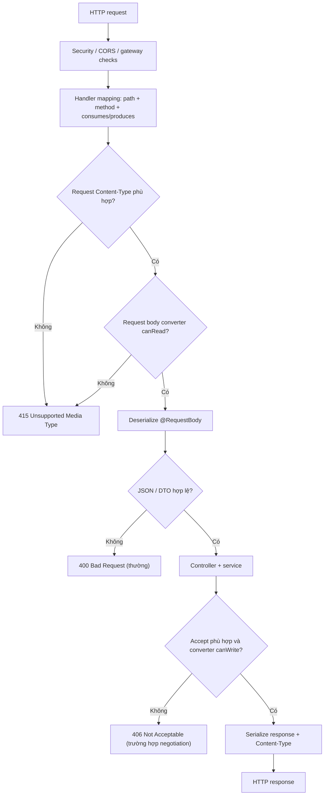

# 406 và 415 do Accept, Content-Type hoặc converter

> **Chương:** Chẩn đoán sự cố  
> **Module:** **INTEGRATION_API_REST** — học thiết kế REST API theo resource, URI, phương thức và mã trạng thái HTTP; xây dựng hợp đồng dữ liệu rõ ràng; thực hành phân trang, cache, idempotency, OpenAPI, xác thực, phân quyền, xử lý lỗi và kiểm thử API bằng Java/Spring hoặc công nghệ tương đương.
>
> **Tình huống trung tâm:** Cùng một endpoint, request từ `curl`, Postman và frontend có thể nhận HTTP `200`, `406 Not Acceptable` hoặc `415 Unsupported Media Type` chỉ vì khác **header đàm phán nội dung**, **kiểu request body** hoặc **cấu hình message converter**. Sửa đúng nghĩa là xác định **client muốn nhận gì**, **client đang gửi gì**, và **server thực sự đọc/ghi được định dạng nào** — không sửa bằng cách đổi ngẫu nhiên status hay mở mọi media type.

## 1. Kết quả học tập và ca lỗi xuyên suốt

Sau bài học, người học có thể:

1. Phân biệt chính xác `Accept`, `Content-Type`, `Content-Encoding`, `produces`, `consumes` và vai trò của HTTP message converters.
2. Giải thích nguyên nhân thường gặp của `406` và `415`, phân biệt chúng với `400`, `422`, `405`, `413`, `401`, `403` và lỗi CORS trong trình duyệt.
3. Tái hiện lỗi bằng `curl`/DevTools, quan sát response status, header, body và trace ID theo từng bước, không thay nhiều biến cùng lúc.
4. Kiểm tra cấu hình Spring MVC: `@RequestBody`, `@RequestMapping(consumes/produces)`, Jackson, `HttpMessageConverter`, error handling và các converter tự đăng ký.
5. Viết test MockMvc cho các trường hợp thành công, 406, 415 và JSON hỏng, đồng thời kiểm thử hợp đồng OpenAPI/consumer.
6. Áp dụng cách sửa không làm suy yếu xác thực, phân quyền, validation, giới hạn body hoặc chính sách browser.

### 1.1. Một API, ba request

Giả sử API chỉ **nhận JSON và trả JSON**:

```http
POST /v1/media-demo/orders HTTP/1.1
Host: api.example.test
Content-Type: application/json
Accept: application/json
Authorization: Bearer <test-token>

{"sku":"SKU-1008","quantity":2}
```

Phản hồi:

```http
HTTP/1.1 201 Created
Location: /v1/media-demo/orders/ord-demo-1
Content-Type: application/json

{"id":"ord-demo-1","status":"NEW"}
```

Nếu client gửi **body JSON nhưng khai báo là văn bản thuần**:

```http
POST /v1/media-demo/orders HTTP/1.1
Content-Type: text/plain
Accept: application/json

{"sku":"SKU-1008","quantity":2}
```

Server có thể trả:

```http
HTTP/1.1 415 Unsupported Media Type
Accept: application/json
```

Nếu client yêu cầu **chỉ XML cho response**, trong khi API chỉ cung cấp JSON:

```http
GET /v1/media-demo/orders/ord-1001 HTTP/1.1
Accept: application/xml
```

Server có thể trả:

```http
HTTP/1.1 406 Not Acceptable
Vary: Accept
```

**Điểm mấu chốt:** `Content-Type` của request nói **dữ liệu gửi lên là gì**, còn `Accept` nói **client chấp nhận phản hồi dạng gì**. Hai header nằm trong *cùng request* nhưng kiểm **hai chiều ngược nhau**. Khi response thành công, `Content-Type` trong *response* lại cho biết server **đã trả định dạng gì**.

## 2. Bản đồ các header và status

| Header hoặc thuộc tính | Chiều | Ý nghĩa | Nếu không tương thích |
|---|---|---|---|
| `Content-Type: application/json` | Request → server | Request body là JSON. | Có thể `415` nếu server không hỗ trợ media type cho operation; JSON hỏng sau khi media type được chấp nhận thường là `400`. |
| `Accept: application/json` | Request → server | Client muốn đọc response JSON. | Có thể `406` khi không có representation phù hợp. |
| `Content-Type: application/json` | Server → client | Representation thực tế trong response là JSON. | Client phải parse đúng content type/schema; không tự suy từ status 200. |
| `Content-Encoding: gzip` | Request hoặc response | Bytes được mã hóa/nén theo coding cụ thể. | Unsupported request content coding cũng có thể dẫn tới `415` theo HTTP semantics. |
| `Accept-Encoding: gzip` | Request → server | Client muốn/cho phép content coding tương ứng. | Không đồng nghĩa `Accept` về media type; phản ứng cụ thể phụ thuộc server và hợp đồng. |
| `Accept-Language: vi` | Request → server | Ưu tiên ngôn ngữ representation. | Không mặc định gây 406 trong mọi Spring REST API. |
| `produces="application/json"` | Spring MVC mapping | Operation cam kết representation response JSON. | `Accept` chỉ XML có thể bị từ chối bằng `406` trước khi vào controller. |
| `consumes="application/json"` | Spring MVC mapping | Operation nhận request content type JSON. | `Content-Type` text/plain có thể bị từ chối bằng `415` trước khi đọc JSON. |

Theo HTTP, `406 Not Acceptable` biểu thị server không tìm được một representation đáp ứng tiêu chí content negotiation mà client đưa ra và không muốn dùng một representation mặc định không phù hợp. `415 Unsupported Media Type` biểu thị server không hỗ trợ định dạng request content cho resource/method này; lý do có thể là media type hoặc content coding.

**Không đảo nghĩa:** 406 **không** có nghĩa request body thiếu field; 415 **không** có nghĩa API không biết tạo JSON response.

### 2.1. Media type gồm những gì?

Một media type có dạng:

```text
type/subtype; parameter=value
```

Ví dụ:

- `application/json` — JSON.
- `application/problem+json` — Problem Details biểu diễn bằng JSON.
- `application/xml`, `text/plain` — XML và văn bản.
- `application/x-www-form-urlencoded` — dữ liệu form URL encoded.
- `multipart/form-data; boundary=----WebKitFormBoundary...` — multipart, cần boundary đúng để parse.
- `application/vnd.example.order+json` — vendor media type có structured suffix `+json`.
- `application/json; charset=UTF-8` — JSON kèm tham số encoding.

JSON được serialize từ object Java **không có nghĩa** mọi media type chứa ký tự `json` đều tự phù hợp với mapping. Spring kiểm media types ở **hai tầng**: điều kiện `consumes/produces` của mapping và khả năng `canRead/canWrite` của converter với class Java + media type.

### 2.2. `Accept` có trọng số `q`

Client có thể đưa nhiều lựa chọn:

```http
Accept: application/xml;q=0.9, application/json;q=0.5
```

Client **ưu tiên XML**, nhưng **vẫn chấp nhận JSON** với chất lượng thấp hơn. API chỉ trả JSON có thể phản hồi `200 application/json`; **không** phải 406 chỉ vì XML đứng đầu.

Các biến thể:

| `Accept` | Ý nghĩa thực hành khi provider chỉ trả JSON |
|---|---|
| Không có header `Accept` | Về mặt content negotiation, không hạn chế media type; JSON có thể được chọn. |
| `Accept: */*` | Chấp nhận mọi media type; JSON có thể được chọn. |
| `Accept: application/json` | JSON phù hợp. |
| `Accept: application/xml, application/json;q=0.4` | JSON vẫn phù hợp nếu không có XML. |
| `Accept: application/xml` | Không có JSON trong danh sách chấp nhận; thường 406. |
| `Accept: application/json;q=0` | JSON không chấp nhận ở chất lượng 0 nếu không có quy tắc khác cho phép; kiểm độ ưu tiên và mức cụ thể theo RFC. |
| `Accept: application/problem+json` | Không tự tương đương `application/json` cho response thành công. |

Trong thực tế, `fetch` có thể gửi `Accept: */*` nếu ứng dụng không đặt cụ thể; browser navigation có thể gửi `Accept` gồm HTML, ảnh và wildcard; thư viện HTTP hoặc SDK sinh tự động có chính sách khác. **Luôn xem request headers thật**, không đoán dựa trên mã JavaScript nhìn thấy.

### 2.3. Content negotiation không giống chuyển đổi dữ liệu

`Content-Type: application/json` đúng không đảm bảo body parse được. Sau bước nhận media type, còn có:

1. Bytes thực có hợp lệ theo charset/content coding không?
2. JSON có đúng cú pháp không?
3. Jackson có deserialize được DTO không?
4. Validation/contract có hợp lệ không?
5. Business rules và authorization có cho phép hành động không?

Mỗi lớp có thể tạo lỗi riêng:

```text
Media type không hỗ trợ      -> 415
Media type phù hợp, JSON sai -> 400 (thường)
DTO parse được, @Valid sai   -> 400 (thường trong Spring MVC)
Payload parse được, rule sai -> 400/409/422 tùy hợp đồng
Không xác thực/không quyền    -> 401/403
Không representation trả về  -> 406
Serializer/config runtime lỗi-> có thể 5xx, không mặc định 406
```

`422 Unprocessable Content` có thể phù hợp khi cú pháp và media type đúng nhưng hướng dẫn trong nội dung không thể được xử lý theo nghiệp vụ. Không nên tự đổi mọi lỗi Bean Validation từ `400` thành `422` khi chưa định nghĩa contract.

## 3. Cơ chế chọn handler và converter trong Spring MVC

### 3.1. Hai chiều xử lý trong request lifecycle



Đây là mô hình khái niệm, **không phải thứ tự gọi chính xác trong mọi Spring Framework version**. Spring có thể kiểm `consumes`/`produces` ngay khi chọn handler, trước khi vào method. Với nhiều mapping trùng path nhưng khác `consumes/produces`, quá trình chọn handler có thêm bước lựa chọn mapping thích hợp.

Với error handler, filter/gateway và converter lỗi, status cuối có thể khác sơ đồ. Để chẩn đoán phải xem log `resolvedException` và response thực, không chỉ stack trace.

### 3.2. Converter là gì?

`HttpMessageConverter<T>` trong Spring MVC có nhiệm vụ đọc/ghi HTTP message body theo Java type và media type. Một số ví dụ:

| Thành phần | Thường xử lý | Lưu ý |
|---|---|---|
| `MappingJackson2HttpMessageConverter` | Java object ↔ JSON | Cần Jackson phù hợp; mặc định thường hỗ trợ `application/json` và `application/*+json` ở converter. |
| `StringHttpMessageConverter` | `String` và text media types | Controller trả `String` có thể đi qua converter khác với DTO JSON. |
| `ByteArrayHttpMessageConverter` | `byte[]` và nhiều binary media types | Tránh suy ra cứ trả bytes là JSON. |
| `ResourceHttpMessageConverter` | File/resource response | Hợp đồng binary/download khác JSON. |
| `FormHttpMessageConverter` và các thành phần multipart | Form URL-encoded, form/multipart theo đường xử lý phù hợp | `@RequestPart`/`MultipartResolver` có quy tắc riêng; không đồng nhất multipart với JSON DTO. |
| XML converter tương ứng | XML nếu đã khai báo và có dependency | Không mặc định mọi dự án Boot có thể sản xuất/đọc XML. |

Với `spring-boot-starter-web` và Jackson trên classpath, Spring Boot thường tự đăng ký JSON converter phù hợp. Nhưng project có thể đã cấu hình lại `WebMvcConfigurer`, `@EnableWebMvc`, custom converter hoặc custom `ObjectMapper` làm thay đổi danh sách/tính năng.

**Hai điều kiện khác nhau phải cùng đúng:**

- `@PostMapping(consumes = "application/json")` chỉ cho phép media type khai báo ở **mapping**.
- Converter vẫn phải có thể `canRead(CreateOrderRequest.class, application/json)`.

Tương tự, `@GetMapping(produces = "application/json")` chưa bảo đảm DTO serialize thành JSON được nếu Jackson/custom converter bị gỡ hoặc gặp kiểu không serialize được. Khi message write thất bại giữa chừng có thể là `500` hoặc connection failure, **không có quy tắc mọi lỗi serialize đều là 406**.

### 3.3. `@RequestBody`, `@RequestPart` và `@ModelAttribute` khác nhau

- `@RequestBody` trên DTO cùng `Content-Type: application/json` thường đi qua JSON converter.
- `@RequestParam`/`@ModelAttribute` xử lý query/form fields theo cơ chế binding; không mặc nhiên cần JSON converter.
- `@RequestPart` cho một part JSON trong multipart sử dụng content type **của part**, còn multipart parsing cần boundary và cấu hình riêng.
- `@RequestBody String` có thể đọc `text/plain`, nhưng không có nghĩa controller DTO JSON chấp nhận `text/plain`.
- Method không đọc request body, ví dụ `GET /orders/{id}`, thường không cần đặt `Content-Type`; đừng giả định chỉ vì header bất thường ở GET là sẽ nhận 415.

### 3.4. Khi `@EnableWebMvc` hoặc converter custom gây hồi quy

Ví dụ phản ví dụ:

```java
@Configuration
@EnableWebMvc
class FullMvcControl {
    // Từ đây nhóm dự án chịu trách nhiệm nhiều cấu hình MVC;
    // đừng thêm chỉ để "sửa 406".
}
```

Trong Spring Boot, `@EnableWebMvc` giành quyền điều khiển MVC config ở mức rộng và có thể khiến nhiều auto-configuration tiện ích không còn được áp dụng như mong đợi. Tùy phiên bản/config, converter, format, resource handling và error behavior có thể khác trước.

Các lỗi cấu hình thường gặp:

- Ghi đè danh sách converter thay vì mở rộng khiến Jackson JSON converter biến mất.
- Đăng ký converter custom trước Jackson với `canWrite` quá rộng, rồi tạo `Content-Type` sai.
- Controller đổi return type từ DTO sang `String` nhưng vẫn mong JSON serialization của DTO.
- Thêm XML library trong một environment nhưng không thêm trong environment khác.
- Định nghĩa `consumes/produces` trên class và method khiến tập media types thực tế hẹp hơn dự kiến.
- Một `ResponseBodyAdvice` thay body không còn tương thích converter đã được chọn.

Phương án sửa là **xác nhận dependency/registered converters và request mapping thực**, sau đó điều chỉnh cấu hình đúng phạm vi. Không xóa toàn bộ `consumes` và `produces` như một cách “để request nào cũng vào”.

## 4. Dựng API mẫu bằng Java 17+ / Spring Boot 3

Ví dụ dưới đây dùng Java records, Spring MVC và Bean Validation. Mục đích là kiểm content negotiation, **không phải backend sản xuất**: dữ liệu lưu trong RAM, không có auth/transaction bền vững. Ở production, cần gắn Spring Security, object-level authorization, persistence, idempotency, limits và logging.

### 4.1. Dependencies tối thiểu

```kotlin
// build.gradle.kts - minh họa; versions theo Spring Boot BOM
dependencies {
    implementation("org.springframework.boot:spring-boot-starter-web")
    implementation("org.springframework.boot:spring-boot-starter-validation")
    testImplementation("org.springframework.boot:spring-boot-starter-test")
}
```

`spring-boot-starter-web` đưa vào Spring MVC và JSON Jackson theo cấu hình thông thường; `starter-validation` cần cho `@Valid`/Jakarta Validation trên DTO trong các bản Boot tương ứng.

### 4.2. Controller có `consumes` và `produces` rõ ràng

Đặt controller và records cùng package; đây là một file Java minh họa:

```java
package example.orders.media;

import jakarta.validation.Valid;
import jakarta.validation.constraints.Max;
import jakarta.validation.constraints.Min;
import jakarta.validation.constraints.NotBlank;
import java.net.URI;
import java.util.concurrent.ConcurrentHashMap;
import java.util.concurrent.ConcurrentMap;
import java.util.concurrent.atomic.AtomicLong;
import org.springframework.http.HttpStatus;
import org.springframework.http.MediaType;
import org.springframework.http.ResponseEntity;
import org.springframework.web.bind.annotation.*;
import org.springframework.web.server.ResponseStatusException;

record CreateOrderRequest(
    @NotBlank String sku,
    @Min(1) @Max(100) int quantity
) {}

record OrderResponse(String id, String status) {}

@RestController
@RequestMapping("/v1/media-demo")
class MediaNegotiationDemoController {
    private final AtomicLong sequence = new AtomicLong();
    private final ConcurrentMap<String, OrderResponse> orders =
        new ConcurrentHashMap<>();

    MediaNegotiationDemoController() {
        orders.put("ord-1001", new OrderResponse("ord-1001", "PAID"));
    }

    @GetMapping(path = "/orders/{id}",
                produces = MediaType.APPLICATION_JSON_VALUE)
    OrderResponse get(@PathVariable String id) {
        OrderResponse found = orders.get(id);
        if (found == null) {
            throw new ResponseStatusException(HttpStatus.NOT_FOUND);
        }
        return found;
    }

    @PostMapping(path = "/orders",
                 consumes = MediaType.APPLICATION_JSON_VALUE,
                 produces = MediaType.APPLICATION_JSON_VALUE)
    ResponseEntity<OrderResponse> create(
            @Valid @RequestBody CreateOrderRequest body) {

        String id = "ord-demo-" + sequence.incrementAndGet();
        OrderResponse created = new OrderResponse(id, "NEW");
        orders.put(id, created);

        return ResponseEntity
            .created(URI.create("/v1/media-demo/orders/" + id))
            .body(created);
    }
}
```

**Giải thích đúng:** 

- `GET` chỉ định `produces` vì không đọc body, nên chỉ đàm phán representation response.
- `POST` chỉ định `consumes/produces` vì vừa đọc request body vừa trả response JSON.
- `@RequestBody` yêu cầu converter đọc body; `@Valid` kiểm constraint sau deserialize.
- `ResponseEntity.created(...)` trả `201` và `Location`, body JSON khi client chấp nhận.
- `GET` có thể truy vấn record vừa tạo trong bản demo, nhưng dữ liệu mất khi restart và không có concurrency/persistence model production.
- Nếu `Accept` chỉ yêu cầu XML, method GET/POST bị từ chối bởi `produces` hoặc bước ghi response, thay vì “thử xuất XML bất chấp hợp đồng”.
- Nếu `Content-Type` không phù hợp JSON ở POST, request bị từ chối trước khi controller chạy; không có side effect tạo order.
- Trên API thật, `POST` phải kiểm Bearer token, quyền tạo order, idempotency và quota **trước khi lưu**; không bỏ security chỉ vì đang điều tra media type.

### 4.3. Các HTTP request đối chứng

**GET đúng:**

```bash
curl -i 'http://localhost:8080/v1/media-demo/orders/ord-1001' \
  -H 'Accept: application/json'
```

**GET chấp nhận nhiều định dạng (JSON vẫn được phép):**

```bash
curl -i 'http://localhost:8080/v1/media-demo/orders/ord-1001' \
  -H 'Accept: application/xml;q=0.9, application/json;q=0.5'
```

**GET gây 406 khi chỉ nhận XML:**

```bash
curl -i 'http://localhost:8080/v1/media-demo/orders/ord-1001' \
  -H 'Accept: application/xml'
```

**POST đúng media type, trả 201:**

```bash
curl -i -X POST 'http://localhost:8080/v1/media-demo/orders' \
  -H 'Content-Type: application/json' \
  -H 'Accept: application/json' \
  --data '{"sku":"SKU-1008","quantity":2}'
```

**POST gây 415 vì Content-Type sai:**

```bash
curl -i -X POST 'http://localhost:8080/v1/media-demo/orders' \
  -H 'Content-Type: text/plain' \
  -H 'Accept: application/json' \
  --data '{"sku":"SKU-1008","quantity":2}'
```

**POST body là JSON hỏng, media type đúng — thường 400:**

```bash
curl -i -X POST 'http://localhost:8080/v1/media-demo/orders' \
  -H 'Content-Type: application/json' \
  -H 'Accept: application/json' \
  --data '{"sku": "SKU-1008", "quantity": }'
```

**POST Content-Type đúng nhưng Accept chỉ XML — 406:**

```bash
curl -i -X POST 'http://localhost:8080/v1/media-demo/orders' \
  -H 'Content-Type: application/json' \
  -H 'Accept: application/xml' \
  --data '{"sku":"SKU-1008","quantity":2}'
```

Ở ví dụ POST cuối, Spring có thể kiểm `produces` ngay trong handler mapping; do đó không tạo order. **Tuy nhiên không bao giờ dựa vào “Accept sai” làm cơ chế ngăn side effect** nói chung: nếu implementation serialize thất bại *sau* khi business action đã commit, client vẫn có thể nhận lỗi dù thay đổi đã xảy ra. POST thật cần idempotency.

**Trên Windows PowerShell 5.1:** tên `curl` có thể là alias cho `Invoke-WebRequest`, khác cú pháp `curl` ở Bash; dùng `curl.exe` hoặc câu lệnh PowerShell chuẩn khi tái hiện. Không che redirect, TLS hoặc proxy khác biệt trong so sánh.

## 5. Bảng chẩn đoán 406, 415 và các lỗi dễ nhầm

| Triệu chứng | Giải thích có thể | Bằng chứng cần tìm | Sửa ở đâu? |
|---|---|---|---|
| `GET` với `Accept: application/xml` trả 406; JSON GET trả 200 | API chỉ `produces: application/json`. | Request `Accept`, mapping `produces`, response `Vary` nếu có. | Client chấp nhận JSON hoặc provider hỗ trợ XML **có chủ ý**. |
| `POST` body JSON nhưng `Content-Type: text/plain` trả 415 | Mapping/converter chỉ nhận JSON. | `Content-Type` request, `consumes`, converter `canRead`. | Client gửi đúng media type; không tự parse JSON từ text/plain. |
| `POST` gửi JSON hợp lệ nhưng quên Content-Type | `consumes` có thể không match; converter không biết đọc. | Request raw, có header hay không. | Đặt `Content-Type: application/json`. |
| JSON Content-Type đúng nhưng syntax hỏng trả 400 | Parser đọc được media type nhưng body sai. | `HttpMessageNotReadableException`, log đã lọc bí mật. | Sửa JSON syntax hoặc DTO mapping. |
| JSON đúng nhưng Bean Validation trả 400 | `@Valid` constraint không đạt. | Validation field errors, Problem Details code. | Sửa dữ liệu hoặc contract; không đổi media type. |
| Accept đúng, Content-Type đúng nhưng 406 | Có thể thiếu/không tương thích converter ghi, mapping variant, error path. | Registered converters, return type, `produces`, handler/error logs. | Kiểm canWrite/type/mapping/handler; không đoán chỉ từ status. |
| XML được client yêu cầu, converter XML có trong classpath, vẫn 406 | `produces` giới hạn JSON dù có converter XML. | So mapping conditions với converter list. | Chọn đúng contract, bổ sung produces XML nếu thực sự hứa hỗ trợ. |
| Custom `+json` request trả 415 | `consumes=application/json` không match vendor media type. | Content-Type chính xác và mapper. | Khai báo media type hỗ trợ rõ, kiểm schema/version. |
| Multipart upload trả 415 | Server nhận JSON nhưng client gửi multipart hoặc ngược lại. | `consumes`, `boundary`, `@RequestPart`/`@RequestBody`. | Dùng đúng multipart contract và parser, không đổi bừa Content-Type. |
| File upload trả 413 | Body quá lớn, không phải 415. | Proxy/Servlet limits, upload bytes. | Giảm file hoặc dùng upload protocol đúng, giữ size cap. |
| `OPTIONS` lỗi, browser báo CORS | Browser không cho gửi/đọc request thật. | DevTools preflight status/CORS headers. | CORS/security/gateway, không “sửa” bằng Accept. |
| `GET` sai method trả 405 | Method không được hỗ trợ cho resource. | Method, `Allow` header, route. | Gọi đúng method/route; không đổi Content-Type. |
| Client nhận 406 sau gateway, backend trực tiếp 200 | Proxy/WAF hoặc transformation khác. | Raw headers/status ở từng hop, request ID. | Gateway/WAF routing/policy, không chỉ controller. |
| Content-Type `application/json` nhưng response là HTML login | Redirect/session/auth hoặc error rendering khác. | Redirect chain, `Location`, response body/media type. | Xử lý auth, không coi HTML là JSON. |

### 5.1. Tại sao không dùng một “mẹo” sửa chung?

Các cách chữa nguy hiểm:

- **Thêm `produces = "*/*"`** để 406 biến mất: có thể khiến API cam kết cả định dạng không biết serialize và tạo response không dự đoán được.
- **Bỏ `consumes` và để DTO tự nhận mọi body**: converter vẫn có giới hạn, client gửi sai contract có thể lọt tới nhánh khác, mở rộng bề mặt tấn công.
- **Tự đọc request InputStream rồi parse mọi thứ như JSON**: bỏ qua content type, size bounds, parser constraints và khả năng kiểm tra/observability chuẩn.
- **Bắt tất cả exception trả HTTP 200**: làm client không biết lỗi, phá monitoring, retry và hợp đồng REST.
- **Cố trả body JSON cho mọi 406**, kể cả client chỉ chấp nhận XML: có thể tạo lỗi content negotiation thứ hai và che nguyên nhân đầu.
- **Cấu hình CORS wildcard** khi browser báo lỗi: không sửa nguyên nhân 406/415, có thể tạo lỗ hổng thiết kế credential.
- **Tắt Spring Security/CSRF** chỉ để request đi vào controller: làm suy yếu hệ thống mà lỗi media type vẫn tồn tại.

## 6. Quy trình điều tra từng bước — không đoán

### Bước 1 — Thu thập request/response thực tế

Lấy các thông tin sau từ DevTools Network, proxy access logs và request IDs:

- Method, scheme, host, port, path **sau rewrite**, status ở mỗi hop.
- `Accept` gửi thật (bao gồm `q` và wildcard).
- `Content-Type` request và **body bytes thực** (không copy secrets/PII vào ticket).
- `Content-Encoding` và `Transfer-Encoding` nếu có.
- `Content-Type` response, `Vary`, `Allow`, `Location`, `WWW-Authenticate`, error type.
- Controller/handler match, `consumes`/`produces`, converter được dùng hoặc exception class.
- Có TLS/redirect, gateway, CORS preflight, WAF, content compression hay serializer custom không?

Không đưa Bearer token/cookie/idempotency key thật vào tài liệu lỗi. Thu thập schema/sample đã ẩn dữ liệu, hash/fingerprint có kiểm soát và request ID để liên kết log.

### Bước 2 — Thay đổi đúng một header

Ví dụ cùng URI/credential, thử:

1. `Accept: application/json`, `Content-Type: application/json` → xem 2xx.
2. Giữ body, đổi **chỉ** `Accept: application/xml` → xem 406.
3. Quay lại `Accept: application/json`, đổi **chỉ** `Content-Type: text/plain` → xem 415.
4. Quay lại headers đúng, sửa body thành JSON sai cú pháp → xem 400.

**Tránh đổi cả hai header cùng lúc.** Một request vừa có `Accept` sai vừa có `Content-Type` sai có thể bị từ chối ở một trong các tầng kiểm tùy mapping/exception resolution. Không dựa vào status của một thử nghiệm mâu thuẫn kép để kết luận quy tắc chung.

### Bước 3 — Dùng `curl` tái hiện tại cùng đường mạng

Thực hiện `curl -i` mà không tự động theo redirect trước; để thấy status/`Location` đầu tiên. Có thể dùng `-v` để kiểm request headers thực gửi, nhưng cần lọc bỏ thông tin bí mật trước khi lưu log.

Nếu `curl` chạy **trên server** và frontend chạy **trên browser máy khách**, kết quả có thể khác vì hostname/DNS/TLS/proxy và auth/cookie. Khi chỉ curl GET mà frontend lỗi POST, kết luận “API chạy bằng curl” chưa có ý nghĩa.

### Bước 4 — Xác định tầng trả 406/415

Một số nguồn:

| Tầng | Dấu hiệu | Hướng kiểm |
|---|---|---|
| Ingress/WAF/API Gateway | Không thấy request tới app hoặc status đổi khi gọi direct service. | Log gateway, routing rules, request ID, header rewrite/validation. |
| Spring handler mapping | Handler không được chọn vì `consumes/produces`. | Mapping info và exception media type. |
| Argument resolver/converter đọc | Mapping nhận nhưng `@RequestBody` không đọc được. | Converter list, DTO type, Content-Type, body/encoding. |
| Jackson deserialize | JSON syntax hoặc mapping sai. | `HttpMessageNotReadableException` và wrapped cause đã lọc secrets. |
| Spring converter ghi | Không có converter `canWrite` phù hợp Java type + Accept. | Return type, converters, produces, chosen media type. |
| Exception handler | Business lỗi nhưng advice cố serialize ProblemDetail media type không acceptable. | Error resolver, error representation, Accept trong request. |
| Browser policy | Request không rời browser hoặc JS không được đọc response. | Console CORS/CSP/mixed content, OPTIONS. |
| Client parsing | Server trả 200/JSON nhưng JS gọi `response.text()` hoặc parse sai. | Response body/Content-Type và code parse. |

### Bước 5 — Quan sát converter với logging có giới hạn

Trong môi trường dev/test có thể bật logger liên quan Spring MVC ở `DEBUG`:

```yaml
logging:
  level:
    org.springframework.web.servlet.mvc.method.annotation: DEBUG
    org.springframework.web.servlet.mvc.condition: DEBUG
    org.springframework.http.converter: DEBUG
```

Tên logger/độ chi tiết log phụ thuộc Spring Framework version, không đảm bảo logger nào cũng in toàn bộ đường chọn converter. Không bật `TRACE` toàn hệ thống hoặc log request body, bearer token hay session cookie ở production để “xem cho rõ”. Ưu tiên thông tin có cấu trúc: request ID, route template, method, status, request media type, Accept đã giới hạn độ dài, exception class và error code.

Nếu có Actuator `mappings` trong môi trường bảo mật có thể kiểm mapping được đăng ký; **không** expose `/actuator/mappings` ra public chỉ để debug 415.

### Bước 6 — Chỉ sửa khi có bằng chứng

- Nếu client gửi sai `Content-Type`: sửa client SDK, frontend `fetch`/Axios, OpenAPI generated client.
- Nếu server `consumes` quá hẹp so với contract: mở đúng những media types đã công bố và test serializer/parser, không dùng wildcard.
- Nếu `Accept` sai: sửa client `Accept` hoặc chủ động bổ sung representation mới với converter và test hợp đồng.
- Nếu converter thiếu: thêm dependency/cấu hình chính xác, kiểm JSON mapper, support Java type và integration tests.
- Nếu error mapping phá negotiation: sửa advice để không cố serialize body không được chấp nhận.
- Nếu gateway rewrite/drop header: sửa gateway và test từ ngoài vào, không thay controller bừa.
- Nếu HTTP đã đúng nhưng browser lỗi: xem CORS/CSRF/cookie/CSP riêng.

## 7. Spring: chẩn đoán response 406 và request 415 bằng exception

Trong Spring MVC, các exception thường thấy gồm:

- `HttpMediaTypeNotAcceptableException` — không tìm thấy representation đáp ứng content negotiation, thường dẫn đến `406`.
- `HttpMediaTypeNotSupportedException` — media type request không được hỗ trợ, thường dẫn đến `415`.
- `HttpMessageNotReadableException` — request body đã vào bước đọc nhưng không parse được hoặc mapping thất bại, thường dẫn đến `400`.
- `MethodArgumentNotValidException` — DTO đã đọc nhưng Bean Validation không hợp lệ, thường `400` trong Spring MVC mặc định.

Không được suy ra **mọi** 406/415 đều là exception này: gateway hoặc thư viện xử lý ngoài MVC có thể trả status tương tự.

### 7.1. Trả lỗi media type mà không phát sinh vòng lặp converter

Với một API chỉ hỗ trợ JSON, cách đơn giản để tránh lỗi thứ hai ở đường 406 là **trả 406 không có body** (còn nếu chủ động cung cấp danh sách format hỗ trợ, body đó cũng phải negotiable).

```java
package example.orders.media;

import org.springframework.http.HttpHeaders;
import org.springframework.http.HttpStatus;
import org.springframework.http.MediaType;
import org.springframework.http.ResponseEntity;
import org.springframework.http.converter.HttpMessageNotReadableException;
import org.springframework.web.HttpMediaTypeNotAcceptableException;
import org.springframework.web.HttpMediaTypeNotSupportedException;
import org.springframework.web.bind.annotation.ExceptionHandler;
import org.springframework.web.bind.annotation.RestControllerAdvice;

@RestControllerAdvice
class MediaNegotiationAdvice {

    @ExceptionHandler(HttpMediaTypeNotAcceptableException.class)
    ResponseEntity<Void> notAcceptable(
            HttpMediaTypeNotAcceptableException ex) {

        // Đừng cố serialize application/problem+json nếu client
        // đã khẳng định chỉ chấp nhận application/xml.
        return ResponseEntity.status(HttpStatus.NOT_ACCEPTABLE)
            .header(HttpHeaders.VARY, HttpHeaders.ACCEPT)
            .build();
    }

    @ExceptionHandler(HttpMediaTypeNotSupportedException.class)
    ResponseEntity<Void> unsupported(
            HttpMediaTypeNotSupportedException ex) {

        // Header Accept trong response 415 có thể cho biết request
        // media types được hỗ trợ cho resource này (RFC 9110).
        // Ở đây controller demo chỉ nhận JSON.
        return ResponseEntity.status(HttpStatus.UNSUPPORTED_MEDIA_TYPE)
            .header(HttpHeaders.ACCEPT, MediaType.APPLICATION_JSON_VALUE)
            .build();
    }

    @ExceptionHandler(HttpMessageNotReadableException.class)
    ResponseEntity<Void> badJson(HttpMessageNotReadableException ex) {
        return ResponseEntity.badRequest().build();
    }
}
```

**Phạm vi của ví dụ:** Handler 415 sử dụng `Accept: application/json` vì **tất cả operation đọc body trong demo** đều nhận JSON. Ở API nhiều endpoint hỗ trợ media type khác nhau, **không dùng header cứng toàn cục này**: xác định media types được hỗ trợ theo route/resource, hoặc dùng cơ chế mặc định Spring phù hợp. `415` có thể do content coding, khi đó header `Accept-Encoding` (không phải `Accept`) có thể liên quan. Không khẳng định luôn trả header `Accept` cho mọi `415`.

Nếu chuẩn lỗi của dự án dùng **RFC 9457 Problem Details**:

```http
HTTP/1.1 415 Unsupported Media Type
Content-Type: application/problem+json
Accept: application/json

{
  "type": "https://api.example.test/problems/unsupported-media-type",
  "title": "Định dạng request không được hỗ trợ",
  "status": 415
}
```

Chỉ phát body `application/problem+json` khi **error representation phù hợp** với client/hợp đồng, hoặc đã quyết định chính sách xử lý lỗi riêng có kiểm thử. `Accept: application/json` **không tự động có nghĩa** client cho phép mọi `application/*+json`. Vì vậy mẫu handler đơn giản ở trên chọn bodyless 406/415 thay vì tạo tranh chấp mới khi trình bày.

### 7.2. Giữ đúng semantics ở security và error layer

Đừng viết:

```java
@ExceptionHandler(Exception.class)
ResponseEntity<String> everything(Exception ex) {
    return ResponseEntity.ok("something went wrong");
}
```

Cách này biến `415`, `406`, `400`, `401`/`403` hoặc 5xx thành HTTP `200`, phá contract và có thể làm retry sai. Với ứng dụng dùng `ResponseEntityExceptionHandler`, có thể override các handler có sẵn với **chữ ký đúng phiên bản Spring Framework**, không thêm `@ExceptionHandler` trùng cho cùng exception trong cùng advice gây ambiguity.

Tương tự, auth filter có thể trả 401/403 **trước khi** controller hoặc exception advice được dùng; CORS preflight có thể bị xử lý trước media negotiation. Giữ error handling ở tầng đúng và không giả định `@RestControllerAdvice` nhìn thấy mọi lỗi gateway/security.

## 8. Consumer-side: curl, Fetch, Axios và generated clients

### 8.1. Fetch gửi JSON đúng

```javascript
async function createOrder(accessToken) {
  const response = await fetch("/v1/media-demo/orders", {
    method: "POST",
    headers: {
      "Authorization": "Bearer " + accessToken,
      "Content-Type": "application/json",
      "Accept": "application/json"
    },
    body: JSON.stringify({ sku: "SKU-1008", quantity: 2 })
  });

  if (!response.ok) {
    // Khi CORS hợp lệ, 406/415 là HTTP response đọc được.
    throw new Error("API returned HTTP " + response.status);
  }
  return await response.json();
}
```

Không tự đặt `Content-Type: multipart/form-data` khi dùng `FormData`: browser phải tự sinh `boundary` khớp payload. Nếu dùng `FormData` để gọi endpoint chỉ nhận JSON, đó là **sai hợp đồng**; không đổi Accept để sửa 415.

### 8.2. Hai header dễ bị copy nhầm

**Sai:**

```javascript
await fetch("/v1/media-demo/orders", {
  method: "POST",
  headers: {
    "Accept": "application/json",
    "Content-Type": "text/plain"
  },
  body: JSON.stringify({ sku: "SKU-1008", quantity: 2 })
});
```

Dù `JSON.stringify` tạo text hợp lệ chứa JSON, `Content-Type: text/plain` thông báo **không** phải JSON media type cho server. Nếu mapping `consumes=application/json`, server từ chối 415 là đúng hợp đồng.

**Cũng sai khi gọi một API chỉ trả JSON:**

```javascript
await fetch("/v1/media-demo/orders/ord-1001", {
  headers: { "Accept": "application/xml" }
});
```

Nếu không có XML representation, server có thể trả 406. Đổi sang `Accept: application/json` khi client parse JSON.

### 8.3. Axios, Postman và generated client

- Axios có thể tự cấu hình `Accept` và `Content-Type` tùy payload/phiên bản; interceptor hoặc wrapper nội bộ cũng có thể ghi đè.
- Postman có thể tự điền header theo lựa chọn “raw JSON”; phải xem **Headers thực gửi**.
- SDK sinh từ OpenAPI thường thiết lập `Accept` theo response content và `Content-Type` theo requestBody content. Nếu OpenAPI sai hoặc không cập nhật khi endpoint đổi, SDK có thể gửi sai dù mã gọi “đúng” theo bản SDK cũ.
- Browser có SOP/CORS riêng; thành công bằng Postman không chứng minh frontend đọc được response. Ngược lại, một HTTP `415` từ server là **lỗi thực** khi browser đã gửi request thành công qua mạng.
- Một frontend gọi API theo route proxy same-origin có thể bị proxy thêm `Content-Type`, normalize header hoặc redirect; kiểm **cả phía browser và server**.

### 8.4. JSON request không tự cần preflight — nhưng Content-Type có thể làm thay đổi browser flow

Một `POST` cross-origin với `Content-Type: application/json` thường kích hoạt CORS preflight, còn một `POST` có content type thuộc nhóm safelisted và không có custom headers có thể đi thẳng. Vì vậy khi browser báo lỗi trước khi gửi POST:

1. Xem DevTools có request `OPTIONS` không.
2. Nếu preflight fail, sửa CORS/gateway/security để OPTIONS được xử lý đúng.
3. Nếu preflight pass rồi POST trả 415, sửa `Content-Type`/contract hoặc converter ở **POST**.
4. Nếu POST trả 415 nhưng response thiếu CORS headers, JS có thể báo “CORS error” và không đọc được status; server logs và Network sẽ giúp phân biệt hai lỗi **cùng tồn tại**.

Không bật `Access-Control-Allow-Origin: *` cho request có cookie credentials, cũng không tắt CSRF chỉ để request đạt tới controller.

## 9. Vendor media types, versioning, XML, multipart và PATCH

### 9.1. Vendor JSON và structured suffix

Ví dụ client gửi:

```http
Content-Type: application/vnd.example.order-v2+json
Accept: application/vnd.example.order-v2+json
```

Jackson converter có thể hiểu một số `application/*+json`, nhưng controller khai báo `consumes=application/json` hoặc `produces=application/json` vẫn có thể **không match** vendor media type. Có hai chính sách rõ ràng:

- **Không hỗ trợ vendor type:** trả `415` ở chiều request hoặc `406` ở chiều response và mô tả media types chính thức trong OpenAPI.
- **Có hỗ trợ:** công bố media type, schema version và mapping `consumes/produces` tương ứng, test cả serialization và compatibility của v2.

Không đổi wildcard `*/*` để “mở version” mà không có test. Suffix `+json` chỉ nói về cú pháp representation, **không bảo đảm semantics/domain version giống nhau**.

### 9.2. API có JSON và XML

Muốn hỗ trợ XML thật sự, cần:

1. Thêm converter/library XML phù hợp, ví dụ Jackson XML trên classpath theo dependency management.
2. Model Java serializable/deserializable trong cả hai định dạng; annotation và wrapping có thể khác.
3. `@GetMapping(produces = {"application/json","application/xml"})` khi contract hứa cả hai.
4. Test `Accept` cụ thể, wildcard, quality factor, response `Content-Type` và `Vary: Accept` khi cùng URL chọn nhiều representation.
5. Security, cache key/`Vary`, error representation và OpenAPI response content tương ứng.

Ví dụ annotation:

```java
@GetMapping(
    path = "/orders/{id}",
    produces = {
        MediaType.APPLICATION_JSON_VALUE,
        MediaType.APPLICATION_XML_VALUE
    }
)
OrderResponse get(@PathVariable String id) {
    return orders.findVisibleById(id);
}
```

Đây là **mảnh minh họa**, không phải một implementation XML hoàn chỉnh. Nếu chưa cài XML converter tương thích, thêm `produces=application/xml` một mình không làm service trả XML được. Việc có một converter có thể `canWrite` cũng chưa chứng minh schema XML đúng hợp đồng.

### 9.3. Multipart: Content-Type của request và từng part

Request upload:

```http
POST /v1/uploads HTTP/1.1
Content-Type: multipart/form-data; boundary=----demoBoundary
Accept: application/json

------demoBoundary
Content-Disposition: form-data; name="metadata"
Content-Type: application/json

{"description":"Ảnh sản phẩm"}
------demoBoundary
Content-Disposition: form-data; name="file"; filename="photo.png"
Content-Type: image/png

<binary-data>
------demoBoundary--
```

Ở đây:

- Request tổng dùng `multipart/form-data; boundary=...`.
- Part metadata có `Content-Type: application/json`, dùng converter phù hợp với `@RequestPart`.
- Part file có image media type, cần kiểm magic bytes/size/scan/quarantine.
- Thiếu boundary có thể gây parser/binding error, không nên luôn gọi là 415.
- Nếu endpoint controller chỉ `consumes=application/json` mà client gửi multipart, 415 là đúng.

**Cảnh báo:** Không tự dùng regex/đọc toàn body trong RAM để “hỗ trợ multipart”; cần parser và giới hạn upload đúng tầng, vì converter và multipart đều có rủi ro cạn bộ nhớ/disk.

### 9.4. PATCH dùng media type có semantics riêng

Một API có thể hỗ trợ:

- `application/json-patch+json` theo JSON Patch (RFC 6902).
- `application/merge-patch+json` theo JSON Merge Patch (RFC 7396).

Cả hai đều có JSON syntax nhưng **không cùng semantics**, và không tự tương đương `application/json` cho operation `PATCH`. Phải công bố `consumes` và implementation áp patch tương ứng, validate quyền trên từng field và kiểm idempotency/ETag/`If-Match` khi cần.

HTTP `Accept-Patch` có thể được dùng trong response (ví dụ `OPTIONS`) để quảng bá patch media types được hỗ trợ; nó khác `Accept` request và khác `Accept` trong response 415 gợi ý request media types.

## 10. OpenAPI contract: ghi rõ request và response media types

Một đặc tả OpenAPI 3.1 ngắn cho API demo:

```yaml
openapi: 3.1.0
info:
  title: Media Negotiation Demo API
  version: 1.0.0
paths:
  /v1/media-demo/orders:
    post:
      operationId: createOrder
      summary: Tạo đơn hàng mẫu
      requestBody:
        required: true
        content:
          application/json:
            schema:
              type: object
              required: [sku, quantity]
              properties:
                sku:
                  type: string
                  minLength: 1
                quantity:
                  type: integer
                  minimum: 1
                  maximum: 100
      responses:
        "201":
          description: Đã tạo
          headers:
            Location:
              schema:
                type: string
          content:
            application/json:
              schema:
                $ref: "#/components/schemas/Order"
        "400":
          description: JSON hoặc input không hợp lệ
        "406":
          description: Không có representation response phù hợp
        "415":
          description: Không hỗ trợ request media type
  /v1/media-demo/orders/{id}:
    get:
      operationId: getOrder
      parameters:
        - in: path
          name: id
          required: true
          schema:
            type: string
      responses:
        "200":
          description: Đơn hàng
          content:
            application/json:
              schema:
                $ref: "#/components/schemas/Order"
        "404":
          description: Không tồn tại
        "406":
          description: Không có representation response phù hợp
components:
  schemas:
    Order:
      type: object
      required: [id, status]
      properties:
        id:
          type: string
        status:
          type: string
          enum: [NEW, PAID]
```

OpenAPI `requestBody.content.application/json` mô tả **media type client phải gửi**; `responses.201.content.application/json` mô tả **representation client có thể nhận**. Khi generated client gửi sai Accept/Content-Type, kiểm trước hết **OpenAPI nguồn và version của SDK**. Một service đổi `consumes/produces` mà không đổi OpenAPI sẽ tạo hợp đồng không nhất quán.

**Contract tests** nên xác minh wire-level request/response với provider thực, không chỉ validate YAML. Consumer mock test xanh không chứng minh converter thật còn hoạt động trên production.

### 10.1. Cache và `Vary: Accept` khi hỗ trợ nhiều representation

Nếu cùng URL có thể trả JSON hoặc XML tùy `Accept`, shared cache cần phân biệt variant. Một response phù hợp có thể chứa:

```http
HTTP/1.1 200 OK
Content-Type: application/json
Vary: Accept
ETag: "order-1001-json-v3"
```

ETag và cache key không được làm lẫn representation hoặc tenant/authorization context. Nếu JSON/XML có bytes khác, ETag cho từng representation cần tuân semantics validator; không mặc định dùng một ETag mạnh cho hai nội dung byte khác nhau.

Khi API chỉ trả JSON bất kể Accept phù hợp, `Vary: Accept` có thể không cần cho response thành công cố định, nhưng đường 406 vẫn có thể đặt header nếu response thực sự thay đổi theo Accept. Kiểm chính sách cache thực thay vì thêm Vary mọi nơi một cách máy móc.

## 11. MockMvc: kiểm lỗi media type như một hợp đồng

Đoạn test sau tập trung ở **tầng Spring MVC content negotiation**, không kiểm JWT, CSRF hay network của cluster. Với Spring Boot 3 + `spring-boot-starter-test`, thêm filter disabling cho test scope để media type được kiểm độc lập.

```java
package example.orders.media;

import static org.springframework.test.web.servlet.request.MockMvcRequestBuilders.*;
import static org.springframework.test.web.servlet.result.MockMvcResultMatchers.*;

import org.junit.jupiter.api.Test;
import org.springframework.beans.factory.annotation.Autowired;
import org.springframework.boot.test.autoconfigure.web.servlet.AutoConfigureMockMvc;
import org.springframework.boot.test.autoconfigure.web.servlet.WebMvcTest;
import org.springframework.context.annotation.Import;
import org.springframework.http.MediaType;
import org.springframework.test.web.servlet.MockMvc;

@WebMvcTest(MediaNegotiationDemoController.class)
@Import(MediaNegotiationAdvice.class)
@AutoConfigureMockMvc(addFilters = false) // Chỉ cô lập bài test media types.
class MediaNegotiationContractTest {
    @Autowired MockMvc mvc;

    @Test
    void getJsonAccepted() throws Exception {
        mvc.perform(get("/v1/media-demo/orders/ord-1001")
                .accept(MediaType.APPLICATION_JSON))
            .andExpect(status().isOk())
            .andExpect(content().contentTypeCompatibleWith(
                MediaType.APPLICATION_JSON))
            .andExpect(jsonPath("$.id").value("ord-1001"))
            .andExpect(jsonPath("$.status").value("PAID"));
    }

    @Test
    void getXmlOnlyIsNotAcceptable() throws Exception {
        mvc.perform(get("/v1/media-demo/orders/ord-1001")
                .accept(MediaType.APPLICATION_XML))
            .andExpect(status().isNotAcceptable());
    }

    @Test
    void getWildcardAcceptCanReceiveJson() throws Exception {
        mvc.perform(get("/v1/media-demo/orders/ord-1001")
                .accept(MediaType.ALL))
            .andExpect(status().isOk())
            .andExpect(content().contentTypeCompatibleWith(
                MediaType.APPLICATION_JSON));
    }

    @Test
    void postJsonCreatesResource() throws Exception {
        mvc.perform(post("/v1/media-demo/orders")
                .contentType(MediaType.APPLICATION_JSON)
                .accept(MediaType.APPLICATION_JSON)
                .content("""
                    {"sku":"SKU-1008","quantity":2}
                    """))
            .andExpect(status().isCreated())
            .andExpect(header().exists("Location"))
            .andExpect(jsonPath("$.status").value("NEW"));
    }

    @Test
    void postTextPlainBodyIsUnsupported() throws Exception {
        mvc.perform(post("/v1/media-demo/orders")
                .contentType(MediaType.TEXT_PLAIN)
                .accept(MediaType.APPLICATION_JSON)
                .content("""
                    {"sku":"SKU-1008","quantity":2}
                    """))
            .andExpect(status().isUnsupportedMediaType());
    }

    @Test
    void postJsonWithOnlyXmlAcceptIsNotAcceptable() throws Exception {
        mvc.perform(post("/v1/media-demo/orders")
                .contentType(MediaType.APPLICATION_JSON)
                .accept(MediaType.APPLICATION_XML)
                .content("""
                    {"sku":"SKU-1008","quantity":2}
                    """))
            .andExpect(status().isNotAcceptable());
    }

    @Test
    void postInvalidJsonIsBadRequestNotUnsupportedMedia() throws Exception {
        mvc.perform(post("/v1/media-demo/orders")
                .contentType(MediaType.APPLICATION_JSON)
                .accept(MediaType.APPLICATION_JSON)
                .content("""
                    {"sku":"SKU-1008","quantity":}
                    """))
            .andExpect(status().isBadRequest());
    }

    @Test
    void postValidJsonWithInvalidQuantityIsBadRequest()
            throws Exception {
        mvc.perform(post("/v1/media-demo/orders")
                .contentType(MediaType.APPLICATION_JSON)
                .accept(MediaType.APPLICATION_JSON)
                .content("""
                    {"sku":"SKU-1008","quantity":0}
                    """))
            .andExpect(status().isBadRequest());
    }
}
```

**Điều test chứng minh:** Trong cấu hình Spring MVC được khởi tạo cho controller mẫu, path/method/`consumes`/`produces` và converter cho kết quả như contract. Nếu có `@RestControllerAdvice`, test có thể xác minh thêm header `Accept` trên 415 hoặc `Vary` trên 406; không phụ thuộc text lỗi mặc định có thể thay theo phiên bản.

**Điều test không chứng minh:** Security filter thực, token JWT thật, gateway rewrite, CORS preflight, HTTP/2, TLS, browser và cluster deployment. Cần thêm `@SpringBootTest(webEnvironment = RANDOM_PORT)` với HTTP client thực, security integration test có JWT decoder/JWKS phù hợp, và end-to-end browser test nếu frontend cross-origin.

### 11.1. Bổ sung kiểm thử DTO/converter

| Thử nghiệm | Vì sao cần |
|---|---|
| `Content-Type: application/json;charset=UTF-8` | Media type có parameter có còn tương thích không? |
| Body không có Content-Type | Mapping/converter có từ chối đúng contract? |
| `Accept: application/xml;q=0.9, application/json;q=0.5` | Server có chọn JSON vẫn được chấp nhận? |
| `Accept: application/json;q=0` | Chứng minh q-value bị tôn trọng theo semantics. |
| `Accept: application/problem+json` cho GET thành công | Không tự coi Problem JSON là JSON response thành công. |
| Converter custom đăng ký trước Jackson | Có làm đổi serialization/Content-Type không? |
| Dữ liệu JSON sai kiểu hoặc số lượng vượt max | 400 hay lỗi validation chính xác, không 415. |
| Trả DTO chứa kiểu Java không serialize được | Phát hiện lỗi runtime/serialization và log nguyên nhân. |
| `Content-Type: application/vnd.example.order+json` | Endpoint có hỗ trợ vendor media type không? |
| Multipart với boundary thiếu hoặc part content type sai | Phân biệt parser error, 400, 415 và 413. |
| `PATCH application/merge-patch+json` | Media type/schema/semantics patch có được triển khai đúng? |
| Controller trả `ResponseEntity<String>` | Converter có thể tạo text/plain khác DTO JSON; test response thực. |
| Không có converter XML nhưng `produces` thêm XML | Test phải phát hiện 406 hoặc failure phù hợp, không cho ra XML giả. |
| `@RequestMapping` trên class có `consumes/produces` | Mọi handler thực có bị thu hẹp ngoài ý muốn không? |
| `401` do filter trước handler | Không nhầm auth failure với negotiation; không cần mở controller. |

Nếu test cùng endpoint ở nhiều dependency profiles, hãy kiểm cả local/staging/prod container image với converter list được cấu hình thật. Đặc biệt, việc dùng một JSON mapper tùy chỉnh ở integration test nhưng Boot default trong production có thể khiến test 2xx mà service thật trả 5xx hoặc media type khác.

## 12. Chẩn đoán browser, gateway và vận hành

### 12.1. Browser thấy CORS, server thấy 415

Một frontend chạy `https://shop.example.test` gọi `https://api.example.test` với `Content-Type: application/json`:

1. Browser có thể gửi `OPTIONS` preflight vì content type không safelisted và/hoặc header Authorization.
2. Nếu `OPTIONS` bị 401/403/404 hoặc thiếu `Access-Control-Allow-Headers`, POST thật có thể chưa xảy ra; đó **không** phải 415 của JSON parser.
3. Nếu preflight thành công, POST đến server với Content-Type. Server có thể trả 415 vì mapping/converter không khớp.
4. Nếu response 415 thiếu header CORS, browser chặn JS đọc status/body và báo lỗi CORS dù server thực đã trả 415.

Cần đối chiếu Console, Network (OPTIONS rồi POST), server access logs và API response headers. `fetch` khi nhận HTTP 415 **không reject Promise chỉ vì status** nếu CORS cho phép đọc; client phải kiểm `response.ok` và `response.status`.

### 12.2. Gateway có thể biến đổi header

Các hành vi thực tế:

- Gateway loại bỏ/ghi đè `Accept` hoặc `Content-Type`.
- Proxy tự giải nén request hoặc thêm/chỉnh `Content-Encoding`.
- WAF trả status 406/415 riêng vì policy hoặc file upload.
- Routing slash/path rewrite đưa request đến controller có `consumes/produces` khác.
- CDN trả cached response cho variant sai khi `Vary`/cache key không phân biệt media type.
- Một downstream error handler trả HTML login page trong khi client mong JSON.

**Không** suy ra Spring là nguồn tạo status chỉ vì ứng dụng viết bằng Spring Boot. Xác định response bắt nguồn từ gateway hay app qua correlation ID, log và đường truy cập trực tiếp **được phép**. Không dùng bypass WAF/TLS production không được phê duyệt.

### 12.3. Observability hữu ích mà không log body

Schema event minh họa:

```json
{
  "event.name": "http.server.request.rejected",
  "service.name": "orders-api",
  "request.id": "req-2a01",
  "http.request.method": "POST",
  "http.route": "/v1/media-demo/orders",
  "http.response.status_code": 415,
  "http.request.content_type": "text/plain",
  "http.request.accept": "application/json",
  "error.code": "UNSUPPORTED_REQUEST_MEDIA_TYPE"
}
```

Đối với `406`, ghi mã khác:

```json
{
  "event.name": "http.server.request.rejected",
  "service.name": "orders-api",
  "request.id": "req-2a02",
  "http.request.method": "GET",
  "http.route": "/v1/media-demo/orders/{id}",
  "http.response.status_code": 406,
  "http.request.accept": "application/xml",
  "error.code": "NO_ACCEPTABLE_REPRESENTATION"
}
```

Không log raw URI/query chứa token hoặc ID nhạy cảm; hạn chế chiều dài `Accept`/`Content-Type`, không log Authorization/Cookie/body. Metric nên nhóm theo **route template**, status code, error code hữu hạn; không dùng giá trị header tùy ý hoặc request ID làm metric label gây cardinality cao.

Nếu lỗi tăng sau deploy, kiểm thay đổi OpenAPI/sdk, client interceptor, filter/gateway, Jackson/converter dependencies, controller mapping và error handler theo thứ tự thời gian. Cần có test compatibility khi đổi media types giống như khi đổi JSON fields.

## 13. Runbook xử lý sự cố 406/415

### 13.1. Khi nhận cảnh báo 406 tăng đột ngột

1. Lọc metrics/log `status=406` theo route và `service.version`.
2. Chọn request ID của một client lỗi, lấy `Accept` thực (đã redacted) và endpoint.
3. Kiểm mapping `produces`/return type/converter `canWrite`, so với OpenAPI đã công bố.
4. Tái hiện bằng `curl` giữ URI/auth cố định, đổi duy nhất `Accept`.
5. Kiểm error path: `Accept` chỉ XML nhưng advice có cố serialize Problem Details JSON không?
6. Nếu trước gateway 200 nhưng qua gateway 406, rà header rewrite/WAF và deployment config.
7. Sửa client hoặc server theo hợp đồng, bổ sung test cho media types và q-values.
8. Theo dõi status distribution, p95/p99, errors do serializer và tỷ lệ 406 sau rollout.

### 13.2. Khi nhận cảnh báo 415 tăng đột ngột

1. Lọc `status=415` theo route/method/client version.
2. Xem `Content-Type`, content coding, body size và `consumes`; không đọc raw PII.
3. Nếu body là JSON nhưng `text/plain`, sửa SDK/Fetch/Axios request headers.
4. Nếu Content-Type đúng nhưng handler từ chối, kiểm converter list, DTO type, route mapping và wrapper/interceptor.
5. Nếu lỗi xảy ra với multipart/PATCH, kiểm media type và protocol riêng, không chuyển hết về JSON.
6. Tái hiện `curl` cùng headers và payload test; kiểm cùng đường ingress.
7. Chỉ mở media types được công bố/kiểm thử, giữ input validation, upload limits và auth.
8. Bổ sung regression test 201/400/406/415, kiểm response error body nếu có.

### 13.3. Nếu lỗi chỉ xảy ra sau deploy

Ma trận nhanh:

| Đã thay đổi | Nguy cơ | Kiểm tra |
|---|---|---|
| Frontend/SDK version | `Accept`/`Content-Type` default khác. | Network raw headers, SDK config. |
| Spring Boot/Jackson dependencies | Converter order/availability thay đổi. | Dependency versions trong build và runtime converters. |
| Thêm `@EnableWebMvc` | Thay MVC auto-configuration. | MVC configuration và integration test thực. |
| API controller mapping | `consumes/produces` thu hẹp. | Handler mappings và contract diff. |
| Gateway/WAF | Header bị rewrite, route khác. | Request/response ở hai hop. |
| Security policy | 401/403 trước mapping. | Security logs/WWW-Authenticate, không mặc định 406/415. |
| Error advice | Content negotiation của error response thất bại. | Advice resolver và Accept tương thích. |
| Nâng cấp multipart upload | Boundary/part parser config khác. | Request capture an toàn, multipart tests. |

**Rollback** là một lựa chọn khi thay đổi gây breaking behavior trên nhiều client; không “vá nóng” bằng cách trả 200 cho tất cả lỗi.

## 14. Bài tập thực hành

### Bài 1 — Phân loại 406 hay 415

Cho bốn request đến API chỉ nhận/trả JSON:

1. `GET /orders/1` với `Accept: application/xml`.
2. `POST /orders`, body JSON hợp lệ, `Content-Type: text/plain` và `Accept: application/json`.
3. `POST /orders`, `Content-Type: application/json` nhưng body thiếu dấu ngoặc/không phải JSON hợp lệ.
4. `POST /orders`, `Content-Type: application/json`, body JSON đúng và `Accept: application/xml`.

Dự đoán status phù hợp, vị trí lỗi trong Spring MVC và chứng cứ để xác minh. Giải thích vì sao request (2) không được đổi thành 400 khi hợp đồng chưa hỗ trợ `text/plain`.

### Bài 2 — Thực hành curl có đối chứng

Chạy API demo ở mục 4. Gọi GET/POST thành công rồi cố tình thay duy nhất `Accept`, `Content-Type` và JSON syntax. Lưu bảng gồm method, hai header, status, response content type, exception class (nếu log thấy), controller có chạy hay không và quyết định sửa.

**Tiêu chí:** Không thay nhiều biến cùng lúc; không dùng token thật và không gộp 406/415/400 thành “JSON lỗi”.

### Bài 3 — Tìm lỗi sau khi thêm XML

Một team thêm Jackson XML dependency và `@GetMapping(produces = "application/json")` vẫn giữ nguyên. Frontend mới gửi `Accept: application/xml` và nhận 406. Hãy chỉ ra vì sao “đã thêm converter XML” vẫn chưa đủ; thiết kế mapping, response schema, OpenAPI và test cho JSON/XML, q-values và `Vary`.

### Bài 4 — Media type vendor

Client phiên bản mới gửi `application/vnd.shop.order-v2+json` nhưng provider chỉ công bố `application/json`. Hãy chọn chính sách hỗ trợ/từ chối, chỉ ra mapping `consumes`/`produces` cần sửa nếu mở version, và kiểm cross-version compatibility. Giải thích vì sao `+json` không bảo đảm schema v2 tương thích v1.

### Bài 5 — Lỗi converter không còn Jackson

Sau một thay đổi cấu hình Spring MVC, `POST application/json` bắt đầu trả 415 và GET `Accept: application/json` có lỗi. Hãy lập kế hoạch kiểm dependency, registered converters, controller signatures, `@EnableWebMvc` và exception handler. Đề xuất minimal fix có test, không xóa toàn bộ mapping constraints.

### Bài 6 — Browser chỉ báo CORS error

Frontend cross-origin gửi POST JSON, DevTools có `OPTIONS 204` và `POST 415`, nhưng JavaScript chỉ thấy `TypeError: Failed to fetch`. Hãy chứng minh có **hai vấn đề riêng**: request POST có media type sai và response 415 không đạt CORS policy. Xử lý hai tầng mà không dùng wildcard CORS với credentials hoặc tắt CSRF.

### Bài 7 — Error representation và HTTP contract

Client gửi `Accept: application/xml` tới API chỉ có JSON. Team muốn trả `406` kèm `application/problem+json`. Hãy giải thích rủi ro không có acceptable representation, chọn bodyless 406 hoặc cơ chế trả error representation có chủ ý, bổ sung OpenAPI và test. Đừng dùng catch-all chuyển lỗi sang 200.

### Câu hỏi tự kiểm tra

1. `Accept` mô tả request body hay response representation?
2. `Content-Type` trong request và response khác nhau như thế nào?
3. Tại sao body là JSON hợp lệ nhưng Content-Type text/plain vẫn có thể trả 415?
4. Request thiếu Accept có nhất thiết 406 không?
5. `Accept: application/xml;q=0.9, application/json;q=0.5` có buộc provider phải trả XML không?
6. Vì sao `Accept: application/problem+json` không tự có nghĩa “chấp nhận JSON thành công”?
7. Controller có Jackson XML converter nhưng `produces` chỉ JSON có thể trả XML được không?
8. Khi JSON syntax hỏng nhưng Content-Type JSON đúng, vì sao thường trả 400 chứ không phải 415?
9. `HttpMediaTypeNotSupportedException` và `HttpMediaTypeNotAcceptableException` thường ứng với status nào?
10. `@RequestBody String` và `@RequestBody OrderDto` có thể dùng converter khác nhau không?
11. Vì sao lỗi serialize sau DB commit có thể nguy hiểm với retry POST?
12. `@RestControllerAdvice` có nhìn thấy 415 do gateway/WAF trả không?
13. `@EnableWebMvc` có thể ảnh hưởng Boot auto-configuration thế nào?
14. Tại sao không được tự đặt Content-Type multipart/form-data khi gửi FormData trong browser?
15. Khi browser báo CORS mà server log 415, cần điều tra những tầng nào?

**Tiêu chí đạt:** Học viên dùng request/response headers để phân biệt đúng 406, 415 và 400; chỉ ra chỗ handler mapping/converter có thể từ chối; sửa **đúng chiều dữ liệu**; có test Spring và curl tái hiện; giữ nguyên authentication, authorization, CORS/CSRF và giới hạn tài nguyên.

## 15. Checklist khi đóng sự cố

- [ ] Đã xác định method/path/status thực tại client, gateway và ứng dụng.
- [ ] Có request ID và request headers `Accept`/`Content-Type` đã làm sạch, cùng response Content-Type.
- [ ] Đã kiểm redirects, CORS preflight, auth failure trước khi kết luận lỗi converter.
- [ ] Đã xác định mapping `consumes/produces` và Java return/request body type thực.
- [ ] Đã kiểm converter `canRead/canWrite`, JSON/XML dependencies và custom MVC config.
- [ ] Đã phân biệt media type sai (415) với JSON syntax sai (400) và response representation sai (406).
- [ ] Đã kiểm `Accept` wildcard/q-values, không tự coi XML ưu tiên là XML bắt buộc.
- [ ] Đã kiểm body/error representation không tạo một lỗi 406 thứ hai.
- [ ] Sửa OpenAPI/SDK/client hoặc provider theo hợp đồng, không mở wildcard tùy tiện.
- [ ] Có MockMvc tests 200/201, 406, 415, 400 và integration test security riêng.
- [ ] Có test browser/gateway nếu lỗi chỉ thấy trong môi trường triển khai thực.
- [ ] Không ghi bearer token, cookie, PII, raw request/response body vào log điều tra.
- [ ] Đã đánh giá tác động tới cache/`Vary: Accept` và client cũ khi mở thêm media type.
- [ ] Có rollback và metric theo route/status/client version nếu lỗi tái phát.

## 16. Kết luận và tài liệu tham khảo

HTTP `406` và `415` không phải hai cách viết khác nhau của “JSON hỏng”:

- **406 — phía trả về:** client không chấp nhận representation mà server hỗ trợ (hoặc không có converter viết phù hợp).
- **415 — phía nhận vào:** server không hỗ trợ media type/content coding của request.
- **400 — dữ liệu:** media type có thể đã đúng, nhưng JSON syntax/deserialization/validation không hợp lệ.

Trong Java/Spring REST API, phải đồng thời xét `Accept`, `Content-Type`, `@RequestMapping(consumes/produces)`, converter registry, type Java và exception handling. Chẩn đoán bằng request thực, thay một biến mỗi lần, so sánh với OpenAPI và giữ kiểm thử qua cả framework, gateway và browser.

Tài liệu tham khảo:

- [RFC 9110 — HTTP Semantics](https://www.rfc-editor.org/rfc/rfc9110) — `Accept`, `Content-Type`, 406, 415 và content negotiation.
- [RFC 6838 — Media Type Specifications and Registration Procedures](https://www.rfc-editor.org/rfc/rfc6838) — mô hình media types.
- [RFC 9457 — Problem Details for HTTP APIs](https://www.rfc-editor.org/rfc/rfc9457) — error representation.
- [RFC 6902 — JSON Patch](https://www.rfc-editor.org/rfc/rfc6902) — `application/json-patch+json`.
- [RFC 7396 — JSON Merge Patch](https://www.rfc-editor.org/rfc/rfc7396) — `application/merge-patch+json`.
- [Spring Framework — HTTP Message Conversion](https://docs.spring.io/spring-framework/reference/web/webmvc/message-converters.html) — đọc/ghi message bodies.
- [Spring Framework — Mapping Requests](https://docs.spring.io/spring-framework/reference/web/webmvc/mvc-controller/ann-requestmapping.html) — `consumes`, `produces`, negotiation.
- [Spring Framework — HTTP Entity and Response Body](https://docs.spring.io/spring-framework/reference/web/webmvc/mvc-controller/ann-responsebody.html) — serialization cho controllers.
- [Spring Framework — Exception Handling and Error Responses](https://docs.spring.io/spring-framework/reference/web/webmvc/mvc-ann-rest-exceptions.html) — xử lý các lỗi framework và Problem Details.
- [Spring Boot — Web/Servlet Applications](https://docs.spring.io/spring-boot/reference/web/servlet.html) — MVC auto-configuration và customization.
- [MDN — Accept](https://developer.mozilla.org/en-US/docs/Web/HTTP/Headers/Accept) — Accept media type preferences.
- [MDN — Content-Type](https://developer.mozilla.org/en-US/docs/Web/HTTP/Headers/Content-Type) — mô tả representation của request/response.
- [OpenAPI Specification](https://spec.openapis.org/oas/latest.html) — `requestBody.content` và `responses.content` để kiểm hợp đồng.
