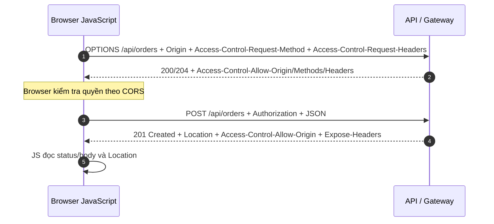
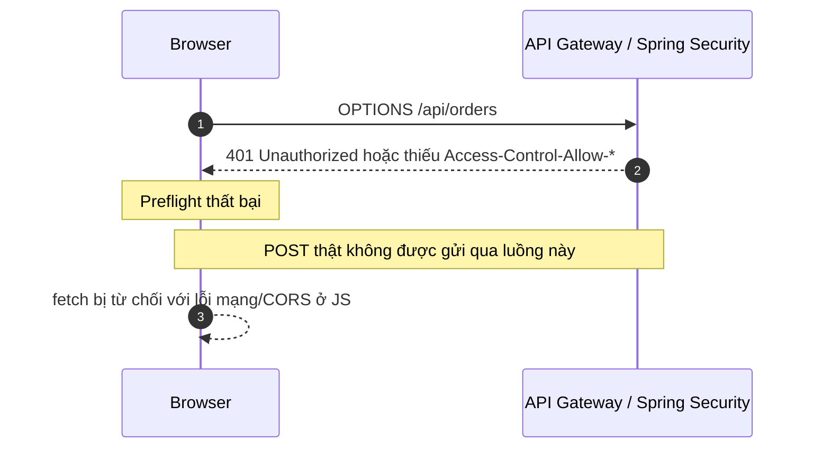
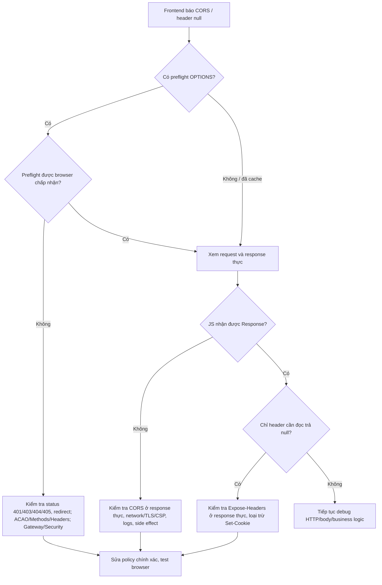

# Preflight bị chặn và header bị trình duyệt ẩn

Một REST API có thể trả `200 OK` khi thử bằng curl hoặc Postman, nhưng trang web gọi cùng endpoint lại báo `CORS error`. Đôi khi DevTools cho thấy request `OPTIONS` bị `401 Unauthorized` trước khi request `POST` thật được gửi. Ở trường hợp khác, request `POST` đã thành công và server đã trả `201 Created` cùng header `Location`, nhưng JavaScript đọc `response.headers.get("Location")` lại nhận `null`.

Hai hiện tượng có nguyên nhân khác nhau:

- **Preflight bị chặn:** trình duyệt kiểm tra trước một lời gọi cross-origin có được phép hay không. Nếu preflight không đạt, request thực có thể **không được gửi**.
- **Header bị trình duyệt ẩn:** request thực đã được phép, nhưng JavaScript chỉ nhìn thấy một nhóm response header mặc định hoặc những header được server cho phép lộ bằng `Access-Control-Expose-Headers`.

Bài học thuộc chương **Chẩn đoán sự cố** của module **INTEGRATION_API_REST**. Trọng tâm là cách đọc dấu vết HTTP, phân biệt chính sách CORS với xác thực/phân quyền, cấu hình Java/Spring Security, kiểm thử và khắc phục lỗi theo hợp đồng REST.

## 1. Mục tiêu học tập

Sau bài này, bạn có thể:

1. Giải thích khi nào trình duyệt phát sinh CORS preflight, vai trò của phương thức `OPTIONS` và các header `Origin`, `Access-Control-Request-Method`, `Access-Control-Request-Headers`.
2. Phân tích vì sao `401`, `403`, `404`, `405`, redirect hoặc thiếu header CORS ở response có thể khiến trình duyệt chặn request.
3. Phân biệt `Access-Control-Allow-Headers` (cho phép **request headers**) với `Access-Control-Expose-Headers` (cho JavaScript đọc **response headers**).
4. Chẩn đoán trường hợp server trả `201/429/500` có header nhưng `fetch().headers.get(...)` trả `null`.
5. Viết cấu hình CORS an toàn với Spring Security và kiểm tra qua DevTools, curl, MockMvc cùng trình duyệt thật.
6. Xác minh rằng CORS không thay thế xác thực, authorization theo đối tượng/tenant, CSRF protection hoặc idempotency.

## 2. Nhận diện lỗi từ một kịch bản REST API

Giả sử frontend được phục vụ ở:

```text
https://portal.example.test
```

và API ở:

```text
https://api.example.test
```

Hai URL này khác **origin**, dù đều dùng HTTPS và có phần domain cấp cao tương tự. Theo mô hình *same-origin*, origin gồm **scheme + hostname + port**. Ví dụ `http://localhost:3000` và `http://localhost:8080` cũng khác origin do cổng khác; `https://api.example.test` và `http://api.example.test` khác origin do scheme khác.

Frontend tạo đơn hàng:

```javascript
const response = await fetch("https://api.example.test/api/orders", {
  method: "POST",
  headers: {
    "Authorization": "Bearer <access-token>",
    "Content-Type": "application/json",
    "Idempotency-Key": "create-order-9d1a"
  },
  body: JSON.stringify({
    customerId: "customer-42",
    items: [{ sku: "SKU-01", quantity: 1 }]
  })
});

console.log(response.status);
console.log(response.headers.get("Location"));
```

Đây là ví dụ truyền bearer token qua header; chuỗi `<access-token>` là placeholder. Cấu hình `fetch` ở đây không sử dụng cookie cross-origin.

Vì method `POST` kết hợp `Content-Type: application/json` và các request header không thuộc nhóm CORS-safelisted như `Authorization`, `Idempotency-Key`, trình duyệt thường gửi preflight trước.

Luồng thành công:



Luồng lỗi preflight:



Nếu **preflight thành công** nhưng response của `POST` thiếu `Access-Control-Allow-Origin`, `POST` vẫn có thể đã chạy và ghi database; lúc này trình duyệt ngăn JavaScript đọc response. Đây là sự khác biệt quan trọng khi xử lý lệnh tạo đơn hoặc thanh toán: **CORS error không chứng minh server chưa thực hiện thao tác**.

## 3. Khi nào trình duyệt cần preflight?

CORS preflight là request `OPTIONS` do trình duyệt tạo để hỏi server trước khi gửi request có đặc điểm không nằm trong nhóm CORS-safelisted. Trên thực tế, không phải mọi cross-origin request đều cần preflight.

Các trường hợp thường **không cần** preflight, nếu không có điều kiện khác kích hoạt:

- `GET` hoặc `HEAD` với các request header thuộc nhóm CORS-safelisted.
- `POST` với `Content-Type` thuộc nhóm safelisted như `application/x-www-form-urlencoded`, `multipart/form-data` hoặc `text/plain`, nếu các điều kiện safelisted khác cũng thỏa.
- Không thêm custom request header hoặc những header không thuộc safelist.

Các tình huống thường **cần** preflight:

| Request thực dự kiến | Vì sao có thể cần preflight? |
|---|---|
| `PUT /orders/{id}` | `PUT` không nằm trong các method CORS-safelisted |
| `PATCH /orders/{id}` | `PATCH` không nằm trong nhóm method safelisted |
| `DELETE /orders/{id}` | `DELETE` không nằm trong nhóm method safelisted |
| `POST` với JSON body | `Content-Type: application/json` không thuộc giá trị safelisted |
| `GET` với `Authorization: Bearer ...` | `Authorization` không phải request header safelisted |
| `POST` với `Idempotency-Key` | Custom header làm tăng yêu cầu CORS |
| Request có `X-Request-ID` do app tự đặt | Custom header phải được server cho phép |

Còn có những điều kiện bổ sung trong Fetch/CORS, như hạn chế trên giá trị của safelisted header, nên bảng trên là hướng dẫn thực hành, không phải toàn bộ thuật toán chuẩn.

**Preflight không phải một yêu cầu xác thực của người dùng.** Browser thường **không gửi bearer token hoặc cookie ứng dụng vào preflight**; nó chỉ gửi danh sách **tên header dự kiến** ở `Access-Control-Request-Headers`, chứ không gửi giá trị của chúng. Vì vậy không nên bắt preflight chứng minh JWT hoặc quyền tenant như request nghiệp vụ.

### 3.1. HTTP request preflight mẫu

```http
OPTIONS /api/orders HTTP/1.1
Host: api.example.test
Origin: https://portal.example.test
Access-Control-Request-Method: POST
Access-Control-Request-Headers: authorization,content-type,idempotency-key
```

Ý nghĩa:

- `Origin`: origin của trang đang yêu cầu quyền truy cập cross-origin.
- `Access-Control-Request-Method: POST`: phương thức của **request thực sẽ đến sau**, không phải method của preflight.
- `Access-Control-Request-Headers`: các **tên header** JavaScript định gửi trong request thật, không phải response header mà JavaScript muốn đọc.
- `OPTIONS`: method của preflight; không được tự thực thi nghiệp vụ tạo đơn hay ghi payment.

Browser có thể bổ sung header hệ thống khác; đừng yêu cầu preflight phải có chính xác từng header giống ví dụ mới xử lý.

### 3.2. HTTP response preflight mẫu

```http
HTTP/1.1 204 No Content
Access-Control-Allow-Origin: https://portal.example.test
Access-Control-Allow-Methods: GET, POST, PATCH, DELETE, OPTIONS
Access-Control-Allow-Headers: Authorization, Content-Type, Idempotency-Key
Access-Control-Max-Age: 600
Vary: Origin, Access-Control-Request-Method, Access-Control-Request-Headers
```

`200 OK` hoặc `204 No Content` đều có thể dùng cho preflight khi phản hồi đúng CORS. Để browser quyết định có gửi request thật không, các điều kiện chính phải khớp: origin được cho phép, method dự kiến được cho phép, và các header dự kiến được cho phép. `Access-Control-Max-Age` cho phép browser cache kết quả preflight trong một khoảng thời gian nhưng browser có thể áp giới hạn và chính sách cache riêng; đừng giả định một giá trị 600 luôn được dùng đúng 600 giây.

`Vary` hữu ích với proxy/cache HTTP nếu response phụ thuộc `Origin`, request method hoặc request headers. Không được để một cached response dành cho origin A bị phục vụ như thể hợp lệ cho origin B.

### 3.3. Request thực cần response CORS riêng

Sau khi preflight đạt, browser mới gửi:

```http
POST /api/orders HTTP/1.1
Host: api.example.test
Origin: https://portal.example.test
Authorization: Bearer <access-token>
Content-Type: application/json
Idempotency-Key: create-order-9d1a

{"customerId":"customer-42","items":[{"sku":"SKU-01","quantity":1}]}
```

Response:

```http
HTTP/1.1 201 Created
Access-Control-Allow-Origin: https://portal.example.test
Access-Control-Expose-Headers: Location, ETag, X-Request-ID
Location: /api/orders/ord-103
ETag: "v1"
X-Request-ID: req-6cfb
Content-Type: application/json
Vary: Origin

{"id":"ord-103","status":"CREATED"}
```

Preflight thành công **không miễn trừ** việc trả header CORS trên response thật. Nếu response thật thiếu `Access-Control-Allow-Origin` (hoặc thiếu `Access-Control-Allow-Credentials` khi yêu cầu có credentials), browser có thể chặn JavaScript đọc response, dù server trả HTTP `201`.

## 4. Hai nhóm header dễ nhầm: Allow-Headers và Expose-Headers

Đây là nguyên nhân hàng đầu khiến lập trình viên thấy request thành công nhưng JavaScript không đọc được header.

| Header | Nằm ở response nào? | Cho phép điều gì? |
|---|---|---|
| `Access-Control-Allow-Origin` | Preflight và response thực (khi áp dụng) | Cho phép origin gọi frontend đọc response theo CORS |
| `Access-Control-Allow-Methods` | Phản hồi preflight | Cho phép những **HTTP method** dự kiến |
| `Access-Control-Allow-Headers` | Phản hồi preflight | Cho phép những **request header** được frontend gửi |
| `Access-Control-Allow-Credentials` | Phản hồi CORS khi cần credentials | Cho phép response của request có credentials được browser cung cấp cho JS |
| `Access-Control-Expose-Headers` | **Response thực** | Cho phép JS đọc thêm **response header** ngoài nhóm mặc định |
| `Access-Control-Max-Age` | Phản hồi preflight | Gợi ý thời gian cache kết quả preflight |
| `Vary` | Response tùy điều kiện | Giúp cache không trộn phản hồi cho các yêu cầu CORS khác nhau |

`Access-Control-Allow-Headers: Authorization, Content-Type` **không** làm `response.headers.get("Location")` có giá trị. Muốn JS đọc `Location`, response thực cần có `Access-Control-Expose-Headers: Location` cùng các điều kiện CORS khác.

### 4.1. Những response header đọc được mặc định

Khi một CORS response đã được browser chấp nhận, JavaScript mặc định có thể đọc các response header thuộc CORS-safelisted response-header names:

- `Cache-Control`
- `Content-Language`
- `Content-Length`
- `Content-Type`
- `Expires`
- `Last-Modified`
- `Pragma`

Các header thường dùng trong REST API như `ETag`, `Location`, `Link`, `Retry-After`, `X-Request-ID`, `X-RateLimit-Remaining` thường cần được liệt kê trong `Access-Control-Expose-Headers` nếu frontend phải truy cập qua `response.headers`.

**Không phải tất cả response header có thể được expose.** `Set-Cookie` là tên response header bị Fetch cấm phơi bày cho JavaScript (`forbidden response-header name`), kể cả server đưa `Set-Cookie` vào `Access-Control-Expose-Headers`. Ngoài ra, cookie `HttpOnly` vốn không được đọc bằng `document.cookie`; đừng coi việc không đọc được cookie bằng JS là lỗi CORS.

### 4.2. Ví dụ JavaScript cho header bị ẩn

Giả sử Network tab hiển thị response:

```http
HTTP/1.1 201 Created
Access-Control-Allow-Origin: https://portal.example.test
Location: /api/orders/ord-103
ETag: "v1"
X-Request-ID: req-6cfb
Content-Type: application/json

{"id":"ord-103","status":"CREATED"}
```

Frontend:

```javascript
const response = await fetch("https://api.example.test/api/orders", {
  method: "POST",
  headers: {
    Authorization: "Bearer <access-token>",
    "Content-Type": "application/json"
  },
  body: JSON.stringify({ customerId: "customer-42", items: [] })
});

console.log(response.status);                  // 201
console.log(response.headers.get("Content-Type")); // application/json
console.log(response.headers.get("Location"));     // null
console.log(response.headers.get("ETag"));         // null
console.log(response.headers.get("X-Request-ID")); // null
```

Các dấu `null` này xuất hiện **dù header có thật trong response ở Network tab**, vì browser lọc tập response headers mà JS được phép nhìn thấy.

Sửa response thực:

```http
Access-Control-Expose-Headers: Location, ETag, X-Request-ID, Retry-After
```

Sau khi CORS toàn bộ response đạt, JavaScript có thể truy cập các header đó:

```javascript
const createdResourceLocation = response.headers.get("Location");
const version = response.headers.get("ETag");
const requestId = response.headers.get("X-Request-ID");
```

Biến `createdResourceLocation` chứa **URI của resource vừa tạo**. Nếu server trả một URI tương đối như `/api/orders/ord-103`, frontend có thể chuẩn hóa bằng `new URL(createdResourceLocation, response.url)` trước khi dùng, sau khi xác minh giá trị không rỗng và phù hợp chính sách điều hướng.

### 4.3. Có nên dùng dấu `*` trong Expose-Headers?

Với request CORS **không có credentials**, dấu `*` trong `Access-Control-Expose-Headers` có ý nghĩa wildcard theo Fetch. Với request dùng `credentials: "include"`, `*` không còn là wildcard mà được hiểu như tên header thông thường; khi đó nên **liệt kê cụ thể** các header cần expose. Chính sách liệt kê rõ cũng giúp tránh vô tình công khai metadata nhạy cảm.

Không khuyến nghị expose mọi header theo mặc định. Chỉ expose những gì hợp đồng frontend cần, ví dụ `Location` để điều hướng resource mới, `ETag` để điều khiển `If-Match`, `Retry-After` để thực hiện backoff, `X-Request-ID` để liên hệ hỗ trợ.

## 5. Ma trận triệu chứng và nguyên nhân thường gặp

| Triệu chứng | Nguyên nhân cần kiểm tra | Chỉ dẫn xử lý |
|---|---|---|
| `OPTIONS` trả `401` | JWT filter/security bắt buộc auth trước CORS | Đặt xử lý CORS trước authentication; cho preflight được xử lý theo cấu hình origin/method/header |
| `OPTIONS` trả `403 Invalid CORS request` | Origin, method hoặc request header không nằm trong allowlist | So sánh chính xác `Origin`, `Access-Control-Request-Method`, `Access-Control-Request-Headers` |
| `OPTIONS` trả `404` | Gateway không route `OPTIONS`, đường dẫn không khớp | Kiểm tra ingress rewrite, prefix và route method |
| `OPTIONS` trả `405` | Backend/router chỉ khai báo `POST/GET` mà không có CORS handler trước | Bật cơ chế CORS ở filter/gateway đúng thứ tự |
| `OPTIONS` bị `301/302/307/308` | HTTP→HTTPS, thêm slash, chuyển host hoặc login redirect | Dùng URL HTTPS cuối đúng ngay từ frontend; tránh preflight bị redirect, xác minh mọi hop |
| `OPTIONS` trả `200` nhưng browser vẫn chặn | Thiếu/sai `Access-Control-Allow-Origin/Methods/Headers` hoặc credentials mismatch | Kiểm tra **header response**, không chỉ HTTP status |
| `POST` chạy và ghi DB nhưng `fetch` báo CORS error | Response thực thiếu/sai CORS, có thể ở path lỗi/exception | Đảm bảo header CORS được thêm trên cả response thành công và response lỗi |
| `fetch` trả response nhưng `headers.get("ETag") === null` | Thiếu `Access-Control-Expose-Headers: ETag` | Expose ở **response thực** |
| `headers.get("Retry-After") === null` trên `429` | `429` thiếu expose header hoặc gateway tự tạo `429` không có CORS | Cấu hình cả rate limiter/gateway và API error handler |
| Origin cho phép trên máy local nhưng lỗi production | Scheme/host/port khác chính xác; config môi trường hoặc wildcard không hợp lệ | Khai báo origin cụ thể theo môi trường và kiểm tra deploy |
| Preflight thỉnh thoảng lỗi | Các instance/gateway không đồng bộ cấu hình; cache `Vary` sai; CDN xử lý `OPTIONS` khác | So response theo instance, version và từng hop |
| Postman chạy, browser lỗi | Postman/curl không áp chính sách CORS như trình duyệt | Chẩn đoán bằng DevTools và replay preflight |
| Cookie không đi kèm dù CORS đúng | `credentials`, `SameSite`, `Secure`, chính sách third-party cookie hoặc CSRF | Kiểm tra cookie/auth riêng, không coi CORS là giải pháp duy nhất |

Thứ tự điều tra tốt nhất là: **request nào thực sự đã được gửi → response CORS nào browser kiểm tra → code nào có thể đã chạy → JavaScript muốn đọc field/header gì**. Không sửa tất cả header một lượt khi chưa xác định tầng gây lỗi.

## 6. Quy trình chẩn đoán bằng DevTools

### 6.1. Xác định origin và request thực

Trong trình duyệt, mở Developer Tools → Network, tái hiện hành động và bật hiển thị request `OPTIONS` nếu bộ lọc Network đang ẩn. Ghi nhận:

1. URL trang (scheme, host, port) và URL API.
2. Method của request thực (`GET`, `POST`, `PATCH`…).
3. Những request header do JavaScript tự thêm (`Authorization`, `Content-Type`, `Idempotency-Key`…).
4. Có request `OPTIONS` ngay trước request thật không; response status/header của nó là gì.
5. Nếu request thật đã được gửi, status và header của **response thật**.

Đừng nhầm `OPTIONS` với một endpoint nghiệp vụ. Khi browser trả về lỗi tổng quát như `TypeError: Failed to fetch` hoặc `net::ERR_FAILED`, cần kiểm tra Network và console kèm trace phía server; JavaScript nhiều khi không được đọc body/status của response bị CORS chặn.

### 6.2. Đọc request OPTIONS trước khi đổi code

Mẫu:

```http
OPTIONS /api/orders HTTP/1.1
Origin: https://portal.example.test
Access-Control-Request-Method: POST
Access-Control-Request-Headers: authorization,content-type,idempotency-key
```

Nếu preflight response:

```http
HTTP/1.1 401 Unauthorized
WWW-Authenticate: Bearer
```

thì nguyên nhân có thể là security filter yêu cầu bearer token đối với `OPTIONS`. Browser không gửi request `POST` thật khi preflight không được cho phép. Phải sửa thứ tự xử lý CORS/security hoặc route gateway, không xử lý bằng cách thêm JWT vào preflight từ JavaScript.

Nếu preflight response:

```http
HTTP/1.1 204 No Content
Access-Control-Allow-Origin: https://portal.example.test
Access-Control-Allow-Methods: GET, POST
Access-Control-Allow-Headers: Content-Type
```

thì `Authorization` và `Idempotency-Key` còn thiếu ở allowlist, nên browser có thể chặn `POST`. Đừng thêm chúng vào `Access-Control-Expose-Headers` để chữa lỗi này; **Expose-Headers không cho phép request header**.

Nếu response có:

```http
Access-Control-Allow-Origin: https://another.example.test
```

thì origin không khớp. So sánh chuỗi origin thực tế, kể cả port và scheme; URL wildcard kiểu `https://*.example.test` không phải một giá trị đơn giản hợp lệ của `Access-Control-Allow-Origin` mà browser tự hiểu là khớp mọi subdomain.

### 6.3. Phân biệt response của preflight và request thật

Trong Network, xem cả:

- `OPTIONS 204` thành công với allow-methods/allow-headers.
- `POST 201` hoặc `POST 429/500` sau đó, có `Access-Control-Allow-Origin` và `Access-Control-Expose-Headers` hay không.

Nếu `OPTIONS` thành công nhưng `POST` trả `500` do application exception, và exception handler/gateway bỏ mất header CORS, console có thể chỉ hiển thị lỗi CORS. Lúc này cần tìm **trace ID, access log và diagnostic log** của `POST` để điều tra nguyên nhân thật, đồng thời sửa CORS trên đường trả lỗi.

Nếu không thấy `OPTIONS`, request có thể không cần preflight hoặc browser đang dùng kết quả preflight cache. Thử bằng request mới phù hợp, dùng DevTools và kiểm tra cache theo hành vi trình duyệt đang chạy; không kết luận server không còn xử lý `OPTIONS` chỉ vì Network không hiển thị một lần.

### 6.4. Không dùng `mode: "no-cors"` làm cách chữa

Một mẹo dễ gặp là:

```javascript
fetch("https://api.example.test/api/orders", {
  mode: "no-cors"
});
```

Trong chế độ `no-cors`, browser hạn chế loại request có thể tạo và trả **opaque response** mà JavaScript không đọc được status/body/header thực. Điều này không giải quyết bài toán REST client phải lấy JSON, `ETag` hoặc `Location`. Cách sửa đúng là phản hồi CORS và thiết kế xác thực/authorization ở server theo hợp đồng.

## 7. Reproduce bằng curl: kiểm tra server, không thay thế trình duyệt

curl/Postman có thể gửi `Origin` và replay preflight để xem response của backend/gateway. Nhưng chúng **không tự thực thi chính sách CORS như trình duyệt**. Một lời gọi curl `200` không chứng minh frontend đọc được response.

### 7.1. Gửi đúng một preflight

```bash
curl -i -X OPTIONS \
  'https://api.example.test/api/orders' \
  -H 'Origin: https://portal.example.test' \
  -H 'Access-Control-Request-Method: POST' \
  -H 'Access-Control-Request-Headers: authorization,content-type,idempotency-key'
```

Đối chiếu `Access-Control-Allow-Origin`, `Access-Control-Allow-Methods` và `Access-Control-Allow-Headers`. Không gửi access token thật trong preflight; cần giống mẫu browser, chỉ gửi tên header dự kiến.

Thử origin không hợp lệ để kiểm tra allowlist:

```bash
curl -i -X OPTIONS \
  'https://api.example.test/api/orders' \
  -H 'Origin: https://untrusted.example.test' \
  -H 'Access-Control-Request-Method: POST' \
  -H 'Access-Control-Request-Headers: authorization,content-type'
```

Response không được cho phép origin giả. Với Spring `DefaultCorsProcessor`, một preflight bị từ chối thường là `403 Invalid CORS request`; với proxy hoặc framework khác có thể có mã khác. Căn cứ quan trọng là browser không được cấp CORS permission cho origin không tin cậy, đồng thời API vẫn thực thi authentication/authorization trên request thật.

### 7.2. Gửi request thực và xem Expose-Headers

```bash
curl -i -X POST \
  'https://api.example.test/api/orders' \
  -H 'Origin: https://portal.example.test' \
  -H 'Authorization: Bearer <test-access-token>' \
  -H 'Content-Type: application/json' \
  -H 'Idempotency-Key: integration-test-order-1' \
  --data '{"customerId":"customer-42","items":[{"sku":"SKU-01","quantity":1}]}'
```

Chỉ dùng token test và backend sandbox/fixture để tránh ghi đơn hàng thật. Nếu response có `Location` nhưng không có `Access-Control-Expose-Headers: Location`, JavaScript cross-origin sẽ không đọc được `Location` dù curl hiển thị nó. Để khẳng định, chạy `fetch` trên origin frontend thực và kiểm tra `response.headers.get("Location")`.

### 7.3. So sánh từng hop

Nếu production có CDN, WAF, ingress, API Gateway rồi Spring Boot:

```text
Browser
  → CDN/WAF
  → Ingress / API Gateway
  → Spring Security / CORS filter
  → REST Controller
```

Hỏi: response `OPTIONS` được tạo ở đâu? Header CORS được gắn ở gateway hay backend? Gateway có rewrite path, redirect sang login, chỉ cho qua `GET/POST` hoặc tự tạo `429/5xx` không? Một header được Spring tạo vẫn có thể bị proxy ghi đè/xóa.

Không nên để nhiều tầng đồng thời tự đưa các giá trị `Access-Control-Allow-Origin` mâu thuẫn vào cùng response. Header trùng lặp hoặc nhiều origin ghép thành một giá trị không phải cách cho phép nhiều origin; browser cần kết quả hợp lệ cho **origin cụ thể**.

## 8. Cấu hình Spring Boot/Spring Security đúng ranh giới

Đối với Spring MVC bảo vệ REST API bằng bearer JWT, hãy cấu hình CORS ở server **và tích hợp với Spring Security** để preflight được xử lý trước yêu cầu xác thực. Một cấu hình điển hình:

```java
@Configuration
@EnableWebSecurity
@EnableMethodSecurity
public class ApiSecurityConfiguration {

    @Bean
    SecurityFilterChain apiSecurity(HttpSecurity http) throws Exception {
        return http
            .securityMatcher("/api/**")
            .cors(Customizer.withDefaults())
            // Chỉ phù hợp nếu API này dùng bearer token trong header,
            // stateless, không dùng cookie/session để xác thực.
            .csrf(csrf -> csrf.disable())
            .sessionManagement(session -> session
                .sessionCreationPolicy(SessionCreationPolicy.STATELESS))
            .authorizeHttpRequests(auth -> auth
                .anyRequest().authenticated())
            .oauth2ResourceServer(resourceServer -> resourceServer
                .jwt(Customizer.withDefaults()))
            .build();
    }

    @Bean
    CorsConfigurationSource corsConfigurationSource() {
        CorsConfiguration cors = new CorsConfiguration();

        cors.setAllowedOrigins(List.of(
            "https://portal.example.test",
            "https://admin.example.test"
        ));
        cors.setAllowedMethods(List.of(
            "GET", "POST", "PUT", "PATCH", "DELETE", "OPTIONS"
        ));
        cors.setAllowedHeaders(List.of(
            "Authorization",
            "Content-Type",
            "Idempotency-Key",
            "X-Request-ID",
            "If-Match"
        ));
        cors.setExposedHeaders(List.of(
            "Location",
            "ETag",
            "Retry-After",
            "X-Request-ID"
        ));
        // Ví dụ dùng Bearer token, không dùng cookie cross-origin.
        cors.setAllowCredentials(false);
        cors.setMaxAge(600L);

        UrlBasedCorsConfigurationSource source =
                new UrlBasedCorsConfigurationSource();
        source.registerCorsConfiguration("/api/**", cors);
        return source;
    }
}
```

Mẫu áp dụng với Spring Security/Spring MVC hiện đại; cần các imports từ `org.springframework.security.*`, `org.springframework.web.cors.*`, `java.util.List` và `Customizer`. Ứng dụng thật còn cần cấu hình JWT decoder, xử lý lỗi, policy tenant/object và version endpoint tương ứng. Nếu có nhiều `SecurityFilterChain` theo matcher khác nhau, phải kiểm tra chain thực sự nhận `OPTIONS /api/**` và response lỗi do chain đó tạo.

### 8.1. Vì sao `.cors(...)` quan trọng?

Spring Security xử lý authentication/authorization theo filter chain. Nếu CORS không được xử lý sớm, browser preflight thường **không mang JWT/cookie của phiên ứng dụng**, nên security filter có thể trả `401/403` trước khi nhận ra đây là một phép thương lượng CORS hợp lệ.

Cấu hình `CorsConfigurationSource` cùng `http.cors(Customizer.withDefaults())` cho phép Spring Security sử dụng cấu hình CORS và xử lý preflight ở vị trí phù hợp. Khi framework đã cung cấp CorsFilter đúng thứ tự, thường không cần tự tạo thêm nhiều filter CORS trùng chức năng.

**Không có nghĩa mọi request `OPTIONS` đều được phép truy cập mọi resource.** Preflight chỉ nhận quyền CORS cho một origin, method và header được cấu hình. Request `POST/DELETE` thực vẫn phải đi qua xác thực JWT, scope, tenant membership, ACL/object policy và rule chức năng.

### 8.2. Vì sao cấu hình một mình `@CrossOrigin` đôi lúc chưa đủ?

`@CrossOrigin` trên controller/method có thể dùng cho ứng dụng đơn giản, nhưng khi preflight bị chặn **trước khi đến Spring MVC controller** bởi gateway hoặc Spring Security, annotation controller không có cơ hội giải quyết lỗi. Cấu hình toàn cục theo `/api/**` với integration security và kiểm tra gateway phù hợp hơn khi nhiều endpoint cùng contract CORS.

Một endpoint xử lý lỗi của gateway, rate limiter hoặc authentication entry point có thể không đi qua controller. Vì vậy cần kiểm chứng **response lỗi** cũng có CORS phù hợp; không chỉ test endpoint trả `200`.

### 8.3. Các lỗi cấu hình Spring thường gặp

| Cấu hình/vị trí sai | Hậu quả |
|---|---|
| Bật `.anyRequest().authenticated()` nhưng bỏ `.cors(...)` | Preflight có thể bị trả `401` |
| Cors config đăng ký `/public/**`, API thực tại `/api/**` | Request không khớp cấu hình CORS |
| `allowedOrigins` có slash cuối hoặc sai scheme/port | Origin frontend không khớp |
| `allowedHeaders` thiếu `Authorization`/`Idempotency-Key` | Preflight bị từ chối |
| `allowedMethods` thiếu `PATCH` | Preflight PATCH bị từ chối |
| Chỉ cấu hình `allowedHeaders`, bỏ `exposedHeaders` | Request được gửi nhưng JS không đọc được `ETag/Location` |
| Vừa thêm CORS ở Gateway vừa thêm duplicate/conflict ở app | Header không hợp lệ hoặc bị ghi đè |
| Tự cho phép `Access-Control-Allow-Origin: *` trên request dùng cookie | Browser chặn credentials response |
| Tắt CSRF khi authentication dựa vào cookie | Có thể tạo lỗ hổng CSRF dù CORS cấu hình chính xác |

Các cấu hình trong bài chỉ cho phép origin đã biết. Nếu danh sách origin thay đổi theo môi trường, đọc từ cấu hình được quản lý nhưng không phản chiếu mù quáng mọi `Origin` do client gửi.

## 9. Credentials, cookie, CSRF và `Access-Control-Allow-Origin: *`

### 9.1. API chỉ dùng bearer token trong header

Khi frontend tự gửi `Authorization: Bearer ...`, browser có thể preflight do `Authorization`. Ví dụ mục 8 đặt `allowCredentials(false)` vì API không dùng cookie/session làm phương thức xác thực cross-origin. Origin vẫn được giới hạn theo allowlist và request thật vẫn phải xác thực JWT.

Không dùng câu "đã bật CORS nên endpoint an toàn": curl, máy chủ khác và ứng dụng di động không chịu chính sách CORS của browser. API phải tự xác minh token, scope, tenant và đối tượng ở server.

### 9.2. API xác thực bằng cookie

Nếu client cần cookie cross-origin, request frontend thường phải dùng:

```javascript
fetch("https://api.example.test/api/profile", {
  method: "GET",
  credentials: "include"
});
```

Response cần origin cụ thể và credentials permission:

```http
Access-Control-Allow-Origin: https://portal.example.test
Access-Control-Allow-Credentials: true
Vary: Origin
```

Không dùng `Access-Control-Allow-Origin: *` cho response của request có credentials. Khi `credentials: "include"`, `Access-Control-Expose-Headers: *` cũng không phải wildcard như trường hợp không có credentials.

Cookie còn chịu `SameSite`, `Secure`, chính sách third-party cookie và giới hạn browser; CORS đúng không bảo đảm cookie được gửi/lưu. Cookie dùng để xác thực khiến ứng dụng phải giải quyết **CSRF** phù hợp, nhất là các method thay đổi trạng thái. `Access-Control-Allow-Credentials` hoặc một allowlist origin CORS không tự thay thế CSRF token, SameSite policy, Origin/Referer validation theo threat model và kiểm soát authorization.

### 9.3. `Origin: null` và wildcard origin

Browser có thể tạo `Origin: null` trong một số bối cảnh như tài liệu sandboxed hoặc nguồn opaque. Không mặc định cho phép `null` hoặc phản chiếu Origin nhận được chỉ vì frontend chạy trong iframe/file; việc này cần mô hình tin cậy riêng.

Khi có nhiều origin hợp lệ, server có thể **chọn đúng một origin đã được xác minh** để trả trong `Access-Control-Allow-Origin` cho từng response, cùng `Vary: Origin` nếu giá trị thay đổi theo request. Không trả chuỗi `https://a.example.test, https://b.example.test` như một giá trị origin hợp lệ.

## 10. Response lỗi và các header REST cần expose

Frontend thường cần đọc thêm header khi làm việc với tài nguyên REST:

| Trạng thái / nghiệp vụ | Header có thể cần đọc | Vì sao cần expose? |
|---|---|---|
| `201 Created` | `Location` | Xác định URI resource vừa tạo |
| `200 OK` / `204 No Content` | `ETag` | Dùng cho conditional GET/`If-Match` khi cập nhật |
| `429 Too Many Requests` | `Retry-After` | Điều phối backoff, tránh retry storm |
| `503 Service Unavailable` | `Retry-After` khi server cung cấp | Gợi ý thời gian thử lại |
| Phân trang | `Link`, header cursor nếu hợp đồng dùng | Tìm trang tiếp / endpoint liên quan |
| Tất cả response phù hợp | `X-Request-ID` | Liên kết log/tracing khi hỗ trợ |
| Rate limiting | Header quota/remaining/reset theo contract | Hiển thị và tự điều chỉnh lưu lượng |

Có thể đưa những thông tin quan trọng vào JSON response body thay vì custom header, nhưng cần nhất quán và tránh sinh hai nguồn sự thật mâu thuẫn. Nếu API đã công bố `Location` hoặc `ETag`, frontend đọc cross-origin cần `Access-Control-Expose-Headers`; việc header tồn tại trong Network không đủ.

### 10.1. Lỗi `429` do gateway trả trước ứng dụng

Giả sử limiter tại gateway tạo:

```http
HTTP/1.1 429 Too Many Requests
Retry-After: 5
Content-Type: application/problem+json

{"type":"about:blank","title":"Too Many Requests","status":429}
```

Nếu gateway không thêm `Access-Control-Allow-Origin` cho response này, JavaScript có thể không thấy `429` hoặc `Retry-After`; `fetch` báo CORS/network error, khiến client không backoff được như dự kiến. Cần sửa policy CORS **ở nơi thực sự tạo response**, bảo đảm không làm lộ thông tin nhạy cảm.

Một response mẫu có thể đọc được từ frontend:

```http
HTTP/1.1 429 Too Many Requests
Access-Control-Allow-Origin: https://portal.example.test
Access-Control-Expose-Headers: Retry-After, X-Request-ID
Retry-After: 5
X-Request-ID: req-73dc
Content-Type: application/problem+json
Vary: Origin

{"type":"about:blank","title":"Too Many Requests","status":429}
```

`Retry-After: 5` là thời gian minh họa tính bằng giây; theo HTTP, `Retry-After` còn có thể dùng dạng HTTP-date. Client cần parse đúng, tôn trọng deadline và retry budget. Không lấy việc có `429` làm cớ retry vô hạn.

### 10.2. CORS error sau mutation có thể dẫn tới double write

Nếu client gửi `POST /payments`, preflight đã đạt, provider đã thu tiền, nhưng response thực bị browser chặn vì thiếu CORS, frontend có thể coi request thất bại và gửi lại, dẫn tới thanh toán trùng nếu không có idempotency.

Nên thực hiện:

1. Xác định request thực đã tới server chưa qua access log/trace và trạng thái nghiệp vụ.
2. Với thao tác tạo/chuyển trạng thái, dùng `Idempotency-Key` hoặc một business operation ID ổn định gắn với tenant/payload.
3. Khi response thất lạc, tra cứu trạng thái theo operation ID trước khi tạo lệnh nghiệp vụ mới.
4. Sửa header CORS của response thực để frontend nhận được `201`/`409`/`429` hoặc mã lỗi chính xác.
5. Không gắn nhãn mọi `TypeError: Failed to fetch` là lỗi chưa gửi request.

**CORS và idempotency giải quyết hai vấn đề độc lập:** CORS kiểm soát việc JavaScript của origin được phép đọc response, còn idempotency bảo vệ nghiệp vụ trước các lần gửi trùng.

## 11. Kiểm thử Spring Security bằng MockMvc

Sau khi cấu hình ở mục 8, dùng Spring Boot Test và Spring Security Test để xác minh preflight cũng như response thực. Các ví dụ giả định có REST controller `/api/orders`, endpoint đọc resource cho user có `orders:read`, DTO và dữ liệu test phù hợp.

### 11.1. Preflight hợp lệ không cần bearer token

```java
@SpringBootTest
@AutoConfigureMockMvc
class CorsIntegrationTest {
    @Autowired MockMvc mvc;

    @Test
    void allowsPreflightForKnownOriginAndHeaders()
            throws Exception {
        mvc.perform(options("/api/orders")
                .header(HttpHeaders.ORIGIN,
                        "https://portal.example.test")
                .header(HttpHeaders.ACCESS_CONTROL_REQUEST_METHOD,
                        "POST")
                .header(HttpHeaders.ACCESS_CONTROL_REQUEST_HEADERS,
                        "authorization,content-type,idempotency-key"))
            .andExpect(status().is2xxSuccessful())
            .andExpect(header().string(
                    HttpHeaders.ACCESS_CONTROL_ALLOW_ORIGIN,
                    "https://portal.example.test"))
            .andExpect(header().exists(
                    HttpHeaders.ACCESS_CONTROL_ALLOW_METHODS))
            .andExpect(header().exists(
                    HttpHeaders.ACCESS_CONTROL_ALLOW_HEADERS));
    }
}
```

Đây là **test preflight CORS**, không test quyền tạo đơn. Không dùng `.with(jwt())` cho request `OPTIONS` ở đây: mục tiêu là xác minh security không buộc browser phải gửi JWT trong preflight.

Tùy phiên bản Spring Framework, tên hằng `HttpHeaders.ACCESS_CONTROL_REQUEST_METHOD`, `ACCESS_CONTROL_ALLOW_*` có trong `org.springframework.http.HttpHeaders`; thêm imports của MockMvc, JUnit, Spring Test và static matchers.

### 11.2. Chặn origin không được phép

Thêm test trong cùng class:

```java
@Test
void doesNotAllowUntrustedOrigin() throws Exception {
    mvc.perform(options("/api/orders")
            .header(HttpHeaders.ORIGIN,
                    "https://untrusted.example.test")
            .header(HttpHeaders.ACCESS_CONTROL_REQUEST_METHOD, "POST")
            .header(HttpHeaders.ACCESS_CONTROL_REQUEST_HEADERS,
                    "authorization,content-type"))
        .andExpect(status().isForbidden())
        .andExpect(header().doesNotExist(
                HttpHeaders.ACCESS_CONTROL_ALLOW_ORIGIN));
}
```

Với Spring `DefaultCorsProcessor`, preflight origin không hợp lệ thường trả `403`. Nếu có gateway xử lý trước hoặc một framework khác, status có thể khác; bất biến bảo mật là origin không được cấp quyền đọc response cross-origin. Test không nên coi chỉ `403` ở tầng backend là đủ: cần kiểm tra browser thật không thể truy cập response.

### 11.3. Response thực expose đúng header

Giả sử `GET /api/orders/{id}` trả `200` với `ETag`, `X-Request-ID`:

```java
@Test
void exposesResponseHeadersToCrossOriginJavaScript()
        throws Exception {
    mvc.perform(get("/api/orders/{id}", "ord-103")
            .header(HttpHeaders.ORIGIN,
                    "https://portal.example.test")
            .with(jwt().jwt(jwt -> jwt.subject("alice"))
                .authorities(new SimpleGrantedAuthority(
                    "SCOPE_orders:read"))))
        .andExpect(status().isOk())
        .andExpect(header().string(
                HttpHeaders.ACCESS_CONTROL_ALLOW_ORIGIN,
                "https://portal.example.test"))
        .andExpect(header().string(
                HttpHeaders.ACCESS_CONTROL_EXPOSE_HEADERS,
                containsString("ETag")))
        .andExpect(header().string(
                HttpHeaders.ACCESS_CONTROL_EXPOSE_HEADERS,
                containsString("X-Request-ID")));
}
```

Đây là test được thêm vào `CorsIntegrationTest` ở mục trên, với fixture và import Hamcrest `containsString`. `jwt()` của Spring Security Test giả lập principal để kiểm tra authorization/policy ứng dụng; **không tự kiểm tra chữ ký, issuer, audience hoặc thời hạn JWT**. Những phần đó cần integration test riêng với cấu hình `JwtDecoder` và token kiểm thử.

Quan trọng: MockMvc xác minh server đã gửi header tương ứng nhưng **không mô phỏng đầy đủ thuật toán CORS, cookie và preflight cache của browser**. Sau đó nên có browser end-to-end test trên hai origin thật.

### 11.4. Test lỗi trên response `401`, `403`, `429` và `500`

Một lỗi phổ biến là test `200` có CORS, nhưng response lỗi từ Spring Security hoặc gateway không có. Bộ regression cần bao gồm:

| Test | Kỳ vọng |
|---|---|
| Preflight đến origin hợp lệ, method/header được phép, **không có JWT** | Response CORS hợp lệ, không bị yêu cầu bearer token |
| Preflight yêu cầu method chưa cho phép | Không cấp CORS permission |
| Preflight yêu cầu header không cho phép | Không cấp CORS permission |
| Preflight có origin không cho phép | Không cấp `Access-Control-Allow-Origin` cho origin đó |
| Request thực thiếu JWT | `401` theo hợp đồng và CORS header phù hợp để JS đọc lỗi |
| Request thực thiếu scope hoặc quyền tenant | `403/404` theo policy; không tiết lộ resource |
| Request thực bị rate limit tại gateway | JS thấy `429` và đọc được `Retry-After` theo contract |
| Endpoint ném exception | JS nhận được status/error được công bố, không bị che bởi thiếu CORS |
| `POST` thành công có `Location` | JS đọc được `Location` sau CORS |
| `GET` có `ETag` | JS đọc được `ETag` |
| Cookie-auth request có credentials | Chỉ origin cụ thể, `Access-Control-Allow-Credentials: true`; kiểm thử CSRF/cookie policy riêng |

Đối với `401/403`, không nên đổi thành `200` chỉ để vượt CORS. CORS cần đúng trên **error response**, còn HTTP status vẫn phải biểu thị lỗi xác thực/quyền. Những policy `404` dùng để che đối tượng trái quyền cần được giữ nguyên.

## 12. Kiểm thử trên trình duyệt và gateway thật

MockMvc là một lớp kiểm chứng. Vì CORS được **trình duyệt** thực thi, hãy thử từ origin frontend thật hoặc một trang test được phục vụ trên origin khác:

```javascript
async function verifyCrossOriginOrderApi() {
  const res = await fetch("https://api.example.test/api/orders/ord-103", {
    headers: {
      Authorization: "Bearer <test-access-token>"
    }
  });

  console.log({
    status: res.status,
    contentType: res.headers.get("Content-Type"),
    etag: res.headers.get("ETag"),
    requestId: res.headers.get("X-Request-ID")
  });
}
```

Điều cần đo: request `OPTIONS` có xuất hiện và được đáp ứng không, request thực có đi qua gateway không, JavaScript có lấy được status/body/headers đã công bố không. Khi dùng browser automation (Playwright/Cypress hoặc công cụ tương đương), thiết lập **hai origin khác nhau thật sự**; nếu frontend test và API test cùng origin, bài test không tái hiện CORS.

Để tránh false positive, cần kiểm tra thêm:

- Request không có auth không được đọc dữ liệu riêng tư dù CORS đúng.
- Origin không nằm trong allowlist không được truy cập response qua JavaScript.
- Client có cookie vẫn phải thỏa chính sách cookie và CSRF.
- Header `Set-Cookie` không được đọc bằng `headers.get("Set-Cookie")` dù `Expose-Headers` có giá trị khác.
- Test qua CDN/ingress/gateway giống production; không chỉ gọi thẳng Spring container trong LAN.
- Revalidate sau khi đổi cấu hình cache, redirect, rate limiting, security chain hoặc error handler.

### 12.1. Quan sát bằng log và metric

Log/tracing nên tách:

- `method=OPTIONS` và method request thực; route template, status, duration.
- Origin đã được chuẩn hóa và giới hạn cardinality theo policy, không dump request body hoặc token.
- Reason code của preflight bị chặn (origin, method, header), không đưa bí mật vào response.
- API version/pod/ingress gây lỗi để phát hiện cấu hình không đồng nhất.
- Trace/request ID cho request thực; preflight và actual request không phải lúc nào có chung trace.
- Số lượng `401/403` do security, `404/405` do routing, `429` do limiter và lỗi `5xx`.

Không gắn raw Origin hoặc ID riêng lẻ không giới hạn vào nhãn metric vì có thể gây cardinality lớn và bị attacker lạm dụng. Với origin động, ghi log có giới hạn/chuẩn hóa hoặc nhóm kết quả theo allowlist vs untrusted.

## 13. Phân biệt CORS với các lỗi khác

Cùng một thông báo `Failed to fetch` có thể phát sinh do DNS, TLS, mixed content, CSP `connect-src`, network timeout, extension trình duyệt, ad blocker, lỗi redirect, hoặc CORS. Vì vậy trước khi kết luận:

1. Kiểm tra có request nào tới network không.
2. Xem status và response header ở mỗi hop; xem console có nêu lỗi CORS cụ thể không.
3. Kiểm tra chứng chỉ HTTPS và mixed content nếu frontend HTTPS gọi API HTTP.
4. Kiểm tra Content Security Policy của frontend, nhất là `connect-src`; CSP và CORS là hai chính sách khác nhau.
5. Đối chiếu server access log: không có request tới server có thể là chặn ngay tại browser, DNS, proxy hoặc upstream.
6. Nếu request tới server và có status `500`, xử lý lỗi backend đồng thời bảo đảm browser thấy được response CORS hợp lệ.

Đừng sửa `Access-Control-Allow-Origin` để chữa lỗi certificate hoặc CSP: chúng có nguyên nhân riêng. Cũng không bật allowlist mở rộng vô điều kiện khi chưa xác minh source origin thực.

## 14. Quy trình khắc phục tại production

Giả sử frontend báo lỗi tạo đơn sau một deployment gateway:

1. **Khoanh vùng:** xác định origin, đường dẫn, method, request headers và thời điểm bắt đầu; phân biệt toàn bộ người dùng với một nhóm/phiên bản.
2. **Xác định request nào bị chặn:** nếu preflight `401/403/404/405`, xử lý ở gateway hoặc Spring CORS trước auth/routing; nếu preflight đạt và response thực lỗi, kiểm tra error handler/gateway tạo response.
3. **Đối chiếu header:** kiểm tra `Access-Control-Allow-Origin/Methods/Headers` ở preflight; `Allow-Origin`, `Allow-Credentials` khi cần và `Expose-Headers` ở response thực.
4. **Kiểm tra hiệu ứng nghiệp vụ:** với `POST` hoặc `PATCH` đã tới backend, tra idempotency record/trạng thái đơn, tránh gửi lại làm trùng.
5. **Sửa phạm vi nhỏ nhất:** thêm đúng origin, method và header được phép; bổ sung exposed response headers theo hợp đồng; không chuyển toàn API sang `*`.
6. **Test cả hai luồng:** preflight và actual trên origin thật, success/error, cookie/bearer đúng cách, các status `201/401/403/429/5xx`.
7. **Triển khai và giám sát:** canary thay đổi nếu hạ tầng hỗ trợ; kiểm tra tỷ lệ lỗi `OPTIONS`, lỗi frontend fetch, lỗi API thực và báo cáo customer support.
8. **Ngăn tái phát:** thêm integration test CORS theo endpoint và test gateway trên pipeline; giữ một cấu hình nguồn/ownership rõ ràng.

### Sơ đồ quyết định nhanh



Đây là flow chẩn đoán, không phải một bộ quy tắc tự động suy ra trạng thái server chỉ từ `fetch`. Khi request tạo side effect, kết quả nghiệp vụ phải được kiểm chứng ở backend trước khi retry.

## 15. Bài tập thực hành

### Bài tập 1 — Phân tích preflight `401`

Frontend `https://portal.example.test` gọi `POST https://api.example.test/api/orders` bằng JSON và bearer. DevTools:

```http
OPTIONS /api/orders HTTP/1.1
Origin: https://portal.example.test
Access-Control-Request-Method: POST
Access-Control-Request-Headers: authorization,content-type
```

Server trả:

```http
HTTP/1.1 401 Unauthorized
WWW-Authenticate: Bearer
```

Giải thích tại sao không nên gắn JWT vào preflight, chỗ nào trong Spring Security/gateway cần sửa, cách giới hạn origin/method/header và cách kiểm chứng `POST` thật vẫn phải xác thực/ủy quyền.

**Tiêu chí tự kiểm:** preflight origin hợp lệ đi qua không cần token; request thực thiếu JWT vẫn nhận `401`; actor/tenant khác không được xem hay tạo đơn ngoài quyền.

### Bài tập 2 — Header response bị ẩn

`POST /orders` trả `201`, body đúng, response có `Location`, `ETag` và `X-Request-ID`. Nhưng browser:

```javascript
console.log(response.headers.get("Location"));     // null
console.log(response.headers.get("ETag"));         // null
console.log(response.headers.get("X-Request-ID")); // null
```

Hãy viết các header CORS cần thêm vào **response thực**. Giải thích vì sao thêm `Access-Control-Allow-Headers: Location, ETag` vào preflight không giải quyết lỗi. Kiểm thử lại bằng `fetch` từ frontend origin khác.

### Bài tập 3 — Browser dùng cookie, wildcard và CSRF

Một API xác thực session cookie, frontend sử dụng `credentials: "include"`, server trả:

```http
Access-Control-Allow-Origin: *
Access-Control-Allow-Credentials: true
Access-Control-Expose-Headers: *
```

Chỉ ra vấn đề của hai wildcard, đề xuất cấu hình allowlist origin cụ thể và exposed headers cụ thể. Nêu thêm điều kiện cookie (`SameSite`/`Secure`/policy) và cơ chế CSRF cần kiểm tra.

### Bài tập 4 — `429` từ gateway

Gateway giới hạn lưu lượng và tạo `429 Retry-After: 10` nhưng không thêm `Access-Control-Allow-Origin`; API Spring phía sau cấu hình CORS đúng. Tại sao frontend vẫn có thể báo CORS error? Hãy thiết kế test đi qua ingress/gateway và xác minh frontend đọc được `Retry-After`. Đề xuất metric để nhận biết gateway nào đang tạo response lỗi.

### Bài tập 5 — Điều tra lỗi thất lạc response sau `POST`

Frontend gọi `POST /payments` có `Idempotency-Key`, preflight đạt. Server hoàn tất thanh toán và trả `201` nhưng thiếu header CORS ở response. Frontend báo lỗi và người dùng nhấn nút thanh toán lần nữa. Hãy mô tả cách tra idempotency record/provider, xử lý request lặp an toàn, sửa CORS ở response thực, và viết regression test không sinh charge trùng.

## 16. Checklist trước khi kết luận đã sửa lỗi

- [ ] Xác nhận đúng origin frontend và URL API (scheme, host, port), kể cả redirect.
- [ ] Phân biệt request `OPTIONS` với request nghiệp vụ thật và biết request nào đã tới server.
- [ ] Preflight hợp lệ được xử lý trước auth theo đúng CORS policy, không bắt browser gửi JWT vào preflight.
- [ ] `Access-Control-Allow-Origin/Methods/Headers` khớp origin, method và request headers đã yêu cầu.
- [ ] Response **thực**, kể cả `401/403/429/5xx`, có header CORS phù hợp khi policy cho phép.
- [ ] `Access-Control-Expose-Headers` liệt kê đúng `Location`, `ETag`, `Retry-After`, `X-Request-ID` mà frontend cần đọc.
- [ ] Không kỳ vọng JavaScript đọc được `Set-Cookie`; credential/cookie và CSRF được xử lý riêng.
- [ ] Không sử dụng `Access-Control-Allow-Origin: *` cho request có credentials; không phản chiếu origin không tin cậy.
- [ ] Kiểm tra gateway/CDN/ingress, `Vary` và các response do middleware tạo.
- [ ] Không dùng `mode: "no-cors"` để che lỗi; không suy từ curl `200` rằng browser chắc chắn thành công.
- [ ] Với request ghi có timeout/CORS error, kiểm tra kết quả nghiệp vụ và idempotency trước khi retry.
- [ ] Có MockMvc test preflight/origin/header, browser test cross-origin, security tests và monitoring vận hành.

**Nguyên tắc cần nhớ:** **Preflight** trả lời "trình duyệt có được gửi request với method/header này từ origin này không?"; **Access-Control-Expose-Headers** trả lời "sau khi response được chấp nhận, JavaScript được đọc thêm response header nào?". Hãy chẩn đoán đúng request và đúng response đang bị chặn, giữ CORS tách biệt với xác thực/phân quyền, và luôn kiểm chứng side effect của REST API trước khi cho client thử lại.
