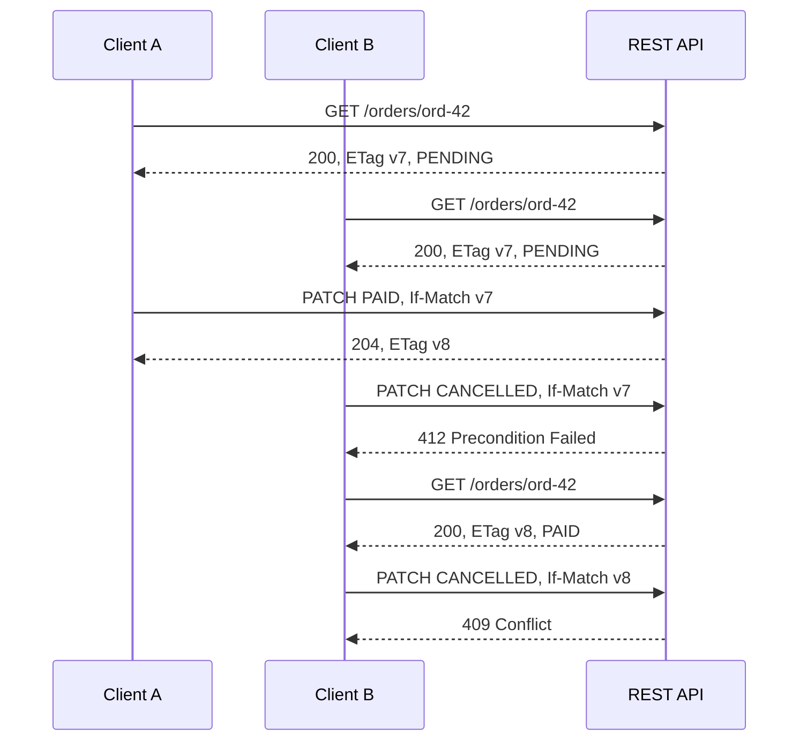

# 409, 412 do xung đột nghiệp vụ hoặc ETag đã cũ

Trong REST API, hai người dùng cùng chỉnh sửa một đơn hàng hoặc tài liệu có thể tạo ra hai loại xung đột rất khác nhau. Một bên muốn hủy đơn **đã thanh toán**: trạng thái hiện tại của nghiệp vụ không cho phép thao tác, thường phù hợp với `409 Conflict`. Một bên cập nhật dựa trên **phiên bản cũ** của tài nguyên: điều kiện `If-Match` không còn đúng, thường phù hợp với `412 Precondition Failed`. Cả hai đều có thể xuất hiện trong cùng một endpoint, nhưng cách chẩn đoán và xử lý của client phải khác nhau.

Bài học thuộc chương **Chẩn đoán sự cố** của module `INTEGRATION_API_REST`. Người học sẽ liên hệ resource/URI, phương thức HTTP, mã trạng thái, hợp đồng dữ liệu, cache với ETag, idempotency, phân quyền, Problem Details và kiểm thử API Java/Spring để xử lý đúng những lỗi thường bị gọi chung là “conflict”.

Sau bài học, bạn có thể:

- Xác định khi nào dùng `409`, `412` hoặc `428 Precondition Required` và phân biệt với `400`, `404`, `422`, `304`.
- Đọc và gửi đúng strong ETag qua `ETag` và `If-Match`, hiểu vì sao request bị `412` khi tài nguyên đã thay đổi.
- Xây dựng cập nhật có điều kiện trong Spring Boot, bảo đảm kiểm tra phiên bản và ghi dữ liệu là một thao tác **nguyên tử**.
- Chẩn đoán lỗi từ log, HTTP trace, database version và kiểm thử hai request cạnh tranh.
- Thiết kế phản hồi lỗi rõ ràng để client biết khi nào phải tải lại, hòa giải thay đổi hoặc điều chỉnh hành động nghiệp vụ.

## 1. Nhận diện đúng bản chất của 409 và 412

| Tình huống | Mã thường phù hợp | Câu hỏi chẩn đoán |
| --- | --- | --- |
| Client yêu cầu hủy đơn đã thanh toán, nhưng quy tắc không cho phép | `409 Conflict` | Trạng thái **nghiệp vụ hiện tại** có ngăn thao tác không? |
| Client PATCH với `If-Match: "ord-42-v7"` nhưng ETag hiện tại là `"ord-42-v8"` | `412 Precondition Failed` | **Điều kiện HTTP** mà client đặt ra có còn đúng không? |
| Server yêu cầu `If-Match` cho thao tác thay đổi nhưng client không gửi | `428 Precondition Required` | Request đã có **điều kiện bắt buộc** theo hợp đồng chưa? |
| Request sai JSON hoặc thiếu trường bắt buộc | `400 Bad Request` | Request có lỗi cú pháp hoặc vi phạm hợp đồng đầu vào không? |
| Dữ liệu hợp lệ về cú pháp nhưng không đáp ứng quy tắc ngữ nghĩa của API | `422 Unprocessable Content`, tùy hợp đồng | Giá trị gửi lên có hợp lệ độc lập với phiên bản resource không? |
| Resource không tồn tại hoặc không được phép tiết lộ tồn tại | `404 Not Found` | Resource được yêu cầu có thể được xác định và truy cập không? |
| `GET` với `If-None-Match` khớp ETag hiện tại | `304 Not Modified` | Client có thể dùng lại biểu diễn đã lưu trong cache không? |

**`409`** cho biết không thể hoàn tất yêu cầu vì xung đột với trạng thái hiện tại của resource. Server nên cung cấp thông tin vừa đủ để client nhận biết nguồn gốc xung đột và cách khắc phục. Ví dụ: chuyển đơn từ `PAID` sang `CANCELLED` bị cấm theo luồng nghiệp vụ; hai người cùng cố giữ một chỗ duy nhất; resource bị khóa vì một thao tác khác.

**`412`** nghĩa là ít nhất một **HTTP request precondition** được server đánh giá là sai. Ví dụ điển hình là `If-Match` trong `PUT`, `PATCH` hoặc `DELETE`. Mã `412` không đồng nghĩa với mọi lỗi “version mismatch” do lập trình viên tự tạo: phải xem request có sử dụng cơ chế điều kiện HTTP hay không. Nếu API dùng `version` trong JSON body thay vì header, việc chọn `409` hoặc một mã khác phải được định nghĩa nhất quán trong hợp đồng.

Với `409`, người dùng thường cần **thay đổi quyết định hoặc luồng nghiệp vụ**. Với `412`, người dùng thường cần **lấy bản mới nhất rồi quyết định hòa giải thay đổi**; tự động thay ETag mới và gửi lại body cũ có thể ghi đè dữ liệu của người khác.

## 2. Mô phỏng sự cố: hai người cùng cập nhật một đơn

Resource bắt đầu với trạng thái `PENDING`:

```http
GET /v1/orders/ord-42 HTTP/1.1
Host: api.example.com
Accept: application/json
```

Response:

```http
HTTP/1.1 200 OK
Content-Type: application/json
ETag: "ord-42-v7"
Cache-Control: no-store

{"id":"ord-42","status":"PENDING"}
```

Hai client A và B cùng đọc ETag `"ord-42-v7"`. A thanh toán đơn hàng:

```http
PATCH /v1/orders/ord-42 HTTP/1.1
Host: api.example.com
Content-Type: application/json
If-Match: "ord-42-v7"

{"status":"PAID"}
```

Server kiểm tra ETag phiên bản 7 còn đúng và cho phép chuyển trạng thái, sau đó tăng phiên bản lên 8:

```http
HTTP/1.1 204 No Content
ETag: "ord-42-v8"
```

B vẫn đang giữ ETag cũ và yêu cầu hủy đơn:

```http
PATCH /v1/orders/ord-42 HTTP/1.1
Host: api.example.com
Content-Type: application/json
If-Match: "ord-42-v7"

{"status":"CANCELLED"}
```

Response lúc này:

```http
HTTP/1.1 412 Precondition Failed
Content-Type: application/problem+json

{
  "type": "https://api.example.com/problems/stale-representation",
  "title": "Resource version is stale",
  "status": 412,
  "detail": "Reload the resource and review the latest state."
}
```

B thực hiện `GET` mới và thấy `"ord-42-v8"` cùng trạng thái `PAID`. Nếu B gửi lại yêu cầu hủy với ETag **đúng phiên bản 8**, HTTP precondition đã thỏa mãn, nhưng quy tắc nghiệp vụ vẫn không cho phép hủy đơn đã thanh toán:

```http
HTTP/1.1 409 Conflict
Content-Type: application/problem+json

{
  "type": "https://api.example.com/problems/invalid-state-transition",
  "title": "Order cannot be cancelled",
  "status": 409,
  "detail": "Orders in PAID state cannot transition to CANCELLED."
}
```

Điểm then chốt: **cùng một mục tiêu “hủy đơn”, client B có thể gặp `412` trước rồi `409` sau**. `412` báo rằng client đang thao tác với bản cũ; `409` báo rằng thao tác không hợp lệ ngay cả khi đã đọc trạng thái mới.



Sơ đồ thể hiện **nguyên tắc**, không ấn định mọi server bắt buộc trả body của lỗi đúng như ví dụ. Hợp đồng API cần quy định mã trạng thái, `type`, `title` và trường bổ sung một cách ổn định.

## 3. Hiểu ETag và các điều kiện HTTP

### 3.1. ETag là validator, không phải nhãn trang trí

`ETag` là một HTTP response header biểu diễn **validator** của representation được trả về. Ví dụ:

```http
ETag: "ord-42-v7"
```

Giá trị ETag có dấu nháy kép. Server có thể tạo ETag từ version của resource, hash nội dung hoặc cơ chế khác, nhưng phải bảo đảm tính đúng đắn đối với representation được phục vụ. Ví dụ `"ord-42-v7"` là tag mang ý nghĩa version theo hợp đồng demo; client nên coi giá trị đó là **opaque token**, không tự đoán rằng tăng `v7` thành `v8` sẽ hợp lệ.

Có hai loại:

- **Strong ETag**, ví dụ `"ord-42-v7"`, thích hợp để so sánh chính xác representation khi dùng `If-Match`.
- **Weak ETag**, ví dụ `W/"ord-42-v7"`, cho phép tương đương về mặt ngữ nghĩa trong một số tình huống cache, **không thỏa phép so sánh mạnh của `If-Match`**.

Không được bỏ tiền tố `W/`, bỏ dấu nháy hoặc tự chỉnh ETag. Các biến thể representation như ngôn ngữ, media type hoặc content encoding cũng cần được tính đến khi thiết kế strong validators và cache. Một tag không được tái sử dụng cho các representation khác nhau theo cách vi phạm quy tắc so sánh mạnh.

### 3.2. ETag đi với header nào?

| Request | Header | Khi điều kiện khớp / không khớp |
| --- | --- | --- |
| `GET` hoặc `HEAD` | `If-None-Match: "tag"` | Khớp → thường `304`; không khớp → trả representation hiện tại |
| `PATCH`, `PUT`, `DELETE` | `If-Match: "tag"` | Khớp strong ETag → có thể thực hiện nếu nghiệp vụ cho phép; không khớp → `412` |
| `PATCH`, `PUT`, `DELETE` | `If-Match: *` | Chỉ yêu cầu resource hiện tồn tại; **không bảo vệ khỏi lost update do phiên bản thay đổi** |
| Method không phải `GET`/`HEAD` | `If-None-Match` | Nếu điều kiện “không khớp” thất bại, thường là `412` |
| Method cập nhật | `If-Unmodified-Since` | Thất bại → `412` theo quy tắc HTTP, nhưng độ chính xác thời gian thường kém ETag |
| Method cập nhật, server bắt buộc precondition | Không gửi header cần thiết | Có thể trả `428 Precondition Required` theo chính sách API |

`If-Match` cho phép một danh sách ETag hoặc `*` theo cú pháp HTTP; server phải áp dụng đúng quy tắc **strong comparison**. Ví dụ minh họa ở mục 5 chỉ xử lý **một ETag mạnh duy nhất** để dễ học và phải được mở rộng nếu dùng trong production. Thứ tự đánh giá các precondition và trạng thái resource tuân theo HTTP; precondition không làm biến mất kiểm tra xác thực, phân quyền, sự tồn tại resource và tính hợp lệ cơ bản của request.

### 3.3. Vì sao ETag giúp tránh lost update?

Không có precondition, hai request đọc phiên bản 7 rồi lần lượt ghi có thể dẫn đến **last write wins** ngoài ý muốn:

```text
Đọc trạng thái v7
  Client A ----------------> PATCH trạng thái PAID
  Client B ----------------> PATCH trạng thái CANCELLED
                                         |
                         Nếu ghi không có điều kiện,
                         cập nhật sau có thể đè kết quả trước
```

Với `If-Match`, client báo “chỉ áp dụng thay đổi của tôi khi representation vẫn là bản tôi đã đọc”. Server phải **kiểm tra điều kiện và ghi dữ liệu trong một thao tác nguyên tử hoặc cơ chế đồng thời an toàn**; nếu tách thành `SELECT version` rồi `UPDATE` không điều kiện, hai request vẫn có thể cùng vượt qua bước kiểm tra và ghi đè nhau.

ETag không tự giải quyết conflict nghiệp vụ: ngay cả khi client dùng phiên bản mới nhất, thao tác “hủy đơn đã thanh toán” vẫn phải được chặn bằng quy tắc domain.

## 4. Chẩn đoán nhanh từ HTTP trace

Khi thấy `409` hoặc `412`, đừng vội đổi mapping exception trong controller. Hãy thu thập **request và response thực tế**, trừ dữ liệu nhạy cảm, rồi đặt các câu hỏi:

1. **Endpoint nào bị lỗi?** Method, URI template, request ID và mã HTTP từ client, gateway và application có khớp nhau không?
2. **Request có header điều kiện không?** Có `If-Match` hay `If-Unmodified-Since`? Giá trị có dấu nháy hợp lệ? Có bị proxy lọc, client SDK bỏ sót hoặc đổi sang weak ETag không?
3. **Resource hiện là gì?** Sau khi xác thực và phân quyền hợp lệ, đọc bản mới nhất cùng ETag, status nghiệp vụ và version trong kho dữ liệu.
4. **Điều kiện hay domain thất bại?** `If-Match` cũ → `412`; precondition hợp lệ nhưng transition không cho phép → `409`.
5. **Có cạnh tranh thật không?** Kiểm tra hai request gần đồng thời, commit DB, transaction rollback, retry của gateway/client, optimistic-lock failures.
6. **Lỗi xuất phát ở tầng nào?** Proxy, service hay database constraint? Không suy diễn nguyên nhân từ status đơn lẻ.

Bảng dấu hiệu:

| Quan sát | Giả thuyết | Cách xác nhận |
| --- | --- | --- |
| `412` ngay sau khi người dùng mở màn hình rất lâu | ETag từ phiên bản cũ | `GET` mới, so ETag, lịch sử update |
| `412` ngay cả khi client vừa GET | Cạnh tranh giữa GET và PATCH, replica không nhất quán hoặc dùng sai representation variant | Trace theo resource, version DB, routing, cache |
| `412` với `If-Match: W/"..."` | Weak tag không thỏa strong comparison | Xem ETag raw ở GET và request |
| `428` trên PATCH | Client bỏ `If-Match` | So HTTP request trước và sau SDK/proxy |
| `409` khi hủy đơn `PAID` | Transition bị business rule cấm | State machine và audit event |
| `409` khi tạo resource | Unique key/đặt chỗ/ghi nhận idempotency đang xung đột | Constraint, rule và contract |
| Một update biến mất nhưng không có `412` | Check version và ghi không nguyên tử | Rà `UPDATE WHERE version=?`, `@Version`, transaction |
| `409` tăng mạnh sau rollout | Client và server dùng contract khác version, retry không an toàn, hoặc thay đổi domain rule | Correlation ID, release diff, error `type`, request payload |

**Lưu ý phân quyền:** chỉ đọc trạng thái hiện tại hoặc trả ETag sau khi đã xác nhận người dùng được phép truy cập resource. Tài liệu lỗi không nên tiết lộ trạng thái đơn hàng, thông tin khách hàng hoặc sự tồn tại của resource bị cấm truy cập.

## 5. Bài demo Spring Boot: cạnh tranh phiên bản và trạng thái nghiệp vụ

Ví dụ dưới đây sử dụng **Spring Boot Web** và `ConcurrentHashMap.compute` để gom kiểm tra ETag + cập nhật trạng thái trong cùng một thao tác nguyên tử **trong một JVM**. Chỉ có đơn `ord-42` khởi đầu ở `PENDING`, version 7. Không có cơ sở dữ liệu, xác thực hay nhiều instance; đây là mô phỏng giúp thấy rõ sự khác nhau giữa `412` và `409`.

### 5.1. Tạo ứng dụng nhỏ

Cần Java 17+ và dự án Spring Boot 3 có dependency `spring-boot-starter-web`. Nếu muốn dựng từ đầu bằng Maven, dùng `pom.xml` tối giản sau:

```xml
<?xml version="1.0" encoding="UTF-8"?>
<project xmlns="http://maven.apache.org/POM/4.0.0"
         xmlns:xsi="http://www.w3.org/2001/XMLSchema-instance"
         xsi:schemaLocation="http://maven.apache.org/POM/4.0.0 https://maven.apache.org/xsd/maven-4.0.0.xsd">
    <modelVersion>4.0.0</modelVersion>
    <parent>
        <groupId>org.springframework.boot</groupId>
        <artifactId>spring-boot-starter-parent</artifactId>
        <version>3.5.6</version>
        <relativePath/>
    </parent>
    <groupId>dev.example</groupId>
    <artifactId>rest-conflict-demo</artifactId>
    <version>1.0.0</version>
    <properties>
        <java.version>17</java.version>
    </properties>
    <dependencies>
        <dependency>
            <groupId>org.springframework.boot</groupId>
            <artifactId>spring-boot-starter-web</artifactId>
        </dependency>
    </dependencies>
    <build>
        <plugins>
            <plugin>
                <groupId>org.springframework.boot</groupId>
                <artifactId>spring-boot-maven-plugin</artifactId>
            </plugin>
        </plugins>
    </build>
</project>
```

File `src/main/java/dev/example/ConflictDemoApplication.java`:

```java
package dev.example;

import java.util.Map;
import java.util.concurrent.ConcurrentHashMap;
import java.util.concurrent.atomic.AtomicReference;
import org.springframework.boot.SpringApplication;
import org.springframework.boot.autoconfigure.SpringBootApplication;
import org.springframework.http.CacheControl;
import org.springframework.http.HttpHeaders;
import org.springframework.http.HttpStatus;
import org.springframework.http.MediaType;
import org.springframework.http.ProblemDetail;
import org.springframework.http.ResponseEntity;
import org.springframework.web.bind.annotation.*;

@SpringBootApplication
public class ConflictDemoApplication {
    public static void main(String[] args) {
        SpringApplication.run(ConflictDemoApplication.class, args);
    }
}

@RestController
@RequestMapping("/v1/orders")
class OrdersController {
    record Order(String id, String status, long version) {}
    record ChangeStatus(String status) {}

    private final Map<String, Order> orders = new ConcurrentHashMap<>(
            Map.of("ord-42", new Order("ord-42", "PENDING", 7)));

    @GetMapping("/{id}")
    ResponseEntity<?> get(@PathVariable String id) {
        Order order = orders.get(id);
        if (order == null) {
            return problem(HttpStatus.NOT_FOUND, "Order not found",
                    "No order for the requested id");
        }
        return ResponseEntity.ok()
                .cacheControl(CacheControl.noStore())
                .eTag(etag(order))
                .body(Map.of("id", order.id(), "status", order.status()));
    }

    @PatchMapping(path = "/{id}", consumes = MediaType.APPLICATION_JSON_VALUE)
    ResponseEntity<?> patch(
            @PathVariable String id,
            @RequestHeader(value = HttpHeaders.IF_MATCH, required = false)
            String ifMatch,
            @RequestBody(required = false) ChangeStatus body) {
        if (ifMatch == null || ifMatch.isBlank()) {
            return problem(HttpStatus.PRECONDITION_REQUIRED,
                    "If-Match required", "Send the ETag from the last GET");
        }
        if (body == null || (!"PAID".equals(body.status())
                && !"CANCELLED".equals(body.status()))) {
            return problem(HttpStatus.BAD_REQUEST,
                    "Invalid status", "Expected PAID or CANCELLED");
        }

        AtomicReference<ResponseEntity<?>> result = new AtomicReference<>();

        // compute giữ check phiên bản + thay đổi cùng một bước nguyên tử.
        orders.compute(id, (key, current) -> {
            if (current == null) {
                result.set(problem(HttpStatus.NOT_FOUND,
                        "Order not found", "No order for the requested id"));
                return null;
            }
            // Demo chấp nhận một strong ETag duy nhất: không parse danh sách/*.
            if (!etag(current).equals(ifMatch)) {
                result.set(problem(HttpStatus.PRECONDITION_FAILED,
                        "Stale ETag", "Reload the order before updating"));
                return current;
            }
            if ("PAID".equals(current.status())
                    && "CANCELLED".equals(body.status())) {
                result.set(problem(HttpStatus.CONFLICT,
                        "Invalid state transition",
                        "A paid order cannot be cancelled"));
                return current;
            }
            if (current.status().equals(body.status())) {
                result.set(ResponseEntity.noContent()
                        .eTag(etag(current)).build());
                return current;
            }
            if (!"PENDING".equals(current.status())) {
                result.set(problem(HttpStatus.CONFLICT,
                        "Invalid state transition",
                        "This order cannot change state again"));
                return current;
            }
            Order updated = new Order(
                    current.id(), body.status(), current.version() + 1);
            result.set(ResponseEntity.noContent()
                    .eTag(etag(updated)).build());
            return updated;
        });

        return result.get();
    }

    private String etag(Order order) {
        return "\"" + order.id() + "-v" + order.version() + "\"";
    }

    private ResponseEntity<ProblemDetail> problem(
            HttpStatus status, String title, String detail) {
        ProblemDetail body = ProblemDetail.forStatusAndDetail(status, detail);
        body.setTitle(title);
        return ResponseEntity.status(status)
                .contentType(MediaType.APPLICATION_PROBLEM_JSON)
                .body(body);
    }
}
```

Chạy trong thư mục dự án:

```bash
mvn spring-boot:run
```

Ứng dụng mặc định lắng nghe ở cổng `8080`. Bài demo chỉ nên chạy trên máy học và mạng thử nghiệm. `ConcurrentHashMap.compute` bảo vệ cập nhật của một key **trong cùng một tiến trình**; không thể thay thế transaction/locking của cơ sở dữ liệu khi triển khai nhiều Pod.

### 5.2. Tái hiện 204, 412 và 409 bằng curl

Dùng bash/Linux/macOS/WSL. Có thể xem cả header và body bằng `-i`:

**Bước 1 — Đọc ETag ban đầu:**

```bash
BASE_URL=http://127.0.0.1:8080

curl -i -sS "$BASE_URL/v1/orders/ord-42"
```

Kỳ vọng: `200`, `ETag: "ord-42-v7"`, body có `"status":"PENDING"`.

**Bước 2 — Thanh toán bằng phiên bản v7:**

```bash
curl -i -sS -X PATCH "$BASE_URL/v1/orders/ord-42" \
  -H 'Content-Type: application/json' \
  -H 'If-Match: "ord-42-v7"' \
  --data-raw '{"status":"PAID"}'
```

Kỳ vọng: `204 No Content`, `ETag: "ord-42-v8"` và không có body.

**Bước 3 — Gửi lại điều kiện cũ:**

```bash
curl -i -sS -X PATCH "$BASE_URL/v1/orders/ord-42" \
  -H 'Content-Type: application/json' \
  -H 'If-Match: "ord-42-v7"' \
  --data-raw '{"status":"CANCELLED"}'
```

Kỳ vọng: `412` với `title: "Stale ETag"`. Kiểm tra lại:

```bash
curl -i -sS "$BASE_URL/v1/orders/ord-42"
```

Response `200` bây giờ trả `"status":"PAID"` và ETag `"ord-42-v8"`.

**Bước 4 — Gửi điều kiện mới nhưng thao tác không hợp lệ:**

```bash
curl -i -sS -X PATCH "$BASE_URL/v1/orders/ord-42" \
  -H 'Content-Type: application/json' \
  -H 'If-Match: "ord-42-v8"' \
  --data-raw '{"status":"CANCELLED"}'
```

Kỳ vọng: `409` với `title: "Invalid state transition"`. Không có trạng thái hoặc version nào được thay đổi ở bước 3 và 4.

**Bước 5 — Không gửi If-Match:**

```bash
curl -i -sS -X PATCH "$BASE_URL/v1/orders/ord-42" \
  -H 'Content-Type: application/json' \
  --data-raw '{"status":"CANCELLED"}'
```

Kỳ vọng: `428`, yêu cầu bổ sung precondition trước khi cập nhật.

Trên PowerShell, có thể dùng `curl.exe` và truyền JSON bằng cách phù hợp với phiên bản PowerShell đang dùng. Nếu vướng dấu nháy, lưu body vào một file JSON trên máy học rồi dùng `--data-binary @body.json` (đường dẫn và quoting tùy shell). Không dùng `-k` để bỏ xác minh TLS khi gọi API thật.

Nếu cần tái hiện từ đầu, restart **server demo** để phục hồi đơn `PENDING`, version 7. Đây là một bước reset state quan trọng vì bước thanh toán làm thay đổi dữ liệu trong bộ nhớ.

### 5.3. Tranh chấp khi hai request đến cùng lúc

Mở hai terminal cùng dùng `If-Match: "ord-42-v7"` và thử PATCH một request `PAID`, một request `CANCELLED`. Với `ConcurrentHashMap.compute`, mỗi cập nhật cùng key được xử lý nối tiếp trong đoạn thao tác nguyên tử: request đến trước có thể nhận `204`, request đến sau sẽ thấy version 8 và nhận `412`. **Không dự đoán trước bên nào thắng**: điều kiện mạng và scheduler quyết định thứ tự xử lý.

Khi kiểm thử race, đối chiếu thêm GET cuối để xác nhận version chỉ tăng một lần và dữ liệu không bị ghi đè âm thầm. Trên nhiều instance, phải thay bảo vệ trong JVM bằng cơ chế đồng thời ở storage dùng chung.

## 6. Từ demo sang cơ sở dữ liệu: kiểm tra và ghi nguyên tử

Trong Spring Data JPA, optimistic locking thường dùng trường `@Version`:

```java
@Entity
class OrderEntity {
    @Id
    private String id;

    @Version
    private Long version;

    @Enumerated(EnumType.STRING)
    private OrderStatus status;
}
```

Luồng cập nhật điển hình:

1. Đọc entity sau khi đã qua xác thực/phân quyền; tạo ETag từ version/representation phù hợp.
2. Đánh giá `If-Match` ngay trước thao tác thay đổi trong phạm vi transaction.
3. Kiểm tra quy tắc chuyển trạng thái: ví dụ `PAID` không thể chuyển sang `CANCELLED`.
4. Lưu entity; khi flush/commit, `@Version` giúp phát hiện writer khác đã sửa cùng record trong lúc transaction chạy.
5. Nếu giao dịch lỗi vì optimistic lock trong một request **có HTTP precondition**, trả `412` phù hợp sau khi rollback (và xác nhận loại lỗi). Nếu phiên bản hợp lệ nhưng domain rule bị vi phạm, trả `409`.
6. Chỉ trả ETag của **phiên bản đã commit**, sau khi kết quả lưu thực sự thành công; đừng phát ETag mới khi transaction sau đó bị rollback.

Đặc biệt, `@Version` tự nó **không đọc header `If-Match`**. Nếu client gửi ETag cũ nhưng code bỏ qua header, JPA có thể đọc entity mới nhất và ghi đè theo yêu cầu cũ. Cần kết nối đúng **validator của HTTP với version trong DB**.

Nếu không dùng ORM, phương án SQL optimistic compare-and-swap minh họa:

```sql
UPDATE orders
   SET status = :new_status,
       version = version + 1
 WHERE id = :id
   AND version = :expected_version;
```

Kết quả `affected_rows = 1` nghĩa là đã cập nhật được một bản ghi thỏa điều kiện. Nếu `0`, cần phân biệt resource không tồn tại (`404`), version đã thay đổi (`412` đối với `If-Match`) hoặc một ràng buộc nghiệp vụ khác. Một phép `UPDATE` đơn lẻ có `WHERE version = ?` giúp tránh lỗi kiểm tra rồi ghi tách rời. Kiểm tra trạng thái nghiệp vụ cũng cần diễn ra dưới transaction/lock phù hợp hoặc được đưa vào điều kiện `WHERE` khi cần.

Hãy tránh thiết kế “`SELECT version` → so ETag → `UPDATE` không điều kiện” ngoài transaction: hai request có thể đọc cùng version và cùng vượt qua phép so sánh, gây **lost update**.

### 6.1. ETag của representation khác với version của hàng DB

Version nội bộ chỉ là **một cách** tạo ETag. Nếu response thay đổi vì dữ liệu ghép từ nhiều bảng, quyền hiển thị field, ngôn ngữ, media type, hoặc mapping representation mà version hàng chính không tăng, sử dụng trực tiếp một trường version có thể tạo strong ETag sai. Cần chọn validator phản ánh representation thực, nhất quán với cache và cấu hình `Vary`/Content-Encoding khi thích hợp.

Ngược lại, không đưa `version` nội bộ ra JSON một cách tùy tiện rồi để client tự tính ETag. Hợp đồng HTTP nên đưa ETag qua response header và cho client gửi lại **nguyên giá trị**. Nếu kiến trúc cần cả JSON version, hãy quy định rõ quan hệ giữa hai giá trị.

## 7. Định nghĩa phản hồi lỗi rõ ràng với Problem Details

RFC 9457 chuẩn hóa kiểu body `application/problem+json`. Ví dụ cho xung đột trạng thái:

```http
HTTP/1.1 409 Conflict
Content-Type: application/problem+json

{
  "type": "https://api.example.com/problems/invalid-state-transition",
  "title": "Invalid state transition",
  "status": 409,
  "detail": "Cannot cancel an order after payment.",
  "instance": "/v1/orders/ord-42",
  "currentState": "PAID",
  "allowedActions": ["refund"]
}
```

Ở đây `currentState` và `allowedActions` là **extension do API tự định nghĩa**, chỉ trả khi người dùng có quyền xem. `type` nên là URI ổn định mô tả loại lỗi; không buộc client parse nội dung `detail` để ra quyết định. Với `412`:

```http
HTTP/1.1 412 Precondition Failed
Content-Type: application/problem+json

{
  "type": "https://api.example.com/problems/stale-representation",
  "title": "Stale representation",
  "status": 412,
  "detail": "The order changed after the client last read it."
}
```

Client nên xử lý theo **status + type**, kết hợp request ID và hướng dẫn sửa lỗi. `detail` phục vụ con người, có thể thay đổi theo ngôn ngữ. Tránh cho stack trace, SQL, token, dữ liệu cá nhân hoặc ETag của resource người gọi không được phép truy cập vào response lỗi.

| Loại lỗi | Hướng dẫn người dùng/client |
| --- | --- |
| `412` ETag cũ | Tải lại bản mới, xem khác biệt, hợp nhất nếu cần, yêu cầu người dùng xác nhận trước khi ghi |
| `409` domain conflict | Đổi hành động theo trạng thái hiện tại: ví dụ tạo yêu cầu hoàn tiền thay vì hủy đơn đã trả |
| `428` thiếu điều kiện | GET để lấy ETag, gửi `If-Match` ở lần PATCH/PUT/DELETE tiếp theo |
| `400`/`422` dữ liệu sai | Sửa payload/schema, không retry nguyên request vô hạn |
| `404` | Xác nhận resource/URI và quyền truy cập |

Không nên tự động retry `409` hoặc `412` với delay ngẫu nhiên rồi hy vọng thành công. Một số `409` do tranh chấp tạm thời có thể thử lại theo chính sách đặc thù, nhưng **409 từ quy tắc nghiệp vụ và 412 stale ETag thường đòi hỏi hành động thay đổi**. Nếu client dùng ETag mới và lặp lại body cũ mà không hỏi người dùng, cơ chế chống ghi đè coi như bị vô hiệu hóa ở tầng UX.

## 8. Cache, proxy, idempotency và những nguồn gây nhầm lẫn

### 8.1. Cache có điều kiện khác cập nhật có điều kiện

`If-None-Match` thường dùng khi đọc resource: nếu tag còn khớp, server trả `304` để client dùng lại bản đã lưu. `If-Match` dùng khi **bảo vệ cập nhật**: nếu tag không còn khớp, server thường trả `412`. Hai header khác nhau về ý nghĩa và quy tắc so sánh ETag.

Một `GET` trả `ETag` vẫn có thể đi cùng `Cache-Control: no-store` nếu resource nhạy cảm. Tài nguyên dùng ETag để chống lost update **không bắt buộc** phải cho phép cache lưu response. Ngược lại, khi CDN hoặc browser cache representation, phải kiểm tra `Cache-Control`, `Vary`, ETag và đường đi request để tránh đọc validator quá cũ.

### 8.2. Idempotency key và version không phải một

- **`Idempotency-Key`**: nhận diện một ý định tạo/thực thi thao tác để retry không gây side effect lặp, đặc biệt hữu ích cho `POST`. Cần lưu key, payload fingerprint, trạng thái/kết quả theo chính sách API.
- **`If-Match` + ETag**: chỉ cho cập nhật resource nếu representation chưa thay đổi kể từ lần client đọc.

Hai cơ chế có thể dùng cùng nhau. Ví dụ thanh toán một đơn: idempotency key tránh xử lý trùng lần charge; ETag tránh cập nhật trên trạng thái cũ. Tái dùng idempotency key với payload khác hoặc gửi request trùng khi lần đầu còn đang xử lý có thể được một số API ánh xạ thành `409`; đó là **xung đột theo hợp đồng idempotency của API**, không tự biến thành `412`.

### 8.3. Proxy và nhiều replica

Khi một API chạy nhiều Pod:

- Nếu ETag được tính từ memory của từng Pod, client có thể nhận các validator không thống nhất.
- Nếu GET đọc replica lag còn PATCH ghi primary, client có thể gửi ETag cũ ngay sau khi đọc. Cần đo replication lag và quyết định chính sách đọc sau ghi.
- Nếu proxy loại bỏ hoặc chuẩn hóa header `If-Match` sai, server có thể trả `428`/`412` ngoài dự kiến.
- Nếu gateway tự retry unsafe method sau timeout mà không có chính sách idempotency, có thể tạo thêm tranh chấp hoặc side effect.

Hãy kiểm tra **raw HTTP** ở client, gateway và server, cùng correlation ID. Không dùng ETag, URI chứa ID khách hàng hoặc giá trị header nhạy cảm làm metric label có cardinality cao.

## 9. Kiểm thử và runbook xử lý sự cố thực tế

### 9.1. Bộ kiểm thử có giá trị

| Test case | Thiết lập | Kỳ vọng |
| --- | --- | --- |
| Đọc phiên bản | GET `ord-42` khi `PENDING` | `200`, strong ETag v7 |
| Cập nhật đúng ETag | PATCH `PAID` với `If-Match v7` | `204`, ETag v8, DB đổi một lần |
| ETag cũ | PATCH với `If-Match v7` sau khi đã tăng v8 | `412`, DB không đổi |
| Conflict nghiệp vụ | PATCH `CANCELLED` với ETag v8 khi đơn `PAID` | `409`, DB không đổi |
| Thiếu precondition | PATCH không có `If-Match` | `428` theo hợp đồng demo |
| Resource không tồn tại | GET/PATCH id không tồn tại, precondition có đủ | `404` phù hợp sau kiểm tra quyền |
| Cập nhật song song | Hai PATCH cùng ETag v7 từ hai client | Một cập nhật thành công, request còn lại `412`; không lost update |
| Cache validator | GET có `If-None-Match` bằng tag hiện tại ở endpoint hỗ trợ conditional GET | `304` và không body theo hợp đồng |

Demo `GET` ở mục 5 gắn ETag qua `ResponseEntity`; Spring MVC có hỗ trợ kiểm tra conditional GET khi trả response với ETag. Hãy **gửi yêu cầu `If-None-Match` và xác nhận `304` trên đúng phiên bản Spring đang chạy**, vì hành vi tự động của framework hoặc lớp proxy có thể khác với một controller tự xử lý HTTP. Nếu triển khai bằng stack khác, cần xác minh hoặc bổ sung logic conditional GET tương ứng.

Khi kiểm thử Spring/JPA, phải buộc hai transaction chạy cạnh tranh trong môi trường có DB thật, thay vì chỉ gọi lần lượt hai HTTP request. Cần xác nhận optimistic locking ở lúc flush/commit, trạng thái cuối và lịch sử thay đổi.

### 9.2. Quy trình xử lý `409` hoặc `412` tăng đột biến

1. **Xác định phạm vi:** route, method, client version, thời điểm bắt đầu, release gần nhất, tỷ lệ request có điều kiện.
2. **Tách nhóm theo status và problem `type`:** stale ETag, invalid state transition, duplicate command, missing precondition; không trộn mọi lỗi thành “conflict”.
3. **Ghép log theo correlation ID:** request có If-Match gì, server tính version nào, trạng thái domain nào, transaction có rollback/optimistic lock exception không.
4. **Tái hiện một resource an toàn trong staging:** GET → PATCH với ETag hiện tại → PATCH với ETag cũ → GET → PATCH domain conflict.
5. **Kiểm tra cạnh tranh và storage:** transaction boundary, `@Version`, conditional update, cache/replica lag, proxy, retry và các tác vụ background cùng sửa resource.
6. **Khắc phục tại nguyên nhân:** sửa UI giữ ETag sai, đồng bộ cache validator, thêm atomic CAS, điều chỉnh quy tắc nghiệp vụ hoặc contract, thêm thông báo hòa giải thay đổi.
7. **Xác nhận sau sửa:** tỷ lệ `409`/`412` hợp lý theo mục đích, không có lost update, không ghi trùng hoặc tạo regression auth/cache.

Gợi ý log nội bộ an toàn:

```text
request_id=req-7f1 method=PATCH route=/v1/orders/{id}
outcome=412 reason=stale_if_match resource_kind=order
requested_version=7 current_version=8
transaction=not_started
```

`requested_version`/`current_version` chỉ là các trường chẩn đoán nội bộ nếu hệ thống có version số; không giả định client có thể phân tích ETag thành số. Không log token, body nhạy cảm, danh tính khách hàng hoặc toàn bộ validator nếu không cần.

## 10. Bài tập thực hành và câu hỏi kiểm tra

**Bài tập 1 — Phân loại mã trạng thái.** Cho các tình huống sau: (a) hủy đơn đã thanh toán; (b) PATCH với `If-Match` cũ; (c) PATCH không có `If-Match` khi API bắt buộc; (d) body JSON hỏng; (e) id resource không tồn tại. Chọn mã phù hợp và giải thích ngữ nghĩa. Trường hợp nào cần tải lại resource, trường hợp nào cần thay đổi hành động nghiệp vụ?

**Bài tập 2 — Tái hiện chuỗi lỗi.** Chạy demo Spring Boot, ghi lại ETag v7; PATCH `PAID`, ghi ETag v8; thử hủy bằng v7 rồi v8. Đối chiếu `204 → 412 → 409` và xác minh resource cuối cùng vẫn `PAID`. Giải thích tại sao thay ETag mới một cách mù quáng nguy hiểm.

**Bài tập 3 — Phát hiện race.** Hai client cùng đọc v7 và gửi PATCH ở cùng thời điểm. Viết một test tạo cạnh tranh thực sự (barrier, executor hoặc môi trường phân tán), kiểm tra chỉ một request được ghi và version tăng đúng một lần. Nếu code dùng `SELECT` và `UPDATE` tách rời, hãy mô tả cách hai writer có thể cùng thắng.

**Bài tập 4 — Thiết kế Spring Data JPA.** Bổ sung `@Version` vào entity, chuyển ETag từ response GET sang `If-Match` trong PATCH. Xác định vị trí bắt optimistic lock exception, transaction rollback và thời điểm trả ETag mới. Thử hai transaction ghi cùng entity để xác nhận status phù hợp.

**Bài tập 5 — Chẩn đoán production.** Sau rollout, tỷ lệ `412` tăng 10 lần; phần lớn client GET qua replica còn PATCH qua primary. Đưa ra giả thuyết, metric/log cần đọc, phép thử read-after-write và biện pháp sửa. Không mặc định xóa cache là đủ.

**Bài tập 6 — Phản hồi lỗi hữu ích.** Thiết kế hai Problem Details: một cho `409 invalid-state-transition`, một cho `412 stale-representation`, có `type` và hướng dẫn hành động cho UI. Chỉ cung cấp trường trạng thái hiện tại nếu người gọi có quyền xem resource.

**Tiêu chí hoàn thành:** xác định đúng **409 do xung đột trạng thái/nghiệp vụ** và **412 do HTTP precondition không thỏa**, xử lý `428` khi yêu cầu thiếu điều kiện, biết gửi strong ETag/`If-Match`, hiểu tính nguyên tử của cập nhật có điều kiện, và chứng minh qua request/test rằng hệ thống không âm thầm ghi đè thay đổi của client khác.
