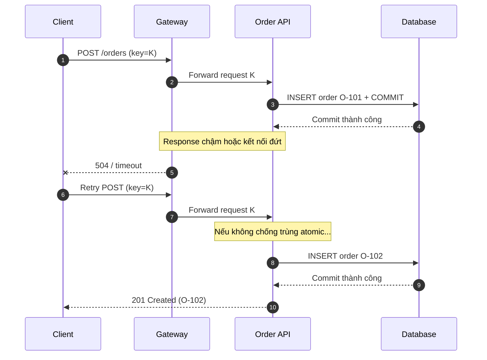
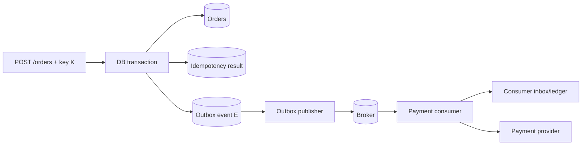

# Lặp tác dụng phụ do retry, timeout và chống trùng sai phạm vi

Trong module **INTEGRATION_API_REST**, thiết kế một REST API đáng tin cậy đòi hỏi hiểu không chỉ resource, URI, phương thức và mã trạng thái HTTP, mà còn hiểu chuyện gì xảy ra khi client gửi lại một request vì **timeout** hoặc mất phản hồi. Một API có OpenAPI rõ ràng, xác thực đúng và trả về JSON hợp lệ vẫn có thể tạo **hai đơn hàng, trừ kho hai lần, thu tiền hai lần hoặc gửi hai thông báo** cho một thao tác mà người dùng chỉ muốn thực hiện một lần.

Bài này thuộc nhóm **Chẩn đoán sự cố**, tập trung điều tra và phòng ngừa lỗi **lặp tác dụng phụ do retry, timeout và chống trùng sai phạm vi**. Ví dụ chính sử dụng API tạo đơn hàng bằng Java/Spring, PostgreSQL và mô hình outbox; nguyên tắc áp dụng tương tự cho thanh toán, đặt chỗ, cấp quyền, gửi email và xử lý message queue.

## 1. Nhận diện đúng lỗi: một ý định, nhiều lần thực thi

Giả sử người dùng nhấn “Đặt hàng” đúng một lần. Frontend gửi:

```http
POST /v1/orders HTTP/1.1
Authorization: Bearer <access-token>
Content-Type: application/json
Idempotency-Key: 7e32c9e2-9db7-473b-9888-35a42c81f99f

{
  "checkoutId": "checkout-881",
  "items": [{"sku": "BOOK-42", "quantity": 1}]
}
```

Server tạo đơn hàng thành công, nhưng client hết thời gian đợi trước khi nhận được `201 Created`. Client hoặc gateway retry cùng request. Nếu server không nhận diện đây là **cùng một thao tác nghiệp vụ**, lần gửi sau có thể tạo đơn thứ hai.

Điểm then chốt là phân biệt:

- **Số lần gửi request:** một lần gửi ban đầu, cộng các retry ở browser, SDK, gateway hoặc job.
- **Số lần server xử lý request:** có thể lớn hơn số lần người dùng thao tác.
- **Số lần ghi dữ liệu:** có thể lớn hơn một nếu thiếu bảo vệ tại database.
- **Số lần phát sinh tác dụng phụ:** thanh toán, trừ kho, gửi email hoặc publish message có thể bị lặp ngay cả khi chỉ còn một bản ghi đơn hàng.

Tình trạng nguy hiểm nhất là **không rõ kết quả** (*ambiguous outcome*): client thấy timeout và kết luận thất bại, trong khi server đã commit thành công. Timeout có nghĩa là client **không nhận được câu trả lời kịp thời**, không có nghĩa giao dịch server đã rollback.

### Dấu hiệu thường thấy khi vận hành

| Triệu chứng | Giả thuyết đầu tiên cần kiểm chứng |
| --- | --- |
| Hai đơn hàng sát nhau vài trăm mili giây, cùng giỏ hàng | Retry ở client/gateway hoặc hai request đồng thời |
| Chỉ một đơn hàng nhưng có hai khoản thu tiền | Tác dụng phụ thanh toán được thực hiện nhiều lần |
| Cùng `Idempotency-Key` nhưng mỗi lần tạo một đơn | Khóa chỉ lưu trong memory/cache, check–then–act không atomic hoặc scope sai |
| Retry bị chặn cho người dùng khác | Dùng khóa toàn cục mà không phân vùng theo tenant/operation |
| Retry cùng payload nhưng bị coi là request mới | Client sinh lại khóa ở mỗi attempt, TTL quá ngắn hoặc gateway loại header |
| Sau khi job chạy lại, email bị gửi trùng | Message consumer thiếu dedup hoặc đánh dấu xử lý sau tác dụng phụ |

Không chẩn đoán từ một hàng log “HTTP 504” hoặc “timeout” riêng lẻ. Phải ghép **request, giao dịch database và tác dụng phụ cuối cùng** theo cùng ý định nghiệp vụ.

## 2. Vì sao timeout + retry có thể gây lặp?



Client thấy một lần thất bại và một lần thành công; cơ sở dữ liệu lại có hai đơn hàng. Đây là lỗi do **retry của thao tác không được bảo vệ**, không phải do bản thân HTTP 504 tạo thêm đơn.

Có nhiều vị trí mà response biến mất:

1. Request không tới server: retry có thể là lần thực thi đầu tiên.
2. Request đến server nhưng transaction rollback: retry có thể là lần thực thi đầu tiên thành công.
3. Server commit nhưng response mất: retry sẽ lặp tác dụng phụ nếu không có dedup.
4. Server đã trả response nhưng proxy/client không nhận: hành vi tương tự trường hợp 3.
5. Server commit đơn hàng rồi gọi dịch vụ bên ngoài; phản hồi từ dịch vụ đó mất: kết quả **tác dụng phụ bên ngoài** cũng không rõ.

Không có cách nào từ phía client, chỉ nhìn một timeout, để phân biệt chắc chắn các trường hợp này. Do đó server phải thiết kế để request được gửi lại mà không gây thêm tác dụng phụ ngoài ý định.

### Phân biệt ba tính chất

**Retryable** nghĩa là client có thể thử lại theo chính sách đã công bố. **Idempotent** nghĩa là thực thi cùng thao tác nhiều lần dẫn đến cùng trạng thái hiệu lực như thực thi một lần; phản hồi HTTP ở các lần gửi không nhất thiết giống hệt nhau. **Exactly-once end-to-end** đòi hỏi bảo đảm xuyên qua các thành phần độc lập, thường không thể khẳng định nếu thiếu cơ chế phối hợp và bảo đảm riêng của từng downstream.

Trong REST, `GET` được kỳ vọng là *safe* (không gây tác dụng phụ do client yêu cầu); `PUT` và `DELETE` có ngữ nghĩa idempotent. `POST` thường không idempotent nếu không bổ sung cơ chế. Tuy nhiên, một `PUT` vẫn có thể gây lặp email hoặc publish message nếu implementation chạy tác dụng phụ trên mỗi lần gọi: **ngữ nghĩa phương thức không tự bảo vệ mọi downstream**.

## 3. Điều tra nguồn retry và ranh giới lỗi

Trước khi sửa code, xác định **ai retry, retry khi nào và cùng định danh gì**:

| Tầng | Cơ chế phổ biến | Cần quan sát |
| --- | --- | --- |
| Browser/mobile app | Người dùng bấm lại, SDK timeout, interceptor retry | `clientOperationId` ổn định theo hành động, attempt number, key giữ nguyên hay thay |
| Load balancer / reverse proxy | Retry upstream khi connection reset, gateway timeout | Route, upstream attempts, proxy headers, request có được forward nhiều lần không |
| Service gọi service | HTTP client retry `502/503/504`, connection timeout | Phương thức, retry policy, tổng deadline, idempotency key được chuyển tiếp |
| Message broker / job | At-least-once delivery, redelivery, retry cron | Message ID, delivery count, consumer ID, ack/nack, thời điểm commit |
| Thanh toán/email bên ngoài | Client SDK retry, callback/webhook được giao lại | Provider request ID, payment intent ID, webhook event ID, idempotency contract của provider |

Một trace có thể bị đứt giữa các lần retry; vì thế cần phân biệt:

- `traceId`/`spanId`: truy vết một đường xử lý; mỗi attempt có thể có trace khác nhau.
- `requestId`: mỗi HTTP request nhận một ID để truy lỗi cụ thể.
- `clientOperationId` hoặc `checkoutId`: đại diện **một ý định nghiệp vụ** qua mọi attempt.
- `Idempotency-Key`: nhận diện các retry của **cùng thao tác API** theo phạm vi đã định nghĩa.
- `orderId` / `paymentIntentId` / `outboxEventId`: nhận diện tài nguyên hoặc tác dụng phụ thực tế.

Không gộp tất cả thành một trường `requestId`. Nếu mỗi retry tạo requestId mới, bạn sẽ không ghép được chúng theo hành động của người dùng.

## 4. Chống trùng “sai phạm vi”: lỗi thường khó phát hiện nhất

Một khóa idempotency chỉ có nghĩa khi server định nghĩa rõ **phạm vi khóa** (*scope*) và **thời hạn lưu**. Giả sử frontend gửi khóa `K`. Các cách làm dưới đây gây lỗi khác nhau.

| Cách làm sai | Hậu quả | Cách thiết kế |
| --- | --- | --- |
| Dùng `K` trên toàn hệ thống | Hai tenant cùng vô tình dùng `K` có thể bị trả kết quả của nhau | Gắn khóa với tenant/principal và operation |
| Scope chỉ theo IP hoặc session | Nhiều người dùng chung NAT; thay session làm mất khả năng dedup | Lấy tenant/principal từ auth đã xác thực, không từ IP |
| Scope theo `requestId` của từng attempt | Request retry khác ID luôn lọt qua | Khóa theo ý định ổn định suốt các attempt |
| Scope gồm timestamp/trace ID thay đổi | Mỗi attempt tạo khóa hiệu lực mới | Chỉ dùng các trường xác định ngữ nghĩa của thao tác |
| Scope chỉ theo endpoint nhưng không xét payload | Cùng khóa khác giỏ hàng có thể nhận lại đơn hàng sai | Lưu thêm fingerprint request và từ chối reuse với nội dung khác |
| Scope theo payload mà không có khóa người dùng | Hai lần mua hợp lệ có cùng giỏ bị chặn nhầm | Dùng khóa do client sinh theo *ý định*, không dedup mọi JSON giống nhau |
| Chỉ lưu khóa ở một instance | Retry sang instance khác bị xử lý như mới | Dùng datastore chia sẻ với ràng buộc unique/atomic |
| TTL chỉ 30 giây dù SDK retry hàng giờ | Hết TTL là xử lý lại | Công bố cửa sổ dedup đủ dài và có khóa nghiệp vụ bổ trợ |
| Cache Redis “check rồi set” tách biệt | Race giữa hai node; cache mất nhưng DB còn dữ liệu | Atomic insert/constraint hoặc transaction với cơ chế reserve đúng |

Với `POST /v1/orders`, một định danh scope phù hợp có thể là:

```text
(tenantId đã xác thực, operationId = "createOrder:v1", Idempotency-Key)
```

Nếu API công khai cho người dùng cuối, có thể cần cả `principalId` để ràng buộc quyền đọc lại kết quả; quyết định tùy mô hình phân quyền. **Luôn xác thực và phân quyền lại** trước khi replay một response đã lưu. Không tin `tenantId` do caller tự gửi trong header, query hoặc body nếu giá trị đó không được kiểm chứng bằng auth.

Cùng khóa, cùng phạm vi nhưng **payload khác** là xung đột. Nên trả `409 Conflict` (hoặc lỗi hợp đồng tương đương) với thông báo rõ rằng key đã được dùng cho yêu cầu khác; không tạo resource mới và không trả mù kết quả của payload đầu tiên. Cùng khóa ở **hai phạm vi hợp lệ khác nhau** không phải tự động là một thao tác.

### Không đánh đồng idempotency key với business key

`Idempotency-Key` chống lặp do **gửi lại một HTTP operation**. `checkoutId` hoặc `merchantOrderId` có thể đại diện **tính duy nhất của ý định nghiệp vụ**, bảo vệ ngay cả khi frontend vô tình sinh key mới.

Ví dụ:

- Retry request tạo đơn giữ nguyên `Idempotency-Key=K` và `checkoutId=C`: replay kết quả đơn cũ.
- Hai request khác key nhưng cùng `checkoutId=C`: ràng buộc unique ở tầng domain ngăn tạo hai đơn cho cùng checkout. API cần xác định trả `409`, trả đơn đã tồn tại (sau kiểm tra quyền), hoặc quy tắc riêng được công bố.
- Hai lần mua sách giống nhau, hai `checkoutId` khác nhau: **hai giao dịch hợp lệ**, không nên dedup chỉ vì JSON giống nhau.

## 5. Xác định hợp đồng retry/idempotency ngay trong API

Ví dụ hợp đồng đối với `POST /v1/orders`:

| Điều kiện | Kết quả mong đợi |
| --- | --- |
| Khóa mới, request hợp lệ | Xử lý một lần và trả `201 Created` cùng `Location` |
| Cùng khóa, cùng scope, cùng payload, đã commit | Không tạo thêm đơn; replay kết quả đã lưu (ví dụ `201`, `Location`, response body) |
| Cùng khóa/scope nhưng payload khác | `409 Conflict` và mã lỗi `IDEMPOTENCY_KEY_REUSED` |
| Cùng khóa/scope đang được xử lý | Chờ có giới hạn hoặc trả phản hồi tạm thời được mô tả, ví dụ `409`/`202` với hướng dẫn kiểm tra lại |
| Thiếu key ở endpoint bắt buộc có key | `400 Bad Request` (hoặc mã thống nhất trong hợp đồng) |
| Sau thời gian lưu khóa | Chính sách phải được tài liệu hóa; có thể trở thành thao tác mới nếu không có business key bảo vệ |
| Caller không có quyền đọc đơn cũ | Tuân thủ xác thực/phân quyền hiện hành; không tiết lộ dữ liệu được cache |
| Request đã thất bại trước khi có tác dụng phụ | Tùy chính sách: có thể cho retry xử lý lại; mô tả rõ loại lỗi nào được lưu/replay |

**Không đưa mọi lỗi vào cache như nhau.** Lỗi validation `400` thường không nên chiếm một key vĩnh viễn nếu không có gì được xử lý, còn lỗi từ tác vụ đã có side effect đòi hỏi trạng thái kiểm chứng. Một số hệ thống lưu chính xác kết quả đầu tiên, kể cả lỗi; hệ thống khác chỉ lưu kết quả sau khi transaction commit. Chọn chính sách rõ ràng, test nhất quán.

### Ví dụ công bố trong OpenAPI

Đoạn dưới minh họa phần quan trọng của một operation (không phải file OpenAPI hoàn chỉnh):

```yaml
paths:
  /v1/orders:
    post:
      operationId: createOrder
      summary: Tạo một đơn hàng
      parameters:
        - in: header
          name: Idempotency-Key
          required: true
          description: >-
            Khóa ổn định cho một thao tác tạo đơn. Dùng lại cùng khóa
            với cùng payload khi retry trong cửa sổ chống trùng 24 giờ.
          schema:
            type: string
            maxLength: 128
      requestBody:
        required: true
        content:
          application/json:
            schema:
              type: object
              required: [checkoutId, items]
              properties:
                checkoutId:
                  type: string
                items:
                  type: array
                  minItems: 1
                  items:
                    type: object
                    required: [sku, quantity]
                    properties:
                      sku: { type: string }
                      quantity: { type: integer, minimum: 1 }
      responses:
        '201':
          description: >-
            Đã tạo đơn; retry cùng khóa và nội dung trong cửa sổ
            chống trùng trả lại kết quả của đơn đã tạo.
          headers:
            Location:
              description: URI đơn hàng đã tạo
              schema: { type: string }
        '400':
          description: Thiếu hoặc sai định dạng khóa hay request
        '401':
          description: Chưa được xác thực
        '403':
          description: Không có quyền thực hiện
        '409':
          description: Khóa được tái sử dụng sai nội dung hoặc checkout bị trùng
        '429':
          description: Quá giới hạn request
        '503':
          description: Dịch vụ tạm thời không sẵn sàng
```

Giá trị “24 giờ” chỉ là **chính sách minh họa**; trong ứng dụng thật phải phù hợp retry window, thời gian xử lý nền và yêu cầu nghiệp vụ. Tài liệu nên nói rõ người dùng cần giữ nguyên key bao lâu, lúc nào phải tạo key mới, cách lấy trạng thái khi timeout và mã lỗi có thể retry.

## 6. Mô hình dữ liệu chống trùng ở PostgreSQL

Với tác dụng phụ tạo đơn và ghi outbox trong **cùng PostgreSQL**, có thể chống trùng nhờ ràng buộc duy nhất và transaction.

```sql
CREATE TABLE api_idempotency (
    tenant_id          text        NOT NULL,
    operation_id       text        NOT NULL,
    idempotency_key    text        NOT NULL,
    request_fingerprint text       NOT NULL,
    state              text        NOT NULL
        CHECK (state IN ('PROCESSING', 'COMPLETED')),
    response_status    integer,
    response_body      jsonb,
    response_location  text,
    created_at         timestamptz NOT NULL DEFAULT now(),
    expires_at         timestamptz NOT NULL,
    PRIMARY KEY (tenant_id, operation_id, idempotency_key)
);

CREATE TABLE orders (
    id                bigserial   PRIMARY KEY,
    tenant_id         text        NOT NULL,
    checkout_id       text        NOT NULL,
    state             text        NOT NULL,
    UNIQUE (tenant_id, checkout_id)
);

CREATE TABLE outbox_events (
    id                uuid        PRIMARY KEY,
    tenant_id         text        NOT NULL,
    aggregate_id      bigint      NOT NULL,
    event_type        text        NOT NULL,
    payload           jsonb       NOT NULL,
    created_at        timestamptz NOT NULL DEFAULT now(),
    delivered_at      timestamptz
);
```

Đây là schema học tập, cần thêm index vận hành, retention policy, giới hạn độ dài/định dạng key, chính sách mã hóa dữ liệu nhạy cảm và công cụ migration phù hợp hệ thống.

**Fingerprint** là dấu vân tay của phần request có ý nghĩa: HTTP operation, request body sau chuẩn hóa và các tham số làm thay đổi tác dụng nghiệp vụ. Ví dụ dùng SHA-256 trên JSON canonicalized và ngữ cảnh phiên bản. Canonicalization phải ổn định giữa các attempt, kể cả thứ tự thuộc tính, cách biểu diễn số và Unicode; chỉ gọi `ObjectMapper.writeValueAsString` trên một object không đủ bảo đảm canonical JSON nếu cấu hình/thứ tự dữ liệu không ổn định. Không log raw body, token, thông tin thẻ hay bí mật; với dữ liệu nhạy cảm cần chính sách lưu hash/HMAC và retention thích hợp.

### Giao dịch atomic cho một request mới

Trong **một transaction**, xử lý theo thứ tự:

1. Kiểm tra auth, quyền và validate request trước khi dùng response cũ.
2. Thử chèn một hàng `api_idempotency` với khóa composite. Chèn thành công nghĩa là request hiện tại nhận quyền thực thi.
3. Nếu khóa đã có, **lock/read** hàng đã commit; so fingerprint. Khác thì trả xung đột. Giống và đã `COMPLETED` thì replay kết quả; không chạm vào `orders` hay outbox.
4. Nếu nhận quyền thực thi, ghi `orders` và `outbox_events`, sau đó lưu response vào `api_idempotency`.
5. Commit cả ba thay đổi cùng nhau. Chỉ khi commit thành công mới coi tạo đơn là hoàn tất.

Ví dụ ý tưởng SQL:

```sql
BEGIN;

INSERT INTO api_idempotency (
    tenant_id, operation_id, idempotency_key,
    request_fingerprint, state, expires_at
)
VALUES (
    :tenant, 'createOrder:v1', :idem_key,
    :fingerprint, 'PROCESSING', now() + interval '24 hours'
)
ON CONFLICT DO NOTHING;

-- Kiểm tra số row vừa INSERT để phân biệt "mới" và "đã có".
-- Sau đó đọc khóa hiện tại; SELECT FOR UPDATE dùng để đồng bộ
-- các luồng cùng key trong cùng transaction.
SELECT request_fingerprint, state, response_status,
       response_body, response_location
FROM api_idempotency
WHERE tenant_id = :tenant
  AND operation_id = 'createOrder:v1'
  AND idempotency_key = :idem_key
FOR UPDATE;

-- Nhánh đã tồn tại: fingerprint khác -> 409;
-- fingerprint giống + COMPLETED -> replay, COMMIT và trả kết quả.
-- Nhánh chèn mới: INSERT đơn + INSERT outbox + UPDATE result.

INSERT INTO orders (tenant_id, checkout_id, state)
VALUES (:tenant, :checkout_id, 'PENDING_PAYMENT')
RETURNING id;

INSERT INTO outbox_events (
    id, tenant_id, aggregate_id, event_type, payload
)
VALUES (
    :event_id, :tenant, :order_id, 'OrderCreated', :event_payload::jsonb
);

UPDATE api_idempotency
SET state = 'COMPLETED',
    response_status = 201,
    response_location = :location,
    response_body = :response_body::jsonb
WHERE tenant_id = :tenant
  AND operation_id = 'createOrder:v1'
  AND idempotency_key = :idem_key;

COMMIT;
```

**Đây là thuật toán minh họa gồm các nhánh**, không phải script SQL để chạy tuần tự cho mọi request. Nhánh replay dừng **trước** các lệnh `INSERT orders`/`INSERT outbox`; các bind variable do service cung cấp. Cần xử lý lỗi unique của `(tenant_id, checkout_id)` nếu hai idempotency key khác nhau cùng tạo một checkout.

Trong PostgreSQL, `INSERT ... ON CONFLICT` có thể phải chờ transaction đang giữ cùng unique key; sau khi transaction trước commit, nhánh sau phải đọc trạng thái đã commit trong transaction phù hợp (thường `READ COMMITTED`). Với `SERIALIZABLE` hoặc `REPEATABLE READ` cần xử lý serialization failure bằng retry **cả transaction**, với giới hạn phù hợp. Không giữ transaction mở khi gọi dịch vụ thanh toán chậm.

Ưu điểm của cách commit chung là nếu tiến trình chết trước `COMMIT`, các thay đổi cùng rollback; nếu chết sau `COMMIT`, cả đơn, outbox và kết quả replay vẫn tồn tại. Nó không tự bảo vệ downstream mà worker outbox sẽ gọi.

### Phác thảo service Java/Spring

Đoạn sau mô tả luồng service, giả định các repository triển khai SQL atomic phía trên:

```java
@Service
class CreateOrderService {
    private final IdempotencyRepository idempotency;
    private final OrderRepository orders;
    private final OutboxRepository outbox;

    CreateOrderService(
        IdempotencyRepository idempotency,
        OrderRepository orders,
        OutboxRepository outbox
    ) {
        this.idempotency = idempotency;
        this.orders = orders;
        this.outbox = outbox;
    }

    @Transactional
    CreateOrderResult create(
        AuthenticatedTenant actor,
        String idempotencyKey,
        CreateOrderCommand command
    ) {
        requireCreateOrderPermission(actor);
        validate(command);

        String operation = "createOrder:v1";
        String fingerprint = canonicalFingerprint(command);

        // tryReserve: INSERT ... ON CONFLICT DO NOTHING;
        // lock: SELECT ... FOR UPDATE với cùng composite key.
        boolean firstAttempt = idempotency.tryReserve(
            actor.tenantId(), operation, idempotencyKey, fingerprint
        );
        IdempotencyRecord record = idempotency.lock(
            actor.tenantId(), operation, idempotencyKey
        );

        if (!record.fingerprint().equals(fingerprint)) {
            throw new IdempotencyKeyReuseException();
        }
        if (!firstAttempt) {
            if (!record.isCompleted()) {
                throw new OperationStillProcessingException();
            }
            return record.storedResult();
        }

        Order order = orders.createUniqueCheckout(
            actor.tenantId(), command.checkoutId(), command.items()
        );
        outbox.enqueueOrderCreated(actor.tenantId(), order);

        CreateOrderResult result = CreateOrderResult.created(
            order.id(), "/v1/orders/" + order.id()
        );
        idempotency.complete(
            actor.tenantId(), operation, idempotencyKey, result
        );
        return result;
    }
}
```

Các kiểu `AuthenticatedTenant`, `IdempotencyRepository`, `OrderRepository`, `OutboxRepository` và `CreateOrderResult` là giao diện miền **cần tự triển khai**; đoạn code tập trung vào ranh giới transaction. Đừng dùng repository lưu mỗi key vào `HashMap` trong production. Với Spring, `@Transactional` cần được gọi qua proxy Spring; không dựa vào self-invocation rồi tưởng rằng transaction đã có hiệu lực.

Trong mô hình một transaction, trạng thái `PROCESSING` chỉ tồn tại **chưa commit** khi việc tạo đơn đang tiến hành; retry cùng key thường đợi unique key rồi thấy `COMPLETED`, hoặc retry tiếp nếu transaction ban đầu rollback. Đừng suy ra rằng đọc được `PROCESSING` là trường hợp phổ biến của thuật toán này. Nếu ứng dụng chọn **reserve key trong transaction riêng** rồi xử lý lâu hoặc không đồng bộ, bắt buộc thiết kế thêm lease, owner, heartbeat, deadline và recovery để tránh key bị treo mãi.

### Khi nào cách làm này chưa đủ?

- Một request tạo tài nguyên ở **nhiều database không có transaction chung**.
- Service gọi payment provider trong transaction rồi crash sau khi payment đã thực hiện.
- Outbox được gửi tới broker nhưng mất xác nhận; publisher có thể gửi lại.
- Consumer xử lý hai bản tin giống nhau ở hai pod.
- TTL đã xóa key trước khi một retry cũ đến.

Các trường hợp này cần dedup và đối soát ở **từng ranh giới tác dụng phụ**, không chỉ ở HTTP controller.

## 7. Chống trùng qua outbox và consumer

Nếu sau khi tạo đơn phải thu tiền hoặc gửi email, đừng gọi bên ngoài theo cách “ghi DB xong rồi gọi HTTP” và kỳ vọng một transaction local bảo vệ cả hai.



**Transactional outbox** ghi bản ghi tác vụ nền trong cùng transaction với đơn hàng. Publisher đọc outbox và chuyển message tới broker. Nếu publisher đã gửi thành công nhưng chết trước khi ghi `delivered_at`, message có thể bị gửi lại: outbox mặc định thường đạt **at-least-once delivery**, không chứng minh exactly-once.

Consumer nên:

1. Gắn mỗi event với `eventId` ổn định; xử lý lại cùng event dùng lại eventId đó.
2. Có inbox/dedup table với unique key theo `consumerName + eventId` hoặc business operation ID, tùy hợp đồng.
3. Ghi kết quả nghiệp vụ và dấu đã xử lý trong **cùng transaction** nếu cùng database.
4. Khi cần gọi payment provider, dùng định danh thanh toán ổn định và khả năng idempotency của provider; nếu timeout, truy vấn trạng thái theo mã tham chiếu trước khi tạo tác vụ thanh toán khác.
5. Thiết kế reconciliation đối chiếu `orderId` ↔ `paymentIntentId` ↔ provider transaction ID, bao gồm trường hợp webhook trễ hoặc lặp.

**Bẫy quan trọng:** ghi inbox “processed” trước rồi mới gọi provider có thể **mất** tác dụng phụ khi crash. Gọi provider trước rồi ghi inbox có thể **lặp** tác dụng phụ khi crash. Vì không có commit atomic giữa database của bạn và hệ thống bên ngoài, cần giao thức idempotency/reconciliation do downstream hỗ trợ hoặc kiến trúc nghiệp vụ chấp nhận bù trừ; không tuyên bố exactly-once chỉ vì đã có inbox.

Nếu provider không hỗ trợ idempotency key hoặc truy vấn theo business reference, không thể bảo đảm chống thu tiền hai lần chỉ bằng khóa ở ứng dụng trong mọi tình huống mất phản hồi. Cần xác định hạn chế đó trong thiết kế và quy trình đối soát.

## 8. Chính sách retry an toàn phía client và giữa các service

Retry là công cụ phục hồi lỗi tạm thời, nhưng có thể khuếch đại tải và làm lặp side effect nếu cấu hình sai.

### Quy tắc trước khi bật retry

1. Chỉ tự động retry các thao tác **idempotent theo hợp đồng** hoặc `POST` có key ổn định và server thực thi dedup đúng.
2. Dùng cùng `Idempotency-Key` cho mọi attempt của **cùng ý định**; tạo key mới cho ý định mới.
3. Áp dụng **exponential backoff với jitter**, giới hạn số lần và tổng deadline. Không retry vô hạn.
4. Tôn trọng `Retry-After` khi response dùng header này theo hợp đồng, nhất là `429` và `503`.
5. Không tự retry các lỗi nghiệp vụ không thể tự hết như `400` sai schema, `401` thiếu auth, `403` thiếu quyền hoặc `409` key-reuse khác payload.
6. Tính **retry budget** trên toàn đường gọi. Khi client, gateway và mỗi service đều thử lại ba lần, số request tới downstream có thể tăng theo cấp số nhân.
7. Bỏ retry khi user hủy thao tác hoặc deadline tổng đã hết; không để job retry tạo tác dụng phụ ngoài phạm vi ý định.

Ví dụ backoff nền 200 ms, hệ số 2, jitter ngẫu nhiên và giới hạn tối đa 3 lần retry; độ trễ thực tế do jitter sẽ khác nhau giữa client, giúp tránh “retry storm”. Cần theo dõi `retry_attempts_total`, lỗi upstream, số request đang chờ và saturation để phát hiện storm.

### HTTP status và quyết định retry

| Kết quả | Hành động mặc định |
| --- | --- |
| Mất kết nối, read timeout | **Kết quả chưa rõ**; retry chỉ khi operation an toàn theo hợp đồng, giữ nguyên key |
| `408 Request Timeout` | Có thể retry khi idempotent; vẫn xét tổng deadline và loại timeout |
| `429 Too Many Requests` | Backoff theo `Retry-After` nếu có và vẫn còn budget |
| `502 / 503 / 504` | Có thể là lỗi tạm thời; không được suy rằng chưa commit |
| `500` | Điều tra loại lỗi; nếu operation có bảo vệ idempotency thì có thể retry theo chính sách |
| `409 IDEMPOTENCY_KEY_REUSED` | Không retry cùng key với payload khác; sửa lỗi sử dụng key |
| `201` hoặc replay result đã commit | Ghi nhận thành công của **một thao tác**, không gửi thêm request tạo mới |

Tùy hợp đồng, `409` còn có thể mô tả thao tác **đang xử lý**; khi đó client được hướng dẫn đọc `GET /v1/operations/{id}` hoặc chờ retry, thay vì coi mọi `409` giống nhau. Dùng mã lỗi ứng dụng ổn định, không chỉ mỗi HTTP status.

## 9. Tạo endpoint kiểm tra trạng thái cho tác vụ kéo dài

Với tác vụ mất nhiều giây hoặc nhiều phút, thiết kế tốt hơn là chấp nhận lệnh một lần rồi trả trạng thái bất đồng bộ:

```http
POST /v1/payments HTTP/1.1
Idempotency-Key: pay-req-683
Content-Type: application/json

{"orderId": "ord-101"}

HTTP/1.1 202 Accepted
Location: /v1/operations/op-683
Content-Type: application/json

{"operationId": "op-683", "status": "PENDING"}
```

Client nhận `202` và polling:

```http
GET /v1/operations/op-683 HTTP/1.1

HTTP/1.1 200 OK
Content-Type: application/json

{"operationId":"op-683","status":"SUCCEEDED","paymentId":"pay-905"}
```

`202 Accepted` chỉ có nghĩa server đã chấp nhận xử lý, **chưa bảo đảm tác vụ nền thành công**. Nếu client timeout ở `POST`, nó retry **cùng idempotency key** để nhận lại cùng `operationId`; nếu đã có `operationId`, ưu tiên `GET` để biết trạng thái. Với polling, dùng cache headers phù hợp và giới hạn tần suất.

Trạng thái nên bao gồm `PENDING`, `RUNNING`, `SUCCEEDED`, `FAILED` (hoặc tương đương), thời điểm cập nhật và mã lỗi ổn định. Không tự động tạo payment mới chỉ vì trạng thái chưa chuyển `SUCCEEDED` trong khoảng timeout của frontend.

## 10. Quy trình chẩn đoán sự cố thực tế

Khi nhận báo cáo “khách đặt một lần nhưng bị trừ tiền hai lần”, xử lý có bằng chứng theo thứ tự:

### Bước 1: Khoanh vùng tác dụng phụ thực tế

Xác nhận có **hai giao dịch đã được provider chấp nhận** hay chỉ hai entry đang `PENDING`/`AUTHORIZED`. Phân biệt duplicate UI, duplicate order row, duplicate payment intent và duplicate charge. Tránh hoàn tiền hoặc phát lệnh thu tiền bổ sung trước khi có đối soát trạng thái.

### Bước 2: Lập timeline end-to-end

Thu thập theo thời điểm UTC (hoặc chuyển đổi nhất quán), tối thiểu:

```text
time                clientOp     reqId   idemKey  stage                 result
10:00:00.000        checkout-881 r-101   K1       POST received         -
10:00:00.420        checkout-881 r-101   K1       order DB commit       ord-101
10:00:01.000        checkout-881 r-101   K1       proxy timeout         504
10:00:01.250        checkout-881 r-102   K2       POST retry            -
10:00:01.530        checkout-881 r-102   K2       order DB commit       ord-102
10:00:01.800        checkout-881 r-102   K2       HTTP response         201
```

Ở ví dụ này, **client đổi key từ K1 sang K2** và không có business unique đủ mạnh, vì vậy dedup theo `Idempotency-Key` không thể nhận diện hai request. Một trace chỉ có `r-102` không giải thích được nguyên nhân; phải ghép theo `checkout-881`.

### Bước 3: Kiểm tra các ràng buộc và bản ghi

Các truy vấn PostgreSQL minh họa (thay tham số bằng giá trị đã xác thực và dùng role chỉ đọc khi điều tra):

```sql
SELECT id, tenant_id, checkout_id, state
FROM orders
WHERE tenant_id = :tenant
  AND checkout_id = :checkout_id;

SELECT operation_id, idempotency_key,
       request_fingerprint, state, response_status,
       created_at, expires_at
FROM api_idempotency
WHERE tenant_id = :tenant
  AND idempotency_key IN (:key_1, :key_2);

SELECT id, aggregate_id, event_type,
       created_at, delivered_at
FROM outbox_events
WHERE tenant_id = :tenant
  AND aggregate_id IN (:order_id_1, :order_id_2);
```

Đối chiếu thêm provider transaction và webhook event theo ID; truy vấn cơ sở dữ liệu không thể tự xác định payment bên ngoài đã thành công hay chưa. Chỉ đọc kết quả trên nguồn có quyền phù hợp, tránh in token và thông tin tài chính nhạy cảm.

### Bước 4: Đặt giả thuyết và kiểm chứng

| Phát hiện | Nguyên nhân có khả năng | Kiểm chứng cần làm |
| --- | --- | --- |
| Hai request cùng key và scope; hai order row | Thiếu unique/atomic reserve hoặc key lưu cục bộ từng pod | Kiểm tra primary key, transaction boundary, đường insert và load test race |
| Hai request cùng checkout, key khác | Client tái tạo key khi retry; thiếu business uniqueness | Xem interceptor/SDK và unique constraint `(tenant, checkout)` |
| Một order, hai outbox event | Handler ghi event hai lần hoặc replay đi qua đoạn enqueue | So event ID và thứ tự insert trong transaction |
| Một event, hai lần charge | Consumer redelivery + provider không dedup | So event delivery, inbox và provider idempotency reference |
| Replay trả sai order của tenant khác | Scope bị bỏ tenant hoặc principal; lỗi phân quyền | Kiểm tra key composite, auth và test đa tenant |
| Chỉ xảy ra sau 24 giờ | TTL ngắn hơn cửa sổ retry hoặc cleanup không xét nghiệp vụ | So `expires_at` với lịch retry/job và retention policy |
| Chỉ xảy ra khi Redis failover | Cache dedup mất hoặc không có DB constraint | Dò cache failover, database uniqueness và cơ chế khôi phục |
| API trả `200` dù charge hai lần | Response handler luôn “thành công” nhưng side effect phát lặp | Kiểm tra ledger payment và các call tới provider |

### Bước 5: Giảm thiểu tác động và phục hồi

Nếu đang có incident, có thể tạm giảm hoặc vô hiệu retry **ở luồng không được bảo vệ**, hạ mức concurrency, giới hạn enqueue và đặt cảnh báo duplicate. Biện pháp phải xét SLA: việc chặn mọi request mới có thể làm gián đoạn nghiệp vụ.

Với dữ liệu đã bị trùng, đối soát order/payment trước; sử dụng nghiệp vụ hoàn tiền/hủy/hoàn kho có idempotency và dấu vết kiểm toán, tránh chạy script xóa dữ liệu production theo suy đoán. Sau đó mới triển khai sửa nguyên nhân và chạy kiểm thử hồi quy.

## 11. Logging, tracing và metric để phát hiện sớm

Đặt các trường log có cấu trúc nhất quán:

```json
{
  "event": "idempotency_decision",
  "service": "order-api",
  "operation": "createOrder:v1",
  "tenantRef": "tenant-hash-abc",
  "clientOperationId": "checkout-881",
  "requestId": "req-102",
  "traceId": "trace-xyz",
  "idempotencyKeyHash": "sha256-prefix-...",
  "fingerprintMatch": true,
  "decision": "REPLAY_COMPLETED",
  "orderId": "ord-101",
  "durationMs": 28
}
```

Hash hoặc giảm khả năng nhận diện các định danh nhạy cảm trong log theo chính sách bảo mật. Không log `Authorization`, dữ liệu thẻ, cookie, full request body hoặc full idempotency key nếu có rủi ro lộ thông tin.

Các metric hữu ích:

- `http_requests_total{operation,status}` và `http_retry_attempts_total{client,operation,reason}`.
- `idempotency_decisions_total{operation,decision}` với quyết định như `NEW`, `REPLAY`, `CONFLICT`, `IN_PROGRESS`.
- `idempotency_lock_wait_seconds`, số request quá deadline và lỗi unique constraint.
- `outbox_delivery_attempts_total`, `consumer_duplicate_events_total` và độ trễ xử lý.
- `business_duplicate_prevented_total` và sai lệch giữa order/payment trong reconciliation.

Không đưa raw idempotency key, trace ID hoặc order ID làm **metric label** vì cardinality tăng không giới hạn. Lưu các ID đó ở log/trace với chính sách retention phù hợp. Cảnh báo nên dựa trên tỉ lệ duplicate bất thường, số tác dụng phụ trên mỗi ý định, lỗi provider không rõ kết quả và độ trễ outbox.

## 12. Kiểm thử hồi quy: phá đúng ranh giới thời gian

Các test chỉ gửi tuần tự cùng request rồi kiểm tra `201` không phát hiện toàn bộ lỗi race/crash. Một bộ kiểm thử đủ sâu bao gồm:

| Trường hợp | Cách gây lỗi có kiểm soát | Kỳ vọng |
| --- | --- | --- |
| Retry sau commit nhưng mất response | Chặn response sau khi DB commit | Cùng key trả kết quả cũ; chỉ một order |
| Hai retry đồng thời | Bắn 10–50 request cùng scope/key/payload qua nhiều thread/pod | Một order, một outbox event, tất cả phản hồi phù hợp hợp đồng |
| Cùng key, payload khác | Gửi giỏ hàng khác trong cùng scope | `409`, không thêm tác dụng phụ |
| Cùng key ở hai tenant | Gửi qua hai token thuộc hai tenant | Độc lập theo scope, không lộ dữ liệu qua replay |
| Hai key, cùng `checkoutId` | Mô phỏng frontend tạo key mới cho retry | Unique nghiệp vụ ngăn tạo hai order |
| Retry sau TTL | Dùng fake clock hoặc dữ liệu thời gian xác định | Hành vi đúng retention policy, có cảnh báo nếu domain không cho phép tạo lại |
| Crash trước commit | Dừng tiến trình trước khi transaction commit | Không còn dữ liệu dở dang; retry có thể hoàn tất |
| Crash sau commit, trước ack HTTP | Dừng tiến trình ngay sau commit | Replay kết quả đã commit |
| Publisher gửi rồi mất ack | Publish thành công, không đánh dấu delivered | Message có thể lặp; consumer xử lý không lặp tác dụng phụ |
| Provider timeout sau khi thu tiền | Giả lập provider đã charge nhưng drop response | Retry/đối soát không phát sinh charge thứ hai |
| Gateway loại `Idempotency-Key` | Gửi request qua proxy cấu hình thật | Server từ chối request thiếu key hoặc proxy chuyển tiếp đúng |
| Retry storm | Nhiều client nhận `503` đồng thời | Có jitter, budget và giới hạn tải |
| Chuyển quyền của caller | Tạo đơn khi có quyền, thu hồi quyền rồi replay | Không leak response sau khi mất quyền |

### Ví dụ contract test bằng Spring MockMvc

Một kiểm thử tập trung vào ý nghĩa của key, kết hợp với fixture database sạch sau mỗi test:

```java
@SpringBootTest
@AutoConfigureMockMvc
class CreateOrderIdempotencyIT {
    @Autowired MockMvc mvc;
    @Autowired OrderRepository orders;

    @Test
    void sameKeyDoesNotCreateSecondOrder() throws Exception {
        String payload = """
            {
              "checkoutId": "checkout-test-501",
              "items": [{"sku": "BOOK-42", "quantity": 1}]
            }
            """;

        MvcResult first = mvc.perform(post("/v1/orders")
                .header("Idempotency-Key", "test-key-501")
                .contentType(MediaType.APPLICATION_JSON)
                .content(payload))
            .andExpect(status().isCreated())
            .andReturn();

        MvcResult replay = mvc.perform(post("/v1/orders")
                .header("Idempotency-Key", "test-key-501")
                .contentType(MediaType.APPLICATION_JSON)
                .content(payload))
            .andExpect(status().isCreated())
            .andReturn();

        assertEquals(
            first.getResponse().getHeader("Location"),
            replay.getResponse().getHeader("Location")
        );
        assertEquals(
            1L,
            orders.countByTenantAndCheckoutId(
                "test-tenant", "checkout-test-501"
            )
        );
    }
}
```

Ví dụ giả định test security context đã được cấu hình thành tenant `test-tenant` và các import JUnit/Spring cần thiết có sẵn. Nó kiểm tra **retry tuần tự**; cần thêm test concurrency thật, ideally dùng database engine giống production (ví dụ Testcontainers PostgreSQL) để kiểm chứng unique constraint, lock và transaction isolation. MockMvc không tái hiện timeout mạng/proxy; dùng kiểm thử tích hợp qua HTTP thực để tiêm lỗi ở vị trí response bị mất.

Khi tạo failure injection, kiểm tra **kết quả nghiệp vụ** sau khi hệ thống ổn định: số order, số charge, event/outbox/inbox và trạng thái client. Chỉ assert cùng HTTP status mà bỏ qua số side effect là chưa đủ.

## 13. Runbook ngắn cho trực ca

1. Xác nhận số tác dụng phụ đã xảy ra thực tế ở database và downstream; nếu thanh toán, đối soát trạng thái provider.
2. Gom các HTTP attempt theo `clientOperationId`/`checkoutId` và kiểm tra `Idempotency-Key` có ổn định không.
3. Xác định retry đến từ client, gateway, service call hay message queue; khoanh thời điểm timeout so với commit.
4. Kiểm tra khóa unique, transaction boundaries, TTL, fingerprint và scope tenant/principal/operation.
5. Với tác dụng phụ ngoài database, xem outbox, inbox, provider idempotency và webhook delivery.
6. Giảm tác động bằng retry budget, rate limit hoặc tạm khóa luồng gây lặp; thực hiện bù trừ sau đối soát.
7. Tái hiện bằng fault injection, thêm test hồi quy và cập nhật hợp đồng REST/OpenAPI, tài liệu cho client.

### Những câu hỏi cần trả lời trước khi đóng incident

- Có phải **hai ý định hợp lệ** hay một ý định bị thực thi hai lần?
- Mỗi attempt có cùng idempotency key, fingerprint và scope không?
- Server đã commit trước hay sau timeout đầu tiên?
- Có tồn tại unique constraint ở **tầng lưu trữ có tính quyết định** không?
- Có side effect nào chạy bên ngoài transaction của ledger và order không?
- Khi sự cố mất phản hồi tái diễn, hệ thống có tạo lại side effect không?
- Client có biết cách truy vấn trạng thái mà không tạo thêm operation không?

## 14. Bài thực hành: tái hiện và sửa lỗi

**Bối cảnh:** một ứng dụng Spring nhận `POST /v1/orders`, tạo đơn và publish `OrderCreated`. Frontend timeout sau 800 ms; trên môi trường tải cao, một số checkout xuất hiện hai order.

**Yêu cầu thực hiện:**

1. Viết client gửi hai request giống nhau trong 100 ms và mô phỏng response của lần đầu bị mất. Ghi lại các request ID, key, checkout ID và order ID.
2. Kiểm tra hiện trạng: có bao nhiêu dòng order/outbox và có unique constraint nào bảo vệ? Vẽ timeline commit và retry.
3. Bổ sung `Idempotency-Key` ổn định, fingerprint và unique key theo `(tenant, operation, key)`. Đưa ghi order, result và outbox vào cùng transaction.
4. Thêm unique `(tenant, checkoutId)` để bảo vệ khi client tạo nhầm key mới; lựa chọn và công bố response cho checkout đã có.
5. Thử lại với ít nhất ba fault: timeout **sau commit**, hai request **đồng thời**, và publisher **gửi event thành công nhưng mất ack**.
6. Mở rộng thử nghiệm tới consumer thanh toán: cùng event được giao hai lần; dùng provider idempotency/reference và đối soát thay vì đoán từ timeout.
7. Cập nhật OpenAPI về header, xung đột `409`, retry policy, retention window và đường dẫn lấy trạng thái tác vụ.

**Tiêu chí đạt:** mỗi checkout hợp lệ tạo đúng một đơn, retry cùng key chỉ replay, khác payload bị từ chối, không lộ dữ liệu qua tenant, message trùng không dẫn tới charge trùng, và người vận hành xác minh được nguyên nhân qua log/trace/ledger.

## 15. Câu hỏi tự kiểm tra

1. Tại sao client nhận `504 Gateway Timeout` không thể kết luận rằng server chưa commit?
2. Cách “`if (!redis.exists(key)) { createOrder(); redis.set(key); }`” có thể sai ở tình huống race nào?
3. Vì sao `Idempotency-Key` chỉ theo key, không theo tenant và operation, có thể dẫn đến rò rỉ dữ liệu?
4. Hai request cùng giỏ hàng nhưng khác checkout ID có nên bị chống trùng không? Vì sao?
5. Vì sao transaction chứa order và outbox vẫn chưa bảo đảm email/charge bên ngoài chỉ thực hiện một lần?
6. Nếu callback từ payment provider đến hai lần, nên dùng định danh nào để dedup và lưu trạng thái ở đâu?
7. Khi một key đã hết TTL nhưng client vẫn retry, những bảo vệ nào còn giúp ngăn thao tác nghiệp vụ lặp?
8. Kiểm thử nào phân biệt được “controller trả một đơn” với “thực tế thu tiền hai lần”?

**Ghi nhớ:** timeout tạo ra **sự không chắc chắn về kết quả**, retry khuếch đại sự không chắc chắn đó, còn chống trùng chỉ có hiệu quả khi đúng **phạm vi, cửa sổ thời gian, transaction boundary và ranh giới tác dụng phụ**. Kết hợp idempotency key theo ý định, fingerprint, unique constraint, outbox/inbox, bảo đảm downstream và đối soát để REST API vẫn an toàn khi phản hồi bị mất hoặc request được giao nhiều lần.
