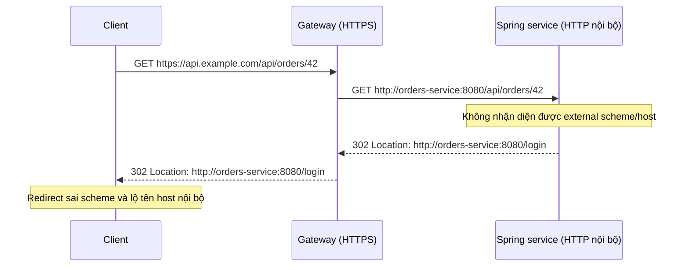

# Chẩn đoán redirect sai scheme, host hoặc chuyển tiếp thông tin xác thực trong REST API

Khi gọi REST API, client có thể nhận phản hồi `301`, `302`, `303`, `307` hoặc `308` với header `Location` để truy cập một URI khác. Vấn đề xuất hiện khi URI đích dùng **`http` thay vì `https`**, trỏ sang **hostname nội bộ hoặc sai domain**, tạo **vòng lặp chuyển hướng**, hoặc khiến **token/cookie xác thực không còn được gửi theo cách mong đợi**. Những hiện tượng này thường chỉ lộ ra sau khi ứng dụng Java/Spring được triển khai sau API gateway, reverse proxy hoặc bộ cân bằng tải.

Bài học thuộc chương **Chẩn đoán sự cố** của mô-đun **INTEGRATION_API_REST**. Nó kết nối kiến thức về **resource, URI, phương thức và mã trạng thái HTTP, hợp đồng OpenAPI, xác thực, phân quyền và xử lý lỗi** với một quy trình điều tra có thể dùng trong Spring Boot/Spring MVC hoặc stack tương đương.

## 1. Hiểu đúng phản hồi redirect

Một phản hồi chuyển hướng thường gồm mã 3xx và header `Location`:

```http
HTTP/1.1 308 Permanent Redirect
Location: https://api.example.com/v2/orders/42
Cache-Control: private, no-store
```

`Location` cho biết URI đích; URI có thể **tuyệt đối** (`https://api.example.com/v2/orders/42`) hoặc **tương đối** (`/v2/orders/42`). Với URI tương đối, client phân giải nó theo URI của request ban đầu. `Location` **không đồng nghĩa** với việc phương thức, body, header `Authorization` và cookie đều được gửi lại y nguyên.

| Mã | Ý nghĩa | Hệ quả khi client làm theo |
| --- | --- | --- |
| `301 Moved Permanently` | Tài nguyên được chuyển vĩnh viễn. | Một số client có thể đổi `POST` thành `GET` khi theo redirect. Có thể được lưu cache. |
| `302 Found` | Tài nguyên tạm thời ở vị trí khác. | Một số client có thể đổi `POST` thành `GET`. |
| `303 See Other` | Xem kết quả ở URI khác; thường dùng sau một yêu cầu thay đổi trạng thái. | Client thực hiện `GET` hoặc `HEAD` tại URI mới, bất kể phương thức ban đầu, theo quy tắc của HTTP. |
| `307 Temporary Redirect` | Chuyển tạm thời nhưng giữ ngữ nghĩa request. | **Không đổi phương thức** khi tự động redirect; request body có thể cần gửi lại. |
| `308 Permanent Redirect` | Chuyển vĩnh viễn và giữ ngữ nghĩa request. | **Không đổi phương thức**; có thể được lưu cache. |

Ví dụ, sau `POST /api/orders`, service có thể phản hồi **`201 Created`** với `Location: /api/orders/42` để mô tả tài nguyên vừa tạo mà **không yêu cầu client theo redirect**. Nếu workflow muốn client xem trang kết quả bằng `GET`, có thể thiết kế **`303 See Other`**. Không tùy tiện thay các mã này bằng `307/308`, vì phương thức `POST` sẽ được giữ và gửi lại ở URI mới.

**Điểm cần nhớ:** 3xx là một phần của hợp đồng HTTP. Mã trạng thái quyết định cách xử lý phương thức; URI đích quyết định scheme/host; chính sách client và trình duyệt quyết định có gửi credential ở request tiếp theo hay không.

## 2. Vì sao scheme/host bị sai sau reverse proxy?

Trong kiến trúc thường gặp:



Client thấy **`https://api.example.com`**, nhưng ứng dụng phía sau proxy lại thấy **`http://orders-service:8080`**. Nếu Spring tạo `Location` từ URL request mà không xử lý forwarded headers đúng cách, nó có thể phát sinh địa chỉ nội bộ hoặc scheme `http`.

Các nguồn gốc thường gặp:

- **TLS termination:** gateway kết thúc HTTPS rồi chuyển HTTP nội bộ. Ứng dụng chỉ thấy scheme `http` nếu thiếu thông tin external scheme.
- **`Host` hoặc forwarded host sai:** proxy chuyển tiếp hostname upstream, rewrite sai hoặc không đặt `X-Forwarded-Host` / `Forwarded` đúng.
- **Nhiều lớp proxy:** ingress, load balancer và API gateway thêm/ghi đè header không nhất quán; một giá trị có thể bị spoof nếu không có ranh giới tin cậy rõ.
- **Cấu hình domain cứng:** biến cấu hình `baseUrl`, callback URL, đường dẫn login hoặc service discovery trỏ nhầm sang `localhost`, host staging hoặc host nội bộ.
- **Hai lớp cùng redirect HTTPS hoặc canonical host:** proxy yêu cầu HTTPS trong khi ứng dụng vẫn nghĩ request là HTTP, gây vòng lặp.
- **Redirect được cache:** 301/308 hoặc cache trung gian còn giữ `Location` cũ sau khi đổi domain/cấu hình.

Các header thường liên quan:

```http
Host: api.example.com
Forwarded: proto=https;host=api.example.com
X-Forwarded-Proto: https
X-Forwarded-Host: api.example.com
X-Forwarded-Port: 443
```

`Forwarded` là header chuẩn theo RFC 7239; nhóm `X-Forwarded-*` là dạng phổ biến trên proxy. Hệ thống có thể dùng một trong hai theo quy ước triển khai. **Đây là dữ liệu chỉ được tin cậy khi được proxy đáng tin cậy làm sạch và đặt lại**, không phải bằng chứng đáng tin chỉ vì client gửi đến.

## 3. Dấu hiệu và cách khoanh vùng

| Triệu chứng | Nguyên nhân đáng kiểm tra đầu tiên | Bằng chứng cần tìm |
| --- | --- | --- |
| Request HTTPS nhưng `Location: http://...` | Ứng dụng không nhận biết external scheme hoặc base URL sai. | `Location` và `X-Forwarded-Proto` / `Forwarded` tại gateway → service. |
| `Location` trỏ `localhost`, `orders-service`, tên pod hoặc staging host | Host nội bộ lọt vào logic tạo URI; sai Host/Forwarded/base URL. | URL đầu vào ở từng hop, cấu hình host canonical và runtime config. |
| Trình duyệt báo “too many redirects” | Hai lớp áp quy tắc HTTP ↔ HTTPS hoặc host canonical mâu thuẫn. | Chuỗi `Location` lặp lại cùng vài URI. |
| API trả `302 Location: /login` thay vì JSON 401 | Security entry point dành cho web session áp vào API. | Security chain, response `Content-Type`, trang login cuối chuỗi. |
| Request đầu có bearer token, request sau redirect nhận `401` | Client không chuyển `Authorization` sang origin/host khác hoặc token không đúng audience. | Host sau redirect, chính sách SDK, access log không chứa token. |
| Cookie biến mất sau khi redirect | `Domain` / `Path` / `Secure` / `SameSite` / chính sách credentials không khớp. | `Set-Cookie`, request cookie sau redirect và DevTools Issues. |
| cURL gọi được nhưng trình duyệt bị CORS/mixed content | Redirect đi qua origin khác, HTTP không an toàn hoặc CORS không cho phép. | Network tab, `Origin`, preflight `OPTIONS` và response headers. |
| Redirect theo 301/302 làm `POST` thành `GET` | Quy tắc tự động redirect của client. | Phương thức thực ở từng hop; xem cả request đầu và cuối. |

Không kết luận “lỗi Spring” chỉ vì Spring trả response cuối cùng. Gateway, CDN, WAF, identity provider và HTTP client cũng có thể tạo hoặc xử lý redirect.

## 4. Quy trình chẩn đoán từng bước

### Bước 1 — Lấy nguyên bản response đầu tiên

Tái hiện bằng URI public đang xảy ra lỗi; **trước tiên tắt việc tự động đi theo redirect** để nhìn đúng mã 3xx và `Location`:

```bash
# Gọi GET; mặc định curl không tự theo redirect nếu không bật --location.
curl --silent --show-error --dump-header - --output /dev/null \
  "https://api.example.com/api/orders/42"

# Hiển thị thông tin request/response của hop đầu.
curl --verbose "https://api.example.com/api/orders/42"
```

Ghi lại request method, URI, status, `Location`, `Cache-Control`, `Set-Cookie`, `WWW-Authenticate` nếu có, cùng trace ID. `curl -I` gửi **HEAD**, nên không dùng thay cho GET nếu cần phân tích hành vi riêng của GET. Khi xem log của lệnh verbose, **che token, cookie, thông tin cá nhân** trước khi chia sẻ.

### Bước 2 — Quan sát toàn bộ chuỗi redirect một cách có kiểm soát

```bash
# Chỉ dùng với endpoint GET không làm thay đổi dữ liệu.
curl --verbose --location --max-redirs 5 \
  "https://api.example.com/api/orders/42"
```

Mỗi hop cần ghi rõ `(status, method, scheme, host, path, Location)`. Chú ý dấu hiệu: `https → http`, `api.example.com → internal-host`, `/api/... → /login`, hoặc A → B → A.

Với `POST`, `PATCH` và `DELETE`, không thử theo redirect tự động trên dữ liệu production. `307` / `308` giữ nguyên phương thức và có thể gửi lại body đến URI khác; hãy thử trên môi trường test bằng dữ liệu thử và kiểm tra idempotency khi áp dụng.

### Bước 3 — Đối chiếu response ở từng lớp

So sánh request/response qua public gateway với access log gateway và ứng dụng, dùng cùng correlation ID. Nếu 3xx xuất hiện ở gateway nhưng application không nhận được request thì kiểm tra route/redirect rules tại gateway. Nếu ứng dụng trả `Location` sai ngay từ đầu, kiểm tra logic tạo URI, forwarded headers và biến base URL.

Những giá trị cần đối chiếu là **Host external**, **scheme external**, **Host/URI sau proxy**, **forwarded headers mà service thực nhận**, **mã 3xx phát ra** và **Location trả về**. Nếu hệ thống có nhiều proxy, ghi nhận quy tắc append/overwrite qua từng hop theo kiến trúc triển khai; không mặc định header cuối cùng là đúng.

### Bước 4 — Xác định redirect có được thiết kế trong hợp đồng API không

Kiểm tra OpenAPI, route mapping, API gateway và quy tắc authentication. Redirect từ endpoint cũ sang endpoint mới phải có lý do và status rõ ràng. Redirect từ API sang trang HTML login có thể là hành vi đúng cho web page nhưng gây sai hợp đồng của JSON API cần 401/403. Kiểm tra client có thực sự hỗ trợ 3xx theo cách API kỳ vọng hay không.

### Bước 5 — Chọn cách sửa theo nguyên nhân

- **Sai scheme/host từ proxy:** sửa nguồn `Host`/forwarded headers ở proxy, cấu hình Spring xử lý forwarded headers phù hợp và kiểm tra nguồn tin cậy.
- **Base URL hard-coded:** dùng đúng public base URL theo môi trường hoặc `Location` tương đối cho chuyển hướng cùng origin.
- **Loop HTTP ↔ HTTPS:** thống nhất một nơi chịu trách nhiệm chuyển sang HTTPS; đảm bảo ứng dụng thấy scheme public chính xác.
- **Chuyển tiếp credential sai:** dùng endpoint đúng origin khi có thể; xác định rõ quy tắc chuyển credential theo domain và client, tránh chuyển bí mật đến host không được tin cậy.
- **Sai redirect sau POST:** chọn `201 + Location`, `303` hoặc `307/308` theo hành vi thực tế muốn client thực hiện.

## 5. Cấu hình Spring Boot khi đứng sau gateway

Với Spring Boot 3/Spring MVC, một lựa chọn là bật xử lý forwarded headers ở tầng framework:

```properties
# application.properties — chỉ dùng khi proxy đầu vào đáng tin cậy đã
# loại bỏ header Forwarded/X-Forwarded-* do client không đáng tin gửi tới.
server.forward-headers-strategy=framework
```

Ở chế độ này Spring có thể dùng cơ chế như `ForwardedHeaderFilter` để lấy external scheme, host, port khi tạo URI và redirect. Một số stack/container có cách xử lý native (`server.forward-headers-strategy=native`); lựa chọn nào phù hợp tùy hạ tầng và cách proxy truyền header. **Tránh cấu hình nhiều lớp tự suy diễn scheme/host theo các nguồn mâu thuẫn.**

Ví dụ cấu hình NGINX ở proxy kết thúc TLS (rút gọn để minh họa các header cần thiết; cấu hình TLS, upstream và routing thực tế phải hoàn chỉnh):

```nginx
server {
    listen 443 ssl;
    server_name api.example.com;

    # Cấu hình ssl_certificate/ssl_certificate_key được quản lý riêng.

    location /api/ {
        proxy_pass http://orders_service;
        proxy_set_header Host              api.example.com;
        proxy_set_header X-Forwarded-Proto $scheme;
        proxy_set_header X-Forwarded-Host  api.example.com;
        proxy_set_header X-Forwarded-Port  $server_port;
        proxy_set_header Forwarded         "";
    }
}
```

Ví dụ này dành cho một public host cố định: proxy đặt `Host` và `X-Forwarded-Host` bằng giá trị đã xác nhận, đồng thời xóa `Forwarded` inbound để tránh Spring ưu tiên giá trị cũ trái với `X-Forwarded-*`. Gateway nên từ chối host public không được hỗ trợ; hệ thống nhiều domain cần xác minh host theo allowlist trước khi chuyển tiếp. Triển khai thật cần quản lý **toàn bộ các header forwarded có thể ảnh hưởng URI/IP** tại ranh giới tin cậy, xử lý nhiều hop và bảo đảm service không thể bị truy cập trực tiếp bởi client tùy ý. **Không bật tin cậy forwarded headers cho traffic Internet trực tiếp**, vì kẻ tấn công có thể giả `X-Forwarded-Host: attacker.example` rồi khiến ứng dụng phát hành `Location` nguy hiểm.

### Tạo URI tài nguyên mới trong Spring MVC

Ví dụ controller trả `201 Created` và `Location` theo external request URI:

```java
import java.net.URI;
import org.springframework.http.ResponseEntity;
import org.springframework.web.bind.annotation.PostMapping;
import org.springframework.web.bind.annotation.RequestMapping;
import org.springframework.web.bind.annotation.RestController;
import org.springframework.web.servlet.support.ServletUriComponentsBuilder;

@RestController
@RequestMapping("/api/orders")
class OrderController {
    @PostMapping
    ResponseEntity<Void> createOrder() {
        // ID giả lập; ứng dụng thật lấy ID từ service/persistence.
        long id = 42L;
        URI location = ServletUriComponentsBuilder
                .fromCurrentRequestUri()
                .path("/{id}")
                .buildAndExpand(id)
                .toUri();

        return ResponseEntity.created(location).build();
    }
}
```

Nếu reverse proxy đã thiết lập external scheme/host một cách đáng tin cậy, response kỳ vọng là:

```http
HTTP/1.1 201 Created
Location: https://api.example.com/api/orders/42
```

Nếu mục đích chỉ là chuyển hướng **trong cùng origin**, `Location` tương đối tránh việc phát sinh host từ thông tin không tin cậy:

```java
import java.net.URI;
import org.springframework.http.HttpStatus;
import org.springframework.http.ResponseEntity;
import org.springframework.web.bind.annotation.GetMapping;
import org.springframework.web.bind.annotation.PathVariable;

@GetMapping("/api/legacy-orders/{id}")
ResponseEntity<Void> redirectOldOrder(@PathVariable long id) {
    // Ví dụ: chỉ GET được chuyển sang URI mới.
    return ResponseEntity.status(HttpStatus.PERMANENT_REDIRECT)
            .location(URI.create("/api/orders/" + id))
            .build();
}
```

Đây là hai **đoạn mã minh họa độc lập**; method thứ hai cần đặt trong controller có annotation phù hợp nếu dùng trong project thật. Khi chuyển sang host khác, cần xác thực host đích bằng allowlist/cấu hình tin cậy thay vì xây `Location` từ query parameter không kiểm soát.

## 6. Tránh làm lộ hoặc làm mất thông tin xác thực khi redirect

### `Authorization: Bearer ...`

`Authorization` là thông tin nhạy cảm. Khi chuyển từ `https://api.example.com` sang `https://other.example.com`, client hoặc SDK có thể **loại bỏ header này** để tránh lộ token sang host khác; kết quả ở endpoint mới thường là 401. Không kết luận rằng “gateway làm mất token” trước khi kiểm tra domain và chính sách follow redirect của client.

Không giải quyết bằng cách bật tùy chọn chuyển credential **vô điều kiện tới mọi redirect** (chẳng hạn tùy chọn tương đương `--location-trusted` của cURL) hoặc tự sao chép bearer token qua mọi host. Nếu luồng nghiệp vụ bắt buộc gọi dịch vụ khác, ưu tiên client truy cập trực tiếp endpoint đã biết và có kiểm soát, hoặc sử dụng cơ chế ủy quyền/token phù hợp cho đúng audience và origin.

Không đưa access token, session ID hoặc bí mật vào query string của `Location`; URI dễ lọt vào browser history, access logs và các hệ thống quan sát khác.

### Cookies, session và browser

Cookie được trình duyệt chọn theo `Domain`, `Path`, `Secure`, `SameSite` cùng ngữ cảnh request. Ví dụ cookie host-only của `api.example.com` **không tự động được gửi** đến `login.example.com`. Cookie có `Secure` chỉ được gửi trên kết nối an toàn theo quy tắc trình duyệt; redirect sang HTTP dễ làm gián đoạn phiên và tạo rủi ro.

Với `fetch`, chế độ `credentials` cũng ảnh hưởng cookie/các thông tin xác thực được trình duyệt gửi; đối với request cross-origin, còn phải thỏa chính sách CORS phù hợp. Không mở rộng `Domain=.example.com` hoặc đặt `SameSite=None` chỉ để “chữa” 401 mà chưa xác định đúng luồng đăng nhập và phạm vi an toàn.

### Redirect đến trang login hay trả mã 401?

Một API trả JSON sử dụng bearer token thường nên thông báo chưa xác thực bằng **401 Unauthorized** (có challenge `WWW-Authenticate` phù hợp), hoặc **403 Forbidden** khi đã xác thực nhưng không được phép. Điều hướng người dùng đến trang login là luồng browser/web app riêng và cần được thiết kế rõ. Nếu Spring Security trả `302 /login` cho request API, kiểm tra cấu hình security chain và authentication entry point; đừng chỉ xử lý lỗi HTML ở phía client.

### Open redirect và header injection

Code như sau rất nguy hiểm:

```java
// KHÔNG dùng: target lấy trực tiếp từ đầu vào người dùng.
return ResponseEntity.status(302)
        .location(URI.create(request.getParameter("next")))
        .build();
```

Kẻ tấn công có thể đặt `next=https://attacker.example/collect` khiến client bị điều hướng khỏi domain đáng tin. Hãy cho phép **đường dẫn tương đối nội bộ** đã kiểm tra kỹ hoặc xác thực scheme, host, port theo allowlist khi bắt buộc redirect ra ngoài; ngăn CRLF/header injection, không cho host do client cung cấp tùy ý biến thành `Location`. Đồng thời kiểm tra trạng thái 301/308 đã được cache trước khi thay đổi chính sách.

## 7. Kiểm thử hồi quy bằng MockMvc và HTTP client

### Kiểm thử tạo `Location` từ forwarded headers

Ví dụ dùng JUnit 5 và Spring Test. Test này kiểm tra phần tạo public URI trong bộ lọc Spring MVC, **không kiểm tra độ tin cậy của cấu hình gateway**.

```java
import org.junit.jupiter.api.Test;
import org.springframework.http.HttpHeaders;
import org.springframework.test.web.servlet.MockMvc;
import org.springframework.test.web.servlet.setup.MockMvcBuilders;
import org.springframework.web.filter.ForwardedHeaderFilter;

import static org.springframework.test.web.servlet.request.MockMvcRequestBuilders.post;
import static org.springframework.test.web.servlet.result.MockMvcResultMatchers.header;
import static org.springframework.test.web.servlet.result.MockMvcResultMatchers.status;

class OrderControllerRedirectTest {

    @Test
    void locationUsesPublicHttpsHost() throws Exception {
        MockMvc mvc = MockMvcBuilders.standaloneSetup(new OrderController())
                .addFilters(new ForwardedHeaderFilter())
                .build();

        mvc.perform(post("/api/orders")
                        .header("X-Forwarded-Proto", "https")
                        .header("X-Forwarded-Host", "api.example.com")
                        .header("X-Forwarded-Port", "443"))
                .andExpect(status().isCreated())
                .andExpect(header().string(
                        HttpHeaders.LOCATION,
                        "https://api.example.com/api/orders/42"));
    }
}
```

Với gateway thực, nên bổ sung kiểm thử tích hợp để xác nhận: (1) client không thể spoof `Host`/`Forwarded` và ép `Location` ra ngoài allowlist, (2) mọi redirect hợp lệ đều dùng HTTPS/public host, (3) không có vòng lặp, (4) bearer token không bị chuyển đến host bất kỳ.

### Ma trận kiểm thử theo hành vi

| Trường hợp | Kỳ vọng |
| --- | --- |
| `GET` qua public HTTPS và redirect cùng origin | `Location` giữ public HTTPS/host; đích truy cập được. |
| `POST` tạo tài nguyên | Phản hồi đúng hợp đồng, ví dụ 201 và `Location` đúng; không tạo đơn hàng hai lần vì redirect không chủ đích. |
| Legacy URL chuyển sang URL mới bằng 308 | Client giữ phương thức; redirect URI đúng và được tài liệu hóa. |
| API chưa có token | Trả 401/`WWW-Authenticate` nếu dùng bearer auth, không trả HTML login 302 ngoài hợp đồng. |
| `Location` đổi sang host không đáng tin | Client không tự gửi bearer token/cookie ngoài phạm vi; server không cho phép open redirect. |
| `X-Forwarded-Host` giả từ Internet | Proxy loại bỏ/ghi đè; `Location` không bị attacker điều khiển. |
| HTTP ↔ HTTPS hoặc host A ↔ B | Không có redirect loop, tối đa số hop theo chính sách client. |
| Browser gọi API khác origin | Không bị phá bởi preflight CORS, mixed content hoặc chính sách credential ngoài dự kiến. |

## 8. Tình huống thực hành có đáp án

**Bối cảnh:** Frontend gọi `GET https://api.example.com/api/orders/42` và nhận:

```http
HTTP/1.1 302 Found
Location: http://orders-service:8080/login
```

Trong khi đó ingress đã terminate TLS; service chạy HTTP port 8080 và Spring Security sử dụng cấu hình login dựa trên session.

**Phân tích:** Có ít nhất **hai vấn đề độc lập**: (1) URI redirect đang lấy scheme/host nội bộ hoặc base URL không phù hợp; (2) API có thể bị chuyển sang trang đăng nhập thay vì phản hồi 401 đúng hợp đồng của client. Nếu browser theo redirect, nó có thể bị lỗi mixed content hoặc không truy cập được host nội bộ; credential cũng có thể không còn được gửi.

**Hướng khắc phục:** Xác định lớp tạo 302, sửa entry point của API theo cơ chế xác thực được thiết kế, cấu hình proxy chuẩn hóa forwarded headers và Spring xử lý chúng **chỉ từ upstream tin cậy**. Thử lại request không token và có token, qua public URL, quan sát `Location` (nếu còn redirect), HTTP status, CORS và logs theo cùng trace ID. Đảm bảo kiểm thử tích hợp chặn host spoofing và redirect loop.

## 9. Checklist điều tra nhanh

- [ ] Ghi lại request method, URI public, mã 3xx và `Location` của **từng hop**.
- [ ] Kiểm tra 301/302/303 có đổi phương thức và 307/308 có giữ body theo thiết kế không.
- [ ] Đối chiếu external HTTPS/Host với request nội bộ và `Forwarded`/`X-Forwarded-*`.
- [ ] Xác định thành phần nào trả redirect: CDN, gateway, Spring MVC hay security/OIDC.
- [ ] Kiểm tra base URL, canonical host, TLS termination, proxy rewrite, cache 301/308 và redirect loop.
- [ ] Kiểm tra origin sau redirect cùng chính sách `Authorization`, cookie, `SameSite` và CORS.
- [ ] Kiểm tra ranh giới tin cậy forwarded headers; không cho client giả host đích.
- [ ] Cập nhật OpenAPI, response 3xx, xác thực và test tích hợp nếu hợp đồng API thay đổi.
- [ ] Xác minh lại dưới public domain và HTTPS, bằng client thật lẫn kiểm thử Spring.

## Tài liệu tham khảo

- [RFC 9110 — HTTP Semantics: Redirection 3xx](https://www.rfc-editor.org/rfc/rfc9110.html#section-15.4).
- [RFC 9110 — HTTP Semantics: Location](https://www.rfc-editor.org/rfc/rfc9110.html#section-10.2.2).
- [RFC 7239 — Forwarded HTTP Extension](https://www.rfc-editor.org/rfc/rfc7239).
- [Spring Framework — Forwarded Headers](https://docs.spring.io/spring-framework/reference/web/webmvc/filters.html#filters-forwarded-headers).
- [OWASP — Unvalidated Redirects and Forwards Cheat Sheet](https://cheatsheetseries.owasp.org/cheatsheets/Unvalidated_Redirects_and_Forwards_Cheat_Sheet.html).
