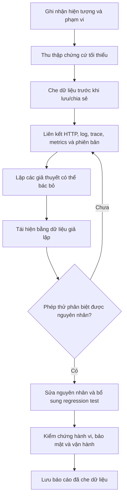

# Thu thập chứng cứ đã che dữ liệu và xác nhận nguyên nhân qua kiểm thử

Trong module **INTEGRATION_API_REST**, người học thiết kế REST API theo resource, URI, phương thức và mã trạng thái HTTP; đồng thời xây dựng hợp đồng dữ liệu, phân trang, cache, idempotency, OpenAPI, xác thực, phân quyền, xử lý lỗi và kiểm thử bằng Java/Spring hoặc công nghệ tương đương. Khi API gặp sự cố, những khái niệm này phải được dùng cùng nhau để trả lời hai câu hỏi: **Điều gì thực sự xảy ra?** và **Kiểm thử nào chứng minh được nguyên nhân, đồng thời ngăn lỗi tái diễn?**

Bài học thuộc chương **Chẩn đoán sự cố**. Trọng tâm là thu thập đủ chứng cứ để đối chiếu các lớp client → gateway → ứng dụng → dịch vụ phụ thuộc, nhưng chỉ lưu/chia sẻ dữ liệu đã được che hoặc tối thiểu hóa; sau đó kiểm chứng giả thuyết bằng phép thử có thể lặp lại. Các ví dụ dùng REST API quản lý đơn hàng và Spring Security, nhưng phương pháp cũng áp dụng cho gateway, service mesh và các framework khác.

## 1. Phân biệt hiện tượng, chứng cứ, giả thuyết và nguyên nhân

Một sự cố thường bắt đầu bằng lời mô tả: “Khách hàng có quyền đọc đơn hàng nhưng `GET /v1/orders/{orderId}` trả về `403`”. Mô tả này chưa chỉ ra nguyên nhân.

| Khái niệm | Cách nhận biết | Ví dụ |
| --- | --- | --- |
| **Hiện tượng** | Kết quả quan sát bên ngoài hệ thống | Một request nhận `403 Forbidden` |
| **Chứng cứ** | Dấu vết có thể đối chiếu được, kèm thời điểm và nguồn thu thập | Trace cho thấy xác thực thành công rồi bị từ chối ở bước kiểm tra authority |
| **Giả thuyết** | Lời giải thích có dự đoán kiểm chứng được | JWT chứa scope `orders.read`, còn rule đang yêu cầu authority có tên khác |
| **Nguyên nhân đã xác nhận** | Giả thuyết khớp với dấu vết và được phân biệt với các giả thuyết khác bằng kiểm thử | Cùng principal, resource và policy: rule sai cho `403`, rule đã sửa cho `200`; thiếu scope vẫn cho `403` |
| **Biện pháp phòng tái diễn** | Kiểm thử/giám sát bảo vệ hành vi đã xác nhận | Test quyền truy cập hợp lệ và các trường hợp bị từ chối được đưa vào CI |

Không nên kết luận “lỗi ở authentication” chỉ vì response là `401`, hoặc “lỗi database” chỉ vì trace có truy vấn chậm. Mã HTTP cho biết **hành vi bên ngoài**; log, trace, cấu hình và phép thử phân biệt các cơ chế bên trong. Tương quan thời gian không tự chứng minh quan hệ nhân quả.

### Quy tắc đủ chứng cứ

Một kết luận có cơ sở thường trả lời được:

1. Request nào, ở môi trường và phiên bản nào, vào thời điểm nào đã xảy ra lỗi?
2. Kết quả kỳ vọng theo hợp đồng REST/OpenAPI và kết quả thực tế là gì?
3. Gateway, bộ lọc xác thực/phân quyền, controller và dịch vụ phụ thuộc đã xử lý request như thế nào?
4. Thay đổi **một yếu tố nghi vấn** có làm kết quả đổi theo dự đoán không?
5. Có kiểm thử đối chứng để loại bỏ cách giải thích khác không?
6. Có bằng chứng rằng bản sửa không mở rộng quyền truy cập hoặc làm sai hợp đồng API không?

## 2. Quy trình từ sự cố đến kết luận kiểm chứng được



Các bước có thể thực hiện song song khi đang khắc phục sự cố sản xuất, nhưng **không được biến dữ liệu nhạy cảm trong log thành tài liệu dùng chung**. Nếu chứng cứ được sinh ra từ hệ thống thật, cần áp dụng kiểm soát truy cập, thời hạn lưu và chính sách xử lý dữ liệu của tổ chức ngay từ thời điểm thu thập.

### Bước 1 — Đóng khung phạm vi

Ghi rõ:

- Thời điểm đầu tiên/đợt xảy ra lỗi, theo **UTC có timezone**; thời điểm client và server có thể lệch nhau.
- Môi trường (local, test, staging, production), vùng triển khai, tên service, bản build/commit, phiên bản cấu hình và hợp đồng OpenAPI.
- Tỷ lệ lỗi, loại request, số lượng client/resource bị ảnh hưởng, và tính chất liên tục hay ngắt quãng.
- Kết quả kỳ vọng: ví dụ “JWT hợp lệ có scope `orders.read`, người dùng sở hữu đơn hàng, phải nhận `200`”.
- Kết quả thực tế: status, mã lỗi ổn định, latency, header liên quan và dấu thời gian.

Không tự động suy đoán “mọi người dùng đều lỗi” từ một mẫu đơn lẻ. Với timeout và retry, cần phân biệt **không nhận response** với **server chưa thực hiện thao tác**: một request có thể đã commit dù client bị timeout.

### Bước 2 — Chọn và giới hạn nguồn chứng cứ

| Nguồn | Dữ liệu hữu ích | Những thứ không nên đưa vào gói dùng chung |
| --- | --- | --- |
| **HTTP client** | Method, route template, status, error code, timestamp, request ID, thời lượng, header điều khiển như `Retry-After` | `Authorization`, `Cookie`, access/refresh token, URL có định danh cá nhân, request/response body thô |
| **Gateway / load balancer** | Request ID, upstream service, status tại gateway và upstream, timing, retry count, policy decision | Raw URI, client IP định danh, header xác thực, thông tin mTLS riêng tư |
| **Ứng dụng** | Trace/span ID, route template, exception type đã chuẩn hóa, kiểm tra policy, nhãn build/config | Stack trace chứa dữ liệu đầu vào, SQL binding, đối tượng entity được serialize, JWT claims nguyên bản |
| **Dịch vụ phụ thuộc** | Operation name, status, latency, error category, thời điểm timeout/circuit breaker | Payload bên thứ ba, credential, câu SQL cùng tham số chứa PII |
| **Metrics** | RPS, error rate theo route/status, p50/p95/p99, saturation, tần suất retry | Metric label gắn email, user ID, order ID gây lộ dữ liệu và tăng cardinality |
| **Thay đổi hệ thống** | Deployment, feature flag, thay đổi quyền, schema, cache và cấu hình trước/sau | Secret trong diff cấu hình hoặc bản dump biến môi trường |

Chọn một **khoảng thời gian hẹp** và các request đại diện (có lỗi và thành công) trước khi mở rộng phạm vi. Giới hạn kích thước, thời gian và số lượng bản ghi. Không bật debug log toàn bộ body hoặc token trên production chỉ để “cho đủ dữ liệu”.

## 3. Che dữ liệu phải xảy ra trước khi tạo chứng cứ chia sẻ

### 3.1. Ưu tiên danh sách trường được phép

Cách an toàn nhất là **tạo bản ghi chứng cứ mới từ các trường đã duyệt** (allowlist). Đừng ghi toàn bộ request rồi phụ thuộc duy nhất vào regex để xóa bí mật: dữ liệu nhạy cảm có thể xuất hiện ở query string, path, JSON lồng nhau, header tùy biến, exception message hoặc trace attribute.

| Loại thông tin | Cách xử lý khuyến nghị | Lý do |
| --- | --- | --- |
| Bearer token, API key, cookie, mật khẩu, private key, secret | **Loại bỏ hoàn toàn**, chỉ giữ `credentialPresent=true/false` nếu thật sự cần | Ngay cả token hết hạn vẫn có thể lộ claims hoặc thông tin nội bộ |
| Email, số điện thoại, địa chỉ, tên người, IP, thiết bị | Không thu thập hoặc thay bằng mã giả phù hợp chính sách | Tách người dùng thật khỏi gói chẩn đoán |
| `/orders/ord-xyz` và query chứa PII | Dùng route template `/orders/{orderId}`; chỉ giữ tên query parameter nếu cần | URI và query thường bị log ở nhiều tầng |
| Order/user/tenant ID cần đối chiếu qua nhiều log | Mã giả ổn định **trong cùng vụ việc**, ví dụ `order-A`, `principal-A` | Vẫn thấy được quan hệ giữa các request mà không lộ ID thật |
| Body request/response | Mặc định không lưu; nếu phải lưu, dựng payload giả lập giữ đúng cấu trúc và loại dữ liệu | Body có thể chứa dữ liệu thanh toán, hồ sơ hoặc nội dung người dùng |
| JWT claims/permission | Chỉ giữ trạng thái xác thực và tên authority/scope được phép chia sẻ | Có thể kiểm tra rule mà không lưu JWT thô |
| SQL, cache key, exception | Giữ operation/error category, thay tham số nhạy cảm bằng nhãn | Chẩn đoán được lỗi kỹ thuật mà không lộ dữ liệu |

**Mã giả khác với ẩn danh hoàn toàn.** Nếu cần nối nhiều log, có thể dùng bảng ánh xạ chỉ người được ủy quyền truy cập hoặc HMAC có khóa bí mật được quản lý riêng, theo phạm vi từng vụ việc. Tránh dùng hash SHA-256 trực tiếp của email, số điện thoại hay giá trị dễ đoán: đối tượng tấn công có thể thử từ điển. Khóa/mapping **không** đưa vào ticket, log hoặc repository.

Đối với thông tin định danh quan trọng cho điều tra bảo mật, chỉ truy cập bản gốc tại kho hạn chế quyền khi có căn cứ phù hợp. Gói chứng cứ dùng để cộng tác vẫn phải được che dữ liệu. Cần xét cả snapshot, exporter, trace backend, message queue và hệ thống cảnh báo vì dữ liệu có thể bị sao chép ở các điểm này.

### 3.2. Ví dụ gói chứng cứ HTTP đã tối thiểu hóa

Ví dụ giả định: request hợp lệ muốn đọc đơn hàng nhưng trả `403`. Nội dung bên dưới **chỉ sử dụng dữ liệu minh họa**, không phải bản sao request thực:

```json
{
  "incidentId": "INC-DEMO-014",
  "capturedAtUtc": "2026-11-18T14:10:00Z",
  "environment": "staging",
  "service": "INTEGRATION_API_REST",
  "build": "demo-build-42",
  "method": "GET",
  "routePattern": "/v1/orders/{orderId}",
  "queryParameterNames": [],
  "principalRef": "principal-A",
  "resourceRef": "order-A",
  "requestId": "req-demo-001",
  "traceId": "trace-demo-001",
  "authentication": {
    "validated": true,
    "authorities": ["SCOPE_orders.read"],
    "tokenStored": false
  },
  "response": {
    "status": 403,
    "errorCode": "ACCESS_DENIED",
    "durationMs": 28
  },
  "requestBodyStored": false,
  "responseBodyStored": false,
  "redactionPolicyVersion": "v1"
}
```

Bản ghi vẫn giữ đủ yếu tố để kiểm tra **status**, **policy**, **route**, **tính liên tục giữa các tầng** và **phiên bản triển khai**. Nó không lưu giá trị token, resource ID thật hay body. Nếu tên scope là thông tin nội bộ có hạn chế, thay bằng một nhãn policy như `required-permission-A` và giữ bảng ánh xạ ở kho hạn chế quyền.

Một response lỗi cũng nên an toàn khi chia sẻ:

```http
HTTP/1.1 403 Forbidden
Content-Type: application/problem+json
X-Request-Id: req-demo-001

{
  "type": "about:blank",
  "title": "Forbidden",
  "status": 403,
  "code": "ACCESS_DENIED",
  "requestId": "req-demo-001"
}
```

`application/problem+json` theo mô hình Problem Details có thể mang các extension như `code` và `requestId`; không trả stack trace, JWT, SQL, điều kiện nội bộ hay thông tin tồn tại của tài nguyên nếu chính sách cần che giấu. Trong dự án thực tế, tên field phải theo hợp đồng API đang công bố.

### 3.3. Ghi log an toàn trong Java/Spring

Với endpoint Spring MVC đã match, `HandlerMapping.BEST_MATCHING_PATTERN_ATTRIBUTE` cho phép lấy **route template** thay vì raw URI có thể chứa ID. Đoạn dưới minh họa một interceptor chỉ log những trường tối thiểu:

```java
import jakarta.servlet.http.HttpServletRequest;
import jakarta.servlet.http.HttpServletResponse;
import org.slf4j.Logger;
import org.slf4j.LoggerFactory;
import org.springframework.stereotype.Component;
import org.springframework.web.servlet.HandlerInterceptor;
import org.springframework.web.servlet.HandlerMapping;

@Component
public class SafeHttpEvidenceInterceptor implements HandlerInterceptor {
    private static final Logger LOG =
            LoggerFactory.getLogger(SafeHttpEvidenceInterceptor.class);

    @Override
    public void afterCompletion(
            HttpServletRequest request,
            HttpServletResponse response,
            Object handler,
            Exception exception) {

        Object pattern =
                request.getAttribute(HandlerMapping.BEST_MATCHING_PATTERN_ATTRIBUTE);
        String route = pattern instanceof String
                ? (String) pattern
                : "<unmatched>";

        LOG.info("http method={} route={} status={}",
                request.getMethod(), route, response.getStatus());
    }
}
```

Đăng ký interceptor qua `WebMvcConfigurer#addInterceptors`. Tên route chỉ có sau khi Spring match handler; với request bị từ chối từ security filter trước khi tới MVC, có thể không có route, nên bản ghi dùng `<unmatched>` thay vì fallback sang URL thô. Trong hệ thống có distributed tracing, bổ sung trace ID từ ngữ cảnh tracing **được tin cậy** và kiểm soát khả năng truy cập log. Không nhúng nguyên `request.getRequestURI()`, `getQueryString()`, `getHeader("Authorization")`, `getParameterMap()` hoặc body vào log.

Trong môi trường thực tế, lựa chọn interceptor, filter hay gateway instrumentation tùy đường đi request; phải kiểm tra cả các lỗi phát sinh **trước controller**. Test việc che dữ liệu nên dùng giá trị giả chứa bí mật có thể nhận biết, nhằm chắc chắn dữ liệu đó không xuất hiện ở log hoặc hệ thống trace.

### 3.4. Kiểm tra lần cuối trước khi chia sẻ

Trước khi đính kèm ticket/issue/PR hoặc gửi cho nhóm khác:

- Kiểm tra cả văn bản, file đính kèm, ảnh chụp màn hình, file HAR, trace export và tên file.
- Tìm credential, PII, internal hostname bị hạn chế, query string, JWT claims, raw body và stack trace kèm giá trị.
- Đảm bảo pseudonym được áp dụng **nhất quán**; cùng một đối tượng luôn có cùng nhãn trong phạm vi điều tra.
- Gắn người chịu trách nhiệm, quyền truy cập, nơi lưu, thời hạn lưu/xóa và phiên bản quy tắc che dữ liệu.
- Kiểm tra chính sách bảo mật thực tế: “đã mask” không đồng nghĩa “được đăng công khai”.

## 4. Liên kết chứng cứ theo đường đi request

Một request REST có thể trải qua CDN, reverse proxy, gateway, authentication filter, authorization rule, controller, business service, database và queue. Xếp các sự kiện theo **request ID/trace ID**, dùng mốc thời gian, span parent–child và thông tin upstream để tìm nơi lỗi phát sinh. Không dùng riêng timestamp làm khóa nối vì các máy có thể lệch đồng hồ.

Ví dụ timeline đã che dữ liệu:

| Thời gian (UTC, minh họa) | Thành phần | Sự kiện có thể xác minh |
| --- | --- | --- |
| 14:10:00.000 | API Gateway | Nhận `GET /v1/orders/{orderId}`, gán `req-demo-001` |
| 14:10:00.010 | Resource server | JWT được xác minh hợp lệ; không lưu token thô |
| 14:10:00.017 | Authorization layer | Principal có `SCOPE_orders.read`; policy hiện hành yêu cầu authority khác |
| 14:10:00.028 | API Gateway | Trả `403`; upstream status cũng là `403` |

Bảng này là **dữ liệu giả định để diễn giải**, không phải kết luận về sự cố thật. Nếu gateway báo `403` nhưng ứng dụng không có span tương ứng, điều tra gateway/WAF trước. Nếu ứng dụng trả `200` nhưng gateway trả `502`, kiểm tra kết nối/chuyển tiếp upstream. Nếu nhiều `5xx` xuất hiện sau thay đổi schema, đối chiếu commit/config với exception category và truy vấn phụ thuộc.

Với lỗi timeout, phân biệt `connection timeout`, `read timeout`, `504` từ gateway và `500` từ ứng dụng; mỗi loại có đường kiểm chứng khác nhau. Với cache, quan sát `Cache-Control`, `ETag`, `If-None-Match`, `Vary` và status `304` theo hợp đồng; tuyệt đối không đưa dữ liệu cá nhân vào cache key được log hoặc cache chia sẻ sai phạm vi.

## 5. Biến chứng cứ thành giả thuyết có thể bác bỏ

Một bảng giả thuyết ngắn giúp tránh sửa theo cảm tính:

| Giả thuyết cho `GET /v1/orders/{orderId}` trả `403` | Dự đoán nếu đúng | Phép thử phân biệt |
| --- | --- | --- |
| **H1. Token không hợp lệ/hết hạn** | Với cấu hình resource server thông thường, xác thực thất bại trước bước cấp quyền, thường trả `401` | Thử token test hợp lệ và token test hết hạn trong môi trường kiểm thử; đối chiếu authentication entry point |
| **H2. Tên authority không khớp policy** | Token được xác thực, nhưng principal có `SCOPE_orders.read` còn rule yêu cầu tên khác | Giữ nguyên principal và dữ liệu, chỉ đổi cấu hình rule trong test; so status và log policy |
| **H3. Resource không thuộc principal/tenant** | Cùng scope, resource thuộc người khác vẫn bị từ chối | Test cặp dữ liệu `own-order` và `foreign-order` theo policy; xác minh `403`/`404` đúng hợp đồng |
| **H4. Gateway từ chối trước ứng dụng** | Không có application span cho request bị từ chối | Đối chiếu gateway policy/status với trace ứng dụng và route |
| **H5. Cache phản hồi sai phạm vi** | Lỗi phụ thuộc cache hit, user/context hoặc key | Dùng fixture cách ly user/tenant, kiểm thử cache key và `Cache-Control`, so khi bypass cache có kiểm soát |

**Không dùng `403` làm bằng chứng tự đủ rằng H2 đúng.** Nhiều rule có thể chồng nhau, ví dụ thiếu scope và sai tenant; phép thử phải giữ các yếu tố khác ổn định. Nếu phát hiện sai authority mapping, sửa đúng tên authority **và** giữ nguyên kiểm tra sở hữu tài nguyên. Việc bỏ hẳn kiểm tra quyền để chuyển `403` thành `200` là một lỗi bảo mật.

Khi lập hypothesis log, nên ghi cả **dữ kiện ủng hộ**, **dữ kiện phản bác**, **bước kiểm tra tiếp theo** và **kết quả**. Giả thuyết bị bác bỏ cũng có giá trị vì thu hẹp phạm vi.

## 6. Tái hiện lỗi trong môi trường kiểm soát

Thứ tự hiệu quả là:

1. Dựng test fixture chứa principal, tenant, resource và quyền **giả lập**. Giữ quan hệ cần thiết (sở hữu đơn hàng, scope, policy); không cần sao chép dữ liệu production.
2. Khóa các biến có thể gây nhiễu: phiên bản code/config, timezone, clock, seed dữ liệu, network stub, cache state, retry policy và feature flag.
3. Viết test thất bại thể hiện hành vi kỳ vọng trước khi sửa (khi có thể).
4. Thay đổi đúng yếu tố đang nghi ngờ; thực hiện lại cùng test để đối chiếu.
5. Thêm test âm tính và test ranh giới để bản sửa không mở rộng quyền hoặc làm lệch hợp đồng.
6. Ghi lại build/config của bản trước và sau; liên kết kết quả với cùng case ID.

Không replay bừa request ghi dữ liệu vào production. Với `POST`/`PATCH`/`DELETE`, tái hiện trên môi trường cô lập, dùng fake integration, rollback thích hợp hoặc idempotency key đã được thiết kế đúng. Retry sau timeout có thể tạo thêm giao dịch nếu endpoint không idempotent; một test “không bị timeout” không đủ để chứng minh “không tạo duplicate”.

### Ví dụ: xác nhận lỗi authority mapping trong Spring Security

Giả sử service dùng OAuth2 resource server với JWT. Cấu hình converter mặc định của Spring Security thường ánh xạ scope `orders.read` thành granted authority `SCOPE_orders.read`. Nếu rule lại kiểm tra `hasAuthority("orders.read")`, một request xác thực hợp lệ có thể bị `403`.

Cấu hình sau thể hiện **rule kỳ vọng** cho endpoint đọc đơn hàng:

```java
import org.springframework.context.annotation.Bean;
import org.springframework.http.HttpMethod;
import org.springframework.security.config.Customizer;
import org.springframework.security.config.annotation.web.builders.HttpSecurity;
import org.springframework.security.web.SecurityFilterChain;

@Bean
SecurityFilterChain apiSecurity(HttpSecurity http) throws Exception {
    http.authorizeHttpRequests(auth -> auth
            .requestMatchers(HttpMethod.GET, "/v1/orders/**")
            .hasAuthority("SCOPE_orders.read")
            .anyRequest().authenticated()
    );
    http.oauth2ResourceServer(oauth2 -> oauth2.jwt(Customizer.withDefaults()));
    return http.build();
}
```

Đây là ví dụ rút gọn về **tên authority**; controller/service vẫn phải kiểm tra ownership/tenant ở nơi thích hợp. Dự án có custom `JwtGrantedAuthoritiesConverter` có thể dùng prefix khác, khi đó rule phải theo mapping thật. Cũng cần kiểm tra rule chồng lên nhau từ method security và gateway.

Một integration test với Spring Boot, JUnit 5, Spring Security Test và MockMvc có thể xác nhận ranh giới bảo mật. Đoạn sau giả định fixture `order-owned` tồn tại và thuộc chủ thể `user-fixture`; cần nạp fixture bằng cơ chế test của dự án:

```java
import org.junit.jupiter.api.Test;
import org.springframework.beans.factory.annotation.Autowired;
import org.springframework.boot.test.autoconfigure.web.servlet.AutoConfigureMockMvc;
import org.springframework.boot.test.context.SpringBootTest;
import org.springframework.security.core.authority.SimpleGrantedAuthority;
import org.springframework.test.web.servlet.MockMvc;

import static org.springframework.security.test.web.servlet.request.SecurityMockMvcRequestPostProcessors.jwt;
import static org.springframework.test.web.servlet.request.MockMvcRequestBuilders.get;
import static org.springframework.test.web.servlet.result.MockMvcResultMatchers.status;

@SpringBootTest
@AutoConfigureMockMvc
class OrderAuthorizationIT {
    @Autowired MockMvc mockMvc;

    @Test
    void validReaderCanReadOwnOrder() throws Exception {
        mockMvc.perform(get("/v1/orders/order-owned")
                .with(jwt()
                    .jwt(token -> token.subject("user-fixture"))
                    .authorities(new SimpleGrantedAuthority("SCOPE_orders.read"))))
                .andExpect(status().isOk());
    }

    @Test
    void authenticatedUserWithoutReadScopeIsForbidden() throws Exception {
        mockMvc.perform(get("/v1/orders/order-owned")
                .with(jwt()
                    .jwt(token -> token.subject("user-fixture"))
                    .authorities(new SimpleGrantedAuthority("SCOPE_orders.write"))))
                .andExpect(status().isForbidden());
    }

    @Test
    void unauthenticatedRequestIsUnauthorized() throws Exception {
        mockMvc.perform(get("/v1/orders/order-owned"))
                .andExpect(status().isUnauthorized());
    }
}
```

Nếu API trả `404` khi người dùng không được biết resource tồn tại, test phải dùng `404` cho trường hợp **khác chủ sở hữu**, theo hợp đồng và threat model. Đừng mặc định mọi truy cập sai đều trả `403`. `403` ở test thiếu scope và `401` ở test chưa xác thực phản ánh cách cấu hình resource server thông thường; các gateway/entry point tùy biến có thể khác, vì thế phải kiểm chứng trên hệ thống thật.

**Giới hạn của `jwt()`:** Spring Security Test dựng authentication giả cho mục tiêu kiểm tra authorization; nó **không** chứng minh signature JWT, issuer, audience, expiration, JWKS rotation hoặc đường đi qua gateway hoạt động đúng. Các yếu tố đó cần integration/contract test riêng với issuer mô phỏng hoặc môi trường kiểm thử được kiểm soát.

Trình tự chứng minh H2 là: test hành vi hợp lệ thất bại trước sửa; xác nhận principal mang đúng authority mong đợi; sửa mapping/rule; test hợp lệ thành công; test thiếu scope và test sai tenant vẫn bị từ chối. Nếu chỉ thấy test thành công sau sửa mà không chứng minh test trước đó thất bại đúng cơ chế, mức tin cậy vào nguyên nhân vẫn thấp.

## 7. Chọn loại kiểm thử theo cơ chế lỗi

| Cơ chế nghi ngờ | Kiểm thử nên có | Dấu hiệu đạt |
| --- | --- | --- |
| Route/HTTP method/status mapping | MVC/controller test và contract test từ OpenAPI | Method đúng, `400/404/405/409` và Problem Details đúng hợp đồng |
| AuthN/AuthZ | Security test với token giả, test JWT validator thật ở môi trường cô lập, test scope/tenant | `401`, `403`, `200`/`404` theo chính sách; không vượt quyền |
| Payload/validation | Boundary test, schema test, invalid content type, dữ liệu rỗng/quá giới hạn | `400` hoặc `415`, lỗi có mã ổn định, không rò input nhạy cảm |
| Idempotency/retry | Integration test cùng idempotency key, retry sau timeout, concurrent duplicate | Một tác dụng nghiệp vụ; response replay theo hợp đồng |
| Cache/pagination | Test cache key theo user/tenant, ETag/`304`, cursor, sort ổn định | Không lộ dữ liệu chéo tenant; không trùng/mất phần tử trái hợp đồng |
| Dependency/network timeout | Test với fake downstream, latency/fault injection có kiểm soát | Timeout hợp lý, retry có giới hạn, không gây retry storm |
| Logging/redaction | Test bản ghi/log với secret, PII và URL giả có thể nhận biết | Không thấy raw token, query/body nhạy cảm; route và trace ID vẫn dùng để đối chiếu |
| Hiệu năng/lỗi gián đoạn | Load test có giới hạn, đo p95/p99, test concurrency và tài nguyên | Tỷ lệ lỗi/latency dưới ngưỡng đã định và không phát sinh side effect |

Với lỗi race condition, timestamp “gần nhau” chưa đủ; cần test concurrency với barrier, điều kiện dữ liệu và số lần commit. Với lỗi môi trường, tái hiện trên cấu hình gần production nhưng dùng dữ liệu kiểm thử. Với các thay đổi hợp đồng API, contract test cần kiểm tra trường hợp client cũ, header, status và schema thay vì chỉ test một response thành công.

## 8. Kiểm chứng bản sửa ở nhiều lớp

Sau khi sửa, lập bảng đối chiếu **trước/sau** bằng cùng fixture:

| Kiểm tra | Trước sửa (minh họa) | Sau sửa kỳ vọng |
| --- | --- | --- |
| JWT hợp lệ, đúng scope, đúng chủ sở hữu | `403` | `200` và response đúng schema |
| JWT hợp lệ, thiếu scope | `403` | **Vẫn `403`** |
| Không gửi thông tin xác thực | `401` | **Vẫn `401`** |
| Đúng scope, resource thuộc tenant khác | Bị từ chối theo policy | **Vẫn bị từ chối**, không lộ dữ liệu |
| HTTP trace/log | Có bằng chứng 403 tại authorization | Có trace kết quả 200 và không lộ token/PII |
| Metrics theo route | Tỷ lệ `403` bất thường ở request hợp lệ | Tỷ lệ lỗi giảm trong phạm vi áp dụng; không tăng `5xx` |

Để kết luận sửa thành công, cần cả **test dương tính** (request đáng được phép) và **test âm tính** (request phải bị từ chối). Với sự cố production, quan sát thêm một cửa sổ vận hành đủ phù hợp sau deploy/canary: error rate theo route/status, độ trễ, số lượng retry, các request bất thường và log redaction. Không đồng nhất “test suite xanh” với “nguyên nhân trong production chắc chắn đã hết” khi môi trường và lưu lượng khác nhau.

### Tiêu chí chấp nhận một kết luận nguyên nhân

- Có ID vụ việc và chuỗi chứng cứ đã che dữ liệu, đối chiếu được HTTP → log/trace → config/build.
- Ghi rõ ít nhất một giả thuyết thay thế và phép thử loại trừ nó.
- Có reproduction test trước sửa hoặc bằng chứng điều kiện lỗi trước sửa; cùng input có kết quả đúng sau sửa.
- Có test ranh giới và trường hợp thất bại để ngăn hồi quy và lỗi bảo mật.
- Có kết quả xác minh trong môi trường phù hợp, với giới hạn phạm vi được nêu rõ.
- Gói chứng cứ chỉ chứa trường được phép, được lưu ở nơi có phân quyền và thời hạn lưu phù hợp.

## 9. Các sai lầm thường gặp

| Sai lầm | Hệ quả | Cách khắc phục |
| --- | --- | --- |
| Đính kèm cURL/HAR nguyên bản có bearer token hoặc cookie | Lộ thông tin đăng nhập qua ticket, chat, PR | Dựng HTTP mẫu đã che, dùng token giả trong test |
| Ghi raw path/query/body để “dễ tìm log” | Có thể lộ ID, email, địa chỉ, nội dung người dùng | Log route template và trường allowlist |
| Hash trực tiếp email/phone bằng SHA-256 | Dễ bị dò lại giá trị | Không giữ nếu không cần; nếu cần liên kết thì dùng pseudonym/HMAC có khóa và phạm vi |
| Đổi nhiều cấu hình trong một lần thử | Không biết thay đổi nào tạo khác biệt | Thử từng yếu tố, chụp version/config và đối chứng |
| Chỉ viết test happy path `200` | Có thể vô tình cấp quyền cho người không đủ điều kiện | Bổ sung `401`, `403` và kiểm tra ownership/tenant |
| Mock JWT rồi kết luận xác minh JWT hoạt động | Bỏ sót issuer/audience/signature/expiry/JWKS | Có test tích hợp đường xác thực thực sự |
| Replay `POST` production sau timeout | Có thể tạo giao dịch lặp | Dùng môi trường cô lập, idempotency và đối chiếu side effect |
| Xóa log ngay sau khi sửa hoặc giữ vô hạn | Mất khả năng kiểm chứng hoặc tăng rủi ro dữ liệu | Retention theo chính sách và lưu report đã che có liên kết |
| Đánh đồng tương quan với nguyên nhân | Sửa phần vô can, lỗi quay lại | Dùng phép thử có dự đoán có thể bác bỏ |

## 10. Bài thực hành

**Tình huống:** API `GET /v1/orders/{orderId}` có hai lớp policy: cần scope `orders.read` và chỉ người thuộc tenant sở hữu đơn hàng mới được đọc. Sau một lần deploy, client hợp lệ nhận `403`, trong khi request không gửi token vẫn nhận `401`.

1. Tạo một gói chứng cứ JSON như phần 3.2 cho hai request: một thất bại, một thành công ở bản cũ. Giữ route, status, trace ID và phiên bản, nhưng loại token, ID thật và body.
2. Viết ít nhất ba giả thuyết có dự đoán phân biệt: mapping scope, rule ownership/tenant, gateway policy. Chỉ rõ loại log/trace cần thêm.
3. Dựng fixture gồm `user-A` thuộc `tenant-A`, `order-A` thuộc `tenant-A` và `order-B` thuộc `tenant-B`. Không sao chép dữ liệu thật.
4. Viết test thể hiện `200` khi đủ scope và đúng tenant; `403` khi thiếu scope; `401` khi không xác thực; `403` hoặc `404` khi khác tenant tùy hợp đồng.
5. Tạo lỗi mapping trong test có kiểm soát, xác nhận test `200` chuyển thành `403`; phục hồi rule đúng và chạy lại. Ghi kết quả trước/sau.
6. Tạo một giá trị giả giống token/email trong test logging. Xác nhận kết quả đã lưu không chứa giá trị này và vẫn giữ route template/request ID.
7. Viết báo cáo ngắn gồm: hiện tượng, chứng cứ đã che, giả thuyết, test phân biệt, thay đổi sửa lỗi, kết quả hồi quy, phạm vi chưa kiểm chứng.

**Tiêu chí tự đánh giá:** Một người khác có thể tái hiện kết quả với fixture giả, biết vì sao kết luận được nguyên nhân, và đọc toàn bộ báo cáo mà không cần thấy bất kỳ token, PII hay payload production nào.

## 11. Mẫu báo cáo điều tra dùng lại

```text
Incident: <case-id>
Service / Environment / Build: <service> / <env> / <version>
Window (UTC): <start> .. <end>
HTTP contract: <method> <route-template>, expected <status/schema>
Observed: <status/error-code/latency>, requestId <safe-id>, traceId <safe-id>
Impact: <scope and sample size; no direct identifiers>
Evidence: <redacted HTTP record>, <trace spans>, <metrics>, <config diff ref>
Hypotheses:
  H1: <prediction> -> <test> -> <result>
  H2: <prediction> -> <test> -> <result>
Confirmed cause: <mechanism + evidence, or still unconfirmed>
Change: <code/config change + version>
Verification: <before/after + positive/negative tests + environment>
Redaction: <policy/version, location/access, retention>
Open questions: <remaining uncertainty>
```

Điểm then chốt của troubleshooting REST API là **chứng cứ đủ để kiểm tra nhưng không chứa dữ liệu thừa**, và **kết luận phải đi kèm phép thử phân biệt nguyên nhân**. Một bản sửa chỉ đáng tin khi giữ đúng giao ước HTTP, tính bảo mật, ngữ nghĩa retry/idempotency và khả năng quan sát sau triển khai.
