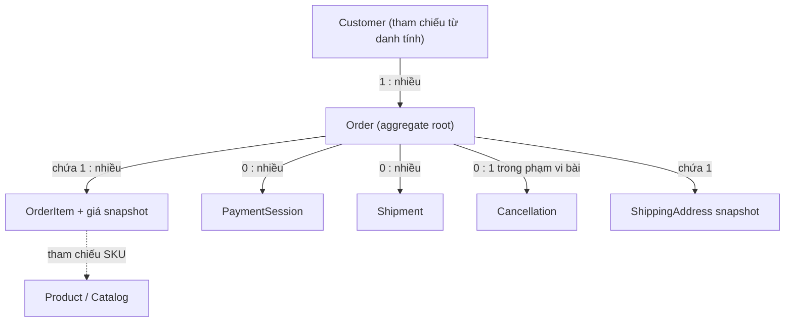
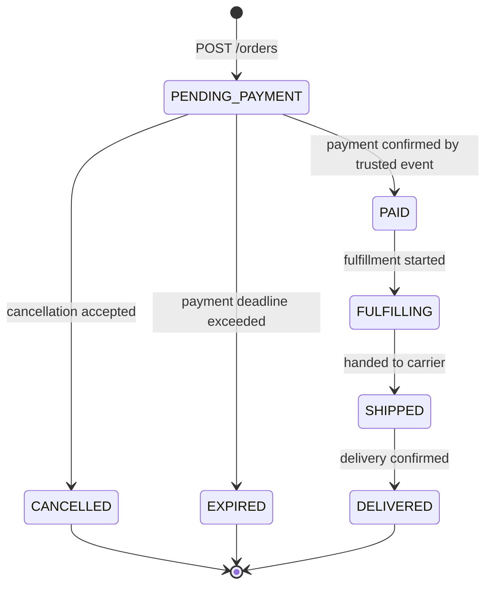

# Thiết kế mô hình tài nguyên cho API đơn hàng

> **Chương:** Thực hành tổng hợp  
> **Module:** INTEGRATION_API_REST  
> **Trọng tâm:** Từ yêu cầu nghiệp vụ đặt hàng, xác định tài nguyên, quan hệ, URI, biểu diễn JSON, trạng thái và hợp đồng HTTP để thiết kế một REST API có thể triển khai bằng Java/Spring.

## 1. Mục tiêu và sản phẩm đầu ra

Sau bài thực hành, bạn có thể:

1. Phân biệt **tài nguyên** (resource), **thực thể miền nghiệp vụ** (domain entity), **giá trị lồng bên trong** (value object) và **hành động nghiệp vụ**.
2. Xác định tài nguyên gốc của đơn hàng, tài nguyên con và các tham chiếu đến khách hàng/sản phẩm mà không sao chép vô tội vạ toàn bộ mô hình cơ sở dữ liệu lên HTTP.
3. Thiết kế URI hướng danh từ, chọn đúng phương thức HTTP và mã trạng thái cho thao tác tạo, xem, cập nhật giới hạn, thanh toán và hủy đơn.
4. Xác định quy tắc bất biến, chuyển trạng thái, quyền truy cập, tính lặp lại an toàn khi gửi lại yêu cầu (*idempotency*) và kiểm soát cập nhật đồng thời.
5. Viết ví dụ request/response, phác thảo controller Java/Spring và kiểm thử được các trường hợp hợp lệ, xung đột cũng như truy cập trái phép.

**Sản phẩm cần nộp:** sơ đồ tài nguyên; bảng URI–HTTP; JSON tạo/lấy đơn; sơ đồ vòng đời đơn; tối thiểu tám tình huống kiểm thử. Phần sau cung cấp **lời giải tham khảo** để tự đối chiếu; có thể thiết kế khác nếu giữ được ràng buộc nghiệp vụ và ngữ nghĩa HTTP.

## 2. Đề bài: hệ thống bán hàng trực tuyến

Một cửa hàng cần API cho ứng dụng web/mobile với luồng:

1. Khách hàng đã đăng nhập chọn sản phẩm theo mã SKU và số lượng rồi đặt hàng.
2. Hệ thống xác minh sản phẩm, tính giá trên máy chủ, kiểm tra/tạm giữ tồn kho và tạo đơn chờ thanh toán.
3. Khách hàng xem danh sách và chi tiết **đơn của chính mình**, thay địa chỉ giao hàng khi đơn còn chờ thanh toán, tạo phiên thanh toán, hoặc hủy đơn trước khi thanh toán.
4. Cổng thanh toán thông báo kết quả về hệ thống qua kênh đáng tin cậy. Bộ phận vận hành xử lý đóng gói và giao hàng. Khách hàng có thể xem thông tin vận chuyển.
5. Đơn đã thanh toán không được hủy bằng API hủy đơn trong phạm vi bài này; hoàn tiền là một quy trình riêng, sẽ thiết kế khi mở rộng.

Để bài toán có giới hạn rõ ràng, thống nhất các giả định sau:

| Quy tắc | Giả định trong bài thực hành |
|---|---|
| Người dùng | API dành cho khách hàng đăng nhập; danh tính lấy từ access token đã xác thực. |
| Mỗi đơn | Thuộc một khách hàng, một đơn vị tiền tệ **VND**, chứa 1–50 SKU khác nhau; số lượng mỗi SKU từ 1 đến 20. |
| Giá bán | Máy chủ tra cứu giá, phí giao hàng và tính tổng tiền; dữ liệu do client gửi không quyết định giá. |
| Tồn kho | Đặt hàng thành công đồng nghĩa hàng đã được giữ trong thời hạn chờ thanh toán; khi hủy/hết hạn phải hoàn lại phần giữ chỗ. |
| Thời hạn | Đơn chờ thanh toán tối đa 15 phút trong ví dụ; thời hạn thực tế là cấu hình nghiệp vụ. |
| Sửa đơn | Chỉ cho sửa một số trường thuộc địa chỉ giao hàng khi đơn ở `PENDING_PAYMENT`. Không sửa danh sách hàng đã chốt. |
| Hủy đơn | Chỉ khi `PENDING_PAYMENT`. Nếu thanh toán đã hoàn tất, trả lỗi xung đột và chuyển sang quy trình hoàn tiền riêng. |
| Phạm vi kỹ thuật | REST/JSON/HTTPS; ví dụ controller dùng Java/Spring, không bắt buộc mọi người học phải chọn Spring. |

### Nhiệm vụ tự thiết kế

Trước khi đọc lời giải, hãy ghi ra quyết định cho năm câu hỏi:

- Thứ gì có vòng đời và định danh riêng: đơn hàng, dòng hàng, phiên thanh toán, lượt vận chuyển, yêu cầu hủy?
- Khi sản phẩm đổi tên hoặc giá, hóa đơn của đơn cũ có được đổi theo không?
- Những thao tác nào là tạo tài nguyên mới, những thao tác nào chỉ đổi trạng thái nội bộ?
- Khi ứng dụng gửi lại `POST` vì mất kết nối, làm sao tránh tạo hai đơn?
- Làm sao bảo đảm người A không xem được đơn của người B dù biết được `orderId`?

## 3. Lời giải tham khảo: xác định ranh giới tài nguyên

Điểm bắt đầu là **ngôn ngữ nghiệp vụ**, không phải tên bảng SQL. Một đối tượng chỉ cần URI riêng khi bên ngoài có nhu cầu định danh, truy xuất, thao tác hoặc theo dõi vòng đời của nó một cách độc lập.

| Khái niệm | Cách biểu diễn đề xuất | Lý do |
|---|---|---|
| `Order` | Tài nguyên gốc `/v1/orders/{orderId}` | Có ID, chủ sở hữu, vòng đời và các quy tắc nhất quán riêng. |
| `OrderItem` | Mảng `items` nằm trong biểu diễn của `Order` | Trong phạm vi này, dòng hàng đã chốt cùng đơn; không cho client tạo/sửa từng dòng bằng API riêng. |
| `ShippingAddress` | Giá trị lồng trong `Order` | Là **bản chụp** địa chỉ giao tại lúc đặt, không tự động đổi khi hồ sơ khách hàng đổi. |
| `PaymentSession` | Tài nguyên con `/v1/orders/{orderId}/payment-sessions/{sessionId}` | Một đơn có thể có nhiều lần mở phiên/thử thanh toán, mỗi lần có trạng thái riêng. |
| `Shipment` | Tài nguyên con `/v1/orders/{orderId}/shipments/{shipmentId}` | Một đơn có thể tách thành nhiều kiện, có mã vận đơn và tiến trình riêng. |
| `Cancellation` | Tài nguyên con `/v1/orders/{orderId}/cancellations/{cancellationId}` | Ghi nhận yêu cầu hủy, lý do và thời điểm; giúp kiểm toán, xử lý gửi lại và mở rộng bất đồng bộ. |
| `Customer`, `Product` | Chỉ lưu tham chiếu cần thiết | Dữ liệu gốc do miền khách hàng/catalog quản lý; đơn lưu thêm snapshot tên và giá của hàng đã mua. |

`Order` là **aggregate root** của việc đặt hàng: các thay đổi ảnh hưởng đến tổng tiền, số lượng và trạng thái cần đi qua quy tắc nhất quán của đơn. Điều này không có nghĩa tất cả các đối tượng đều phải nằm trong một bảng hoặc một dịch vụ. Phiên thanh toán và lô vận chuyển có thể do dịch vụ khác quản lý nhưng vẫn được trình bày thành tài nguyên liên quan đến đơn trong API.

`OrderItem` vẫn có thể mang `id` riêng để tham chiếu khi hoàn tiền từng dòng hoặc trả hàng về sau. Trong phiên bản này, có ID **không bắt buộc** phải mở toàn bộ CRUD cho dòng hàng.



**Lưu ý về URI:** `/orders/{id}/payment-sessions/{sessionId}` biểu đạt mối quan hệ định danh. Không nên kéo theo các chuỗi lồng nhau quá sâu, chẳng hạn `/customers/{customerId}/carts/{cartId}/orders/{orderId}/items/{itemId}/...`. Quyền sở hữu phải được kiểm tra trên máy chủ, không suy ra từ việc client điền `customerId` vào đường dẫn.

## 4. Hợp đồng URI và phương thức HTTP

| Phương thức + URI | Ý nghĩa | Kết quả thành công |
|---|---|---|
| `POST /v1/orders` | Đặt đơn từ SKU, số lượng và địa chỉ giao hàng | `201 Created`, `Location` trỏ đến đơn mới |
| `GET /v1/orders` | Danh sách **đơn của người đang đăng nhập**, lọc trạng thái và phân trang | `200 OK` |
| `GET /v1/orders/{orderId}` | Xem chi tiết đơn thuộc quyền truy cập | `200 OK`; có thể `304 Not Modified` khi dùng cache validator |
| `PATCH /v1/orders/{orderId}` | Sửa các trường địa chỉ được cho phép ở trạng thái hợp lệ | `200 OK` và `ETag` mới |
| `POST /v1/orders/{orderId}/payment-sessions` | Tạo một phiên thanh toán qua nhà cung cấp | `201 Created`, `Location` trỏ đến phiên |
| `GET /v1/orders/{orderId}/payment-sessions/{sessionId}` | Tra cứu trạng thái phiên thanh toán | `200 OK` |
| `POST /v1/orders/{orderId}/cancellations` | Tạo yêu cầu hủy đơn khi còn chờ thanh toán | `201 Created`, `Location` trỏ đến yêu cầu hủy |
| `GET /v1/orders/{orderId}/cancellations/{cancellationId}` | Xem kết quả/yêu cầu hủy | `200 OK` |
| `GET /v1/orders/{orderId}/shipments` | Danh sách kiện hàng do hệ thống fulfillment tạo | `200 OK`; có thể trả mảng rỗng |
| `GET /v1/orders/{orderId}/shipments/{shipmentId}` | Theo dõi một kiện hàng cụ thể | `200 OK` |

Không công khai `PUT /orders/{id}/status` để client tự gán `PAID`, `SHIPPED` hay `DELIVERED`. Những chuyển trạng thái này đến từ sự kiện thanh toán đã xác minh hoặc hệ thống xử lý vận chuyển có thẩm quyền. Không dùng `DELETE /orders/{id}` để "hủy" đơn vì xóa làm mất lịch sử đối soát; **yêu cầu hủy là một tài nguyên nghiệp vụ**.

Không có một phương thức HTTP nào tự nó bảo đảm đủ an toàn nghiệp vụ: `POST` là thao tác có thể tạo hiệu ứng nhiều lần, `PATCH` phải xác minh trạng thái hiện tại, còn `GET` không được tạo thêm đơn hoặc thu tiền.

### 4.1. Thiết kế danh sách đơn

`GET /v1/orders?status=PENDING_PAYMENT&limit=20` lấy đơn của khách hiện tại, sắp theo `createdAt` giảm dần (và `id` để ổn định thứ tự). Với dữ liệu lớn, dùng **cursor phân trang**:

```http
GET /v1/orders?status=PENDING_PAYMENT&limit=20&cursor=eyJ... HTTP/1.1
Authorization: Bearer <access-token>
```

```json
{
  "data": [
    {
      "id": "ord_01HZX1001",
      "status": "PENDING_PAYMENT",
      "total": { "currency": "VND", "amount": 717000 },
      "createdAt": "2026-11-18T10:00:00Z"
    }
  ],
  "page": {
    "nextCursor": null,
    "limit": 20
  }
}
```

`cursor` phải là giá trị **mờ đục** đối với client: client dùng lại đúng chuỗi máy chủ trả về. Máy chủ áp dụng cùng bộ lọc và quyền truy cập ở từng trang; không lộ dữ liệu của khách khác chỉ vì cursor bị sửa.

## 5. Biểu diễn JSON và trách nhiệm máy chủ

Một JSON đơn hàng nên tách rõ dữ liệu **client được nhập** với dữ liệu **máy chủ quyết định**.

### 5.1. Tạo đơn hàng

```http
POST /v1/orders HTTP/1.1
Authorization: Bearer <access-token>
Content-Type: application/json
Idempotency-Key: 6b9d4c2a-72b3-4f1e-9a81-8419a7a12222

{
  "items": [
    { "sku": "SKU-BAG-001", "quantity": 2 },
    { "sku": "SKU-CUP-002", "quantity": 1 }
  ],
  "shippingAddress": {
    "recipientName": "Khách hàng mẫu",
    "line1": "12 Đường Ví Dụ",
    "city": "TP. Hồ Chí Minh",
    "postalCode": "700000",
    "countryCode": "VN"
  }
}
```

Client **không** truyền `customerId`, `unitPrice`, `total`, `status` hay `orderId` để máy chủ tin và lưu trực tiếp. Máy chủ lấy `customerId` từ principal, định giá theo catalog hiện hành, kiểm tra giới hạn số lượng/tồn kho, giữ chỗ và tạo snapshot nhất quán.

**Response mẫu:**

```http
HTTP/1.1 201 Created
Location: /v1/orders/ord_01HZX1001
Content-Type: application/json
ETag: "v1"

{
  "id": "ord_01HZX1001",
  "status": "PENDING_PAYMENT",
  "version": 1,
  "items": [
    {
      "id": "oli_001",
      "sku": "SKU-BAG-001",
      "productName": "Túi vải",
      "quantity": 2,
      "unitPrice": { "currency": "VND", "amount": 299000 },
      "lineTotal": { "currency": "VND", "amount": 598000 }
    },
    {
      "id": "oli_002",
      "sku": "SKU-CUP-002",
      "productName": "Ly sứ",
      "quantity": 1,
      "unitPrice": { "currency": "VND", "amount": 89000 },
      "lineTotal": { "currency": "VND", "amount": 89000 }
    }
  ],
  "pricing": {
    "subtotal": { "currency": "VND", "amount": 687000 },
    "shippingFee": { "currency": "VND", "amount": 30000 },
    "total": { "currency": "VND", "amount": 717000 }
  },
  "shippingAddress": {
    "recipientName": "Khách hàng mẫu",
    "line1": "12 Đường Ví Dụ",
    "city": "TP. Hồ Chí Minh",
    "postalCode": "700000",
    "countryCode": "VN"
  },
  "createdAt": "2026-11-18T10:00:00Z",
  "expiresAt": "2026-11-18T10:15:00Z",
  "_links": {
    "self": "/v1/orders/ord_01HZX1001",
    "paymentSessions": "/v1/orders/ord_01HZX1001/payment-sessions",
    "cancellations": "/v1/orders/ord_01HZX1001/cancellations"
  }
}
```

Ở ví dụ VND, `amount` là số nguyên theo đơn vị tiền nhỏ nhất của đồng tiền được chọn (VND có 0 chữ số thập phân). Với tiền tệ khác phải theo đúng số chữ số thập phân của tiền tệ đó; không tính tiền bằng `float`/`double`. Công thức ở đây: `2 × 299000 + 1 × 89000 = 687000` và `687000 + 30000 = 717000`. Trên Java có thể dùng `BigDecimal` với quy tắc làm tròn xác định hoặc số nguyên đơn vị nhỏ nhất.

Các đường dẫn ở `_links` là liên kết gợi ý giúp client khám phá thao tác; đây là lựa chọn thiết kế, không bắt buộc mọi REST API phải dùng cùng tên trường. Ứng dụng vẫn phải xử lý trường hợp thao tác không còn hợp lệ do trạng thái thay đổi trong lúc người dùng đang xem.

### 5.2. Cập nhật địa chỉ với điều kiện phiên bản

Khách hàng được sửa địa chỉ **chỉ khi đơn còn `PENDING_PAYMENT`**. Trong ví dụ sử dụng JSON Merge Patch và `If-Match`:

```http
PATCH /v1/orders/ord_01HZX1001 HTTP/1.1
Authorization: Bearer <access-token>
Content-Type: application/merge-patch+json
If-Match: "v1"

{
  "shippingAddress": {
    "line1": "34 Đường Ví Dụ"
  }
}
```

Response `200 OK` chứa đơn sau cập nhật và header `ETag: "v2"`. Nếu `If-Match` không khớp phiên bản hiện tại, trả `412 Precondition Failed`; nếu thiếu trong API này, trả `428 Precondition Required`. Nếu phiên bản đúng nhưng đơn đã thanh toán, trả `409 Conflict`. Máy chủ chỉ nhận danh sách trường cho phép; client gửi `{"status":"PAID"}` hay `{"pricing":...}` phải bị từ chối, không được lặng lẽ cập nhật.

`ETag` được coi là validator **mờ đục**, không dựa trên phép tăng số phiên bản ở client. Ví dụ `"v1"`/`"v2"` được rút gọn để học; hệ thống thật có thể dùng chuỗi gắn ID/version hoặc hash phù hợp.

### 5.3. Tạo phiên thanh toán

```http
POST /v1/orders/ord_01HZX1001/payment-sessions HTTP/1.1
Authorization: Bearer <access-token>
Content-Type: application/json
Idempotency-Key: d1129401-38e8-452f-9378-17b0913d991e

{ "method": "QR" }
```

```http
HTTP/1.1 201 Created
Location: /v1/orders/ord_01HZX1001/payment-sessions/ps_001
Content-Type: application/json

{
  "id": "ps_001",
  "orderId": "ord_01HZX1001",
  "status": "PENDING",
  "method": "QR",
  "checkoutUrl": "https://payments.example.test/checkout/ps_001",
  "expiresAt": "2026-11-18T10:15:00Z"
}
```

`checkoutUrl` chỉ là URL minh họa. Hệ thống không nhận số thẻ/CVV vào API đơn hàng; phần xử lý thông tin thanh toán nhạy cảm do nhà cung cấp phù hợp đảm nhiệm. Trạng thái thanh toán thành công phải dựa trên thông báo được xác thực từ nhà cung cấp (kèm kiểm tra order, số tiền, tiền tệ và chống xử lý trùng), **không** dựa vào redirect hoặc chuỗi `status=success` do trình duyệt gửi lên.

### 5.4. Tạo yêu cầu hủy

```http
POST /v1/orders/ord_01HZX1001/cancellations HTTP/1.1
Authorization: Bearer <access-token>
Content-Type: application/json
Idempotency-Key: 5c3f605f-33bf-4cd0-8d1f-2ef3ea649221

{ "reason": "CHANGED_MIND" }
```

```http
HTTP/1.1 201 Created
Location: /v1/orders/ord_01HZX1001/cancellations/can_001
Content-Type: application/json

{
  "id": "can_001",
  "orderId": "ord_01HZX1001",
  "reason": "CHANGED_MIND",
  "status": "COMPLETED",
  "createdAt": "2026-11-18T10:02:00Z"
}
```

Ví dụ áp dụng hủy **đồng bộ**: tạo `Cancellation`, chuyển `Order` sang `CANCELLED` và giải phóng giữ chỗ tồn kho như một quy trình nhất quán. Khi xử lý hủy cần chạy bất đồng bộ, API có thể trả `202 Accepted` với trạng thái `REQUESTED`; khi đó phải thiết kế rõ cách theo dõi tiến trình và không tuyên bố đã hủy xong ngay.

## 6. Vòng đời và bất biến nghiệp vụ



Không nên mô hình hóa lỗi thanh toán tức thời thành việc đơn lập tức bị hủy: một `PaymentSession` có thể `FAILED` trong khi `Order` vẫn `PENDING_PAYMENT` để khách thử cách khác trước `expiresAt`. Sự kiện thanh toán đến muộn sau khi đơn `CANCELLED`/`EXPIRED` phải được đưa vào luồng đối soát/hoàn tiền và cảnh báo; không tự ý chuyển đơn quay về `PAID`.

**Các bất biến cần kiểm tra trong tầng nghiệp vụ:**

1. Một `Order` thuộc đúng một `customerId` lấy từ ngữ cảnh đã xác thực; chỉ chủ đơn hoặc vai trò vận hành được cấp quyền mới xem được theo đúng chính sách.
2. `items` không rỗng, không trùng SKU trong bài này; `quantity` hợp lệ. Giá và tên sản phẩm được chốt thành snapshot tại thời điểm tạo.
3. `total = sum(lineTotal) + shippingFee` theo chính sách thuế/khuyến mãi đã công bố; nếu mở rộng có giảm giá/thuế, phải hiển thị từng thành phần và cách tính nhất quán.
4. Tạo đơn, ghi giữ chỗ tồn kho và dữ liệu chống lặp phải bảo đảm không có hai đơn cùng phát sinh vì một lần gửi lại. Với nhiều dịch vụ, dùng transaction phù hợp kết hợp reservation/outbox hoặc cơ chế nhất quán đã thiết kế.
5. Đơn ở trạng thái kết thúc `CANCELLED`, `EXPIRED` hoặc `DELIVERED` không được quay lại `PENDING_PAYMENT` vì client gọi API.
6. Sửa địa chỉ yêu cầu đúng chủ sở hữu, đúng trạng thái và đúng `If-Match`. Luôn kiểm tra lại trong transaction để tránh race condition.
7. Không tạo phiên thanh toán mới sau khi đơn hết hạn, đã hủy hoặc đã được thanh toán thành công.
8. Một đơn chỉ có tối đa một yêu cầu hủy thành công trong phạm vi này; gửi lại phải nhận kết quả nhất quán.

Đối với tích hợp nhiều dịch vụ, việc đổi trạng thái, giải phóng giữ chỗ và phát sự kiện có thể không hoàn tất trong cùng một transaction cơ sở dữ liệu. Cần ghi nhận trạng thái trung gian, retry có kiểm soát và đối soát để tránh "đã hủy đơn nhưng vẫn giữ hàng" hoặc "đã thanh toán nhưng chưa ghi nhận".

## 7. Idempotency, concurrency và mã lỗi

### 7.1. Gửi lại `POST` mà không tạo dữ liệu trùng

`POST /v1/orders` không mặc định idempotent. Ứng dụng có thể gặp tình huống máy chủ đã tạo đơn nhưng gói `201` bị mất, rồi người dùng/SDK gửi lại. Trong thiết kế này, yêu cầu client cung cấp `Idempotency-Key` cho các thao tác tạo đơn, phiên thanh toán và yêu cầu hủy:

- Lưu kết quả theo **(principal/tenant, tuyến thao tác, idempotency key)** cùng dấu vân tay nội dung request; tạo bản ghi và thay đổi nghiệp vụ bằng cơ chế atomic phù hợp.
- Cùng key và cùng nội dung: trả lại kết quả đã ghi, gồm mã đáp ứng, `Location` và tài nguyên đã tạo. Không tạo đơn thứ hai.
- Cùng key nhưng nội dung khác: trả `409 Conflict`.
- Key thiếu hoặc sai định dạng: trả `400 Bad Request` theo contract này.
- Quy định thời gian lưu key rõ ràng (ví dụ 24 giờ), giới hạn kích thước và lưu hash phù hợp; key hết hạn không bảo đảm chống lặp vô hạn. Không ghi token/PII vào log cùng key.

Đặc biệt, hai request đồng thời cùng key phải được khóa/ràng buộc duy nhất ở phía lưu trữ; thao tác "kiểm tra key rồi mới chèn" không có khóa là chưa đủ.

### 7.2. Mã phản hồi và cấu trúc lỗi

| Trường hợp | HTTP status gợi ý | Lưu ý |
|---|---|---|
| Tạo đơn/phiên thanh toán/yêu cầu hủy thành công | `201 Created` | Kèm `Location`; có thể trả body. |
| Xem đơn và sửa địa chỉ thành công | `200 OK` | Kèm biểu diễn hợp lệ; dùng `ETag` khi thích hợp. |
| JSON sai cú pháp, thiếu key bắt buộc | `400 Bad Request` | Cung cấp lỗi đủ rõ để sửa request. |
| Chưa có hoặc token không hợp lệ | `401 Unauthorized` | Có thể trả `WWW-Authenticate` theo cơ chế xác thực. |
| Đăng nhập hợp lệ nhưng thiếu quyền của thao tác | `403 Forbidden` | Ví dụ chỉ role vận hành mới thay đổi thông tin nội bộ. |
| Không có đơn hoặc đơn không thuộc phạm vi người gọi | `404 Not Found` | Có thể dùng 404 để tránh tiết lộ sự tồn tại của đơn khách khác. |
| Trạng thái không cho hủy/sửa, hết tồn kho, key trùng nhưng payload khác | `409 Conflict` | Cho client biết loại xung đột qua mã lỗi ổn định. |
| `If-Match` không khớp | `412 Precondition Failed` | Client cần tải phiên bản mới và quyết định lại. |
| Thiếu `If-Match` ở endpoint bắt buộc | `428 Precondition Required` | Chính sách tiền điều kiện của API. |
| SKU/số lượng không hợp quy tắc nghiệp vụ | `422 Unprocessable Content` | Giả định JSON hợp cú pháp nhưng giá trị không hợp lệ. |
| Quá nhiều request | `429 Too Many Requests` | Có thể kèm `Retry-After`. |

Chọn **một** định dạng lỗi nhất quán, chẳng hạn Problem Details (RFC 9457). Ví dụ hủy đơn đã thanh toán:

```http
HTTP/1.1 409 Conflict
Content-Type: application/problem+json

{
  "type": "https://api.example.test/problems/order-not-cancellable",
  "title": "Không thể hủy đơn",
  "status": 409,
  "detail": "Đơn không ở trạng thái PENDING_PAYMENT.",
  "code": "ORDER_NOT_CANCELLABLE",
  "instance": "/v1/orders/ord_01HZX1001"
}
```

`code` là phần mở rộng nội bộ, giúp client xử lý lỗi mà không phải so khớp câu chữ `detail`. Không đưa stack trace, câu truy vấn SQL, dữ liệu cá nhân hay thông tin nội bộ cổng thanh toán vào lỗi trả cho người dùng.

## 8. Phác thảo hiện thực Java/Spring

Controller chỉ ánh xạ HTTP vào ca sử dụng; logic tính giá, quyền sở hữu, kiểm soát phiên bản, tồn kho và chuyển trạng thái nên đặt ở tầng ứng dụng/miền. Đoạn sau là **khung thiết kế**, cần tự bổ sung DTO, service, repository, validation và exception handler khi làm dự án chạy được:

```java
@RestController
@RequestMapping("/v1/orders")
class OrderController {
    private final OrderApplicationService orders;

    OrderController(OrderApplicationService orders) {
        this.orders = orders;
    }

    @PostMapping
    ResponseEntity<OrderResponse> create(
            @AuthenticationPrincipal Jwt jwt,
            @RequestHeader("Idempotency-Key") String key,
            @Valid @RequestBody CreateOrderRequest request) {
        CreatedOrder result = orders.create(jwt.getSubject(), key, request);
        return ResponseEntity
                .created(URI.create("/v1/orders/" + result.order().id()))
                .eTag(result.etag())
                .body(result.order());
    }

    @GetMapping("/{orderId}")
    ResponseEntity<OrderResponse> detail(
            @AuthenticationPrincipal Jwt jwt,
            @PathVariable String orderId) {
        OrderView view = orders.findForCustomer(jwt.getSubject(), orderId);
        return ResponseEntity.ok().eTag(view.etag()).body(view.order());
    }

    @PatchMapping(
            value = "/{orderId}",
            consumes = "application/merge-patch+json")
    ResponseEntity<OrderResponse> changeAddress(
            @AuthenticationPrincipal Jwt jwt,
            @PathVariable String orderId,
            @RequestHeader(value = "If-Match", required = false) String ifMatch,
            @RequestBody JsonNode patch) {
        OrderView view =
                orders.patchAddress(jwt.getSubject(), orderId, ifMatch, patch);
        return ResponseEntity.ok().eTag(view.etag()).body(view.order());
    }

    @PostMapping("/{orderId}/cancellations")
    ResponseEntity<CancellationResponse> cancel(
            @AuthenticationPrincipal Jwt jwt,
            @PathVariable String orderId,
            @RequestHeader("Idempotency-Key") String key,
            @Valid @RequestBody CancellationRequest request) {
        CancellationResponse cancellation =
                orders.cancel(jwt.getSubject(), orderId, key, request);
        URI location = URI.create("/v1/orders/" + orderId
                + "/cancellations/" + cancellation.id());
        return ResponseEntity.created(location).body(cancellation);
    }
}
```

Các điểm cần làm trong `OrderApplicationService`:

1. Đọc `principal` đã được xác thực; truy vấn đơn phải giới hạn theo khách hàng (ví dụ `findByIdAndCustomerId`), đồng thời bảo đảm quyền đối với thao tác và tài nguyên con.
2. Kiểm tra input bằng Bean Validation và quy tắc nghiệp vụ; không cho người dùng gửi thêm các trường do server sở hữu.
3. Khi tạo đơn, đảm bảo ràng buộc duy nhất idempotency key, định giá phía server, giữ tồn kho và ghi đơn bằng cơ chế nhất quán; phát sự kiện bằng outbox nếu tích hợp qua message broker.
4. Khi patch, phân tích JSON Merge Patch theo **allowlist** của `shippingAddress`; kiểm tra `If-Match` (thiếu → 428, sai → 412) và trạng thái trước khi commit. Dùng optimistic locking (`@Version` hoặc so sánh có điều kiện) để chống ghi đè giữa hai request.
5. Khi hủy, xác minh trạng thái `PENDING_PAYMENT`, lưu `Cancellation`, chuyển `CANCELLED`, giải phóng tồn kho và xử lý retry trùng.
6. Xử lý ngoại lệ tập trung (`@RestControllerAdvice`), trả cấu trúc lỗi Problem Details và status thích hợp; không để lỗi miền rò ra như `500` chung.

`Jwt`, `@AuthenticationPrincipal` thuộc tích hợp Spring Security OAuth2 Resource Server; cách cấp/xác thực token nằm ngoài phạm vi ví dụ. Với session/cookie, có thể lấy danh tính từ `Authentication` tương đương và áp dụng biện pháp chống CSRF khi cần.

## 9. Tình huống kiểm thử bắt buộc

Lấy người dùng `alice` và `bob` làm tài khoản thử nghiệm. Bảng sau là tiêu chí để đối chiếu với API hiện thực:

| Given | When | Then |
|---|---|---|
| Alice có SKU hợp lệ, đủ tồn | `POST /orders` với key `K1` | `201`, có `Location`, đơn `PENDING_PAYMENT`, tổng tính tại server. |
| Đơn từ request `K1` đã tạo | Gửi lại **cùng key và payload** | Trả kết quả cũ, chỉ có **một** đơn/giữ chỗ. |
| `K1` đã gắn với nội dung trước | Gửi `K1` kèm SKU/số lượng khác | `409`, không tạo thêm đơn. |
| Đơn có `ETag: "v1"` | Alice patch địa chỉ với `If-Match: "v1"` | `200`, địa chỉ đổi, ETag mới. |
| Đơn đã thành `"v2"` | Client dùng lại `If-Match: "v1"` | `412`, không ghi đè địa chỉ mới. |
| Đơn `PAID` | Alice gọi `POST /cancellations` | `409`, không hủy hoặc giải phóng tồn kho. |
| Đơn `PENDING_PAYMENT` | Alice hủy bằng key hợp lệ | `201`, tạo cancellation, đơn `CANCELLED`, giữ chỗ được giải phóng. |
| Bob biết ID đơn của Alice | Bob `GET /orders/{id}` | `404` theo chính sách che giấu, không lộ body đơn. |
| Giá SKU đổi sau khi tạo đơn | Alice `GET` đơn đã tạo | Snapshot `unitPrice`/`total` của đơn **không đổi**. |
| Cổng thanh toán gửi hai lần cùng sự kiện | Xử lý callback có xác minh | Chỉ ghi nhận một lần; không phát sinh thanh toán/đổi trạng thái lặp. |
| Đơn hết hạn khi phiên thanh toán còn mở | Client xin phiên mới | `409`; không cấp link thu tiền mới. |
| Hai request đồng thời cùng key | Cả hai cố tạo đơn | Ràng buộc lưu trữ đảm bảo chỉ một đơn và một lần giữ kho; request còn lại nhận kết quả nhất quán. |

**Đặc biệt kiểm thử race condition:** khi callback thanh toán đến cùng lúc yêu cầu hủy, chỉ một hướng chuyển trạng thái có thể thắng theo phiên bản/khóa và chính sách nghiệp vụ. Hướng còn lại phải được đối soát, không được tồn tại trạng thái "đơn đã hủy nhưng vừa xác nhận thu tiền" mà không có xử lý tiếp theo.

## 10. Bài tập mở rộng

1. **Giỏ hàng khác đơn hàng:** thiết kế thêm `Cart` cho phép sửa số lượng trước checkout. Giải thích vì sao không nên dùng `PATCH /orders/{id}/items` để sửa đơn đã chốt.
2. **Nhiều kiện hàng:** một đơn có hai `Shipment`. Hãy đề xuất JSON cho `GET /orders/{id}/shipments` và phân biệt trạng thái giao hàng từng kiện với trạng thái chung của đơn.
3. **Hoàn tiền:** khi hỗ trợ hủy đơn đã thanh toán, cần thêm tài nguyên `Refund` hoặc `Cancellation` bất đồng bộ, trạng thái trung gian và bù trừ; liệt kê điều kiện trả `202 Accepted`.
4. **Thay đổi hợp đồng:** cần bổ sung mã giảm giá/thuế cho đơn. Thiết kế trường mở rộng mà không làm client cũ hiểu sai `total`; cân nhắc OpenAPI, ví dụ và versioning.
5. **Phân tán:** tồn kho, đơn hàng, thanh toán là các dịch vụ khác nhau. Phác thảo cách reservation, outbox, sự kiện có ID và consumer idempotent để xử lý trùng/lỗi mạng.

### Thang tự đánh giá (10 điểm)

| Tiêu chí | Điểm tối đa |
|---|---:|
| Phân loại đúng `Order`, `OrderItem`, payment, shipment, cancellation và snapshot | 2 |
| URI danh từ, HTTP method, `Location` và status code hợp lý | 2 |
| JSON nhất quán: ID, money, status, dữ liệu client/server và phân trang | 2 |
| Bất biến trạng thái, idempotency, `If-Match` và xử lý đồng thời | 2 |
| Quyền theo từng tài nguyên, xử lý lỗi và kiểm thử tình huống xấu | 2 |

**Đạt yêu cầu:** tối thiểu 8/10 điểm và phải vượt qua các kiểm thử chống tạo đơn trùng, không truy cập chéo khách hàng và không tự gán trạng thái thanh toán. Các quyết định khác với lời giải tham khảo đều được chấp nhận nếu có lập luận nhất quán và kiểm thử tương ứng.

## 11. Những nhầm lẫn thường gặp

- **Mỗi bảng là một endpoint CRUD:** mô hình cơ sở dữ liệu phục vụ lưu trữ, còn API phải phản ánh hành vi và ranh giới nghiệp vụ. `OrderItem` lồng trong `Order` là lựa chọn hợp lý khi không sửa độc lập.
- **Tạo đơn là tạo thanh toán thành công:** `201 Created` của đơn chỉ xác nhận đã tạo `Order`, không chứng minh tiền đã được thu; trạng thái ban đầu là `PENDING_PAYMENT`.
- **Client gửi giá/tổng và server lưu nguyên:** tạo lỗ hổng chỉnh sửa giá. Server phải định giá và giữ snapshot tại thời điểm chốt.
- **Hủy đơn bằng `DELETE`:** hành động nghiệp vụ hủy cần lịch sử và quy tắc trạng thái; xóa tài nguyên không diễn đạt đúng yêu cầu.
- **`POST` có retry tự nhiên:** mạng có thể làm mất response. Cần idempotency key và đảm bảo atomic trên lưu trữ.
- **Có JWT là đủ phân quyền:** xác thực người gọi không đồng nghĩa được xem mọi đơn. Phải kiểm tra chủ sở hữu cả ở tài nguyên con.
- **Dùng ETag nhưng không kiểm tra trong transaction:** hai request có thể vượt qua kiểm tra sơ bộ rồi ghi đè nhau. Phải kết hợp optimistic locking hoặc update có điều kiện.
- **Tin redirect `success` của trình duyệt:** client không phải nguồn sự thật của giao dịch tiền; chỉ sự kiện xác thực/đối soát từ hệ thống thanh toán mới được cập nhật trạng thái.

Khi hoàn thành bài này, bạn đã có một thiết kế tài nguyên đủ rõ để bước tiếp sang viết OpenAPI, hiện thực Spring MVC, gắn xác thực–phân quyền và xây dựng bộ kiểm thử tích hợp cho REST API đơn hàng.
