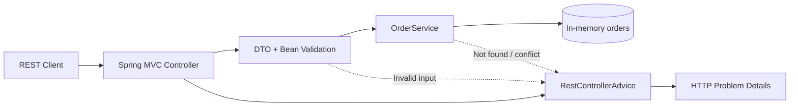

# Xây dựng API Spring MVC với DTO, validation và Problem Details

Một API có thể trả đúng JSON nhưng vẫn khó tích hợp nếu `POST` tạo tài nguyên mà không trả `201 Created` và `Location`, nếu JSON sai không được kiểm tra trước khi ghi dữ liệu, hoặc lỗi `404`/`409` có cấu trúc hoàn toàn khác nhau. Trong bài **thực hành tổng hợp** này, chúng ta xây dựng một REST API Java/Spring MVC nhỏ nhưng nhất quán từ **hợp đồng HTTP → DTO → validation → nghiệp vụ → Problem Details → kiểm thử**.

Ngữ cảnh là module `INTEGRATION_API_REST`: học thiết kế REST dựa trên resource, URI, HTTP method/status và hợp đồng dữ liệu, đồng thời kết nối với phân trang, cache, idempotency, OpenAPI, xác thực, phân quyền, xử lý lỗi và kiểm thử bằng Java/Spring hoặc tương đương. `SPECIAL_NOTE` không có yêu cầu bổ sung. Bài chọn tài nguyên **orders** để người học triển khai; dữ liệu lưu tạm trong bộ nhớ nhằm làm nổi bật HTTP contract thay vì cấu hình database.

> **Phạm vi:** Đây là một ứng dụng thực hành dùng Java 17 và Spring Boot 3.x / Spring Framework 6.x. Mã nguồn minh họa dùng repository in-memory, **chưa có xác thực/phân quyền, cơ sở dữ liệu, idempotency store hay giao dịch phân tán**. Không đưa API mẫu lên Internet hoặc dùng cho thanh toán thật. Các phần mở rộng ở cuối chỉ rõ những gì cần bổ sung trước production.

## 1. Mục tiêu và sản phẩm cuối

Sau khi hoàn thành, bạn sẽ có:

1. Một hợp đồng REST API nhất quán cho `/v1/orders` và `/v1/orders/{id}`, bao gồm request/response schema, HTTP status, headers và media types.
2. **Request DTO** chỉ chứa dữ liệu client được phép gửi, **response DTO** chỉ chứa dữ liệu muốn công bố; không trả entity nội bộ trực tiếp.
3. Bean Validation với `@Valid`, `@NotBlank`, `@NotEmpty`, `@Positive` và `@NotNull`, kể cả trường hợp danh sách lồng nhau.
4. Xử lý lỗi tập trung bằng `ProblemDetail` / `ResponseEntityExceptionHandler` với `application/problem+json`, mã `400`, `404`, `409` và không lộ exception nội bộ.
5. Kiểm thử `MockMvc` cho cả success/error: `201`/`Location`, `200`/`ETag`, `204` không body, validation `400`, sai method `405`, sai media type `415`, không chấp nhận response `406`.
6. Các bài tập nâng cấp optimistic locking, security, pagination, idempotency, OpenAPI và khả năng quan sát.

### 1.1. Bối cảnh nghiệp vụ

Một order chứa các dòng hàng (SKU và số lượng), trạng thái và phiên bản. Khi mới tạo, trạng thái là `PENDING`. Người dùng có thể cập nhật trạng thái:

- `PENDING → CONFIRMED`;
- `PENDING → CANCELLED`;
- yêu cầu trạng thái đang có là **no-op**;
- không cho `CONFIRMED → CANCELLED` hoặc `CANCELLED → CONFIRMED` trong mô hình đơn giản này; trả `409 Conflict`.

Đây là **quy tắc ví dụ**, không phải luật chung cho mọi cửa hàng. Phiên bản `version` tăng mỗi khi trạng thái thực sự đổi, chuẩn bị cho bài mở rộng ETag/`If-Match`.



## 2. Thiết kế hợp đồng HTTP trước khi viết controller

### 2.1. Danh sách endpoint

| Method + URI | Ý nghĩa | Request | Response thành công |
|---|---|---|---|
| `POST /v1/orders` | Tạo order | `application/json`: danh sách dòng hàng | `201 Created`, `Location: /v1/orders/{id}`, `ETag`, body JSON |
| `GET /v1/orders/{id}` | Xem order | Không có body | `200 OK`, `ETag`, body JSON |
| `PATCH /v1/orders/{id}` | Thay trạng thái theo rule | JSON với `status` | `200 OK`, `ETag` phiên bản mới, body JSON |
| `DELETE /v1/orders/{id}` | Xóa order khỏi store thực hành | Không có body | `204 No Content`, body rỗng |

Không có `PUT` trong bài: thử `PUT /v1/orders/{id}` phải nhận `405 Method Not Allowed` nếu URI có handler nhưng method PUT không được hỗ trợ. Response `405` cần có `Allow` chứa các method được phép theo framework. `HEAD`/`OPTIONS` có thể được Spring tự hỗ trợ; khi kiểm `Allow` không ép thứ tự văn bản.

### 2.2. Ví dụ tạo order

```http
POST /v1/orders HTTP/1.1
Host: localhost:8080
Content-Type: application/json
Accept: application/json

{
  "items": [
    {"sku": "BOOK-101", "quantity": 2},
    {"sku": "PEN-008", "quantity": 1}
  ]
}
```

Response:

```http
HTTP/1.1 201 Created
Location: /v1/orders/550e8400-e29b-41d4-a716-446655440000
Content-Type: application/json
ETag: "v1"
Cache-Control: no-store

{
  "id": "550e8400-e29b-41d4-a716-446655440000",
  "status": "PENDING",
  "items": [
    {"sku": "BOOK-101", "quantity": 2},
    {"sku": "PEN-008", "quantity": 1}
  ],
  "createdAt": "2026-11-18T10:00:00Z",
  "version": 1
}
```

UUID và timestamp chỉ minh họa; mỗi request tạo thật có giá trị khác. `Location` là URI reference tương đối hợp lệ và trỏ đúng resource vừa tạo. `ETag` là validator có dấu ngoặc kép; ở phần lõi nó mới để **tham khảo phiên bản**, chưa có conditional GET/PATCH cho đến bài mở rộng.

### 2.3. Quy tắc status và lỗi

| Trường hợp | Status | Lý do |
|---|---:|---|
| Tạo order hợp lệ | `201` | Resource mới được tạo, có `Location` |
| Đọc / cập nhật order hợp lệ | `200` | Trả representation JSON |
| Xóa order thành công | `204` | Không có response body |
| Request JSON sai cú pháp, enum không nhận được | `400` | Không đọc được request body |
| DTO thiếu `items`, SKU rỗng, quantity không dương, thiếu status | `400` | Bean Validation theo chính sách của bài |
| Path ID không phải UUID | `400` | Không chuyển được path parameter |
| Order UUID hợp lệ nhưng không tồn tại | `404` | Không có resource |
| Chuyển trạng thái trái quy tắc | `409` | Xung đột trạng thái nghiệp vụ |
| Dùng method không hỗ trợ trên resource | `405` + `Allow` | Method được nhận biết nhưng không hợp lệ với URI |
| Client yêu cầu `Accept: application/xml` | `406` | API chỉ có representation JSON |
| Request dùng `Content-Type: text/plain` khi POST/PATCH chỉ nhận JSON | `415` | Không hỗ trợ media type đầu vào |

`422 Unprocessable Content` cũng có thể được API khác dùng cho lỗi semantic, nhưng **mẫu này thống nhất 400 cho Bean Validation** để phù hợp mapping thực hành của Spring MVC. Không nên đổi status chỉ vì muốn mọi lỗi giống nhau. `401/403` chỉ có ý nghĩa khi cấu hình Security thật; bài này chưa triển khai filter xác thực.

### 2.4. Hợp đồng Problem Details

Lỗi trả media type `application/problem+json` theo RFC 9457, tối thiểu các trường `type`, `title`, `status`, `detail`; `instance` là tùy chọn. Ví dụ:

```http
HTTP/1.1 400 Bad Request
Content-Type: application/problem+json
Cache-Control: no-store

{
  "type": "https://api.example.com/problems/validation-error",
  "title": "Bad Request",
  "status": 400,
  "detail": "Request validation failed",
  "violations": [
    {"field": "items[0].sku", "message": "must not be blank"},
    {"field": "items[0].quantity", "message": "must be greater than 0"}
  ]
}
```

`violations` là **extension do API này quy định**, không phải trường bắt buộc của RFC 9457. Nội dung message tùy provider Bean Validation và locale; test không nên cố định mọi câu chữ mặc định. Không đưa giá trị nhập nhạy cảm, rejected value, stack trace hoặc SQL vào response lỗi.

## 3. Khởi tạo dự án Java/Spring

Yêu cầu: JDK 17+, Spring Boot 3.x (một bản vá còn được hỗ trợ theo chính sách dự án), Gradle/Maven, `spring-boot-starter-web`, `spring-boot-starter-validation` và `spring-boot-starter-test`. Để tập trung vào code, dùng Gradle Kotlin DSL:

```kotlin
// build.gradle.kts - phiên bản plugin minh họa, hãy pin bản vá
// đã được phê duyệt và cập nhật theo BOM của dự án.
plugins {
    java
    id("org.springframework.boot") version "3.4.0"
    id("io.spring.dependency-management") version "1.1.6"
}

java {
    toolchain {
        languageVersion = JavaLanguageVersion.of(17)
    }
}

repositories {
    mavenCentral()
}

dependencies {
    implementation("org.springframework.boot:spring-boot-starter-web")
    implementation("org.springframework.boot:spring-boot-starter-validation")
    testImplementation("org.springframework.boot:spring-boot-starter-test")
    testRuntimeOnly("org.junit.platform:junit-platform-launcher")
}

tasks.withType<Test>().configureEach {
    useJUnitPlatform()
}
```

Đây là các phiên bản **minh họa cú pháp**, không phải khuyến nghị bảo mật cho production năm hiện tại; khi thực hành trên dự án thật, dùng phiên bản Spring Boot/Gradle và Java được tổ chức hỗ trợ, lock/dependency scan và đọc release notes tương ứng. Đoạn này dùng Spring MVC/Servlet chứ không dùng WebFlux.

Cấu trúc gợi ý:

```text
src/main/java/com/example/orders/
  OrdersApplication.java
  api/
    OrderDtos.java
    OrderService.java
    OrderController.java
    OrderErrors.java
src/main/resources/
  application.yaml
src/test/java/com/example/orders/
  OrderHttpIntegrationTest.java
```

Ở ví dụ này **mọi thành phần thuộc `api` dùng chung package** `com.example.orders.api` để code mẫu gọn. Về production, thường tách domain/repository/service/api theo trách nhiệm.

### 3.1. Spring Boot entrypoint

```java
// src/main/java/com/example/orders/OrdersApplication.java
package com.example.orders;

import org.springframework.boot.SpringApplication;
import org.springframework.boot.autoconfigure.SpringBootApplication;

@SpringBootApplication
public class OrdersApplication {
    public static void main(String[] args) {
        SpringApplication.run(OrdersApplication.class, args);
    }
}
```

### 3.2. Cấu hình tối thiểu

```yaml
# src/main/resources/application.yaml
spring:
  application:
    name: orders-exercise
  mvc:
    problemdetails:
      enabled: true

server:
  port: 8080
```

`spring.mvc.problemdetails.enabled` giúp Spring Boot hỗ trợ Problem Details cho các lỗi MVC/framework theo phiên bản. `@RestControllerAdvice` ở mục 6 vẫn chủ động chuẩn hóa lỗi nghiệp vụ và validation. Nguồn cấu hình production nên externalize; không dùng ví dụ này để bật actuator debug hay cho phép truy cập hệ thống không xác thực.

## 4. DTO: tách đầu vào, đầu ra khỏi mô hình lưu trữ

Không sử dụng một `OrderEntity` cho cả request và response: client không nên được phép tự nhập ID, `createdAt`, trạng thái khởi tạo hay version. Bài dùng các record Java làm DTO bất biến theo ý nghĩa dữ liệu.

```java
// src/main/java/com/example/orders/api/OrderDtos.java
package com.example.orders.api;

import jakarta.validation.Valid;
import jakarta.validation.constraints.NotBlank;
import jakarta.validation.constraints.NotEmpty;
import jakarta.validation.constraints.NotNull;
import jakarta.validation.constraints.Positive;
import java.time.Instant;
import java.util.List;
import java.util.UUID;

public final class OrderDtos {
    private OrderDtos() {}

    public enum OrderStatus {
        PENDING, CONFIRMED, CANCELLED
    }

    public record OrderItemRequest(
            @NotBlank String sku,
            @Positive int quantity) {}

    public record CreateOrderRequest(
            @NotEmpty List<@NotNull @Valid OrderItemRequest> items) {}

    public record UpdateOrderStatusRequest(
            @NotNull OrderStatus status) {}

    public record OrderItemResponse(String sku, int quantity) {}

    public record OrderResponse(
            UUID id,
            OrderStatus status,
            List<OrderItemResponse> items,
            Instant createdAt,
            long version) {}
}
```

**Giải thích từng annotation:**

- `@NotBlank` từ chối `null`, chuỗi rỗng hoặc chỉ có whitespace cho `sku`.
- `@Positive` yêu cầu số lượng lớn hơn 0. Vì `quantity` là `int` primitive, field vắng mặt có thể được Jackson gán giá trị 0 và sau đó bị validation loại; nếu muốn phân biệt “không gửi” với “gửi 0”, dùng `Integer` kèm `@NotNull @Positive`.
- `@NotEmpty` yêu cầu `items` không null và không rỗng; `List<@NotNull @Valid OrderItemRequest>` từ chối phần tử null và kiểm các ràng buộc ở mỗi phần tử lồng nhau.
- `@NotNull` buộc request PATCH có `status`; enum không nhận diện thường gây JSON deserialization error trước Bean Validation.
- `OrderResponse` không chứa secret hoặc entity nội bộ, chỉ công bố những gì hợp đồng nói.

Chú ý: `@NotNull` ở phần tử list là cần thiết để `items: [null]` bị loại bằng 400 thay vì dẫn tới lỗi khi map trong service. Để giới hạn kích thước payload, thêm `@Size(max = ...)` cho danh sách/chuỗi, giới hạn HTTP request body và quota; **validation DTO không thay authentication, authorization hoặc rate limiting**.

## 5. Service: kiểm quy tắc nghiệp vụ, không chứa HTTP

`OrderService` không trả `ResponseEntity`, không đọc `HttpServletRequest` và không tự chọn mã 400/404/409. Nó làm việc với DTO/domain và ném **ngoại lệ có ý nghĩa nghiệp vụ**; lớp MVC sẽ ánh xạ exception thành HTTP response.

Để bài có thể chạy mà không cần database, dùng `ConcurrentHashMap` lưu một `StoredOrder` bất biến. `ConcurrentHashMap.compute` thực hiện thay đổi tại một key theo thao tác nguyên tử trong instance; **không** thay thế transaction DB hay khóa phân tán khi scale nhiều replica.

```java
// src/main/java/com/example/orders/api/OrderService.java
package com.example.orders.api;

import com.example.orders.api.OrderDtos.*;
import java.time.Instant;
import java.util.List;
import java.util.UUID;
import java.util.concurrent.ConcurrentHashMap;
import org.springframework.stereotype.Service;

@Service
public class OrderService {
    private final ConcurrentHashMap<UUID, StoredOrder> store =
            new ConcurrentHashMap<>();

    public OrderResponse create(CreateOrderRequest request) {
        UUID id = UUID.randomUUID();
        List<OrderItemResponse> items = request.items().stream()
                .map(item -> new OrderItemResponse(
                        item.sku(), item.quantity()))
                .toList();

        StoredOrder saved = new StoredOrder(
                id, OrderStatus.PENDING, List.copyOf(items),
                Instant.now(), 1L);
        store.put(id, saved);
        return toResponse(saved);
    }

    public OrderResponse get(UUID id) {
        StoredOrder saved = store.get(id);
        if (saved == null) {
            throw new OrderNotFoundException();
        }
        return toResponse(saved);
    }

    public OrderResponse changeStatus(
            UUID id, UpdateOrderStatusRequest request) {
        StoredOrder updated = store.compute(id, (key, current) -> {
            if (current == null) {
                throw new OrderNotFoundException();
            }
            OrderStatus next = request.status();

            // Cùng một trạng thái: không tạo version mới.
            if (current.status() == next) {
                return current;
            }
            // Chỉ cho PENDING -> CONFIRMED/CANCELLED.
            if (current.status() != OrderStatus.PENDING ||
                    next == OrderStatus.PENDING) {
                throw new OrderConflictException();
            }
            return new StoredOrder(
                    current.id(), next, current.items(),
                    current.createdAt(), current.version() + 1);
        });
        return toResponse(updated);
    }

    public void delete(UUID id) {
        if (store.remove(id) == null) {
            throw new OrderNotFoundException();
        }
    }

    private static OrderResponse toResponse(StoredOrder saved) {
        return new OrderResponse(
                saved.id(), saved.status(), saved.items(),
                saved.createdAt(), saved.version());
    }

    private record StoredOrder(
            UUID id,
            OrderStatus status,
            List<OrderItemResponse> items,
            Instant createdAt,
            long version) {}
}

// Package-private exceptions trong cùng tệp Java.
final class OrderNotFoundException extends RuntimeException {
    OrderNotFoundException() {
        super("Order not found");
    }
}

final class OrderConflictException extends RuntimeException {
    OrderConflictException() {
        super("The order cannot change to the requested status");
    }
}
```

**Giải thích cấu trúc:**

- `StoredOrder` là mô hình lưu nội bộ, không đưa trực tiếp ra JSON.
- `OrderResponse` được dựng khi đọc/trả kết quả; sau này thêm database, có thể thay `StoredOrder` bằng entity và mapper mà không đổi hợp đồng API.
- `compute` giúp hai thread trên **một instance** không đồng thời ghi đè trạng thái của cùng order; ở database thật phải dùng transaction, optimistic locking hoặc atomic update.
- `delete` lần đầu trả thành công; lần thứ hai có thể trả 404 theo hợp đồng bài này. `DELETE` vẫn có ngữ nghĩa **idempotent về hiệu ứng dự định**, không bắt buộc mọi lần gọi phải có cùng status.
- Mô hình này không có giới hạn số order hoặc TTL; chỉ chạy local/test. Một service nhiều replica với map riêng sẽ không đọc được order tạo ở replica khác.

**Bổ sung cần làm trước khi triển khai:** validation chặt hơn (giới hạn số items, SKU, payload), kiểm product SKU tồn tại, giá/tồn kho, transaction và tenant/owner authorization. Chưa có `Idempotency-Key`: retry `POST` sau timeout có thể tạo hai order vì `UUID.randomUUID()` được gọi lại; đây là yêu cầu mở rộng riêng ở cuối bài.

## 6. Controller: method, URI, status, Location, ETag và JSON

Controller nối hợp đồng HTTP với service:

```java
// src/main/java/com/example/orders/api/OrderController.java
package com.example.orders.api;

import com.example.orders.api.OrderDtos.*;
import jakarta.validation.Valid;
import java.net.URI;
import java.util.UUID;
import org.springframework.http.CacheControl;
import org.springframework.http.MediaType;
import org.springframework.http.ResponseEntity;
import org.springframework.web.bind.annotation.DeleteMapping;
import org.springframework.web.bind.annotation.GetMapping;
import org.springframework.web.bind.annotation.PatchMapping;
import org.springframework.web.bind.annotation.PathVariable;
import org.springframework.web.bind.annotation.PostMapping;
import org.springframework.web.bind.annotation.RequestBody;
import org.springframework.web.bind.annotation.RequestMapping;
import org.springframework.web.bind.annotation.RestController;

@RestController
@RequestMapping("/v1/orders")
public class OrderController {
    private final OrderService orders;

    public OrderController(OrderService orders) {
        this.orders = orders;
    }

    private static String etag(OrderResponse response) {
        return "\"v" + response.version() + "\"";
    }

    @PostMapping(
        consumes = MediaType.APPLICATION_JSON_VALUE,
        produces = MediaType.APPLICATION_JSON_VALUE)
    public ResponseEntity<OrderResponse> create(
            @Valid @RequestBody CreateOrderRequest request) {
        OrderResponse created = orders.create(request);
        URI location = URI.create("/v1/orders/" + created.id());
        return ResponseEntity.created(location)
                .eTag(etag(created))
                .cacheControl(CacheControl.noStore())
                .body(created);
    }

    @GetMapping(value = "/{id}",
                produces = MediaType.APPLICATION_JSON_VALUE)
    public ResponseEntity<OrderResponse> get(@PathVariable UUID id) {
        OrderResponse result = orders.get(id);
        return ResponseEntity.ok()
                .eTag(etag(result))
                .cacheControl(CacheControl.noStore())
                .body(result);
    }

    @PatchMapping(
        value = "/{id}",
        consumes = MediaType.APPLICATION_JSON_VALUE,
        produces = MediaType.APPLICATION_JSON_VALUE)
    public ResponseEntity<OrderResponse> patch(
            @PathVariable UUID id,
            @Valid @RequestBody UpdateOrderStatusRequest request) {
        OrderResponse changed = orders.changeStatus(id, request);
        return ResponseEntity.ok()
                .eTag(etag(changed))
                .cacheControl(CacheControl.noStore())
                .body(changed);
    }

    @DeleteMapping("/{id}")
    public ResponseEntity<Void> delete(@PathVariable UUID id) {
        orders.delete(id);
        return ResponseEntity.noContent().build();
    }
}
```

### 6.1. Tại sao sử dụng các annotation này?

| Annotation/API | Tác dụng | Lỗi dễ mắc |
|---|---|---|
| `@RestController` | Trả response body JSON thay vì view template | Dùng `@Controller` thiếu `@ResponseBody` |
| `@RequestMapping("/v1/orders")` | Đặt URI gốc theo resource | Đưa động từ `create`/`delete` vào path |
| `@PostMapping(consumes, produces)` | Khai request/response media type | Nhầm `Accept` với `Content-Type` |
| `@Valid @RequestBody` | Deserialize JSON rồi kiểm bean constraints | Quên `@Valid` nên input sai vẫn qua service |
| `@PathVariable UUID` | Chuyển path param thành UUID | Không xử lý UUID sai thành client error |
| `ResponseEntity.created(location)` | Tạo response `201` + `Location` | Trả `200` nhưng quên URI resource |
| `ResponseEntity.noContent()` | `204` không body | Trả `204` kèm `{}` hoặc `null` |
| `.eTag(...)` | Header validator có cú pháp hợp lệ | Quên quote hoặc nhầm ETag với quyền truy cập |

Hai chi tiết cần hiểu sâu:

1. **Validation ở ranh giới HTTP:** `@Valid` kiểm dữ liệu request có đúng các ràng buộc cú pháp/hình dạng. Service vẫn phải kiểm business transition, data integrity, concurrency và quyền owner. Không gọi mọi lỗi là validation error.
2. **ETag trong ví dụ không thực thi concurrency:** Controller đang trả `ETag: "v1"`, `"v2"` nhưng **không đọc `If-Match`** và không trả `412`. Do đó, chưa thể tuyên bố API chống lost update. Bài mở rộng yêu cầu thêm kiểm `If-Match` nguyên tử trong service/database và test race.

### 6.2. PATCH ở đây không phải JSON Patch tiêu chuẩn

`PATCH` trong bài nhận JSON kiểu:

```http
PATCH /v1/orders/550e8400-e29b-41d4-a716-446655440000 HTTP/1.1
Content-Type: application/json
Accept: application/json

{"status":"CONFIRMED"}
```

Đó là **hợp đồng cập nhật trạng thái tự định nghĩa** bằng `application/json`. Nó không tự động là JSON Patch (`application/json-patch+json`) hay JSON Merge Patch (`application/merge-patch+json`). Nếu muốn triển khai các chuẩn đó, cần thay media type, schema, semantics và kiểm thử, không chỉ đổi tên annotation.

## 7. Problem Details và xử lý lỗi tập trung

Trong Spring MVC, lỗi có thể xuất hiện ở nhiều giai đoạn: mapping method/URI, content negotiation, deserialize JSON, Bean Validation, service nghiệp vụ. Không nên dùng `catch (Exception e)` trong từng controller rồi trả `200 {"success":false}`. Dùng `@RestControllerAdvice` để thống nhất error contract.

`ProblemDetail` là kiểu Spring cung cấp cho RFC 9457. `ResponseEntityExceptionHandler` xử lý nhiều exception của Spring MVC; ta override hai trường hợp quan trọng để giữ thông điệp validation an toàn.

```java
// src/main/java/com/example/orders/api/OrderErrors.java
package com.example.orders.api;

import java.net.URI;
import java.util.List;
import java.util.Map;
import org.springframework.http.CacheControl;
import org.springframework.http.HttpHeaders;
import org.springframework.http.HttpStatus;
import org.springframework.http.HttpStatusCode;
import org.springframework.http.MediaType;
import org.springframework.http.ProblemDetail;
import org.springframework.http.ResponseEntity;
import org.springframework.http.converter.HttpMessageNotReadableException;
import org.springframework.core.Ordered;
import org.springframework.core.annotation.Order;
import org.springframework.web.bind.MethodArgumentNotValidException;
import org.springframework.web.bind.annotation.ExceptionHandler;
import org.springframework.web.bind.annotation.RestControllerAdvice;
import org.springframework.web.context.request.WebRequest;
import org.springframework.web.servlet.mvc.method.annotation.ResponseEntityExceptionHandler;

// Ưu tiên advice này trước error advice mặc định khi Boot bật Problem Details.
@Order(Ordered.HIGHEST_PRECEDENCE)
@RestControllerAdvice
public class OrderErrors extends ResponseEntityExceptionHandler {
    private static final MediaType PROBLEM_JSON =
            MediaType.parseMediaType("application/problem+json");

    @ExceptionHandler(OrderNotFoundException.class)
    public ResponseEntity<ProblemDetail> notFound() {
        return domainError(
                HttpStatus.NOT_FOUND,
                "order-not-found", "Order not found");
    }

    @ExceptionHandler(OrderConflictException.class)
    public ResponseEntity<ProblemDetail> conflict() {
        return domainError(
                HttpStatus.CONFLICT,
                "order-state-conflict",
                "The order cannot change to the requested status");
    }

    @Override
    protected ResponseEntity<Object> handleMethodArgumentNotValid(
            MethodArgumentNotValidException ex,
            HttpHeaders headers,
            HttpStatusCode status,
            WebRequest request) {
        ProblemDetail problem = problem(
                HttpStatus.BAD_REQUEST,
                "validation-error", "Request validation failed");

        List<Map<String, String>> violations =
                ex.getBindingResult().getFieldErrors().stream()
                    .map(error -> Map.of(
                            "field", error.getField(),
                            "message", error.getDefaultMessage() == null
                                    ? "Invalid value"
                                    : error.getDefaultMessage()))
                    .toList();
        problem.setProperty("violations", violations);

        return ResponseEntity.status(HttpStatus.BAD_REQUEST)
                .contentType(PROBLEM_JSON)
                .cacheControl(CacheControl.noStore())
                .body(problem);
    }

    @Override
    protected ResponseEntity<Object> handleHttpMessageNotReadable(
            HttpMessageNotReadableException ex,
            HttpHeaders headers,
            HttpStatusCode status,
            WebRequest request) {
        ProblemDetail problem = problem(
                HttpStatus.BAD_REQUEST,
                "malformed-json", "Malformed JSON request body");
        return ResponseEntity.status(HttpStatus.BAD_REQUEST)
                .contentType(PROBLEM_JSON)
                .cacheControl(CacheControl.noStore())
                .body(problem);
    }

    private static ResponseEntity<ProblemDetail> domainError(
            HttpStatus status, String code, String detail) {
        return ResponseEntity.status(status)
                .contentType(PROBLEM_JSON)
                .cacheControl(CacheControl.noStore())
                .body(problem(status, code, detail));
    }

    private static ProblemDetail problem(
            HttpStatus status, String code, String detail) {
        ProblemDetail result =
                ProblemDetail.forStatusAndDetail(status, detail);
        result.setTitle(status.getReasonPhrase());
        result.setType(URI.create(
                "https://api.example.com/problems/" + code));
        return result;
    }
}
```

**Vì sao không trả chi tiết exception trực tiếp?**

- `HttpMessageNotReadableException` có thể chứa đoạn input chưa kiểm chứng và thông tin parser; chỉ trả thông điệp ngắn, ổn định.
- `FieldError.getRejectedValue()` có thể chứa email/token/PII; chỉ trả tên trường và thông điệp đã kiểm soát, không echo giá trị.
- `type` dùng URI mô tả loại lỗi để client tra tài liệu; đường dẫn `api.example.com` là **placeholder minh họa**, khi áp dụng thật nên có trang tài liệu tương ứng hoặc chọn `about:blank`.
- `status` trong ProblemDetail phải khớp HTTP status. `detail` hữu ích cho người dùng nhưng không được lộ stack trace, secret hoặc hostname nội bộ.
- Các exception MVC khác (`405`/`406`/`415`/UUID conversion) được xử lý bởi Spring/framework, có thể ra cấu trúc/headers khác theo phiên bản; test xem response thực. Để bắt buộc mọi lỗi cũng có schema `application/problem+json`, hãy tùy biến thêm các handler tương ứng và kiểm filter/proxy.

**Lưu ý content negotiation:** Với `406 Not Acceptable`, client đã yêu cầu một media type không được hỗ trợ. Không nên mặc định test rằng *mọi* response 406 phải chứa `application/problem+json`; tùy Spring MVC và `Accept`, body có thể rỗng hoặc khác. Điều quan trọng là status đúng và server không trả sai representation một cách âm thầm.

## 8. Chạy ứng dụng và thử HTTP bằng curl

Sau khi tạo đúng những file ở mục 3–7, chạy bằng Gradle Wrapper trong dự án của **người học**:

```bash
# Linux/macOS:
./gradlew bootRun

# Windows PowerShell:
.\gradlew.bat bootRun
```

Các câu lệnh là hướng dẫn **thực hành**, không phải lệnh đã được thực thi khi biên soạn bài. Thay cổng nếu environment `SERVER_PORT` khác `8080`.

### 8.1. Tạo và đọc order

```bash
curl -i -X POST 'http://localhost:8080/v1/orders' \
  -H 'Content-Type: application/json' \
  -H 'Accept: application/json' \
  --data '{"items":[{"sku":"BOOK-101","quantity":2}]}'
```

Quan sát `HTTP/1.1 201`, `Location`, `ETag: "v1"` và body có `id`, `status=PENDING`. Lấy UUID thực được tạo rồi thay vào những lệnh bên dưới:

```bash
curl -i 'http://localhost:8080/v1/orders/<uuid-from-location>' \
  -H 'Accept: application/json'

curl -i -X PATCH \
  'http://localhost:8080/v1/orders/<uuid-from-location>' \
  -H 'Content-Type: application/json' \
  --data '{"status":"CONFIRMED"}'

curl -i -X PATCH \
  'http://localhost:8080/v1/orders/<uuid-from-location>' \
  -H 'Content-Type: application/json' \
  --data '{"status":"CANCELLED"}'

curl -i -X DELETE \
  'http://localhost:8080/v1/orders/<uuid-from-location>'
```

Kết quả mong đợi: GET `200`, PATCH đầu `200` với version 2, PATCH từ CONFIRMED sang CANCELLED `409` Problem Details, DELETE `204` body rỗng. Gọi GET lại UUID đã xóa nhận `404`. Nếu copy chuỗi `<uuid-from-location>` nguyên văn thay vì UUID thật, server sẽ trả `400` do không parse được path.

### 8.2. Gửi request không hợp lệ

```bash
# SKU blank, quantity = 0 -> 400 validation-error
curl -i -X POST 'http://localhost:8080/v1/orders' \
  -H 'Content-Type: application/json' \
  --data '{"items":[{"sku":" ","quantity":0}]}'

# Danh sách rỗng -> 400
curl -i -X POST 'http://localhost:8080/v1/orders' \
  -H 'Content-Type: application/json' \
  --data '{"items":[]}'

# JSON hỏng -> 400 malformed-json
curl -i -X POST 'http://localhost:8080/v1/orders' \
  -H 'Content-Type: application/json' \
  --data '{"items":['

# Content-Type không hỗ trợ -> 415
curl -i -X POST 'http://localhost:8080/v1/orders' \
  -H 'Content-Type: text/plain' \
  --data 'BOOK-101'

# Accept không phù hợp -> 406
curl -i 'http://localhost:8080/v1/orders/550e8400-e29b-41d4-a716-446655440000' \
  -H 'Accept: application/xml'

# Method không hỗ trợ -> 405 + Allow
curl -i -X PUT \
  'http://localhost:8080/v1/orders/550e8400-e29b-41d4-a716-446655440000' \
  -H 'Content-Type: application/json' \
  --data '{}'
```

Khi chạy trên Windows PowerShell, cú pháp quoting/line continuation của `curl.exe` hoặc PowerShell cần được điều chỉnh; các mẫu trên dùng cú pháp Bash. Không dùng `-k/--insecure` để giải quyết lỗi TLS khi đổi sang HTTPS. `curl` cho phép quan sát HTTP headers nhưng không mô phỏng CORS của browser hoặc tự kiểm chứng Security.

### 8.3. Bảng chẩn đoán nhanh

| Hiện tượng | Vị trí cần kiểm |
|---|---|
| 404 cho `POST /v1/orders` | Package scan, `@RestController`, `@RequestMapping`, port/context path |
| 500 khi gửi body invalid | Có `spring-boot-starter-validation`, `@Valid` và `OrderErrors` đúng không? |
| SKU rỗng vẫn được tạo | Thiếu Bean Validation hoặc thiếu `@Valid` ở controller/nested list |
| 415 khi gửi JSON | Header `Content-Type`, `consumes`, HTTP client thực sự gửi gì |
| 406 khi GET | Header `Accept` không cho phép JSON |
| 409 không xuất hiện | Service thiếu state transition check, test đã gọi đúng trạng thái trước đó chưa |
| 204 nhưng body có `null` | Controller đang trả object thay vì `ResponseEntity.noContent().build()` |
| 201 nhưng thiếu Location | Không dùng `ResponseEntity.created(...)` hoặc có gateway sửa header |
| Problem JSON lộ exception/stack trace | Exception handler đang đưa `ex.getMessage()`/stack vào response |

## 9. Kiểm thử bằng Spring Boot Test và MockMvc

Kiểm thử HTTP contract phải làm hơn việc gọi `OrderService.create()` rồi assert dữ liệu. Dùng `@SpringBootTest` và `@AutoConfigureMockMvc` để nạp MVC controller, HTTP message converters, Bean Validation và exception advice trong ứng dụng thực hành. Không cần mở socket thật với `MockMvc`; khi bổ sung gateway, TLS, CORS hoặc JWT, thêm **HTTP integration tests** riêng.

### 9.1. Bài test end-to-end trong một phương thức

```java
// src/test/java/com/example/orders/OrderHttpIntegrationTest.java
package com.example.orders;

import static org.junit.jupiter.api.Assertions.*;
import static org.springframework.test.web.servlet.request.MockMvcRequestBuilders.*;
import static org.springframework.test.web.servlet.result.MockMvcResultMatchers.*;

import com.fasterxml.jackson.databind.JsonNode;
import com.fasterxml.jackson.databind.ObjectMapper;
import java.util.UUID;
import org.junit.jupiter.api.Test;
import org.springframework.beans.factory.annotation.Autowired;
import org.springframework.boot.test.autoconfigure.web.servlet.AutoConfigureMockMvc;
import org.springframework.boot.test.context.SpringBootTest;
import org.springframework.http.HttpHeaders;
import org.springframework.http.MediaType;
import org.springframework.test.web.servlet.MockMvc;
import org.springframework.test.web.servlet.MvcResult;

@SpringBootTest
@AutoConfigureMockMvc
class OrderHttpIntegrationTest {
    @Autowired MockMvc mvc;
    @Autowired ObjectMapper objectMapper;

    @Test
    void orderLifecycleRespectsHttpContract() throws Exception {
        MvcResult created = mvc.perform(post("/v1/orders")
                .contentType(MediaType.APPLICATION_JSON)
                .accept(MediaType.APPLICATION_JSON)
                .content("""
                    {"items":[{"sku":"BOOK-101","quantity":2}]}
                    """))
            .andExpect(status().isCreated())
            .andExpect(content().contentTypeCompatibleWith(
                    MediaType.APPLICATION_JSON))
            .andExpect(header().exists(HttpHeaders.LOCATION))
            .andExpect(header().string(HttpHeaders.ETAG, "\"v1\""))
            .andExpect(jsonPath("$.status").value("PENDING"))
            .andExpect(jsonPath("$.version").value(1))
            .andReturn();

        JsonNode payload = objectMapper.readTree(
                created.getResponse().getContentAsString());
        String id = payload.get("id").asText();
        assertDoesNotThrow(() -> UUID.fromString(id));
        String location = created.getResponse()
                .getHeader(HttpHeaders.LOCATION);
        assertEquals("/v1/orders/" + id, location);

        mvc.perform(get(location)
                .accept(MediaType.APPLICATION_JSON))
            .andExpect(status().isOk())
            .andExpect(header().string(HttpHeaders.ETAG, "\"v1\""))
            .andExpect(jsonPath("$.items[0].sku").value("BOOK-101"));

        mvc.perform(patch(location)
                .contentType(MediaType.APPLICATION_JSON)
                .content("{\"status\":\"CONFIRMED\"}"))
            .andExpect(status().isOk())
            .andExpect(header().string(HttpHeaders.ETAG, "\"v2\""))
            .andExpect(jsonPath("$.status").value("CONFIRMED"))
            .andExpect(jsonPath("$.version").value(2));

        mvc.perform(patch(location)
                .contentType(MediaType.APPLICATION_JSON)
                .content("{\"status\":\"CANCELLED\"}"))
            .andExpect(status().isConflict())
            .andExpect(content().contentTypeCompatibleWith(
                    MediaType.parseMediaType("application/problem+json")))
            .andExpect(jsonPath("$.status").value(409));

        mvc.perform(delete(location))
            .andExpect(status().isNoContent())
            .andExpect(content().string(""));

        mvc.perform(get(location))
            .andExpect(status().isNotFound())
            .andExpect(jsonPath("$.status").value(404));
    }
}
```

Lợi ích: test kiểm **hành vi** xuyên Controller → Validation → Service → Advice, nhưng không phụ thuộc order ID cố định. Mỗi test tạo dữ liệu riêng với UUID mới, tránh phụ thuộc thứ tự test. Mã này chưa khởi chạy database hay gateway thật; không được coi là test transaction, JWT hoặc khả năng chạy nhiều replica.

### 9.2. Test validation và JSON hỏng

Thêm các phương thức sau vào cùng lớp `OrderHttpIntegrationTest`:

```java
@Test
void invalidNestedFieldsReturn400ProblemDetails() throws Exception {
    mvc.perform(post("/v1/orders")
            .contentType(MediaType.APPLICATION_JSON)
            .content("""
                {"items":[{"sku":" ","quantity":0}]}
                """))
        .andExpect(status().isBadRequest())
        .andExpect(content().contentTypeCompatibleWith(
                MediaType.parseMediaType("application/problem+json")))
        .andExpect(jsonPath("$.status").value(400))
        .andExpect(jsonPath("$.violations").isArray());
}

@Test
void emptyItemsAreRejected() throws Exception {
    mvc.perform(post("/v1/orders")
            .contentType(MediaType.APPLICATION_JSON)
            .content("{\"items\":[]}"))
        .andExpect(status().isBadRequest())
        .andExpect(jsonPath("$.status").value(400));
}

@Test
void missingStatusIsRejected() throws Exception {
    mvc.perform(patch("/v1/orders/" + UUID.randomUUID())
            .contentType(MediaType.APPLICATION_JSON)
            .content("{}"))
        .andExpect(status().isBadRequest());
}

@Test
void invalidEnumReturns400() throws Exception {
    mvc.perform(patch("/v1/orders/" + UUID.randomUUID())
            .contentType(MediaType.APPLICATION_JSON)
            .content("{\"status\":\"SHIPPED\"}"))
        .andExpect(status().isBadRequest())
        .andExpect(jsonPath("$.type").value(
                "https://api.example.com/problems/malformed-json"));
}

@Test
void malformedJsonReturns400WithoutEchoingInput() throws Exception {
    mvc.perform(post("/v1/orders")
            .contentType(MediaType.APPLICATION_JSON)
            .content("{\"items\":["))
        .andExpect(status().isBadRequest())
        .andExpect(jsonPath("$.detail").value(
                "Malformed JSON request body"));
}
```

**Điểm quan sát:** Thông báo `violations` có thể khác theo locale/provider; test chỉ nên chốt cấu trúc và status nếu không sở hữu message catalog. `@Valid` ở Controller + `@NotEmpty` ở request + `@Valid` ở phần tử list là ba mảnh phối hợp. Mọi input invalid phải bị loại **trước khi** `OrderService.create` ghi order.

### 9.3. Test method, media type và path ID

```java
@Test
void wrongMediaTypeReturns415() throws Exception {
    mvc.perform(post("/v1/orders")
            .contentType(MediaType.TEXT_PLAIN)
            .content("BOOK-101"))
        .andExpect(status().isUnsupportedMediaType());
}

@Test
void unacceptableResponseTypeReturns406() throws Exception {
    mvc.perform(get("/v1/orders/" + UUID.randomUUID())
            .accept(MediaType.APPLICATION_XML))
        .andExpect(status().isNotAcceptable());
}

@Test
void unsupportedMethodReturns405WithAllow() throws Exception {
    mvc.perform(put("/v1/orders/" + UUID.randomUUID())
            .contentType(MediaType.APPLICATION_JSON)
            .content("{}"))
        .andExpect(status().isMethodNotAllowed())
        .andExpect(header().exists(HttpHeaders.ALLOW));
}

@Test
void invalidUuidReturns400() throws Exception {
    mvc.perform(get("/v1/orders/not-a-uuid"))
        .andExpect(status().isBadRequest());
}

@Test
void missingOrderReturns404ProblemDetails() throws Exception {
    mvc.perform(get("/v1/orders/" + UUID.randomUUID()))
        .andExpect(status().isNotFound())
        .andExpect(content().contentTypeCompatibleWith(
            MediaType.parseMediaType("application/problem+json")))
        .andExpect(jsonPath("$.type").value(
            "https://api.example.com/problems/order-not-found"));
}
```

Với 405, Spring MVC có thể thêm HEAD/OPTIONS; test quan tâm `Allow` đúng theo contract, không nên so chuỗi có thứ tự cố định. Với 406, client đòi XML nhưng API chỉ trả JSON; không ép luôn body Problem JSON trong response 406. Với 400 path UUID sai, Spring dùng framework exception resolver; nếu error body là yêu cầu bắt buộc của hệ thống, cần thêm bài kiểm cho advice/framework mappings tương ứng.

### 9.4. Chạy test và đọc kết quả

```bash
# Linux/macOS trong dự án:
./gradlew test

# Windows:
.\gradlew.bat test
```

Nếu test không đạt, phân loại trước khi sửa:

| Test fail | Giả thuyết cần xác minh |
|---|---|
| 201/Location fail | Controller dùng `ok` thay `created`, mapping POST sai |
| Validation 400 fail | Thiếu starter validation, `@Valid`, cascaded `@Valid` hoặc DTO annotation |
| 409 fail | Business transition không được kiểm hoặc state test chuẩn bị sai |
| 404 fail | Service không ném exception có chủ đích, advice thiếu handler |
| 406/415 fail | `produces`/`consumes`, request headers hoặc thứ tự filter |
| Error media type fail | Advice chưa đặt `application/problem+json`, framework error handler khác |
| 204 body fail | Controller trả `null` hoặc object dù status 204 |
| Test phụ thuộc thứ tự | Dùng ID cố định/in-memory state chia sẻ không được cô lập |

Không sửa hợp đồng OpenAPI cho khớp một lỗi implementation nếu hợp đồng ban đầu đúng. Nếu hành vi mới được quyết định chính thức, phải review compatibility, cập nhật tài liệu và test đồng bộ.

## 10. Mô tả API bằng OpenAPI 3.1

OpenAPI là **hợp đồng**, không phải cách để Spring tự động kiểm mọi quy tắc nghiệp vụ. Có thể viết `api/openapi.yaml` trong dự án học tập (không phải file được tạo bởi bài viết này) để phản ánh behavior đã xây. Bản sau trình bày khung các endpoint chính và reusable schemas; khi dùng thật, bổ sung description/examples/headers/error responses đầy đủ.

```yaml
openapi: 3.1.0
info:
  title: Orders Exercise API
  version: 1.0.0
  description: Demo API without authentication; local learning only.
servers:
  - url: http://localhost:8080
tags:
  - name: Orders
    description: Create, read, update and delete orders.
paths:
  /v1/orders:
    post:
      tags: [Orders]
      operationId: createOrder
      summary: Create an order
      requestBody:
        required: true
        content:
          application/json:
            schema:
              $ref: '#/components/schemas/CreateOrderRequest'
      responses:
        '201':
          description: Created order
          headers:
            Location:
              required: true
              description: URI of the created order.
              schema: {type: string}
            ETag:
              description: Current representation validator.
              schema: {type: string}
          content:
            application/json:
              schema:
                $ref: '#/components/schemas/OrderResponse'
        '400':
          $ref: '#/components/responses/Problem400'
        '415':
          description: Unsupported request media type
  /v1/orders/{id}:
    parameters:
      - name: id
        in: path
        required: true
        schema: {type: string, format: uuid}
    get:
      tags: [Orders]
      operationId: getOrder
      summary: Get an order
      responses:
        '200':
          description: Current order
          headers:
            ETag:
              description: Current representation validator.
              schema: {type: string}
          content:
            application/json:
              schema:
                $ref: '#/components/schemas/OrderResponse'
        '400':
          $ref: '#/components/responses/Problem400'
        '404':
          $ref: '#/components/responses/Problem404'
        '406':
          description: Requested representation cannot be produced
    patch:
      tags: [Orders]
      operationId: changeOrderStatus
      summary: Change order status
      requestBody:
        required: true
        content:
          application/json:
            schema:
              $ref: '#/components/schemas/UpdateOrderStatusRequest'
      responses:
        '200':
          description: Updated order, or unchanged status
          headers:
            ETag:
              schema: {type: string}
          content:
            application/json:
              schema:
                $ref: '#/components/schemas/OrderResponse'
        '400':
          $ref: '#/components/responses/Problem400'
        '404':
          $ref: '#/components/responses/Problem404'
        '409':
          $ref: '#/components/responses/Problem409'
        '415':
          description: Unsupported request media type
    delete:
      tags: [Orders]
      operationId: deleteOrder
      summary: Delete an order
      responses:
        '204':
          description: Order deleted (no body)
        '400':
          $ref: '#/components/responses/Problem400'
        '404':
          $ref: '#/components/responses/Problem404'
components:
  schemas:
    OrderItemRequest:
      type: object
      required: [sku, quantity]
      properties:
        sku: {type: string, minLength: 1}
        quantity: {type: integer, minimum: 1}
    CreateOrderRequest:
      type: object
      required: [items]
      properties:
        items:
          type: array
          minItems: 1
          items:
            $ref: '#/components/schemas/OrderItemRequest'
    UpdateOrderStatusRequest:
      type: object
      required: [status]
      properties:
        status:
          type: string
          enum: [PENDING, CONFIRMED, CANCELLED]
    OrderResponse:
      type: object
      required: [id, status, items, createdAt, version]
      properties:
        id: {type: string, format: uuid}
        status:
          type: string
          enum: [PENDING, CONFIRMED, CANCELLED]
        items:
          type: array
          items:
            $ref: '#/components/schemas/OrderItemRequest'
        createdAt: {type: string, format: date-time}
        version: {type: integer, minimum: 1}
    Problem:
      type: object
      required: [type, title, status]
      properties:
        type: {type: string, format: uri-reference}
        title: {type: string}
        status: {type: integer}
        detail: {type: string}
        instance: {type: string, format: uri-reference}
        violations:
          type: array
          items:
            type: object
            properties:
              field: {type: string}
              message: {type: string}
  responses:
    Problem400:
      description: Malformed or invalid request
      content:
        application/problem+json:
          schema:
            $ref: '#/components/schemas/Problem'
    Problem404:
      description: Order not found
      content:
        application/problem+json:
          schema:
            $ref: '#/components/schemas/Problem'
    Problem409:
      description: Order state conflict
      content:
        application/problem+json:
          schema:
            $ref: '#/components/schemas/Problem'
```

OpenAPI trên cố ý không khai `securitySchemes` vì **bản thực hành lõi không có authentication**; nó không an toàn để đưa ra mạng công cộng. Khi bật Spring Security ở phần mở rộng, bắt buộc thêm OAuth2 Bearer scheme, `401/403`, mô tả scope/ownership và test tương ứng. Không “bảo mật bằng tài liệu”: thêm `security: [...]` trong YAML không khiến server xác thực thật.

### 10.1. So hợp đồng với code, đừng chỉ lint YAML

Đối chiếu:

| OpenAPI | Spring code | Cách phát hiện sai lệch |
|---|---|---|
| `POST` nhận `items` tối thiểu 1 | `@NotEmpty List<@Valid ...>` | MockMvc `items: []` → 400 |
| SKU phải không rỗng, số lượng dương | `@NotBlank`, `@Positive` | Validation nested test |
| `PATCH` chỉ status enum | `UpdateOrderStatusRequest` | Gửi `SHIPPED` → 400 |
| `201` và `Location` | `ResponseEntity.created` | Test 201/Location |
| `204` không body | `noContent().build()` | Test body empty |
| `404` khi order không tồn tại | `OrderNotFoundException` → advice | GET random UUID → 404 |
| `409` khi chuyển trạng thái không hợp lệ | `OrderConflictException` → advice | PENDING → CONFIRMED → CANCELLED |
| Lỗi đúng media type | `ProblemDetail` + `@RestControllerAdvice` | Assert `application/problem+json` |

**Một điểm cần review thêm:** `@NotBlank` xem chuỗi chỉ chứa whitespace là invalid; OpenAPI `minLength: 1` chưa diễn tả đầy đủ điều đó. Nếu contract cần mô tả chính xác, thêm pattern hoặc mô tả schema tương thích với cách Java xử lý Unicode/whitespace, và test cả hai. Tương tự, Spring Boot/Jackson có thể bỏ qua **unknown JSON properties** theo cấu hình mặc định; nếu muốn từ chối field lạ, phải cấu hình deserialize policy và cập nhật OpenAPI `additionalProperties` đồng bộ. Lint OpenAPI không tự chứng minh runtime thực sự dùng rule đó.

### 10.2. Static lint và provider conformance là hai vòng riêng

Trong dự án của người học, có thể dùng OpenAPI parser/validator và Spectral với ruleset nội bộ để phát hiện thiếu `operationId`, `summary`, schema/status/header. Sau đó chạy `MockMvc`/HTTP tests ở mục 9 để xác nhận server thực sự làm đúng như tài liệu. Nếu có baseline của bản API đã phát hành, chạy compatibility diff và consumer tests trước khi thay kiểu dữ liệu hoặc business semantics.

Không kiểm OpenAPI ở CI rồi coi đó là bằng chứng `OrderService` có tenant authorization hoặc idempotency: những thuộc tính đó cần kiểm ở implementation và transaction/database.

## 11. Những giới hạn của mini-project và hướng nâng cấp

### 11.1. Không có xác thực/phân quyền

Ứng dụng mẫu **không có Spring Security dependency**; mọi ai truy cập vào `localhost:8080` có thể thao tác mọi order. Để đưa gần production:

1. Thêm `spring-boot-starter-security` và `spring-boot-starter-oauth2-resource-server` vào build.
2. Cấu hình resource server kiểm signature, issuer, audience, expiry và JWKS theo identity provider tin cậy.
3. Tạo `SecurityFilterChain`: GET cần scope `orders:read`, POST/PATCH/DELETE cần `orders:write`.
4. **Kiểm owner/tenant từng order trong service/repository**; chỉ scope tổng quát không chặn lỗi BOLA (đọc order của người khác).
5. Test `401 + WWW-Authenticate` khi không có/sai token, `403` khi thiếu quyền, 404/403 theo policy cho order tenant khác.

Fragment cấu hình định hướng:

```java
http.authorizeHttpRequests(auth -> auth
        .requestMatchers(HttpMethod.GET, "/v1/orders/**")
            .hasAuthority("SCOPE_orders:read")
        .requestMatchers(HttpMethod.POST, "/v1/orders")
            .hasAuthority("SCOPE_orders:write")
        .requestMatchers(HttpMethod.PATCH, "/v1/orders/**")
            .hasAuthority("SCOPE_orders:write")
        .requestMatchers(HttpMethod.DELETE, "/v1/orders/**")
            .hasAuthority("SCOPE_orders:write")
        .anyRequest().authenticated())
    .oauth2ResourceServer(oauth2 -> oauth2.jwt(
            Customizer.withDefaults()));
```

Đây là **fragment**, không phải cấu hình có thể copy vào project lõi khi chưa thêm dependencies/issuer/JwtDecoder, chưa xử lý CSRF cho cookie workflows và chưa kiểm tenant. Dùng `jwt()` trong `spring-security-test` có thể kiểm quyền scope ở tầng web nhưng không verify JWT signature/JWKS thật; cần integration test token thực với key test riêng.

### 11.2. ETag phải có If-Match để chống lost update

Hiện tại trả `ETag` nhưng chưa dùng validator khi PATCH. Để nhiều client cập nhật đồng thời an toàn:

1. Client GET order nhận `ETag: "v1"`.
2. Client PATCH kèm `If-Match: "v1"`.
3. Server kiểm **strong ETag** và version ngay trong thao tác cập nhật nhất quán; nếu match, tăng version và trả ETag mới; nếu stale, trả `412 Precondition Failed` mà **không sửa** dữ liệu.
4. Nếu API quy định bắt buộc `If-Match` mà client không gửi, trả `428 Precondition Required`.
5. Test hai PATCH cùng ETag: chỉ một thành công, request còn lại 412; không đủ nếu chỉ kiểm `If-Match` trước khi transaction DB.

`If-Match` có cú pháp danh sách entity tags và `*` theo HTTP; không nên chỉ so chuỗi thô nếu đặt mục tiêu hỗ trợ đầy đủ chuẩn. `GET If-None-Match`/`304 Not Modified` là bài mở rộng cache khác, không tự xuất hiện chỉ vì controller trả ETag. Với order nhạy cảm, `Cache-Control: no-store` vẫn hợp lý dù dùng ETag cho concurrency.

### 11.3. POST và idempotency

Request tạo order có thể bị client timeout sau khi service đã lưu. Nếu retry `POST` như hiện tại, `UUID.randomUUID()` tạo thêm order. Để thêm hợp đồng `Idempotency-Key`:

- Header required/optional theo policy, có format/length/TTL công bố trong OpenAPI.
- Scope key theo caller/tenant và request fingerprint; cùng key khác payload phải nhận conflict theo hợp đồng.
- Lưu **key + kết quả + trạng thái thao tác** cùng tính nhất quán với side effect (transaction/unique constraint) để hai request đồng thời không tạo trùng.
- Retry cùng key và cùng payload nhận kết quả đã lưu/đường truy vấn trạng thái theo contract; đừng dùng trace ID/correlation ID làm khóa idempotency.
- Với payment/charge, timeout không chứng minh downstream chưa commit; cần đối soát.

In-memory `ConcurrentHashMap` riêng từng instance **không đủ** để bảo đảm idempotency toàn cluster; cần kho dữ liệu/transaction chia sẻ và chính sách xử lý request đang xử lý dở.

### 11.4. Pagination, database và tính ổn định của dữ liệu

Nếu thêm `GET /v1/orders?limit=20&cursor=...`, cần một sort order ổn định, tie-breaker, giới hạn tối đa và filter theo tenant. Cursor phải opaque, có validate/scope, không phải raw SQL/offset người dùng có thể sửa tùy ý. Với database, dùng repository và transaction, kiểm concurrency và schema migration. Không đưa trực tiếp JPA entity ra REST response; lazy loading, field nhạy cảm và chu trình quan hệ có thể làm response không ổn định.

### 11.5. Observability và resilience

Khi API gọi inventory/payment thật:

- Dùng timeout budget đầu cuối, connect/read timeout, retry có kiểm soát, circuit breaker/bulkhead theo đo đạc; không retry mutation không idempotent mù.
- Có `X-Correlation-ID` để support tìm log và W3C `traceparent` để liên kết distributed spans; các ID này **không phải credential**.
- Tránh log raw request body/JWT/PII; metrics dùng route template/status/method, không dùng UUID/order ID làm label.
- Trả `502`/`503`/`504` đúng vai trò khi dependency lỗi, Problem Details không lộ hostname/token nội bộ. `408` không phải mã chung cho mọi backend timeout.
- Không cache công khai order có dữ liệu cá nhân, áp `Cache-Control`/`Vary` và CORS theo origin thực sự được phép.

## 12. Bài tập nâng cấp theo từng mức độ

Để luyện tập có chủ đích, mỗi bài dưới đây ghi **đầu vào cần xử lý**, **kết quả kỳ vọng** và **điểm kiểm chứng**. Nên làm theo thứ tự; bài nâng cao có thể thực hiện với database test hoặc mock dependency, không cần dùng credential/dữ liệu production.

### Bài 1 — Hoàn thiện DTO và validation (cơ bản)

**Yêu cầu:** Thêm giới hạn tối đa 30 dòng hàng/order, tối đa 64 ký tự cho SKU, không nhận phần tử null, và giới hạn mỗi quantity 1–100. Bảo đảm không có order nào được tạo khi dữ liệu vi phạm.

| Input | Kỳ vọng |
|---|---|
| `{"items":[]}` | `400` với violations cho `items` |
| `{"items":null}` | `400` |
| `{"items":[null]}` | `400`, không có 500 |
| `{"items":[{"sku":" ","quantity":2}]}` | `400` |
| `{"items":[{"sku":"BOOK-101","quantity":0}]}` | `400` |
| `{"items":[{"sku":"BOOK-101","quantity":101}]}` | `400` |
| 31 dòng hàng hợp lệ | `400` |
| Một dòng hàng hợp lệ | `201` |

*Gợi ý:* Thêm `@Size(max=30)` trên list, `@Size(max=64)` cho SKU, `@Max(100)` cho quantity. Bắt lỗi ở request DTO, không chờ `OrderService` ném `NullPointerException`. Nếu muốn nhận null/missing quantity khác nhau, dùng `Integer` và `@NotNull`.

### Bài 2 — Chỉ trả dữ liệu an toàn (cơ bản)

Thêm trường nội bộ `internalCost` hoặc `paymentReference` vào `StoredOrder` nhưng **không thêm** vào `OrderResponse`. Viết test tạo/get order khẳng định JSON không chứa trường nội bộ. Thử gửi thêm `{"id":"fake-id","status":"CONFIRMED"}` trong body POST và thảo luận policy xử lý unknown fields: bỏ qua hay trả 400? Nếu chọn từ chối, phải cấu hình Jackson tương ứng và ghi trong OpenAPI; không chỉ giả định record tự từ chối.

*Tiêu chí đạt:* client không thể tự đặt ID/status/createdAt/price, response không rò entity fields, request DTO và response DTO độc lập.

### Bài 3 — Chuẩn hóa lỗi validation (trung bình)

Mở rộng `OrderErrors` để các lỗi validation có `violations[]` sắp xếp ổn định theo `field`, có mã lỗi `VALIDATION_FAILED` là extension, đồng thời không chứa `rejectedValue`. Thêm tests cho hai lỗi lồng nhau trong cùng request và JSON sai cú pháp.

*Tiêu chí đạt:* HTTP status 400, media type `application/problem+json`, `type/title/status/detail` đúng; một test không bị phụ thuộc thứ tự mặc định của Hibernate Validator; log/response không chứa raw payload nhạy cảm.

### Bài 4 — Phân biệt 404 và 409 (trung bình)

Viết hai integration tests độc lập:

1. `GET`/`PATCH`/`DELETE` với UUID hợp lệ nhưng không có → 404.
2. Tạo order, PATCH từ PENDING sang CONFIRMED, rồi PATCH sang CANCELLED → 409; GET lại vẫn là CONFIRMED và version không tăng.

*Tiêu chí đạt:* 404 và 409 có `type` riêng; state không bị thay đổi khi service ném conflict; test không dùng một UUID được hard-code trùng dữ liệu test khác.

### Bài 5 — Media negotiation và HTTP semantics (trung bình)

Thêm các kiểm thử:

- `POST Content-Type: text/plain` → 415.
- `GET Accept: application/xml` → 406.
- `PUT` tại URI order chỉ hỗ trợ GET/PATCH/DELETE → 405 + `Allow`.
- `HEAD` trên URI có GET → header phù hợp nhưng không body.
- `DELETE` thành công → 204 body rỗng; gọi lại theo chính sách bài này → 404.

*Gợi ý:* `Allow` là danh sách method không phân biệt thứ tự; `HEAD` có thể được Spring MVC hỗ trợ tự động từ `@GetMapping`. Dùng HTTP server integration test nếu cần kiểm chính xác transport; không khẳng định `curl` mô phỏng browser CORS.

### Bài 6 — Optimistic locking với ETag (nâng cao)

Thêm `@RequestHeader("If-Match")` cho PATCH và điều kiện:

```http
PATCH /v1/orders/550e8400-e29b-41d4-a716-446655440000 HTTP/1.1
If-Match: "v1"
Content-Type: application/json

{"status":"CONFIRMED"}
```

Server trả 200 + `ETag: "v2"` nếu version khớp, `412` nếu không khớp; `428` nếu thiếu header theo chính sách mới. Viết test hai request cùng `If-Match: "v1"` chạy gần đồng thời và chứng minh chỉ một lần ghi thành công. Với bộ nhớ, dùng `ConcurrentHashMap.compute`; với DB, dùng optimistic locking/conditional UPDATE trong transaction.

*Lưu ý:* Nếu đổi API đang có client, việc bắt buộc `If-Match` là **breaking change**; cần OpenAPI/SDK migration plan. Không dùng ETag làm credential.

### Bài 7 — Idempotency cho POST (nâng cao)

Client gửi cùng `Idempotency-Key` và body tạo order hai lần do retry mạng. Thiết kế kho idempotency có unique key theo caller/tenant, fingerprint payload, trạng thái IN_PROGRESS/SUCCEEDED/FAILED, TTL và transaction với side effect.

*Tiêu chí đạt:* Hai request cùng key/payload → cùng kết quả theo contract và **chỉ một order**; cùng key nhưng payload khác → conflict; concurrency không tạo hai order; kho chia sẻ được giữa nhiều replica. Giải thích vì sao `traceId`/`X-Correlation-ID` không thay `Idempotency-Key`.

### Bài 8 — Security và quyền sở hữu order (nâng cao)

Thêm Spring Security OAuth2 Resource Server. Mỗi `StoredOrder` có `ownerId/tenantId` nội bộ, lấy danh tính từ JWT **đã verify**, không lấy owner ID tùy ý từ JSON body. Viết các test:

| Request | Kỳ vọng |
|---|---|
| Không Bearer token | `401 + WWW-Authenticate` |
| Token hợp lệ nhưng thiếu `orders:read` | `403` khi GET |
| Token hợp lệ có `orders:read` và đúng tenant | `200` |
| Token hợp lệ đúng scope nhưng order khác tenant | `403` hoặc `404` theo chính sách che tồn tại |
| Token sai issuer/audience/signature | `401` |
| Token có quyền ghi, đúng tenant, PATCH hợp lệ | `200` |

*Gợi ý:* `jwt()` trong Spring Security Test là mock Authentication, không tự test chữ ký/JWKS. Cần test resource server thật với test key/issuer. Không coi CORS, trace ID hoặc correlation ID là cơ chế authorization.

### Bài 9 — Phân trang và OpenAPI (nâng cao)

Thêm `GET /v1/orders?limit=20&cursor=...` trả `items` và `nextCursor`. Đặt max limit, sort order/tie-breaker ổn định, tenant filter và opaque cursor. Bổ sung OpenAPI 3.1 schemas/errors và validator. Viết test nhiều trang, chèn thêm order trong khi phân trang, limit không hợp lệ, cursor hết hạn/sai tenant.

*Tiêu chí đạt:* API không trả toàn bộ store trong một response, không làm lộ order tenant khác và không phụ thuộc thứ tự map. Tách “có schema phân trang” khỏi “phân trang ổn định thực tế”.

### Bài 10 — Quan sát và lỗi dependency (nâng cao)

Giả lập `payment-api`/`inventory-api` từ MockWebServer hoặc WireMock. Khi dependency timeout, đo remaining budget và trả `504` nếu service đóng vai gateway theo hợp đồng. Thêm correlation ID vào response lỗi và distributed tracing context qua HTTP client được instrument. Test retry có giới hạn, không log API key/JWT hoặc body nhạy cảm.

*Tiêu chí đạt:* 504 không bị gộp vào 400, lỗi không lộ hostname/secret, idempotency được xem xét khi downstream có side effect; trace ID không thay quyền truy cập.

## 13. Tiêu chí chấm bài và nghiệm thu

Một bài thực hành có thể được đánh giá theo thang 100 điểm:

| Nhóm đánh giá | Điểm | Tiêu chí |
|---|---:|---|
| Resource/HTTP contract | 20 | URI/method đúng, POST 201 + Location, GET/PATCH 200, DELETE 204, header/media type nhất quán |
| DTO và validation | 20 | Request/response tách riêng, nested constraints hoạt động, input lỗi không gây side effect |
| Service/business rules | 15 | PENDING transition đúng, 404/409 đúng, không sửa version khi fail |
| Problem Details | 15 | RFC 9457 fields, error type/status/media type hợp đồng, không lộ internal |
| Kiểm thử | 20 | MockMvc success/error, JSON malformed, 405/406/415, 204 body, kiểm dữ liệu sau cập nhật |
| Tài liệu/vận hành | 10 | OpenAPI mô tả đúng mã nguồn, chỉ ra giới hạn demo/security, hướng nâng cấp rõ |
| **Tổng** | **100** | |

**Điều kiện bắt buộc**, bất kể điểm số: không có secret thật trong source/log; không triển khai public khi chưa có auth/tenant policy; không dùng `200 {"error":...}` cho lỗi; không làm trôi trạng thái khi validation/409; không tuyên bố hỗ trợ idempotency hay optimistic locking khi chưa kiểm/test.

### 13.1. Checklist tự đánh giá

| Kiểm tra | Kết quả mong đợi |
|---|---|
| Source compile với Java 17 và dependency đã chọn | □ |
| `POST` hợp lệ trả 201 + Location + JSON + ETag | □ |
| `GET` theo Location trả 200 và cùng ID | □ |
| `PATCH` hợp lệ thay status, tăng version, trả ETag mới | □ |
| Chuyển trạng thái sai trả 409 và không đổi dữ liệu | □ |
| `DELETE` trả 204, response body rỗng | □ |
| `items: []`, SKU blank, quantity 0, status thiếu → 400 | □ |
| `items: [null]` không gây 500 | □ |
| JSON hỏng/enum không hỗ trợ → 400 Problem Details | □ |
| UUID sai định dạng → 400; UUID chưa có → 404 | □ |
| Sai method → 405 + Allow | □ |
| `Accept` không hỗ trợ → 406; `Content-Type` sai → 415 | □ |
| Problem Details có type/title/status/detail, không lộ stacktrace/raw input | □ |
| OpenAPI khớp status, schema, headers và media types của code | □ |
| Unit/MVC tests không phụ thuộc thứ tự, có dữ liệu kiểm thử độc lập | □ |
| Có kế hoạch cho auth/tenant, DB, If-Match và idempotency trước production | □ |

### 13.2. Lỗi phổ biến khi làm bài

| Sai lầm | Vì sao sai | Cách sửa |
|---|---|---|
| Entity DB cũng là request DTO | Client có thể ghi trường nội bộ | Tách input/output/domain model |
| Có annotation `@NotBlank` nhưng không có `@Valid` | Ràng buộc không được kích hoạt tại HTTP boundary | Dùng `@Valid @RequestBody` |
| Quên validation phần tử list | SKU/quantity lồng nhau bị bỏ qua | `List<@NotNull @Valid OrderItemRequest>` |
| Catch mọi exception, trả `200` | Client/cache không nhận biết lỗi | `@RestControllerAdvice` và status phù hợp |
| Chỉ trả `ex.getMessage()` | Có thể lộ SQL/stack/input nhạy cảm | Dùng error code/detail an toàn |
| Dùng `@ResponseStatus(201)` nhưng thiếu Location | Hợp đồng tạo resource chưa đủ | `ResponseEntity.created(...)` |
| `204` có body `{}` | Vi phạm semantics của 204 | `noContent().build()` |
| Test chỉ assert JSON, bỏ qua status/header | Không phát hiện breaking HTTP contract | MockMvc status/header/media type assertions |
| Trả `409` cho mọi lỗi input | Không phân biệt validation với state conflict | 400/409/412 theo lý do thực |
| Chỉ thêm `ETag` rồi tuyên bố chống lost update | Không có atomic precondition check | `If-Match` + 412/428 + concurrency test |
| Dùng in-memory map cho production cluster | Dữ liệu mất và phân mảnh giữa replicas | Shared datastore + transaction/migration |
| Bật CORS wildcard rồi nghĩ API đã có auth | CORS không chặn client ngoài browser | JWT + object-level authorization |

## 14. Tài liệu chuẩn để tham khảo

- **RFC 9110 — HTTP Semantics:** `GET`, `POST`, `PATCH`, `DELETE`, `201`, `204`, `400`, `404`, `405`, `406`, `409`, `415`, `ETag` và `Location`.
- **RFC 9457 — Problem Details for HTTP APIs:** media type `application/problem+json`, các trường `type`, `title`, `status`, `detail`, `instance` và extension members.
- **RFC 5789 — PATCH Method for HTTP:** đặc tính của PATCH và yêu cầu cân nhắc tính atomic của áp dụng patch.
- **Spring Framework Reference — Spring Web MVC:** `@RestController`, mapping annotations, message conversion, exception handling và `ResponseEntity`.
- **Spring Framework Reference — Error Responses:** `ProblemDetail`, `ErrorResponse`, `ResponseEntityExceptionHandler` và quản lý exceptions.
- **Spring Boot Reference — Validation / Testing Spring Boot Applications:** Bean Validation, `@SpringBootTest`, `@AutoConfigureMockMvc` và context tests.
- **Jakarta Bean Validation Specification:** `@NotNull`, `@NotEmpty`, `@NotBlank`, `@Positive`, container-element validation và cascaded `@Valid`.
- **OpenAPI Specification 3.1 + JSON Schema 2020-12:** mô tả request/response schemas, status/headers và điều kiện dữ liệu.
- **Spring Security Reference — OAuth2 Resource Server / Testing:** Bearer JWT, scope, object authorization và security tests khi nâng cấp.
- **OWASP API Security Top 10:** đặc biệt Broken Object Level Authorization, Broken Authentication và Security Misconfiguration.

**Kết luận:** Xây dựng một REST API nhỏ nhưng **đúng hợp đồng** đòi hỏi nhiều hơn một controller trả JSON. Request/response DTO giữ ranh giới dữ liệu, Bean Validation loại input sai, service bảo vệ quy tắc trạng thái, `ProblemDetail` tạo lỗi nhất quán, và MockMvc kiểm chứng **method + URI + status + headers + media type + body + side effect**. Với bài `INTEGRATION_API_REST` này, hãy hoàn thành các test lõi trước, rồi mở rộng từng bước về bảo mật, concurrency, idempotency, phân trang và vận hành để tiến tới một API có thể sử dụng an toàn.
