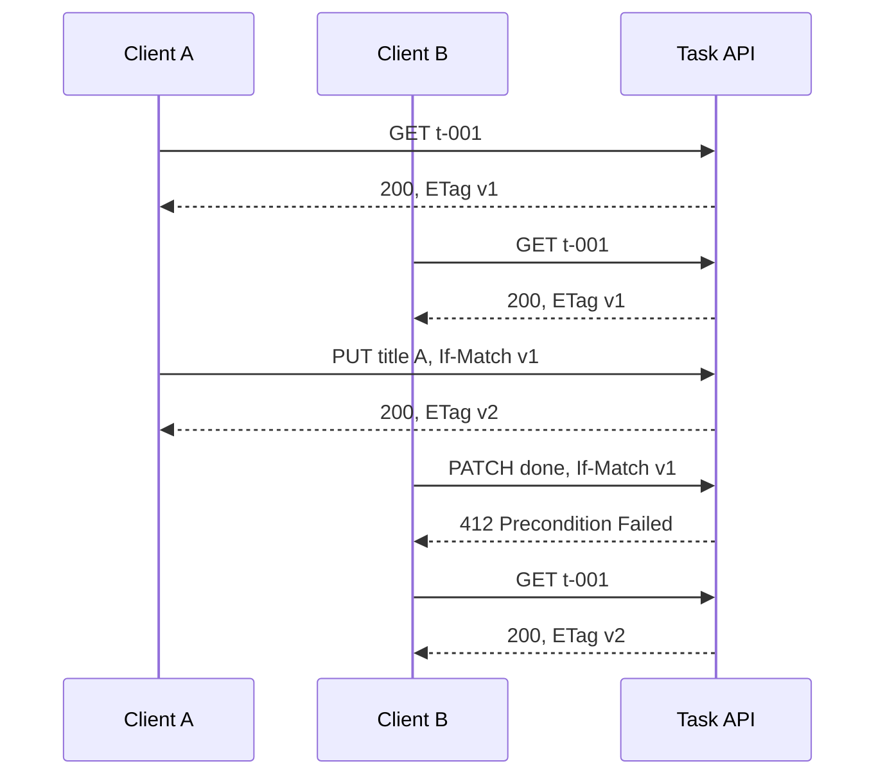

# Triển khai POST, PUT, PATCH, DELETE đúng ngữ nghĩa đã chọn

Một REST API có thể trả đúng mã `200` nhưng vẫn làm người dùng mất dữ liệu nếu xem `PUT` là “chỉnh vài trường”, dùng `PATCH` để thay toàn bộ resource, tạo bản ghi trùng khi retry `POST` hoặc xóa dữ liệu mà không kiểm tra phiên bản. Bài thực hành này yêu cầu người học **chọn và thực thi nhất quán ngữ nghĩa của từng phương thức**, từ hợp đồng URI, request/response đến concurrency, idempotency và kiểm thử.

Đây là bài thuộc chương **Thực hành tổng hợp** của module `INTEGRATION_API_REST`. Ta áp dụng thiết kế resource, URI, phương thức và mã trạng thái HTTP, hợp đồng JSON, ETag, idempotency, xử lý lỗi theo Problem Details và kiểm thử với Java/Spring Boot. Các quyết định đều được viết rõ để có thể kiểm tra bằng `curl` và chuyển sang OpenAPI. Nếu triển khai bằng framework khác, hãy giữ nguyên các cam kết về hành vi HTTP.

## 1. Đề bài và kết quả cần đạt

Xây dựng API quản lý công việc trong một dự án. Resource được chọn là `task`; collection của dự án mẫu có URI:

```text
/v1/projects/p-1/tasks
/v1/projects/p-1/tasks/{taskId}
```

Để tập trung vào HTTP, server demo chỉ có dự án `p-1`, lưu dữ liệu trong bộ nhớ, chạy một JVM và không bật xác thực. Trong production, mỗi dự án phải được kiểm tra quyền truy cập; ID, trạng thái và idempotency phải được lưu bền vững.

Một task có representation:

```json
{
  "id": "t-001",
  "title": "Viết hợp đồng API",
  "description": "Tài liệu hóa request và response",
  "done": false
}
```

`id` do server cấp và **không cho phép thay qua PUT/PATCH**. `title` là chuỗi không rỗng sau khi trim, tối đa 120 ký tự; `done` là boolean bắt buộc trong create/replace; `description` là chuỗi tùy chọn, có thể vắng mặt. Nếu không có `description`, response cũng bỏ trường này.

Người học cần triển khai và xác minh:

- `POST` để **tạo mới trong collection**, server sinh ID; yêu cầu `Idempotency-Key` và trả `201 Created`, `Location` cùng representation.
- `PUT` lên URI task **đã tồn tại** để **thay toàn bộ những trường có thể sửa**; không cho tạo mới qua PUT theo hợp đồng của bài. Trường tùy chọn không gửi sẽ được xóa khỏi representation. Kết quả là `200 OK` với representation mới.
- `PATCH` với `Content-Type: application/merge-patch+json` theo một tập field được hỗ trợ để **chỉnh một phần**. Giá trị `null` ở `description` nghĩa là xóa trường đó. Kết quả là `200 OK` với representation mới.
- `DELETE` để **xóa task chưa hoàn thành**; task đã hoàn thành bị từ chối với `409 Conflict` theo quy tắc nghiệp vụ của bài. Xóa thành công trả `204 No Content`.
- `PUT`, `PATCH`, `DELETE` bắt buộc gửi strong `ETag` bằng `If-Match`. Thiếu điều kiện trả `428 Precondition Required`, điều kiện cũ trả `412 Precondition Failed`.

Bài có chủ đích dùng **cập nhật có điều kiện** để tránh ghi đè thay đổi của client khác. Tất cả ví dụ HTTP và mã Java dưới đây là một hợp đồng thống nhất; trong hệ thống thực cần bổ sung auth, database và các bảo vệ vận hành.

## 2. Chốt hợp đồng trước khi viết controller

| Operation | Request và URI | Thành công | Không thành công đáng chú ý |
| --- | --- | --- | --- |
| Đọc task | `GET /v1/projects/p-1/tasks/{id}` | `200`, JSON + ETag | `404` nếu không tồn tại |
| Tạo task | `POST /v1/projects/p-1/tasks` | `201`, `Location`, ETag + JSON | `400` đầu vào/key thiếu; `409` key cũ nhưng payload khác |
| Thay thế | `PUT /v1/projects/p-1/tasks/{id}` | `200`, JSON + ETag | `400` JSON sai; `404` không tồn tại; `428` thiếu `If-Match`; `412` ETag cũ |
| Chỉnh một phần | `PATCH /v1/projects/p-1/tasks/{id}` | `200`, JSON + ETag | `400` patch sai; `415` media type sai; `428`/`412` điều kiện |
| Xóa task | `DELETE /v1/projects/p-1/tasks/{id}` | `204`, body rỗng | `404` không tồn tại; `409` task đã `done`; `428`/`412` điều kiện |

**Quyết định về PUT:** HTTP cho phép PUT tạo resource tại URI xác định trong một số hợp đồng, nhưng **bài này chọn cập nhật resource đã tồn tại**. Nếu URI chưa có, server trả `404`. Không suy ra mọi API đều buộc PUT phải upsert.

**Quyết định về DELETE:** phương thức DELETE là *idempotent về hiệu ứng dự kiến*; gọi lần đầu xóa task trả `204`, gọi tiếp khi task đã biến mất trả `404`. Response status có thể khác giữa các lần gọi mà DELETE vẫn idempotent về trạng thái cuối cùng của resource.

**Quyết định về PATCH:** body dùng JSON Merge Patch (`application/merge-patch+json`, RFC 7396) trên các thuộc tính có thể sửa. Vì `id` là read-only, một patch chứa `id` hoặc field không biết sẽ nhận `400`. `description: null` xóa trường khỏi representation. `title: null` và `done: null` bị từ chối vì làm hỏng invariant.

**Quyết định về idempotency:** `POST` dùng header do hợp đồng API quy định. Cùng key + cùng payload trả lại kết quả tạo lần đầu (trong demo là `201`, body và `Location` cũ); cùng key + payload khác trả `409`. Demo chỉ đảm bảo điều này trong **một tiến trình còn đang chạy**.

### Idempotency không đồng nghĩa “trả cùng status trong mọi trường hợp”

- `POST` không idempotent theo mặc định; muốn retry an toàn khi tạo resource có thể bổ sung cơ chế idempotency key.
- `PUT` thay thế resource nên là phương thức idempotent về hiệu ứng dự kiến. Trong demo, gửi lại cùng body trên cùng version sẽ không tăng version; tuy nhiên nếu dùng `If-Match` cũ **sau khi resource đã thay đổi**, server trả `412`.
- `PATCH` không bắt buộc idempotent theo ngữ nghĩa phương thức; *merge patch với giá trị cố định* thường cho cùng trạng thái cuối nếu không có thay đổi xen kẽ, nhưng client không được suy ra mọi kiểu PATCH đều an toàn để retry.
- `DELETE` idempotent về hiệu ứng dự kiến, nhưng không bảo đảm lần retry luôn có cùng HTTP status.

## 3. HTTP contract cụ thể cho từng phương thức

### 3.1. POST tạo task trong collection

```http
POST /v1/projects/p-1/tasks HTTP/1.1
Content-Type: application/json
Idempotency-Key: create-task-a1

{
  "title": "Viết hợp đồng API",
  "description": "Tài liệu hóa request và response",
  "done": false
}
```

Response tạo task đầu tiên trong server mới khởi động:

```http
HTTP/1.1 201 Created
Location: /v1/projects/p-1/tasks/t-001
ETag: "task-t-001-v1"
Content-Type: application/json

{
  "id": "t-001",
  "title": "Viết hợp đồng API",
  "description": "Tài liệu hóa request và response",
  "done": false
}
```

Client có thể theo `Location` để đọc resource. Không lấy `id` từ body để ghép URI theo quy tắc tự phát nếu server đã công bố `Location`.

### 3.2. PUT thay thế toàn bộ các thuộc tính có thể ghi

```http
PUT /v1/projects/p-1/tasks/t-001 HTTP/1.1
Content-Type: application/json
If-Match: "task-t-001-v1"

{
  "title": "Hoàn thiện hợp đồng API",
  "done": false
}
```

Response:

```http
HTTP/1.1 200 OK
ETag: "task-t-001-v2"
Content-Type: application/json

{
  "id": "t-001",
  "title": "Hoàn thiện hợp đồng API",
  "done": false
}
```

Chú ý `description` đã **biến mất** vì PUT thay thế các thuộc tính có thể ghi, không giữ nguyên những field bỏ qua. Nếu client chỉ muốn đổi `title` mà giữ `description`, nó phải gửi đầy đủ giá trị cũ trong PUT **hoặc** dùng PATCH.

### 3.3. PATCH thay đổi đúng trường đã chọn

```http
PATCH /v1/projects/p-1/tasks/t-001 HTTP/1.1
Content-Type: application/merge-patch+json
If-Match: "task-t-001-v2"

{"done": true}
```

Response:

```http
HTTP/1.1 200 OK
ETag: "task-t-001-v3"
Content-Type: application/json

{
  "id": "t-001",
  "title": "Hoàn thiện hợp đồng API",
  "done": true
}
```

Một patch như `{"description":"Đã duyệt"}` chỉ bổ sung `description`, giữ nguyên `title` và `done`; `{"description":null}` xóa trường `description`. Empty patch `{}` là no-op, không làm tăng ETag trong demo.

### 3.4. DELETE và xung đột nghiệp vụ

Trong bài, task đã hoàn thành không thể xóa. Nếu gửi:

```http
DELETE /v1/projects/p-1/tasks/t-001 HTTP/1.1
If-Match: "task-t-001-v3"
```

Server trả:

```http
HTTP/1.1 409 Conflict
Content-Type: application/problem+json

{
  "type": "about:blank",
  "title": "Completed task cannot be deleted",
  "status": 409,
  "detail": "Reopen the task before deleting it"
}
```

Để minh họa xóa thành công, tạo task khác chưa hoàn thành, lấy ETag của nó rồi DELETE. Response thành công là `204 No Content` **không có body**; yêu cầu DELETE lặp lại sẽ trả `404` vì resource đã không còn.

## 4. Chuẩn bị dự án Spring Boot

Dùng Java 21, Maven 3.9+, `curl` và môi trường có thể tải dependency Maven. Tạo hai file:

```text
rest-methods-lab/
├── pom.xml
└── src/main/java/dev/example/lab/RestMethodsApplication.java
```

`pom.xml` dùng Spring Boot 3.5.6 và web starter:

```xml
<?xml version="1.0" encoding="UTF-8"?>
<project xmlns="http://maven.apache.org/POM/4.0.0"
         xmlns:xsi="http://www.w3.org/2001/XMLSchema-instance"
         xsi:schemaLocation="http://maven.apache.org/POM/4.0.0 https://maven.apache.org/xsd/maven-4.0.0.xsd">
  <modelVersion>4.0.0</modelVersion>
  <parent>
    <groupId>org.springframework.boot</groupId>
    <artifactId>spring-boot-starter-parent</artifactId>
    <version>3.5.6</version>
    <relativePath/>
  </parent>
  <groupId>dev.example</groupId>
  <artifactId>rest-methods-lab</artifactId>
  <version>1.0.0</version>
  <properties>
    <java.version>21</java.version>
  </properties>
  <dependencies>
    <dependency>
      <groupId>org.springframework.boot</groupId>
      <artifactId>spring-boot-starter-web</artifactId>
    </dependency>
  </dependencies>
  <build>
    <plugins>
      <plugin>
        <groupId>org.springframework.boot</groupId>
        <artifactId>spring-boot-maven-plugin</artifactId>
      </plugin>
    </plugins>
  </build>
</project>
```

Đặt mã dưới đây vào `src/main/java/dev/example/lab/RestMethodsApplication.java`. Một file chứa ứng dụng và controller để giảm thao tác tạo project. `ConcurrentHashMap` và `synchronized` phục vụ minh họa **chỉ trong một JVM**; tuyệt đối không coi đây là cơ chế bảo đảm transaction hoặc idempotency trong hệ thống phân tán.

```java
package dev.example.lab;

import com.fasterxml.jackson.annotation.JsonInclude;
import com.fasterxml.jackson.databind.JsonNode;
import java.net.URI;
import java.util.Iterator;
import java.util.Map;
import java.util.Objects;
import java.util.Set;
import java.util.concurrent.ConcurrentHashMap;
import java.util.concurrent.atomic.AtomicInteger;
import org.springframework.boot.SpringApplication;
import org.springframework.boot.autoconfigure.SpringBootApplication;
import org.springframework.http.CacheControl;
import org.springframework.http.HttpHeaders;
import org.springframework.http.HttpStatus;
import org.springframework.http.MediaType;
import org.springframework.http.ProblemDetail;
import org.springframework.http.ResponseEntity;
import org.springframework.web.bind.annotation.*;

@SpringBootApplication
public class RestMethodsApplication {
    public static void main(String[] args) {
        SpringApplication.run(RestMethodsApplication.class, args);
    }
}

@RestController
@RequestMapping("/v1/projects/{projectId}/tasks")
class TaskController {
    private static final String DEMO_PROJECT = "p-1";
    private static final Set<String> PATCHABLE =
            Set.of("title", "description", "done");

    record Task(String id, String projectId, String title,
                String description, boolean done, int version) {}

    record TaskInput(String title, String description, Boolean done) {}

    @JsonInclude(JsonInclude.Include.NON_NULL)
    record TaskView(String id, String title, String description, boolean done) {}

    record StoredRequest(TaskInput input, Task originalTask) {}

    private final Map<String, Task> tasks = new ConcurrentHashMap<>();
    private final Map<String, StoredRequest> requests = new ConcurrentHashMap<>();
    private final AtomicInteger ids = new AtomicInteger();

    @GetMapping("/{taskId}")
    ResponseEntity<?> get(@PathVariable String projectId,
                          @PathVariable String taskId) {
        Task current = find(projectId, taskId);
        return current == null
                ? problem(HttpStatus.NOT_FOUND, "Task not found",
                          "No visible task with this id")
                : ok(current);
    }

    @PostMapping(consumes = MediaType.APPLICATION_JSON_VALUE)
    synchronized ResponseEntity<?> post(
            @PathVariable String projectId,
            @RequestHeader(value = "Idempotency-Key", required = false)
            String key,
            @RequestBody(required = false) TaskInput input) {
        if (!DEMO_PROJECT.equals(projectId)) {
            return problem(HttpStatus.NOT_FOUND, "Project not found",
                           "Unknown project");
        }
        if (key == null || key.isBlank() || key.length() > 120) {
            return problem(HttpStatus.BAD_REQUEST, "Invalid idempotency key",
                           "Idempotency-Key must be non-empty and <= 120 characters");
        }
        if (!valid(input)) {
            return problem(HttpStatus.BAD_REQUEST, "Invalid task",
                           "title must be 1..120 characters; done is required");
        }

        String scopedKey = projectId + ":" + key;
        StoredRequest old = requests.get(scopedKey);
        if (old != null) {
            if (!old.input().equals(input)) {
                return problem(HttpStatus.CONFLICT, "Key reused",
                               "Same key was used with a different payload");
            }
            return created(old.originalTask());
        }

        String id = String.format("t-%03d", ids.incrementAndGet());
        Task task = new Task(id, projectId,
                input.title().trim(), input.description(), input.done(), 1);
        tasks.put(id, task);
        requests.put(scopedKey, new StoredRequest(input, task));
        return created(task);
    }

    @PutMapping(path = "/{taskId}",
                consumes = MediaType.APPLICATION_JSON_VALUE)
    synchronized ResponseEntity<?> put(
            @PathVariable String projectId, @PathVariable String taskId,
            @RequestHeader(value = HttpHeaders.IF_MATCH, required = false)
            String ifMatch,
            @RequestBody(required = false) TaskInput input) {
        Task current = find(projectId, taskId);
        if (current == null) {
            return problem(HttpStatus.NOT_FOUND, "Task not found",
                           "PUT does not create tasks in this API");
        }
        ResponseEntity<?> precondition = checkMatch(current, ifMatch);
        if (precondition != null) {
            return precondition;
        }
        if (!valid(input)) {
            return problem(HttpStatus.BAD_REQUEST, "Invalid task",
                           "PUT requires title and done; description is optional");
        }

        String title = input.title().trim();
        String description = input.description(); // Omission -> null -> clear field
        boolean done = input.done();
        Task updated = replaceIfChanged(current, title, description, done);
        tasks.put(taskId, updated);
        return ok(updated);
    }

    @PatchMapping(path = "/{taskId}",
                  consumes = "application/merge-patch+json")
    synchronized ResponseEntity<?> patch(
            @PathVariable String projectId, @PathVariable String taskId,
            @RequestHeader(value = HttpHeaders.IF_MATCH, required = false)
            String ifMatch,
            @RequestBody(required = false) JsonNode changes) {
        Task current = find(projectId, taskId);
        if (current == null) {
            return problem(HttpStatus.NOT_FOUND, "Task not found",
                           "No visible task with this id");
        }
        ResponseEntity<?> precondition = checkMatch(current, ifMatch);
        if (precondition != null) {
            return precondition;
        }
        if (changes == null || !changes.isObject()) {
            return problem(HttpStatus.BAD_REQUEST, "Invalid merge patch",
                           "PATCH body must be a JSON object");
        }
        Iterator<String> fields = changes.fieldNames();
        while (fields.hasNext()) {
            String name = fields.next();
            if (!PATCHABLE.contains(name)) {
                return problem(HttpStatus.BAD_REQUEST, "Unknown patch field",
                               "Only title, description and done may be patched");
            }
        }

        String title = current.title();
        String description = current.description();
        boolean done = current.done();

        if (changes.has("title")) {
            JsonNode value = changes.get("title");
            if (!value.isTextual() || value.asText().isBlank()
                    || value.asText().trim().length() > 120) {
                return problem(HttpStatus.BAD_REQUEST, "Invalid title",
                               "title must be a non-empty string <= 120 characters");
            }
            title = value.asText().trim();
        }
        if (changes.has("description")) {
            JsonNode value = changes.get("description");
            if (!(value.isNull() || value.isTextual())) {
                return problem(HttpStatus.BAD_REQUEST, "Invalid description",
                               "description must be string or null");
            }
            description = value.isNull() ? null : value.asText();
        }
        if (changes.has("done")) {
            JsonNode value = changes.get("done");
            if (!value.isBoolean()) {
                return problem(HttpStatus.BAD_REQUEST, "Invalid done flag",
                               "done must be true or false");
            }
            done = value.booleanValue();
        }

        Task updated = replaceIfChanged(current, title, description, done);
        tasks.put(taskId, updated);
        return ok(updated);
    }

    @DeleteMapping("/{taskId}")
    synchronized ResponseEntity<?> delete(
            @PathVariable String projectId, @PathVariable String taskId,
            @RequestHeader(value = HttpHeaders.IF_MATCH, required = false)
            String ifMatch) {
        Task current = find(projectId, taskId);
        if (current == null) {
            return problem(HttpStatus.NOT_FOUND, "Task not found",
                           "No visible task with this id");
        }
        ResponseEntity<?> precondition = checkMatch(current, ifMatch);
        if (precondition != null) {
            return precondition;
        }
        if (current.done()) {
            return problem(HttpStatus.CONFLICT,
                           "Completed task cannot be deleted",
                           "Reopen the task before deleting it");
        }
        tasks.remove(taskId);
        return ResponseEntity.noContent().build();
    }

    private Task find(String projectId, String taskId) {
        Task task = tasks.get(taskId);
        return task != null && task.projectId().equals(projectId)
                && DEMO_PROJECT.equals(projectId) ? task : null;
    }

    private boolean valid(TaskInput input) {
        return input != null && input.title() != null
                && !input.title().isBlank()
                && input.title().trim().length() <= 120
                && input.done() != null;
    }

    private Task replaceIfChanged(Task old, String title,
                                  String description, boolean done) {
        if (old.title().equals(title)
                && Objects.equals(old.description(), description)
                && old.done() == done) {
            return old;
        }
        return new Task(old.id(), old.projectId(), title,
                description, done, old.version() + 1);
    }

    private ResponseEntity<?> checkMatch(Task task, String ifMatch) {
        if (ifMatch == null || ifMatch.isBlank()) {
            return problem(HttpStatus.PRECONDITION_REQUIRED,
                           "If-Match required",
                           "GET the task and send its strong ETag in If-Match");
        }
        // Demo chỉ chấp nhận đúng một strong ETag, không phân tích list/*.
        if (!etag(task).equals(ifMatch)) {
            return problem(HttpStatus.PRECONDITION_FAILED, "Stale ETag",
                           "The task changed; fetch it and review the changes");
        }
        return null;
    }

    private String etag(Task task) {
        return "\"task-" + task.id() + "-v" + task.version() + "\"";
    }

    private TaskView view(Task task) {
        return new TaskView(task.id(), task.title(),
                            task.description(), task.done());
    }

    private ResponseEntity<TaskView> ok(Task task) {
        return ResponseEntity.ok()
                .cacheControl(CacheControl.noStore())
                .eTag(etag(task))
                .body(view(task));
    }

    private ResponseEntity<TaskView> created(Task task) {
        String uri = "/v1/projects/" + task.projectId()
                + "/tasks/" + task.id();
        return ResponseEntity.created(URI.create(uri))
                .cacheControl(CacheControl.noStore())
                .eTag(etag(task))
                .body(view(task));
    }

    private ResponseEntity<ProblemDetail> problem(
            HttpStatus status, String title, String detail) {
        ProblemDetail error = ProblemDetail.forStatusAndDetail(status, detail);
        error.setTitle(title);
        return ResponseEntity.status(status)
                .contentType(MediaType.APPLICATION_PROBLEM_JSON)
                .body(error);
    }
}
```

Mã mẫu xử lý dữ liệu bằng `synchronized` nên chỉ bảo đảm chuỗi thao tác kiểm tra ETag rồi ghi trong **một instance**. Khi dùng DB, cần transaction, `@Version` hoặc cập nhật có điều kiện trong SQL. `If-Match` theo RFC 9110 còn có danh sách entity-tag và ký tự `*`; demo **cố tình chỉ chấp nhận một strong ETag**. Không triển khai so sánh ETag như chuỗi đơn giản này cho toàn bộ giao thức trong production.

`TaskInput` cho phép bỏ `description`. Đối với PUT, bỏ trường này nghĩa là thay thế representation bằng phiên bản không có `description`; đối với PATCH, không gửi `description` nghĩa là giữ nguyên. Annotation `@JsonInclude(NON_NULL)` làm field description vắng mặt khi null để phản ánh lựa chọn này trong response.

Khởi động ứng dụng trong thư mục project:

```bash
mvn spring-boot:run -Dspring-boot.run.arguments=--server.address=127.0.0.1
```

Kiểm tra log cho biết Tomcat đang lắng nghe tại `127.0.0.1:8080`. Giữ tiến trình chạy khi thực hành. Trong production cần TLS, auth, rate limit, phân quyền theo project và kiểm soát dữ liệu đầu vào. Ứng dụng demo chỉ chạy loopback vì không có bảo vệ truy cập.

## 5. Chạy lần lượt POST, PUT, PATCH, DELETE bằng curl

Các lệnh sử dụng bash (Linux/macOS, WSL, Git Bash). Trên Windows PowerShell, dùng `curl.exe` và chuyển cách trích dẫn JSON cho shell, hoặc ghi JSON vào file rồi dùng `--data-binary @body.json`. **Điều kiện đầu:** restart server demo để bộ đếm ID bắt đầu từ 1 và các idempotency key chưa được sử dụng.

```bash
BASE_URL=http://127.0.0.1:8080/v1/projects/p-1/tasks
```

### Bước 1 — POST tạo task

```bash
curl -i -sS -X POST "$BASE_URL" \
  -H 'Content-Type: application/json' \
  -H 'Idempotency-Key: lab-create-001' \
  --data-raw '{
    "title":"Viết hợp đồng API",
    "description":"Tài liệu hóa request và response",
    "done":false
  }'
```

Kỳ vọng `201 Created`, `Location: /v1/projects/p-1/tasks/t-001`, `ETag: "task-t-001-v1"`, body chứa task mới. Khi thay môi trường hoặc chạy sau lần tạo trước đó, **không hardcode ID**: lấy URI trong `Location` trả về.

### Bước 2 — Replay POST

```bash
curl -i -sS -X POST "$BASE_URL" \
  -H 'Content-Type: application/json' \
  -H 'Idempotency-Key: lab-create-001' \
  --data-raw '{"title":"Viết hợp đồng API","description":"Tài liệu hóa request và response","done":false}'
```

Kỳ vọng vẫn `201`, cùng `Location` và snapshot ban đầu của task t-001, **không sinh t-002**. Cùng key nhưng body khác phải trả `409 Conflict`. Trong demo, response của idempotency replay là bản đã lưu lúc tạo, ngay cả nếu task được sửa sau này; đây là một quyết định của hợp đồng. Hệ thống production cần lưu key và kết quả an toàn xuyên instance/restart.

### Bước 3 — GET task và lấy ETag

```bash
curl -i -sS "$BASE_URL/t-001"
```

Kỳ vọng `200 OK`, ETag v1 và representation gồm `description`. Header `Cache-Control: no-store` không ngăn API phát ETag để phục vụ kiểm tra phiên bản khi cập nhật; không đồng nghĩa cho phép cache nội dung nhạy cảm.

### Bước 4 — PUT thay toàn bộ dữ liệu có thể ghi

```bash
curl -i -sS -X PUT "$BASE_URL/t-001" \
  -H 'Content-Type: application/json' \
  -H 'If-Match: "task-t-001-v1"' \
  --data-raw '{"title":"Hoàn thiện hợp đồng API","done":false}'
```

Kỳ vọng `200`, ETag v2, `description` **không còn trong JSON**. Khi PUT, field không gửi được xem là không còn trong representation mới theo hợp đồng bài tập.

Gửi lại cùng body với **ETag v2**:

```bash
curl -i -sS -X PUT "$BASE_URL/t-001" \
  -H 'Content-Type: application/json' \
  -H 'If-Match: "task-t-001-v2"' \
  --data-raw '{"title":"Hoàn thiện hợp đồng API","done":false}'
```

Kỳ vọng `200` và ETag **vẫn v2** vì trạng thái không đổi. Nếu giữ `If-Match: "task-t-001-v1"`, server sẽ trả `412`: phương thức PUT vẫn idempotent về hiệu ứng dự kiến, nhưng HTTP precondition cũ không còn thỏa.

### Bước 5 — PATCH chỉ cập nhật một trường

```bash
curl -i -sS -X PATCH "$BASE_URL/t-001" \
  -H 'Content-Type: application/merge-patch+json' \
  -H 'If-Match: "task-t-001-v2"' \
  --data-raw '{"done":true}'
```

Kỳ vọng `200`, ETag v3, `done:true`, title vẫn là “Hoàn thiện hợp đồng API”. Với PATCH, field không gửi giữ nguyên giá trị. `{"description":null}` dùng để xóa description; `{}` là no-op và không tăng version trong demo.

### Bước 6 — DELETE bị cấm bởi nghiệp vụ

```bash
curl -i -sS -X DELETE "$BASE_URL/t-001" \
  -H 'If-Match: "task-t-001-v3"'
```

Kỳ vọng `409 Conflict` cùng Problem Details có `title: "Completed task cannot be deleted"`. ETag v3 **đúng**, nhưng trạng thái `done:true` không cho phép xóa. Đây là xung đột nghiệp vụ, khác với `412` do ETag cũ.

### Bước 7 — Xóa task chưa hoàn thành

```bash
curl -i -sS -X POST "$BASE_URL" \
  -H 'Content-Type: application/json' \
  -H 'Idempotency-Key: lab-create-002' \
  --data-raw '{"title":"Dọn dữ liệu mẫu","done":false}'
```

Với môi trường vừa khởi động, task mới là `t-002`, ETag `"task-t-002-v1"`. Tiếp tục:

```bash
curl -i -sS -X DELETE "$BASE_URL/t-002" \
  -H 'If-Match: "task-t-002-v1"'
curl -i -sS "$BASE_URL/t-002"
```

Kỳ vọng DELETE trả `204 No Content` và body rỗng; GET sau đó `404 Not Found`. Gửi DELETE lần nữa lên URI cũ sẽ nhận `404`: hiệu ứng dự kiến vẫn là “resource không còn”, nên không vi phạm tính idempotent của DELETE.

## 6. Nhận diện các lỗi và cách khắc phục

| Tình huống | Mã kỳ vọng | Phân tích |
| --- | --- | --- |
| POST thiếu `Idempotency-Key` | `400` | API yêu cầu khóa để retry tạo mới an toàn |
| POST lại cùng key nhưng body khác | `409` | Một key chỉ đại diện một ý định tạo mới |
| PUT/PATCH/DELETE thiếu `If-Match` | `428` | API bắt buộc precondition trước khi ghi |
| PUT/PATCH/DELETE có ETag cũ | `412` | Bản resource hiện tại đã thay đổi |
| PUT đến task chưa tồn tại | `404` | Bài chọn PUT chỉ thay thế resource hiện có |
| PATCH dùng `Content-Type: application/json` | `415` | Endpoint chọn `application/merge-patch+json` |
| PATCH có `id` hoặc field không biết | `400` | Từ chối field read-only/không được hỗ trợ |
| PATCH gửi `{"done":null}` | `400` | Field done bắt buộc là boolean |
| DELETE task hoàn thành với ETag đúng | `409` | Quy tắc nghiệp vụ không cho xóa |
| DELETE lặp sau xóa thành công | `404` | Trạng thái cuối không đổi, không xóa thêm |
| Dự án khác `p-1` hoặc task không nhìn thấy | `404` | Demo chỉ có một project, production cần kiểm tra quyền |

Hai request lỗi có thể thử khi task t-001 đang ở v3:

```bash
# Thiếu If-Match -> 428
curl -i -sS -X PUT "$BASE_URL/t-001" \
  -H 'Content-Type: application/json' \
  --data-raw '{"title":"Thử thiếu điều kiện","done":false}'

# ETag đúng nhưng patch payload không hợp lệ -> 400
curl -i -sS -X PATCH "$BASE_URL/t-001" \
  -H 'Content-Type: application/merge-patch+json' \
  -H 'If-Match: "task-t-001-v3"' \
  --data-raw '{"done":null}'
```

Đối với JSON sai cú pháp, Spring có thể tạo `400` **trước khi controller chạy**. Body lỗi do Spring phát sinh mặc định có thể khác Problem Details thủ công; API production cần `@RestControllerAdvice` và hợp đồng lỗi chung nếu muốn thống nhất. Với media type sai, Spring thường tự trả `415`. Không dựa vào một thứ tự ưu tiên cứng giữa các lỗi đầu vào, precondition và resource nếu chưa định nghĩa trong hợp đồng.

## 7. Kiểm thử hai client sửa cùng resource

Đây là tình huống chứng minh giá trị của ETag. A và B cùng GET task tại ETag v1. A thay title bằng PUT và nhận ETag v2; B dùng bản v1 để PATCH done. Nếu server kiểm tra điều kiện đúng, B bị từ chối:



Trong demo, `synchronized` bảo vệ đoạn đọc ETag, kiểm tra rồi cập nhật **trong một JVM**. Trong ứng dụng có nhiều instance, cần transaction và optimistic locking (`@Version` trong JPA) hoặc SQL compare-and-swap:

```sql
UPDATE tasks
   SET title = :title,
       description = :description,
       done = :done,
       version = version + 1
 WHERE project_id = :project_id
   AND id = :task_id
   AND version = :expected_version;
```

Chỉ một request có thể cập nhật một row cùng version. `affected_rows = 0` cần phân biệt không tồn tại, stale version hoặc quy tắc nghiệp vụ; ánh xạ `412` khi HTTP `If-Match` đã hết hiệu lực. Đừng tách `SELECT version` và `UPDATE` không điều kiện vì có nguy cơ lost update. ETag là token opaque; client không tự tăng version, xóa dấu nháy hoặc dùng weak ETag `W/"..."` với `If-Match`.

## 8. Hợp đồng OpenAPI và lỗi có cấu trúc

Nên công bố các operation đã chọn bằng OpenAPI 3.1, ghi rõ media type của PATCH, `If-Match`, `Idempotency-Key`, response code, Location và ETag. Trích đoạn minh họa:

```yaml
openapi: 3.1.0
info:
  title: Task REST Lab
  version: 1.0.0
servers:
  - url: http://127.0.0.1:8080
paths:
  /v1/projects/{projectId}/tasks:
    post:
      summary: Tạo task
      parameters:
        - name: Idempotency-Key
          in: header
          required: true
          schema: { type: string, minLength: 1, maxLength: 120 }
      requestBody:
        required: true
        content:
          application/json:
            schema:
              $ref: '#/components/schemas/TaskInput'
      responses:
        '201':
          description: Đã tạo hoặc replay kết quả tạo trước
          headers:
            Location:
              schema: { type: string }
            ETag:
              schema: { type: string }
        '400': { description: Request không hợp lệ }
        '409': { description: Idempotency key xung đột }
  /v1/projects/{projectId}/tasks/{taskId}:
    put:
      summary: Thay thế hoàn toàn các trường có thể sửa
      parameters:
        - in: header
          name: If-Match
          required: true
          schema: { type: string }
      requestBody:
        required: true
        content:
          application/json:
            schema:
              $ref: '#/components/schemas/TaskInput'
      responses:
        '200': { description: Đã thay thế; có ETag mới }
        '404': { description: Task không tồn tại }
        '412': { description: ETag cũ }
        '428': { description: Thiếu If-Match }
    patch:
      summary: JSON Merge Patch các trường cho phép
      parameters:
        - in: header
          name: If-Match
          required: true
          schema: { type: string }
      requestBody:
        required: true
        content:
          application/merge-patch+json:
            schema:
              type: object
              additionalProperties: false
              properties:
                title: { type: string, minLength: 1, maxLength: 120 }
                description: { type: [string, 'null'] }
                done: { type: boolean }
      responses:
        '200': { description: Đã patch; có ETag mới }
        '400': { description: Dữ liệu patch sai }
        '412': { description: ETag cũ }
        '415': { description: Media type không hỗ trợ }
        '428': { description: Thiếu If-Match }
    delete:
      summary: Xóa task chưa hoàn thành
      parameters:
        - in: header
          name: If-Match
          required: true
          schema: { type: string }
      responses:
        '204': { description: Đã xóa }
        '404': { description: Không tồn tại }
        '409': { description: Đã hoàn thành, không thể xóa }
        '412': { description: ETag cũ }
        '428': { description: Thiếu If-Match }
components:
  schemas:
    TaskInput:
      type: object
      required: [title, done]
      properties:
        title: { type: string, minLength: 1, maxLength: 120 }
        description: { type: [string, 'null'] }
        done: { type: boolean }
```

Đoạn này là **khung đặc tả**, chưa thay thế OpenAPI đầy đủ: cần bổ sung `GET`, hai path parameter bắt buộc, schema response `Task`, Problem Details, header ETag/Location ở từng response, ví dụ và auth. Trước khi phát hành, phải chạy validator OpenAPI và contract test. Hợp đồng trong code phải thống nhất: Spring/Jackson mặc định có thể bỏ qua field lạ trong DTO của POST/PUT, trong khi PATCH chủ động từ chối field lạ; nếu yêu cầu `additionalProperties: false` thì cần cấu hình hoặc validation để thực sự thực thi chính sách đó.

Với lỗi, có thể chuẩn hóa `application/problem+json` (RFC 9457):

```json
{
  "type": "https://api.example.com/problems/stale-task",
  "title": "Task has changed",
  "status": 412,
  "detail": "Reload the task and review changes before updating."
}
```

Trong demo `ProblemDetail` mặc định có thể dùng `type: "about:blank"`; ví dụ URI ở trên là gợi ý mở rộng production. UI nên xử lý theo status + `type` ổn định thay vì parse text của `detail`. Không trả stack trace, token, thông tin project của người dùng khác hoặc lỗi database ra công khai.

## 9. Ma trận kiểm thử nghiệm thu

Một bộ test có ý nghĩa cần kiểm tra **hiệu ứng cuối cùng, ETag và status**, không chỉ kiểm tra HTTP 2xx.

| Case | Tiền điều kiện | Hành động | Kỳ vọng |
| --- | --- | --- | --- |
| Create | Chưa dùng key A | POST body X, key A | `201`, Location, ETag v1, GET thấy task |
| Replay | Đã POST key A/body X | POST key A/body X | Vẫn một task; trả snapshot cũ |
| Key conflict | Đã POST key A/body X | POST key A/body Y | `409`, không tạo thêm task |
| PUT replaces | Task có description, ETag v1 | PUT không description, ETag v1 | `200`, description bị xóa, ETag v2 |
| PUT replay | Task có body như mới, ETag v2 | PUT body giống hệt, ETag v2 | `200`, ETag không đổi |
| PUT stale | Task hiện v2 | PUT với ETag v1 | `412`, resource không đổi |
| PUT missing | URI không tồn tại | PUT payload hợp lệ | `404`, không upsert |
| PATCH partial | Task v2 | PATCH done=true, ETag v2 | `200`, ETag v3, title giữ nguyên |
| PATCH remove | Có description | PATCH description=null | Trường description biến mất |
| PATCH empty | Task có ETag v3 | PATCH `{}` với v3 | `200`, ETag v3 |
| PATCH bad type | Task có ETag hiện tại | PATCH Content-Type application/json | `415` |
| Missing precondition | Task tồn tại | PUT/PATCH/DELETE không If-Match | `428` |
| Delete allowed | Task done=false | DELETE If-Match đúng | `204`, GET `404` |
| Delete blocked | Task done=true | DELETE If-Match đúng | `409`, vẫn GET được |
| Two writers | Cùng đọc ETag v1 | Hai cập nhật đồng thời | Một thành công; một `412`; không lost update |

Trong Spring, có thể dùng `MockMvc` hoặc `WebTestClient` tùy stack để kiểm tra status/header/body. Với cạnh tranh, test cần tạo **hai request thực sự giao nhau** và xác minh version/trạng thái cuối; hai request tuần tự chỉ thử stale update, chưa đủ chứng minh atomicity.

Kiểm thử production cũng nên bao gồm: request không có auth (`401`), user không có quyền (`403` hoặc `404` theo chính sách), body vượt kích thước (`413`), rate limit (`429`), dữ liệu chứa ký tự Unicode, unknown field, malformed JSON, cache validator và rollback khi DB bị lỗi. Nếu cùng request bị sai nhiều điều kiện, tránh giả định một thứ tự trả lỗi cố định nếu hợp đồng chưa cam kết.

## 10. Chuyển bài thực hành thành API có thể vận hành

| Hạn chế trong demo | Việc cần làm ở hệ thống thực |
| --- | --- |
| `ConcurrentHashMap` cho tasks/idempotency | Database bền vững; unique constraint cho idempotency key theo actor/operation; TTL và fingerprint |
| `synchronized` bảo vệ một JVM | Transaction, optimistic lock `@Version` hoặc SQL conditional UPDATE |
| Không có xác thực | Xác thực, phân quyền resource/tenant cho GET/POST/PUT/PATCH/DELETE |
| PUT/POST dùng Java record đơn giản | Bean Validation, DTO/schema đầy đủ, kiểm soát unknown field/read-only fields |
| Merge patch hỗ trợ các field cấp một | Định nghĩa rõ tập hỗ trợ; nếu hứa hỗ trợ toàn RFC 7396 thì xử lý thêm cấu trúc lồng nhau, array và null đúng chuẩn |
| DELETE xóa ngay khỏi Map | Chọn hard delete, soft delete hoặc `202` cho workflow xóa dài; cập nhật hợp đồng |
| ETag dựa trên version đơn giản | Strong validator đúng với representation và biến thể nội dung được trả |
| Lỗi framework và lỗi controller khác nhau | `@RestControllerAdvice`, Problem Details `type` ổn định và correlation ID |
| Không có rate limit/timeout | Rate limit, body size, timeout, retry policy, quan sát 4xx/5xx và latency |

Đối với multi-instance, idempotency key phải có phạm vi theo user/tenant + endpoint và kiểm tra payload; hai request cùng key đến đồng thời không được tạo hai task. Một `POST` bị timeout vẫn có thể đã commit: chỉ retry an toàn khi server có cơ chế chống tạo trùng bền vững. Với PUT/PATCH/DELETE, nếu client nhận `412`, phải GET bản mới rồi hòa giải, không tự động thay ETag mới để ghi đè yêu cầu cũ.

Khi thực hiện DELETE trên dữ liệu cần giữ lịch sử, một hệ thống có thể dùng soft delete hoặc trạng thái nghiệp vụ thay vì xóa vật lý. Chọn cách nào phải ghi rõ `GET` sau DELETE trả gì, quyền khôi phục ra sao và side effect có thể được retry như thế nào.

## 11. Bài tập mở rộng và sản phẩm bàn giao

**Bài tập A — Đối chiếu PUT với PATCH.** Tạo một task có `description`. Gửi PUT chỉ có title/done; xem description bị xóa. Tạo task mới, PATCH title và so representation. Giải thích nguyên nhân khác nhau.

**Bài tập B — Kiểm tra idempotency thật.** Hai client gửi POST cùng key/cùng payload đồng thời; thêm một request cùng key/khác payload. Chuyển storage sang DB và thử sau restart để bảo đảm không tạo task trùng.

**Bài tập C — Atomic update.** Thêm `@Version` vào entity, triển khai PUT/PATCH/DELETE trong transaction. Viết integration test hai writer cùng ETag và xác nhận chỉ một writer thành công.

**Bài tập D — Media type.** So sánh `application/merge-patch+json` với `application/json-patch+json` (RFC 6902). Giải thích vì sao hai cú pháp và ngữ nghĩa patch khác nhau; chọn một loại và kiểm thử đúng cách.

**Bài tập E — Tài liệu và bảo mật.** Viết OpenAPI đầy đủ và thêm phân quyền: chỉ thành viên dự án mới được sửa task; chỉ admin mới được xóa task hoàn thành. Phân biệt xung đột nghiệp vụ `409` với thiếu quyền `403`.

### Thang chấm gợi ý

- **25%:** đúng lựa chọn URI, method, status và response header.
- **25%:** PUT thay thế, PATCH sửa một phần, DELETE đúng nghiệp vụ.
- **20%:** idempotency, ETag/`If-Match`, không lost update.
- **20%:** kiểm thử happy path, lỗi, retry và race condition.
- **10%:** tài liệu chạy lại được, OpenAPI và yêu cầu bảo mật.

**Sản phẩm bàn giao:** mã API, đặc tả OpenAPI, test tích hợp với fixture độc lập và script HTTP tái hiện được chuỗi POST → PUT → PATCH → DELETE. Người học đạt yêu cầu khi chứng minh bằng request, response và trạng thái cuối rằng **mỗi phương thức tạo đúng hiệu ứng theo hợp đồng đã chọn**, kể cả khi gửi lại request, dùng ETag cũ hoặc gặp xung đột nghiệp vụ.

