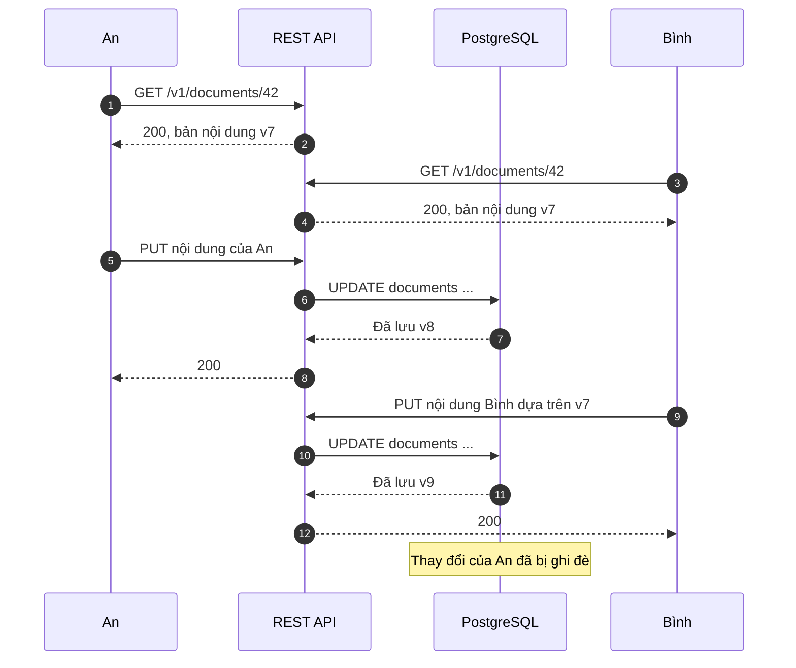
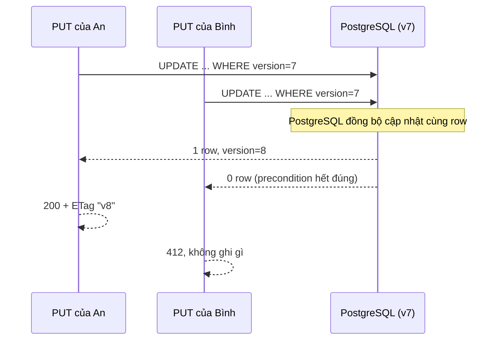

# Thêm ETag, 304 và If-Match để ngăn mất cập nhật

Trong module **INTEGRATION_API_REST**, việc thiết kế REST API theo resource, URI, phương thức HTTP và mã trạng thái chỉ thật sự hoàn chỉnh khi client biết **một tài nguyên có thay đổi kể từ lần đọc trước hay không**. Hai cơ chế HTTP có liên quan nhưng giải quyết hai mục tiêu khác nhau:

- **Cache revalidation:** client gửi `If-None-Match` khi đọc lại. Nếu biểu diễn chưa đổi, server trả `304 Not Modified` và không gửi lại body.
- **Optimistic concurrency control:** client gửi `If-Match` khi cập nhật. Nếu tài nguyên đã bị người khác sửa, server trả `412 Precondition Failed` và không ghi đè dữ liệu mới.

Bài thuộc phần **Thực hành tổng hợp** và yêu cầu bạn triển khai cả hai cơ chế cho REST API quản lý tài liệu bằng **Java/Spring, PostgreSQL, OpenAPI và kiểm thử HTTP**. Ví dụ có một tài liệu được hai biên tập viên sửa gần như đồng thời. Mục tiêu cuối cùng là ngăn lỗi *lost update* mà vẫn hỗ trợ HTTP cache và mã trạng thái đúng ngữ nghĩa.

> **Tình huống:** An và Bình cùng mở tài liệu số `42` khi tài liệu đang ở phiên bản `7`. An cập nhật thành công lên phiên bản `8`. Bình dùng bản cũ để lưu. API phải từ chối thao tác của Bình bằng `412`, thay vì âm thầm ghi đè thay đổi của An.

## 1. Kết quả cần đạt

Sau bài thực hành, bạn có thể:

1. Mô tả chính xác vai trò của `ETag`, `If-None-Match`, `If-Match`, `304`, `412` và `428`.
2. Đọc một resource bằng `GET`, nhận strong ETag, sau đó đọc lại có điều kiện để nhận `304` không kèm response body.
3. Cập nhật resource bằng `PUT` với `If-Match` và nhận ETag mới sau khi ghi thành công.
4. Từ chối cập nhật dùng ETag cũ, kể cả khi hai request đi qua nhiều instance Spring cùng lúc.
5. Dùng câu lệnh SQL **compare-and-swap** (CAS) để kiểm tra phiên bản và cập nhật nguyên tử trong PostgreSQL.
6. Viết OpenAPI và kiểm thử cho cả đường thành công, không thay đổi, xung đột phiên bản và request thiếu precondition.
7. Giải thích giới hạn của ví dụ, các quy tắc bảo mật/cache và cách mở rộng sang API có xác thực, phân quyền và tác dụng phụ.

**Tiêu chí hoàn thành:** mỗi lần thay đổi biểu diễn tài liệu đều tạo ETag mới; `GET` với ETag hiện tại trả `304` không có body; chỉ một trong hai `PUT` cạnh tranh cùng ETag cũ được phép cập nhật; bản ghi cuối cùng chứa nội dung của người thắng, không bị ghi đè âm thầm.

## 2. Hiểu lỗi mất cập nhật trước khi viết code

Không có điều kiện phiên bản, cả An và Bình có thể làm như sau:



Lỗi này thường xảy ra khi endpoint `PUT` lấy toàn bộ nội dung client gửi và dùng câu lệnh `UPDATE ... WHERE id = ?`. Server không biết client đang dựa trên bản tài liệu nào.

Khi có `If-Match`, cả hai client đọc được ETag `"v7"`. An gửi `If-Match: "v7"` và cập nhật thành `"v8"`. Bình vẫn gửi `If-Match: "v7"`, nên server **không cập nhật** và phản hồi `412`. Bình cần tải lại phiên bản mới, xem khác biệt và quyết định hợp nhất thay đổi.

Lưu ý: ETag giúp phát hiện **xung đột cập nhật cùng tài nguyên**, không tự động hợp nhất hai bản nội dung. UI phải có cách trình bày xung đột cho người dùng.

## 3. Cơ chế HTTP cần phân biệt

| Thành phần | Gửi từ đâu | Ý nghĩa trong bài |
| --- | --- | --- |
| `ETag: "v7"` | Server → client | Validator của biểu diễn tài liệu hiện tại |
| `If-None-Match: "v7"` | Client → server trên `GET` | “Nếu vẫn là phiên bản này, đừng gửi lại body” |
| `304 Not Modified` | Server → client | Biểu diễn phù hợp điều kiện cache; dùng body đã lưu |
| `If-Match: "v7"` | Client → server trên `PUT` | “Chỉ cập nhật nếu biểu diễn hiện tại còn khớp validator này” |
| `412 Precondition Failed` | Server → client | Điều kiện `If-Match` không đúng; thao tác cập nhật không được thực hiện |
| `428 Precondition Required` | Server → client | Endpoint yêu cầu cập nhật có điều kiện nhưng request không cung cấp |
| `200 OK` | Server → client | Đọc hoặc cập nhật thành công, thường kèm representation mới |
| `404 Not Found` | Server → client | Tài liệu không tồn tại trong phạm vi caller được phép xem |

### Strong ETag và weak ETag

```http
ETag: "v7"
ETag: W/"v7"
```

- `"v7"` là **strong ETag**. Hai strong validators bằng nhau phải biểu thị cùng nội dung biểu diễn ở mức cần thiết cho strong comparison.
- `W/"v7"` là **weak ETag**. Nó phù hợp cho kiểm tra tương đương ngữ nghĩa khi đọc/cache, nhưng **không thỏa** phép so sánh mạnh của `If-Match`.
- Với `If-None-Match` trên `GET`, HTTP dùng **weak comparison**: `If-None-Match: W/"v7"` vẫn có thể khớp ETag mạnh `"v7"`.
- Với `If-Match`, HTTP dùng **strong comparison**: `If-Match: W/"v7"` không được cho phép ghi khi server trả `ETag: "v7"`.
- `If-Match: *` chỉ kiểm tra sự tồn tại của representation, không kiểm tra nó có đổi kể từ lần đọc hay chưa. Vì mục tiêu bài này là **ngăn lost update**, endpoint thực hành yêu cầu validator cụ thể và từ chối wildcard theo chính sách API.

Một ETag mạnh dạng `"v7"` chỉ đúng khi **mọi thay đổi có thể làm thay đổi byte của biểu diễn** đều làm phiên bản tăng và cách xuất JSON ổn định cho cùng phiên bản. Nếu response còn thay đổi theo ngôn ngữ, media type, vai trò người đọc hoặc cấu hình serialization mà `version` không phản ánh, chỉ dùng `"v7"` có thể là validator sai. Khi đó cần tạo ETag từ hash của biểu diễn cụ thể, hoặc có cơ chế phân biệt variant và cập nhật version tương ứng. Không lấy `System.currentTimeMillis()` khi trả `GET` vì mỗi lần đọc sẽ tạo ETag mới và phá revalidation.

### Mã trạng thái nào dùng lúc nào?

| Request | Điều kiện | Kết quả |
| --- | --- | --- |
| `GET` không có `If-None-Match` | Tài liệu tồn tại | `200` + body + `ETag` |
| `GET` với `If-None-Match` hiện tại | Tài liệu chưa đổi | `304` + ETag/cache headers; **không có body** |
| `GET` với ETag cũ | Tài liệu đã đổi | `200` + body mới + ETag mới |
| `PUT` với `If-Match` hiện tại | Cập nhật thành công | `200` + body mới + ETag mới |
| `PUT` với ETag cũ hoặc weak tag không khớp | Precondition sai | `412`, không thay đổi dữ liệu |
| `PUT` thiếu `If-Match` | Chính sách yêu cầu precondition | `428`, không thay đổi dữ liệu |
| `PUT` với `If-Match: *` | Endpoint yêu cầu tag phiên bản cụ thể | `400` theo chính sách bài thực hành |
| `GET/PUT` tài liệu không tìm thấy | Sau bước xác thực và kiểm tra truy cập | `404` theo chính sách che giấu sự tồn tại |

**Không dùng `304` để báo lỗi ghi dữ liệu.** `304` chỉ dùng cho conditional `GET` hoặc `HEAD` khi điều kiện phù hợp; khi precondition của cập nhật không thỏa, cần `412`. `409 Conflict` có thể phù hợp các loại xung đột nghiệp vụ khác, nhưng `412` diễn đạt chính xác việc `If-Match` thất bại. `428` hữu ích để yêu cầu tất cả client phải gửi điều kiện cập nhật.

## 4. Thiết kế hợp đồng API trước khi lập trình

Resource được dùng trong bài:

```text
GET /v1/documents/{documentId}
PUT /v1/documents/{documentId}
```

Representation JSON:

```json
{
  "id": 42,
  "title": "Thiết kế API",
  "body": "Bản nháp số một"
}
```

Phiên bản nội bộ `version` được lưu trong database; client nhận phiên bản dưới dạng ETag ở HTTP header. Không bắt client tự đoán hoặc tự tăng phiên bản. Request cập nhật thay toàn bộ trường chỉnh sửa được:

```json
{
  "title": "Thiết kế REST API",
  "body": "Nội dung đã cập nhật"
}
```

### Luồng HTTP chuẩn

**Lần đọc đầu tiên:**

```http
GET /v1/documents/42 HTTP/1.1
Authorization: Bearer <token>
Accept: application/json

HTTP/1.1 200 OK
Content-Type: application/json
ETag: "v7"
Cache-Control: private, no-cache

{"id":42,"title":"Thiết kế API","body":"Bản nháp số một"}
```

**Đọc lại chưa có thay đổi:**

```http
GET /v1/documents/42 HTTP/1.1
Authorization: Bearer <token>
If-None-Match: "v7"

HTTP/1.1 304 Not Modified
ETag: "v7"
Cache-Control: private, no-cache
```

Phản hồi `304` **không có response body**. Client được phép dùng representation đã lưu tương ứng với ETag đó, theo quy tắc cache HTTP. Nếu client không còn bản body cũ thì phải gửi lại `GET` không có điều kiện để lấy đủ dữ liệu.

**An cập nhật thành công:**

```http
PUT /v1/documents/42 HTTP/1.1
Authorization: Bearer <token>
If-Match: "v7"
Content-Type: application/json

{"title":"REST API có điều kiện","body":"Nội dung của An"}

HTTP/1.1 200 OK
Content-Type: application/json
ETag: "v8"
Cache-Control: private, no-cache

{"id":42,"title":"REST API có điều kiện","body":"Nội dung của An"}
```

**Bình cố cập nhật từ bản cũ:**

```http
PUT /v1/documents/42 HTTP/1.1
Authorization: Bearer <token>
If-Match: "v7"
Content-Type: application/json

{"title":"Tài liệu do Bình sửa","body":"Nội dung của Bình"}

HTTP/1.1 412 Precondition Failed
Content-Type: application/problem+json

{"type":"about:blank","title":"Precondition Failed","status":412,
 "detail":"Tài liệu đã thay đổi. Hãy tải phiên bản mới rồi thử lại."}
```

Trong response thực tế, header và body lỗi có thể do `ProblemDetail` của Spring hoặc handler thống nhất tạo. Cần giữ status HTTP và mã lỗi nhất quán trong OpenAPI. Không tự động ghi đè dữ liệu dù client đã gọi `PUT` hợp lệ về cấu trúc.

## 5. Lộ trình thực hành

Tạo một ứng dụng Spring Boot 3.x (Java 17 trở lên), bổ sung:

- `spring-boot-starter-web`: REST controller, xử lý HTTP và JSON.
- `spring-boot-starter-validation`: kiểm tra `title`, `body`.
- `spring-boot-starter-jdbc` và driver `org.postgresql:postgresql`: truy cập PostgreSQL bằng SQL rõ ràng.
- `spring-boot-starter-security` cùng `spring-boot-starter-oauth2-resource-server`: xác thực bearer JWT, lấy tenant từ token đã kiểm chứng.
- `spring-boot-starter-test` và `spring-security-test`: MockMvc, assertion và JWT giả cho kiểm thử.
- PostgreSQL test độc lập, nên dùng Testcontainers để kiểm tra transaction/atomic update với đúng database engine.

Phần ví dụ giả định ứng dụng đã xác thực JWT hợp lệ, mọi document được phân vùng theo `tenant_id` và token có claim `tenant_id` do identity provider đáng tin cậy cấp. Nếu dự án của bạn dùng session, phân quyền theo user hoặc mô hình đa tenant khác, thay cách lấy tenant nhưng **giữ nguyên điều kiện truy vấn và kiểm soát quyền**. Không lấy `tenantId` từ header mà caller tự khai.

Các bước thực hành sẽ lần lượt tạo schema, repository dùng CAS, controller xử lý HTTP conditional requests, OpenAPI, request thử nghiệm và kiểm thử cạnh tranh.

## 6. Tạo bảng lưu phiên bản tài nguyên

Schema minh họa cho PostgreSQL:

```sql
CREATE TABLE documents (
    id          bigint GENERATED BY DEFAULT AS IDENTITY PRIMARY KEY,
    tenant_id   text        NOT NULL,
    title       text        NOT NULL,
    body        text        NOT NULL,
    version     bigint      NOT NULL DEFAULT 1 CHECK (version > 0),
    updated_at  timestamptz NOT NULL DEFAULT now()
);

CREATE INDEX documents_by_tenant
    ON documents (tenant_id, id);

INSERT INTO documents (id, tenant_id, title, body, version)
VALUES (42, 'tenant-demo', 'Thiết kế API', 'Bản nháp số một', 7);
```

Với bảng đơn giản này, `id` là khóa chính toàn cục; `tenant_id` vẫn có trong mọi câu lệnh `SELECT/UPDATE` để ngăn đọc/ghi chéo tenant. Index thứ hai minh họa cách tìm theo tenant, tùy workload có thể thừa so với primary key; đo query plan trước khi sử dụng ở production. Khi viết migration cho hệ thống thật, không dùng câu lệnh `INSERT` dữ liệu demo vào môi trường production.

Cột `version` có ba yêu cầu quan trọng:

1. Mỗi lần sửa bất kỳ trường nào làm thay đổi representation đã công bố, `version` phải tăng **trong cùng lệnh ghi/giao dịch**.
2. **Tất cả đường ghi** (REST, batch, admin tool, event consumer) phải tuân thủ quy tắc tăng phiên bản; nếu có một đường bỏ qua, ETag sẽ không còn đáng tin.
3. Phiên bản phục vụ như điều kiện cạnh tranh ở database, không chỉ là thông tin trang trí trong JSON.

Phương pháp không an toàn:

```sql
-- Hai request đều có thể đọc version 7 rồi cùng ghi.
SELECT version FROM documents WHERE id = 42;

UPDATE documents
SET title = :title, body = :body
WHERE id = 42;
```

Phương pháp đúng là **so sánh và cập nhật bằng một câu lệnh atomic**:

```sql
UPDATE documents
SET title = :title,
    body = :body,
    version = version + 1,
    updated_at = now()
WHERE id = :document_id
  AND tenant_id = :tenant_id
  AND version = :expected_version
RETURNING id, title, body, version;
```

Nếu kết quả trả về **một dòng**, precondition phiên bản đúng và update thắng. Nếu trả **không dòng nào**, tài liệu đã bị đổi, bị xóa hoặc không tồn tại trong scope. Server phải quyết định `404` hay `412` tùy trạng thái và chính sách phản hồi, **không được thử lại UPDATE vô điều kiện**.

### Vì sao SQL CAS ngăn được race condition?



Trong isolation `READ COMMITTED` thông thường của PostgreSQL, khi hai `UPDATE` cùng nhắm một hàng, transaction sau phải xử lý tình trạng khóa và đánh giá lại điều kiện trên phiên bản đã cập nhật. Vì vậy chỉ một request với expected version `7` có thể đổi hàng sang `8`. Nếu dùng isolation khác, cần xử lý serialization failure đúng cách; không bỏ `version = :expected_version` khi retry transaction.

Không dùng mô hình `SELECT version` rồi `if (version == expected) UPDATE WHERE id = ?`: khoảng thời gian giữa kiểm tra và ghi vẫn cho phép hai request cùng vượt qua điều kiện.

## 7. Repository dùng JDBC và PostgreSQL RETURNING

Đoạn Java sau là phần lõi truy cập dữ liệu, sử dụng `NamedParameterJdbcTemplate` từ Spring JDBC. Các class được đặt cùng package để dùng được `DocumentRow` trong controller.

```java
import java.util.List;
import java.util.Map;
import java.util.Optional;

import org.springframework.jdbc.core.RowMapper;
import org.springframework.jdbc.core.namedparam.MapSqlParameterSource;
import org.springframework.jdbc.core.namedparam.NamedParameterJdbcTemplate;
import org.springframework.stereotype.Repository;

record DocumentRow(long id, String title, String body, long version) {}

@Repository
class DocumentRepository {
    private final NamedParameterJdbcTemplate jdbc;

    DocumentRepository(NamedParameterJdbcTemplate jdbc) {
        this.jdbc = jdbc;
    }

    private static final RowMapper<DocumentRow> DOC_MAPPER = (rs, n) ->
        new DocumentRow(
            rs.getLong("id"),
            rs.getString("title"),
            rs.getString("body"),
            rs.getLong("version")
        );

    Optional<DocumentRow> find(String tenant, long id) {
        List<DocumentRow> rows = jdbc.query(
            """
            SELECT id, title, body, version
            FROM documents
            WHERE tenant_id = :tenant AND id = :id
            """,
            Map.of("tenant", tenant, "id", id),
            DOC_MAPPER
        );
        return rows.stream().findFirst();
    }

    Optional<DocumentRow> replaceIfVersion(
        String tenant,
        long id,
        long expectedVersion,
        String title,
        String body
    ) {
        var params = new MapSqlParameterSource()
            .addValue("tenant", tenant)
            .addValue("id", id)
            .addValue("expected", expectedVersion)
            .addValue("title", title)
            .addValue("body", body);

        List<DocumentRow> rows = jdbc.query(
            """
            UPDATE documents
               SET title = :title,
                   body = :body,
                   version = version + 1,
                   updated_at = now()
             WHERE tenant_id = :tenant
               AND id = :id
               AND version = :expected
             RETURNING id, title, body, version
            """,
            params,
            DOC_MAPPER
        );
        return rows.stream().findFirst();
    }
}
```

`RETURNING` cho phép tạo response và ETag từ **đúng hàng vừa cập nhật**. Nếu thay bằng `UPDATE` rồi `SELECT` rời rạc, một writer khác có thể cập nhật lần nữa giữa hai lệnh, khiến response không còn phản ánh lần ghi của request hiện tại.

Ví dụ này cập nhật một hàng bằng một câu lệnh PostgreSQL, nên bản thân phép CAS là atomic. Nếu khi cập nhật tài liệu còn phải ghi audit hoặc outbox trong cùng database, hãy đưa các thao tác đó vào **một service transaction** (`@Transactional`) và chỉ phát sinh event khi CAS thành công; nếu ghi event ngoài transaction, request thất bại hoặc retry có thể tạo event thừa. CAS bảo vệ resource này, không thay thế idempotency cho các giao dịch bên ngoài như thanh toán.

## 8. Controller xử lý ETag, 304, 412 và 428

Spring MVC hỗ trợ kiểm tra điều kiện đọc qua `WebRequest.checkNotModified(etag)`. Cách này xử lý những quy tắc HTTP như danh sách ETag và weak comparison tốt hơn việc tự so chuỗi `If-None-Match` theo cách đơn giản.

Đối với `PUT`, ví dụ dùng `HttpHeaders.getIfMatch()` để đọc danh sách validators, chọn strong ETag khớp với phiên bản hiện tại rồi gọi SQL CAS. Trong bài này `If-Match: *` bị từ chối theo **quy tắc riêng của endpoint** vì không bảo vệ lost update; HTTP nói chung vẫn cho phép wildcard như một điều kiện tồn tại.

```java
import java.util.List;

import jakarta.validation.Valid;
import jakarta.validation.constraints.NotBlank;

import org.springframework.http.CacheControl;
import org.springframework.http.HttpHeaders;
import org.springframework.http.HttpStatus;
import org.springframework.http.ResponseEntity;
import org.springframework.security.access.AccessDeniedException;
import org.springframework.security.core.annotation.AuthenticationPrincipal;
import org.springframework.security.oauth2.jwt.Jwt;
import org.springframework.web.bind.annotation.GetMapping;
import org.springframework.web.bind.annotation.PathVariable;
import org.springframework.web.bind.annotation.PutMapping;
import org.springframework.web.bind.annotation.RequestBody;
import org.springframework.web.bind.annotation.RequestHeader;
import org.springframework.web.bind.annotation.RequestMapping;
import org.springframework.web.bind.annotation.RestController;
import org.springframework.web.server.ResponseStatusException;
import org.springframework.web.context.request.WebRequest;

@RestController
@RequestMapping("/v1/documents")
class DocumentController {
    private final DocumentRepository documents;

    DocumentController(DocumentRepository documents) {
        this.documents = documents;
    }

    public record DocumentView(long id, String title, String body) {}

    public record ReplaceDocument(
        @NotBlank String title,
        @NotBlank String body
    ) {}

    private static String etag(long version) {
        return "\"v" + version + "\"";
    }

    private static DocumentView toView(DocumentRow row) {
        return new DocumentView(row.id(), row.title(), row.body());
    }

    private static String tenantId(Jwt jwt) {
        if (jwt == null || jwt.getClaimAsString("tenant_id") == null) {
            throw new AccessDeniedException("Thiếu tenant hợp lệ");
        }
        return jwt.getClaimAsString("tenant_id");
    }

    @GetMapping("/{id}")
    ResponseEntity<DocumentView> get(
        @PathVariable long id,
        @AuthenticationPrincipal Jwt jwt,
        WebRequest request
    ) {
        DocumentRow row = documents.find(tenantId(jwt), id)
            .orElseThrow(() -> new ResponseStatusException(
                HttpStatus.NOT_FOUND, "Document not found"
            ));

        String currentTag = etag(row.version());
        CacheControl policy = CacheControl.noCache().cachePrivate();

        // Spring xử lý If-None-Match cho GET/HEAD.
        if (request.checkNotModified(currentTag)) {
            return ResponseEntity
                .status(HttpStatus.NOT_MODIFIED)
                .eTag(currentTag)
                .cacheControl(policy)
                .build();  // 304 KHÔNG có body
        }

        return ResponseEntity.ok()
            .eTag(currentTag)
            .cacheControl(policy)
            .body(toView(row));
    }

    @PutMapping("/{id}")
    ResponseEntity<DocumentView> replace(
        @PathVariable long id,
        @AuthenticationPrincipal Jwt jwt,
        @RequestHeader HttpHeaders headers,
        @Valid @RequestBody ReplaceDocument request
    ) {
        if (!headers.containsKey(HttpHeaders.IF_MATCH)) {
            throw new ResponseStatusException(
                HttpStatus.PRECONDITION_REQUIRED,
                "Cần If-Match để cập nhật"
            );
        }

        List<String> tags = headers.getIfMatch();
        if (tags.isEmpty() || tags.contains("*")) {
            throw new ResponseStatusException(
                HttpStatus.BAD_REQUEST,
                "Cần ít nhất một ETag cụ thể, không dùng *"
            );
        }

        String tenant = tenantId(jwt);
        DocumentRow current = documents.find(tenant, id)
            .orElseThrow(() -> new ResponseStatusException(
                HttpStatus.NOT_FOUND, "Document not found"
            ));

        // So sánh chuỗi chính xác: weak ETag W/"v7" không khớp "v7".
        String currentTag = etag(current.version());
        if (tags.stream().noneMatch(currentTag::equals)) {
            throw new ResponseStatusException(
                HttpStatus.PRECONDITION_FAILED,
                "Tài liệu đã thay đổi"
            );
        }

        // CAS trong database xử lý race xảy ra SAU phép đọc ở trên.
        DocumentRow updated = documents.replaceIfVersion(
            tenant, id, current.version(), request.title(), request.body()
        ).orElseThrow(() -> new ResponseStatusException(
            HttpStatus.PRECONDITION_FAILED,
            "Tài liệu vừa bị thay đổi hoặc xóa"
        ));

        return ResponseEntity.ok()
            .eTag(etag(updated.version()))
            .cacheControl(CacheControl.noCache().cachePrivate())
            .body(toView(updated));
    }
}
```

Phần code này minh họa một API với biểu diễn JSON ổn định theo `version` và sử dụng các import tiêu chuẩn. Trong ứng dụng thực, nên chuyển nghiệp vụ cập nhật sang service, có chuẩn `ProblemDetail` với mã lỗi ổn định, kiểm soát kích thước request, audit, scope/role phù hợp và cấu hình JWT resource server. Quy tắc `HttpHeaders.getIfMatch()` cần được kiểm thử với nhiều validator và dạng header không hợp lệ theo phiên bản Spring đang dùng. API thực hành nhận một hoặc nhiều ETag cụ thể, nhưng không nhận wildcard.

### Tại sao vẫn cần CAS sau khi đã kiểm tra If-Match?

Đây là lỗi phổ biến:

```java
DocumentRow current = documents.find(tenant, id).orElseThrow();
if (etag(current.version()).equals(ifMatch)) {
    documents.updateWithoutVersionCheck(tenant, id, body);  // SAI
}
```

Hai request có thể cùng đọc `version=7`, cùng vượt qua `if`, rồi cùng ghi dữ liệu. `If-Match` là **điều kiện ở tầng HTTP**, còn CAS biến điều kiện đó thành **ràng buộc atomic ở tầng lưu trữ**. Cần có cả hai mới giải quyết được lost update trong hệ thống nhiều thread/nhiều pod.

### Lưu ý về bảo mật và cache

Ví dụ trả `Cache-Control: private, no-cache` để trình duyệt được phép lưu riêng representation nhưng phải revalidate trước khi dùng lại. Từ `no-cache` **không** có nghĩa “không lưu”; nếu dữ liệu quá nhạy cảm để cache thì chọn `no-store` và chấp nhận giảm lợi ích của `304` ở cache. Không dùng `public` cho nội dung cá nhân mà chưa thiết kế chia sẻ và phân tách cache an toàn.

Luôn xác thực và phân quyền trước khi trả `200` hay `304`: phản hồi `304` vẫn có thể làm lộ việc resource tồn tại hoặc hợp lệ. Nếu biểu diễn thay đổi theo `Accept-Language` hoặc `Accept`, phản hồi phải có `Vary` phù hợp, và ETag phải đặc trưng cho representation tương ứng. Header `Authorization`, cookie hoặc token không được sử dụng như nguồn tin chưa kiểm chứng để chọn tenant.

## 9. Khai báo hợp đồng OpenAPI

Bản mô tả thu gọn sau tập trung vào request/response liên quan ETag. Khi ghép vào OpenAPI đầy đủ, bổ sung `openapi`, `info`, `servers`, security schemes và schema Problem Details theo quy chuẩn dự án.

```yaml
paths:
  /v1/documents/{documentId}:
    parameters:
      - name: documentId
        in: path
        required: true
        schema:
          type: integer
          format: int64
    get:
      operationId: getDocument
      summary: Đọc tài liệu, hỗ trợ cache revalidation
      parameters:
        - name: If-None-Match
          in: header
          required: false
          schema:
            type: string
          description: ETag của bản đã lưu; chấp nhận weak comparison
      responses:
        '200':
          description: Trả representation hiện tại
          headers:
            ETag:
              description: Strong ETag của representation
              schema: { type: string }
            Cache-Control:
              schema: { type: string }
          content:
            application/json:
              schema:
                $ref: '#/components/schemas/Document'
        '304':
          description: Representation chưa thay đổi; không có body
          headers:
            ETag:
              schema: { type: string }
            Cache-Control:
              schema: { type: string }
        '401':
          description: Chưa được xác thực
        '403':
          description: Không được phép truy cập
        '404':
          description: Không tìm thấy tài liệu
    put:
      operationId: replaceDocument
      summary: Thay nội dung nếu ETag chưa thay đổi
      parameters:
        - name: If-Match
          in: header
          required: true
          description: >-
            Gửi strong ETag nhận từ GET. Nếu tài liệu đã đổi thì
            không được cập nhật. API không nhận wildcard *.
          schema:
            type: string
            example: '"v7"'
      requestBody:
        required: true
        content:
          application/json:
            schema:
              type: object
              additionalProperties: false
              required: [title, body]
              properties:
                title:
                  type: string
                  minLength: 1
                body:
                  type: string
                  minLength: 1
      responses:
        '200':
          description: Đã cập nhật, trả representation và ETag mới
          headers:
            ETag:
              schema: { type: string }
          content:
            application/json:
              schema:
                $ref: '#/components/schemas/Document'
        '400':
          description: Header/đầu vào không hợp lệ hoặc dùng wildcard
        '401':
          description: Chưa được xác thực
        '403':
          description: Không được phép cập nhật
        '404':
          description: Không tìm thấy tài liệu
        '412':
          description: If-Match không khớp; dữ liệu không bị ghi đè
          content:
            application/problem+json:
              schema:
                $ref: '#/components/schemas/Problem'
        '428':
          description: Bắt buộc gửi If-Match để cập nhật
components:
  schemas:
    Document:
      type: object
      required: [id, title, body]
      properties:
        id: { type: integer, format: int64 }
        title: { type: string }
        body: { type: string }
    Problem:
      type: object
      required: [type, title, status]
      properties:
        type: { type: string }
        title: { type: string }
        status: { type: integer }
        detail: { type: string }
```

Trong production, mô tả cả schema lỗi validation, quy tắc bảo mật, version API, hạn mức, ví dụ đầy đủ và chính sách xử lý tag không hợp lệ. Các ví dụ `200`, `304`, `412` phải khớp response thật; dùng kiểm thử hợp đồng trong CI để phát hiện drift giữa code và OpenAPI.

## 10. Tự kiểm tra bằng HTTP

Dưới đây là các thao tác minh họa với `curl` trong shell Bash. Cần có API chạy trên `localhost:8080`, database đã seed tài liệu `42` tại tenant `tenant-demo`, và bearer token hợp lệ có quyền với tài liệu đó.

```bash
# TOKEN cần được thiết lập sẵn trong môi trường thử nghiệm.
# Không đưa token thật vào tài liệu hoặc commit.
curl -i \
  -H "Authorization: Bearer $TOKEN" \
  http://localhost:8080/v1/documents/42
```

Kết quả đầu tiên là `200`, có `ETag: "v7"` và body. Tiếp theo:

```bash
curl -i \
  -H "Authorization: Bearer $TOKEN" \
  -H 'If-None-Match: "v7"' \
  http://localhost:8080/v1/documents/42
```

Kỳ vọng `304`, có validator/cache headers, **không có body**.

Lưu một bản cập nhật:

```bash
curl -i -X PUT \
  -H "Authorization: Bearer $TOKEN" \
  -H "Content-Type: application/json" \
  -H 'If-Match: "v7"' \
  --data '{"title":"REST API có điều kiện","body":"Nội dung của An"}' \
  http://localhost:8080/v1/documents/42
```

Kỳ vọng `200` + `ETag: "v8"`. Nếu lặp lại request `PUT` với `"v7"`:

```bash
curl -i -X PUT \
  -H "Authorization: Bearer $TOKEN" \
  -H "Content-Type: application/json" \
  -H 'If-Match: "v7"' \
  --data '{"title":"Tài liệu do Bình sửa","body":"Nội dung của Bình"}' \
  http://localhost:8080/v1/documents/42
```

Kỳ vọng `412`. Sau đó `GET` để xác nhận database vẫn có **nội dung của An** và ETag mới là `"v8"`.

Thử thêm các tình huống:

- Gửi `GET` với `If-None-Match: "v1"` → `200` + tài liệu hiện tại.
- Gửi `GET` với `If-None-Match: W/"v8"` → `304` theo weak comparison.
- Gửi `PUT` thiếu `If-Match` → `428`, không có update.
- Gửi `PUT` với `If-Match: W/"v8"` → `412` vì weak ETag không thể thỏa strong comparison.
- Gửi `PUT` với `If-Match: *` → `400` theo chính sách cụ thể của endpoint bài tập.
- Gửi `GET` cho tài liệu không thuộc tenant đã xác thực → `404`; không tiết lộ body và ETag của tenant khác.

Các lệnh giả định bắt đầu từ fixture `v7`. Nếu chạy lại sau khi đã cập nhật, dùng ETag hiện tại thay vì ghi cứng `"v7"`.

## 11. Kiểm thử tích hợp bằng Spring MockMvc

Trong test, nên tạo fixture tài liệu xác định và gọi HTTP layer thực để kiểm tra status, header, body lẫn trạng thái database. Với Spring Security Test, có thể tạo JWT thử nghiệm bằng `jwt()` mà không phải sử dụng token thật.

Một ví dụ gộp các tình huống chính (các import tiêu chuẩn của JUnit 5, Spring MockMvc, JDBC và AssertJ được lược bớt để tập trung vào bài toán):

```java
@SpringBootTest
@AutoConfigureMockMvc
class DocumentConditionalRequestIT {
    @Autowired MockMvc mvc;
    @Autowired JdbcTemplate jdbc;

    private RequestPostProcessor actor() {
        return jwt().jwt(token ->
            token.claim("tenant_id", "tenant-demo")
        );
    }

    @BeforeEach
    void seed() {
        jdbc.update("DELETE FROM documents WHERE id = ?", 42L);
        jdbc.update(
            """
            INSERT INTO documents(id, tenant_id, title, body, version)
            VALUES (42, 'tenant-demo', 'Thiết kế API',
                    'Bản nháp số một', 7)
            """
        );
    }

    @Test
    void getWithCurrentEtagReturns304WithoutBody() throws Exception {
        mvc.perform(get("/v1/documents/42").with(actor())
                .header("If-None-Match", "\"v7\""))
            .andExpect(status().isNotModified())
            .andExpect(header().string("ETag", "\"v7\""))
            .andExpect(content().string(""));
    }

    @Test
    void staleIfMatchCannotOverwriteNewVersion() throws Exception {
        String payloadA = """
            {"title":"Bản của An","body":"Nội dung A"}
            """;
        String payloadB = """
            {"title":"Bản của Bình","body":"Nội dung B"}
            """;

        mvc.perform(put("/v1/documents/42").with(actor())
                .header("If-Match", "\"v7\"")
                .contentType(MediaType.APPLICATION_JSON)
                .content(payloadA))
            .andExpect(status().isOk())
            .andExpect(header().string("ETag", "\"v8\""));

        mvc.perform(put("/v1/documents/42").with(actor())
                .header("If-Match", "\"v7\"")
                .contentType(MediaType.APPLICATION_JSON)
                .content(payloadB))
            .andExpect(status().isPreconditionFailed());

        String currentTitle = jdbc.queryForObject(
            "SELECT title FROM documents WHERE id = 42",
            String.class
        );
        Long currentVersion = jdbc.queryForObject(
            "SELECT version FROM documents WHERE id = 42",
            Long.class
        );

        assertThat(currentTitle).isEqualTo("Bản của An");
        assertThat(currentVersion).isEqualTo(8L);
    }

    @Test
    void missingIfMatchReturns428() throws Exception {
        mvc.perform(put("/v1/documents/42").with(actor())
                .contentType(MediaType.APPLICATION_JSON)
                .content("""
                    {"title":"Bản bất kỳ","body":"Nội dung"}
                    """))
            .andExpect(status().isPreconditionRequired());

        Long version = jdbc.queryForObject(
            "SELECT version FROM documents WHERE id = 42", Long.class
        );
        assertThat(version).isEqualTo(7L);
    }
}
```

Để chạy ví dụ, cần static imports cho `MockMvcRequestBuilders`, `MockMvcResultMatchers`, `SecurityMockMvcRequestPostProcessors.jwt` và `Assertions.assertThat`, cùng dependency `spring-security-test`. Nếu ứng dụng sử dụng filter kiểm tra role/scope bổ sung, hãy cấu hình JWT test có authority tương ứng. Fixture ở đây dành cho test database độc lập, không đặt `@Transactional` lên toàn bộ test nếu bạn muốn xác minh commit và cạnh tranh từ các connection riêng.

### Bài kiểm tra bắt buộc: hai PUT cùng lúc

Kiểm thử tuần tự ở trên hữu ích nhưng chưa đủ để phát hiện lỗi *check-then-act*. Hãy tạo hai task, cùng gửi `PUT` với `If-Match: "v7"` tới tài liệu `42`, dùng `CountDownLatch` để chúng bắt đầu gần nhau. Kỳ vọng:

- Chính xác **một** request trả `200` với ETag `"v8"`.
- Request còn lại trả `412`.
- `SELECT version FROM documents WHERE id=42` trả `8`.
- `title/body` bằng nội dung của **một** request thắng, không phải bản trộn của cả hai.
- Trong log không có event cập nhật thành công thứ hai.
- Lặp test nhiều lần; test trên PostgreSQL thật bằng Testcontainers thay vì chỉ dựa vào H2 vì cơ chế khóa/isolation khác nhau.

Pseudocode kiểm thử cạnh tranh:

```java
var start = new CountDownLatch(1);
var pool = Executors.newFixedThreadPool(2);

Callable<Integer> writerA = () -> {
    start.await();
    return performPutWithEtagAndPayload("\"v7\"", payloadA);
};
Callable<Integer> writerB = () -> {
    start.await();
    return performPutWithEtagAndPayload("\"v7\"", payloadB);
};

Future<Integer> a = pool.submit(writerA);
Future<Integer> b = pool.submit(writerB);
start.countDown();

List<Integer> statuses = List.of(a.get(), b.get());
assertThat(statuses).containsExactlyInAnyOrder(200, 412);
assertThat(readVersionFromDb()).isEqualTo(8L);
pool.shutdown();
```

Trong pseudocode, `performPutWithEtagAndPayload` và `readVersionFromDb` là các helper cần tự cài trong test. Đặt timeout cho `Future.get(...)`, đóng executor bằng `finally` hoặc try-with-resources nếu Java version hỗ trợ; tách fixture theo test để không va chạm dữ liệu. Muốn kiểm chứng qua nhiều instance, chạy hai client vào hai pod cùng kết nối PostgreSQL và giữ nguyên expected version.

## 12. Các lỗi triển khai thường gặp

| Hiện tượng | Nguyên nhân có thể | Cách sửa |
| --- | --- | --- |
| `GET` lúc nào cũng trả `200` | Mỗi response tạo ETag ngẫu nhiên hoặc server không xử lý `If-None-Match` | Tạo validator ổn định; kiểm tra conditional GET |
| `304` vẫn trả JSON body | Controller xây response sai | Dùng `ResponseEntity.status(304).build()`, không gắn body |
| `304` nhưng trình duyệt hiển thị bản cache khác | ETag trùng giữa các representation khác nhau, thiếu `Vary` hoặc cache chia sẻ sai | Ràng buộc validator với representation và variant |
| Bình vẫn ghi đè An dù có `If-Match` | Kiểm tra version ở Java rồi UPDATE chỉ theo id | Dùng `WHERE version = :expected` và kiểm tra affected rows |
| Cả hai writer đều được `200` | Cột version không tăng atomic, ghi qua một đường khác, hoặc DB constraint bị bỏ qua | Kiểm tra SQL CAS, transaction và mọi write path |
| `PUT` thiếu `If-Match` vẫn được phép | Endpoint quên policy `428` | Bổ sung precondition guard và contract test |
| Client gửi `W/"v7"` để cập nhật | Dùng weak ETag cho write | Server phải dùng strong comparison; client dùng strong ETag từ GET |
| Cập nhật thành công nhưng trả ETag cũ | Response dựng từ row đọc trước UPDATE | Dùng `UPDATE ... RETURNING` hoặc state mới đã commit |
| `304` cho user đã mất quyền | Cache/conditional check chạy trước authorization | Xác thực và phân quyền trước khi xét điều kiện |
| ETag không đổi khi job nền sửa tài liệu | Job quên tăng version | Ràng buộc mọi mutation đi qua quy tắc versioning |
| `If-Match` sai nhưng trả `409` | Nhầm business conflict với HTTP precondition | Dùng `412` cho `If-Match` không thỏa |
| `If-Match: *` được dùng để qua mặt bảo vệ lost update | Wildcard chỉ kiểm tra tồn tại | Định nghĩa API yêu cầu tag cụ thể; test và công bố quy tắc |

Khi debug sự cố, log các trường `requestId`, `tenantRef`, `documentId`, `method`, `ifMatch`/`ifNoneMatch` (đã lọc theo chính sách bảo mật), `currentVersion`, `updatedRows` và `responseStatus`. Tránh log nội dung tài liệu nhạy cảm và bearer token.

## 13. Mở rộng: cache, version và thay đổi nghiệp vụ

### Nếu tài liệu được trả theo nhiều định dạng?

Cùng một resource có thể có `application/json`, `text/html` hoặc ngôn ngữ khác nhau. Strong ETag phải nhận diện biểu diễn tương ứng. Nếu dùng ETag từ `version`, bảo đảm mỗi variant có validator khác nhau khi bytes khác nhau, chẳng hạn thêm định danh variant vào tag hoặc tính hash trên bytes được xuất. Thiết lập `Vary: Accept`, `Vary: Accept-Language` khi có content negotiation. Cache không được dùng body của variant khác chỉ vì cùng version.

### Nếu tài liệu được sửa bằng PATCH?

`PATCH` cũng cần bảo vệ lost update khi có thao tác dựa trên trạng thái cũ. Client gửi `If-Match` và server thực hiện thay đổi có điều kiện theo cùng nguyên tắc CAS. Việc thay toàn bộ nội dung của `PUT` hay vá một phần bằng `PATCH` không làm mất nhu cầu kiểm tra phiên bản.

### Nếu người dùng cần tự giải quyết xung đột?

Sau `412`, UI có thể:

1. Giữ bản nháp cục bộ mà Bình đã sửa.
2. Gửi `GET` để tải representation và ETag mới.
3. Hiển thị khác biệt giữa bản Bình khởi đầu, bản Bình đã sửa và phiên bản hiện tại của server.
4. Cho Bình hợp nhất thủ công; gửi `PUT` mới với ETag mới lấy từ `GET`.
5. Nếu trong thời gian hợp nhất có người khác sửa, vẫn có thể nhận `412` lần nữa. Không tự động lặp bằng cách lấy ETag mới rồi ghi đè toàn bộ khi chưa hỏi người dùng.

### Nếu tác vụ cập nhật còn phát ra event?

Giả sử sửa tài liệu còn gửi `DocumentUpdated` qua broker. Chỉ enqueue outbox event **sau khi CAS thành công**, trong cùng transaction với cập nhật. Nếu CAS trả 0 row thì không có event “update thành công”. Consumer cần idempotency riêng cho retry của message. `If-Match` bảo vệ một phiên bản resource, không giải quyết mọi tác dụng phụ ở các hệ thống khác.

### Nếu thêm Last-Modified và If-Unmodified-Since?

Đó là lựa chọn điều kiện dựa trên thời gian. Timestamp có giới hạn về độ phân giải và clock; hai update gần nhau có thể nằm trong cùng đơn vị thời gian làm điều kiện không đủ chính xác. Trong bài tập cần phát hiện update cạnh tranh, **strong ETag + version CAS** là lựa chọn trực tiếp hơn.

## 14. Checklist đánh giá bài thực hành

| Hạng mục | Tiêu chí đạt | Điểm gợi ý |
| --- | --- | ---: |
| HTTP GET | `200` có body, strong ETag và cache policy | 10 |
| Conditional GET | `If-None-Match` khớp → `304` không body; stale → `200` | 15 |
| Conditional PUT | `If-Match` hiện tại → `200` + ETag mới | 15 |
| Tránh lost update | Stale ETag → `412`, DB giữ phiên bản mới | 20 |
| Kiểm soát thiếu điều kiện | Không `If-Match` → `428`, không ghi | 10 |
| Atomic concurrency | Hai writer cùng ETag chỉ một thành công | 15 |
| OpenAPI & tests | Status/headers/schema đồng bộ, có test các nhánh | 10 |
| An toàn dữ liệu | Tenant/auth kiểm soát trước khi revalidate và update | 5 |
| **Tổng** | | **100** |

Một bài đạt điểm tối đa phải giải thích được **vì sao câu lệnh SQL CAS quyết định kết quả trong tình huống đồng thời**, và chứng minh điều đó bằng test. Chỉ có code controller đọc `If-Match` hoặc một câu lệnh `if` ở Java sẽ không đạt tiêu chí concurrency.

## 15. Câu hỏi tự kiểm tra

1. Vì sao `GET` trả `304` mà không trả lại response body? Client lấy nội dung hiển thị ở đâu?
2. Sự khác nhau cốt lõi giữa `If-None-Match` và `If-Match` là gì?
3. Với server ETag `"v7"`, tại sao `If-None-Match: W/"v7"` có thể khớp trên GET nhưng `If-Match: W/"v7"` lại không bảo vệ được PUT?
4. Nếu hai thread đều đọc `version=7` rồi cùng `UPDATE WHERE id=42`, chuyện gì xảy ra?
5. Vì sao `UPDATE ... WHERE id=:id AND version=:expected RETURNING ...` có thể giải quyết race?
6. Vì sao endpoint cần phân biệt `412` và `428`?
7. Khi một client nhận `412`, vì sao không nên tự động ghi lại dữ liệu với ETag mới mà không hợp nhất thay đổi?
8. Nếu server cá nhân hóa JSON theo ngôn ngữ nhưng chỉ tạo ETag từ document version, nguy cơ nào xảy ra?
9. Nếu một batch job bỏ qua quy tắc tăng `version`, điều gì xảy ra với cache revalidation và optimistic locking?
10. Tại sao cần chạy test cạnh tranh với PostgreSQL thật thay vì chỉ kiểm tra hai PUT tuần tự?

**Kết luận thực hành:** `ETag + If-None-Match + 304` giảm truyền tải body khi đọc lại tài nguyên không đổi; `ETag + If-Match + 412` báo hiệu khi client muốn ghi dựa trên phiên bản cũ; **SQL CAS với version trong điều kiện UPDATE** biến cam kết HTTP thành bảo đảm atomic tại database. Kết hợp chúng với `428`, OpenAPI, xác thực/phân quyền và kiểm thử cạnh tranh giúp REST API phát hiện xung đột và tránh âm thầm làm mất cập nhật của người dùng.
