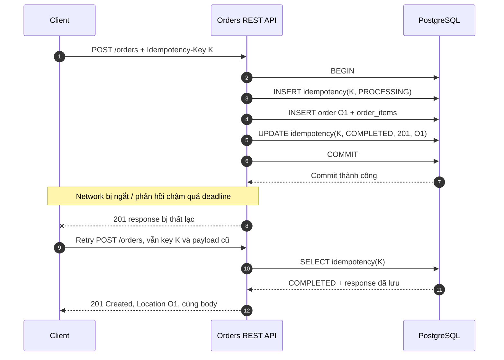

# Chống trùng khi tạo đơn hàng và mô phỏng timeout sau commit

Trong REST API, một thao tác `POST /orders` có thể **thành công tại server** nhưng **thất bại theo quan sát của client**. Ví dụ, database đã `COMMIT` đơn hàng, song kết nối mạng bị ngắt trước khi browser nhận `201 Created`. Nếu client gửi lại cùng yêu cầu mà server không có cơ chế chống trùng, hệ thống sẽ tạo hai đơn hàng cho một ý định mua hàng.

Bài thực hành này thuộc chương **Thực hành tổng hợp** của module **INTEGRATION_API_REST**. Bạn sẽ xây một API Java/Spring sử dụng resource/URI và HTTP status đúng ngữ nghĩa, định nghĩa hợp đồng `Idempotency-Key`, ghi dữ liệu bằng PostgreSQL transaction, kiểm tra phân quyền tenant, mô phỏng timeout **sau commit**, và viết kiểm thử xác minh điều quan trọng nhất: **có thể nhận nhiều HTTP attempts nhưng chỉ có một kết quả nghiệp vụ đã commit**.

Đây là bài thực hành end-to-end. Các đoạn mã minh họa tập trung vào invariant, contract và điểm phát sinh lỗi. Khi áp dụng vào dự án thật, bạn cần bổ sung imports, cấu hình security, fixture và các kiểu miền được mô tả bên dưới. Không sử dụng ví dụ trên đơn hàng hoặc thanh toán thật khi chưa kiểm thử.

## 1. Bối cảnh và yêu cầu đầu bài

Một cửa hàng cung cấp endpoint tạo đơn cho mỗi tenant:

```http
POST /api/tenants/{tenantId}/orders HTTP/1.1
Authorization: Bearer <access-token>
Idempotency-Key: order-req-20261118-001
Content-Type: application/json

{
  "customerId": "11111111-1111-4111-8111-111111111111",
  "items": [
    {"sku": "BOOK-JAVA", "quantity": 2},
    {"sku": "PEN-01", "quantity": 1}
  ]
}
```

**Kết quả khi tạo lần đầu:**

```http
HTTP/1.1 201 Created
Location: /api/tenants/aaaaaaaa-aaaa-4aaa-8aaa-aaaaaaaaaaaa/orders/22222222-2222-4222-8222-222222222222
Content-Type: application/json

{
  "id": "22222222-2222-4222-8222-222222222222",
  "status": "CREATED"
}
```

**Khi client gửi lại cùng khóa, cùng identity, cùng tenant và cùng payload**, server phải trả kết quả đã ghi nhớ của operation trước, **không INSERT thêm order**. Bài này chọn replay `201 Created`, `Location` và JSON body đã lưu. Một header tùy chọn như `Idempotency-Replayed: true` có thể giúp debug, nhưng không được dùng làm bằng chứng business correctness.

Nếu cùng một phạm vi khóa nhưng payload khác, server trả `409 Conflict` và không tạo đơn mới.

### 1.1. Các bất biến cần bảo vệ

| ID | Bất biến | Cách chứng minh |
|---|---|---|
| INV-01 | Một ý định tạo đơn có một kết quả business đã commit | Unique constraint và DB query sau retry |
| INV-02 | Order và bản ghi kết quả idempotency được commit **nguyên tử** | Fault trước commit: cả hai rollback |
| INV-03 | Timeout sau commit không làm server tạo lại đơn | Fault injection và replay cùng key |
| INV-04 | Hai request song song cùng key không tạo hai order | Concurrent integration test |
| INV-05 | Cùng key nhưng payload khác không tái sử dụng kết quả cũ | `409`, DB bất biến |
| INV-06 | Key và order của tenant A không cấp quyền đọc cho tenant B | Authorization test trước lookup/replay |
| INV-07 | Mỗi retry dùng cùng semantics hợp đồng | Giữ `status`, `Location` và body đã commit |
| INV-08 | Lỗi chưa rõ kết quả không được suy thành "chưa tạo" | Tra cứu operation hoặc retry idempotent |

Để kiểm thử chính xác, phân biệt **HTTP request attempt**, **business operation**, **database transaction**, **commit** và **response delivery**. Chúng không có quan hệ một-một trong mọi tình huống.

## 2. Vì sao cần Idempotency-Key cho POST?

`GET` và `PUT` có tính idempotent theo ngữ nghĩa HTTP khi được thực hiện đúng hợp đồng; `POST` nhìn chung không có bảo đảm này. Hai lần `POST /orders` với cùng JSON có thể là hai đơn hợp lệ nếu người dùng thực sự nhấn mua hai lần. Vì vậy server không được **tùy tiện coi mọi payload giống nhau là trùng**.

`Idempotency-Key` là cách client nói: "Những lần request mang khóa này là các lần thử của **cùng một ý định nghiệp vụ**". Key phải được tạo khi bắt đầu một operation và **giữ nguyên khi retry operation đó**. Nếu người dùng muốn tạo một đơn thứ hai thực sự, client dùng key khác.

Định nghĩa khóa duy nhất trong bài:

```text
(tenant_id, actor_subject, operation, idempotency_key)
```

Trong đó `operation` là định danh ổn định `orders.create.v1`, không phụ thuộc URL instance hoặc pod. `actor_subject` lấy từ identity đã xác thực, không tin `X-User-Id` do client tự khai. Hệ thống tích hợp theo service account có thể chọn khóa theo `client_id` thay cho user, miễn chính sách được công bố và nhất quán giữa các phiên bản.

### 2.1. Những trường hợp không được gộp

| Request | Tenant/actor/operation/key | Payload | Kỳ vọng |
|---|---|---|---|
| A1: tạo đơn lần đầu | Cùng phạm vi, `key-1` | P1 | Tạo order O1 |
| A2: retry A1 | Cùng phạm vi, `key-1` | P1 | Replay O1 |
| A3: dùng lại key sai | Cùng phạm vi, `key-1` | P2 | `409 Conflict` |
| A4: đơn mới thật sự | Cùng phạm vi, `key-2` | P1 | Tạo order O2 |
| B1: tenant B dùng `key-1` | Tenant khác | P1 | Operation độc lập sau authorization |
| C1: actor khác dùng `key-1` | Actor khác cùng tenant | P1 | Theo bài này là operation độc lập sau authorization |
| A5: retry sau client timeout | Cùng phạm vi, `key-1` | P1 | Replay O1 dù response đầu thất lạc |

Cần document phạm vi khóa rõ ràng. Một số API chọn key theo tenant + service client thay vì theo actor; nếu thay đổi phạm vi giữa các phiên bản mà không có migration, retry qua V1/V2 có thể tạo hiệu ứng trùng.

### 2.2. Thời gian lưu khóa

Bài này giả định giữ bản ghi idempotency **ít nhất 24 giờ** để bao phủ retry thông thường. Đây là yêu cầu minh họa, không phải thời hạn chuẩn cho mọi hệ thống. Với thanh toán, đơn hàng có nghiệp vụ quan trọng hoặc client offline dài ngày, cần xác định thời gian lưu theo rủi ro và hợp đồng.

Không được xóa key quá sớm rồi cho retry cũ tạo đơn mới. Nếu dọn record sau hạn, phải quyết định liệu kết quả nghiệp vụ vẫn có khóa tham chiếu ổn định để tra cứu và tránh lặp hay không. Lịch cleanup phải được kiểm thử và vận hành độc lập.

## 3. Trục thời gian: timeout xảy ra sau commit

Sự cố cần mô phỏng chính là:



Bản chất: **lỗi mạng sau commit nằm ngoài transaction database**. DB không thể rollback chỉ vì client ngừng chờ; phía client không thể suy ra "server chưa làm gì" từ timeout.

Ngược lại, nếu crash xảy ra **trước commit**, cả bản ghi order và kết quả idempotency phải rollback cùng nhau. Retry sau đó có thể trở thành lần tạo đầu tiên và vẫn chỉ có một order đã commit.

### 3.1. Vì sao không chỉ kiểm tra tồn tại order theo customer?

Một customer có thể chủ động tạo nhiều đơn với cùng danh sách sản phẩm. Dùng `customerId + sku` làm khóa duy nhất sẽ chặn các giao dịch hợp lệ. Còn việc `SELECT` tìm order theo request body rồi `INSERT` nếu chưa thấy là mô hình check-then-act có race condition: hai request đồng thời cùng không thấy dữ liệu và cùng insert.

Idempotency cần một **operation identity ổn định** do client cung cấp và một **unique constraint tại database** để bảo đảm concurrency.

## 4. Thiết kế API contract trước khi code

### 4.1. Request

```http
POST /api/tenants/{tenantId}/orders
Authorization: Bearer <token>
Content-Type: application/json
Idempotency-Key: <opaque-client-generated-key>
```

Quy tắc đề xuất cho bài thực hành:

- `Idempotency-Key` là bắt buộc với endpoint tạo đơn; thiếu key trả `400 Bad Request`.
- Key có độ dài 8–128 ký tự, chỉ nhận tập ký tự ASCII hợp lệ đã công bố (ví dụ chữ, số, `-`, `_`, `.`); không chứa dữ liệu cá nhân hoặc bí mật.
- Backend lấy tenant từ path nhưng phải kiểm tra actor có quyền `orders:create` tại tenant đó.
- Payload được validate: `customerId` hợp lệ thuộc tenant, `items` không rỗng và có tối đa 50 phần tử; `sku` và `quantity` nằm trong giới hạn.
- Tất cả lần retry **cùng key** phải có nội dung nghiệp vụ tương đương theo quy tắc canonicalization; khác payload trả `409`.
- Một key đã hoàn tất chỉ được replay trong phạm vi retention đã công bố.
- Server không tin kết quả cũ từ một key của tenant khác, actor khác hoặc operation khác.

### 4.2. Response và mã lỗi

| Tình huống | HTTP | Side effect |
|---|---|---|
| Tạo đơn mới thành công | `201 Created` + `Location` + order body | Một order và một idempotency record |
| Retry key+payload đã hoàn tất | Replay `201` + `Location` + body cũ | Không thêm order/items |
| Key+payload khác nhau | `409 Conflict` | Không thay đổi order trước |
| Thiếu key hoặc key không hợp lệ | `400 Bad Request` | Không tạo order |
| Payload không hợp lệ | `400` theo hợp đồng mẫu | Không ghi business |
| Không xác thực | `401 Unauthorized` | Không truy vấn/replay dữ liệu riêng tư |
| Thiếu quyền tenant hoặc customer | `403/404` theo policy | Không tạo hay lộ order |
| Operation đồng thời đang giữ unique lock quá lâu | Lỗi có thể retry theo chính sách (ví dụ `503` + `Retry-After`) | Không tạo thêm order |
| Lỗi DB trước commit | `5xx` nếu server còn gửi được response | Transaction rollback |
| Client timeout sau commit | Client không nhận response | Order đã tồn tại; retry cùng key sẽ replay |

Bài chọn replay nguyên `201`. Một API khác có thể thiết kế replay `200`, nhưng phải document và kiểm thử nhất quán, không tự đổi status tùy pod. Khi sử dụng `Location`, URI phải trỏ đến resource tồn tại và mọi `GET` vẫn bắt buộc authorization theo tenant/owner.

### 4.3. OpenAPI rút gọn

```yaml
openapi: 3.1.0
info:
  title: Orders API - Idempotent creation exercise
  version: "1.0"
paths:
  /api/tenants/{tenantId}/orders:
    post:
      summary: Create an order exactly once per idempotency operation
      operationId: createOrder
      security:
        - bearerAuth: []
      parameters:
        - name: tenantId
          in: path
          required: true
          schema:
            type: string
            format: uuid
        - name: Idempotency-Key
          in: header
          required: true
          schema:
            type: string
            minLength: 8
            maxLength: 128
      requestBody:
        required: true
        content:
          application/json:
            schema:
              $ref: "#/components/schemas/CreateOrderRequest"
      responses:
        "201":
          description: Created or replayed response for same operation
          headers:
            Location:
              description: URI of the created order
              schema:
                type: string
          content:
            application/json:
              schema:
                $ref: "#/components/schemas/OrderCreated"
        "400":
          description: Invalid key or request
        "401":
          description: Authentication required
        "403":
          description: Insufficient privileges
        "409":
          description: Key reused for different payload
        "503":
          description: Temporary unavailability
components:
  securitySchemes:
    bearerAuth:
      type: http
      scheme: bearer
      bearerFormat: JWT
  schemas:
    CreateOrderRequest:
      type: object
      required: [customerId, items]
      properties:
        customerId:
          type: string
          format: uuid
        items:
          type: array
          minItems: 1
          maxItems: 50
          items:
            type: object
            required: [sku, quantity]
            properties:
              sku:
                type: string
              quantity:
                type: integer
                minimum: 1
    OrderCreated:
      type: object
      required: [id, status]
      properties:
        id:
          type: string
          format: uuid
        status:
          type: string
          enum: [CREATED]
```

OpenAPI chỉ mô tả hình dạng hợp đồng; **không thể tự chứng minh database transaction, xử lý đồng thời hay idempotency**. Chúng cần được test riêng.

## 5. Schema PostgreSQL và ranh giới nguyên tử

Ta sử dụng ba bảng, cùng một database:

```sql
CREATE TABLE orders (
    id             uuid PRIMARY KEY,
    tenant_id      uuid NOT NULL,
    customer_id    uuid NOT NULL,
    status         text NOT NULL,
    created_at     timestamptz NOT NULL DEFAULT now(),
    CONSTRAINT ck_order_status CHECK (status IN ('CREATED', 'CANCELLED'))
);

CREATE TABLE order_items (
    order_id       uuid NOT NULL REFERENCES orders(id),
    line_no        integer NOT NULL,
    sku            text NOT NULL,
    quantity       integer NOT NULL,
    PRIMARY KEY (order_id, line_no),
    CONSTRAINT ck_item_quantity CHECK (quantity > 0)
);

CREATE TABLE idempotency_records (
    tenant_id         uuid NOT NULL,
    actor_subject     text NOT NULL,
    operation         text NOT NULL,
    idem_key          text NOT NULL,
    request_hash      varchar(64) NOT NULL,
    state             text NOT NULL,
    order_id          uuid REFERENCES orders(id),
    response_status   integer,
    response_location text,
    response_body     text,
    created_at        timestamptz NOT NULL DEFAULT now(),
    expires_at        timestamptz NOT NULL,
    PRIMARY KEY (tenant_id, actor_subject, operation, idem_key),
    CONSTRAINT ck_idempotency_state
        CHECK (state IN ('PROCESSING', 'COMPLETED'))
);

CREATE INDEX idx_idempotency_expiry
    ON idempotency_records (expires_at);
```

**Điểm thiết kế quyết định:** record trạng thái `PROCESSING`, order, items và response `COMPLETED` đều được viết **trong cùng một transaction**. Do đó, trạng thái `PROCESSING` chỉ là bước trung gian **chưa commit**, không phải một job có thể quan sát ở database sau khi transaction thành công. Nếu process chết trước commit, mọi thứ cùng rollback.

Đừng đặt `order_id NOT NULL` hoặc `response_body NOT NULL` trên record idempotency khi code cần INSERT trạng thái PROCESSING trước, rồi mới UPDATE thành COMPLETED trong cùng transaction. Có thể thêm CHECK theo state ở hệ thống hoàn thiện để ngăn commit một record PROCESSING không hợp lệ; cần kiểm thử ràng buộc đó với luồng ghi.

Schema trên là tối thiểu cho bài thực hành. Production thường cần customer/tenant foreign keys, price snapshot, inventory validation, audit, dữ liệu bảo mật, index thực tế và quy tắc vòng đời riêng. Tạo order **chưa đồng nghĩa** với đã thanh toán hoặc đặt tồn kho thành công.

### 5.1. Unique constraint quan trọng nhất

Primary key `(tenant_id, actor_subject, operation, idem_key)` đảm bảo chỉ có một record trong cùng phạm vi. Nó là điểm đồng bộ giữa **nhiều thread, nhiều instance và nhiều pod** dùng chung database.

Không thay thế bằng:

```java
if (!idempotencyRepository.existsByKey(key)) {
    orderRepository.save(newOrder);
}
```

Hai request cùng đọc "chưa tồn tại" rồi cùng insert vẫn có thể tạo hai order. Unique constraint ở DB là lớp bảo vệ cuối cho concurrent execution.

## 6. Quy trình xử lý bằng SQL, không có khoảng trống dual-write

Luồng transaction `READ COMMITTED` khuyến nghị cho ví dụ PostgreSQL:

1. Validate request, xác thực actor và quyền tenant/customer.
2. Tính hash của payload nghiệp vụ theo chuẩn canonicalization cố định.
3. Thử **claim key** bằng `INSERT ... ON CONFLICT DO NOTHING`.
4. Nếu claim thành công: INSERT order + items, xây response và UPDATE record `COMPLETED` trong **cùng transaction**, rồi COMMIT.
5. Nếu claim không thành công: SELECT record đã commit của key đó, so hash và replay hoặc trả `409`.
6. Controller chỉ bắt đầu xây và gửi HTTP response **sau khi service transaction đã kết thúc**.

### 6.1. Claim key trước

```sql
INSERT INTO idempotency_records (
    tenant_id,
    actor_subject,
    operation,
    idem_key,
    request_hash,
    state,
    expires_at
) VALUES (
    :tenantId,
    :actorSubject,
    'orders.create.v1',
    :idemKey,
    :requestHash,
    'PROCESSING',
    now() + interval '24 hours'
)
ON CONFLICT (tenant_id, actor_subject, operation, idem_key)
DO NOTHING;
```

Nếu INSERT thành công, transaction hiện tại **sở hữu** operation mới. Chỉ sau đó được tạo order. Nếu conflict, **không tạo order**, mà đọc record đã có.

Trong PostgreSQL, unique conflict với transaction đang xử lý cùng key có thể khiến request thứ hai **chờ transaction thứ nhất hoàn tất**. Ở isolation `READ COMMITTED`, câu SELECT tiếp theo (statement riêng) có thể nhìn thấy record vừa commit, nhờ snapshot mới. Không giả định hành vi y hệt khi chuyển sang `REPEATABLE READ`, hệ quản trị khác hoặc dùng một SQL statement tổng hợp theo cách thay đổi visibility.

### 6.2. Lưu response trước COMMIT

```sql
INSERT INTO orders (id, tenant_id, customer_id, status)
VALUES (:orderId, :tenantId, :customerId, 'CREATED');

-- INSERT order_items ở cùng transaction.

UPDATE idempotency_records
SET state = 'COMPLETED',
    order_id = :orderId,
    response_status = 201,
    response_location = :location,
    response_body = :responseJson
WHERE tenant_id = :tenantId
  AND actor_subject = :actorSubject
  AND operation = 'orders.create.v1'
  AND idem_key = :idemKey
  AND state = 'PROCESSING';
```

Kiểm tra số dòng UPDATE phải bằng 1; nếu không, ném exception để transaction rollback. **Không** commit order trước rồi mới insert idempotency record ở transaction thứ hai. Khoảng crash giữa hai commit sẽ để lại order mà retry không tìm thấy dấu vết operation, từ đó có thể tạo thêm một order.

**Vì sao lưu JSON body dưới dạng text?** Trong bài này ta cần replay ổn định cả body và `Location` của lần thành công đầu. Lưu text giúp tránh khác biệt cách serialize giữa hai pod hoặc phiên bản ứng dụng sau khi response đã commit. Với API thật cần xem xét dung lượng, version schema, mã hóa và dữ liệu nhạy cảm; không nên lưu token hoặc response chứa bí mật không cần thiết.

### 6.3. Tránh ghi PROCESSING đã commit riêng

Một biến thể khác thường dùng hai transaction: INSERT key `PROCESSING` rồi commit, sau đó mới tạo đơn và cập nhật `COMPLETED`. Biến thể đó cần **lease, expiry, heartbeat, retry ownership và recovery state machine** để xử lý record PROCESSING bị kẹt sau crash. Bài này **không** chọn biến thể đó: nhờ cùng transaction, record PROCESSING không tồn tại bền vững khi quá trình tạo order bị ngắt trước COMMIT.

Vì vậy không cần tự suy ra "cứ thấy PROCESSING là request vẫn đang chạy" trong DB production của bài này; nếu thấy record PROCESSING đã commit, đó là lỗi implementation hoặc dữ liệu legacy, phải xử lý như trường hợp bất thường.

## 7. Java/Spring: DTO, policy và service transaction

### 7.1. DTO request và dữ liệu trả về

```java
public record OrderLineRequest(
        @NotBlank String sku,
        @Min(1) @Max(1000) int quantity
) {}

public record CreateOrderRequest(
        @NotNull UUID customerId,
        @NotEmpty @Size(max = 50)
        List<@Valid OrderLineRequest> items
) {}

public record OrderCreatedView(UUID id, String status) {}

public record StoredResponse(
        int status,
        String location,
        String jsonBody,
        boolean replayed
) {}
```

`@Valid` trên request body phải được kích hoạt trong controller; cần Bean Validation dependency/configuration phù hợp. Đây là hợp đồng dữ liệu minh họa, không chứa giá/thuế/khuyến mãi. Trong bài thực hành thật có thể thêm price snapshot nhưng vẫn phải ghi nguyên tử cùng order.

### 7.2. Fingerprint phải ổn định qua retry

Không nên hash **raw JSON bytes** của HTTP body theo mặc định. Hai request tương đương có thể khác whitespace hoặc thứ tự key mà vẫn mang cùng nghĩa nghiệp vụ. Có thể hash **cấu trúc DTO đã validate và canonicalize**:

```java
@Component
public class OrderFingerprint {
    private final ObjectMapper json;

    public OrderFingerprint(ObjectMapper json) {
        this.json = json;
    }

    public String sha256V1(CreateOrderRequest request) {
        try {
            // DTO/field order được xác định theo schema v1.
            // Giữ nguyên thứ tự items vì đó là một phần hợp đồng mẫu.
            byte[] bytes = json.writeValueAsBytes(request);
            byte[] digest = MessageDigest
                    .getInstance("SHA-256")
                    .digest(bytes);
            return HexFormat.of().formatHex(digest);
        } catch (JsonProcessingException
                 | NoSuchAlgorithmException ex) {
            throw new IllegalStateException(
                "Cannot fingerprint order request", ex);
        }
    }
}
```

Trong ứng dụng production, cần **đóng băng quy tắc canonicalization V1**: tên và thứ tự property, cách biểu diễn số, Unicode normalization nếu cần, phân biệt field vắng mặt với null, thứ tự mảng có ý nghĩa hay không, và version schema. Ví dụ dùng record Jackson ổn định trong **cùng cấu hình serializer**; nếu deployment thay serializer/record fields, có thể làm cùng operation key bị `409` không mong muốn. Nên có test golden vectors cho fingerprint và bảo đảm V1/V2 cùng hiểu trong thời gian mixed deployment.

Có thể dùng một `CanonicalOrderV1` DTO riêng và serialize theo sơ đồ cố định (có version) thay vì dựa trực tiếp vào request record; bài tập yêu cầu mở rộng điểm này. Không dùng key từ body JSON làm thay thế identity đã xác thực.

### 7.3. Service hoàn chỉnh theo ranh giới transaction

Đoạn code tiếp theo thể hiện logic quan trọng. Các component `OrderAccessPolicy`, `OrderFingerprint` và mapper được giả định đã được xây; các imports JDBC, Spring Transaction, Jackson và Java types được thêm theo dự án.

```java
@Service
public class OrderCommandService {
    private static final String OPERATION = "orders.create.v1";

    private final JdbcTemplate jdbc;
    private final ObjectMapper json;
    private final OrderFingerprint fingerprints;
    private final OrderAccessPolicy access;

    public OrderCommandService(
            JdbcTemplate jdbc,
            ObjectMapper json,
            OrderFingerprint fingerprints,
            OrderAccessPolicy access) {
        this.jdbc = jdbc;
        this.json = json;
        this.fingerprints = fingerprints;
        this.access = access;
    }

    @Transactional(isolation = Isolation.READ_COMMITTED)
    public StoredResponse create(
            UUID tenantId,
            Authentication actor,
            String idemKey,
            CreateOrderRequest request) {

        // Xác minh identity, quyền tạo order và customer thuộc tenant.
        access.requireCanCreateOrder(
                actor, tenantId, request.customerId());

        String subject = actor.getName();
        String hash = fingerprints.sha256V1(request);

        int claimed = jdbc.update("""
            INSERT INTO idempotency_records (
                tenant_id, actor_subject, operation, idem_key,
                request_hash, state, expires_at
            )
            VALUES (?, ?, ?, ?, ?, 'PROCESSING',
                    now() + interval '24 hours')
            ON CONFLICT (
                tenant_id, actor_subject, operation, idem_key
            ) DO NOTHING
            """,
            tenantId, subject, OPERATION, idemKey, hash);

        if (claimed == 0) {
            return replayExisting(tenantId, subject, idemKey, hash);
        }

        UUID orderId = UUID.randomUUID();

        jdbc.update("""
            INSERT INTO orders (id, tenant_id, customer_id, status)
            VALUES (?, ?, ?, 'CREATED')
            """,
            orderId, tenantId, request.customerId());

        for (int i = 0; i < request.items().size(); i++) {
            OrderLineRequest line = request.items().get(i);
            jdbc.update("""
                INSERT INTO order_items (order_id, line_no, sku, quantity)
                VALUES (?, ?, ?, ?)
                """, orderId, i, line.sku(), line.quantity());
        }

        String location = "/api/tenants/"
                + tenantId + "/orders/" + orderId;
        String responseJson = toJson(
                new OrderCreatedView(orderId, "CREATED"));

        int completed = jdbc.update("""
            UPDATE idempotency_records
            SET state = 'COMPLETED',
                order_id = ?,
                response_status = 201,
                response_location = ?,
                response_body = ?
            WHERE tenant_id = ?
              AND actor_subject = ?
              AND operation = ?
              AND idem_key = ?
              AND state = 'PROCESSING'
            """,
            orderId, location, responseJson,
            tenantId, subject, OPERATION, idemKey);

        if (completed != 1) {
            throw new IllegalStateException(
                "Idempotency completion must update one row");
        }

        return new StoredResponse(
                201, location, responseJson, false);
        // Spring transaction proxy COMMITs trước khi trả về controller.
    }

    private StoredResponse replayExisting(
            UUID tenantId, String subject,
            String idemKey, String requestedHash) {

        List<StoredRecord> found = jdbc.query("""
            SELECT request_hash, state,
                   response_status, response_location, response_body
            FROM idempotency_records
            WHERE tenant_id = ?
              AND actor_subject = ?
              AND operation = ?
              AND idem_key = ?
            """,
            (rs, rowNum) -> new StoredRecord(
                    rs.getString("request_hash"),
                    rs.getString("state"),
                    rs.getInt("response_status"),
                    rs.getString("response_location"),
                    rs.getString("response_body")),
            tenantId, subject, OPERATION, idemKey);

        if (found.size() != 1) {
            // Trạng thái không mong đợi: đừng tự tạo order lần nữa.
            throw new IllegalStateException(
                "Idempotency record not visible");
        }

        StoredRecord prior = found.get(0);
        if (!prior.requestHash().equals(requestedHash)) {
            throw new ResponseStatusException(
                HttpStatus.CONFLICT,
                "Idempotency-Key reused with different payload");
        }
        if (!"COMPLETED".equals(prior.state())
                || prior.location() == null
                || prior.body() == null) {
            throw new IllegalStateException(
                "Incomplete committed idempotency record");
        }

        return new StoredResponse(
                prior.responseStatus(),
                prior.location(),
                prior.body(),
                true);
    }

    private String toJson(OrderCreatedView result) {
        try {
            return json.writeValueAsString(result);
        } catch (JsonProcessingException ex) {
            // Runtime exception làm transaction rollback mặc định.
            throw new IllegalStateException(
                "Cannot serialize response", ex);
        }
    }

    private record StoredRecord(
        String requestHash,
        String state,
        int responseStatus,
        String location,
        String body
    ) {}
}
```

Những bảo đảm cần hiểu:

- `@Transactional` ở **public method của Spring bean** được gọi từ bean khác (controller), để transaction proxy hoạt động; tránh self-invocation `this.create(...)`.
- Khi insert idempotency bị conflict, service **không** tạo order; nó đọc record đã commit rồi trả lại response hoặc `409`.
- `INSERT ... ON CONFLICT DO NOTHING` không ném unique violation làm transaction PostgreSQL bị aborted; nó cho phép code chuyển sang nhánh replay.
- Thứ tự INSERT key → order → items → UPDATE key hoàn tất nằm trong một transaction, nên cả order và response được commit cùng nhau.
- `IllegalStateException` (unchecked) khiến Spring mặc định rollback; đừng chỉ log exception và tiếp tục trả `201`.
- Phản hồi `201` trong controller được tạo **sau khi lời gọi qua proxy trả về**, tức commit đã hoàn tất. Nếu commit thất bại, controller không được gửi response thành công.
- Ví dụ sử dụng `READ COMMITTED` vì nhánh conflict/replay cần thấy record commit bởi transaction cạnh tranh qua câu SELECT tiếp theo.
- Kết quả replay không kiểm tra lại business mutation, nhưng **vẫn kiểm tra quyền actor/tenant/customer trước khi đọc kết quả**.

Mã không xử lý connection lock timeout, lỗi serialization, request cancellation, cleanup idempotency, metrics hay audit production đầy đủ. Các phần đó được nêu ở mục vận hành và kiểm thử. Nếu SQL insert xong rồi phải gọi một API thanh toán/vận chuyển ngoài DB, không kéo HTTP call vào transaction này: dùng transactional outbox và state machine riêng.

### 7.4. Controller trả đúng kết quả đã commit

```java
@RestController
@RequestMapping("/api/tenants/{tenantId}/orders")
public class OrderController {
    private final OrderCommandService service;
    private final AfterCommitResponseGate responseGate;

    public OrderController(
            OrderCommandService service,
            AfterCommitResponseGate responseGate) {
        this.service = service;
        this.responseGate = responseGate;
    }

    @PostMapping
    public ResponseEntity<String> create(
            @PathVariable UUID tenantId,
            @RequestHeader("Idempotency-Key") String key,
            @Valid @RequestBody CreateOrderRequest body,
            Authentication authentication) {

        if (!key.matches("[A-Za-z0-9._-]{8,128}")) {
            throw new ResponseStatusException(
                HttpStatus.BAD_REQUEST, "Invalid Idempotency-Key");
        }

        StoredResponse result =
                service.create(tenantId, authentication, key, body);

        // TEST HOOK: gọi SAU khi transaction service đã commit.
        // Production implementation là no-op. Không dùng header
        // do client quyết định có bật fault injection hay không.
        responseGate.beforeResponse(key);

        return ResponseEntity.status(result.status())
                .header(HttpHeaders.LOCATION, result.location())
                .contentType(MediaType.APPLICATION_JSON)
                .body(result.jsonBody());
    }
}
```

`AfterCommitResponseGate` là interface được giải thích ở mục 9. Với production có thể bỏ dependency này hoàn toàn; ở đây nó làm điểm kiểm thử dễ thấy. Nếu client dùng browser cross-origin và cần đọc `Location`, hãy cấu hình CORS `Access-Control-Expose-Headers: Location` ở **response thật**, nhưng CORS không thay idempotency.

**Kiểm tra authorization bắt buộc:** `OrderAccessPolicy` phải xác thực principal và tenant membership. Một `Idempotency-Key` hợp lệ không cho phép user A lấy response thuộc user/tenant khác. `GET /orders/{id}` cũng cần kiểm tra owner/tenant độc lập, không chỉ vì id là UUID khó đoán.

## 8. Vì sao cách triển khai trên chịu được concurrency?

Giả sử Request R1 và R2 tới hai pod cùng lúc:

```mermaid
sequenceDiagram
    autonumber
    participant R1 as Pod A / R1
    participant R2 as Pod B / R2
    participant DB as PostgreSQL
    R1->>DB: BEGIN; INSERT idem K
    DB-->>R1: claimed=1, unique key chưa commit
    R2->>DB: BEGIN; INSERT idem K ON CONFLICT DO NOTHING
    Note over R2,DB: Có thể chờ transaction R1 quyết định
    R1->>DB: INSERT order O1 + items; UPDATE idem COMPLETED
    R1->>DB: COMMIT
    DB-->>R2: claimed=0
    R2->>DB: SELECT idem K
    DB-->>R2: O1 + status 201 + Location + body
    R1-->>R1: Trả response O1
    R2-->>R2: Replay response O1
```

Kết quả:

```text
HTTP attempts:            2
Business operation key:   1
Orders committed:         1
Idempotency rows:         1
Kết quả R1/R2:            cùng order ID và Location
```

Nếu R1 rollback thay vì commit, R2 có thể claim key và trở thành request thực hiện thao tác, khi đó vẫn chỉ một transaction tạo order được commit.

**Không bảo đảm hai request đều nhận `201` ngay lập tức.** Nếu R1 giữ transaction rất lâu, R2 có thể chờ unique lock và gặp statement timeout. Lúc đó service phải trả lỗi tạm thời phù hợp (nếu có thể) để client retry cùng key sau backoff; không được quyết định tạo order mới với key khác như một workaround.

## 9. Mô phỏng timeout SAU commit một cách xác định

Đây là trọng tâm thực hành. Chúng ta **không** muốn mô phỏng timeout trước khi server nhận request, vì như vậy sẽ không kiểm chứng được tình huống nguy hiểm.

### 9.1. Vị trí đặt fault injection

Sau lời gọi `service.create(...)` trong controller, Spring transaction proxy đã trả về, nên commit đã thành công. Chặn **trước khi controller trả `ResponseEntity`** cho phép mô phỏng server đã ghi DB nhưng client chờ quá thời hạn.

```text
Controller
  |
  +-- orderCommandService.create(...)
  |       BEGIN
  |       INSERT idem + order + items
  |       UPDATE idem COMPLETED
  |       COMMIT
  |
  +-- AFTER_COMMIT_RESPONSE_GATE  <--- giữ response tại đây
  |
  +-- return HTTP 201
```

**Lưu ý:** chặn response ở test hook không mô phỏng đầy đủ một socket bị đóng, nhưng mô phỏng chính xác điều kiện quan trọng: **client hết thời gian chờ sau khi transaction đã commit, không biết kết quả và phải retry**. Để thử mất gói/RST thật, dùng HTTP proxy có fault injection trên môi trường test và chỉ ngắt kết nối sau khi DB commit được xác minh.

### 9.2. Interface và implementation production

```java
public interface AfterCommitResponseGate {
    void beforeResponse(String idemKey);
}

@Component
@Profile("!integration-fault")
public class NoopAfterCommitResponseGate
        implements AfterCommitResponseGate {
    @Override
    public void beforeResponse(String idemKey) {
        // Không làm gì trong production.
    }
}
```

Ở profile `integration-fault` chỉ dùng trong bài test, cung cấp một bean giữ request **đầu tiên** cho một key định trước. Trong production, hook nên được loại bỏ nếu không còn cần để tránh tăng diện tích rủi ro; không cho phép caller kích hoạt bằng query param hoặc header công khai.

### 9.3. Test-only gate dùng latch

```java
@Component
@Profile("integration-fault")
public class TestAfterCommitResponseGate
        implements AfterCommitResponseGate {

    private final AtomicBoolean first = new AtomicBoolean(true);
    private final CountDownLatch entered = new CountDownLatch(1);
    private final CountDownLatch release = new CountDownLatch(1);

    @Override
    public void beforeResponse(String idemKey) {
        if (!"timeout-after-commit-001".equals(idemKey)) {
            return;
        }
        if (!first.compareAndSet(true, false)) {
            return; // Các lần retry không bị giữ.
        }

        entered.countDown();

        try {
            // Gate là lớp TEST, không dùng trong hệ thống thật.
            if (!release.await(10, TimeUnit.SECONDS)) {
                throw new IllegalStateException("Test gate timed out");
            }
        } catch (InterruptedException ex) {
            Thread.currentThread().interrupt();
            throw new IllegalStateException(
                "Test gate interrupted", ex);
        }
    }

    public boolean awaitEntered() throws InterruptedException {
        return entered.await(5, TimeUnit.SECONDS);
    }

    public void releaseFirstResponse() {
        release.countDown();
    }
}
```

Test dùng `@ActiveProfiles("integration-fault")`, cần có **đủ HTTP worker threads** để request đầu bị chặn không làm request retry bị treo. Có thể đặt timeout của HTTP client khoảng vài trăm milliseconds và giữ gate lâu hơn. Trong integration test với nhiều method, tạo fixture/key mới hoặc reset bean/latch an toàn giữa các test, vì `first` và latch chứa state.

**Không đánh dấu transaction bằng sleep bên trong `@Transactional`**: nếu trì hoãn trước COMMIT, test chỉ chứng minh timeout khi transaction chưa hoàn thành, không phải timeout **sau commit**. Điều đó làm mất mục tiêu của bài.

### 9.4. Kịch bản test timeout bằng client HTTP thật

Một integration test khởi động Spring Boot ở cổng ngẫu nhiên (`webEnvironment = RANDOM_PORT`) và dùng client HTTP với **request timeout ngắn**. Kịch bản tuần tự:

1. Gửi `POST /orders` key `timeout-after-commit-001`; controller đi qua service và DB commit.
2. Test gate nhận tín hiệu và chặn trước khi server gửi response.
3. Client hết deadline (ví dụ 250 ms) và nhận timeout; test **không** kết luận transaction thất bại.
4. Query DB ở một transaction/kết nối độc lập: `orders=1`, `idempotency=1`, state `COMPLETED`, response có `Location`.
5. Gửi **lần thứ hai** cùng tenant, actor, key và payload, không cần đợi response đầu; gate cho phép retry đi qua.
6. Lần hai nhận `201`, cùng order ID/`Location` đã lưu.
7. Release response đầu để giải phóng server thread; nếu client đã đóng kết nối, lần gửi muộn có thể thất bại ở tầng transport nhưng **không** thay đổi DB.
8. Query lại DB: số order vẫn 1 và không có duplicate order_items.

Với `HttpClient` của Java:

```java
HttpClient client = HttpClient.newHttpClient();

HttpRequest firstRequest = HttpRequest.newBuilder()
    .uri(URI.create(baseUrl + "/api/tenants/" + tenantId + "/orders"))
    .timeout(Duration.ofMillis(250))
    .header("Authorization", "Bearer " + testToken)
    .header("Idempotency-Key", "timeout-after-commit-001")
    .header("Content-Type", "application/json")
    .POST(HttpRequest.BodyPublishers.ofString(requestJson))
    .build();

assertThrows(HttpTimeoutException.class, () ->
    client.send(firstRequest, HttpResponse.BodyHandlers.ofString())
);

// Sau khi test đã xác nhận DB commit, retry cùng key với
// timeout dài hơn. Request đầu được gate giữ nhưng không
// giữ transaction DB.
```

Đây là đoạn test **rút gọn**, không phải toàn bộ test fixture. Lưu ý `HttpTimeoutException` có thể là class con cụ thể tùy loại timeout, và trong môi trường chịu tải cao deadline 250 ms quá ngắn dễ gây flaky tests. Dùng latch báo "đã qua commit" và giới hạn timeout đủ phân biệt lỗi môi trường với fault injection; không chạy test này như benchmark hiệu năng.

### 9.5. Nhánh khác: ngắt socket sau commit

Để kiểm thử sát network thực, có thể đặt test reverse proxy giữa client và server, cấu hình **chặn/hủy response** sau khi test nhận được tín hiệu rằng DB đã commit. Các công cụ fault injection HTTP/TCP như proxy test có thể mô phỏng response mất/RST. Tránh cắt kết nối trước COMMIT, vì test đó có thể chỉ chứng minh rollback hoặc hủy request sớm.

Điểm quan trọng không phải công cụ nào, mà là **chứng minh thứ tự xảy ra**:

```text
COMMIT thành công
    ↓
Response bị delay/drop
    ↓
Client quan sát timeout
    ↓
Retry cùng key
    ↓
Replay, không có order thứ hai
```

## 10. Các kiểm thử tích hợp phải viết

### 10.1. Kết quả ban đầu và retry ổn định

Dùng `@SpringBootTest` và `@AutoConfigureMockMvc` khi muốn đi qua security filter, controller và database. Ví dụ sau giả định fixture đã seed tenant A/customer hợp lệ, service đã cấu hình và helper `jwt()` tạo principal test:

```java
@SpringBootTest
@AutoConfigureMockMvc
class CreateOrderIdempotencyIT {
    private static final String TENANT_A =
        "aaaaaaaa-aaaa-4aaa-8aaa-aaaaaaaaaaaa";

    @Autowired MockMvc mvc;
    @Autowired JdbcTemplate jdbc;

    private RequestPostProcessor alice() {
        return jwt()
            .jwt(token -> token.subject("alice"))
            .authorities(new SimpleGrantedAuthority(
                    "SCOPE_orders:create"));
    }

    private String payload() {
        return """
            {
              "customerId":
                "11111111-1111-4111-8111-111111111111",
              "items":[
                {"sku":"BOOK-JAVA","quantity":2},
                {"sku":"PEN-01","quantity":1}
              ]
            }
            """;
    }

    @Test
    void retrySameKeyReturnsSameOrder() throws Exception {
        String key = "order-regression-001";

        MvcResult first = mvc.perform(
            post("/api/tenants/{tenant}/orders", TENANT_A)
                .with(alice())
                .header("Idempotency-Key", key)
                .contentType(MediaType.APPLICATION_JSON)
                .content(payload()))
            .andExpect(status().isCreated())
            .andExpect(header().exists("Location"))
            .andReturn();

        MvcResult replay = mvc.perform(
            post("/api/tenants/{tenant}/orders", TENANT_A)
                .with(alice())
                .header("Idempotency-Key", key)
                .contentType(MediaType.APPLICATION_JSON)
                .content(payload()))
            .andExpect(status().isCreated())
            .andReturn();

        assertThat(replay.getResponse().getHeader("Location"))
            .isEqualTo(first.getResponse().getHeader("Location"));
        assertThat(replay.getResponse().getContentAsString())
            .isEqualTo(first.getResponse().getContentAsString());

        Integer count = jdbc.queryForObject("""
            SELECT count(*)
            FROM idempotency_records
            WHERE tenant_id = ?
              AND actor_subject = ?
              AND operation = ?
              AND idem_key = ?
            """,
            Integer.class,
            UUID.fromString(TENANT_A),
            "alice",
            "orders.create.v1",
            key);

        assertThat(count).isEqualTo(1);
        // Ngoài idempotency row, query order_id được ghi trong
        // record và khẳng định có đúng một order tương ứng.
    }
}
```

Đây là **khung integration test cần fixture và imports phù hợp**. Không sử dụng `@Transactional` trên test nếu muốn xác minh transaction service đã commit và quan sát từ connection khác. Với mock JWT, `jwt()` từ Spring Security Test chỉ mô phỏng authentication; cần test độc lập cho chữ ký, issuer, audience và expiry của bearer token thật.

### 10.2. Same key, different payload

```java
@Test
void rejectsSameKeyWithDifferentPayload() throws Exception {
    String key = "order-regression-002";

    mvc.perform(post("/api/tenants/{t}/orders", TENANT_A)
            .with(alice())
            .header("Idempotency-Key", key)
            .contentType(MediaType.APPLICATION_JSON)
            .content(payload()))
        .andExpect(status().isCreated());

    String changed = payload().replace(
            "\"quantity\":2", "\"quantity\":3");

    mvc.perform(post("/api/tenants/{t}/orders", TENANT_A)
            .with(alice())
            .header("Idempotency-Key", key)
            .contentType(MediaType.APPLICATION_JSON)
            .content(changed))
        .andExpect(status().isConflict());

    // DB phải chỉ có một order thuộc operation key này.
}
```

Bài test này giả định `payload()` có đúng đoạn cần thay; trong test production dùng builder/DTO để tránh brittle string replacement. Cần kiểm tra trạng thái order/items không đổi, không chỉ HTTP status.

### 10.3. Hai request đồng thời

Không phải hai request chạy tuần tự là đủ. Tạo concurrency test với hai client và một `CountDownLatch` làm tín hiệu bắt đầu chung:

```java
ExecutorService pool = Executors.newFixedThreadPool(2);
CountDownLatch start = new CountDownLatch(1);

Callable<HttpResponse<String>> operation = () -> {
    start.await();
    return httpClient.send(
        buildPost(baseUrl, tenantA, token, "parallel-key-001", body),
        HttpResponse.BodyHandlers.ofString());
};

Future<HttpResponse<String>> a = pool.submit(operation);
Future<HttpResponse<String>> b = pool.submit(operation);
start.countDown();

HttpResponse<String> ra = a.get(10, TimeUnit.SECONDS);
HttpResponse<String> rb = b.get(10, TimeUnit.SECONDS);

assertThat(ra.statusCode()).isEqualTo(201);
assertThat(rb.statusCode()).isEqualTo(201);
assertThat(ra.headers().firstValue("Location"))
    .isEqualTo(rb.headers().firstValue("Location"));
assertThat(ra.body()).isEqualTo(rb.body());

pool.shutdownNow();
```

`httpClient`, `buildPost(...)`, `baseUrl`, `tenantA`, `token` và `body` là fixture/helpers của bài test; đây là skeleton để tập trung vào cạnh tranh. Sau test phải đếm ở database để chắc chắn một order được commit. Với fixture chạy trên database thật như PostgreSQL/Testcontainers, test mới có giá trị kiểm chứng hành vi unique lock và `ON CONFLICT`.

Nếu thấy timeout do contention, điều chỉnh deadline test và chính sách chờ thay vì cho phép hai order. Với traffic production, có thể dùng per-key lock phân tán để giảm contention, nhưng DB uniqueness vẫn phải là bảo vệ cuối.

### 10.4. Mô phỏng rollback trước commit

Dùng fault injection ở repository hoặc câu SQL trong cùng transaction trước `COMMIT`, ví dụ làm insert `order_items` vi phạm constraint. Kỳ vọng:

```text
POST với key K → database exception
    ↓
Transaction rollback toàn bộ
    ↓
Không có idempotency record K được commit
Không có order K được commit
    ↓
Sửa nguyên nhân lỗi test
    ↓
Retry key K → tạo một order O1 hợp lệ
```

Không dùng exception được bắt rồi bỏ qua bên trong `@Transactional`, vì như vậy có thể làm transaction commit một phần tùy loại lỗi và transaction manager. Khi một bước bắt buộc thất bại, phải propagate lỗi để toàn bộ business operation rollback. Nếu ghi audit thất bại theo policy bắt buộc, audit và order cũng cần cùng ranh giới nguyên tử hoặc một mô hình bền vững được thiết kế rõ.

### 10.5. Mô phỏng timeout sau commit

Tiêu chí hoàn tất test này **không chỉ** là client nhận timeout. Bắt buộc ghi nhận:

| Điều kiểm tra | Kỳ vọng |
|---|---|
| Gate đã được vào | Service transaction đã trả về sau commit |
| Request đầu | Client timeout hoặc mất response |
| DB sau timeout | Có đúng một order, đủ items và một idem record COMPLETED |
| Request retry cùng key/payload | Nhận cùng `201`, `Location` và body |
| DB sau retry | Không có order/items mới |
| Request cùng key nhưng payload khác sau timeout | `409`, không ghi thêm |
| Trace/log | Phân biệt hai HTTP attempts với một business operation |
| Request qua hai instance (nếu test mở rộng) | Dùng record DB chung, không dựa in-memory lock |

Đừng dùng `Thread.sleep(...)` **trước commit** rồi nói đã kiểm thử timeout sau commit. Đây là lỗi thực hành phổ biến.

## 11. Checklist về security, dữ liệu và HTTP semantics

Chống trùng không tách khỏi bảo mật:

| Chủ đề | Điều cần thực hiện |
|---|---|
| Tenant isolation | Dữ liệu và key có `tenant_id`; kiểm tra membership actor ở mỗi request |
| Actor identity | Lấy `actor_subject` từ authentication server-side, không từ body/header tự khai |
| Customer authorization | `customerId` phải thuộc tenant và actor đủ quyền tạo order cho customer |
| Key validation | Chặn key quá dài, control chars, secret/PII; không dùng key làm SQL string |
| Fingerprint | Dựa trên canonical payload, không lưu raw token/body nhạy cảm |
| Response replay | Không lộ kết quả của actor/tenant khác dù cùng key |
| Scope/function authorization | Kiểm tra `orders:create`, role và quyền theo đối tượng/tenant |
| GET order | Luôn kiểm tra quyền; `Location` không phải URL công khai |
| Input/price validation | Không tin giá, thuế hoặc inventory gửi từ browser |
| CORS | Browser đọc được `Location` nếu API cross-origin qua `Access-Control-Expose-Headers` |
| Rate limiting | Giới hạn lượng request và retry để tránh người dùng/attacker khóa DB |
| Error mapping | Không trả SQL exception/stack trace hoặc business identifiers trái quyền |

Một key có thể lưu trong log để chẩn đoán chỉ khi nó đã được validate và chính sách dữ liệu cho phép; đừng đưa key có cardinality lớn vào nhãn metric. Nên có trace ID/request ID cho **mỗi attempt** và operation ID để liên kết những attempt thuộc cùng nghiệp vụ.

### 11.1. Tính nhất quán của giá, tồn kho và thanh toán

Bài tập bảo đảm **một order được tạo trong một database**, không cam kết tồn kho hoặc thanh toán ngoài hệ thống cũng exactly once. Nếu sau khi tạo order cần gọi payment provider, không giữ transaction database mở trong lúc chờ HTTP; ghi **outbox** hoặc payment intent bền vững cùng transaction, rồi worker gọi provider bằng key ổn định và đối soát kết quả `UNKNOWN`.

Không tự động tạo order thứ hai để "cứu" timeout thanh toán. Có thể cần Saga/compensation cho các bước đã hoàn tất bên ngoài.

## 12. Quan sát và vận hành

Thiết kế metric và log cho phép phân biệt lỗi HTTP với kết quả nghiệp vụ:

| Tín hiệu | Ý nghĩa |
|---|---|
| `orders_create_attempts_total` | Tổng POST requests, bao gồm retry |
| `orders_created_total` | Tổng orders thực sự commit lần đầu |
| `idempotency_replays_total` | Số lần replay response đã commit |
| `idempotency_payload_conflicts_total` | Số lần same key/different payload |
| `idempotency_lock_wait_seconds` | Thời gian chờ unique conflict/cạnh tranh |
| `orders_create_transaction_duration_seconds` | Thời gian giữ transaction DB |
| `orders_create_client_timeouts_total` | Từ phía client/gateway nếu có telemetry tương ứng |
| `orders_create_5xx_total` | Lỗi server, không tự đồng nghĩa transaction rollback |
| `idempotency_cleanup_backlog` | Record quá thời hạn chờ xử lý retention/cleanup |

Một request có thể làm tăng `attempts_total` nhưng không tăng `orders_created_total` khi replay. Cần metric emit **sau commit** hoặc nguồn đếm bền vững từ DB để tránh đo thành công sai khi transaction rollback; metric trong code trước commit chỉ là tín hiệu attempt, không phải business success đã xác nhận.

Ví dụ log có cấu trúc:

```json
{
  "event": "orders.create.replayed",
  "tenant_ref": "tenant-a",
  "operation_ref": "op-7c1e",
  "http_attempt_id": "req-2",
  "order_ref": "ord-103",
  "result": "REPLAYED",
  "trace_id": "c64dc96e0a884b7dbaf179ec0823f85a"
}
```

Dùng tham chiếu an toàn và quyền truy cập log phù hợp; không log bearer token, chi tiết thanh toán, thông tin khách hàng hoặc raw request body. Audit event `ORDER_CREATED` chỉ phản ánh **một** business change đã commit; hai HTTP attempts có thể có hai access log riêng.

## 13. Các lỗi thiết kế thường gặp

| Sai lầm | Điều gì có thể xảy ra | Cách sửa |
|---|---|---|
| Tạo order rồi mới lưu key trong transaction khác | Crash giữa hai commit → retry tạo order nữa | Ghi order và kết quả idempotency trong cùng transaction |
| Chỉ dùng `synchronized`/in-memory map | Pod khác không biết khóa, restart mất state | Unique constraint + shared database |
| Chỉ `SELECT` trước rồi `INSERT` | Race: hai request cùng không thấy key | Atomic `INSERT ... ON CONFLICT` / unique constraint |
| Dùng payload hash như khóa duy nhất | Hai đơn hợp lệ giống nhau bị gộp | Client operation key riêng |
| Không so payload khi key trùng | Same key có thể trả order của lệnh khác | Hash canonical payload; mismatch trả `409` |
| Hash raw JSON bytes | Khác whitespace/thứ tự property thành false conflict | Canonical hóa DTO và giữ version |
| Hash thay đổi sau deploy | Retry từ V1 sang V2 không được nhận diện | Giữ fingerprint contract ổn định và golden-vector test |
| Chỉ lưu order ID, tạo lại response theo bản mới | Replay có status/body/Location khác contract | Lưu kết quả response cần replay trong cùng transaction |
| Ghi `PROCESSING` rồi commit riêng mà không recovery | Crash để lại key kẹt mãi | Cùng transaction như bài hoặc có lease/recovery đúng cách |
| Timeout → đổi key mới rồi retry | Tạo hai order cho cùng một ý định | Retry cùng key, hoặc GET/reconcile trước |
| Test timeout trước COMMIT | Không chứng minh lỗi after-commit | Đặt gate **sau** service transactional return |
| Test dùng H2 rồi suy ra PostgreSQL lock semantics | Có thể bỏ qua hành vi `ON CONFLICT`/snapshot thật | Testcontainers/PostgreSQL thật |
| Bỏ quyền tenant ở nhánh replay | Có thể lộ dữ liệu qua key đã biết | Authorize trước lookup/replay |
| Chạy 1 test tuần tự và gọi là concurrency-safe | Không phát hiện tranh chấp giữa hai thread/pod | Hai request đồng thời + DB constraint |
| Xóa key trong lúc còn request retry | Operation cũ có thể tạo đơn mới | Retention/cleanup có guard và runbook |

## 14. Bài tập mở rộng

### Bài tập A — Hoàn thiện implementation

Dựa trên schema và `OrderCommandService`, hiện thực `OrderAccessPolicy`, validate request, một error handler trả `application/problem+json`, và `GET /api/tenants/{tenantId}/orders/{id}`. Viết test người khác tenant không thể xem order dù biết `Location`. Kiểm tra `Idempotency-Key` không được dùng để vượt qua authorization.

### Bài tập B — Golden vectors cho fingerprint

Tạo hai JSON khác whitespace/thứ tự field nhưng cùng payload nghiệp vụ, và một JSON thay `quantity`. Xác minh hai payload tương đương có cùng SHA-256 canonical, payload khác có hash khác. Giả lập chạy serializer/canonicalization V1/V2 trên cùng fixture để chứng minh mixed-version replay an toàn.

### Bài tập C — Tải đồng thời 100 requests

Phát 100 `POST` cùng key từ nhiều thread/pod với một tenant/actor/payload. Đo số `201`/lỗi tạm thời, độ trễ chờ unique lock, số order commit và số replay. Điều kiện an toàn là **không có quá một order cho operation**; không bắt buộc tất cả request thành công tức thì khi đã có timeout cạnh tranh.

### Bài tập D — Cơ chế lưu response khi kết quả async

Thay `POST /orders` bằng một flow `202 Accepted` có outbox giao việc sang worker. Thiết kế idempotency record gắn với **order request** và các trạng thái `ACCEPTED/PROCESSING/COMPLETED/FAILED/UNKNOWN`, nêu rõ response replay được phép thay đổi hay không theo contract. Chứng minh worker có idempotency riêng để không xử lý tác vụ ngoài hai lần.

### Bài tập E — Client retry đúng cách

Viết client Java `HttpClient` gọi `POST /orders` với một key sinh một lần. Nếu bị `HttpTimeoutException`, giữ key và payload, retry có giới hạn với exponential backoff + jitter, hoặc tra status resource nếu biết ID. Không được retry vô hạn hay tạo key khác sau mỗi timeout. Viết test client với proxy cố tình đánh rơi response lần đầu.

## 15. Tiêu chí nghiệm thu của bài thực hành

| Nhóm | Tiêu chí PASS |
|---|---|
| **HTTP contract** | `POST` đúng path, validate key/body, `201 Location`, `400/401/403/409` đúng hợp đồng |
| **Atomicity** | Order, items và idem response commit cùng transaction; fault trước commit rollback tất cả |
| **Dedup** | Retry key/payload trả cùng response, không INSERT order mới |
| **Concurrency** | Hai hoặc nhiều request cùng key không tạo hai orders; unique constraint ở PostgreSQL thật |
| **After-commit timeout** | Test chứng minh COMMIT trước khi client timeout, retry sau đó replay |
| **Mismatch** | Key trùng payload khác trả `409`, không mutate dữ liệu |
| **Tenant security** | Actor/tenant/customer được xác minh ở lần đầu và replay; không lộ dữ liệu chéo |
| **Observability** | Có thể nối các HTTP attempts với một business operation/commit |
| **Resilience** | Lock timeout và lỗi tạm thời không làm sinh side effect trùng |
| **Documentation** | OpenAPI, error cases, TTL key, retry semantics và limitation được giải thích |

### 15.1. Checklist chạy theo thứ tự

- [ ] Tạo schema PostgreSQL có unique key theo tenant + actor + operation + idempotency key.
- [ ] Implement validation và authorization trước logic business/replay.
- [ ] Implement canonical request fingerprint với contract V1 ổn định.
- [ ] Implement atomic claim + insert order/items + update response trong **một transaction**.
- [ ] Kiểm thử request đầu `201`, replay y hệt, key khác tạo order mới.
- [ ] Kiểm thử key cũ + payload khác trả `409` và DB không đổi.
- [ ] Chạy concurrent tests với PostgreSQL, kiểm tra số order bằng SQL.
- [ ] Đặt test response gate **sau commit**, kiểm thử HTTP client timeout và retry.
- [ ] Kiểm thử rollback trước commit rồi retry an toàn.
- [ ] Kiểm thử cross-tenant/actor isolation, authorization và key validation.
- [ ] Xác minh logs/metrics phân biệt attempt, replay và business commit.
- [ ] Kiểm tra không lưu token/PII trong key, fingerprint logs hay response cache.
- [ ] Định nghĩa retention/cleanup policy trước khi đưa vào production.

**Kết luận:** Một **HTTP timeout không cho biết operation đã commit hay chưa**. Để an toàn, API phải có khóa idempotency với phạm vi rõ ràng, fingerprint payload ổn định, unique constraint ở database và transaction ghi **đơn hàng + kết quả replay** nguyên tử. Bài thực hành chỉ được xem là hoàn thành khi đã mô phỏng được **commit thành công → response thất lạc → client retry → vẫn một đơn hàng**, không phải chỉ khi test gửi lại tuần tự trả `201`.
