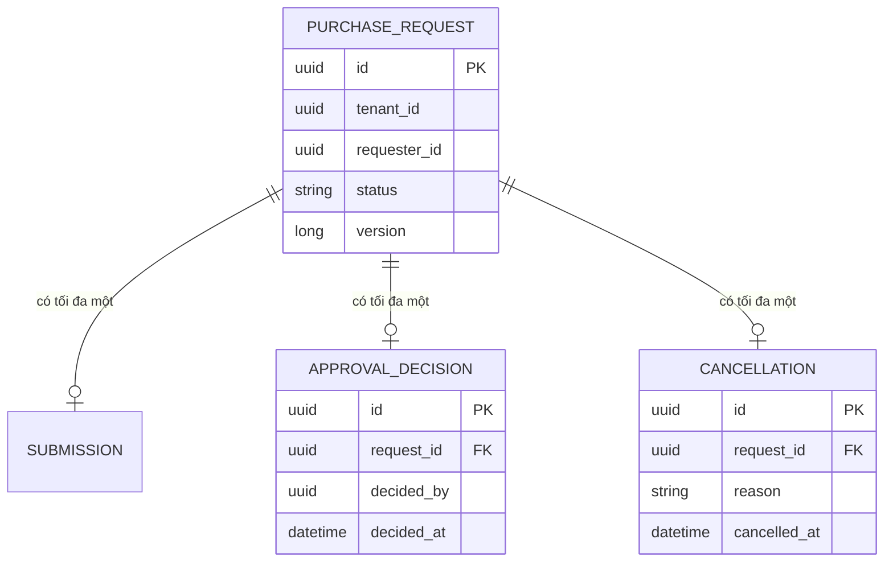
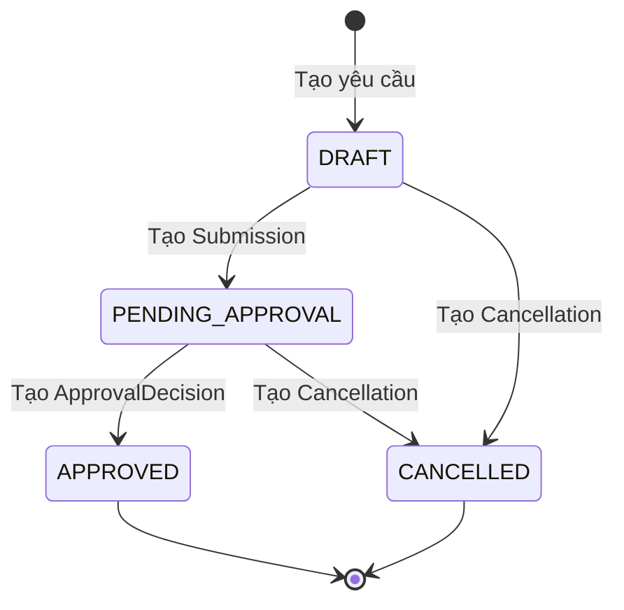

# Bài thực hành tổng hợp: Mô hình hóa quy trình duyệt, hủy bằng tài nguyên nghiệp vụ

## 1. Bối cảnh và mục tiêu

Một hệ thống mua sắm nội bộ cho phép nhân viên tạo **yêu cầu mua hàng**, gửi duyệt, người quản lý phê duyệt và người tạo hủy yêu cầu khi không còn nhu cầu. Mọi quyết định cần truy vết: ai thực hiện, lúc nào, trên phiên bản nào của yêu cầu và vì sao.

Nhiệm vụ của bạn là thiết kế REST API theo **tài nguyên nghiệp vụ**, thay vì chỉ ghép các động từ vào URL. Đây là bài **Thực hành tổng hợp** trong mô-đun **INTEGRATION_API_REST**: kết nối cách xác định resource/URI, phương thức và status HTTP với **hợp đồng OpenAPI, xác thực/phân quyền, idempotency, xử lý lỗi, kiểm soát đồng thời và kiểm thử bằng Java/Spring**.

Sau bài này, bạn cần tự giải thích và hiện thực được:

1. **Tài nguyên nào tồn tại**: yêu cầu mua hàng, lần gửi duyệt, quyết định duyệt, yêu cầu hủy; dữ liệu nào là trạng thái hiện tại, dữ liệu nào là lịch sử bất biến.
2. **Ai được phép tạo tài nguyên nào**, trên trạng thái nào, và hệ thống phải trả mã HTTP gì khi yêu cầu hợp lệ hoặc bị từ chối.
3. **Cách chống xử lý trùng và tranh chấp** khi hai tác nhân cùng duyệt/hủy gần như đồng thời.
4. **Cách viết hợp đồng API và bài kiểm thử** mà người tích hợp có thể thực hiện độc lập.

> Phạm vi bài tập: quy trình **một cấp duyệt**; sau khi được duyệt thì không thể hủy bằng quy trình này. Hệ thống thật có thể có nhiều cấp duyệt, thu hồi phê duyệt, bồi hoàn hoặc quy trình hủy sau duyệt; đó là các quy tắc mới cần thiết kế riêng.

## 2. Đề bài nghiệp vụ

Hệ thống có hai vai trò chính:

- **Requester**: nhân viên tạo và chỉnh sửa yêu cầu ở trạng thái nháp, gửi duyệt, hủy yêu cầu của mình trước khi được duyệt.
- **Approver**: người có thẩm quyền duyệt yêu cầu đang chờ duyệt, không được tự duyệt yêu cầu do chính mình tạo.

Mỗi yêu cầu mua hàng có mã `requestId`, mã tổ chức `tenantId`, `requesterId`, nội dung hàng hóa, số tiền, tiền tệ, trạng thái và số phiên bản `version`. Một quyết định duyệt hoặc yêu cầu hủy phải lưu người thực hiện, thời điểm và lý do/ghi chú. Không được xóa lịch sử khi trạng thái thay đổi.

Các quy tắc phải thỏa mãn:

| Mã | Quy tắc |
| --- | --- |
| BR-01 | Người tạo có thể chỉnh sửa hoặc gửi duyệt khi yêu cầu còn `DRAFT`. |
| BR-02 | Chỉ Approver được phép duyệt yêu cầu `PENDING_APPROVAL`; không được tự duyệt yêu cầu của mình. |
| BR-03 | Requester được phép hủy `DRAFT` hoặc `PENDING_APPROVAL`, phải cung cấp lý do hủy. |
| BR-04 | `APPROVED` và `CANCELLED` là trạng thái cuối trong phạm vi bài tập. |
| BR-05 | Một yêu cầu chỉ có tối đa một lần gửi duyệt, một quyết định duyệt thành công **hoặc** một bản ghi hủy thành công trong quy trình một cấp này. |
| BR-06 | Duyệt và hủy phải là hai thay đổi **loại trừ nhau**, kể cả khi được gọi đồng thời. |
| BR-07 | Retry cùng một lệnh có `Idempotency-Key` hợp lệ không tạo thêm quyết định hay bản ghi hủy. |
| BR-08 | Tài nguyên của tổ chức khác không được truy cập; người dùng phải xác thực và được kiểm tra quyền trên đối tượng cụ thể. |

Hãy phân biệt hai điều: *trạng thái* của yêu cầu mua hàng cho biết nó hiện đang ở đâu; *sự kiện/tài nguyên nghiệp vụ* `ApprovalDecision` hoặc `Cancellation` cho biết quyết định nào làm trạng thái thay đổi. Chỉ lưu một trường `status` sẽ mất thông tin kiểm toán.

## 3. Tìm các tài nguyên trước khi thiết kế URL

Một phương án phù hợp là:

| Tài nguyên | Thuộc tính chính | Vai trò |
| --- | --- | --- |
| `PurchaseRequest` | `id, tenantId, requesterId, items, amount, currency, status, version` | Aggregate chính, hiển thị trạng thái hiện tại. |
| `Submission` | `id, requestId, submittedBy, submittedAt` | Bằng chứng yêu cầu đã được gửi duyệt. |
| `ApprovalDecision` | `id, requestId, decision=APPROVE, decidedBy, comment, decidedAt` | Quyết định duyệt được lưu bất biến. |
| `Cancellation` | `id, requestId, reason, cancelledBy, cancelledAt` | Bản ghi hủy có lý do và người thực hiện. |

Ở đây `Submission`, `ApprovalDecision` và `Cancellation` là **tài nguyên con có danh tính**, không chỉ là tên gọi khác của phương thức `submit()`, `approve()`, `cancel()`. Mỗi `POST` tạo một bản ghi nghiệp vụ mới trong cùng transaction cập nhật aggregate.

Sơ đồ quan hệ khái niệm:



**Câu hỏi thiết kế:** Vì sao không dùng `POST /requests/{id}/approve` và `POST /requests/{id}/cancel`?

Các endpoint dạng hành động vẫn có thể được sử dụng thực tế nếu hợp đồng nêu rõ, nhưng `POST` vào collection `/approval-decisions` hay `/cancellations` diễn đạt chính xác **tài nguyên mới được tạo**, giúp định danh kết quả qua `Location`, truy vấn lịch sử, theo dõi người quyết định và thể hiện một mô hình tài nguyên nhất quán. Không có một quy tắc REST bắt buộc mọi chuyển trạng thái phải thành subresource; hãy chọn cách phản ánh nghiệp vụ và nhất quán trong API.

## 4. Vẽ state machine và ràng buộc chuyển trạng thái



| Trạng thái hiện tại | Lệnh | Điều kiện | Trạng thái kế | Kết quả nếu điều kiện sai |
| --- | --- | --- | --- | --- |
| `DRAFT` | Chỉnh sửa | Requester sở hữu, đúng version, dữ liệu hợp lệ. | `DRAFT`, version tăng. | 403 / 412 / 422 tùy nguyên nhân. |
| `DRAFT` | Gửi duyệt | Requester, đúng version, ít nhất một item, tổng tiền hợp lệ. | `PENDING_APPROVAL`. | 403 / 412 / 422. |
| `DRAFT` | Hủy | Requester, có lý do và đúng version. | `CANCELLED`. | 403 / 412 / 422. |
| `PENDING_APPROVAL` | Duyệt | Approver hợp lệ, không tự duyệt, đúng version. | `APPROVED`. | 403 / 412 / 409. |
| `PENDING_APPROVAL` | Hủy | Requester, có lý do, đúng version. | `CANCELLED`. | 403 / 412 / 409. |
| `APPROVED` | Hủy trong workflow này | Không được phép theo BR-04. | Giữ nguyên. | 409. |
| `CANCELLED` | Duyệt | Không được phép theo BR-04. | Giữ nguyên. | 409. |

Phân biệt hai kiểu xung đột:

- **`412 Precondition Failed`**: request gửi `If-Match: "v2"` trong khi phiên bản hiện tại là `"v3"`. Client đang thao tác trên bản đã cũ.
- **`409 Conflict`**: client đã có version mới nhất nhưng cố duyệt yêu cầu đã bị hủy hoặc hủy yêu cầu đã duyệt; chuyển trạng thái trái quy tắc nghiệp vụ.

Nếu API yêu cầu `If-Match` mà client không gửi, có thể dùng **`428 Precondition Required`** để diễn đạt rõ hợp đồng (phải cấu hình xử lý lỗi tương ứng). **403 Forbidden** là thiếu quyền trên hành động/tài nguyên; không sử dụng 409 để che lỗi phân quyền.

## 5. Thiết kế URI và HTTP method

Giả sử prefix public là `/v1`:

| Method và URI | Ý nghĩa | Kết quả thành công |
| --- | --- | --- |
| `POST /v1/purchase-requests` | Tạo yêu cầu mua hàng ở trạng thái `DRAFT`. | 201 + `Location` aggregate mới. |
| `GET /v1/purchase-requests/{id}` | Đọc trạng thái và phiên bản. | 200 + body + `ETag`. |
| `GET /v1/purchase-requests?status=PENDING_APPROVAL&limit=20&cursor=...` | Tìm danh sách yêu cầu được phép xem, phân trang theo cursor. | 200 + `items, nextCursor`. |
| `PATCH /v1/purchase-requests/{id}` | Sửa các trường được cho phép khi còn `DRAFT`. | 200 + bản mới hoặc 204. |
| `POST /v1/purchase-requests/{id}/submissions` | Tạo lần gửi duyệt và chuyển sang `PENDING_APPROVAL`. | 201 + `Location` Submission. |
| `POST /v1/purchase-requests/{id}/approval-decisions` | Ghi quyết định duyệt, chuyển sang `APPROVED`. | 201 + `Location` ApprovalDecision. |
| `POST /v1/purchase-requests/{id}/cancellations` | Tạo bản ghi hủy, chuyển sang `CANCELLED`. | 201 + `Location` Cancellation. |
| `GET /v1/purchase-requests/{id}/approval-decisions/{decisionId}` | Đọc quyết định đã ghi. | 200 nếu có quyền. |
| `GET /v1/purchase-requests/{id}/cancellations/{cancellationId}` | Đọc lý do hủy và người hủy. | 200 nếu có quyền. |

Giả định tài nguyên con không có endpoint `DELETE` vì đây là bằng chứng kiểm toán. `DELETE /purchase-requests/{id}` không phù hợp để diễn tả hành động **hủy yêu cầu theo nghiệp vụ**: HTTP DELETE nhằm loại bỏ liên kết tài nguyên đích theo ngữ nghĩa HTTP, còn hủy vẫn cần giữ aggregate, lý do và lịch sử.

Đối với API có yêu cầu bí mật dữ liệu, cân nhắc `Cache-Control: private, no-store` trên các phản hồi chứa dữ liệu nhạy cảm. `ETag` ở đây chủ yếu làm precondition để chống cập nhật đè; không phải lời hứa rằng hệ thống trung gian được phép cache nội dung.

## 6. Thiết kế hợp đồng request/response

### 6.1. Tạo và đọc yêu cầu mua hàng

```http
POST /v1/purchase-requests HTTP/1.1
Authorization: Bearer <access-token>
Content-Type: application/json

{
  "items": [
    {"sku": "LAPTOP-01", "quantity": 2, "unitPrice": 15000000}
  ],
  "currency": "VND",
  "purpose": "Trang bị máy cho nhóm dự án"
}
```

Response minh họa:

```http
HTTP/1.1 201 Created
Location: /v1/purchase-requests/req-1001
ETag: "v1"
Content-Type: application/json
Cache-Control: private, no-store

{
  "id": "req-1001",
  "requesterId": "user-17",
  "status": "DRAFT",
  "version": 1,
  "totalAmount": 30000000,
  "currency": "VND"
}
```

`totalAmount` nên được tính ở server từ dữ liệu đã xác thực; client không được tự quyết định tổng tiền hay `requesterId`. Xác định quy tắc làm tròn và kiểu biểu diễn tiền (ví dụ đơn vị nhỏ nhất dạng integer hoặc decimal), tránh dùng `double` cho nghiệp vụ tài chính.

### 6.2. Gửi duyệt

```http
POST /v1/purchase-requests/req-1001/submissions HTTP/1.1
Authorization: Bearer <access-token>
If-Match: "v1"
Idempotency-Key: submit-req-1001-2026-01
Content-Type: application/json

{}
```

```http
HTTP/1.1 201 Created
Location: /v1/purchase-requests/req-1001/submissions/sub-51
Content-Type: application/json

{
  "submissionId": "sub-51",
  "requestId": "req-1001",
  "status": "PENDING_APPROVAL",
  "version": 2
}
```

Trường `version: 2` trong response cho biết phiên bản mới của aggregate `PurchaseRequest`. Để nhận giá trị `ETag` dùng cho `If-Match` tiếp theo, client có thể `GET /v1/purchase-requests/req-1001` và đọc `ETag: "v2"` từ **representation của aggregate**. `ETag` trên phản hồi tạo `Submission` (nếu API phát hành) sẽ mô tả representation của `Submission`, không tự động là ETag của aggregate.

### 6.3. Duyệt thành công

```http
POST /v1/purchase-requests/req-1001/approval-decisions HTTP/1.1
Authorization: Bearer <approver-token>
If-Match: "v2"
Idempotency-Key: approve-req-1001-2026-01
Content-Type: application/json

{"comment": "Chi phí phù hợp ngân sách"}
```

```http
HTTP/1.1 201 Created
Location: /v1/purchase-requests/req-1001/approval-decisions/dec-81
Content-Type: application/json

{
  "decisionId": "dec-81",
  "requestId": "req-1001",
  "decision": "APPROVE",
  "status": "APPROVED",
  "version": 3,
  "decidedBy": "manager-9"
}
```

API lấy `decidedBy` từ danh tính đã xác thực, không tin trường này nếu client gửi trong JSON. Để lưu timestamp chính xác, server ghi `decidedAt` trong cùng transaction với thay đổi trạng thái.

### 6.4. Hủy một yêu cầu khác khi đang chờ duyệt

```http
POST /v1/purchase-requests/req-1002/cancellations HTTP/1.1
Authorization: Bearer <requester-token>
If-Match: "v4"
Idempotency-Key: cancel-req-1002-2026-01
Content-Type: application/json

{"reason": "Không còn nhu cầu mua hàng"}
```

```http
HTTP/1.1 201 Created
Location: /v1/purchase-requests/req-1002/cancellations/can-63
Content-Type: application/json

{
  "cancellationId": "can-63",
  "requestId": "req-1002",
  "status": "CANCELLED",
  "version": 5,
  "reason": "Không còn nhu cầu mua hàng"
}
```

Các ID `req-1001`/`dec-81`/`can-63` và số version là dữ liệu mẫu. Dùng UUID/ULID hoặc ID do hệ thống quy định nhất quán trong triển khai thật.

## 7. Chống retry trùng với Idempotency-Key

`POST` không mặc nhiên idempotent theo HTTP. Nếu client gửi duyệt, nhận timeout nhưng transaction thực tế đã commit, gửi lại một `POST` không được tạo thêm quyết định. Thiết kế idempotency có thể gồm:

1. Yêu cầu header `Idempotency-Key` với các lệnh tạo Submission, ApprovalDecision, Cancellation.
2. Lưu định danh key cùng phạm vi `tenant + authenticated actor + method + route/target resource` và **fingerprint** nội dung request; chọn thời gian lưu giữ theo chính sách API và ghi rõ trong tài liệu.
3. Khi key mới, chạy kiểm tra nghiệp vụ trong transaction; tạo tài nguyên và lưu response/`Location` cho key đó một cách nguyên tử.
4. Khi cùng key và **cùng payload**, sau khi xác thực/kiểm tra quyền, trả lại kết quả đã ghi (ví dụ cùng 201, cùng `Location`, `version`) dù request cũ đã chuyển trạng thái.
5. Khi cùng key nhưng **payload khác**, báo lỗi 409 với type lỗi riêng, không coi hai lệnh là một.

Việc chống retry phải **không chỉ** dựa vào key ở bộ nhớ một instance: nhiều replica cùng phục vụ cần kho lưu trữ chung và unique constraint hoặc giao dịch tương đương. Lưu key đủ lâu theo quy ước; sau khi hết hạn, quy tắc trạng thái và ràng buộc unique vẫn ngăn tạo quyết định trùng.

**Thứ tự xử lý cần có chủ đích:** xác thực → kiểm tra quyền → nhận diện replay hợp lệ theo key/fingerprint → nếu là lệnh mới thì kiểm tra `If-Match` và state machine → commit. Không yêu cầu client gửi version mới hơn khi chỉ retry **chính cùng một lệnh đã được xác nhận**; nhưng tuyệt đối không bỏ kiểm tra quyền hoặc dùng key của người khác để lấy response.

## 8. Xử lý approve và cancel đồng thời

Giả sử yêu cầu `req-1003` ở `PENDING_APPROVAL`, `version=7`. Approver gửi duyệt và Requester gửi hủy gần như cùng lúc, cả hai đều mang `If-Match: "v7"`.

```mermaid
sequenceDiagram
    participant A as Approver
    participant S as Workflow service
    participant R as Requester
    participant DB as Database
    A->>S: POST approval-decisions; If-Match "v7"
    R->>S: POST cancellations; If-Match "v7"
    S->>DB: Transaction duyệt: lock/đối chiếu version
    DB-->>S: PENDING_APPROVAL, v7
    S->>DB: Insert decision + update APPROVED, v8
    DB-->>S: Commit
    S-->>A: 201 Created; version=8 trong body
    S->>DB: Transaction hủy: lock/đối chiếu version
    DB-->>S: APPROVED, v8
    S-->>R: 412 Precondition Failed
```

Khi hủy thắng thì duyệt phải thất bại tương ứng; **chính sách thắng/thua phụ thuộc transaction thực sự commit trước**, không phụ thuộc thứ tự request tới gateway.

Triển khai có thể chọn một trong hai cơ chế:

- **Optimistic locking**: cột `version`, câu lệnh update có điều kiện `WHERE id=? AND version=? AND status=?`; nếu không cập nhật được row thì đọc lại state, phân loại `412` hoặc `409`.
- **Pessimistic row lock**: `SELECT ... FOR UPDATE` aggregate, kiểm tra version/trạng thái trong transaction, sau đó insert event và cập nhật status/version trước khi commit.

Dù chọn cách nào, **tạo ApprovalDecision/Cancellation, cập nhật aggregate và ghi idempotency result phải ở cùng ranh giới transaction** hoặc một cơ chế atomic tương đương. Không cho tình trạng quyết định đã lưu nhưng trạng thái aggregate chưa cập nhật.

Ràng buộc database quan trọng là unique `approval_decisions(request_id)`, unique `cancellations(request_id)`, unique `submissions(request_id)` trong mô hình một cấp này. Chúng bổ trợ kiểm tra application chứ không thay thế state machine. Không dùng mỗi unique constraint để loại trừ *cả hai loại event khác nhau*; phải có cập nhật trạng thái nguyên tử hoặc khóa aggregate.

## 9. Xử lý lỗi chuẩn hóa

Dùng `application/problem+json` theo RFC 9457 để client phân biệt lỗi dữ liệu, quyền và trạng thái.

Ví dụ client dùng version cũ:

```http
HTTP/1.1 412 Precondition Failed
Content-Type: application/problem+json
Cache-Control: no-store

{
  "type": "https://api.example.com/problems/stale-version",
  "title": "Precondition Failed",
  "status": 412,
  "detail": "Yêu cầu đã thay đổi từ phiên bản v7 sang v8.",
  "instance": "/v1/purchase-requests/req-1003",
  "requestId": "trace-abc"
}
```

Ví dụ client dùng version **mới nhất** nhưng thao tác sai quy tắc:

```http
HTTP/1.1 409 Conflict
Content-Type: application/problem+json

{
  "type": "https://api.example.com/problems/invalid-transition",
  "title": "Conflict",
  "status": 409,
  "detail": "Không thể hủy yêu cầu đã được duyệt.",
  "currentStatus": "APPROVED"
}
```

Bảng ánh xạ kết quả dự kiến:

| Trường hợp | Mã HTTP | Client cần làm |
| --- | --- | --- |
| Tạo yêu cầu/record thành công | **201 Created** | Ghi `Location` và ID tài nguyên. |
| Đọc yêu cầu có quyền | **200 OK** | Hiển thị state và version; `ETag` nếu API cung cấp. |
| Thiếu hoặc sai token | **401 Unauthorized** | Thực hiện lại xác thực theo `WWW-Authenticate` nếu phù hợp. |
| Có token nhưng không đủ quyền / tự duyệt | **403 Forbidden** | Không retry nguyên lệnh; báo đúng lý do/quyền. |
| Không tìm thấy tài nguyên | **404 Not Found** | Kiểm tra ID; có thể dùng 404 để không tiết lộ tài nguyên khác tenant theo chính sách. |
| Không hỗ trợ phương thức | **405 Method Not Allowed** | Kiểm tra `Allow` và hợp đồng route. |
| Chuyển trạng thái không hợp lệ | **409 Conflict** | Tải lại tài nguyên và hướng dẫn nghiệp vụ tiếp theo. |
| `If-Match` không khớp | **412 Precondition Failed** | Tải lại representation/version trước khi ra quyết định mới. |
| Thiếu `If-Match` bắt buộc | **428 Precondition Required** | Thêm precondition theo hợp đồng. |
| Dữ liệu đúng cú pháp nhưng vi phạm validation nghiệp vụ | **422 Unprocessable Content** | Sửa dữ liệu, ví dụ lý do hủy trống. |
| Vượt rate limit | **429 Too Many Requests** | Tuân thủ `Retry-After` nếu được gửi; retry có kiểm soát. |

Duy trì `requestId`/trace ID để dò log; không trả stack trace, token, thông tin tenant hoặc lịch sử riêng tư trong `detail`. Khi chủ thể có `If-Match` đúng nhưng không có quyền, server vẫn phải chặn thao tác; không để thông tin precondition tạo đường vòng qua phân quyền.

## 10. Mẫu hiện thực bằng Spring Boot / Spring MVC

Đoạn mã sau minh họa contract phía HTTP. Nó **không phải ứng dụng hoàn chỉnh**: `WorkflowService` phải thực hiện kiểm tra quyền, idempotency và transaction ở tầng nghiệp vụ như phần trên.

```java
import java.net.URI;
import java.security.Principal;
import java.util.UUID;

import org.springframework.http.ResponseEntity;
import org.springframework.web.bind.annotation.PathVariable;
import org.springframework.web.bind.annotation.PostMapping;
import org.springframework.web.bind.annotation.RequestBody;
import org.springframework.web.bind.annotation.RequestHeader;
import org.springframework.web.bind.annotation.RequestMapping;
import org.springframework.web.bind.annotation.RestController;

@RestController
@RequestMapping("/v1/purchase-requests")
class WorkflowController {
    private final WorkflowService service;

    WorkflowController(WorkflowService service) {
        this.service = service;
    }

    @PostMapping("/{id}/approval-decisions")
    ResponseEntity<ApprovalReceipt> approve(
            @PathVariable UUID id,
            @RequestHeader("If-Match") String ifMatch,
            @RequestHeader("Idempotency-Key") String idempotencyKey,
            @RequestBody ApproveInput input,
            Principal principal) {

        ApprovalReceipt result = service.approve(
                id, principal.getName(), ifMatch, idempotencyKey, input);

        URI location = URI.create("/v1/purchase-requests/" + id
                + "/approval-decisions/" + result.decisionId());
        return ResponseEntity.created(location).body(result);
    }

    record ApproveInput(String comment) {}
    record ApprovalReceipt(
            UUID decisionId, UUID requestId,
            String decision, String status, long version) {}

    interface WorkflowService {
        ApprovalReceipt approve(
                UUID id, String actor, String ifMatch,
                String idempotencyKey, ApproveInput input);
    }
}
```

Lưu ý: ví dụ request/response ở trên dùng ID dễ đọc như `req-1001`, còn controller minh họa sử dụng `UUID`. Chọn **một** định dạng ID khi triển khai và phản ánh chính xác trong OpenAPI. Spring mặc định có thể trả **400** khi thiếu header bắt buộc; để trả **428** như hợp đồng đề xuất, cần cấu hình handler phân loại lỗi thiếu `If-Match` và chuyển nó thành Problem Details. Các lỗi domain như stale version, invalid transition và thiếu quyền cũng cần mapping rõ ràng.

### Pseudocode của transaction ở tầng service

```text
approve(requestId, actor, ifMatch, key, comment):
  authenticate(actor)
  authorize(actor, "APPROVE", requestId)       // kiểm tra role, tenant, ownership

  if idempotencyStore.hasCommittedResult(key, requestFingerprint):
      return exactPreviouslyCommittedResponse() // cùng resource và Location

  begin transaction
    request = repository.lockById(requestId)

    if request.version != parseStrongETag(ifMatch):
        fail 412
    if request.status != PENDING_APPROVAL:
        fail 409
    if request.requesterId == actor.id:
        fail 403

    decision = approvalDecisionRepository.insert(
        requestId, actor.id, comment, now()
    )
    request.status = APPROVED
    request.version += 1
    repository.save(request)
    idempotencyStore.recordSuccessAtomically(key, fingerprint, response)
  commit

  return 201 Created + Location(decision.id) + version trong response body
```

Đây là thuật toán khái niệm, không phải code chạy trực tiếp. Dữ liệu idempotency cần ràng buộc uniqueness và xử lý **hai lệnh cùng key đến đồng thời** (chẳng hạn insert key trong transaction trước khi xử lý, hoặc khóa theo key), không chỉ kiểm tra `hasCommittedResult`. Trong hệ phân tán, thông báo sau commit nên dùng transactional outbox hoặc cơ chế tương đương; không gửi sự kiện "đã duyệt" ra message broker trước khi transaction bền vững.

## 11. Phần giao việc cho người học

Hãy thực hiện trên giấy, OpenAPI và dự án Java/Spring của bạn theo thứ tự:

1. **Lập mô hình:** vẽ quan hệ `PurchaseRequest`, `Submission`, `ApprovalDecision`, `Cancellation`. Giải thích vì sao sau khi hủy vẫn giữ aggregate và bản ghi hủy.
2. **Thiết kế hợp đồng:** định nghĩa JSON schema, method/URI, 201/`Location`, `ETag`/`If-Match`, `Idempotency-Key` và tối thiểu 5 trường hợp Problem Details.
3. **Cài đặt state machine:** triển khai 4 trạng thái, 4 hành động (sửa nháp, gửi duyệt, duyệt, hủy) và các vai trò được phép.
4. **Đảm bảo transaction:** thêm version/lock và ràng buộc unique; chứng minh approve và cancel không thể cùng thành công.
5. **Kiểm thử hợp đồng:** viết API integration tests bằng MockMvc hoặc HTTP client tương đương, chạy bằng principal test khác nhau và dữ liệu tenant khác nhau.
6. **Thảo luận vận hành:** ghi audit log an toàn, correlation ID, metric chuyển trạng thái lỗi và cách xử lý retry/timeouts.

### Khung OpenAPI tối thiểu để mở rộng

```yaml
openapi: 3.0.3
info:
  title: Purchase Request Workflow
  version: "1.0"
paths:
  /v1/purchase-requests/{id}/approval-decisions:
    post:
      summary: Tạo một quyết định duyệt
      security:
        - bearerAuth: []
      parameters:
        - name: id
          in: path
          required: true
          schema:
            type: string
            format: uuid
        - name: If-Match
          in: header
          required: true
          schema:
            type: string
          example: '"v2"'
        - name: Idempotency-Key
          in: header
          required: true
          schema:
            type: string
            minLength: 1
      requestBody:
        required: true
        content:
          application/json:
            schema:
              type: object
              properties:
                comment:
                  type: string
                  maxLength: 1000
      responses:
        '201':
          description: Đã tạo quyết định duyệt
          headers:
            Location:
              description: URI của quyết định mới
              schema:
                type: string
        '401':
          description: Chưa xác thực
        '403':
          description: Không có quyền duyệt
        '404':
          description: Không tìm thấy yêu cầu được phép xem
        '409':
          description: Chuyển trạng thái không hợp lệ hoặc key trùng payload
        '412':
          description: Version đã thay đổi
        '428':
          description: Thiếu If-Match bắt buộc
components:
  securitySchemes:
    bearerAuth:
      type: http
      scheme: bearer
      bearerFormat: JWT
```

Đây là **khung** để bổ sung `requestBody`/`response` schemas và mã lỗi đầy đủ, không phải đặc tả OpenAPI hoàn chỉnh cho cả hệ thống. Khi viết thật, tài liệu hóa chi tiết `application/problem+json` cùng quy tắc token, pagination, caching và thời gian sống của idempotency key. `bearerFormat: JWT` chỉ mô tả dạng token dự kiến; ứng dụng vẫn phải xác thực chữ ký, issuer, audience, expiry và thực hiện authorization theo chính sách.

## 12. Ma trận kiểm thử chấp nhận

| ID | Kịch bản | Kết quả mong đợi |
| --- | --- | --- |
| TC-01 | Requester tạo yêu cầu hợp lệ. | 201, `Location` mới, `DRAFT`, version = 1. |
| TC-02 | Requester sửa khi `DRAFT` với `If-Match` đúng. | 200, dữ liệu thay đổi, version tăng. |
| TC-03 | Gửi duyệt `DRAFT` và retry cùng key/payload. | Lần đầu 201; retry trả cùng kết quả đã ghi, chỉ một Submission. |
| TC-04 | Approver khác requester duyệt `PENDING_APPROVAL`. | 201, một ApprovalDecision, trạng thái `APPROVED`. |
| TC-05 | Requester tự duyệt yêu cầu của chính mình. | 403, không sinh Decision. |
| TC-06 | Requester hủy `PENDING_APPROVAL`, có lý do. | 201, một Cancellation, `CANCELLED`. |
| TC-07 | Requester hủy sau khi `APPROVED`, dùng version mới nhất. | 409, không sinh Cancellation. |
| TC-08 | Approver duyệt sau khi `CANCELLED`, dùng version mới nhất. | 409, không sinh Decision. |
| TC-09 | Duyệt với `If-Match` cũ. | 412, không cập nhật state. |
| TC-10 | Thiếu `If-Match` khi tạo Decision. | 428 theo hợp đồng đã thiết kế. |
| TC-11 | Hai client cùng duyệt/hủy ở version cũ. | Chỉ một lệnh thắng; lệnh còn lại 412 hoặc 409 theo precondition/state được đánh giá. |
| TC-12 | Retry cùng key nhưng sửa payload. | 409 với loại lỗi `idempotency-key-reused`; không tạo bản ghi mới. |
| TC-13 | Không có token / token không đủ quyền. | 401 / 403; không tiết lộ dữ liệu khác tenant. |
| TC-14 | `GET` tài nguyên của tenant khác. | 404 hoặc 403 theo chính sách đã công bố, không lộ dữ liệu. |
| TC-15 | Requester gửi hủy với reason rỗng. | 422, không đổi trạng thái. |
| TC-16 | Đồng thời 20 request cùng key trên nhiều instance. | Một kết quả tạo thành công và các phản hồi replay/theo hợp đồng; chỉ một bản ghi nghiệp vụ. |

Với TC-11, không chỉ assert status response: cần đọc lại aggregate, đếm decision/cancellation trong database và đối chiếu audit. TC-16 cần chạy kiểm thử tích hợp với kho idempotency dùng chung, không thể kết luận từ một unit test giả lập lưu key trong bộ nhớ.

## 13. Các lỗi thiết kế cần nhận diện

**Dùng `PATCH /purchase-requests/{id} {"status":"APPROVED"}` cho mọi client.** Cách này để client tùy ý điều khiển state và bỏ qua quyền, điều kiện chuyển trạng thái, quyết định kiểm toán. Nếu cung cấp PATCH, chỉ cho sửa trường được phép theo status/actor; các chuyển trạng thái nghiệp vụ đi qua command/resource riêng có kiểm chứng.

**Dùng `DELETE` như “hủy” rồi xóa sạch record.** Mất audit và dẫn đến khó giải thích 404 cho các hệ tích hợp đang tham chiếu đến yêu cầu cũ. Hủy ở bài tập là tạo Cancellation và cập nhật state.

**Chỉ kiểm tra status ở frontend.** Hai người có thể đồng thời bấm duyệt/hủy; kiểm tra UI không đảm bảo BR-06. Cần ràng buộc server và transaction.

**Dùng idempotency key nhưng bỏ fingerprint và uniqueness.** Cùng key cho hai payload khác nhau có thể trả nhầm kết quả, và hai replica vẫn tạo trùng. Kho key phải có scope và cơ chế đồng bộ.

**Tin trường actor/tenant do client gửi.** Xác định actor từ identity đã xác thực, tenant từ access context và kiểm tra quyền trên aggregate. Không chỉ dựa vào role chung để đọc/sửa mọi yêu cầu.

**Trả tất cả lỗi bằng 400 hoặc 500.** Client không phân biệt payload sai, thiếu quyền, phiên bản cũ hay trạng thái không hợp lệ. Dùng HTTP status phù hợp và Problem Details nhất quán.

## 14. Gợi ý tự đánh giá sản phẩm

| Tiêu chí | Điểm tối đa | Đạt yêu cầu khi |
| --- | ---: | --- |
| Resource, URI, HTTP semantics | 20 | Tài nguyên có danh tính rõ ràng, method/status/Location hợp lý. |
| State machine & quy tắc nghiệp vụ | 20 | Thể hiện đầy đủ chuyển trạng thái và trường hợp bị cấm. |
| Security & audit | 15 | Có owner/tenant check, phân quyền duyệt, lưu actor/timestamp/lý do. |
| Idempotency & concurrency | 20 | Không xử lý trùng, hai lệnh duyệt/hủy không cùng thắng. |
| OpenAPI & error contract | 15 | Client hiểu request/response và phân biệt 409/412/428/401/403. |
| Integration tests | 10 | Bao phủ happy path, concurrency, cross-tenant và retry. |
| **Tổng** | **100** | **Có thể chứng minh bằng request/response và trạng thái lưu trong database.** |

Một thiết kế tốt cho bài này phải trả lời được câu hỏi cốt lõi: **“Ai đã làm gì với yêu cầu mua hàng, trong điều kiện nào, và liệu lệnh đó đã từng được xử lý trước đó chưa?”**. Nếu chỉ nhìn vào status hiện tại mà không chứng minh được các điều trên, mô hình vẫn thiếu phần nghiệp vụ quan trọng.

## Tài liệu tham khảo

- [RFC 9110 — HTTP Semantics (Methods, Status Codes, Conditional Requests)](https://www.rfc-editor.org/rfc/rfc9110).
- [RFC 9457 — Problem Details for HTTP APIs](https://www.rfc-editor.org/rfc/rfc9457).
- [RFC 6585 — HTTP 428 Precondition Required](https://www.rfc-editor.org/rfc/rfc6585#section-3) *(428 được quy định tại RFC 6585, mục 3)*.
- [OpenAPI Specification 3.0.3](https://spec.openapis.org/oas/v3.0.3.html).
- [Spring Framework — REST Controllers](https://docs.spring.io/spring-framework/reference/web/webmvc/mvc-controller.html).
