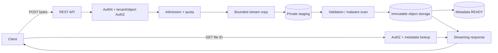
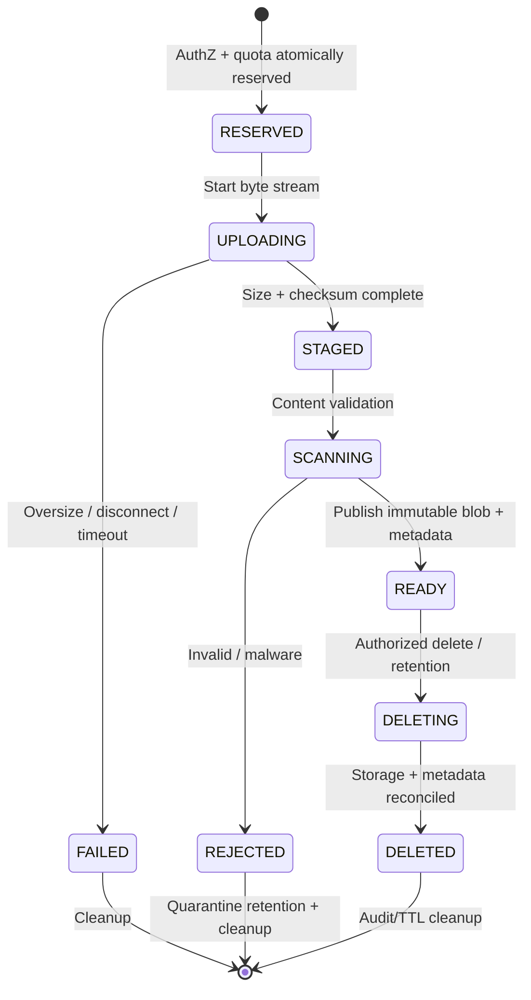

# Upload, download theo luồng với kiểm soát quyền và kích thước

> **Chương:** Thực hành tổng hợp  
> **Module:** **INTEGRATION_API_REST** — thiết kế REST API theo resource, URI, HTTP method và status, hợp đồng dữ liệu rõ ràng; thực hành phân trang, cache, idempotency, OpenAPI, xác thực, phân quyền, xử lý lỗi và kiểm thử với Java/Spring hoặc công nghệ tương đương.
>
> **Nhiệm vụ:** Xây dựng API nhận file **theo luồng** (streaming upload), lưu vào vùng riêng chưa công bố, kiểm tra kích thước và quyền truy cập, sau đó cho phép **download theo luồng** mà không đọc toàn bộ file vào heap. Phải chứng minh user thuộc tenant khác không thể tải file bằng cách đoán ID, file quá lớn bị dừng trong lúc đọc, và lỗi không để lại file tạm/metadata sai trạng thái.

## 1. Bối cảnh thực hành và kết quả cần nộp

Một hệ thống thương mại điện tử cần lưu tài liệu đính kèm cho đơn hàng: hóa đơn, tài liệu chứng nhận hoặc file do nhân viên nội bộ tải lên. Giả sử mỗi tài khoản có một tenant, mỗi file có chủ sở hữu và mỗi người dùng chỉ được truy cập file thuộc tenant mà mình được cấp quyền.

Sơ đồ yêu cầu:



Mô hình bài tập sử dụng Spring Boot 3, Java 17+, Spring MVC/Servlet và filesystem riêng để hiểu rõ xử lý luồng. Trong triển khai production, có thể thay filesystem bằng object storage nhưng vẫn giữ **phân quyền, quota, kiểm kích thước thực, lifecycle và API contract**.

### 1.1. Năng lực cần đạt

Sau khi thực hành, người học có thể:

1. Phân biệt streaming với cách đọc toàn bộ request bằng `byte[]` hoặc `MultipartFile.getBytes()`; nêu rõ giới hạn của multipart parser.
2. Thiết kế HTTP contract cho tạo file, đọc metadata, download, lỗi `401`/`403`/`404`/`413`/`415`/`429`/`503` và trường hợp upload bị ngắt.
3. Giới hạn bytes **thực sự đọc** thay vì tin `Content-Length`; tính checksum trong lúc ghi, dọn staging sau lỗi, giới hạn thời gian, số upload song song và dung lượng tenant.
4. Kiểm tra principal đã xác thực, tenant/owner **trước khi phát bytes**; không sử dụng ID, filename hay đường dẫn do client gửi làm quyền truy cập.
5. Tạo `StreamingResponseBody`/response binary với `Content-Type`, `Content-Length` (khi bảo đảm), `Content-Disposition` và `X-Content-Type-Options` đúng.
6. Viết test chứng minh file 0 byte, file đúng hạn mức, vượt hạn mức không khai báo size, quyền chéo tenant, file bị xóa giữa lúc download và cleanup khi lỗi.
7. Giải thích tính nhất quán metadata ↔ blob, idempotency khi retry, tải file lớn/Range, quan sát hệ thống và giới hạn tài nguyên thực tế.

### 1.2. Chính sách minh họa

Các ngưỡng sau **để học thiết kế**, không phải số chuẩn cho mọi hệ thống:

| Quy tắc | Giá trị ví dụ | Ý nghĩa |
|---|---:|---|
| Kích thước file tối đa | 16 MiB = 16.777.216 byte | Từ chối byte thứ 16.777.217, không phụ thuộc header. |
| Số upload đồng thời mỗi tenant | 3 | Tránh một tenant chiếm toàn bộ I/O và temp disk. |
| Số stream download đồng thời toàn instance | 32 | Bảo vệ file handles, bandwidth và async executor. |
| Quota storage mỗi tenant | 512 MiB | Tính cả file đang upload/quarantine và file đã lưu. |
| Thời gian upload tối đa | 60 giây | Ngăn slow client giữ request mãi. |
| Thời gian download tối đa | Theo SLA, ví dụ 120 giây | Ngắt/cleanup khi client quá chậm. |
| Retention staging lỗi/treo | TTL có kiểm soát, ví dụ 1 giờ | Dọn file orphan sau crash. |
| Content type của API mẫu | `application/octet-stream` | File được tải xuống dạng attachment, không render inline. |
| Quyền | `files.write`, `files.read`, kiểm tenant/owner | Scope không thay authorization trên từng file. |

Mô hình tham chiếu **không tự thực hiện** antivirus hoặc lưu quota phân tán. Những điểm cần adapter thực tế được chỉ rõ; không đánh dấu `READY` khi bước kiểm nội dung bắt buộc chưa chạy.

## 2. Ràng buộc và mô hình đe dọa

### 2.1. Vì sao upload/download là bề mặt nguy hiểm?

| Đe dọa | Hành vi tấn công/lỗi | Kiểm soát cần có |
|---|---|---|
| **Excessive upload** | Gửi body không có `Content-Length`, liên tục vượt 16 MiB. | Đếm bytes thực trong stream + cap ở gateway/container. |
| **Memory exhaustion** | Controller nhận `@RequestBody byte[]` hoặc gọi `getBytes()` với file lớn. | Copy theo buffer cố định, streaming và bounded concurrency. |
| **Slow upload / slow download** | Client gửi/nhận vài byte mỗi giây, chiếm socket/worker. | Deadlines, idle timeout, bandwidth và in-flight cap. |
| **Path traversal** | Filename `../../secrets.txt` hoặc path do client chọn. | Server tạo ID/key ngẫu nhiên; không ghép raw filename vào path. |
| **Symlink/path race** | File trên disk bị thay bằng symlink hoặc sửa nội dung. | Private directory, phân quyền OS, immutable blob, không cho untrusted process ghi. |
| **IDOR / BOLA** | Đoán `fileId` của tenant khác và gọi GET. | Lookup theo ID **và** tenant/owner từ security context. |
| **Malware / active content** | Đăng HTML/script/ZIP bomb nhưng khai image/png. | Quarantine, allowlist, sniff/scan, decode limits, tải về dạng attachment. |
| **Quota bypass** | Chia 1 GiB thành nhiều file 10 MiB, retry song song. | Per-tenant reservation và tổng usage quota **atomic**. |
| **TOCTOU / orphan** | Blob đã move nhưng DB chưa `READY` hoặc ngược lại. | State machine, thứ tự publish, reconciler và TTL cleanup. |
| **Replay / duplicate** | POST timeout sau commit, client gửi lại tạo file thứ hai. | Idempotency key hoặc upload session có state bền vững. |
| **Leak qua HTTP** | Tải file nhạy cảm inline, proxy cache công khai. | `Content-Disposition: attachment`, `nosniff`, `Cache-Control: no-store`. |
| **Broken download** | File biến mất giữa lúc stream; server đã gửi 200. | Storage immutable, lifecycle/lease, checksum, log và cảnh báo. |
| **Credential leak** | Ghi raw bearer token, signed URL hoặc file nội dung vào log. | Structured logging chỉ chứa route, trạng thái, ID phù hợp chính sách. |

### 2.2. Streaming không đồng nghĩa không có bộ đệm ở mọi tầng

```text
Browser/File
    -> CDN / WAF / ingress
    -> Servlet connector / filters
    -> Controller InputStream
    -> staging storage
```

Controller gọi `request.getInputStream()` và đọc theo buffer **không bảo đảm** gateway/ingress đã stream request từ đầu tới cuối: proxy có thể buffer/spool body trước khi chuyển cho ứng dụng. Vì vậy phải kiểm kích thước và timeouts tại **gateway, HTTP container và code copy**.

Với `multipart/form-data`, Spring MVC/Servlet multipart parser có thể đã lưu các part vào disk trước khi controller nhận `MultipartFile`. `MultipartFile.getInputStream()` giúp tránh gọi `getBytes()` trong controller, **nhưng không phải streaming end-to-end trước parser**. Bài này chọn **raw body `application/octet-stream`** để minh họa đường đọc stream trực tiếp.

## 3. HTTP contract đề xuất

API gồm ba resource/operation:

| Operation | Request | Response bình thường | Ghi chú |
|---|---|---|---|
| Tạo file | `POST /v1/files`, body binary, `Content-Type: application/octet-stream` | `201 Created` + `Location` + JSON metadata | Server tạo ID; chưa công bố nếu chưa đạt scan/quota. |
| Đọc metadata | `GET /v1/files/{id}` | `200 OK` + JSON metadata | Kiểm tenant/owner và quyền đọc. |
| Download | `GET /v1/files/{id}/content` | `200 OK` + stream binary | Response attachment, không buffer toàn file. |

Phần cơ bản không yêu cầu `DELETE` và `Range`; đó là phần mở rộng có tiêu chí kiểm thử riêng, không được tự quảng bá hỗ trợ nếu chưa triển khai.

### 3.1. Upload thành công

```http
POST /v1/files HTTP/1.1
Host: api.example.test
Authorization: Bearer <trusted-access-token>
Content-Type: application/octet-stream
Accept: application/json
Content-Length: 1048576

<1 MiB raw bytes>
```

```http
HTTP/1.1 201 Created
Location: /v1/files/f8d85389-0a9e-4bb2-ab21-3cce02ba73c1
Content-Type: application/json
Cache-Control: no-store

{
  "id": "f8d85389-0a9e-4bb2-ab21-3cce02ba73c1",
  "state": "READY",
  "sizeBytes": 1048576,
  "sha256": "3e7cae8a...example-truncated"
}
```

Chuỗi SHA-256 minh họa trên **không phải hash hợp lệ hoàn chỉnh**; khi implement phải trả hex đủ 64 ký tự tính từ bytes thực. Nếu scan nội dung bất đồng bộ, không được trả `READY` giả: trả `202 Accepted` và tài nguyên trạng thái `SCANNING/QUARANTINED`, chỉ cho download khi `READY`.

### 3.2. Download thành công

```http
GET /v1/files/f8d85389-0a9e-4bb2-ab21-3cce02ba73c1/content HTTP/1.1
Authorization: Bearer <trusted-access-token>
Accept: application/octet-stream
```

```http
HTTP/1.1 200 OK
Content-Type: application/octet-stream
Content-Length: 1048576
Content-Disposition: attachment; filename="download-f8d85389.bin"
X-Content-Type-Options: nosniff
Cache-Control: no-store

<1 MiB raw bytes>
```

`Content-Length` phải lấy từ metadata đã xác minh và đối tượng lưu **bất biến**. Nếu kích thước thực không khớp hoặc file bị mất sau khi response đã bắt đầu, không thể quay lại gửi JSON `404`/`500` như chưa có byte nào truyền; cần đóng stream, log sự cố và báo client phát hiện download không đầy đủ qua size/checksum.

### 3.3. Bảng lỗi HTTP và phản ứng client

| Tình huống | HTTP status | Phản ứng đúng |
|---|---|---|
| Thiếu/sai token | `401 Unauthorized` | Lấy/đổi credential hợp lệ; không tạo file trước auth. |
| Có token nhưng thiếu `files.write`/`files.read` | `403 Forbidden` | Dừng hoặc xin quyền; không retry vô hạn. |
| File không tồn tại hoặc thuộc tenant khác | `404 Not Found` theo chính sách che tồn tại | Không tiết lộ owner/tenant, ngay cả qua timing/log client. |
| Request JSON/multipart tới operation chỉ nhận binary | `415 Unsupported Media Type` | Dùng đúng protocol hoặc route multipart riêng. |
| Kích thước file vượt 16 MiB | `413 Content Too Large` | Thu nhỏ/chia theo protocol được hỗ trợ. |
| Body 0 byte (chính sách bài tập) | `400 Bad Request` | Chọn file có nội dung; không lưu object rỗng. |
| Tenant vượt số upload/quota | `429 Too Many Requests` hoặc `403`/`409` tùy quota contract | Không chia nhỏ để lách quota; chờ/giải phóng dung lượng. |
| Server hết slot stream/temporary storage | `503 Service Unavailable` | Backoff bounded; không bắt đầu upload nếu chưa đủ capacity. |
| Client hủy kết nối giữa upload | Có thể không nhận được response | Server cleanup và ghi metric; client kiểm trạng thái trước retry. |
| Upload thành công nhưng client timeout trước `201` | Trạng thái **không rõ** từ client | Dùng idempotency/session; không POST mới tùy tiện. |
| Scan fail hoặc file bị cách ly | `422`/`409` hoặc trạng thái job theo hợp đồng | Không cho download trước khi `READY`. |

`413` có thể được trả bởi gateway trước khi vào ứng dụng; `@RestControllerAdvice` không xử lý các lỗi phát sinh ngoài Spring MVC. Với `429` của quota caller và `503` của capacity chung, `Retry-After` có thể được phát theo chính sách. Những mã `400`/`409`/`422` tùy thiết kế nghiệp vụ; phải ghi rõ trong OpenAPI và test.

## 4. Kiến trúc metadata và blob tách rời

Một hệ thống lưu file cần hai phần:

- **Metadata** trong DB: `id` (UUID), `tenant_id`, `owner_subject`, `state`, `size_bytes`, `sha256`, `storage_key`, `created_at`, `expires_at`/`deleted_at`, scan result và quota state.
- **Blob** lưu trên filesystem/object storage dưới **key do server tạo**, không phải tên file từ client.

Ví dụ:

```text
/private-files/
  staging/
    4da1a4a9-b5a4-4a3d-9723-5e0fc3cfb572.part
  objects/
    4da1a4a9-b5a4-4a3d-9723-5e0fc3cfb572.bin
```

Thư mục này **không nằm dưới `static/`, `public/`, document root của reverse proxy hoặc thư mục người dùng có thể duyệt trực tiếp**. Hệ điều hành nên giới hạn quyền đọc/ghi cho service account của ứng dụng; container volume, backup và secret/config không dùng chung khu vực.

### 4.1. State machine cơ bản



Chỉ trạng thái `READY` mới được cấp download. Nếu quá trình publish bị crash, có thể còn file ở `staging` hoặc `objects` nhưng DB chưa `READY`; cần **reconciliation job** tìm orphan/hồ sơ treo để xử lý lại hoặc xóa an toàn.

### 4.2. Nhất quán không phải một transaction đơn giản

Không thể mở DB transaction rồi giả định `Files.move` hoặc ghi object storage rollback theo DB. Một trình tự có khả năng phục hồi là:

1. Xác thực/authorize, đặt **reservation** quota và tạo ID trong DB atomically.
2. Stream vào staging và tính checksum/size.
3. Verify nội dung và thực hiện scan/quarantine theo policy.
4. Move sang immutable object/key do server quản lý (tốt nhất atomic trong cùng filesystem khi có thể).
5. Chuyển metadata sang `READY` bằng cập nhật có điều kiện/optimistic lock.
6. Settle quota đúng byte thực, phát event/audit; cleanup theo TTL nếu bất kỳ bước nào bị bỏ dở.

Không trả `201 READY` trước khi bước 4–5 bền vững theo cam kết. Nếu object storage eventual consistency hoặc publish có nhiều bước, cần retry/reconciliation/idempotency và tránh client truy cập object khi chưa được kiểm.

## 5. Spring Boot: cấu hình tối thiểu cho thực hành

### 5.1. Công nghệ

Ví dụ dùng Java 17+, Spring Boot 3.x với MVC, Security và Validation:

```kotlin
// build.gradle.kts (ví dụ dependency declarations, version theo Boot BOM)
dependencies {
    implementation("org.springframework.boot:spring-boot-starter-web")
    implementation("org.springframework.boot:spring-boot-starter-security")
    implementation("org.springframework.boot:spring-boot-starter-oauth2-resource-server")
    implementation("org.springframework.boot:spring-boot-starter-validation")
    testImplementation("org.springframework.boot:spring-boot-starter-test")
    testImplementation("org.springframework.security:spring-security-test")
}
```

Với token thật, phải cấu hình trusted issuer/JWKS và kiểm audience/scope phù hợp. Ở bài test MockMvc có thể dùng `jwt()` để giả lập Authentication cho các ca authorization; nó **không chứng minh** chữ ký/issuer/audience JWT được kiểm trong runtime thật.

### 5.2. Cấu hình tham khảo

```yaml
# application.yml
app:
  files:
    root: /var/lib/orders-private-files
    max-bytes: 16777216

spring:
  servlet:
    multipart:
      max-file-size: 16MB
      max-request-size: 18MB

# Chỉ minh họa khi tích hợp resource server:
# spring.security.oauth2.resourceserver.jwt.issuer-uri: ...
```

**Lưu ý quan trọng:** `spring.servlet.multipart.*` chỉ áp dụng **multipart parser**, không phải raw `application/octet-stream` của bài. Raw upload phải có byte cap ở gateway/connector và trong vòng copy ứng dụng. Quota tenant và tổng bytes tạm phải được đặt trong service/database hoặc infrastructure, không chỉ trong cấu hình multipart.

Một ingress có thể giới hạn request body, idle timeout, concurrent connections và bandwidth. Giá trị tối đa ở ingress nên khớp hoặc đủ chặt theo protocol; tính cả request overhead nếu dùng multipart. Reverse proxy có thể spool body trước controller; phải kiểm đường triển khai thực.

## 6. Streaming upload: nhận `InputStream` và giới hạn bytes thực

### 6.1. Vì sao không chọn `@RequestBody byte[]`?

Mẫu có nguy cơ:

```java
@PostMapping("/v1/files")
void bad(@RequestBody byte[] allBytes) {
    fileRepository.save(allBytes); // Đã cấp phát toàn body trên heap.
}
```

Đọc toàn bộ body khiến RAM tăng xấp xỉ kích thước file nhân với số request đồng thời, chưa tính copies/JSON converter/object graph. Khi client gửi body không khai `Content-Length` hoặc cố ý chậm, toàn hệ thống có thể cạn bộ nhớ/worker.

Với raw binary, dùng `HttpServletRequest.getInputStream()` và copy theo buffer cố định. Mỗi lần đọc kiểm **giới hạn tổng bytes** trước khi ghi.

### 6.2. Hàm copy có trần, checksum và cleanup

Primitive này độc lập Spring, thích hợp cho unit test. Nó **không** tự xác thực principal, chọn đường dẫn, virus scan hay quota tenant; các bước đó phải được gọi ở service. Đặt record kết quả trong file `CopyResult.java` để các package khác truy cập được:

```java
package example.files.storage;

public record CopyResult(long sizeBytes, String sha256) {}
```

Nội dung `BoundedFileCopy.java`:

```java
package example.files.storage;

import java.io.IOException;
import java.io.InputStream;
import java.io.OutputStream;
import java.nio.file.Files;
import java.nio.file.Path;
import java.nio.file.StandardOpenOption;
import java.security.MessageDigest;
import java.security.NoSuchAlgorithmException;
import java.util.HexFormat;

public final class BoundedFileCopy {
    private BoundedFileCopy() {}

    public static CopyResult copy(InputStream source, Path destination,
                                  long maxBytes) throws IOException {
        if (maxBytes < 1) throw new IllegalArgumentException("maxBytes");

        final MessageDigest digest;
        try {
            digest = MessageDigest.getInstance("SHA-256");
        } catch (NoSuchAlgorithmException ex) {
            throw new IllegalStateException("SHA-256 unavailable", ex);
        }

        boolean createdByUs = false;
        long total = 0L;
        byte[] buffer = new byte[64 * 1024];

        try (OutputStream target = Files.newOutputStream(
                destination,
                StandardOpenOption.CREATE_NEW,
                StandardOpenOption.WRITE)) {
            createdByUs = true;
            int n;
            while ((n = source.read(buffer)) != -1) {
                if (n == 0) continue;

                // Phép trừ tránh tràn long; KHÔNG ghi byte vượt trần.
                if (n > maxBytes - total) {
                    throw new UploadTooLargeException();
                }
                target.write(buffer, 0, n);
                digest.update(buffer, 0, n);
                total += n;
            }
            if (total == 0) {
                throw new EmptyUploadException();
            }
        } catch (IOException | RuntimeException ex) {
            // Khi CREATE_NEW thất bại vì file đã tồn tại, không xóa file đó.
            if (createdByUs) {
                try {
                    Files.deleteIfExists(destination);
                } catch (IOException cleanupFailure) {
                    ex.addSuppressed(cleanupFailure);
                }
            }
            throw ex;
        }

        return new CopyResult(
            total, HexFormat.of().formatHex(digest.digest()));
    }
}
```

Hai exception domain (đặt mỗi public type trong file Java riêng nếu dùng ở nhiều package):

```java
package example.files.storage;

public final class UploadTooLargeException extends RuntimeException {
    public UploadTooLargeException() {
        super("upload_limit_exceeded");
    }
}
```

```java
package example.files.storage;

public final class EmptyUploadException extends RuntimeException {
    public EmptyUploadException() {
        super("empty_upload");
    }
}
```

**Các điểm cần giải thích:**

- Buffer 64 KiB không phụ thuộc tổng file size; một stream 16 MiB không đòi buffer 16 MiB.
- `source.read(...)` đo số bytes thực sau các tầng proxy/container; header `Content-Length` chỉ giúp từ chối sớm khi đáng tin, không thay kiểm.
- `n > maxBytes - total` tránh tràn `long` khi cộng, và dừng **trước khi ghi** chunk vượt giới hạn.
- `MessageDigest` cập nhật trong lúc ghi, không đọc lại toàn file chỉ để tính SHA-256.
- `CREATE_NEW` không ghi đè file tồn tại. Nhánh cleanup **chỉ xóa nếu lần gọi đã tạo thành công file đích**, tránh xóa nhầm file của request khác.
- `copy` không đóng `source` vì vòng đời stream request do Servlet/controller quản lý. Phần ví dụ chỉ đóng output file. **Trong production cần bảo đảm input stream được giải phóng ở tầng tiếp nhận khi framework hoàn tất/hủy request.**
- Nếu hệ điều hành bị crash khi ghi, có thể còn file tạm; phải có reconciler/TTL cleanup. Ở mức yêu cầu durability cao, cần flush/fsync và chiến lược filesystem/object storage thích hợp.
- `SHA-256` phát hiện dữ liệu đổi/hỏng; **không chứng minh file không độc hại** và không thay chữ ký số/kênh TLS.

### 6.3. Có nên tin `Content-Length`?

Không. Ví dụ client dùng `Transfer-Encoding: chunked` và không cung cấp tổng kích thước, hoặc proxy thay cách truyền. Ngay cả khi có header, nó mô tả **declared bytes**, không đảm bảo bytes cuối cùng thực sự được đọc và ghi. Có thể kiểm sớm:

```java
long declared = request.getContentLengthLong();
if (declared > MAX_BYTES) {
    throw new UploadTooLargeException();
}
```

Sau đó **vẫn** gọi `BoundedFileCopy.copy(...)`. Nếu khai báo quá nhỏ so với bytes thực, HTTP parser/gateway có thể từ chối kết nối hoặc không cho body vượt framing; code vẫn phải độc lập với giả định header luôn chính xác. Cũng cần chặn unsupported `Content-Encoding`, ví dụ request gzip, nếu API chỉ chấp nhận raw bytes và pipeline không decode.

### 6.4. Tạo đường dẫn an toàn

Không viết:

```java
Path target = root.resolve(request.getHeader("X-Filename"));
```

Client có thể dùng `../`, dấu phân tách path, tên file đặc biệt hoặc Unicode control characters. Chọn ID/key do server tạo:

```java
UUID fileId = UUID.randomUUID();
Path temp = privateRoot.resolve("staging")
    .resolve(fileId.toString() + ".part");
Path finalBlob = privateRoot.resolve("objects")
    .resolve(fileId.toString() + ".bin");
```

Với private root do cấu hình an toàn và chỉ app account được ghi, UUID server-generated làm path traversal qua header không xảy ra. Bảo vệ thêm symlink/path replacement bằng quyền OS, mount isolation và option đọc file không theo symlink khi storage hỗ trợ. **Không nhận raw `storage_key` hoặc filesystem path từ HTTP** rồi mở trực tiếp.

### 6.5. Orchestrator: từ stream tới `READY`

Một service có thể giữ các interface sau (đây là **skeleton thiết kế**, các adapter DB/quota/scanner cần triển khai trong bài thực hành). Trước hết, tạo `UploadReceipt.java` trong package application để controller có thể truy cập kiểu kết quả:

```java
package example.files.application;

import java.util.UUID;

public record UploadReceipt(UUID id, long sizeBytes, String sha256) {}
```

Sau đó là `FileUploadWorkflow.java`. Các interface package-private bên dưới có thể được triển khai trong **cùng package**, hoặc tách thành public interfaces trong các file riêng nếu adapter thuộc package khác:

```java
package example.files.application;

import example.files.storage.BoundedFileCopy;
import example.files.storage.CopyResult;
import example.files.storage.UploadTooLargeException;
import java.io.IOException;
import java.io.InputStream;
import java.nio.file.Path;
import java.util.UUID;
import org.springframework.security.core.Authentication;

record Actor(String subjectId, String tenantId) {}

interface VerifiedIdentity {
    Actor requireActor(Authentication authentication);
}
interface FileQuota {
    QuotaReservation reserve(Actor actor, long maxBytes);
    void settle(QuotaReservation reservation, long actualBytes);
    void release(QuotaReservation reservation);
}
interface QuotaReservation {}

interface FileRegistry {
    void insertReserved(UUID id, Actor actor);
    void markReady(UUID id, long sizeBytes, String sha256);
    void markFailed(UUID id);
    void flagReconciliation(UUID id);
}
interface ContentScanner {
    // Phải kiểm loại file, policy và malware theo yêu cầu thực tế.
    // Fail closed nếu dịch vụ scan bắt buộc không sẵn sàng.
    void validateOrReject(Path quarantinedFile) throws IOException;
}
interface PrivateBlobStore {
    Path stagingPath(UUID id);
    void publish(UUID id) throws IOException; // atomic/immutable nếu có thể
    void cleanup(UUID id);
}

public final class FileUploadWorkflow {
    private static final long MAX_BYTES = 16L * 1024 * 1024;
    private final VerifiedIdentity identities;
    private final FileQuota quota;
    private final FileRegistry registry;
    private final ContentScanner scanner;
    private final PrivateBlobStore blobs;

    public FileUploadWorkflow(VerifiedIdentity identities,
                              FileQuota quota,
                              FileRegistry registry,
                              ContentScanner scanner,
                              PrivateBlobStore blobs) {
        this.identities = identities;
        this.quota = quota;
        this.registry = registry;
        this.scanner = scanner;
        this.blobs = blobs;
    }

    public UploadReceipt upload(Authentication auth, InputStream input,
                                long declaredLength)
            throws IOException {
        Actor actor = identities.requireActor(auth);
        if (declaredLength > MAX_BYTES) {
            throw new UploadTooLargeException();
        }

        // reserve() phải atomic, bao gồm số upload đang chạy +
        // bytes staging/quarantine/READY của tenant.
        QuotaReservation reservation = quota.reserve(actor, MAX_BYTES);
        UUID id = UUID.randomUUID();
        boolean blobPublished = false;
        try {
            registry.insertReserved(id, actor);
            Path temp = blobs.stagingPath(id);
            CopyResult copy = BoundedFileCopy.copy(
                input, temp, MAX_BYTES);

            scanner.validateOrReject(temp);
            blobs.publish(id);  // immutable object, đúng key server tạo
            blobPublished = true;
            // Blob đã publish -> settle quota -> công bố READY.
            quota.settle(reservation, copy.sizeBytes());
            registry.markReady(id, copy.sizeBytes(), copy.sha256());
            return new UploadReceipt(
                id, copy.sizeBytes(), copy.sha256());
        } catch (IOException | RuntimeException failure) {
            if (!blobPublished) {
                // Trước publish: cleanup + release theo trạng thái thực.
                // Các thao tác cleanup phải idempotent và kiểm owner.
                try { blobs.cleanup(id); }
                catch (RuntimeException cleanup) {
                    failure.addSuppressed(cleanup);
                }
                try { registry.markFailed(id); }
                catch (RuntimeException cleanup) {
                    failure.addSuppressed(cleanup);
                }
                try { quota.release(reservation); }
                catch (RuntimeException cleanup) {
                    failure.addSuppressed(cleanup);
                }
            } else {
                // Sau publish, DB/quota có thể không đồng bộ.
                // Không xóa blob vội vì record có thể đã READY.
                try { registry.flagReconciliation(id); }
                catch (RuntimeException cleanup) {
                    failure.addSuppressed(cleanup);
                }
            }
            throw failure;
        }
    }
}
```

Đây là **khung để người học hoàn thiện**, chưa có implementation DB/quota/scanner/storage. Khi lỗi xảy ra **trước publish**, code thử cleanup và release reservation, giữ lỗi gốc cùng suppressed exceptions. Khi lỗi xảy ra **sau publish**, chỉ đánh dấu cần đối soát: nếu `quota.settle` đã commit nhưng `markReady` thất bại, không được xóa blob hoặc trừ quota mù quáng. Các adapter phải idempotent, có outbox/reconciliation và không chuyển `READY` ngược lại tùy tiện khi download đang diễn ra. Ngay cả nếu `publish` ném lỗi, storage có thể đã move một phần; `cleanup` phải kiểm trạng thái thực. **Không xem skeleton là transaction ACID xuyên DB và filesystem.**

**Vì sao dùng reserve đủ `MAX_BYTES` trước khi stream?** Khi request không có `Content-Length`, nếu chỉ tính quota sau khi nhận hết, nhiều upload đồng thời có thể làm đầy disk. Reserve worst case trước rồi settle phần thực, release khi thất bại. Bộ quota phải giới hạn concurrency và state cập nhật **atomic** xuyên các replica; không chỉ dùng `AtomicLong` trong một JVM.

### 6.6. REST controller raw body

```java
package example.files.api;

import example.files.application.FileUploadWorkflow;
import jakarta.servlet.http.HttpServletRequest;
import java.io.IOException;
import java.net.URI;
import org.springframework.http.*;
import org.springframework.security.core.Authentication;
import org.springframework.security.access.prepost.PreAuthorize;
import org.springframework.web.bind.annotation.*;

@RestController
@RequestMapping("/v1/files")
class FileUploadController {
    private final FileUploadWorkflow workflow;

    FileUploadController(FileUploadWorkflow workflow) {
        this.workflow = workflow;
    }

    @PostMapping(consumes = MediaType.APPLICATION_OCTET_STREAM_VALUE,
                 produces = MediaType.APPLICATION_JSON_VALUE)
    @PreAuthorize("hasAuthority('SCOPE_files.write')")
    public ResponseEntity<UploadResult> upload(
            HttpServletRequest request,
            Authentication authentication) throws IOException {

        var created = workflow.upload(
            authentication,
            request.getInputStream(),
            request.getContentLengthLong());

        UploadResult body = new UploadResult(
            created.id().toString(), "READY",
            created.sizeBytes(), created.sha256());

        return ResponseEntity.created(
                URI.create("/v1/files/" + created.id()))
            .cacheControl(CacheControl.noStore())
            .body(body);
    }
}

record UploadResult(
    String id, String state, long sizeBytes, String sha256) {}
```

**Đường đi của exception/authorization:** `@PreAuthorize` cần `@EnableMethodSecurity`; phương thức này phải qua proxy Spring. Với `401/403`, Spring Security có thể từ chối trước controller. Để kiểm BOLA và quota, `FileUploadWorkflow` cần kiểm actor từ principal đã xác thực; không tin `X-Tenant-Id` hay `tenantId` trong body.

`@PostMapping(consumes=application/octet-stream)` khiến JSON/multipart được từ chối `415` trước khi đọc raw bytes. Nếu cần upload multipart, **tạo endpoint/hợp đồng riêng** hoặc mở rộng controller và test parser một cách có chủ đích; không đặt wildcard `consumes="*/*"` để “chữa 415”.

Một handler tối thiểu có thể chuyển lỗi kích thước và body rỗng thành HTTP status phù hợp, không trả stack trace hay tên đường dẫn lưu trữ:

```java
package example.files.api;

import example.files.storage.EmptyUploadException;
import example.files.storage.UploadTooLargeException;
import org.springframework.http.*;
import org.springframework.web.bind.annotation.*;

@RestControllerAdvice
class FileUploadErrors {
    @ExceptionHandler(UploadTooLargeException.class)
    ResponseEntity<ProblemDetail> tooLarge(UploadTooLargeException ex) {
        var p = ProblemDetail.forStatusAndDetail(
            HttpStatusCode.valueOf(413), "File vượt kích thước tối đa");
        return ResponseEntity.status(413)
            .cacheControl(CacheControl.noStore())
            .body(p);
    }

    @ExceptionHandler(EmptyUploadException.class)
    ResponseEntity<ProblemDetail> empty(EmptyUploadException ex) {
        var p = ProblemDetail.forStatusAndDetail(
            HttpStatus.BAD_REQUEST, "File không được rỗng");
        return ResponseEntity.badRequest().body(p);
    }
}
```

`413` do gateway/ngắt body xảy ra trước controller sẽ không đi qua advice này. Quota/scan/storage failures cần handler riêng theo policy; không ánh xạ mọi `IOException` thành `413`.

### 6.7. Upload chưa nhận xong không được xem là thành công

Lỗi giữa stream:

- Client cắt kết nối: `InputStream.read` có thể ném `IOException`; cleanup và release quota theo protocol.
- Quá size: `UploadTooLargeException`; dừng đọc/ghi, trả `413` nếu còn khả năng gửi response.
- Scanner fail: không publish `READY`, trả lỗi theo policy hoặc giữ `SCANNING` cho retry kiểm soát.
- Disk full: fail closed, `503`/lỗi capacity hợp lý, không trả `201`.
- Thread bị interrupt/timeout: không chắc client nhận status; theo dõi trạng thái bằng upload ID/session nếu giao thức hỗ trợ.

**Không đọc hết phần còn lại của body quá lớn chỉ để giữ kết nối sống.** Server/gateway có thể quyết định đóng connection. Client phải chuẩn bị cho việc nhận connection reset thay vì body `413` khi server ngắt sớm.

## 7. Streaming download: kiểm quyền trước khi trả bytes

### 7.1. Đường kiểm quyền bắt buộc

```mermaid
flowchart TD
    G[GET /v1/files/{id}/content] --> A[Authenticated principal]
    A --> S{Scope files.read?}
    S -->|Không| E403[403]
    S -->|Có| R[Lookup metadata by ID]
    R --> X{Record READY and readable?}
    X -->|Không| E404[404]
    X -->|Có| T{Tenant + owner/ACL allowed?}
    T -->|Không| H404[404 / 403 theo policy]
    T -->|Có| P[Prepared download ticket]
    P --> B[Stream immutable blob by server key]
    B --> OK[200 + binary bytes]
```

**Không chỉ kiểm scope.** Nếu tenant A có token hợp lệ với `files.read`, token đó **không** được phép tải file tenant B chỉ vì ID đoán được. Tốt nhất truy vấn metadata theo `id AND tenant_id` từ identity đã xác thực, sau đó kiểm owner/ACL. Khi không có bản ghi phù hợp, trả `404` đồng nhất để không tiết lộ file tenant khác tồn tại.

### 7.2. Không lấy path từ URL

Không dùng `/v1/files?path=/var/private/secrets` hoặc lấy `filename` từ query rồi `Files.newInputStream(filename)`. API nhận **opaque ID**, repository trả storage key server-owned. Nếu dùng object storage, metadata có blob key không được công bố như authorization token.

Một record kết quả chuẩn bị download:

```java
package example.files.application;

import java.nio.file.Path;
import java.util.UUID;

public record DownloadTicket(
    UUID fileId,
    Path immutablePath,
    long sizeBytes,
    String sha256
) {}
```

Service có trách nhiệm:

1. Resolve actor từ `Authentication` đã được xác minh.
2. Query metadata với tenant/owner/ACL, file state `READY`, chưa xóa/hết hạn.
3. Trả 404/403 **trước khi** tạo `StreamingResponseBody`.
4. Tạo ticket tới immutable blob trong private root, không tới raw user path.
5. Ngăn garbage collector/retention job xóa blob khi stream còn hợp lệ (lease/reference count hoặc thời gian giữ), hoặc có cơ chế stream lỗi được quan sát rõ.

Để thể hiện điểm mở rộng phải triển khai, khai báo interface `FileReadService.java`:

```java
package example.files.application;

import org.springframework.security.core.Authentication;

public interface FileReadService {
    // Parse UUID, query (id, tenant), READY, owner/ACL và
    // resolve immutable path bằng server-controlled storage key.
    DownloadTicket prepareDownload(String id, Authentication actor);
}
```

### 7.3. Controller trả `StreamingResponseBody`

Spring MVC có thể chạy `StreamingResponseBody` qua async executor. Code dưới minh họa streaming với buffer cố định, không đọc toàn bộ file trước khi gửi:

```java
package example.files.api;

import example.files.application.DownloadTicket;
import example.files.application.FileReadService;
import java.io.InputStream;
import java.nio.charset.StandardCharsets;
import java.nio.file.Files;
import org.springframework.http.*;
import org.springframework.security.access.prepost.PreAuthorize;
import org.springframework.security.core.Authentication;
import org.springframework.web.bind.annotation.*;
import org.springframework.web.servlet.mvc.method.annotation.StreamingResponseBody;

@RestController
@RequestMapping("/v1/files")
class FileDownloadController {
    private final FileReadService files;

    FileDownloadController(FileReadService files) {
        this.files = files;
    }

    @GetMapping(path = "/{id}/content",
                produces = MediaType.APPLICATION_OCTET_STREAM_VALUE)
    @PreAuthorize("hasAuthority('SCOPE_files.read')")
    public ResponseEntity<StreamingResponseBody> download(
            @PathVariable String id,
            Authentication authentication) {

        // MUST complete authz/tenant/READY checks before returning 200.
        DownloadTicket ticket = files.prepareDownload(
            id, authentication);

        StreamingResponseBody stream = output -> {
            // Open inside the callback; file storage must be immutable
            // and retention must not delete during an authorized download.
            try (InputStream input = Files.newInputStream(
                    ticket.immutablePath())) {
                byte[] buf = new byte[64 * 1024];
                long sent = 0;
                int n;
                while ((n = input.read(buf)) != -1) {
                    if (n == 0) continue;
                    if (n > ticket.sizeBytes() - sent) {
                        throw new java.io.IOException(
                            "stored_blob_larger_than_metadata");
                    }
                    output.write(buf, 0, n);
                    sent += n;
                }
                if (sent != ticket.sizeBytes()) {
                    throw new java.io.IOException(
                        "stored_blob_shorter_than_metadata");
                }
                output.flush();
            }
        };

        String safeName =
            "download-" + ticket.fileId().toString() + ".bin";

        return ResponseEntity.ok()
            .contentType(MediaType.APPLICATION_OCTET_STREAM)
            .contentLength(ticket.sizeBytes())
            .header(HttpHeaders.CONTENT_DISPOSITION,
                ContentDisposition.attachment()
                    .filename(safeName, StandardCharsets.UTF_8)
                    .build().toString())
            .header("X-Content-Type-Options", "nosniff")
            .cacheControl(CacheControl.noStore())
            .body(stream);
    }
}
```

`FileReadService` là service cần triển khai (mẫu ranh giới dưới). Trong code thật, cần chọn async executor/bulkhead **bounded**, có idle/response timeout, handle disconnect và theo dõi active downloads. Đừng giữ DB transaction mở suốt thời gian stream.

**Tại sao authorization trước callback?** Callback có thể bắt đầu sau khi Spring đã chọn status/headers và response có thể đã commit; nếu đợi tới callback mới kiểm quyền, không thể đảm bảo trả `403`/`404` trước khi bytes bị phát. Vì vậy `prepareDownload` phải kiểm quyền và trạng thái `READY` trước.

**Tại sao không mở file bằng đường dẫn client?** `ticket.immutablePath()` phải đến từ private blob store và metadata **đã qua kiểm tenant**, tuyệt đối không nhận path từ HTTP. Hàm controller không tự chứng minh path an toàn; đó là nhiệm vụ storage adapter.

### 7.4. Race khi file biến mất sau khi kiểm quyền

Có một khoảng thời gian giữa `prepareDownload` và callback mở file. Nếu file bị xóa/move trong lúc đó, callback có thể ném `NoSuchFileException` **sau khi header 200 đã được chuẩn bị**. Các chiến lược:

- Blob immutable; soft-delete metadata trước nhưng không xóa vật lý cho đến khi active download hết hoặc hết TTL an toàn.
- Dùng download lease/reference counter hoặc object store có version ID ổn định.
- Với local filesystem, có thể mở handle trước khi response commit, nhưng phải xử lý chắc chắn việc đóng handle nếu async callback không bao giờ chạy hoặc executor reject; không được leak file descriptors.
- Ghi metric `download.stream.failed`, số bytes đã gửi và error code; client kiểm `Content-Length`/checksum, không coi kết nối bị cắt là download hợp lệ.
- Tránh tính checksum bằng cách đọc toàn file trước mỗi GET nếu file rất lớn; checksum đã lưu từ lúc upload, có kiểm đối soát khi cần.

**Không cố trả `ResponseEntity.status(500)` trong callback sau khi đã ghi bytes.** HTTP response đã có thể commit; việc đúng là dừng stream, giải phóng tài nguyên và ghi sự cố.

### 7.5. Cần xử lý `Range` và `HEAD` thế nào?

Bài cơ bản chỉ cam kết download toàn file `200`. Nếu client gửi `Range: bytes=100-999` mà endpoint chưa implement 206, **đừng trả `206 Partial Content` giả**. Server có thể bỏ qua Range và trả 200 toàn file theo HTTP, nhưng API/client cần biết contract rõ và kiểm behavior. Khi bổ sung resume download:

- Parse và validate range (start/end/size), không cấp phát buffer theo range size.
- Trả `206 Partial Content` với `Content-Range` chính xác và body đúng đoạn.
- Trả `416 Range Not Satisfiable` cho range không thỏa mãn với header phù hợp.
- Kết hợp `If-Range`, ETag/Last-Modified theo semantics; tránh ghép hai phiên bản file khác nhau.
- Kiểm authorization cho **mọi** range, HEAD và conditional request.
- Hạn chế nhiều range hoặc multipart response phức tạp khi không cần.

`HEAD` không nên tải toàn bộ file rồi bỏ body; cần kiểm response headers phản ánh GET và không có bytes body. Spring có thể hỗ trợ HEAD cho GET mappings theo framework, nhưng với streaming/async hãy **test** thay vì giả định mọi version/config đều không khởi tạo stream.

## 8. Security: authentication, authorization, tenant và signed URL

### 8.1. Một security chain theo scope

Ví dụ stateless Bearer JWT:

```java
package example.files.security;

import org.springframework.context.annotation.Bean;
import org.springframework.context.annotation.Configuration;
import org.springframework.security.config.Customizer;
import org.springframework.security.config.annotation.method.configuration.EnableMethodSecurity;
import org.springframework.security.config.annotation.web.builders.HttpSecurity;
import org.springframework.security.config.annotation.web.configurers.AbstractHttpConfigurer;
import org.springframework.security.config.http.SessionCreationPolicy;
import org.springframework.security.web.SecurityFilterChain;

@Configuration
@EnableMethodSecurity
class FileApiSecurity {
    @Bean
    SecurityFilterChain api(HttpSecurity http) throws Exception {
        return http
            .authorizeHttpRequests(auth -> auth
                .requestMatchers("/v1/files/**").authenticated()
                .anyRequest().denyAll())
            .oauth2ResourceServer(oauth -> oauth.jwt(
                Customizer.withDefaults()))
            .sessionManagement(session -> session
                .sessionCreationPolicy(SessionCreationPolicy.STATELESS))
            .csrf(AbstractHttpConfigurer::disable)
            .build();
    }
}
```

**Chỉ tắt CSRF trong trường hợp stateless Bearer không dùng cookie/session làm credential.** Nếu browser dùng cookie/SSO, cần chính sách CSRF, SameSite, CORS và session phù hợp. `@EnableMethodSecurity` kích hoạt `@PreAuthorize` tại controller, nhưng authorization theo tenant/owner vẫn phải trong `FileReadService`/`FileUploadWorkflow`.

Cấu hình JWT resource server phải kiểm signature, issuer, audience, expiration và scope mapping phù hợp provider. **`tenantId` từ request body, query hoặc header do client tự khai không được xem là identity có quyền**; có thể dùng claim đã ký từ issuer đáng tin sau khi xác minh membership hoặc lấy tenant từ DB theo subject.

### 8.2. Pattern truy vấn DB chống IDOR

Một truy vấn metadata cần đi kèm tenant đã xác thực:

```sql
SELECT id, tenant_id, owner_subject, state,
       size_bytes, sha256, storage_key
FROM stored_files
WHERE id = :file_id
  AND tenant_id = :authenticated_tenant
  AND state = 'READY'
  AND deleted_at IS NULL;
```

Sau đó kiểm owner/ACL nếu role của caller yêu cầu. Không làm:

```java
FileRecord file = repository.findById(fileId);
return download(file); // Thiếu kiểm tenant/owner!
```

Phải định nghĩa object-level authorization trong service; dùng `404` cho file tenant khác theo policy có thể giảm lộ thông tin tồn tại, nhưng phải dùng nhất quán. Log phía server vẫn cần phân loại authorization denied, song không echo owner/tenant khác vào body trả cho caller.

### 8.3. Không coi ID ngẫu nhiên hoặc URL đã ký là đủ

UUID khó đoán giúp giảm khả năng enumeration nhưng **không thay authorization**. Nếu thiết kế cho phép người dùng tải trực tiếp từ object storage qua presigned URL:

1. API kiểm identity/tenant/owner trước khi tạo URL ngắn hạn.
2. URL chỉ cho đúng object/version, method và TTL đã định, không cấp quyền list toàn bucket.
3. Không log hoặc chèn URL vào analytics/referrer không kiểm soát; ai có URL khi còn hạn có thể có quyền bearer tương đương.
4. Có chính sách revoke/expire, antivirus/quarantine, cache và kiểm lại ownership khi cần.
5. Verify provider-specific constraints: presigned PUT, POST policy và multipart có khả năng ràng buộc size/checksum khác nhau; xác minh object sau complete.

**Direct download** có thể giảm tải băng thông của API instance nhưng không biến việc cấp quyền download thành public hoặc bỏ quota.

## 9. Quota, timeout, concurrency và xử lý gián đoạn

### 9.1. Ba giới hạn phải có cùng lúc

- **Per-request:** 16 MiB file, có giới hạn khai báo ở ingress và đo bytes thực.
- **Per-tenant:** tối đa 3 uploads đồng thời, tổng 512 MiB đã dùng + reserved, quyền user/role.
- **Global capacity:** giới hạn disk space, open file descriptors, active stream/download, network throughput và async workers.

Chỉ một `Semaphore(3)` trong một pod không bảo vệ tenant khi app chạy 10 replicas; có thể thành 30 slots. Nếu yêu cầu quota cấp cluster, dùng DB transaction/atomic counter/distributed admission và reconciliation khi worker crash.

### 9.2. Quota phải tính reservation trước khi upload

Giả sử tenant còn 20 MiB storage và đồng thời gửi hai file 16 MiB. Nếu service chỉ kiểm usage **sau khi** copy xong, cả hai có thể vượt quota. Cần:

```text
Atomic transaction:
  check tenant.used + tenant.reserved + MAX_UPLOAD_BYTES <= tenant.quota
  increment tenant.reserved by MAX_UPLOAD_BYTES
  create RESERVED file row
Then stream:
  on success: decrement reserved by MAX, increment used by actual size
  on failure: decrement reserved by MAX, mark FAILED
```

Dùng điều kiện atomic và unique idempotency key; reservation hết hạn phải có job kiểm/reconcile, không chỉ dựa trên `finally` vốn không chạy khi process crash. Với quota dynamic, policy có thể reserve dựa trên declared size và chặn nếu chênh lớn, nhưng **vẫn** cần trần bytes thực.

### 9.3. Deadline và client chậm

Đối với request streaming:

- Gateway/read idle timeout ngăn client gửi từng byte trong nhiều phút.
- Servlet async executor cho download phải có giới hạn workers/queue và phản hồi khi quá tải.
- Disk I/O, scan và object storage có timeout và circuit breaker phù hợp.
- Không giữ DB connection/transaction trong toàn bộ thời gian stream.
- Khi client disconnect, bắt lỗi IOException, hủy work/giải phóng permit theo policy, ghi metric không lộ dữ liệu.
- Download response có thể bị chặn vì browser CORS/`Content-Disposition` exposure; đó là bài toán khác với authorization trên server.

Virtual threads có thể giúp giảm overhead platform thread khi chờ I/O, nhưng **không** tăng disk IOPS, bandwidth hay quota. Một nghìn stream đồng thời vẫn có thể làm đầy open file descriptors và network buffers.

### 9.4. Retry và idempotency của upload

Nếu `POST /v1/files` thành công nhưng response mất giữa đường, client không biết đã tạo file hay chưa. Gửi lại POST có thể tạo **hai blobs và trừ quota hai lần**.

Giải pháp nâng cao:

- Client cung cấp `Idempotency-Key` cho cùng upload intent, server gắn atomic với principal/tenant + checksum/metadata/fingerprint, lưu trạng thái RESERVED/UPLOADING/READY.
- Khi retry cùng key, API trả lại file ID/receipt cũ hoặc cho tiếp tục session theo contract; cùng key nhưng request khác phải `409 Conflict`.
- Với file rất lớn, dùng `POST /v1/upload-sessions` rồi `PUT /v1/upload-sessions/{id}/chunks` hoặc direct object storage, kiểm part limits và complete/abort.
- Vì request body có thể chưa đọc khi phát hiện replay, server/gateway cần quy tắc giữ/đóng HTTP connection và không vô tình đọc toàn bộ file vào RAM chỉ để so fingerprint. Có thể dùng checksum do client khai **và** xác minh bytes thực khi nhận mới.
- Dùng DB unique constraints, trạng thái bền vững và reconciler; không chỉ một `ConcurrentHashMap` trong JVM.

**Không đơn giản đặt `@Transactional` quanh toàn bộ stream 60 giây.** Giao dịch dài giữ connection/lock và không rollback file/object storage khi DB thất bại.

## 10. Test trước khi kết luận upload/download an toàn

### 10.1. Unit test copy: đúng hạn mức, quá hạn, empty và cleanup

Có thể test trực tiếp `BoundedFileCopy` với stream trong RAM nhỏ; đây là **unit test primitive**, không có security/network. Ví dụ JUnit 5:

```java
package example.files.storage;

import static org.junit.jupiter.api.Assertions.*;
import java.io.ByteArrayInputStream;
import java.nio.file.Files;
import java.nio.file.Path;
import java.security.MessageDigest;
import java.util.HexFormat;
import org.junit.jupiter.api.Test;
import org.junit.jupiter.api.io.TempDir;

class BoundedFileCopyTest {
    @TempDir Path directory;

    @Test
    void copiesExactlyAtLimitAndComputesDigest() throws Exception {
        byte[] source = new byte[] {1, 2, 3, 4};
        Path destination = directory.resolve("one.part");

        CopyResult result = BoundedFileCopy.copy(
            new ByteArrayInputStream(source), destination, 4);

        assertEquals(4, result.sizeBytes());
        assertArrayEquals(source, Files.readAllBytes(destination));
        String expected = HexFormat.of().formatHex(
            MessageDigest.getInstance("SHA-256").digest(source));
        assertEquals(expected, result.sha256());
    }

    @Test
    void rejectsByteOverLimitAndRemovesItsPartialFile() {
        byte[] source = new byte[] {1, 2, 3, 4, 5};
        Path destination = directory.resolve("too-big.part");

        assertThrows(UploadTooLargeException.class, () ->
            BoundedFileCopy.copy(
                new ByteArrayInputStream(source), destination, 4));

        assertFalse(Files.exists(destination));
    }

    @Test
    void rejectsEmptyUploadWithoutLeavingFile() {
        Path destination = directory.resolve("empty.part");

        assertThrows(EmptyUploadException.class, () ->
            BoundedFileCopy.copy(
                new ByteArrayInputStream(new byte[0]),
                destination, 4));

        assertFalse(Files.exists(destination));
    }

    @Test
    void neverDeletesPreexistingDestination() throws Exception {
        Path destination = directory.resolve("existing.part");
        Files.write(destination, new byte[] {9});

        assertThrows(java.nio.file.FileAlreadyExistsException.class,
            () -> BoundedFileCopy.copy(
                new ByteArrayInputStream(new byte[] {1}),
                destination, 4));

        assertArrayEquals(new byte[] {9},
            Files.readAllBytes(destination));
    }
}
```

Test đầu dùng `Files.readAllBytes` trên **4 bytes** trong unit test, không phải đường production upload; không vi phạm yêu cầu streaming. Test quan trọng thứ tư bắt bug cleanup xóa nhầm file tồn tại khi `CREATE_NEW` thất bại.

### 10.2. Streaming upload vượt 16 MiB mà không có `Content-Length`

Một test integration thực sự phải gửi body dạng stream/chunked, có gateway/container cấu hình tương đương production và tạo dữ liệu lớn hơn 16 MiB. Assertions:

1. API từ chối bằng `413` hoặc đóng kết nối theo policy khi kích thước vượt giới hạn (kết quả quan sát có thể khác nếu gateway reject sớm).
2. Không tạo file trạng thái `READY`.
3. Staging bị xóa hoặc bị đánh dấu cleanup, quota reservation được release/reconcile.
4. Heap không tăng tỷ lệ với file size, số bytes ứng dụng đã ghi **không vượt** max.
5. Log chỉ ghi error code, request/tenant ID phù hợp quyền, không chứa binary body.
6. Test với `Content-Length` vắng mặt và `Content-Length` khai báo lớn để chứng minh hai lớp kiểm.

**Không chỉ test `MockMultipartFile` nhỏ** rồi tuyên bố hệ thống đã hỗ trợ raw streaming. MockMvc có thể materialize request trong RAM; chỉ test HTTP client/proxy thật mới phản ánh cách ingress gửi chunked body và disconnect.

### 10.3. Test object-level authorization

Ma trận tối thiểu:

| Principal | Scope | Tenant/owner của file | Kết quả |
|---|---|---|---|
| Anonymous | Không | Bất kỳ | `401`; không phát bytes. |
| User A | Thiếu `files.read` | Tenant A | `403`; không phát bytes. |
| User A | Có `files.read` | File A của chính mình | `200`; bytes đúng. |
| User A | Có `files.read` | File B tenant B | `404` hoặc `403` theo policy; không phát bytes. |
| User A | Có `files.read` | File cùng tenant nhưng ACL không cấp | `404`/`403` theo policy. |
| User A | Có `files.write` | Upload tới tenant B tự khai trong header | Không thể ép lưu sang B; tenant lấy từ identity hợp lệ. |
| Admin service | Scope chuyên biệt | File theo role/scope cho phép | Đúng policy, có audit. |

**Chứng cứ phải kiểm cả status và body:** Test không chỉ assert 404; còn phải xác nhận không có bytes của file B trên wire, không có header tiết lộ tên file/hash của B, và không gọi blob store khi authz bị từ chối.

### 10.4. Ví dụ MockMvc cho security scope

Đoạn test này minh họa cách giả lập authentication; dùng service/repository fake trả dữ liệu đã seed trong test. Để test thực sự chạy, lớp `FileReadService` và bean `DownloadTicket` phải được triển khai trong project.

```java
import static org.springframework.security.test.web.servlet.request.SecurityMockMvcRequestPostProcessors.jwt;
import static org.springframework.test.web.servlet.request.MockMvcRequestBuilders.get;
import static org.springframework.test.web.servlet.result.MockMvcResultMatchers.*;

import org.junit.jupiter.api.Test;
import org.springframework.beans.factory.annotation.Autowired;
import org.springframework.boot.test.autoconfigure.web.servlet.AutoConfigureMockMvc;
import org.springframework.boot.test.context.SpringBootTest;
import org.springframework.security.core.authority.SimpleGrantedAuthority;
import org.springframework.test.web.servlet.MockMvc;

@SpringBootTest
@AutoConfigureMockMvc
class FileDownloadSecurityTest {
    @Autowired MockMvc mvc;

    @Test
    void missingReadScopeIsForbidden() throws Exception {
        mvc.perform(get("/v1/files/test-id/content")
                .with(jwt().authorities(
                    new SimpleGrantedAuthority("SCOPE_files.write"))))
            .andExpect(status().isForbidden());
    }

    @Test
    void anonymousRequestRequiresAuthentication() throws Exception {
        mvc.perform(get("/v1/files/test-id/content"))
            .andExpect(status().isUnauthorized());
    }

    // Test khác tenant cần DB/fixture mô phỏng owner thật,
    // không chỉ dùng @WithMockUser rồi bỏ qua service authorization.
}
```

`jwt()` trong `spring-security-test` tạo Authentication để test filter/policy, **không kiểm chữ ký token JWT thật**. Cần security integration test đưa token thật (hoặc mock JWKS đáng tin) qua `JwtDecoder`/introspection để xác minh issuer, audience, expiration và quyền. Khi dùng `@PreAuthorize`, đảm bảo bean method security được bật và test thực sự qua Spring proxy.

### 10.5. Download theo luồng: kiểm bytes và không OOM

Các assertions:

- Với file chính xác 4 MiB, response body hash SHA-256 bằng hash đã lưu; `Content-Length` chính xác.
- `Content-Type=application/octet-stream`, `Content-Disposition=attachment`, `nosniff`, `Cache-Control=no-store`.
- Khi client disconnect sau 100 KiB, server giải phóng InputStream/file descriptor/permit và ghi event, không retry tự động từ byte 0 trong server.
- Khi file bị thay đổi/rút ngắn ở storage (trường hợp lỗi) server không im lặng coi download thành công; client xác minh length/hash.
- 1.000 download đồng thời chỉ nhận tối đa 32 active per instance theo policy; phần vượt bị từ chối sớm (`503`/backpressure), không tạo queue vô hạn.
- Không giữ DB connection hoặc transaction trong khi client đọc chậm.
- Nếu dùng browser, test `Content-Disposition`, CORS expose headers cần thiết và việc trình duyệt xử lý file như attachment; CORS **không thay authorization**.

**Cẩn trọng với MockMvc:** `StreamingResponseBody` chạy bất đồng bộ; test cần xử lý `asyncDispatch` khi thích hợp. Nếu chỉ gọi `mvc.perform(...).andExpect(status().isOk())` và không đợi stream hoàn tất, không chứng minh bytes thực đã được gửi hay stream bị đóng.

### 10.6. Test theo nhiều tầng

| Tầng | Test | Bằng chứng |
|---|---|---|
| Unit | `BoundedFileCopy`, quota policy, path rules | Đếm byte, hash, cleanup, không overwrite. |
| MVC slice | Route, consumes/produces, validation, security annotation | HTTP 201/400/403/413/415 theo hợp đồng. |
| DB integration | Atomic quota, owner/tenant lookup, state transitions | Không race, không lộ file cross-tenant. |
| Storage integration | Move/publish, scanner/quarantine, immutable blob | READY chỉ khi blob hợp lệ, cleanup orphan. |
| HTTP integration | Chunked upload, download stream, disconnect | Không buffer toàn file, status/header, size. |
| Gateway/staging | Proxy body cap, timeout, concurrency, CORS | Chặn trước app và không bỏ qua auth. |
| Load/chaos | Disk full, kill instance, scanner down, 1000 stream | Không lộ data, không quota âm, không stale READY. |

## 11. Mở rộng: Multipart, content scanning, video lớn và cloud object storage

### 11.1. Multipart có metadata và file

Nếu client cần upload tên file, mô tả và binary trong một request, có thể dùng:

```http
POST /v1/files/multipart HTTP/1.1
Content-Type: multipart/form-data; boundary=----demo
Authorization: Bearer <trusted-access-token>

------demo
Content-Disposition: form-data; name="metadata"
Content-Type: application/json

{"description":"Hoa don"}
------demo
Content-Disposition: form-data; name="file"; filename="invoice.pdf"
Content-Type: application/pdf

<binary bytes>
------demo--
```

Spring MVC:

```java
@PostMapping(
    path = "/v1/files/multipart",
    consumes = MediaType.MULTIPART_FORM_DATA_VALUE)
ResponseEntity<?> multipart(
        @RequestPart("file") MultipartFile file,
        @RequestPart("metadata") MetadataDto metadata,
        Authentication authentication) throws IOException {

    // Multipart parser có thể đã spool disk TRƯỚC controller.
    // Không dùng file.getBytes() cho file lớn.
    try (InputStream in = file.getInputStream()) {
        // Kiểm quyền, byte cap, quota, type, scan, publish
        // theo cùng workflow của raw upload.
    }
    return ResponseEntity.accepted().build(); // ví dụ nếu scan async
}
```

**Phải cấu hình** `spring.servlet.multipart.max-file-size`, `max-request-size`, số parts, temp dir và gateway body limit. `MultipartFile.getOriginalFilename()` chỉ là dữ liệu không tin cậy; không dùng làm storage path. Nếu scan chạy đồng bộ trước response 201, chỉ trả READY khi đầy đủ bước; nếu scan async trả `202` và job status resource.

### 11.2. Nhận diện và kiểm nội dung

Một file khai `Content-Type: image/png` có thể chứa nội dung khác. Nếu dịch vụ chỉ chấp nhận PDF/PNG:

- Kiểm magic bytes, parser/decoder phù hợp, giới hạn số trang/pixel/độ sâu/nesting.
- Với ZIP, chống zip slip và zip bomb: cap bytes sau giải nén, số entries, depth và tỷ lệ nén.
- Virus scan trong quarantine; fail closed khi scanner không sẵn sàng nếu security policy bắt buộc.
- Với PDF, cân nhắc embedded JS/macros/link, text extraction và sanitization theo bài toán sử dụng.
- Không phục vụ file chưa kiểm qua public CDN; không tin MIME type do client cung cấp.
- Dù sniff type thành công, vẫn nên download `attachment` nếu file do user upload và có thể chứa active content.

Chỉ nhìn vài bytes đầu để thấy `%PDF` hoặc PNG signature **không chứng minh** file an toàn. Cần validation và scanner thích hợp mức rủi ro.

### 11.3. Direct-to-object-storage upload

Khi file vượt hàng trăm MiB, API proxy stream có thể tốn băng thông và connection lâu. Có thể dùng:

```text
POST /v1/upload-sessions
   -> reserve quota + create object key/session
   -> return short-lived upload authorization
Client uploads directly to object storage
POST /v1/upload-sessions/{id}/complete
   -> verify actual object bytes/checksum/content
   -> scan/quarantine -> READY
GET /v1/files/{id}/content
   -> authorize -> proxy stream OR issue short-lived signed download URL
```

Không tự mặc định presigned PUT hoặc multipart upload provider **enforce max size/checksum** giống nhau. Kiểm tài liệu provider, policy conditions, object versioning, complete/abort, orphan parts, quota và quyền bucket. Với direct download, signed URL là bearer capability có TTL; không log/đính vào referrer, chỉ cấp sau authz.

## 12. OpenAPI 3.1: mô tả binary và lỗi

Một đặc tả rút gọn cho raw upload/download:

```yaml
openapi: 3.1.0
info:
  title: Private File API
  version: 1.0.0
paths:
  /v1/files:
    post:
      summary: Upload raw file bytes
      operationId: createFile
      security:
        - bearerAuth: []
      requestBody:
        required: true
        content:
          application/octet-stream:
            schema:
              type: string
              format: binary
      responses:
        "201":
          description: File published and ready
          headers:
            Location:
              schema:
                type: string
          content:
            application/json:
              schema:
                $ref: "#/components/schemas/FileReceipt"
        "400": { description: Empty upload }
        "401": { description: Unauthenticated }
        "403": { description: Forbidden }
        "413": { description: File exceeds maximum size }
        "415": { description: Unsupported request media type }
        "429": { description: Tenant quota exceeded }
        "503": { description: Storage or global capacity unavailable }
  /v1/files/{id}:
    get:
      operationId: getFileMetadata
      security:
        - bearerAuth: []
      parameters:
        - $ref: "#/components/parameters/FileId"
      responses:
        "200":
          description: File metadata visible to caller
          content:
            application/json:
              schema:
                $ref: "#/components/schemas/FileReceipt"
        "401": { description: Unauthenticated }
        "403": { description: Forbidden }
        "404": { description: File hidden or not found }
  /v1/files/{id}/content:
    get:
      operationId: downloadFile
      security:
        - bearerAuth: []
      parameters:
        - $ref: "#/components/parameters/FileId"
      responses:
        "200":
          description: Binary file stream
          headers:
            Content-Disposition:
              schema:
                type: string
            Content-Length:
              schema:
                type: integer
                format: int64
          content:
            application/octet-stream:
              schema:
                type: string
                format: binary
        "401": { description: Unauthenticated }
        "403": { description: Forbidden }
        "404": { description: File hidden or not found }
components:
  parameters:
    FileId:
      in: path
      name: id
      required: true
      schema:
        type: string
        format: uuid
  securitySchemes:
    bearerAuth:
      type: http
      scheme: bearer
  schemas:
    FileReceipt:
      type: object
      required: [id, state, sizeBytes, sha256]
      properties:
        id:
          type: string
          format: uuid
        state:
          type: string
          enum: [READY]
        sizeBytes:
          type: integer
          format: int64
          minimum: 1
          maximum: 16777216
        sha256:
          type: string
          pattern: "^[0-9a-f]{64}$"
```

OpenAPI chỉ mô tả **hợp đồng giao thức**, không tự enforce streaming, tenant ACL, scan, quota hoặc TLS. Cần provider integration test đối chiếu actual responses. Với binary payload, `type: string, format: binary` là biểu diễn quen thuộc trong OpenAPI 3.x; kiểm công cụ sinh client hỗ trợ streaming thay vì tự động load toàn bộ bytes vào RAM. Media type của file metadata cũng phải theo chuẩn riêng.

**Quan trọng:** Đặc tả mẫu cho download chưa khai `Range/206`, vì bài cơ bản không cam kết partial download. Nếu sau này cung cấp Range, phải cập nhật OpenAPI và test kỹ cache/ETag/If-Range.

## 13. Vận hành và quan sát hệ thống

### 13.1. Logging có cấu trúc, không ghi binary

Một completion event nên có:

```json
{
  "event.name": "files.upload.completed",
  "http.route": "/v1/files",
  "http.response.status_code": 201,
  "file.size_bytes": 1048576,
  "file.state": "READY",
  "duration_ms": 735,
  "request.id": "req-abc123",
  "outcome": "success"
}
```

Khi failed:

```json
{
  "event.name": "files.upload.failed",
  "http.route": "/v1/files",
  "error.code": "UPLOAD_TOO_LARGE",
  "file.bytes_received": 16777217,
  "outcome": "rejected"
}
```

Không log bearer token, raw filename chứa PII, body bytes, presigned URL hoặc dữ liệu tài chính. `fileId` có thể là định danh cần bảo vệ; ghi log với quyền/retention phù hợp, không dùng ID động làm metric label.

### 13.2. Metrics và alert gợi ý

| Metric | Mục đích |
|---|---|
| `files_upload_bytes_total` | Khối lượng bytes đã nhận/xử lý. |
| `files_upload_rejected_total{reason}` | Tỷ lệ 413/quota/scanner/invalid content. |
| `files_upload_inflight` | Số luồng upload và nguy cơ resource exhaustion. |
| `files_staging_bytes` / `files_staging_age_seconds` | Phát hiện orphan và cleanup sai. |
| `files_download_inflight` | Quản lý file handles/bandwidth. |
| `files_download_stream_failures_total{reason}` | Client disconnect, missing blob, I/O error. |
| `files_scan_duration_seconds` | Phát hiện scanner chậm/không sẵn sàng. |
| `files_quota_reserved_bytes` | Phát hiện quota reservation bị treo. |
| HTTP p95/p99 theo route | Đo độ trễ và backpressure. |

Không đưa tenant ID tùy ý vào metric label nếu cardinality cao hoặc làm lộ workload; có thể ghi thống kê tenant trong database/quota service với kiểm soát truy cập riêng. Khi staging gần đầy hoặc scanner down, hệ thống cần **từ chối sớm** thay vì tiếp tục nhận upload rồi làm đầy disk.

### 13.3. Runbook sự cố

**Khi nhiều request nhận 413:** kiểm gateway cap, byte cap của app, client có gửi file lớn/transfer-encoding chunked, có nhầm MiB/MB không; tuyệt đối không mở cap vô hạn để “hết lỗi”.

**Khi download trả 404 nhưng DB có row:** kiểm trạng thái `READY`, tenant/owner quyền, blob lifecycle, metadata/outbox đồng bộ; không tự chuyển toàn bộ row sang READY hoặc public bucket.

**Khi disk staging đầy:** tạm ngừng admission, đo số reservation/age, bật cleanup đã kiểm owner và state, đối soát DB với filesystem; tránh xóa file đang được upload chỉ vì cùng hậu tố `.part`.

**Khi response 200 nhưng client nhận file thiếu:** kiểm client disconnect, proxy buffering, Content-Length mismatch, storage mutation, async executor error; so SHA-256/size, tăng metrics và thiết kế immutable/lease.

**Khi client browser nhận CORS error:** kiểm preflight `OPTIONS`, `Authorization`, `Content-Type: application/octet-stream`, response CORS headers và cookie/CSRF. `curl` thành công không chứng minh browser dùng được. CORS không phải biên authorization.

## 14. Bài tập giao cho người học

### Bài 1 — Raw streaming upload có byte cap

Xây dựng `POST /v1/files` theo giao thức `application/octet-stream`, giới hạn 16 MiB, nhận file 1 KiB/đúng 16 MiB/vượt 16 MiB/không `Content-Length`/body rỗng. Tính SHA-256 trong lúc copy; xác nhận không có `@RequestBody byte[]` hay `getBytes()` trên đường production.

**Tiêu chí:** Không ghi byte vượt limit; file tạm được cleanup khi lỗi; request thành công có `201`/`Location`/receipt đúng bytes/hash.

### Bài 2 — Download có object authorization

Dùng metadata DB với `tenant_id`, `owner_subject`, `state` và server-generated key. Xây dựng `GET /v1/files/{id}/content` với `StreamingResponseBody`, `Content-Disposition: attachment`, `nosniff` và `no-store`. Test user A đọc file A và không thể đọc file tenant B.

**Tiêu chí:** Authorization hoàn tất trước khi callback phát byte; không có data leak khi đoán ID, không mở file nếu bị từ chối.

### Bài 3 — Atomic quota và rollback

Cho tenant còn 20 MiB quota, hai upload 16 MiB đến cùng lúc trên hai replicas. Thiết kế transaction/counter để chỉ nhận công việc phù hợp, reserve trước khi copy, settle sau publish và cleanup khi fail/crash. Bổ sung job reconcile các file ở `UPLOADING` quá TTL.

**Tiêu chí:** Không có race làm vượt quota; không có quota reservation âm, READY giả hoặc blob orphan tồn tại vĩnh viễn.

### Bài 4 — Fault injection

Giả lập các điểm lỗi: client disconnect sau 3 MiB, disk full, scanner outage, DB lỗi sau blob publish, storage xóa file trong lúc download, async executor reject. Nêu response/metrics/cleanup/retry và bằng chứng hệ thống không trả file chưa kiểm.

**Tiêu chí:** Không hứa rollback xuyên DB/filesystem đơn giản; có lifecycle và reconciliation rõ.

### Bài 5 — Multipart và cloud storage

Mở rộng endpoint nhận metadata JSON và file multipart, cấu hình max request/file/parts, giới hạn bytes sau parser, reject filename traversal, file chứa active content. Sau đó đề xuất upload session/direct object storage cho file 2 GiB với pre-signed policy/chunk/complete/abort.

**Tiêu chí:** Nhận biết `MultipartFile.getInputStream()` không chứng minh toàn request không bị spool disk; xác minh object size/checksum sau upload.

### Bài 6 — Idempotent retry, Range và cache

Thiết kế `Idempotency-Key` cho upload khi `201` bị mất trong mạng; đảm bảo không tạo blob trùng trên cùng intent. Bổ sung `Range`/`206`/`416`, ETag/`If-Range` cho download immutable blob và giữ authz trên mọi request. Nếu file nhạy cảm, xác định lý do sử dụng `no-store`.

**Tiêu chí:** Retry POST an toàn qua nhiều replica, Range trả đúng bytes/headers và không vượt quyền khi request một phần.

### Câu hỏi tự kiểm tra

1. Vì sao `Content-Length` không thể là kiểm soát duy nhất cho upload?
2. Tại sao `@RequestBody byte[]` không phù hợp file lớn?
3. `MultipartFile.getInputStream()` có bảo đảm không có disk spool trước controller không?
4. Làm sao giới hạn bytes theo stream mà tránh tràn số và ghi vượt cap?
5. Vì sao cleanup phải không xóa nhầm file khi `CREATE_NEW` thất bại?
6. Khi nào được trả `201 READY` và khi nào phải trả `202`?
7. Vì sao UUID file ID vẫn cần object-level authorization?
8. Có nên dùng tên file gốc của user làm filesystem path không?
9. `Content-Disposition: attachment` và `nosniff` giải quyết rủi ro gì?
10. Tại sao phải kiểm quyền **trước** `StreamingResponseBody`?
11. Có thể đổi response từ 200 sang 404 sau khi đã gửi một phần file không?
12. Nếu client mất response 201, cần thiết kế retry thế nào để không tạo file trùng?
13. Vì sao quota phải reserve trước khi nhận body khi nhiều uploads đồng thời?
14. Virtual threads có tự tăng băng thông/IOPS/giới hạn file handles không?
15. Khi nào cần trả `206`, `416` và kiểm `If-Range`?
16. Vì sao SHA-256 không thay antivirus/content validation?
17. Làm sao chứng minh test mock không che lỗi gateway/ingress có buffer request?
18. Nếu blob đã lưu nhưng DB update READY fail, bước xử lý nào giúp nhất quán?

## 15. Rubric đánh giá và checklist hoàn tất

| Hạng mục | Điểm tối đa | Bằng chứng đạt |
|---|---:|---|
| HTTP contract và OpenAPI | 15 | Định nghĩa 201/200/400/401/403/404/413/415/429/503, binary schema, Location và headers. |
| Upload streaming + size bound | 20 | Buffer cố định, đếm bytes thực, không copy whole body, cleanup/sha256 đúng. |
| Object authorization | 20 | JWT/scope + tenant/owner/ACL, cross-tenant/anonymous tests, không leak bytes. |
| Download streaming | 15 | StreamingResponseBody/équivalent, attachment/nosniff/no-store, size/checksum, cleanup. |
| Quota/lifecycle/idempotency | 15 | Atomic reserve, STAGED/SCANNING/READY, reconcile, xử lý retry sau timeout. |
| Kiểm thử, observability, vận hành | 15 | Test cạnh tranh/disconnect/oversize/disk full và metrics, runbook. |
| **Tổng** | **100** | Bài hoàn chỉnh và kiểm được qua API thực. |

Checklist:

- [ ] Đã chọn raw binary hay multipart **theo contract**, không lẫn lộn `Content-Type`.
- [ ] Gateway/Servlet và service đều có body size, deadline và concurrency limits phù hợp.
- [ ] Upload đo **bytes thực**, có checksum, không giữ toàn file trên heap.
- [ ] Staging nằm ngoài web root, path chỉ do server-generated key tạo; private OS permissions.
- [ ] Không public file trước khi validation/quarantine/scan theo chính sách xong.
- [ ] Quota tenant và global storage/concurrency được reserve/settle atomic, có TTL cleanup.
- [ ] Không trả 201 khi metadata/blob chưa READY nhất quán; có reconciler và audit.
- [ ] Download kiểm token/scope/tenant/owner trước khi stream.
- [ ] Không lấy path/filename/signed URL không tin cậy làm quyền truy cập file.
- [ ] Download có Content-Type, Content-Disposition, nosniff, Cache-Control và size/hash đúng.
- [ ] Streaming/download callback xử lý disconnect/I/O failure; không giữ DB transaction dài.
- [ ] Range/HEAD/ETag có contract hoặc không tự quảng bá hỗ trợ.
- [ ] Có test anonymous, wrong scope, wrong tenant, size vượt trần, chunked upload, stream disconnect.
- [ ] Có test cleanup sau exception và race quota/job, kể cả restart.
- [ ] Log không chứa raw payload/credential, metrics có cardinality thấp.
- [ ] OpenAPI và SDK phản ánh binary semantics; client không mặc định buffer toàn file.
- [ ] Có runbook khi 413 tăng, scan down, staging đầy, READY nhưng blob mất, download bị cắt.

## 16. Kết luận và tài liệu tham khảo

**Streaming** giúp kiểm soát bộ nhớ khi nhận và trả dữ liệu lớn, nhưng API vẫn cần **giới hạn bytes theo stream, admission/quota, thời gian, trạng thái lưu trữ và object-level authorization**. Một upload thành công là kết quả của HTTP contract, kiểm danh tính/quyền, ghi blob, kiểm nội dung, publish và metadata nhất quán. Một download thành công phải được phép trước khi phát byte, có headers an toàn và khả năng phát hiện stream bị cắt.

Tài liệu tham khảo để mở rộng bài:

- [RFC 9110 — HTTP Semantics](https://www.rfc-editor.org/rfc/rfc9110) — Content-Type, Content-Length, 200/201/202/206/413/416 và Range.
- [RFC 9457 — Problem Details for HTTP APIs](https://www.rfc-editor.org/rfc/rfc9457) — error body có cấu trúc.
- [OWASP File Upload Cheat Sheet](https://cheatsheetseries.owasp.org/cheatsheets/File_Upload_Cheat_Sheet.html) — kiểm loại file, lưu trữ và scan.
- [OWASP API Security Top 10: Broken Object Level Authorization](https://owasp.org/API-Security/editions/2023/en/0xa1-broken-object-level-authorization/) — IDOR/BOLA.
- [OWASP API Security Top 10: Unrestricted Resource Consumption](https://owasp.org/API-Security/editions/2023/en/0xa4-unrestricted-resource-consumption/) — size/quota/cost limits.
- [Spring Framework — StreamingResponseBody](https://docs.spring.io/spring-framework/reference/web/webmvc/mvc-ann-async.html) — async response streaming trong Spring MVC.
- [Spring Framework — Multipart](https://docs.spring.io/spring-framework/reference/web/webmvc/mvc-servlet/multipart.html) — multipart parsing và upload.
- [Spring Boot — Servlet Web Applications](https://docs.spring.io/spring-boot/reference/web/servlet.html) — multipart configuration.
- [Spring Security — Method Security](https://docs.spring.io/spring-security/reference/servlet/authorization/method-security.html) — kiểm scope ở method.
- [OpenAPI Specification](https://spec.openapis.org/oas/latest.html) — binary request/response media type.
- [Java 17 — InputStream](https://docs.oracle.com/en/java/javase/17/docs/api/java.base/java/io/InputStream.html) — streaming reads và close semantics.
