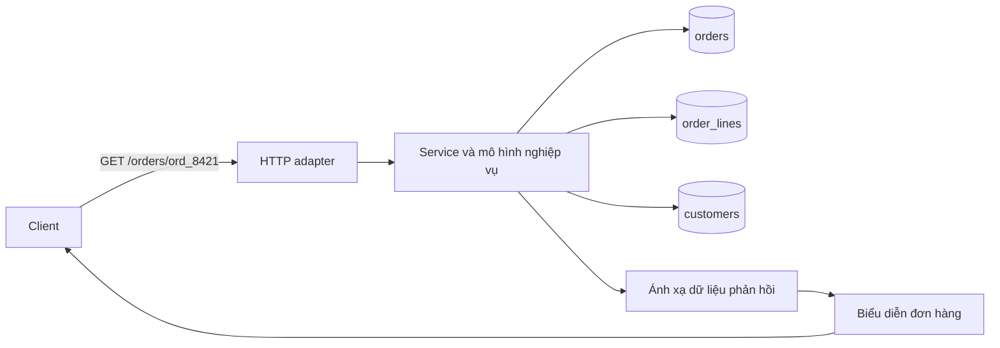

# Phân biệt tài nguyên với bảng dữ liệu và đối tượng Java

## 1. Mục tiêu bài học

Trong chương **Mô hình tài nguyên** của module **INTEGRATION_API_REST**, bài học này giúp bạn phân biệt ba thứ thường bị gộp làm một: tài nguyên mà API cung cấp, cấu trúc dữ liệu dùng để lưu trữ và đối tượng trong chương trình Java.

Sau bài học, bạn có thể:

- Giải thích vì sao một tài nguyên không bắt buộc tương ứng với một bảng hoặc một đối tượng Java.
- Phân biệt tài nguyên với biểu diễn JSON và DTO dùng để tạo biểu diễn đó.
- Xây dựng hợp đồng đơn hàng từ nhu cầu sử dụng thay vì sao chép cấu trúc cơ sở dữ liệu.
- Xác định dữ liệu được phép nhận, dữ liệu được phép trả và dữ liệu chỉ thuộc nội bộ.
- Tổ chức ánh xạ giữa mô hình lưu trữ, mô hình nghiệp vụ và hợp đồng API trong Java/Spring hoặc công nghệ tương đương.

## 2. Ba góc nhìn về cùng một đơn hàng

Một hệ thống bán hàng cần cho khách xem đơn `ord_8421`.

Từ phía client, đây là một tài nguyên có thể được đọc qua HTTP:

```http
GET /orders/ord_8421 HTTP/1.1
Host: api.example.test
Accept: application/json
```

Từ phía lưu trữ, thông tin có thể nằm trong nhiều bảng:

```text
orders
order_lines
customers
```

Từ phía chương trình Java, cùng dữ liệu có thể đi qua nhiều đối tượng:

```text
Đối tượng ánh xạ bản ghi lưu trữ
Đối tượng nghiệp vụ xử lý đơn hàng
DTO trả về qua HTTP
```

Các đối tượng này có liên hệ, nhưng không bắt buộc có cùng tên trường, số lượng hoặc vòng đời.

| Góc nhìn | Câu hỏi chính |
|---|---|
| Tài nguyên API | Client đang tương tác với khái niệm nào và được làm gì? |
| Bảng dữ liệu | Dữ liệu được lưu, liên kết và truy vấn như thế nào? |
| Đối tượng Java | Chương trình biểu diễn dữ liệu và tổ chức hành vi ra sao? |

Nếu để một góc nhìn quyết định toàn bộ hai góc nhìn còn lại, hệ thống dễ tạo ra sự phụ thuộc không cần thiết. Ví dụ, đổi một cột lưu trữ có thể vô tình làm client mất một trường đang sử dụng.

## 3. Tài nguyên là khái niệm được định danh qua giao diện

### 3.1. Tài nguyên không phải bản thân chuỗi JSON

Trong REST API, tài nguyên là khái niệm hoặc đối tượng thông tin mà hệ thống cho phép tương tác thông qua một giao diện được xác định. URI định danh tài nguyên trong tương tác HTTP.

Ví dụ:

- `/orders/ord_8421`: một đơn hàng.
- `/orders`: tập hợp đơn hàng theo hợp đồng của API.
- `/orders/ord_8421/items`: tập hợp các dòng hàng của một đơn.
- `/reports/daily-revenue?date=2026-11-16`: báo cáo doanh thu cho ngày được yêu cầu, nếu API cung cấp tài nguyên này.

Một tài nguyên có thể thay đổi trạng thái theo thời gian mà vẫn giữ định danh. Đơn `ord_8421` có thể đang `PENDING`, sau đó thành `PAID`; nó không vì thế trở thành một đơn khác.

JSON server trả về là một **biểu diễn** của tài nguyên. Nếu API hỗ trợ biểu diễn XML cho cùng đơn hàng, tài nguyên vẫn là đơn đó dù nội dung truyền có hình dạng khác.

### 3.2. Tài nguyên không nhất thiết có một hàng dữ liệu riêng

Tập hợp đơn hàng có thể được tạo từ truy vấn nhiều hàng. Báo cáo doanh thu có thể được tính khi có yêu cầu. Thông tin tồn kho có thể được tổng hợp từ nhiều nguồn.

Do đó, không cần tạo một bảng chỉ để hợp thức hóa mọi URI. Cũng không nên cho rằng một kết quả được tính động thì không thể là tài nguyên.

Ngược lại, không phải mọi bảng nội bộ đều cần được công khai thành tài nguyên API. Bảng theo dõi tiến độ đồng bộ hoặc bảng phục vụ chỉ mục tìm kiếm có thể chỉ là chi tiết triển khai.

### 3.3. Tài nguyên cần có ý nghĩa với bên sử dụng

Khi đề xuất một tài nguyên, hãy làm rõ:

1. Nó đại diện cho điều gì trong bài toán?
2. Nó được định danh như thế nào?
3. Client nào cần đọc hoặc thay đổi nó?
4. Những thao tác nào được phép theo hợp đồng và quyền truy cập?
5. Những dữ liệu nào cần được công khai để thực hiện các thao tác đó?

Những câu hỏi này giúp tránh cách thiết kế “có bảng nào thì sinh endpoint CRUD cho bảng đó” mà chưa xem bên gọi thực sự cần gì.

## 4. Bảng dữ liệu giải quyết bài toán lưu trữ

### 4.1. Cấu trúc lưu trữ có mục đích riêng

Giả sử cơ sở dữ liệu dùng cấu trúc sau. Đây là mô hình minh họa, không phải yêu cầu về một hệ quản trị cụ thể:

```text
orders
  id                    khóa nội bộ
  public_id             mã dùng trong hợp đồng API
  customer_id           khóa liên kết khách hàng
  state_code            mã trạng thái nội bộ
  total_amount          tổng tiền đã chấp nhận
  currency              đơn vị tiền
  internal_review_note  ghi chú xử lý nội bộ
  row_version           dữ liệu hỗ trợ kiểm soát cập nhật

order_lines
  id
  order_id
  product_public_id
  product_name_at_order
  quantity
  unit_price_at_order

customers
  id
  public_id
  display_name
  email
```

Thiết kế bảng có thể phục vụ chuẩn hóa dữ liệu, ràng buộc toàn vẹn, truy vấn hoặc hiệu quả cập nhật. Những lý do đó không bắt buộc client phải nhìn thấy cùng cấu trúc.

Ví dụ, `order_id` giúp liên kết các dòng hàng trong cơ sở dữ liệu. Client đọc chi tiết một đơn có thể chỉ cần danh sách `items` nằm trong response, không cần nhận khóa liên kết nội bộ của từng dòng.

### 4.2. Khóa nội bộ và định danh công khai có thể tách riêng

Trong ví dụ, bản ghi có thể dùng `id = 42` ở bên trong và `public_id = ord_8421` ở hợp đồng API. Việc tách này cho phép quản lý định danh công khai mà không buộc client phụ thuộc trực tiếp vào một khóa lưu trữ cụ thể.

Tuy nhiên, đây là một lựa chọn thiết kế, không phải quy định rằng mọi REST API phải dùng UUID hoặc luôn phải có hai loại khóa. Một API có thể dùng khóa số hiện có làm định danh công khai nếu đó là lựa chọn có chủ đích và được quản lý phù hợp.

Điều cần giữ là ngữ nghĩa và tính ổn định của định danh đối với bên gọi. Dùng mã khó đoán cũng không thay thế kiểm tra quyền truy cập tài nguyên.

### 4.3. Mô hình lưu trữ có thể thay đổi

Server có thể chuyển một cột sang bảng khác, thay cách biểu diễn trạng thái hoặc bổ sung bảng tổng hợp. Nếu hợp đồng API vẫn giữ nguyên ngữ nghĩa và dữ liệu cam kết, client không nhất thiết phải thay đổi theo.

Đó là lợi ích của ranh giới giữa tài nguyên công khai và cấu trúc lưu trữ. Nó không bảo đảm mọi thay đổi lưu trữ đều vô hại; server vẫn phải giữ đúng hành vi mà API đã công bố.

## 5. Đối tượng Java giải quyết bài toán trong chương trình

### 5.1. Một class không đồng nghĩa một tài nguyên

Một ứng dụng Java có thể dùng:

- Entity hoặc kiểu dữ liệu ánh xạ với lưu trữ.
- Đối tượng nghiệp vụ chứa quy tắc và hành vi.
- DTO nhận request hoặc tạo response.
- Đối tượng hỗ trợ như bộ lọc, kết quả phân trang hoặc ngữ cảnh gọi.

Không phải class nào cũng cần có URI. Một bộ tính phí là thành phần xử lý; một object chứa tham số tìm kiếm chưa mặc nhiên là tài nguyên độc lập.

Ngược lại, một tài nguyên có thể được tổng hợp từ nhiều object Java và không có một class duy nhất mang tên giống URI.

### 5.2. Định danh tài nguyên khác danh tính object trong bộ nhớ

Hai yêu cầu đọc cùng đơn hàng có thể tạo ra hai instance Java khác nhau để xử lý:

```text
Request A -> instance Java thứ nhất -> đơn ord_8421
Request B -> instance Java thứ hai  -> đơn ord_8421
```

Hai instance không cần giống nhau theo tham chiếu bộ nhớ để cùng nói về một tài nguyên. Định danh tài nguyên được duy trì qua hợp đồng và URI, không dựa vào địa chỉ bộ nhớ hoặc việc object còn sống trong một tiến trình.

Các phương thức `equals` hoặc `hashCode` cũng không tự định nghĩa cách client nhận diện tài nguyên qua HTTP. Chúng thuộc thiết kế kiểu dữ liệu trong chương trình.

### 5.3. DTO mô tả dữ liệu trao đổi

DTO là kiểu dữ liệu phục vụ truyền qua một ranh giới. Response DTO thường là một cách trong chương trình để tạo biểu diễn JSON theo hợp đồng.

DTO không phải toàn bộ khái niệm tài nguyên. Tài nguyên còn có định danh, hành vi HTTP, quyền truy cập, vòng đời và các quy tắc mà một tập trường Java chưa thể hiện đầy đủ.

Ví dụ, `OrderResponse` có thể có trường `status`, nhưng chính sách ai được xem đơn và khi nào được hủy vẫn cần được thực thi trong xử lý của server.

## 6. Không có quan hệ một-một bắt buộc

### 6.1. Một tài nguyên có thể dùng nhiều bảng và object

`GET /orders/ord_8421` có thể cần dữ liệu từ đơn hàng, các dòng hàng và một phần thông tin khách hàng được phép dùng. Server trả một biểu diễn thống nhất cho bên gọi.



Client không cần tự gọi một endpoint cho mỗi bảng rồi ghép dữ liệu theo khóa ngoại chỉ vì cơ sở dữ liệu đã được chuẩn hóa như vậy.

### 6.2. Một bảng có thể tham gia nhiều tài nguyên

Dữ liệu trong `orders` có thể tham gia:

- Biểu diễn chi tiết một đơn.
- Một trang danh sách đơn với các trường tóm tắt.
- Báo cáo tổng doanh thu.
- Thống kê số đơn đang chờ xử lý.

Không nên suy rằng tất cả những biểu diễn đó phải trả mọi cột của bảng. Mỗi trường hợp cần một hợp đồng có mục đích rõ.

### 6.3. Bảng liên kết có thể cần hoặc không cần tài nguyên riêng

Một bảng nối kỹ thuật giữa hai bảng không tự động cần endpoint công khai. Nhưng nếu quan hệ có ý nghĩa nghiệp vụ riêng, nó có thể được mô hình hóa thành tài nguyên.

Ví dụ, việc đăng ký một khóa học có ngày đăng ký, trạng thái và kết quả riêng. “Đăng ký” có thể là tài nguyên dù dữ liệu ban đầu được lưu bằng một bảng liên kết.

Quyết định nằm ở ý nghĩa mà client cần thao tác, không nằm ở việc cơ sở dữ liệu gọi bảng đó là bảng chính hay bảng nối.

### 6.4. Một tài nguyên có thể không đọc trực tiếp từ bảng nào

Một báo cáo có thể được tính từ sự kiện hoặc dịch vụ khác. Một tài nguyên trạng thái xử lý có thể được đọc từ hệ thống công việc nền.

Trong những trường hợp đó, API vẫn cần định nghĩa dữ liệu, độ mới và hành vi của tài nguyên. Không có bảng tương ứng không làm những yêu cầu hợp đồng đó biến mất.

## 7. Xây dựng biểu diễn đơn hàng từ nhu cầu sử dụng

### 7.1. Xác định thông tin client cần

Giả sử khách cần biết:

- Mã đơn và trạng thái hiện tại.
- Những sản phẩm đã đặt, tên tại lúc đặt và số lượng.
- Đơn giá đã được chấp nhận lúc đặt.
- Tổng tiền cùng đơn vị tiền.

Một response có thể là:

```http
HTTP/1.1 200 OK
Content-Type: application/json

{
  "id": "ord_8421",
  "status": "PENDING",
  "items": [
    {
      "productId": "P-100",
      "name": "Sổ tay",
      "quantity": 2,
      "unitPrice": 125000
    }
  ],
  "totalAmount": 250000,
  "currency": "VND"
}
```

Hợp đồng ví dụ quy định số tiền là số nguyên đồng Việt Nam; `name` và `unitPrice` trong dòng hàng phản ánh dữ liệu đã ghi nhận cho đơn, không phải tên hoặc giá hiện tại mà danh mục sản phẩm có thể đã thay đổi.

Nếu không làm rõ điểm này, server có thể vô tình tính lại đơn cũ bằng giá mới khi ghép dữ liệu. Đúng cấu trúc JSON chưa đủ; biểu diễn còn phải giữ đúng ý nghĩa nghiệp vụ.

### 7.2. Chọn những gì không thuộc biểu diễn công khai

Response trên không cần công khai:

- Khóa số nội bộ của đơn và khóa ngoại dùng để ghép bảng.
- Mã trạng thái chỉ có ý nghĩa trong lưu trữ.
- Ghi chú xử lý dành riêng cho nhân viên nội bộ.
- Mọi dữ liệu cá nhân của khách hàng chỉ vì truy vấn có liên quan đến bảng `customers`.

Một số dữ liệu nội bộ có thể được sử dụng để thực hiện khả năng API có chủ đích. Ví dụ, dữ liệu phiên bản có thể hỗ trợ thiết kế cập nhật có điều kiện. Khi đó cần định nghĩa hợp đồng tương ứng, thay vì để mọi cột tự xuất hiện trong JSON.

### 7.3. Tóm tắt và chi tiết có thể khác hình dạng

Danh sách đơn hàng có thể chỉ cần:

```json
{
  "items": [
    {
      "id": "ord_8421",
      "status": "PENDING",
      "totalAmount": 250000,
      "currency": "VND"
    }
  ]
}
```

Đây là cấu trúc danh sách minh họa; phân trang và các metadata khác cần được bổ sung khi hợp đồng yêu cầu. Không có quy định rằng danh sách phải nhúng toàn bộ chi tiết của từng đơn hoặc phải giống cách một ORM tải quan hệ.

## 8. Ánh xạ rõ ràng trong Java

### 8.1. DTO cho biểu diễn công khai

```java
import java.math.BigDecimal;
import java.util.List;

record OrderItemResponse(
        String productId,
        String name,
        int quantity,
        BigDecimal unitPrice
) {}

record OrderResponse(
        String id,
        String status,
        List<OrderItemResponse> items,
        BigDecimal totalAmount,
        String currency
) {}
```

Các kiểu này mô tả dữ liệu response trong ví dụ. Chúng không phải entity ORM, không tự xác thực người gọi và không tự bảo đảm đơn giá hoặc tổng tiền đúng.

### 8.2. Một ánh xạ tối giản cho dữ liệu tóm tắt

Ví dụ dưới đây minh họa cách một kiểu dữ liệu nội bộ và kiểu phản hồi công khai có thể khác nhau. `OrderData` là dữ liệu nội bộ giản lược, không phải triển khai đầy đủ một entity hoặc mô hình nghiệp vụ.

```java
import java.math.BigDecimal;

record OrderData(
        long internalId,
        String publicId,
        String internalState,
        BigDecimal totalAmount,
        String currency,
        String internalReviewNote,
        long rowVersion
) {}

record OrderSummaryResponse(
        String id,
        String status,
        BigDecimal totalAmount,
        String currency
) {}

final class OrderResponseMapper {
    static OrderSummaryResponse toSummary(OrderData order) {
        String apiStatus;

        switch (order.internalState()) {
            case "N":
                apiStatus = "PENDING";
                break;
            case "P":
                apiStatus = "PAID";
                break;
            case "C":
                apiStatus = "CANCELLED";
                break;
            default:
                throw new IllegalStateException("Trạng thái nội bộ chưa được ánh xạ");
        }

        return new OrderSummaryResponse(
                order.publicId(),
                apiStatus,
                order.totalAmount(),
                order.currency()
        );
    }
}
```

Trong quy ước nội bộ của ví dụ, `N`, `P` và `C` là các mã lưu trữ. Mapper chuyển chúng sang ngữ nghĩa công khai đã cam kết. `internalId`, `internalReviewNote` và `rowVersion` không tự xuất hiện trong response.

Nếu dữ liệu nội bộ có một trạng thái mới, mapper cần được xem xét thay vì âm thầm trả mã chưa được hợp đồng chấp nhận. Cách xử lý lỗi nội bộ qua HTTP thuộc trách nhiệm của ứng dụng; không trả nguyên chi tiết exception cho client.

### 8.3. Không cần lớp ánh xạ chỉ để đổi tên cho mọi thứ

Tách mô hình không có nghĩa mỗi bảng hoặc mỗi thao tác luôn cần một số lượng class cố định. Với một API nhỏ, mô hình nội bộ và biểu diễn có thể gần nhau, thậm chí dùng chung kiểu khi đó là lựa chọn được kiểm soát.

Điểm cần giữ là hợp đồng công khai có chủ đích. Đừng để serializer tự quyết định toàn bộ dữ liệu được phép lộ ra chỉ vì một object đang tồn tại trong Java.

## 9. Request cũng không nên là bản ghi dữ liệu cho client tùy sửa

### 9.1. Client gửi ý định, server quyết định dữ liệu có thẩm quyền

Request tạo đơn có thể là:

```http
POST /orders HTTP/1.1
Content-Type: application/json
Accept: application/json

{
  "items": [
    {
      "productId": "P-100",
      "quantity": 2
    }
  ]
}
```

Server xác định người gọi theo cơ chế xác thực, kiểm tra quyền, đọc giá hợp lệ và tính tổng tiền theo nghiệp vụ. Server cũng xác định trạng thái ban đầu cùng định danh của đơn theo hợp đồng.

Request này không cần cho client điền mọi cột của `orders`, chẳng hạn `internal_review_note` hoặc `state_code`.

### 9.2. Nguy cơ khi ánh xạ đầu vào quá rộng

Nếu server nhận trực tiếp một entity có mọi thuộc tính, client có thể thử gửi thêm:

```json
{
  "customerId": "cus_other",
  "status": "PAID",
  "totalAmount": 1,
  "internalReviewNote": "Đã được duyệt"
}
```

Những trường này không tự trở thành hợp lệ chỉ vì serializer hoặc cơ chế binding đọc được chúng. Nếu ứng dụng sao chép chúng vào dữ liệu chính thức mà không kiểm soát, client có thể thay đổi các giá trị ngoài quyền hạn.

Hợp đồng cần xác định trường được phép nhận và cách xử lý trường ngoài hợp đồng. Một request DTO hẹp giúp thể hiện phạm vi đó, nhưng vẫn cần kiểm tra dữ liệu và phân quyền khi thực hiện thao tác.

### 9.3. Một request có thể cập nhật nhiều hàng

Tạo một đơn thường tạo bản ghi đơn cùng nhiều dòng hàng. Trong thiết kế dùng cùng một cơ sở dữ liệu, ứng dụng có thể cần một giao dịch để các thay đổi liên quan được chấp nhận nhất quán.

Client không cần lần lượt gọi “tạo hàng orders”, “tạo hàng order_lines” chỉ để phản chiếu các câu lệnh lưu trữ. Giao diện API nên cung cấp khả năng tạo đơn theo nghĩa nghiệp vụ đã chọn.

Nếu thao tác trải qua nhiều hệ thống hoặc có xử lý bất đồng bộ, cần thiết kế cơ chế nhất quán và trạng thái xử lý riêng. Việc mô hình hóa thành tài nguyên không tự giải quyết các vấn đề đó.

## 10. Điều gì xảy ra khi trả trực tiếp entity?

### 10.1. Những phụ thuộc có thể phát sinh

Trả trực tiếp một đối tượng ánh xạ lưu trữ có thể dẫn đến:

| Vấn đề | Ví dụ |
|---|---|
| Lộ dữ liệu ngoài hợp đồng | Ghi chú nội bộ xuất hiện sau khi thêm getter hoặc thuộc tính |
| Phụ thuộc cấu trúc quan hệ | Client phải hiểu cách lồng object theo các liên kết ORM |
| Đồ thị đối tượng có chu trình | Đơn chứa khách hàng, khách hàng lại chứa danh sách đơn |
| Tải dữ liệu ngoài dự kiến | Việc tuần tự hóa có thể kích hoạt tải thêm quan hệ tùy cấu hình |
| Lỗi do vòng đời lưu trữ | Quan hệ chưa tải có thể không đọc được ở thời điểm tạo response |
| Thay đổi API ngoài ý muốn | Đổi tên hoặc tách thuộc tính entity làm JSON thay đổi theo |

Các hệ quả cụ thể phụ thuộc framework, cấu hình và thiết kế. Không phải mọi entity đều gây mọi lỗi trên, nhưng đó là những lý do để kiểm soát rõ ranh giới biểu diễn.

### 10.2. Annotation tuần tự hóa không thay toàn bộ thiết kế

Có thể cấu hình bỏ qua một trường hoặc xử lý một chu trình object. Những biện pháp đó giải quyết được phần kỹ thuật cụ thể, nhưng không tự trả lời những câu hỏi như:

- Client có cần trường này không?
- Người gọi có quyền thấy nó không?
- Ý nghĩa trường có ổn định khi lưu trữ thay đổi không?
- Những gì client được phép gửi có khác những gì server được phép trả không?

Thiết kế DTO và ánh xạ là một cách làm rõ các quyết định đó. Chúng cần phục vụ hợp đồng, không chỉ để có thêm một tầng class.

### 10.3. Tài nguyên không buộc cung cấp đủ CRUD

Có một tài nguyên đơn hàng không có nghĩa API bắt buộc cho client tùy ý tạo, sửa mọi trường và xóa vật lý mọi bản ghi.

Một số trạng thái chỉ có thể thay đổi bằng quy trình nghiệp vụ. Một báo cáo có thể chỉ đọc. Những phương thức được hỗ trợ cần được công bố theo ngữ nghĩa HTTP cùng khả năng thực tế của tài nguyên.

Việc cơ sở dữ liệu hỗ trợ `UPDATE` hoặc `DELETE` không tự tạo quyền thực hiện thao tác tương ứng cho bên gọi API.

## 11. Cách tiếp cận khi thiết kế một tài nguyên mới

### 11.1. Bắt đầu từ khả năng sử dụng

Ví dụ yêu cầu là “khách có thể xem đơn và nhân viên có thể xử lý đơn”. Hãy xác định tài nguyên, các vai trò gọi và các dữ liệu cần thiết trước khi quyết định hình dạng response.

Sau đó đối chiếu mô hình nghiệp vụ và lưu trữ để tìm cách cung cấp dữ liệu đúng, thay vì biến lược đồ cơ sở dữ liệu thành bản thiết kế API mặc định.

### 11.2. Mô tả hợp đồng ở ranh giới

Với mỗi tương tác, xác định:

1. URI và định danh công khai.
2. Phương thức HTTP được hỗ trợ.
3. Media type, schema cùng ý nghĩa dữ liệu request và response.
4. Quyền truy cập và các điều kiện nghiệp vụ.
5. Mã trạng thái, cấu trúc lỗi và các header liên quan.
6. Các quy tắc giữ tương thích khi thay đổi mô hình bên trong.

OpenAPI có thể ghi lại phần hợp đồng HTTP và schema. Những quy tắc như “đơn giá là giá đã chốt lúc đặt” cũng cần được thể hiện trong mô tả dữ liệu, không chỉ trong tên trường.

### 11.3. Kiểm tra khả năng thay đổi độc lập

Hãy thử đặt những giả thiết sau khi xem xét thiết kế:

- Nếu đổi `state_code` trong cơ sở dữ liệu, tên và ý nghĩa trạng thái công khai có còn giữ được không?
- Nếu tách một bảng thành hai bảng, client có phải sửa cách đọc JSON không?
- Nếu đổi công nghệ lưu trữ, URI và định danh công khai có còn ý nghĩa không?
- Nếu thêm một trường nội bộ nhạy cảm, nó có tự động xuất hiện trong response không?
- Nếu client gửi thêm trường ngoài quyền hạn, server có chặn thay đổi dữ liệu đó không?

Đây là những câu hỏi giúp nhận diện mức phụ thuộc của hợp đồng. Chúng không yêu cầu mô hình API và mô hình lưu trữ phải khác nhau ở mọi chi tiết; chúng giúp bạn biết phần nào đang được chia sẻ có chủ đích.

## 12. Bài tập vận dụng

### 12.1. Từ cơ sở dữ liệu học tập đến tài nguyên API

Một hệ thống có các bảng:

```text
students
courses
student_course
  student_id
  course_id
  enrolled_at
  status
  final_score
sync_offsets
```

Client cần xem khóa học, đăng ký học và theo dõi tình trạng đăng ký. `sync_offsets` chỉ giúp một tiến trình nội bộ nhớ vị trí đồng bộ.

Hãy đề xuất tài nguyên và giải thích vì sao không cần sao chép từng bảng thành endpoint.

### 12.2. Gợi ý thiết kế

| Nhu cầu | Tài nguyên có thể phù hợp | Lý do |
|---|---|---|
| Xem một khóa học | `/courses/{courseId}` | Khóa học có ý nghĩa trực tiếp với người học |
| Tạo đăng ký | `POST /enrollments` | Đăng ký có dữ liệu và vòng đời riêng |
| Xem tình trạng đăng ký | `/enrollments/{enrollmentId}` | Không buộc client thao tác trực tiếp theo khóa nối của bảng |
| Theo dõi vị trí đồng bộ nội bộ | Không nhất thiết có endpoint công khai | Đây là nhu cầu triển khai, chưa phải nhu cầu của client đã nêu |

API cần lựa chọn cách định danh một đăng ký. Có thể bổ sung mã công khai hoặc dùng cách định danh khác phù hợp; việc bảng hiện tại chỉ có hai khóa liên kết không quyết định duy nhất URI phải trông như thế nào.

Người học cũng không được tự gửi `final_score` để quyết định kết quả của mình. Hợp đồng tạo đăng ký và hợp đồng cập nhật kết quả cần thể hiện đúng quyền cùng trách nhiệm nghiệp vụ.

### 12.3. Tự giải thích một response

Với biểu diễn đơn hàng trong bài, hãy chỉ ra dữ liệu nào đến từ nhiều hàng lưu trữ, dữ liệu nào đã được đổi từ mã nội bộ sang ngữ nghĩa công khai, và dữ liệu nội bộ nào được giữ ngoài response. Sau đó giải thích vì sao thay đổi một class Java chưa chắc phải là thay đổi tài nguyên API.

Tài nguyên xác định điều client có thể tương tác; bảng dữ liệu tổ chức việc lưu trữ; đối tượng Java tổ chức dữ liệu và hành vi trong chương trình. Ánh xạ rõ giữa ba góc nhìn giúp hợp đồng API phản ánh nhu cầu sử dụng và quy tắc nghiệp vụ, trong khi cấu trúc bên trong vẫn có thể phát triển có kiểm soát.
