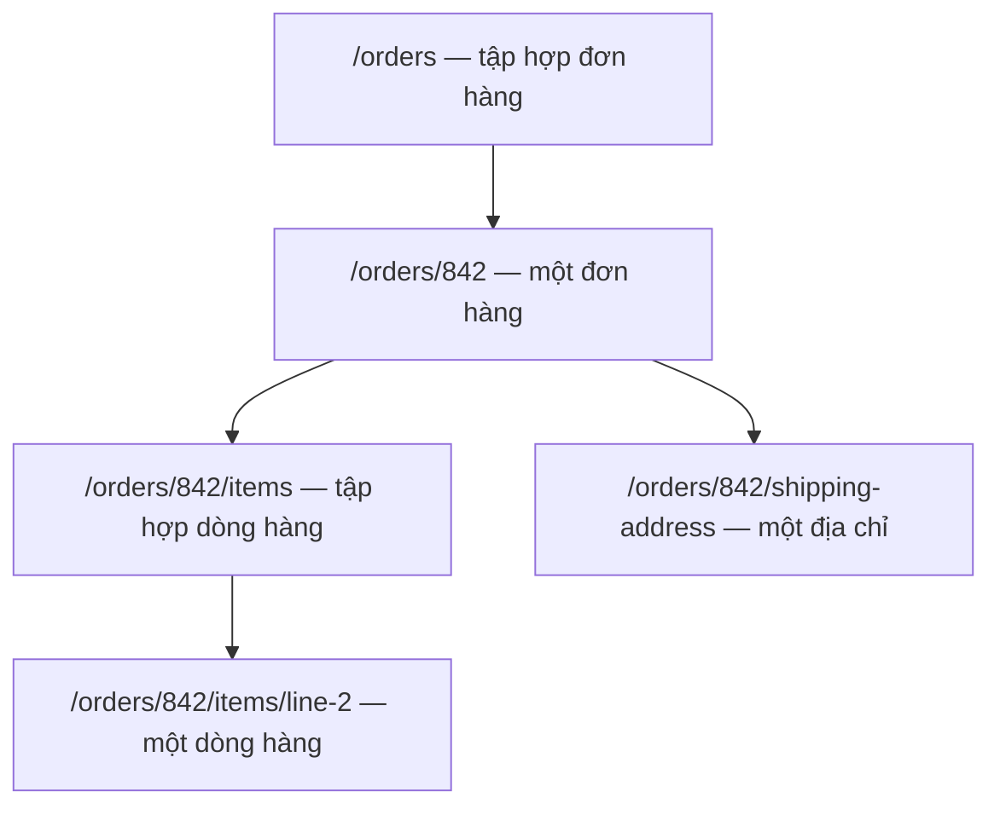

# Tài nguyên đơn, tập hợp và tài nguyên con

## Mục tiêu bài học

Một API bán hàng có đơn hàng, danh sách đơn hàng, dòng hàng, địa chỉ giao hàng và thanh toán. Không phải đối tượng nào cũng nên trở thành một resource độc lập ở cấp gốc; cũng không phải mọi quan hệ trong cơ sở dữ liệu đều cần biến thành đường dẫn lồng nhau.

Trong chương **Mô hình tài nguyên** của module **INTEGRATION_API_REST**, bài học này giải thích cách phân biệt tài nguyên đơn, tập hợp và tài nguyên con. Mục tiêu là xây mô hình REST API có định danh, vòng đời và hợp đồng dữ liệu rõ ràng, từ đó chọn URI, phương thức HTTP cùng mã trạng thái phù hợp.

Các ví dụ liên hệ với Java/Spring, đồng thời đặt nền cho phân trang, cache, idempotency, OpenAPI, xác thực, phân quyền, xử lý lỗi và kiểm thử API.

Sau bài học, bạn có thể:

- Phân biệt một resource cụ thể với một resource tập hợp.
- Nhận diện tài nguyên con đơn lẻ và tập hợp tài nguyên con.
- Phân biệt tài nguyên đơn với singleton.
- Chọn URI dựa trên danh tính, quan hệ sở hữu và vòng đời.
- Hiểu vì sao đường dẫn lồng nhau không tự tạo phân quyền hoặc giao dịch.
- Thiết kế response cho tập hợp rỗng, cha không tồn tại và con không thuộc cha.
- Ánh xạ mô hình cha–con vào controller và service có kiểm tra quan hệ.

## 1. Ba khái niệm qua một ví dụ

Giả sử hệ thống quản lý đơn hàng có các URI:

```text
/orders
/orders/842
/orders/842/items
/orders/842/items/line-2
/orders/842/shipping-address
```

Có thể phân loại như sau:

| URI | Loại resource | Ý nghĩa |
| --- | --- | --- |
| `/orders` | Tập hợp | Các đơn hàng trong phạm vi hợp đồng và quyền truy cập |
| `/orders/842` | Tài nguyên đơn | Một đơn hàng cụ thể |
| `/orders/842/items` | Tập hợp tài nguyên con | Các dòng hàng thuộc đơn 842 |
| `/orders/842/items/line-2` | Tài nguyên con đơn lẻ | Dòng line-2 của đơn 842 |
| `/orders/842/shipping-address` | Tài nguyên con đơn lẻ kiểu singleton theo cha | Địa chỉ giao hàng hiện tại của đơn 842 |

Điểm quan trọng là hai cách phân loại đang nói về hai khía cạnh khác nhau:

- **Đơn hay tập hợp** nói về resource được mô hình hóa.
- **Con hay độc lập** nói về quan hệ định danh, truy cập hoặc vòng đời với resource khác.

Vì vậy, “tài nguyên con” không phải lúc nào cũng có nghĩa “một phần tử”. Nó có thể là một tập hợp như `/orders/842/items` hoặc một địa chỉ duy nhất như `/orders/842/shipping-address`.



Sơ đồ diễn đạt mô hình API, không bắt buộc cơ sở dữ liệu phải có cùng cấu trúc hoặc lưu mọi thứ trong một bảng.

## 2. Tài nguyên đơn: một đối tượng có danh tính rõ ràng

**Tài nguyên đơn** là một resource cụ thể mà client có thể định danh và tương tác theo hợp đồng.

Ví dụ:

```http
GET /orders/842 HTTP/1.1
Host: api.example.com
Authorization: Bearer <access-token>
Accept: application/json
```

Phản hồi minh họa:

```http
HTTP/1.1 200 OK
Content-Type: application/json
Cache-Control: no-store

{
  "id": "842",
  "status": "DRAFT",
  "links": [
    {
      "rel": "items",
      "href": "/orders/842/items"
    },
    {
      "rel": "shipping-address",
      "href": "/orders/842/shipping-address"
    }
  ]
}
```

Các ví dụ HTTP trong bài lược bỏ một số chi tiết truyền tải.

Trong bài, đơn ở trạng thái `DRAFT` được phép chỉnh sửa dòng hàng và địa chỉ. Đây là giả định nghiệp vụ minh họa; hệ thống khác có thể có vòng đời và quyền sửa khác.

Resource là đơn hàng. JSON là representation của đơn hàng tại thời điểm xử lý, không phải chính resource hay một tham chiếu trực tiếp tới entity Java.

### 2.1. Danh tính không đổi theo mọi thay đổi trạng thái

Đơn hàng có thể chuyển từ bản nháp sang xác nhận rồi giao hàng mà vẫn được định danh bằng `/orders/842`.

Nếu đổi URI theo mọi trạng thái, client sẽ khó giữ liên kết ổn định và hệ thống phải quản lý nhiều địa chỉ không cần thiết. Trạng thái thường được thể hiện trong representation và điều khiển tương tác.

Tuy nhiên, không phải mọi thứ liên quan đến đơn đều có cùng danh tính với đơn. Một lần thanh toán hoặc hoàn tiền có thể có ID và vòng đời riêng.

### 2.2. Tài nguyên đơn không đồng nghĩa với singleton

Hai ví dụ đều chỉ một resource:

```text
/users/user-7
/users/user-7/profile
```

Nhưng cách định danh khác nhau:

- `/users/user-7` chọn một người dùng bằng ID trong tập hợp.
- `/users/user-7/profile` là hồ sơ duy nhất trong phạm vi người dùng đó, nên URI không cần thêm một profile ID nếu hợp đồng không đòi hỏi.

Singleton là một resource duy nhất trong một phạm vi đã xác định, không nhất thiết duy nhất trong toàn hệ thống.

Các ví dụ khác có thể là `/me` hoặc `/orders/842/shipping-address`. Với `/me`, danh tính resource được xác định tương đối theo người gọi đã xác thực; điều đó phải được mô tả rõ và xử lý cache đúng phạm vi.

Việc đặt danh từ số ít hoặc số nhiều chỉ là quy ước đặt tên. Bản chất resource không do số chữ hoặc hình thức ngữ pháp của URI quyết định.

### 2.3. Resource không bắt buộc tương ứng với một hàng dữ liệu

Representation của đơn hàng có thể tổng hợp từ nhiều bảng hoặc dịch vụ. Hồ sơ người dùng cũng có thể chứa dữ liệu đã tính toán.

Ngược lại, hai resource khác nhau có thể được lưu chung trong một bảng. Cách chia resource nên phản ánh hợp đồng bên ngoài và nghiệp vụ, không đơn thuần sao chép mô hình ORM.

## 3. Tập hợp cũng là một resource

**Resource tập hợp** đại diện cho một nhóm thành viên cùng hợp đồng truy cập. Client tương tác với tập hợp bằng chính URI của nó.

Ví dụ:

```http
GET /orders?status=DRAFT&limit=20 HTTP/1.1
Host: api.example.com
Authorization: Bearer <access-token>
Accept: application/json
```

```http
HTTP/1.1 200 OK
Content-Type: application/json
Cache-Control: no-store

{
  "items": [
    {
      "id": "842",
      "status": "DRAFT",
      "href": "/orders/842"
    },
    {
      "id": "915",
      "status": "DRAFT",
      "href": "/orders/915"
    }
  ],
  "nextCursor": null
}
```

Tập hợp không chỉ là “một mảng JSON”. Nó có thể có:

- Điều kiện lọc và sắp xếp.
- Giới hạn số lượng.
- Con trỏ lấy trang tiếp theo.
- Chính sách tạo thành viên.
- Metadata được phép công bố.
- Liên kết tới từng thành viên.

Cấu trúc `items`, `nextCursor` và `href` trong ví dụ là quy ước của hợp đồng, không phải từ khóa mà JSON tự gán ý nghĩa.

### 3.1. Một trang không có nghĩa là toàn bộ tập hợp

Nếu API trả tối đa 20 đơn, client không được kết luận hệ thống chỉ có 20 đơn. Representation hiện tại có thể chỉ chứa một trang hoặc một phần nhìn thấy của tập hợp.

Hợp đồng cần làm rõ:

- Thứ tự đọc có ổn định không.
- Cách lấy trang tiếp theo.
- Những bộ lọc nào phải giữ nguyên.
- Dữ liệu thay đổi trong lúc duyệt được xử lý thế nào.
- Có cung cấp tổng số phần tử hay không.

Tổng số không phải lúc nào cũng cần thiết hoặc rẻ để tính. Nếu cung cấp, cần nói rõ đó là tổng của phạm vi nào và mức độ nhất quán của nó.

### 3.2. Tập hợp theo quyền không phải toàn bộ dữ liệu lưu trữ

`GET /orders` của khách hàng có thể chỉ trả những đơn họ được xem. Cùng URI, một người gọi khác có thể nhìn thấy tập hợp khác theo hợp đồng và thông tin xác thực.

Không được lấy tên “tập hợp đơn hàng” làm lý do trả mọi bản ghi của bảng đơn hàng. Lọc theo quyền là một phần của truy vấn và hợp đồng bảo mật.

Cache cũng cần biết phạm vi dùng lại representation. Không dùng chung response cá nhân chỉ vì các người gọi có cùng path.

### 3.3. Tập hợp rỗng khác với resource không tồn tại

Nếu tập hợp hợp lệ nhưng không có phần tử khớp:

```http
HTTP/1.1 200 OK
Content-Type: application/json
Cache-Control: no-store

{
  "items": [],
  "nextCursor": null
}
```

Trong hợp đồng minh họa, đây là kết quả bình thường, không phải 404.

Trả 200 với cấu trúc tập hợp ổn định giúp client vẫn đọc được metadata và phân trang. Một 204 không có body nên không thể đồng thời mang JSON `items: []`; nếu một API chọn 204, nó phải công bố hợp đồng khác tương ứng.

Không nên dùng 404 chỉ vì một bộ lọc hợp lệ không tìm được thành viên nào trong một tập hợp đang tồn tại.

## 4. Tài nguyên con: quan hệ cần có ý nghĩa

**Tài nguyên con** được truy cập trong ngữ cảnh của một resource cha. Quan hệ này có thể phản ánh phạm vi định danh, quan hệ sở hữu hoặc vòng đời nghiệp vụ.

Ví dụ:

```text
/orders/842/items/line-2
```

Để hiểu dòng hàng này, client cần biết nó thuộc đơn 842. Một dòng khác cũng tên `line-2` trong đơn 915 có thể là resource khác.

Tuy nhiên, một khóa ngoại trong cơ sở dữ liệu chưa đủ để bắt buộc tạo URI lồng nhau. Cần xem mối quan hệ có quan trọng với danh tính và hợp đồng hay chỉ là một điều kiện tìm kiếm.

### 4.1. Tập hợp con và thành viên con

```text
/orders/842/items
/orders/842/items/line-2
```

URI đầu là tập hợp các dòng thuộc một đơn. URI sau là một thành viên cụ thể.

Server cần kiểm tra rằng `line-2` thật sự thuộc đơn 842. Không thể chỉ truy vấn dòng theo ID rồi bỏ qua `orderId` trong path.

Nếu ID dòng chỉ duy nhất trong phạm vi cha, cặp:

```text
(orderId, itemId)
```

là thông tin định danh cần thiết. Hợp đồng và service phải giữ được phạm vi này.

### 4.2. Tài nguyên con singleton

```text
/orders/842/shipping-address
```

Trong giả định mỗi đơn có tối đa một địa chỉ giao hàng hiện tại, không nhất thiết cần thêm `addressId` vào URI.

Nếu đơn tồn tại nhưng chưa có địa chỉ, hợp đồng có thể chọn 404 cho resource địa chỉ. Representation của đơn vẫn có thể tồn tại và thể hiện `shippingAddress: null` hoặc chưa có liên kết địa chỉ theo quy ước được công bố.

Điều đó khác với tập hợp dòng hàng rỗng:

- Tập hợp con tồn tại và có không phần tử: có thể trả 200 với `items: []`.
- Một resource con đơn lẻ tùy chọn chưa được tạo: có thể trả 404.

Không nên để client đoán hai trường hợp có cùng ý nghĩa.

### 4.3. Cha không tồn tại hoặc không được phép xem

Với:

```text
GET /orders/unknown-order/items
```

nếu cha không tồn tại, hợp đồng minh họa trả 404. Đây không phải một đơn hợp lệ có tập hợp dòng hàng rỗng.

Tương tự, server có thể dùng 404 để không công bố một cha mà người gọi không được xem, theo chính sách bảo mật. Điều quan trọng là không dùng danh sách rỗng để âm thầm che mọi loại lỗi mà không có hợp đồng rõ.

### 4.4. Đường dẫn không tạo ra quyền hay ràng buộc tự động

Đặt item dưới order chỉ biểu đạt quan hệ trong API. Nó không tự thực hiện:

- Kiểm tra quyền trên đơn hàng.
- Kiểm tra item thuộc đơn hàng.
- Kiểm tra đơn còn cho phép sửa.
- Giao dịch giữa các bảng.
- Xóa dây chuyền.
- Cập nhật tổng tiền hoặc cache.

Những bảo đảm đó phải được hiện thực trong các tầng xử lý thích hợp.

## 5. Khi nào nên lồng URI, khi nào dùng resource độc lập?

Một số câu hỏi giúp chọn mô hình:

| Câu hỏi | Nếu câu trả lời là có |
| --- | --- |
| ID của con chỉ duy nhất trong phạm vi cha? | URI lồng thường thể hiện đúng phạm vi định danh |
| Con gần như chỉ có ý nghĩa khi gắn với một cha? | Cân nhắc mô hình tài nguyên con |
| Con có vòng đời, truy cập và thao tác độc lập? | Cân nhắc URI độc lập, liên kết hoặc truy vấn theo cha |
| Con có thể chuyển giữa các cha mà vẫn giữ danh tính? | Tránh để URI định danh chính đổi chỉ vì thay quan hệ |
| Quan hệ chỉ để lọc danh sách? | Query hoặc một tập hợp theo quan hệ có thể đủ |
| Quan hệ có thuộc tính và vòng đời riêng? | Cân nhắc mô hình hóa chính quan hệ thành resource |

Đây là tiêu chí thiết kế, không phải công thức bắt buộc dựa trên số lượng bảng.

### 5.1. Thanh toán có thể có danh tính độc lập

Một lần thanh toán có thể cần tra cứu, hoàn tiền, đối soát và kiểm toán độc lập với màn hình đơn hàng.

Một thiết kế có thể dùng:

```text
/orders/842/payments
/payments/pay-73
/payments/pay-73/refunds
```

Tập hợp theo đơn giúp tạo hoặc duyệt các thanh toán liên quan. Resource `/payments/pay-73` có URI riêng cho các tương tác độc lập.

Nếu POST tới `/orders/842/payments` tạo thành công thanh toán pay-73, Location có thể trỏ tới `/payments/pay-73`. Resource mới không bắt buộc có URI bằng cách nối thêm ID vào đúng URI tập hợp nhận POST.

Hợp đồng phải chỉ rõ URI và các liên kết được công bố, để client không tự đoán mọi cấu trúc path.

### 5.2. Nhiều cách truy cập không buộc phải là nhiều đối tượng

Một API có thể cung cấp danh sách thanh toán theo đơn và truy vấn toàn cục:

```text
/orders/842/payments
/payments?orderId=842
```

Hai cách truy cập có thể dẫn tới cùng các thanh toán, nhưng có thể khác quyền, bộ lọc hoặc metadata. Chỉ công bố những cách có nhu cầu rõ và giữ chúng nhất quán theo hợp đồng.

Một resource có thể có alias hoặc nhiều liên kết truy cập. Nên có quy ước về URI được công bố cho thành viên, tránh để client nhầm các alias là hai thanh toán riêng.

### 5.3. Đừng lồng toàn bộ sơ đồ quan hệ vào một đường dẫn

Ví dụ:

```text
/companies/c1/departments/d2/teams/t3/users/u4/orders/842/items/line-2
```

Nếu đơn 842 đã có định danh độc lập, việc mang toàn bộ cơ cấu tổ chức vào URI có thể làm liên kết đổi khi người dùng chuyển đội hoặc phòng ban.

Không có một giới hạn độ sâu URI cố định do REST đặt ra. Cần cân nhắc mức lồng có thật sự đóng góp vào danh tính và ngữ cảnh nghiệp vụ, hay chỉ lặp lại các quan hệ có thể tra cứu.

## 6. Quan hệ nhiều–nhiều có thể là một resource riêng

Giả sử người dùng tham gia nhiều nhóm, còn mỗi nhóm có nhiều người. Quan hệ tham gia có các thuộc tính:

```json
{
  "id": "mem-9",
  "userId": "user-7",
  "role": "EDITOR",
  "joinedAt": "2026-11-17T08:30:00Z"
}
```

Quan hệ này có thể được mô hình hóa thành membership:

```text
/teams/team-3/memberships
/teams/team-3/memberships/mem-9
/users/user-7
```

Thay đổi vai trò tác động vào membership. Xóa membership có thể nghĩa là rời nhóm, không phải xóa tài khoản user-7.

Đây là ví dụ quan trọng về sự khác nhau giữa **quan hệ thuộc nhóm** và **quyền sở hữu vòng đời của người dùng**.

Cơ sở dữ liệu có thể dùng bảng nối, nhưng việc công bố membership không chỉ vì có bảng nối. Nó có ý nghĩa vì quan hệ có trạng thái, quyền và thao tác riêng.

## 7. Ánh xạ mô hình sang thao tác HTTP

Không phải resource nào cũng phải hỗ trợ đủ tạo, đọc, cập nhật và xóa. Phương thức được hỗ trợ phụ thuộc vào hợp đồng và nghiệp vụ.

| Yêu cầu | Ý nghĩa minh họa | Kết quả thành công thường gặp |
| --- | --- | --- |
| `GET /orders` | Đọc tập hợp đơn trong phạm vi quyền | 200 và representation tập hợp |
| `POST /orders` | Tạo một đơn | 201 và Location |
| `GET /orders/842` | Đọc một đơn | 200 và representation đơn |
| `GET /orders/842/items` | Đọc tập hợp dòng hàng của đơn | 200 và representation tập hợp con |
| `POST /orders/842/items` | Tạo dòng hàng dưới đơn | 201 và URI dòng mới |
| `GET /orders/842/items/line-2` | Đọc một dòng thuộc đơn | 200 |
| `PATCH /orders/842/items/line-2` | Áp dụng thay đổi được cho phép lên dòng | 200 hoặc 204 theo hợp đồng |
| `DELETE /orders/842/items/line-2` | Xóa dòng khỏi đơn khi nghiệp vụ cho phép | 204 nếu không trả body |
| `GET /orders/842/shipping-address` | Đọc resource địa chỉ hiện tại | 200 |
| `PUT /orders/842/shipping-address` | Tạo hoặc thay thế địa chỉ nếu API cho phép | 201 khi tạo; 200 hoặc 204 khi thay thế |

Bảng không phải yêu cầu mọi API đơn hàng phải hiện thực tất cả các dòng. Chẳng hạn, sau khi đơn đã xác nhận, việc sửa hoặc xóa dòng có thể không còn được phép theo nghiệp vụ.

### 7.1. Tạo một thành viên trong tập hợp con

```http
POST /orders/842/items HTTP/1.1
Host: api.example.com
Authorization: Bearer <access-token>
Content-Type: application/json
Accept: application/json

{
  "productId": "book-1",
  "quantity": 2
}
```

Trong ví dụ, server tạo một resource dòng hàng mới:

```http
HTTP/1.1 201 Created
Location: /orders/842/items/line-2
Content-Type: application/json
Cache-Control: no-store

{
  "id": "line-2",
  "productId": "book-1",
  "quantity": 2
}
```

Những điểm cần làm rõ:

- Target của POST là tập hợp dòng hàng dưới đơn 842.
- Đơn 842 đã tồn tại; thao tác không tự tạo cha nếu chưa có.
- ID dòng mới do server tạo trong hợp đồng này.
- Body không cần thêm `orderId` vì cha đã được xác định trong URI.
- Giá bán và tổng tiền, nếu có, phải được xác định theo quy tắc server; không tự tin mọi giá trị client gửi.
- Nếu cùng sản phẩm đã có trong đơn, hợp đồng cần nói rõ tạo dòng khác, từ chối hay xử lý theo một thao tác riêng.

POST không tự có tính idempotent. Nếu phản hồi bị mất rồi client gửi lại, có thể tạo thêm dòng tùy quy tắc nghiệp vụ.

Nếu API cung cấp khóa chống trùng, cần định nghĩa phạm vi theo người gọi hoặc tenant và thao tác, xử lý cùng khóa khác body, gọi đồng thời cùng thời hạn lưu dấu. Tên header không tự hiện thực các bảo đảm đó.

### 7.2. Cập nhật thành viên không có nghĩa thay thế cả tập hợp

Ví dụ dùng JSON Merge Patch để đổi số lượng:

```http
PATCH /orders/842/items/line-2 HTTP/1.1
Host: api.example.com
Authorization: Bearer <access-token>
Content-Type: application/merge-patch+json
If-Match: "order-842-line-2-r3"

{
  "quantity": 3
}
```

Target là dòng line-2, không phải toàn bộ đơn hàng hoặc tập hợp dòng hàng.

Hợp đồng cần quy định trường được sửa và các điều kiện. Nếu chỉ quantity được sửa, gửi thêm customerId hay trạng thái đơn không được biến chúng thành trường ghi hợp lệ.

Server vẫn kiểm tra đơn còn cho phép chỉnh sửa và quantity hợp lệ, đồng thời cập nhật dữ liệu dẫn xuất cần thiết.

### 7.3. Xóa thành viên khác với xóa tập hợp hoặc xóa cha

Nếu đơn bản nháp cho phép xóa dòng:

```text
DELETE /orders/842/items/line-2
```

có thể loại bỏ dòng khỏi đơn mà vẫn giữ đơn 842. Khi dòng cuối bị xóa, tập hợp items có thể tiếp tục tồn tại và trả `items: []`.

Không tự suy ra:

```text
DELETE /orders
```

có nghĩa xóa mọi đơn. Một API có thể không hỗ trợ DELETE trên tập hợp và trả 405 cùng Allow phù hợp.

Tương tự, PUT tới tập hợp không mặc nhiên là “cập nhật hàng loạt những phần tử gửi trong body”. Nếu hỗ trợ thao tác hàng loạt, cần mô tả rõ mục tiêu, giới hạn, tính nguyên tử, kết quả từng phần và cách gọi lại; có thể cần một resource tác vụ riêng.

### 7.4. Địa chỉ singleton cần hợp đồng tạo và thay thế rõ ràng

Với `PUT /orders/842/shipping-address`, client đã chỉ ra một URI duy nhất trong phạm vi đơn.

Nếu API cho phép tạo địa chỉ tại URI này:

- Chưa có địa chỉ và tạo thành công: có thể trả 201.
- Đã có địa chỉ và thay thế thành công: có thể trả 200 hoặc 204 theo hợp đồng.

PUT cần representation thay thế đầy đủ theo mô hình ghi, không mặc định giữ mọi trường bị thiếu như một bản vá.

Việc địa chỉ là singleton không có nghĩa có thể ghi ở mọi trạng thái đơn hoặc không cần điều kiện phiên bản.

## 8. Cardinality, quyền sở hữu và vòng đời không giống nhau

Cardinality nói có bao nhiêu đối tượng liên quan; quyền sở hữu và vòng đời nói điều gì được tạo, thay đổi hoặc kết thúc cùng nhau.

| Quan hệ | Cardinality minh họa | Điều không được tự suy ra |
| --- | --- | --- |
| Đơn hàng – dòng hàng | Một–nhiều | Mọi dòng đều được sửa sau khi đơn xác nhận |
| Đơn hàng – địa chỉ giao | Một–không hoặc một | Địa chỉ này chính là địa chỉ hồ sơ đang được người dùng chỉnh |
| Đơn hàng – thanh toán | Một–nhiều | Xóa đơn sẽ xóa mọi chứng từ thanh toán |
| Nhóm – người dùng | Nhiều–nhiều | Xóa nhóm đồng nghĩa xóa mọi người dùng trong nhóm |

### 8.1. Địa chỉ của đơn có thể là một snapshot nghiệp vụ

Người dùng có thể có địa chỉ hồ sơ tại:

```text
/users/user-7/addresses/address-5
```

Khi đặt đơn, server có thể sao chép dữ liệu đã chọn thành địa chỉ giao của đơn:

```text
/orders/842/shipping-address
```

Hai resource có thể chứa cùng giá trị ban đầu nhưng có ý nghĩa khác nhau. Việc người dùng sửa địa chỉ hồ sơ không nên tự thay đổi địa chỉ của một đơn đã giao, nếu hợp đồng nghiệp vụ yêu cầu giữ lịch sử.

Chỉ vì hai đối tượng “đều là địa chỉ” không có nghĩa chúng là cùng resource hoặc phải chia sẻ vòng đời.

### 8.2. ID thành viên không nên là vị trí hiển thị

Nếu một dòng được gọi là line-2, trong ví dụ đó là ID, không phải lời hứa nó luôn đứng thứ hai.

Dùng chỉ số mảng làm định danh ổn định có thể gây lỗi khi chèn, xóa hoặc sắp xếp lại. Một liên kết cũ có thể trỏ tới phần tử khác sau khi thứ tự đổi.

Nếu thứ tự có ý nghĩa nghiệp vụ, có thể mô hình hóa thêm vị trí hoặc thao tác đổi thứ tự theo hợp đồng. Danh tính và thứ tự là hai dữ liệu khác nhau.

### 8.3. Di chuyển con giữa các cha cần quyết định về danh tính

Nếu itemId chỉ có nghĩa trong phạm vi orderId, chuyển item sang cha khác làm thay đổi cặp định danh.

Cần xác định nghiệp vụ có:

- Cấm chuyển.
- Xóa một resource và tạo resource mới.
- Hay cho phép một đối tượng có ID toàn cục di chuyển nhưng giữ danh tính độc lập.

Không nên thiết kế URI lồng sâu rồi về sau mặc định mọi thay đổi quan hệ cha đều không ảnh hưởng liên kết. Khi khả năng chuyển cha là nhu cầu cốt lõi, resource độc lập thường đáng cân nhắc.

## 9. Tài nguyên con không tự tạo giao dịch nguyên tử

Giả sử hai thao tác diễn ra gần đồng thời:

1. Một request thêm dòng hàng vào đơn bản nháp.
2. Một request xác nhận đơn và khóa nội dung.

Nếu request thêm chỉ kiểm tra trạng thái DRAFT rồi ghi sau đó mà không bảo vệ điều kiện, nó có thể thêm dòng sau khi đơn đã được xác nhận.

Đường dẫn `/orders/842/items` không giải quyết tranh chấp này.

Service cần giữ các bất biến nghiệp vụ, chẳng hạn:

- Chỉ đơn còn được chỉnh sửa mới nhận thay đổi.
- Tổng tiền phản ánh tập dòng hàng hợp lệ.
- Phiên bản hoặc trạng thái được kiểm tra cùng thao tác ghi theo cơ chế nguyên tử phù hợp.
- Các giới hạn số dòng, số lượng và quyền không bị vượt qua bởi gọi đồng thời.

Khi dữ liệu nằm trong cùng một kho, transaction và kiểm soát đồng thời phù hợp có thể hỗ trợ. Khi thay đổi đi qua nhiều dịch vụ, cần thêm cơ chế phối hợp, trạng thái trung gian hoặc khôi phục; cấu trúc URI không biến chúng thành một transaction chung.

### 9.1. Validator phải phù hợp với resource được cập nhật

ETag của `/orders/842/items/line-2` có thể dùng cho điều kiện cập nhật dòng đó theo hợp đồng. Không mặc nhiên lấy ETag của toàn bộ đơn hoặc của tập hợp items để dùng thay.

Ngay cả khi ETag dòng còn khớp, server vẫn cần kiểm tra trạng thái cha. Một validator của dòng không tự chứng minh đơn hàng vẫn cho phép chỉnh sửa.

Nếu một representation tổng hợp nhiều nguồn, chính sách validator và độ mới cần phản ánh những phụ thuộc thực tế.

### 9.2. Cập nhật con có thể ảnh hưởng nhiều representation

Thay quantity của một dòng có thể làm thay đổi:

- Representation của dòng.
- Tập hợp dòng hàng.
- Tổng tiền trong representation của đơn.
- Danh sách đơn có chứa tổng tiền hoặc số dòng.

Không được giả định cache sẽ tự vô hiệu hóa mọi representation liên quan chỉ vì URI có cùng prefix cha.

Cần chính sách độ mới, xác thực lại, cập nhật hoặc vô hiệu hóa phù hợp với mức nhất quán mà API cam kết. Quan hệ nghiệp vụ và quan hệ giữa các cache entry cần được xét rõ.

## 10. Phân quyền và kiểm tra quan hệ cha–con

Một yêu cầu:

```text
GET /orders/842/items/line-2
```

đặt ra ít nhất ba câu hỏi:

1. Người gọi là ai?
2. Người gọi có được xem đơn 842 và dữ liệu dòng hàng không?
3. Dòng line-2 có thật sự thuộc đơn 842 không?

Nếu service chỉ gọi `findItemById(itemId)` rồi trả dữ liệu, orderId trong path có thể trở thành một phần trang trí không được kiểm chứng.

### 10.1. Truy vấn phải giữ phạm vi được mô hình hóa

Với ID con chỉ duy nhất theo cha, cần truy vấn theo cả cha và con. Với ID toàn cục, vẫn phải kiểm tra quan hệ nếu URI đã tuyên bố con thuộc cha đó.

Không được lấy một dòng của đơn khác rồi trả ra chỉ vì itemId tồn tại.

Nếu người gọi không có quyền, hợp đồng có thể dùng 403 hoặc 404 theo chính sách công bố. Dù chọn mã nào, không được làm lộ representation của resource ngoài quyền.

### 10.2. Không tin cha do body tự khai

Với POST tới `/orders/842/items`, DTO đầu vào có thể chỉ gồm:

```json
{
  "productId": "book-1",
  "quantity": 2
}
```

Cha đã được xác định bởi URI. Nếu đồng thời cho phép body có `orderId`, phải có quy tắc xử lý mâu thuẫn; một cách đơn giản là không đưa trường đó vào mô hình ghi.

Tương tự, chủ sở hữu và tenant nên được xác định hoặc kiểm tra từ ngữ cảnh đã xác thực cùng resource đích. Client không có quyền tự chuyển dữ liệu sang tài khoản khác chỉ bằng cách gửi thêm một trường.

DTO riêng giúp giới hạn bề mặt ghi, nhưng vẫn cần ánh xạ có kiểm soát và chính sách rõ cho trường không được hỗ trợ.

## 11. Ví dụ Java/Spring: định tuyến cả cha lẫn con

Đoạn mã dưới đây minh họa đọc và tạo dòng hàng. Giả sử ứng dụng đã yêu cầu xác thực, có cấu hình JSON, Jakarta Validation và xử lý lỗi phù hợp.

```java
import java.net.URI;
import java.security.Principal;
import java.util.Optional;

import jakarta.validation.Valid;
import jakarta.validation.constraints.Max;
import jakarta.validation.constraints.Min;
import jakarta.validation.constraints.NotBlank;

import org.springframework.http.CacheControl;
import org.springframework.http.HttpStatus;
import org.springframework.http.MediaType;
import org.springframework.http.ResponseEntity;
import org.springframework.web.bind.annotation.GetMapping;
import org.springframework.web.bind.annotation.PathVariable;
import org.springframework.web.bind.annotation.PostMapping;
import org.springframework.web.bind.annotation.RequestBody;
import org.springframework.web.bind.annotation.RequestMapping;
import org.springframework.web.bind.annotation.RestController;
import org.springframework.web.server.ResponseStatusException;
import org.springframework.web.util.UriComponentsBuilder;

@RestController
@RequestMapping("/orders/{orderId}/items")
public class OrderItemController {

    private final OrderItemService service;

    public OrderItemController(OrderItemService service) {
        this.service = service;
    }

    @GetMapping(value = "/{itemId}", produces = MediaType.APPLICATION_JSON_VALUE)
    public ResponseEntity<OrderItemView> get(
            @PathVariable("orderId") String orderId,
            @PathVariable("itemId") String itemId,
            Principal principal) {

        OrderItemView item = service
                .findVisibleTo(principal.getName(), orderId, itemId)
                .orElseThrow(() -> new ResponseStatusException(
                        HttpStatus.NOT_FOUND, "Item not found"));

        return ResponseEntity.ok()
                .cacheControl(CacheControl.noStore())
                .body(item);
    }

    @PostMapping(
            consumes = MediaType.APPLICATION_JSON_VALUE,
            produces = MediaType.APPLICATION_JSON_VALUE)
    public ResponseEntity<OrderItemView> create(
            @PathVariable("orderId") String orderId,
            @Valid @RequestBody CreateOrderItem input,
            Principal principal) {

        OrderItemView created = service.createFor(
                principal.getName(), orderId, input);

        URI location = UriComponentsBuilder.newInstance()
                .pathSegment("orders", orderId, "items", created.id())
                .build()
                .encode()
                .toUri();

        return ResponseEntity.created(location)
                .cacheControl(CacheControl.noStore())
                .body(created);
    }

    public record CreateOrderItem(
            @NotBlank String productId,
            @Min(1) @Max(999) int quantity) {
    }

    public record OrderItemView(
            String id,
            String productId,
            int quantity) {
    }

    public interface OrderItemService {
        Optional<OrderItemView> findVisibleTo(
                String subject, String orderId, String itemId);

        OrderItemView createFor(
                String subject, String orderId, CreateOrderItem input);
    }
}
```

Đây là đoạn minh họa, không phải dự án chạy độc lập. Cần hiện thực service, cung cấp bean, cấu hình validation và ánh xạ các lỗi nghiệp vụ.

Các trách nhiệm quan trọng của service:

- Kiểm tra người gọi được truy cập đơn.
- Kiểm tra item thuộc đúng order khi đọc.
- Từ chối tạo khi cha không tồn tại hoặc không được công bố.
- Kiểm tra trạng thái đơn còn cho sửa.
- Xác minh sản phẩm cùng các giới hạn nghiệp vụ.
- Ghi dữ liệu và giữ các bất biến bằng cơ chế đồng thời phù hợp.

Chữ ký nhận cả orderId và itemId giúp truyền đủ ngữ cảnh, nhưng không tự bảo đảm implementation đã kiểm tra đúng. Cần hiện thực và kiểm tra hành vi.

Ví dụ Location giả định URI công khai dùng prefix `/orders`. Nếu hạ tầng công bố thêm prefix khác, việc tạo liên kết phải tuân theo cấu hình URI bên ngoài. Controller cũng chưa minh họa ETag, chống trùng POST hoặc phân trang.

## 12. Công bố hợp đồng và kiểm tra các trường hợp biên

Trong OpenAPI hoặc tài liệu tương đương, cần mô tả riêng:

- URI tập hợp, thành viên và resource con singleton.
- Mỗi path parameter, kiểu ID và phạm vi duy nhất.
- Schema request và response cho từng thao tác.
- Quyền truy cập và các điều kiện nghiệp vụ.
- Hành vi khi tập hợp rỗng, cha thiếu hoặc con không thuộc cha.
- Các mã lỗi, Location, điều kiện phiên bản và hợp đồng phân trang khi có.

Một schema hợp lệ không tự chứng minh service giữ đúng quan hệ cha–con. Cần kiểm tra tại ranh giới API.

| Tình huống | Hành vi cần kiểm tra theo hợp đồng minh họa |
| --- | --- |
| Đọc một đơn tồn tại và được phép xem | 200 với representation đơn |
| Danh sách hợp lệ không có phần tử khớp | 200 với items rỗng |
| Cha hợp lệ không có dòng hàng | 200 với tập hợp con rỗng |
| Cha không tồn tại | 404, không giả làm đơn hợp lệ rỗng |
| itemId tồn tại nhưng thuộc cha khác | Không trả dữ liệu của item đó |
| Hai cha có cùng itemId cục bộ | Mỗi URI chỉ trả đúng thành viên của cha tương ứng |
| Người gọi biết ID nhưng không có quyền | Không đọc hoặc sửa được dữ liệu |
| Tạo dòng dưới đơn đã khóa chỉnh sửa | Từ chối theo quy tắc và mã lỗi đã công bố |
| Xóa dòng cuối của bản nháp | Cha vẫn tồn tại nếu hợp đồng quy định như vậy |
| Xóa membership | Không vô tình xóa tài khoản người dùng |
| Thay đổi số lượng đồng thời với xác nhận đơn | Giữ bất biến, không thêm thay đổi trái phép sau khi khóa |
| Gửi lại POST sau timeout | Đáp ứng đúng hợp đồng chống trùng nếu API có hỗ trợ |

Không cần buộc mọi resource hỗ trợ mọi method để bảng URI trông đối xứng. Một mô hình nhỏ, có hành vi rõ thường dễ dùng hơn nhiều endpoint có ngữ nghĩa mơ hồ.

## 13. Bài tập tự kiểm tra

### Câu hỏi

1. `/orders/842/items` là một tài nguyên con hay một tập hợp? Hai cách gọi có loại trừ nhau không?
2. Đơn 842 tồn tại nhưng không có dòng hàng. Đơn unknown-order không tồn tại. Vì sao không nên mặc định trả cùng một kết quả rỗng cho cả hai?
3. `/orders/842/shipping-address` không có addressId. Nó có thể là resource hợp lệ không?
4. itemId line-2 chỉ duy nhất trong một đơn. Service nhận mỗi itemId có đủ thông tin định danh không?
5. Một lần thanh toán cần hoàn tiền và đối soát độc lập. Có bắt buộc mọi URI của nó phải nằm sâu dưới đơn hàng không?
6. Xóa membership của user-7 trong team-3 có đồng nghĩa xóa user-7 không?
7. Người dùng đổi địa chỉ hồ sơ. Địa chỉ giao hàng của mọi đơn cũ có nên tự đổi theo không?
8. ETag của dòng hàng còn khớp nhưng đơn đã được xác nhận. Có thể bỏ qua việc kiểm tra trạng thái cha không?
9. Vì sao không nên dùng vị trí trong mảng làm ID ổn định của một dòng?
10. POST tạo item dưới một cha có tự bảo đảm quyền trên cha và chống tạo trùng không?

### Gợi ý đối chiếu

1. Nó là tập hợp tài nguyên con. Hai cách phân loại nói về hai khía cạnh khác nhau.
2. Tập hợp rỗng thuộc một cha hợp lệ khác với không có cha. Trong hợp đồng minh họa, trường hợp đầu là 200, trường hợp sau là 404.
3. Có. Nó có thể là singleton trong phạm vi đơn hàng.
4. Không. Cần orderId cùng itemId, đồng thời kiểm tra quan hệ và quyền.
5. Không. Có thể có tập hợp thanh toán theo đơn và URI độc lập cho từng thanh toán.
6. Không. Membership mô hình hóa quan hệ tham gia, không phải tài khoản người dùng.
7. Phụ thuộc hợp đồng, nhưng khi địa chỉ đơn là snapshot nghiệp vụ thì không được âm thầm sửa lịch sử theo hồ sơ hiện tại.
8. Không. Điều kiện phiên bản dòng không thay thế kiểm tra trạng thái và bất biến của cha.
9. Thứ tự có thể đổi khi chèn, xóa hoặc sắp xếp, khiến liên kết cũ trỏ nhầm đối tượng.
10. Không. Server phải hiện thực kiểm tra quyền, quan hệ, điều kiện nghiệp vụ và cơ chế idempotency nếu có.

Khi mô hình hóa một API, hãy ghi rõ đâu là một đối tượng có danh tính, đâu là tập hợp và quan hệ nào thực sự tạo nên phạm vi của tài nguyên con. Sau đó đối chiếu với vòng đời, quyền và các thao tác được phép trước khi quyết định URI.
