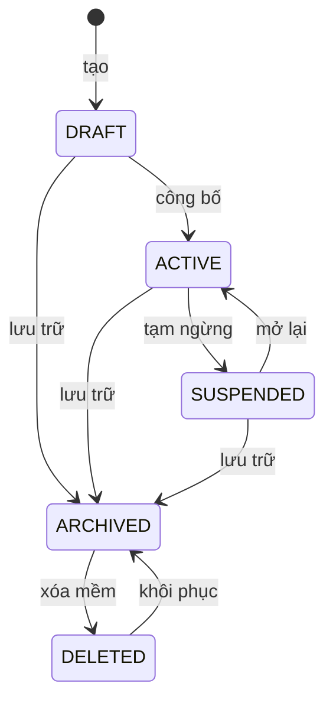

# Định danh ổn định và vòng đời của tài nguyên

Trong một REST API, tài nguyên phải giữ được danh tính khi tên gọi, thuộc tính và trạng thái của nó thay đổi. Một sản phẩm có thể đổi tên, tạm ngừng bán, được lưu trữ rồi bị xóa; các thay đổi ấy không nhất thiết tạo ra sản phẩm mới. Thiết kế API cần làm rõ điều gì xác định tài nguyên, URI nào dùng để truy cập nó và những chuyển trạng thái nào được chấp nhận.

Bài học thuộc chương **Mô hình tài nguyên** của module **INTEGRATION_API_REST**. Nội dung kết nối cách thiết kế resource và URI với phương thức HTTP, mã trạng thái, hợp đồng dữ liệu, cache, idempotency, phân quyền và kiểm thử; ví dụ triển khai sử dụng Java và có thể áp dụng trong Spring hoặc công nghệ tương đương.

## 1. Mục tiêu học tập

Sau bài học, bạn có thể:

- Phân biệt danh tính tài nguyên, khóa lưu trữ, khóa nghiệp vụ và URI.
- Chọn định danh công khai không đổi theo các thuộc tính có thể sửa.
- Mô hình hóa vòng đời bằng trạng thái, chuyển trạng thái và bất biến nghiệp vụ.
- Thiết kế hành vi đọc, cập nhật, lưu trữ, xóa và khôi phục nhất quán.
- Dùng điều kiện HTTP và transaction để xử lý cập nhật đồng thời.
- Mô tả và kiểm thử các cam kết về định danh trong hợp đồng API.

## 2. Danh tính, định danh, URI và biểu diễn

Giả sử hệ thống quản lý một sản phẩm tên “Bàn làm việc gỗ”. Người bán đổi tên thành “Bàn làm việc gỗ sồi”, thay ảnh và điều chỉnh giá. Về nghiệp vụ, đây vẫn là cùng một sản phẩm nếu hệ thống chỉ đang sửa thông tin của đối tượng đã có.

Bốn khái niệm cần tách rõ:

| Khái niệm | Ý nghĩa | Ví dụ |
|---|---|---|
| Danh tính tài nguyên | Sự liên tục của cùng một đối tượng trong hệ thống | Sản phẩm được tạo từ một yêu cầu đăng bán cụ thể |
| Giá trị định danh | Giá trị dùng để phân biệt đối tượng trong một phạm vi | `8c13d94e-1a6f-4e0c-8bd0-a963b19d2f74` |
| URI tài nguyên | Địa chỉ mà API công bố để tương tác với tài nguyên | `/products/8c13d94e-1a6f-4e0c-8bd0-a963b19d2f74` |
| Biểu diễn tài nguyên | Dữ liệu mà API gửi về tại một thời điểm | JSON chứa `id`, `name`, `state` và `updatedAt` |

Một URI có thể trả về các biểu diễn khác nhau theo thời gian. Ngày hôm nay sản phẩm ở trạng thái `DRAFT`; ngày mai cùng URI ấy có thể trả về trạng thái `ACTIVE`. Thuộc tính thay đổi không làm danh tính thay đổi.

Ngược lại, hai sản phẩm có cùng tên và giá vẫn có thể là hai tài nguyên khác nhau. Không nên dùng sự giống nhau của nội dung JSON để kết luận chúng có cùng danh tính.

### 2.1. Phạm vi của định danh

Cam kết duy nhất luôn cần một phạm vi cụ thể:

- `productId` duy nhất toàn hệ thống: `/products/{productId}`.
- Mã hàng chỉ duy nhất trong một cửa hàng: cặp `(storeId, sku)` mới phân biệt được hàng.
- Số dòng chỉ duy nhất trong một đơn hàng: `/orders/{orderId}/lines/{lineId}`.

Không suy ra khả năng truy cập chỉ từ việc một định danh là duy nhất. Với API nhiều tenant, hệ thống vẫn phải xác thực người gọi và kiểm tra quyền đối với tenant, tài nguyên, thao tác và trạng thái hiện tại.

### 2.2. Danh tính không đồng nghĩa với lịch sử phiên bản

Một sản phẩm có thể có nhiều bản sửa đổi mà vẫn giữ một `id`. Trường `version` hoặc ETag giúp phân biệt các phiên bản của biểu diễn; chúng không thay thế `id`.

Nếu nghiệp vụ cần truy cập lịch sử, có thể mô hình hóa thêm `/products/{id}/revisions/{revisionId}`. Khi đó bản sửa đổi là một tài nguyên riêng, còn `/products/{id}` tiếp tục đại diện cho sản phẩm hiện tại. Chỉ bổ sung tài nguyên lịch sử khi có nhu cầu rõ ràng; bảng lưu lịch sử trong cơ sở dữ liệu không tự động buộc API phải có endpoint lịch sử.

## 3. Chọn định danh công khai ổn định

Một định danh tốt cần đáp ứng những cam kết phù hợp với miền nghiệp vụ:

1. **Duy nhất trong phạm vi đã công bố:** không gán một giá trị cho hai đối tượng cùng phạm vi.
2. **Không đổi trong suốt danh tính đó:** đổi tên hoặc trạng thái không làm đổi `id`.
3. **Không tái sử dụng cho đối tượng khác:** liên kết cũ không vô tình trỏ vào đối tượng mới.
4. **Không phụ thuộc cách lưu trữ hiện tại:** chuyển bảng, chuyển shard hoặc di chuyển dữ liệu không buộc client đổi địa chỉ.
5. **Được xử lý như giá trị opaque ở phía client:** client truyền và lưu nguyên giá trị, không tách cấu trúc để suy ra nghiệp vụ ngoài hợp đồng.

“Không đổi” là cam kết của hệ thống, không phải đặc tính tự có của một kiểu dữ liệu. Dùng UUID nhưng cấp UUID mới mỗi lần sửa vẫn làm hỏng danh tính. Dùng số nguyên tăng dần vẫn có thể tạo ra định danh ổn định nếu hệ thống giữ đúng cam kết.

### 3.1. Khóa cơ sở dữ liệu và định danh API

Ví dụ một bản ghi:

```text
id nội bộ:       9182
public_id:       8c13d94e-1a6f-4e0c-8bd0-a963b19d2f74
sku:             DESK-OAK-01
slug:            ban-lam-viec-go-soi
```

| Giá trị | Vai trò điển hình | Có thể thay đổi? |
|---|---|---|
| `id` nội bộ | Tham chiếu, join và tối ưu lưu trữ | Tùy thiết kế và quy trình migration |
| `public_id` | Định danh được API cam kết với client | Không đổi trong cùng danh tính |
| `sku` | Mã nghiệp vụ phục vụ vận hành | Theo quy tắc nghiệp vụ; có hệ thống cho phép sửa |
| `slug` | Chuỗi dễ đọc phục vụ điều hướng | Thường thay đổi khi đổi tên hoặc xử lý trùng tên |

Tách khóa nội bộ và `public_id` là một lựa chọn thiết kế, không phải yêu cầu bắt buộc cho mọi API. Nếu khóa nội bộ đã đáp ứng cam kết công khai, có thể dùng chung. Khi công bố bất kỳ khóa nào, việc đổi nó sau này sẽ trở thành vấn đề tương thích với client.

Cơ sở dữ liệu cần ràng buộc duy nhất phù hợp cho định danh. Sinh UUID làm xác suất trùng rất nhỏ nhưng không thay thế ràng buộc dữ liệu. Định danh khó đoán cũng không thay thế kiểm tra quyền truy cập.

### 3.2. Khóa tự nhiên cần được xem xét theo miền nghiệp vụ

Không nên kết luận mọi khóa nghiệp vụ đều xấu. Một mã được chuẩn hóa, bất biến và có phạm vi duy nhất rõ ràng có thể là định danh phù hợp. Trước khi chọn email, số điện thoại, mã nhân viên hoặc SKU làm khóa URI, cần xác định:

- Người dùng có được sửa giá trị đó không?
- Giá trị có được cấp lại cho đối tượng khác không?
- Giá trị có chứa thông tin riêng tư hoặc nhạy cảm khi xuất hiện trong URL, log và lịch sử duyệt web không?
- Thay đổi tổ chức, chuẩn hóa hoặc sáp nhập có làm đổi ý nghĩa của giá trị không?

Nếu các câu trả lời làm cam kết ổn định trở nên khó duy trì, nên có một định danh công khai riêng. Email thường phù hợp làm thuộc tính tra cứu hơn là danh tính lâu dài của tài khoản.

## 4. Giữ URI ổn định khi dữ liệu thay đổi

Với cùng sản phẩm, API có thể trả về:

```http
GET /products/8c13d94e-1a6f-4e0c-8bd0-a963b19d2f74
```

```json
{
  "id": "8c13d94e-1a6f-4e0c-8bd0-a963b19d2f74",
  "name": "Bàn làm việc gỗ sồi",
  "state": "ACTIVE",
  "slug": "ban-lam-viec-go-soi"
}
```

Đổi `name` hoặc `slug` không đổi URI định danh sản phẩm.

### 4.1. Slug, alias và URI chính thức

Có thể cung cấp đường dẫn dễ đọc như `/catalog/ban-lam-viec-go-soi`, đồng thời duy trì URI chính thức `/products/{id}`. Khi slug đổi, hệ thống có thể giữ alias cũ và chuyển hướng sang địa chỉ mới theo chính sách công bố.

Cần phân biệt:

- Định danh API có thể ổn định dù có nhiều đường dẫn điều hướng đến cùng tài nguyên.
- Việc giữ alias là một cam kết bổ sung, cần quản lý va chạm và thời gian tồn tại.
- Không nên cấp lại alias cũ cho sản phẩm khác khi còn các liên kết bên ngoài dựa vào ý nghĩa cũ.

Chuyển hướng cần phù hợp với phương thức HTTP và khả năng theo chuyển hướng của client. Không mặc định rằng mọi client ghi dữ liệu đều tự xử lý chuyển hướng giống trình duyệt đọc trang.

### 4.2. URI lồng nhau và quan hệ có thể thay đổi

URI `/stores/{storeId}/products/{productId}` diễn đạt sản phẩm trong ngữ cảnh một cửa hàng. Nếu sản phẩm có thể chuyển cửa hàng mà vẫn là cùng đối tượng, lấy đường dẫn này làm URI chính thức sẽ khiến URI thay đổi khi quan hệ thay đổi.

Một phương án phù hợp là:

```text
GET /products/{productId}                    # URI chính thức
GET /stores/{storeId}/products               # Tập hợp theo cửa hàng
```

Biểu diễn sản phẩm chứa `storeId` hiện tại; thay đổi cửa hàng là thay đổi quan hệ. Ngược lại, nếu đối tượng chỉ có ý nghĩa trong cha và không thể chuyển cha, URI lồng nhau có thể phản ánh đúng danh tính.

Quyết định này phải xuất phát từ quy tắc miền nghiệp vụ. Không tạo cấu trúc URI chỉ vì bảng dữ liệu đang có khóa ngoại.

### 4.3. Khi nào cần tài nguyên mới?

| Sự kiện | Cách nhìn danh tính thường phù hợp |
|---|---|
| Đổi tên, giá hoặc ảnh sản phẩm | Giữ tài nguyên và định danh |
| Tạm ngừng bán rồi mở bán lại | Giữ tài nguyên, chuyển trạng thái |
| Nhân bản sản phẩm để đăng bán độc lập | Tạo tài nguyên với định danh mới |
| Tạo mặt hàng thay thế và muốn giữ lịch sử mặt hàng cũ | Tạo tài nguyên mới, liên kết bằng quan hệ thay thế |
| Chuyển dữ liệu sang hệ thống lưu trữ khác | Giữ định danh công khai nếu vẫn là cùng đối tượng |

Nếu miền nghiệp vụ định nghĩa một trường hợp khác, API phải diễn đạt rõ. Không lấy thao tác “xóa một dòng rồi insert lại” trong triển khai làm lý do tự động đổi danh tính công khai.

## 5. Mô hình hóa vòng đời bằng trạng thái

Vòng đời là tập trạng thái hợp lệ cùng quy tắc chuyển giữa chúng. Ví dụ dưới đây dùng sản phẩm với năm trạng thái:

| Trạng thái | Ý nghĩa trong ví dụ |
|---|---|
| `DRAFT` | Đã được cấp định danh, đang hoàn thiện thông tin |
| `ACTIVE` | Được phép xuất hiện trong danh mục đang bán |
| `SUSPENDED` | Tạm ngừng bán, vẫn có thể sửa và mở lại |
| `ARCHIVED` | Đã ngừng vận hành, được giữ để tham chiếu và chưa cho sửa nội dung |
| `DELETED` | Đã xóa mềm khỏi API thông thường, còn thông tin để phục hồi hoặc dọn dẹp |

Đây là mô hình nghiệp vụ minh họa. Không có quy tắc REST buộc mọi sản phẩm hay mọi tài nguyên phải dùng đúng những trạng thái này.



Xóa vật lý là bước dọn dẹp dữ liệu sau đó, không nhất thiết là một giá trị `state` còn đọc được qua API.

### 5.1. Mỗi chuyển trạng thái phải có điều kiện

| Thao tác | Trạng thái nguồn | Điều kiện bổ sung | Trạng thái đích |
|---|---|---|---|
| Tạo sản phẩm | Chưa tồn tại | Dữ liệu tạo hợp lệ, người gọi có quyền | `DRAFT` |
| Công bố hoặc mở lại | `DRAFT`, `SUSPENDED` | Đủ thông tin bắt buộc để bán | `ACTIVE` |
| Tạm ngừng | `ACTIVE` | Người gọi có quyền vận hành | `SUSPENDED` |
| Lưu trữ | `DRAFT`, `ACTIVE`, `SUSPENDED` | Thỏa điều kiện ngừng vận hành | `ARCHIVED` |
| Xóa mềm | `ARCHIVED` | Thỏa điều kiện xóa và chính sách dữ liệu | `DELETED` |
| Khôi phục | `DELETED` | Chưa xóa vật lý, còn trong thời hạn cho phép | `ARCHIVED` |

Khôi phục về `ARCHIVED` tránh tự động đưa một sản phẩm đã xóa trở lại danh mục bán. Nếu cần công bố lại sau lưu trữ, miền nghiệp vụ có thể bổ sung một chuyển trạng thái riêng với bước kiểm tra lại; mô hình ví dụ hiện tại chưa cung cấp chuyển đó.

### 5.2. Bất biến phải được kiểm tra ở nơi ghi dữ liệu

Ví dụ bất biến:

- `id` không đổi qua mọi chuyển trạng thái.
- Tên không được rỗng.
- Chỉ sản phẩm `ACTIVE` được đưa vào tập hợp đang bán.
- Không sửa tên khi sản phẩm đã `ARCHIVED` hoặc `DELETED`.
- `deletedAt` có giá trị khi và chỉ khi sản phẩm đang `DELETED` trong mô hình này.
- Một chuyển trạng thái thành công phải ghi trạng thái và dấu thời gian nhất quán.

Giao diện ẩn nút không đủ bảo vệ bất biến. Client khác vẫn có thể gọi API trực tiếp, và hai yêu cầu có thể chạy đồng thời. Service/domain và tầng lưu trữ phải phối hợp bảo đảm các điều kiện cần thiết.

## 6. Ánh xạ vòng đời sang HTTP

Phương thức HTTP biểu đạt kiểu tương tác với tài nguyên. Trạng thái nghiệp vụ được biểu đạt trong dữ liệu và quy tắc miền; không dùng mã HTTP như `200` hay `404` làm giá trị vòng đời trong bảng sản phẩm.

### 6.1. Tạo tài nguyên và công bố danh tính

```http
POST /products
Content-Type: application/json

{"name":"Bàn làm việc gỗ sồi"}
```

```http
HTTP/1.1 201 Created
Location: /products/8c13d94e-1a6f-4e0c-8bd0-a963b19d2f74
Content-Type: application/json

{
  "id": "8c13d94e-1a6f-4e0c-8bd0-a963b19d2f74",
  "name": "Bàn làm việc gỗ sồi",
  "state": "DRAFT",
  "version": 0
}
```

Trong hợp đồng này, server cấp `id`; request tạo không cho client gán `id`, `version` hoặc các dấu thời gian do server quản lý. Response và `Location` phải nói về cùng một tài nguyên.

Nếu client timeout sau khi server tạo thành công, gửi lại `POST` có thể tạo đối tượng thứ hai. Có thể thiết kế cơ chế khóa idempotency ở mức ứng dụng: cùng khóa, cùng người gọi/phạm vi và cùng nội dung sẽ nhận lại kết quả của lần tạo đã ghi nhận trong thời hạn công bố. Dùng lại khóa với nội dung khác phải được xử lý theo quy tắc rõ ràng. Khóa retry này không phải `productId`, và chỉ thêm một header mà không có lưu trữ, kiểm soát đồng thời và quy tắc hết hạn thì chưa bảo đảm được hành vi đó.

### 6.2. Cập nhật thuộc tính và chuyển trạng thái

Hai cách biểu đạt phổ biến là cập nhật có kiểm soát hoặc tạo tài nguyên ghi nhận yêu cầu chuyển trạng thái:

| Cách | Ví dụ | Cách áp dụng |
|---|---|---|
| Cập nhật một phần | `PATCH /products/{id}` với `{"state":"SUSPENDED"}` | Hợp đồng cho phép cập nhật `state`, nhưng vẫn kiểm tra chuyển trạng thái |
| Tạo bản ghi chuyển trạng thái | `POST /products/{id}/transitions` với `{"targetState":"SUSPENDED"}` | Phù hợp khi cần lưu lý do, người yêu cầu, kết quả hoặc lịch sử như tài nguyên riêng |

Phải công bố loại tài liệu PATCH và `Content-Type` được hỗ trợ. Một JSON body bất kỳ không tự động có ngữ nghĩa cập nhật chuẩn. Nếu dùng JSON Merge Patch, ví dụ trạng thái có thể dùng `Content-Type: application/merge-patch+json`; quy tắc cho `null` và thuộc tính được phép sửa cần được mô tả rõ.

Không nhận một đối tượng rồi gán toàn bộ field vào entity. Các trường như `id`, `createdAt`, `deletedAt` và `version` phải được bảo vệ theo hợp đồng. Cho phép gửi `state` cũng không đồng nghĩa cho phép mọi bước nhảy giữa các trạng thái.

Nếu tạo một tài nguyên transition mới và hoàn thành ngay, có thể trả `201 Created` với URI của transition. Nếu xử lý chưa hoàn tất, có thể trả `202 Accepted` và cung cấp cách theo dõi tiến độ. Chỉ trả mã chấp nhận chưa đủ để chứng minh trạng thái đích đã có hiệu lực.

### 6.3. Các kết quả cần phân biệt

| Tình huống | Mã phản hồi có thể dùng trong hợp đồng ví dụ |
|---|---|
| Đọc tài nguyên có thể truy cập | `200 OK` |
| Tạo tài nguyên thành công | `201 Created` |
| Cập nhật hoặc xóa đã hoàn tất và không trả body | `204 No Content` |
| Yêu cầu xử lý đã nhận nhưng chưa hoàn tất | `202 Accepted` |
| Dữ liệu request sai cấu trúc hoặc vi phạm kiểm tra đầu vào | `400 Bad Request` theo quy ước API này |
| Chuyển trạng thái không hợp lệ với trạng thái hiện tại | `409 Conflict` |
| `If-Match` không khớp với biểu diễn hiện tại | `412 Precondition Failed` |
| Không tìm thấy tài nguyên trong phạm vi truy cập | `404 Not Found` |
| Tài nguyên được xác định đã bị gỡ và API muốn công bố điều đó | `410 Gone` theo chính sách công khai |

Một sản phẩm `SUSPENDED` vẫn tồn tại; API quản trị có thể trả `200` với trạng thái đó. Endpoint danh mục bán có thể không liệt kê nó. Cần phân biệt “không xuất hiện trong tập hợp này” với “không tồn tại trong toàn hệ thống”.

Lỗi nghiệp vụ nên cung cấp mã máy đọc được, ví dụ `PRODUCT_STATE_CONFLICT`, cùng mô tả và trạng thái hiện tại khi người gọi có quyền xem. Không buộc client phân tích câu thông báo dành cho con người để xác định loại lỗi.

## 7. Lưu trữ, xóa mềm, xóa vật lý và khôi phục

Các thao tác này có hệ quả khác nhau đối với liên kết, dữ liệu và khả năng đọc:

| Thao tác | Dữ liệu phía server | Hành vi API cần xác định |
|---|---|---|
| Lưu trữ | Còn dữ liệu nghiệp vụ | Có đọc trực tiếp không, có nằm trong danh sách mặc định không |
| Xóa mềm | Còn một phần hoặc toàn bộ dữ liệu, có dấu xóa | GET thông thường trả gì, ai được xem phần đã xóa, ai được khôi phục |
| Xóa vật lý | Đã dọn dữ liệu theo chính sách | Có giữ dấu vết định danh tối thiểu không, còn khôi phục được không |

`DELETE` không buộc server phải xóa ngay một dòng trong database. Nó yêu cầu hành vi xóa tài nguyên theo hợp đồng HTTP và API; cách dọn dữ liệu bên trong là quyết định triển khai. Trong ví dụ này, `DELETE /products/{id}` chỉ hợp lệ khi tài nguyên đã `ARCHIVED`, và hoàn tất bằng việc chuyển sang `DELETED`.

### 7.1. Idempotency của DELETE không yêu cầu phản hồi giống nhau

Ví dụ một chính sách:

```text
DELETE /products/{id} lần đầu: 204, sản phẩm chuyển sang DELETED.
DELETE /products/{id} lần nữa: 204, không có thay đổi nghiệp vụ thêm.
GET /products/{id} sau xóa:    404 trong API thông thường.
```

Một API khác có thể trả `404` cho lần DELETE lặp lại. Tính idempotent nói về tác động dự kiến lên tài nguyên khi lặp lại yêu cầu, không bắt buộc mọi lần có cùng mã trạng thái hoặc body.

Lần DELETE lặp lại không được kéo dài thời hạn giữ dữ liệu, sửa lại `deletedAt`, hoặc phát sinh thêm một khoản phí xóa chỉ vì client retry. Log kỹ thuật cho từng request vẫn có thể được ghi nhận.

Nếu yêu cầu xóa có `If-Match`, lần retry sau khi phiên bản đã đổi có thể nhận `412` tùy thứ tự đánh giá điều kiện theo hợp đồng. Ví dụ `204` lặp lại ở trên giả định yêu cầu không có điều kiện phiên bản đang bị sai lệch.

### 7.2. Tombstone và không tái sử dụng định danh

Tombstone là bản ghi tối thiểu cho biết một định danh đã từng tồn tại và đã bị xóa. Nó có thể giúp ngăn tái cấp ID, đồng bộ việc xóa hoặc lựa chọn phản hồi `410` khi chính sách cho phép.

Không nhất thiết giữ toàn bộ dữ liệu sản phẩm để giữ ý nghĩa của định danh. Tuy nhiên, dữ liệu tombstone cũng cần phạm vi, thời hạn và quyền truy cập phù hợp. Không dùng lịch sử xóa làm lý do giữ vô hạn các thuộc tính không còn cần thiết.

Ngay cả khi không giữ tombstone ở database nghiệp vụ, cơ chế cấp định danh cũng phải tránh cấp lại ID của tài nguyên đã xóa cho một đối tượng khác. Với alias hay mã nghiệp vụ có thể tái cấp, cần tách rõ chúng khỏi định danh lâu dài và giải quyết cách client tra cứu lịch sử.

### 7.3. Khôi phục giữ danh tính cũ

Khôi phục trong thời hạn cho phép phải đưa trở lại đúng đối tượng với `id` cũ và quan hệ hợp lệ. Không thực hiện một request tạo mới rồi coi đó là khôi phục nếu các liên kết cũ cần tiếp tục đúng.

Cần xử lý các điều kiện có thể đã thay đổi trong thời gian bị xóa: mã nghiệp vụ bị chiếm, cửa hàng không còn tồn tại, quan hệ liên quan đã bị xóa hoặc dữ liệu không còn đủ để phục hồi. Khi không đáp ứng điều kiện, API phải từ chối hoặc yêu cầu giải quyết xung đột theo hợp đồng; không khôi phục dở dang.

Sau xóa vật lý, khả năng phục hồi phụ thuộc chính sách lưu trữ và dữ liệu thực tế còn lại. Không cam kết khôi phục qua API chỉ vì hệ thống có bản sao lưu vận hành.

## 8. Ngăn cập nhật ghi đè khi vòng đời thay đổi đồng thời

Giả sử hai người cùng đọc sản phẩm `ACTIVE` ở phiên bản 7. Người A lưu trữ sản phẩm, trong khi người B gửi dữ liệu sửa tên từ màn hình cũ. Nếu server ghi đè toàn bộ entity từ request B, sản phẩm có thể bị sửa sau khi đã lưu trữ, thậm chí bị đưa trở lại `ACTIVE` ngoài ý muốn.

Có hai tầng cần phối hợp:

1. **Điều kiện ở HTTP:** client gửi validator đã đọc, chẳng hạn ETag trong `If-Match`.
2. **Kiểm soát đồng thời ở lưu trữ:** cập nhật có điều kiện, optimistic locking hoặc cơ chế khóa phù hợp để việc kiểm tra và ghi là nguyên tử.

Ví dụ:

```http
GET /products/8c13d94e-1a6f-4e0c-8bd0-a963b19d2f74
```

```http
HTTP/1.1 200 OK
ETag: "product-view-7"
Content-Type: application/json

{"id":"8c13d94e-1a6f-4e0c-8bd0-a963b19d2f74","name":"Bàn gỗ","state":"ACTIVE","version":7}
```

Sau khi A cập nhật, biểu diễn đã chuyển sang phiên bản 8. B gửi:

```http
PATCH /products/8c13d94e-1a6f-4e0c-8bd0-a963b19d2f74
Content-Type: application/merge-patch+json
If-Match: "product-view-7"

{"name":"Bàn gỗ sồi"}
```

```http
HTTP/1.1 412 Precondition Failed
```

Client cần đọc lại và quyết định với dữ liệu mới. Không tự động bỏ `If-Match` rồi gửi lại vì làm như vậy sẽ bỏ chính điều kiện bảo vệ người dùng.

### 8.1. Kiểm tra rồi ghi phải nằm trong cơ chế nguyên tử

Mẫu cập nhật có điều kiện có thể có dạng:

```sql
UPDATE product
SET name = :new_name,
    version = version + 1,
    updated_at = :now
WHERE public_id = :product_id
  AND version = :expected_version
  AND state IN ('DRAFT', 'ACTIVE', 'SUSPENDED');
```

Nếu không cập nhật được dòng nào, service phải phân biệt nguyên nhân cần thiết theo quyền và hợp đồng: không có tài nguyên, phiên bản đã đổi hoặc trạng thái không cho phép. Không mặc định mọi trường hợp đều là `404`. Mẫu SQL chỉ minh họa điều kiện nguyên tử; thiết kế đầy đủ còn cần xử lý transaction, validation và các quan hệ liên quan.

Với JPA, có thể dùng optimistic locking qua `@Version` rồi ánh xạ thất bại phù hợp với điều kiện HTTP. Không chỉ đọc `version`, so sánh trong bộ nhớ và sau đó ghi không điều kiện. Đối với thao tác ảnh hưởng nhiều bản ghi, cần xét cả bất biến của toàn transaction.

### 8.2. ETag không mặc nhiên bằng số phiên bản của một dòng

ETag đại diện cho biểu diễn được chọn. Có thể xây dựng ETag mạnh từ `version` nếu mọi thay đổi ảnh hưởng đến biểu diễn đó đều làm validator thay đổi và các biến thể được phân biệt đúng. Nếu JSON còn chứa dữ liệu từ bảng giá, danh mục hoặc phép tính khác, chỉ dùng phiên bản dòng `product` có thể là không đủ.

`If-Match` cần phép so sánh mạnh; không dùng ETag yếu có tiền tố `W/` cho cơ chế bảo vệ cập nhật này. Client cần xem ETag là chuỗi opaque và gửi lại đúng giá trị server đã cung cấp.

## 9. Ví dụ Java: giữ định danh và bảo vệ chuyển trạng thái

Lớp dưới đây tập trung vào danh tính và vòng đời. Các phương thức nhận thời điểm từ bên ngoài để application service có thể dùng một nguồn thời gian thống nhất.

```java
import java.time.Instant;
import java.util.Objects;
import java.util.UUID;

public final class Product {
    public enum State {
        DRAFT, ACTIVE, SUSPENDED, ARCHIVED, DELETED
    }

    private final UUID id;
    private final Instant createdAt;
    private String name;
    private State state;
    private Instant updatedAt;
    private Instant deletedAt;
    private long version;

    public Product(String name, Instant now) {
        this.id = UUID.randomUUID();
        this.name = validName(name);
        this.createdAt = Objects.requireNonNull(now);
        this.updatedAt = now;
        this.state = State.DRAFT;
    }

    public UUID id() { return id; }
    public String name() { return name; }
    public State state() { return state; }
    public long version() { return version; }
    public Instant createdAt() { return createdAt; }
    public Instant updatedAt() { return updatedAt; }
    public Instant deletedAt() { return deletedAt; }

    public void rename(String requestedName, Instant now) {
        require(state == State.DRAFT || state == State.ACTIVE
                || state == State.SUSPENDED);
        String nextName = validName(requestedName);
        if (name.equals(nextName)) return;
        Objects.requireNonNull(now);
        name = nextName;
        touch(now);
    }

    public void activate(Instant now) {
        if (state == State.ACTIVE) return;
        require(state == State.DRAFT || state == State.SUSPENDED);
        changeState(State.ACTIVE, now);
    }

    public void suspend(Instant now) {
        if (state == State.SUSPENDED) return;
        require(state == State.ACTIVE);
        changeState(State.SUSPENDED, now);
    }

    public void archive(Instant now) {
        if (state == State.ARCHIVED) return;
        require(state == State.DRAFT || state == State.ACTIVE
                || state == State.SUSPENDED);
        changeState(State.ARCHIVED, now);
    }

    public void softDelete(Instant now) {
        if (state == State.DELETED) return;
        require(state == State.ARCHIVED);
        Objects.requireNonNull(now);
        deletedAt = now;
        changeState(State.DELETED, now);
    }

    public void restore(Instant now) {
        require(state == State.DELETED);
        Objects.requireNonNull(now);
        deletedAt = null;
        changeState(State.ARCHIVED, now);
    }

    private void changeState(State next, Instant now) {
        Objects.requireNonNull(now);
        state = next;
        touch(now);
    }

    private void touch(Instant now) {
        version++;
        updatedAt = now;
    }

    private static void require(boolean allowed) {
        if (!allowed) {
            throw new IllegalStateException("PRODUCT_STATE_CONFLICT");
        }
    }

    private static String validName(String value) {
        if (value == null || value.isBlank()) {
            throw new IllegalArgumentException("PRODUCT_NAME_REQUIRED");
        }
        return value.strip();
    }
}
```

Những quyết định thể hiện trong ví dụ:

- `id` được cấp trong lần tạo đối tượng mới, là `final` và không có setter. Đường tái dựng đối tượng từ database phải nạp lại đúng ID đã lưu, không gọi constructor tạo mới để sinh ID khác.
- Không có phương thức `setState` tùy ý. Mỗi thao tác bảo vệ trạng thái nguồn được phép.
- Các lần lặp lại thao tác đặt về trạng thái đã đạt được có thể là no-op. Ví dụ xóa mềm lại không đổi `deletedAt` và không tăng `version`.
- `restore` trong ví dụ chỉ cho đi từ `DELETED` về `ARCHIVED`. Nếu endpoint khôi phục cần retry an toàn qua một chu kỳ xóa mới, cần thêm quy tắc nhận diện yêu cầu hoặc thế hệ xóa; chỉ nhìn trạng thái hiện tại có thể chưa đủ.
- Số `version` ở đây minh họa thay đổi của đối tượng trong bộ nhớ. Lớp này chưa tự bảo đảm an toàn đồng thời hoặc lưu bền dữ liệu.

Trong ứng dụng Spring, application service thường tải đối tượng, kiểm tra quyền, kiểm tra dữ liệu và chính sách bổ sung, gọi phương thức domain rồi lưu trong transaction. Ví dụ đơn giản chỉ coi tên không rỗng là điều kiện dữ liệu để kích hoạt; một danh mục thực tế có thể còn yêu cầu giá, hình ảnh hoặc phê duyệt.

Nếu entity thực tế dùng `@Version`, hãy để cơ chế ORM quản lý phiên bản của entity thay vì sao chép cả cách tự tăng phiên bản trong lớp minh họa này. Lỗi domain phải được ánh xạ chủ đích sang HTTP, chẳng hạn xung đột trạng thái sang `409`; không ánh xạ mọi `IllegalStateException` trong ứng dụng thành cùng một lỗi nghiệp vụ.

## 10. Cache, danh sách và liên kết khi vòng đời thay đổi

Giữ URI ổn định giúp client tiếp tục tham chiếu đúng đối tượng nhưng không tự giải quyết dữ liệu cache cũ.

Ví dụ sản phẩm chuyển từ `ACTIVE` sang `SUSPENDED`:

- Cache chi tiết sản phẩm có thể còn biểu diễn cũ.
- Cache danh sách `/products?state=ACTIVE` có thể còn chứa sản phẩm.
- Cache trang tìm kiếm hoặc danh mục theo cửa hàng cũng có thể cần cập nhật.

API cần chính sách độ tươi, revalidation hoặc vô hiệu hóa phù hợp cho từng loại biểu diễn. Một yêu cầu ghi tới URI chi tiết không bảo đảm mọi cache chứa các tập hợp liên quan đều tự cập nhật đúng. Nếu hỗ trợ đọc có điều kiện, client có thể gửi `If-None-Match` để kiểm tra biểu diễn đã lưu; trường hợp phù hợp có thể nhận `304 Not Modified`.

Sau xóa hoặc khôi phục, cần xem xét cả cache của phản hồi không tìm thấy. Một `404` đã được cache vẫn có thể làm client chưa thấy tài nguyên vừa khôi phục cho tới khi hết hạn hoặc được xác thực lại theo chính sách cache.

Với API riêng tư, quy tắc cache còn phải xét phạm vi người dùng hoặc tenant. Không dùng chung biểu diễn hoặc validator một cách khiến dữ liệu dành cho người này bị phục vụ cho người khác.

Danh sách cũng cần hợp đồng rõ: mặc định trả những trạng thái nào, có bộ lọc trạng thái không và ai được liệt kê phần đã lưu trữ hay đã xóa. Thay đổi trạng thái giữa các lần phân trang có thể làm tập kết quả thay đổi; việc ID ổn định chỉ giúp nhận diện đối tượng, không bảo đảm một ảnh chụp nhất quán của toàn bộ danh sách.

## 11. Ghi rõ cam kết trong hợp đồng API

OpenAPI hoặc tài liệu tương đương cần mô tả được các quyết định mà client phải dựa vào:

| Nội dung | Ví dụ cam kết |
|---|---|
| Định danh | `id` do server cấp, không đổi và không tái sử dụng cho đối tượng khác |
| URI | `Location` của lần tạo chỉ đến URI chính thức của sản phẩm |
| Trường chỉ đọc | `id`, `version`, `createdAt`, `updatedAt`, `deletedAt` do server quản lý |
| Trạng thái | Enum, ý nghĩa, chuyển trạng thái và điều kiện được phép |
| Khả năng ghi | Thuộc tính nào sửa được ở từng trạng thái |
| Đồng thời | Khi nào cần `If-Match`, dạng validator và hành vi khi điều kiện thất bại |
| Xóa | Điều kiện DELETE, phản hồi khi lặp lại, hành vi GET sau xóa |
| Khôi phục | Quyền, thời hạn, trạng thái đích và xung đột có thể gặp |
| Danh sách | Các trạng thái xuất hiện mặc định và bộ lọc được hỗ trợ |
| Retry | Cơ chế idempotency nếu có, phạm vi, thời hạn và xử lý nội dung khác |

Đánh dấu `readOnly` trong schema là mô tả hợp đồng; server vẫn cần DTO, validation hoặc cơ chế xử lý input phù hợp để thực thi. Khai báo enum chỉ mô tả tập giá trị, chưa đủ mô tả các cạnh của máy trạng thái.

Thêm một giá trị enum mới cũng có thể ảnh hưởng client xử lý đóng tập trạng thái. Cần xem xét khả năng tương thích, cách client xử lý giá trị chưa biết và kế hoạch phát hành thay vì coi mọi thay đổi bổ sung đều tự động an toàn.

## 12. Những hành vi cần kiểm chứng khi triển khai

Kiểm thử API nên kiểm tra các cam kết có thể quan sát từ ngoài hệ thống, thay vì chỉ kiểm tra bảng dữ liệu có đổi hay không.

| Tình huống | Kết quả cần quan sát |
|---|---|
| Tạo rồi sửa tên | `id` và URI chính thức giữ nguyên |
| Đổi slug hoặc chuyển cửa hàng | URI theo chính sách vẫn định vị đúng sản phẩm |
| Nhân bản sản phẩm | Bản sao có định danh mới, bản gốc vẫn đọc đúng |
| Gửi input cố đổi `id` | Server xử lý theo chính sách input và không đổi danh tính |
| Yêu cầu chuyển trạng thái sai | Trả lỗi đã công bố; không ghi một phần dữ liệu |
| Hai request cùng dùng phiên bản cũ | Chỉ thay đổi thỏa điều kiện mới được ghi; request xung đột không ghi đè |
| Gọi DELETE lặp lại | Không phát sinh thêm tác động xóa hoặc đổi mốc giữ dữ liệu |
| Khôi phục trong hạn | Đúng ID cũ, đúng trạng thái đích và đúng quan hệ |
| Định danh của sản phẩm đã xóa | Không được cấp lại cho sản phẩm khác |
| Người dùng khác tenant truy cập cùng ID | Quyền được kiểm tra ở cả đọc, ghi, xóa và khôi phục |
| Chuyển trạng thái hoặc khôi phục khi có cache | Hành vi độ tươi và xác thực lại phù hợp hợp đồng |

Danh tính là phần client cần tin cậy lâu dài; vòng đời giải thích những thay đổi được phép xảy ra với đối tượng mang danh tính đó. Khi hai phần này được mô tả rõ và thực thi nhất quán, client có thể lưu liên kết, retry, xử lý xung đột và theo dõi tài nguyên qua nhiều trạng thái mà không phải đoán ý nghĩa của từng lần phản hồi.