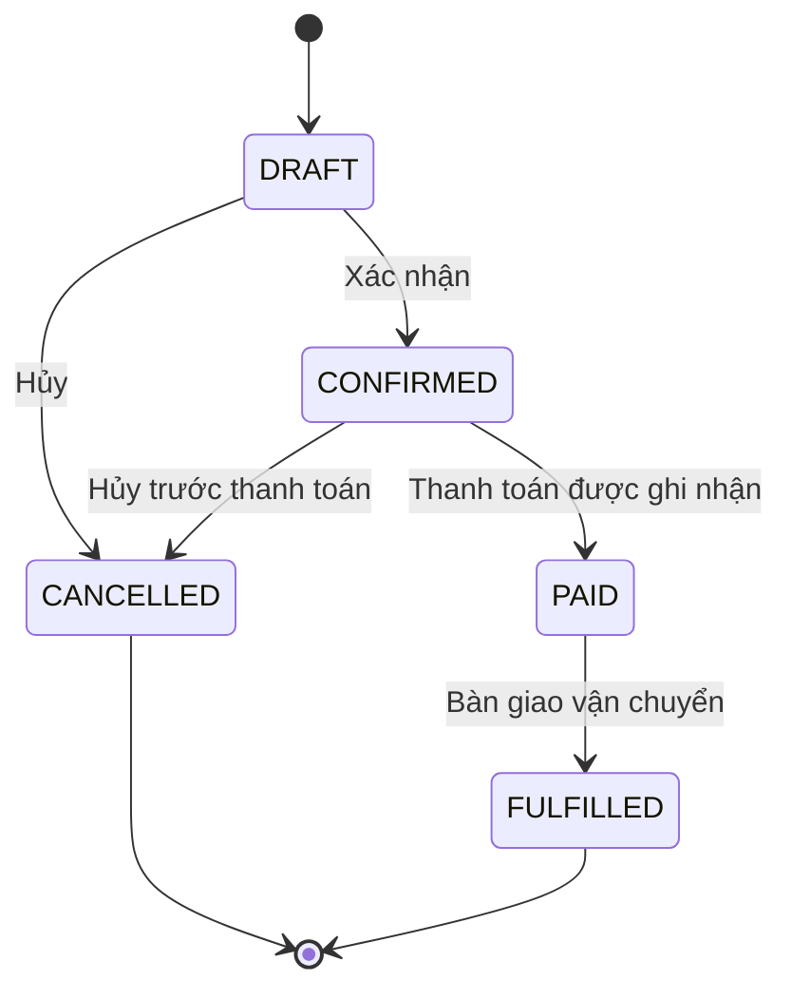
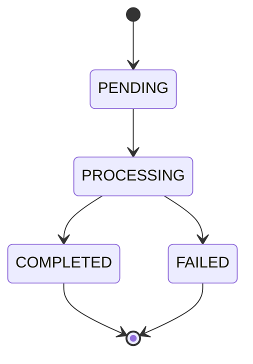

# Biểu diễn trạng thái nghiệp vụ bằng tài nguyên

## Mục tiêu bài học

Trong chương **Mô hình tài nguyên** của module **INTEGRATION_API_REST**, bài học này giải quyết một câu hỏi thiết kế: làm thế nào để client quan sát và tác động đến vòng đời nghiệp vụ thông qua tài nguyên REST?

Sau bài học, bạn có thể:

- Phân biệt trạng thái nghiệp vụ, trạng thái HTTP và trạng thái lưu trữ.
- Mô hình hóa một vòng đời bằng trạng thái, chuyển trạng thái và điều kiện chuyển.
- Chọn giữa cập nhật thuộc tính trạng thái và tạo tài nguyên nghiệp vụ như yêu cầu hủy hoặc khoản thanh toán.
- Thiết kế URI, request, response và lỗi để client hiểu được kết quả chuyển trạng thái.
- Xử lý cập nhật đồng thời, gửi lại request và tác vụ bất đồng bộ trong phạm vi một luồng nghiệp vụ.
- Chuyển các quyết định đó thành hợp đồng có thể triển khai và kiểm thử với Java/Spring hoặc công nghệ tương đương.

Ví dụ xuyên suốt là hệ thống đặt hàng. Các quy tắc bên dưới là **quy ước của hệ thống minh họa**, không phải vòng đời bắt buộc cho mọi hệ thống bán hàng.

## 1. Trạng thái nghiệp vụ trả lời câu hỏi nào?

Một đơn hàng không chỉ là tập hợp các cột trong cơ sở dữ liệu. Ở mỗi thời điểm, nghiệp vụ cần biết đơn hàng đang ở giai đoạn nào, được phép làm gì tiếp theo và vì sao một thao tác bị từ chối.

Ví dụ:

- Đơn nháp có thể sửa địa chỉ và số lượng hàng.
- Đơn đã xác nhận bị khóa nội dung, nhưng có thể thanh toán hoặc hủy theo chính sách.
- Đơn đã thanh toán cần quy trình hoàn tiền nếu khách yêu cầu hủy.
- Đơn đã giao cho đơn vị vận chuyển không thể bị hủy bằng quy trình thông thường.

Trạng thái `CONFIRMED` chỉ hữu ích khi nó gắn với ý nghĩa và các quy tắc như vậy. Nếu chỉ thêm một chuỗi `status` rồi cho phép client gán bất kỳ giá trị nào, API chưa thực sự mô hình hóa vòng đời nghiệp vụ.

### Ba khái niệm dễ nhầm

| Khái niệm | Ví dụ | Ý nghĩa |
| --- | --- | --- |
| Trạng thái nghiệp vụ | `order.status = "CONFIRMED"` | Đơn hàng đang ở giai đoạn đã xác nhận |
| Mã trạng thái HTTP | `200 OK`, `409 Conflict` | Kết quả xử lý một request HTTP cụ thể |
| Trạng thái lưu trữ/kỹ thuật | `version = 8`, `deleted_at`, cờ xử lý của worker | Phục vụ đồng bộ, lưu trữ hoặc vận hành |

Một request `GET /orders/ord-1042` có thể trả `200 OK` cùng đơn hàng `CANCELLED`. HTTP thành công vì đọc được tài nguyên; đơn hàng bị hủy là nội dung nghiệp vụ.

Ngược lại, `409 Conflict` không có nghĩa là đơn hàng mang trạng thái `CONFLICT`. Nó cho biết request hiện tại mâu thuẫn với trạng thái tài nguyên hoặc ràng buộc đang có.

## 2. Phân biệt tài nguyên, biểu diễn và chuyển trạng thái

**Tài nguyên** là đối tượng có danh tính mà API cho phép tham chiếu, chẳng hạn đơn hàng `ord-1042`.

**Biểu diễn** là dữ liệu API gửi về tài nguyên tại một thời điểm. Một biểu diễn JSON có thể chứa trạng thái, tổng tiền, liên kết và thời điểm cập nhật.

**Chuyển trạng thái** là thay đổi hợp lệ trong vòng đời, chẳng hạn từ `DRAFT` sang `CONFIRMED`. Sự thay đổi có thể được kích hoạt bởi request của người dùng hoặc sự kiện từ hệ thống khác.

Ví dụ đọc một đơn hàng:

```http
GET /orders/ord-1042 HTTP/1.1
Accept: application/json
```

```http
HTTP/1.1 200 OK
Content-Type: application/json
ETag: "order-ord-1042-v7"
Cache-Control: private, no-cache

{
  "id": "ord-1042",
  "status": "DRAFT",
  "total": {
    "amount": "1250000",
    "currency": "VND"
  },
  "updatedAt": "2026-11-17T02:00:00Z",
  "links": {
    "self": "/orders/ord-1042",
    "confirmation": "/orders/ord-1042/confirmation",
    "cancellations": "/orders/ord-1042/cancellations"
  },
  "allowedTransitions": ["CONFIRM", "CANCEL"]
}
```

Ở đây:

- `id` và URI xác định đơn hàng; danh tính này không thay đổi khi đơn chuyển trạng thái.
- `status` là mã trạng thái ổn định theo hợp đồng, không phải nhãn đã dịch cho giao diện.
- `allowedTransitions` là gợi ý dựa trên dữ liệu, danh tính người gọi và chính sách tại thời điểm đọc.
- `ETag` là bộ xác thực phiên bản biểu diễn, được dùng lại trong ví dụ kiểm soát đồng thời.
- `private, no-cache` cho phép cache riêng lưu biểu diễn nhưng yêu cầu xác thực lại trước khi tái sử dụng. Đây là lựa chọn minh họa; dữ liệu nhạy cảm hơn có thể cần `no-store`.

Các tên trong `links` và `allowedTransitions` ở trên là quy ước riêng của API. Client cần hợp đồng để biết phương thức HTTP, nội dung request và ý nghĩa của từng thao tác; các tên này không tự tạo ra một chuẩn điều khiển siêu phương tiện.

Client không được coi `allowedTransitions` là quyền thực thi đã được cấp vĩnh viễn. Sau khi client đọc dữ liệu, trạng thái hoặc quyền có thể thay đổi. Server phải kiểm tra lại khi xử lý request.

## 3. Mô hình hóa vòng đời trước khi chọn endpoint

Bắt đầu bằng các câu hỏi nghiệp vụ:

1. Những giai đoạn nào có ý nghĩa đối với người dùng?
2. Điều gì được phép thay đổi tại từng giai đoạn?
3. Chuyển trạng thái nào được phép và ai có quyền thực hiện?
4. Dữ liệu nào bắt buộc khi chuyển?
5. Có tác động ngoài hệ thống như thu tiền, giữ hàng hoặc gửi vận chuyển không?
6. Khi thất bại, hệ thống giữ trạng thái nào và người dùng tiếp tục ra sao?

Với ví dụ này, quy ước vòng đời đơn hàng như sau:



`FULFILLED` trong ví dụ có nghĩa là đã bàn giao vận chuyển. Nếu doanh nghiệp cần phân biệt đã giao, đã nhận và đã hoàn tất đối soát, cần mô hình thêm các mốc tương ứng.

### Bảng chuyển trạng thái là hợp đồng nghiệp vụ cốt lõi

| Trạng thái hiện tại | Chuyển trạng thái | Điều kiện chính | Trạng thái kết quả |
| --- | --- | --- | --- |
| `DRAFT` | Xác nhận | Có dòng hàng hợp lệ, địa chỉ đầy đủ, đã kiểm tra chính sách bán hàng | `CONFIRMED` |
| `DRAFT` | Hủy | Chủ đơn hoặc nhân viên có quyền | `CANCELLED` |
| `CONFIRMED` | Ghi nhận thanh toán | Bằng chứng thanh toán hợp lệ, số tiền và loại tiền khớp, chưa ghi nhận giao dịch này | `PAID` |
| `CONFIRMED` | Hủy | Chưa có khoản thanh toán được ghi nhận, đáp ứng chính sách hủy | `CANCELLED` |
| `PAID` | Bàn giao vận chuyển | Hàng đã chuẩn bị, có quyền xác nhận bàn giao | `FULFILLED` |

Không có dòng `DRAFT → FULFILLED`, nên server phải từ chối yêu cầu đi thẳng qua các giai đoạn bắt buộc.

Không có dòng `PAID → CANCELLED` trực tiếp. Trường hợp này cần một quy trình riêng để xử lý hoàn tiền. Không nên đơn giản gán `CANCELLED` rồi bỏ qua tiền đã thu.

### Trạng thái không thay thế bất biến nghiệp vụ

Một số quy tắc phải đúng sau mọi thao tác:

- Đơn `CONFIRMED` phải có ít nhất một dòng hàng hợp lệ.
- Đơn `PAID` phải có căn cứ thanh toán được hệ thống chấp nhận.
- Một giao dịch thanh toán bên ngoài không được ghi nhận hai lần.
- Đơn `CANCELLED` không được phát sinh yêu cầu bàn giao vận chuyển mới theo luồng thông thường.

Các quy tắc này là **bất biến**. Controller, tác vụ nền và trình xử lý sự kiện đều phải đi qua cùng lớp bảo vệ nghiệp vụ thích hợp; chỉ kiểm tra tại một endpoint là chưa đủ.

## 4. Chọn cách biểu diễn một thay đổi nghiệp vụ

Không có một hình dạng URI duy nhất phù hợp cho mọi chuyển trạng thái. Điều cần giữ là ngữ nghĩa tài nguyên, phương thức HTTP và ràng buộc nghiệp vụ phải rõ ràng.

### Cách A: Cập nhật trạng thái như một thuộc tính

```http
PATCH /orders/ord-1042 HTTP/1.1
Content-Type: application/merge-patch+json
If-Match: "order-ord-1042-v7"

{
  "status": "CONFIRMED"
}
```

Cách này phù hợp khi:

- Chuyển trạng thái đơn giản, có thể xử lý ngay.
- Dữ liệu bổ sung ít hoặc không có.
- Không cần một hồ sơ chuyển trạng thái có URI và vòng đời riêng.
- API đã quy định rõ thuộc tính nào client được sửa.

Phần thân trên biểu đạt trạng thái mong muốn. Server vẫn phải kiểm tra đồ thị chuyển trạng thái, quyền, dữ liệu và phiên bản.

Không nên dùng cơ chế ánh xạ toàn bộ JSON lên entity để cho phép sửa mọi thuộc tính. Những field như `paidAt`, `paymentStatus` hoặc `createdBy` có thể chỉ được cập nhật bởi luồng nghiệp vụ được kiểm soát.

Với JSON Merge Patch, giá trị `null` có ý nghĩa xóa thuộc tính trong mô hình vá. Hợp đồng cần từ chối việc xóa các thuộc tính bắt buộc như `status`, thay vì để dữ liệu đi vào trạng thái không xác định.

### Cách B: Biểu diễn một mốc có danh tính cố định

Nếu mỗi đơn chỉ có một lần xác nhận có hiệu lực và việc xác nhận có dữ liệu riêng, có thể mô hình hóa tài nguyên đơn nhất:

```http
PUT /orders/ord-1042/confirmation HTTP/1.1
Content-Type: application/json

{
  "acceptedTermsVersion": "2026-10",
  "customerReference": "PO-8841"
}
```

Server có thể trả `201 Created` cùng `Location` khi tạo mốc xác nhận lần đầu. Nếu tài nguyên đã tồn tại và request lặp lại có cùng ý nghĩa, hợp đồng có thể trả biểu diễn hiện có bằng `200 OK`, hoặc `204 No Content` nếu không trả nội dung.

Lựa chọn `PUT` có nghĩa là client đã biết URI đích và gửi biểu diễn mong muốn của tài nguyên đó. Tác động dự kiến của việc lặp lại request giống nhau phải được giữ idempotent: không tạo thêm một lần xác nhận và không lặp lại tác động như giữ hàng.

Không nên chọn `PUT` chỉ vì muốn đặt tên cho một lệnh. Thiết kế này cần quy định rõ tài nguyên `confirmation` biểu đạt điều gì, các field được chấp nhận và cách xử lý request có nội dung khác sau khi đã xác nhận.

### Cách C: Tạo tài nguyên nghiệp vụ có vòng đời riêng

Một yêu cầu hủy có thể cần lý do, người yêu cầu, phê duyệt, hoàn tiền và lịch sử xử lý. Khi đó nó đáng có danh tính riêng:

```http
POST /orders/ord-1042/cancellations HTTP/1.1
Content-Type: application/json
Idempotency-Key: cancel-ord-1042-9f2a

{
  "reasonCode": "CUSTOMER_REQUEST",
  "comment": "Khách đổi kế hoạch nhận hàng"
}
```

Nếu việc hủy hoàn tất ngay:

```http
HTTP/1.1 201 Created
Location: /orders/ord-1042/cancellations/can-301
Content-Type: application/json

{
  "id": "can-301",
  "orderId": "ord-1042",
  "status": "COMPLETED",
  "reasonCode": "CUSTOMER_REQUEST",
  "orderStatusAfter": "CANCELLED",
  "completedAt": "2026-11-17T02:05:00Z"
}
```

`can-301` là yêu cầu hủy; `ord-1042` vẫn là đơn hàng. Trạng thái của hai tài nguyên trả lời hai câu hỏi khác nhau:

- `cancellation.status`: quy trình hủy đã xử lý đến đâu?
- `order.status`: đơn hàng đang ở giai đoạn nào?

Không nên thêm tài nguyên trung gian cho mọi phép gán nhỏ. Một lần sửa ghi chú chưa chắc cần `note-change-request`. Tài nguyên riêng có ích khi có danh tính, dữ liệu, quyền, lịch sử hoặc vòng đời cần theo dõi độc lập.

### Bảng lựa chọn nhanh

| Tình huống | Mô hình nên cân nhắc | Điểm cần làm rõ |
| --- | --- | --- |
| Chuyển đơn giản, xử lý ngay | `PATCH /orders/{id}` | Field được sửa và các chuyển trạng thái hợp lệ |
| Một mốc duy nhất, URI biết trước | `PUT /orders/{id}/confirmation` | Biểu diễn mốc, tính bất biến, hành vi khi lặp |
| Nhiều lần yêu cầu, có lịch sử hoặc xử lý dài | `POST /orders/{id}/cancellations` | Danh tính, vòng đời, idempotency và kết quả |
| Có đối tượng nghiệp vụ độc lập | `POST /payments`, `POST /shipments` | Quan hệ với đơn hàng và quy tắc đồng bộ |

Nên chọn một cách chủ đạo cho mỗi khả năng nghiệp vụ. Nếu đồng thời cho phép cả `PATCH status=CANCELLED` và tạo `cancellation`, phải bảo đảm hai đường đi tuân thủ cùng quy tắc. Trong nhiều hệ thống, chỉ công khai đường tạo yêu cầu hủy sẽ dễ quản lý hơn.

## 5. URI và phương thức phải khớp với hợp đồng

Một thiết kế tài nguyên cần nêu được đối tượng được tạo, đọc hoặc sửa là gì.

| Thiết kế | Đánh giá |
| --- | --- |
| `GET /orders/ord-1042` | Đọc đơn hàng và trạng thái hiện tại |
| `PATCH /orders/ord-1042` | Sửa phần biểu diễn mà hợp đồng cho phép |
| `POST /orders/ord-1042/cancellations` | Tạo yêu cầu hủy liên quan đến đơn |
| `GET /orders/ord-1042/cancellations/can-301` | Theo dõi một yêu cầu hủy |
| `GET /cancelOrder?id=ord-1042` | Dùng GET gây tác động nghiệp vụ, trái với ngữ nghĩa an toàn của GET |
| `DELETE /orders/ord-1042` để giữ đơn nhưng đánh dấu hủy | Dễ gây hiểu nhầm nếu hợp đồng thực chất là hủy nghiệp vụ |

Hủy nghiệp vụ và xóa tài nguyên có thể có ý nghĩa khác nhau. Nếu đơn đã hủy vẫn cần được đọc để hỗ trợ khách hàng và đối soát, nên biểu diễn việc hủy bằng trạng thái hoặc tài nguyên hủy. Không dùng `DELETE` chỉ vì giao diện đặt nút “Hủy”.

Các endpoint mang tên hành động như `POST /orders/{id}/cancel` vẫn có thể được định nghĩa nhất quán theo HTTP. Tuy nhiên, trước khi chọn, hãy kiểm tra xem nghiệp vụ có một khái niệm tài nguyên rõ hơn như `cancellation` hay không. Đổi một động từ thành danh từ mà không định nghĩa danh tính và hợp đồng cũng chưa làm mô hình tốt hơn.

## 6. Trả kết quả chuyển trạng thái bằng HTTP

### Thành công đồng bộ

Sau một cập nhật đã hoàn tất, API có thể trả biểu diễn hiện tại:

```http
HTTP/1.1 200 OK
Content-Type: application/json
ETag: "order-ord-1042-v8"

{
  "id": "ord-1042",
  "status": "CONFIRMED",
  "confirmedAt": "2026-11-17T02:03:00Z",
  "updatedAt": "2026-11-17T02:03:00Z"
}
```

Nếu trả `204 No Content`, response không có phần thân. Client có thể cần đọc lại nếu muốn biết trạng thái hoặc dữ liệu server đã tính.

### Lỗi phải nói rõ nguyên nhân có thể xử lý

Giả sử client muốn hủy một đơn đã bàn giao vận chuyển:

```http
HTTP/1.1 409 Conflict
Content-Type: application/problem+json

{
  "type": "https://api.example.com/problems/order-transition-not-allowed",
  "title": "Không thể hủy đơn ở trạng thái hiện tại",
  "status": 409,
  "detail": "Đơn đã bàn giao vận chuyển; cần dùng quy trình trả hàng.",
  "instance": "/orders/ord-1042",
  "code": "ORDER_TRANSITION_NOT_ALLOWED",
  "currentStatus": "FULFILLED",
  "requestedTransition": "CANCEL"
}
```

Trong ví dụ này, `status: 409` ở đối tượng lỗi là mã HTTP, còn `currentStatus` là trạng thái nghiệp vụ. Các field `code`, `currentStatus` và `requestedTransition` là phần mở rộng do API quy định.

Client nên dựa vào mã ổn định như `code` để quyết định luồng xử lý. Không phân tích chuỗi `detail`, vì câu chữ có thể thay đổi hoặc được dịch.

| Tình huống | Mã HTTP theo hợp đồng minh họa | Gợi ý xử lý cho client |
| --- | --- | --- |
| JSON sai cú pháp hoặc sai kiểu cấu trúc | `400 Bad Request` | Sửa request |
| Chưa xác thực hoặc thông tin xác thực không hợp lệ | `401 Unauthorized` | Thực hiện luồng xác thực |
| Đã xác thực nhưng không có quyền thao tác | `403 Forbidden` | Không tiếp tục với cùng quyền |
| Không tìm thấy tài nguyên | `404 Not Found` | Kiểm tra danh tính tài nguyên |
| Request có cấu trúc hợp lệ nhưng thiếu dữ liệu nghiệp vụ bắt buộc | `422 Unprocessable Content` | Bổ sung hoặc sửa dữ liệu |
| Chuyển trạng thái không hợp lệ tại trạng thái hiện tại | `409 Conflict` | Đọc trạng thái mới và chọn hành động phù hợp |
| `If-Match` không còn khớp | `412 Precondition Failed` | Đọc lại trước khi quyết định gửi lại |
| Endpoint bắt buộc điều kiện phiên bản nhưng request không gửi | `428 Precondition Required` | Gửi điều kiện theo hợp đồng |

Ranh giới giữa một số lỗi kiểm tra dữ liệu có thể được API quy ước khác. Hợp đồng cần nhất quán và ví dụ lỗi phải phản ánh đúng cách triển khai.

Không trả thông tin nội bộ như câu SQL, stack trace hoặc dữ liệu thanh toán nhạy cảm. Việc trả `403` hay che giấu sự tồn tại bằng `404` cho tài nguyên ngoài phạm vi truy cập cũng cần một chính sách thống nhất.

## 7. Chuyển trạng thái phải an toàn khi có cạnh tranh

Hai request có thể cùng đọc đơn ở phiên bản 7:

- Request A muốn xác nhận đơn.
- Request B muốn sửa các dòng hàng của đơn nháp.

Nếu cả hai chỉ kiểm tra một bản sao cũ rồi ghi đè, hệ thống có thể nhận một đơn đã xác nhận nhưng nội dung vừa bị thay đổi trái quy tắc.

### Dùng điều kiện phiên bản tại API

Client đọc `ETag: "order-ord-1042-v7"`, sau đó gửi:

```http
PATCH /orders/ord-1042 HTTP/1.1
Content-Type: application/merge-patch+json
If-Match: "order-ord-1042-v7"

{
  "status": "CONFIRMED"
}
```

Nếu phiên bản tài nguyên đã đổi, server trả `412 Precondition Failed` và không áp dụng thay đổi.

`If-Match` dùng so sánh mạnh. Một ETag yếu dạng `W/"..."` không thích hợp cho kiểm tra này. Client phải coi ETag là giá trị mờ đục, không tự tăng số phiên bản trong chuỗi.

### Kiểm tra HTTP không thay thế tính nguyên tử ở server

Điều kiện phiên bản cần được bảo vệ đến lúc ghi dữ liệu. Chỉ so sánh ETag ở controller rồi ghi không điều kiện vẫn có khoảng đua.

Ví dụ SQL mang tính minh họa:

```sql
UPDATE orders
SET status = 'CONFIRMED',
    version = version + 1,
    confirmed_at = :confirmed_at
WHERE id = :order_id
  AND status = 'DRAFT'
  AND version = :expected_version;
```

Nếu không có dòng nào được cập nhật, service phải phân biệt nguyên nhân phù hợp với hợp đồng: đơn không tồn tại, phiên bản không còn khớp hoặc trạng thái không cho phép chuyển. Cách phân biệt phải được thực hiện trong thiết kế giao dịch nhất quán, tránh suy kết quả từ một lần đọc đã lỗi thời.

Câu SQL chỉ minh họa việc ghi có điều kiện. Các bất biến như dòng hàng, tổng tiền và địa chỉ còn cần được kiểm tra và bảo vệ trong cùng ranh giới nhất quán thích hợp.

Nếu thao tác tác động đến hệ thống ngoài như cổng thanh toán, giao dịch cơ sở dữ liệu cục bộ không thể tự hoàn tác tác động bên ngoài. Khi cần, sử dụng quy trình có trạng thái, thông điệp bền vững hoặc outbox, xử lý lặp an toàn và thao tác bù phù hợp.

## 8. Phân biệt idempotency với kiểm soát đồng thời

Hai cơ chế xử lý hai vấn đề khác nhau:

| Cơ chế | Câu hỏi giải quyết |
| --- | --- |
| `If-Match` | Có phải tôi đang sửa đúng phiên bản mà tôi đã đọc? |
| Khóa idempotency | Request gửi lại này có phải cùng một ý định đã được xử lý? |
| Quy tắc chuyển trạng thái | Với trạng thái hiện tại, hành động có hợp lệ không? |

Ví dụ client gửi yêu cầu hủy, server xử lý thành công nhưng response bị mất. Client gửi lại cùng request. Nếu server tạo thêm yêu cầu hủy và phát thêm tác vụ hoàn tiền, kiểm tra trạng thái đơn đơn thuần có thể chưa bảo vệ đủ các tác động phụ.

Với `Idempotency-Key` trong ví dụ, hợp đồng nên quy định:

1. Phạm vi khóa gắn với người gọi/tenant và loại thao tác.
2. Cùng khóa, cùng nội dung tương đương trả lại cùng kết quả đã ghi nhận theo chính sách replay.
3. Cùng khóa nhưng nội dung khác bị từ chối bằng lỗi rõ ràng, ví dụ `409 Conflict`.
4. Khóa có thời hạn lưu cụ thể; client biết giới hạn đảm bảo.
5. Hai request đồng thời cùng khóa phải được phân xử nguyên tử.
6. Bản ghi chống lặp và kết quả nghiệp vụ phải có quan hệ nhất quán khi tiến trình bị lỗi giữa chừng.

`Idempotency-Key` ở đây là một phần của hợp đồng API minh họa; server phải triển khai cơ chế lưu và kiểm tra tương ứng. Chỉ thêm header ở client không tạo ra bảo đảm.

Trong chính sách replay của ví dụ, sau khi xác thực và kiểm tra quyền, server nhận diện request đã hoàn tất bằng khóa trước khi đánh giá lại các điều kiện nghiệp vụ có thể đã đổi do chính request đó. Nếu kết hợp khóa với `If-Match`, tài liệu phải nói rõ cách replay khi ETag cũ là ETag trước lần xử lý thành công.

Idempotency không có nghĩa là mọi lần gửi đều nhận response giống hệt từng byte, cũng không đồng nghĩa với bảo đảm xử lý đúng một lần trên toàn bộ hệ thống phân tán. Điều quan trọng là tác động nghiệp vụ được kiểm soát theo cam kết đã công bố.

## 9. Biểu diễn quy trình bất đồng bộ

Giả sử yêu cầu hủy cần chờ xác nhận từ hệ thống khác. Server có thể trả:

```http
HTTP/1.1 202 Accepted
Location: /orders/ord-1042/cancellations/can-302
Content-Type: application/json

{
  "id": "can-302",
  "orderId": "ord-1042",
  "status": "PENDING",
  "links": {
    "self": "/orders/ord-1042/cancellations/can-302",
    "order": "/orders/ord-1042"
  }
}
```

`202 Accepted` nghĩa là request được nhận để xử lý, không phải cam kết đơn đã bị hủy.

Trong hợp đồng này, `Location` chỉ URI client dùng theo dõi yêu cầu hủy. Cần mô tả rõ cách theo dõi trong tài liệu; không giả định mã `202` tự quy định toàn bộ cơ chế đó.

Vòng đời của yêu cầu hủy có thể là:



Client đọc lại tài nguyên yêu cầu:

```http
GET /orders/ord-1042/cancellations/can-302 HTTP/1.1
Accept: application/json
```

```http
HTTP/1.1 200 OK
Content-Type: application/json
Cache-Control: no-store

{
  "id": "can-302",
  "orderId": "ord-1042",
  "status": "FAILED",
  "failure": {
    "code": "CANCELLATION_WINDOW_CLOSED",
    "message": "Đơn đã được bàn giao trước khi yêu cầu hủy được chấp thuận."
  },
  "completedAt": "2026-11-17T02:07:00Z"
}
```

HTTP vẫn là `200 OK` vì việc đọc yêu cầu thành công. `FAILED` là kết quả nghiệp vụ của yêu cầu được theo dõi.

Trong lúc yêu cầu còn chờ, hệ thống phải chọn chính sách cạnh tranh rõ ràng:

- Khóa khả năng bàn giao khi đã chấp nhận yêu cầu hủy; hoặc
- Cho phép bàn giao tiếp tục, rồi đánh giá lại điều kiện khi xử lý yêu cầu hủy.

Ví dụ lỗi trên sử dụng chính sách thứ hai. Không để hai luồng độc lập cùng hoàn tất nếu điều đó vi phạm bất biến.

Nếu nghiệp vụ cần hiển thị “đang hủy” như một giai đoạn thực sự của đơn, có thể thêm `CANCELLATION_PENDING` hoặc mô hình một trạng thái xử lý riêng. Việc thêm trạng thái phải đi kèm quy định về hành động bị chặn, thời hạn chờ và phục hồi khi lỗi.

Client nên theo dõi với nhịp có giới hạn, có backoff và dừng khi đạt trạng thái kết thúc. Timeout phía client chỉ có nghĩa là chưa nhận được kết quả trong thời gian chờ; không chứng minh quy trình server đã thất bại.

## 10. Tách các chiều trạng thái khi một enum trở nên quá tải

Một enum duy nhất rất dễ phình to:

```text
PAID_NOT_SHIPPED
PAID_PARTIALLY_SHIPPED
PARTIALLY_REFUNDED_SHIPPED
REFUNDED_RETURNED
...
```

Nếu các chiều tiến triển tương đối độc lập, có thể biểu diễn riêng:

```json
{
  "id": "ord-1042",
  "orderStatus": "CONFIRMED",
  "paymentStatus": "PAID",
  "fulfillmentStatus": "NOT_STARTED"
}
```

Đây là **phương án mở rộng khác** với enum đơn giản trong các phần trước. Khi chuyển sang mô hình này, phải định nghĩa lại các quy tắc; không trộn hai bộ ý nghĩa trong cùng hợp đồng.

Tách trạng thái không có nghĩa là chấp nhận mọi tổ hợp. Ví dụ:

- Không cho tạo lệnh giao hàng nếu chính sách yêu cầu thanh toán mà `paymentStatus` chưa đạt điều kiện.
- `paymentStatus = REFUNDED` không tự chứng minh hàng đã quay lại kho.
- Hủy đơn không tự động đồng nghĩa với đã hoàn tiền thành công.

Một số giá trị tổng hợp như `displayStatus` có thể được tính để giao diện hiển thị. Nếu công khai chúng, hãy quy định rõ đây là dữ liệu suy ra, cách ưu tiên khi có nhiều chiều trạng thái và khả năng cập nhật chậm.

## 11. Lưu lịch sử mà không đánh đồng với event sourcing

Trạng thái hiện tại trả lời “đang ở đâu”. Lịch sử trả lời “đã đi qua những bước nào”.

Ví dụ một bản ghi chuyển trạng thái:

```json
{
  "id": "tr-908",
  "orderId": "ord-1042",
  "fromStatus": "DRAFT",
  "toStatus": "CONFIRMED",
  "occurredAt": "2026-11-17T02:03:00Z",
  "actor": {
    "type": "CUSTOMER",
    "id": "cus-88"
  },
  "reasonCode": "CUSTOMER_CONFIRMED",
  "requestId": "req-58ca"
}
```

Nếu cần cho người dùng hoặc vận hành tra cứu, có thể cung cấp:

```http
GET /orders/ord-1042/transitions?limit=20&cursor=opaque-token
```

Với một collection lịch sử, hợp đồng cần quy định thứ tự ổn định, cách phân trang và quyền truy cập. Tránh đưa ghi chú nội bộ hoặc dữ liệu cá nhân vào response chỉ vì chúng có trong log.

Thời điểm chuyển, danh tính tác nhân và mã lý do do server kiểm soát. Không tin trực tiếp các field như `actorId` do client gửi nếu chúng phải phản ánh người đã được xác thực.

Có bảng lịch sử chuyển trạng thái không đồng nghĩa hệ thống sử dụng event sourcing. Bạn vẫn có thể lưu trạng thái hiện tại và lịch sử trong mô hình dữ liệu thông thường. Điều cần bảo đảm là chúng không mâu thuẫn sau khi giao dịch hoàn tất.

## 12. Phác thảo lớp nghiệp vụ bằng Java

Ví dụ sau tập trung vào quy tắc chuyển trạng thái. Đây là đoạn minh họa, không phải ứng dụng hoàn chỉnh và chưa bao gồm persistence, HTTP mapping hay xử lý thanh toán.

```java
import java.time.Instant;

enum OrderStatus {
    DRAFT, CONFIRMED, PAID, FULFILLED, CANCELLED
}

record ConfirmationFacts(
        boolean hasItems,
        boolean hasDeliveryAddress,
        boolean salesPolicySatisfied
) {}

final class TransitionNotAllowed extends RuntimeException {
    TransitionNotAllowed(OrderStatus current, OrderStatus target) {
        super("Cannot transition from " + current + " to " + target);
    }
}

final class Order {
    private final String id;
    private OrderStatus status;
    private Instant confirmedAt;

    Order(String id, OrderStatus status) {
        this.id = id;
        this.status = status;
    }

    void confirm(ConfirmationFacts facts, Instant now) {
        if (status != OrderStatus.DRAFT) {
            throw new TransitionNotAllowed(status, OrderStatus.CONFIRMED);
        }
        if (!facts.hasItems()
                || !facts.hasDeliveryAddress()
                || !facts.salesPolicySatisfied()) {
            throw new IllegalArgumentException(
                    "Order does not satisfy confirmation requirements");
        }

        status = OrderStatus.CONFIRMED;
        confirmedAt = now;
    }

    String id() {
        return id;
    }

    OrderStatus status() {
        return status;
    }

    Instant confirmedAt() {
        return confirmedAt;
    }
}
```

Các điểm thiết kế quan trọng:

- Không công khai `setStatus` tổng quát để mọi lớp tùy ý bỏ qua quy tắc.
- `confirm` diễn đạt ý định nghiệp vụ và kiểm tra điều kiện trước khi đổi trạng thái.
- Thời gian được truyền vào để dễ kiểm thử, có thể lấy từ `Clock` ở lớp ứng dụng.
- `ConfirmationFacts` phải do server tổng hợp từ dữ liệu đáng tin cậy. Không nhận ba cờ này từ client rồi tin rằng điều kiện đã đạt.
- Đoạn code chỉ chặn chuyển trạng thái trên một đối tượng trong bộ nhớ; vẫn phải có cơ chế phiên bản/giao dịch ở persistence để bảo vệ khi nhiều request cùng chạy.

Trong ứng dụng Java/Spring, có thể phân trách nhiệm:

| Thành phần | Trách nhiệm |
| --- | --- |
| Controller | Đọc URI, header, request DTO; trả response theo hợp đồng |
| Lớp ứng dụng | Xác thực quyền trên tài nguyên, điều phối nghiệp vụ, giao dịch và idempotency |
| Mô hình miền/chính sách | Kiểm tra chuyển trạng thái và bất biến |
| Repository | Đọc/ghi dữ liệu, thực thi kiểm soát đồng thời |
| Bộ ánh xạ lỗi | Chuyển lỗi đã phân loại thành mã HTTP và problem details ổn định |

Thứ tự chi tiết tùy thiết kế, nhưng không được để một đường gọi khác bỏ qua quyền hoặc bất biến. Lỗi phiên bản và lỗi chuyển trạng thái cũng cần giữ được sự phân biệt khi ánh xạ sang `412` và `409`.

## 13. Ghi hợp đồng và kiểm thử những gì?

### Nội dung cần đưa vào OpenAPI hoặc tài liệu API

Không chỉ khai báo `status` là chuỗi. Hợp đồng cần có:

- Danh sách trạng thái công khai và ý nghĩa từng giá trị.
- Field nào chỉ đọc, field nào được sửa và request schema riêng khi cần.
- Những chuyển trạng thái được cho phép và điều kiện liên quan.
- Request/response mẫu cho thành công, xung đột và lỗi phiên bản.
- Phương thức, URI, header, media type và mã phản hồi.
- Quy tắc idempotency, thời hạn lưu khóa và xử lý request trùng.
- Tài nguyên theo dõi khi bất đồng bộ, các trạng thái kết thúc và cách lấy kết quả.
- Quy tắc cache và cập nhật đồng thời.
- Quyền thực hiện từng hành động trên từng tài nguyên.

Schema enum giúp kiểm tra giá trị hợp lệ, nhưng thường chưa mô tả đủ điều kiện như “chỉ chuyển `DRAFT → CONFIRMED` khi địa chỉ đã hợp lệ”. Các điều kiện này cần được mô tả và được server thực thi.

Khi bổ sung giá trị trạng thái mới, cần xem tác động đến client đã sinh code từ enum đóng. Client nên có hành vi dự phòng cho giá trị chưa biết; nếu điều đó chưa được thỏa thuận, mở rộng enum có thể gây lỗi tương thích.

### Ma trận kiểm thử theo hành vi

| Trường hợp | Điều cần xác nhận |
| --- | --- |
| Đơn nháp hợp lệ được xác nhận | Trạng thái, thời điểm và phiên bản đổi đúng |
| Đơn nháp thiếu địa chỉ | Từ chối theo hợp đồng; dữ liệu không bị cập nhật một phần |
| Đơn đã bàn giao bị yêu cầu hủy | Trả lỗi chuyển trạng thái; không tạo tác động hủy ngoài ý muốn |
| Người dùng khác gửi request với ID đoán được | Kiểm tra quyền trên đúng đơn; không rò dữ liệu |
| Hai request cùng ETag tranh nhau cập nhật | Chỉ thao tác còn hợp lệ được ghi; không mất cập nhật |
| Request cùng khóa được gửi lại sau timeout | Không tạo thêm yêu cầu hoặc tác động nghiệp vụ |
| Hai request đồng thời cùng khóa | Có một kết quả nghiệp vụ nhất quán |
| Cùng khóa nhưng payload khác | Từ chối rõ ràng theo hợp đồng |
| Yêu cầu hủy đã được nhận nhưng xử lý thất bại | Tài nguyên theo dõi phản ánh thất bại; đơn giữ trạng thái phù hợp |
| Lưu trạng thái thành công nhưng gửi thông điệp gặp lỗi | Có cách khôi phục/tiếp tục; không mất dấu tác vụ cần thực hiện |

Kiểm thử không chỉ so mã HTTP. Cần quan sát dữ liệu cuối cùng, lịch sử, tác động phụ và hành vi khi gửi lại. Với xung đột đồng thời, kiểm thử phải tạo được tình huống cạnh tranh thật ở ranh giới persistence phù hợp.

## 14. Những lỗi mô hình hóa thường gặp

| Sai lầm | Hệ quả | Cách cải thiện |
| --- | --- | --- |
| Client được gán mọi giá trị `status` | Bỏ qua điều kiện và tạo trạng thái giả | Dùng danh sách field cho phép, chính sách chuyển trạng thái |
| Chỉ ghi enum mà không có bảng chuyển | Không rõ trạng thái nào đi đến trạng thái nào | Mô tả đồ thị, điều kiện và quyền |
| Dùng `200` để hiểu rằng thanh toán đã thành công | Nhầm kết quả HTTP với kết quả nghiệp vụ | Đọc trạng thái của đúng tài nguyên |
| Đổi `PAID → CANCELLED` rồi quên hoàn tiền | Đơn và giao dịch tiền mâu thuẫn | Mô hình quy trình hủy/hoàn tiền với trạng thái riêng |
| Kiểm tra phiên bản rồi ghi không điều kiện | Hai request vẫn có thể vượt qua kiểm tra | Bảo vệ đến lúc commit bằng cơ chế đồng thời phù hợp |
| Tin vào nút giao diện đã bị ẩn | Người gọi trực tiếp vẫn thực hiện được hành động | Kiểm tra quyền và trạng thái ở server |
| Trả `202` mà không có cách theo dõi | Client không biết khi nào xong hoặc thất bại | Cung cấp tài nguyên yêu cầu/tác vụ và hợp đồng theo dõi |
| Thêm tài nguyên yêu cầu cho mọi thay đổi nhỏ | API có nhiều lớp trung gian không cần thiết | Chỉ tách khi có giá trị nghiệp vụ hoặc vòng đời độc lập |

## 15. Bài tập áp dụng

Thiết kế API duyệt một phiếu đề nghị nghỉ phép với các yêu cầu:

- Nhân viên tạo phiếu ở trạng thái nháp.
- Nhân viên gửi duyệt khi đủ thông tin.
- Quản lý có quyền phê duyệt hoặc từ chối.
- Nhân viên được rút phiếu đang chờ duyệt.
- Phê duyệt và rút phiếu có thể xảy ra gần như đồng thời.
- Người gọi có thể gửi lại request sau khi mất kết nối.

Hãy thực hiện theo thứ tự:

1. Vẽ đồ thị và lập bảng chuyển trạng thái.
2. Nêu quyền và dữ liệu bắt buộc của từng chuyển trạng thái.
3. Chọn nơi dùng cập nhật thuộc tính, nơi cần tài nguyên như `approval` hoặc `withdrawal`.
4. Viết một cặp request/response thành công và một response xung đột.
5. Mô tả kết quả khi hai request cạnh tranh và khi request được gửi lại.
6. Chọn ít nhất ba bất biến cần được bảo vệ trong giao dịch.

Gợi ý tự đối chiếu: nếu hai request phê duyệt và rút phiếu cùng thành công nhưng trạng thái cuối không phản ánh một chính sách rõ ràng, mô hình còn thiếu quy tắc cạnh tranh. Nếu gửi lại request tạo thêm lần trừ quỹ nghỉ phép, thiết kế còn thiếu bảo vệ tác động lặp.

Một mô hình hoàn chỉnh phải giúp người đọc trả lời được: **tài nguyên đang ở đâu trong nghiệp vụ, vì sao được hoặc không được chuyển tiếp, ai được thực hiện và client quan sát kết quả bằng cách nào**.
