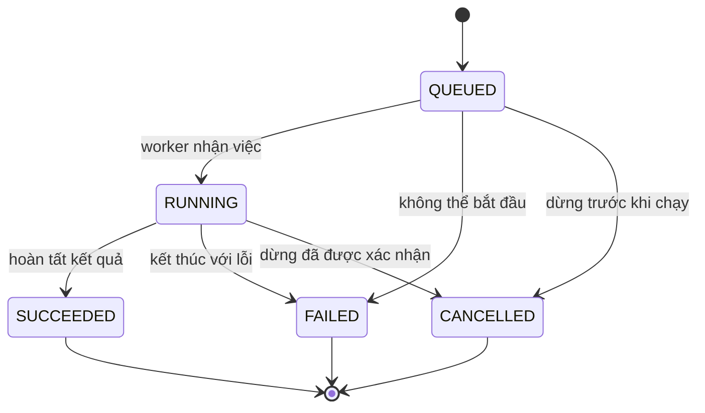

# Mô hình hóa lệnh bằng tài nguyên yêu cầu hoặc lần thực hiện

## 1. Từ một động tác nghiệp vụ đến một tài nguyên có vòng đời

Trong chương **Mô hình tài nguyên** của module **INTEGRATION_API_REST**, bài này giải quyết tình huống một API cần làm nhiều hơn việc đọc, tạo hoặc sửa một bản ghi: yêu cầu hủy đơn hàng, chạy báo cáo, nhập dữ liệu hoặc đối soát thanh toán.

Những công việc này thường có đầu vào riêng, người yêu cầu, thời điểm tiếp nhận, điều kiện được phép thực hiện và kết quả xuất hiện sau đó. Ta có thể mô hình hóa chính **yêu cầu nghiệp vụ** hoặc **lần thực hiện công việc** thành tài nguyên có định danh và URI.

Ví dụ, khách hàng muốn tạo báo cáo doanh thu tháng 10. Thay vì chỉ nhận một thông báo “đã gửi lệnh”, họ nhận được tài nguyên `ex-901`, có thể xem tiến độ, biết lỗi và lấy đường dẫn kết quả khi hoàn tất.

Mục tiêu sau bài học:

- Chọn được khi nào cần tài nguyên yêu cầu và khi nào cần tài nguyên lần thực hiện.
- Thiết kế URI, biểu diễn dữ liệu và chuyển trạng thái phù hợp với nghiệp vụ.
- Xây dựng hợp đồng tạo, theo dõi, gửi lại và yêu cầu hủy công việc.
- Liên hệ mô hình với Java/Spring, xử lý đồng thời, phân quyền và kiểm thử API.

Tài nguyên trong bài là mô hình công khai của API; nó không bắt buộc tương ứng một-một với bảng cơ sở dữ liệu, message trong hàng đợi hay lớp entity của Java.

## 2. Khi nào một lệnh cần trở thành tài nguyên?

Xét thao tác “chạy báo cáo”. Một endpoint như sau có thể kích hoạt công việc:

```http
POST /runReport
Content-Type: application/json

{
  "reportId": "r-revenue",
  "month": "2026-10"
}
```

Tên endpoint chưa giải quyết các câu hỏi quan trọng: công việc nào vừa được tạo, nó còn đang chạy hay đã lỗi, gửi lại sau timeout có tạo thêm bản sao không, và kết quả thuộc người dùng nào?

Mô hình lần thực hiện đặt các câu hỏi đó vào một đối tượng rõ ràng:

```http
POST /reports/r-revenue/executions
Content-Type: application/json

{
  "parameters": {
    "month": "2026-10",
    "format": "CSV"
  }
}
```

`r-revenue` định danh báo cáo được cấu hình; mỗi execution định danh một lần chạy với bộ tham số cụ thể. Cùng một báo cáo có thể có nhiều lần chạy hợp lệ.

Tài nguyên trung gian có ích khi công việc:

- Kéo dài vượt thời gian chờ thông thường của HTTP.
- Cần phê duyệt, xếp hàng, điều phối nhiều bước hoặc gọi dịch vụ khác.
- Cần lịch sử, tra cứu kết quả, truy vết trách nhiệm hoặc hỗ trợ khách hàng.
- Có thể bị gửi lặp và cần nhận diện cùng một ý định.
- Cần hủy, lên lịch hoặc thực hiện lại với quy tắc riêng.

Với thao tác ngắn, hoàn tất ngay và không cần vòng đời độc lập, sửa tài nguyên hiện có vẫn có thể đủ. Ví dụ, thay đổi tên hiển thị của một bản báo cáo không nhất thiết cần tạo thêm một “yêu cầu đổi tên”. Lựa chọn dựa trên nhu cầu hợp đồng, không dựa trên quy tắc máy móc rằng mọi động từ đều phải đổi thành danh từ.

## 3. Phân biệt tài nguyên yêu cầu và tài nguyên lần thực hiện

### 3.1. Tài nguyên yêu cầu: ghi nhận mong muốn nghiệp vụ

Một **request resource** ghi lại mong muốn mà hệ thống cần xem xét.

Ví dụ:

```http
POST /orders/o-204/cancellation-requests
Content-Type: application/json

{
  "reasonCode": "CUSTOMER_CHANGED_MIND",
  "comment": "Khách đề nghị hủy trước khi giao hàng."
}
```

Tài nguyên được tạo có thể chứa `id`, `orderId`, lý do, người gửi, thời điểm gửi và trạng thái xét duyệt.

Tạo được yêu cầu hủy không đồng nghĩa đơn hàng đã bị hủy. Đơn có thể cần kiểm tra tình trạng giao hàng, duyệt ngoại lệ hoặc xử lý hoàn tiền. Vòng đời minh họa của yêu cầu là `SUBMITTED → APPROVED` hoặc `SUBMITTED → REJECTED`; trạng thái của đơn hàng là một vòng đời khác.

Nếu có bước thực thi sau phê duyệt, API cần biểu diễn được sự khác biệt giữa “đã phê duyệt” và “đã hủy đơn thành công”. Không gộp hai ý nghĩa này vào một trường `success: true`.

### 3.2. Tài nguyên lần thực hiện: ghi nhận một lần làm việc

Một **execution resource** ghi lại một lần chạy đã được định danh.

Ví dụ:

```text
Report r-revenue
├── Execution ex-901: tháng 10, CSV, SUCCEEDED
├── Execution ex-902: tháng 10, PDF, FAILED
└── Execution ex-903: tháng 11, CSV, RUNNING
```

Đầu vào của một execution nên được chốt khi tiếp nhận. Nếu báo cáo hoặc quyền truy cập thay đổi sau đó, hệ thống vẫn giải thích được execution đã chạy với tham số và phiên bản cấu hình nào.

Trong bài, `execution` là một lần chạy ở mức hợp đồng nghiệp vụ. Bên trong nó, worker có thể thử lại một bước nhiều lần. Những lần thử kỹ thuật đó được gọi là `attempt`; chúng không tự động trở thành execution mới.

### 3.3. Chọn theo ý nghĩa mà client cần biết

| Câu hỏi thiết kế | Tài nguyên yêu cầu | Tài nguyên lần thực hiện |
| --- | --- | --- |
| Nó đại diện cho điều gì? | Mong muốn cần được tiếp nhận hoặc quyết định | Một lần chạy công việc |
| Trạng thái điển hình | SUBMITTED, APPROVED, REJECTED | QUEUED, RUNNING, SUCCEEDED, FAILED |
| Client quan tâm nhất điều gì? | Được chấp thuận chưa, vì sao bị từ chối | Đã chạy xong chưa, kết quả ở đâu |
| Có thể tồn tại mà chưa chạy? | Có, đang chờ xét duyệt | Có, đang chờ worker nhận |
| Quan hệ giữa hai mô hình | Có thể dẫn đến một hoặc nhiều lần thực hiện | Có thể tham chiếu yêu cầu nguồn |
| Ví dụ | Yêu cầu hủy đơn, yêu cầu hoàn tiền | Lần xuất báo cáo, lần đồng bộ dữ liệu |

Không cần luôn tạo cả hai loại. API xuất báo cáo đơn giản có thể chỉ công khai execution. Quy trình hoàn tiền cần phê duyệt có thể có `refund-request`, rồi liên kết đến các execution xử lý tiền.

## 4. Thiết kế tập tài nguyên và URI

Với bài toán báo cáo, ta chọn hợp đồng minh họa sau:

| Phương thức và URI | Ý nghĩa |
| --- | --- |
| `POST /reports/{reportId}/executions` | Tiếp nhận một lần chạy báo cáo |
| `GET /reports/{reportId}/executions` | Liệt kê các lần chạy mà người gọi được phép xem |
| `GET /report-executions/{executionId}` | Đọc trạng thái một lần chạy |
| `GET /report-executions/{executionId}/result` | Tải kết quả của lần chạy thành công |
| `POST /report-executions/{executionId}/cancellation-requests` | Gửi yêu cầu dừng lần chạy |
| `GET /execution-cancellation-requests/{requestId}` | Theo dõi việc xử lý yêu cầu dừng |

Collection tạo được đặt dưới report để thể hiện ngữ cảnh đầu vào. Mỗi execution có URI độc lập để client theo dõi bằng ID duy nhất. Đây là lựa chọn thiết kế của ví dụ; cũng có thể dùng URI lồng đầy đủ nếu có hợp đồng nhất quán.

Nên trả `self` và liên kết kết quả trong biểu diễn để client không phải tự ghép mọi URI. JSON có các liên kết này là một hợp đồng riêng của ví dụ, không ngụ ý rằng tên trường `links` là chuẩn bắt buộc.

Tránh một collection chung như `/commands` chỉ có `type` và một object `payload` tùy ý nếu các lệnh có quyền hạn, dữ liệu và vòng đời rất khác nhau. Nó khiến việc tài liệu hóa schema, kiểm tra quyền và diễn giải lỗi trở nên khó hơn. Một collection chung chỉ có ích khi miền nghiệp vụ thực sự có một khái niệm công việc thống nhất.

## 5. Hợp đồng dữ liệu và vòng đời execution

### 5.1. Tách dữ liệu được gửi lên khỏi dữ liệu server quản lý

Client được gửi tham số nghiệp vụ:

```json
{
  "parameters": {
    "month": "2026-10",
    "format": "CSV"
  }
}
```

Server quyết định ID, chủ sở hữu, thời điểm tiếp nhận và trạng thái:

```json
{
  "id": "ex-901",
  "reportId": "r-revenue",
  "status": "QUEUED",
  "parameters": {
    "month": "2026-10",
    "format": "CSV"
  },
  "requestedAt": "2026-11-17T02:00:00Z",
  "startedAt": null,
  "finishedAt": null,
  "result": null,
  "error": null,
  "links": {
    "self": "/report-executions/ex-901"
  }
}
```

`requestedBy` và tenant được lấy từ danh tính đã xác thực; không tin một `userId` hoặc `tenantId` tùy ý trong body. API có thể trả các trường này khi người đọc có quyền, nhưng không cho client tự nhận là người khác.

Quy ước dữ liệu trong ví dụ:

| Trường | Quy tắc |
| --- | --- |
| `parameters` | Giữ nguyên bộ đầu vào đã tiếp nhận |
| `status` | Do server thay đổi qua các chuyển trạng thái hợp lệ |
| `startedAt` | Có giá trị khi execution thực sự bắt đầu |
| `finishedAt` | Có giá trị khi execution kết thúc |
| `result` | Có dữ liệu khi SUCCEEDED; mô tả tài nguyên kết quả |
| `error` | Có mã lỗi và thông tin an toàn khi FAILED |
| `progress`, nếu có | Chỉ là thông tin quan sát; không thay thế status |

Nếu không đo được tiến độ đáng tin cậy, nên bỏ `progress` hoặc cho phép `null`. Một giá trị 100% không nên được client dùng để suy ra thành công khi chưa có `SUCCEEDED`.

### 5.2. Định nghĩa chuyển trạng thái trước khi viết controller



Trong hợp đồng này, `SUCCEEDED`, `FAILED` và `CANCELLED` là trạng thái kết thúc, không được chuyển ngược về `RUNNING`.

Một lần chạy đã FAILED muốn được người dùng chạy lại sẽ tạo execution mới. Nếu cần truy vết, execution mới có thể lưu `retryOf: "ex-902"`. Các lần thử lại nội bộ trước khi kết thúc vẫn thuộc execution hiện tại.

Việc đặt cờ “đã yêu cầu hủy” chưa làm execution trở thành CANCELLED. Server chỉ công bố CANCELLED sau khi xác định công việc đã dừng theo cam kết nghiệp vụ. Với các bước đã gây tác động bên ngoài, cần giải thích liệu dừng có giữ lại tác động đó hay có bước bù trừ.

## 6. Tạo và theo dõi một lần chạy qua HTTP

### 6.1. Tiếp nhận công việc

Trong API ví dụ, hợp đồng POST nhấn mạnh việc tiếp nhận chạy bất đồng bộ, vì vậy phản hồi đầu tiên là:

```http
POST /reports/r-revenue/executions HTTP/1.1
Host: api.example.test
Authorization: Bearer <access-token>
Content-Type: application/json
Idempotency-Key: revenue-2026-10-csv-01

{
  "parameters": {
    "month": "2026-10",
    "format": "CSV"
  }
}
```

```http
HTTP/1.1 202 Accepted
Location: /report-executions/ex-901
Content-Type: application/json
Cache-Control: no-store

{
  "id": "ex-901",
  "reportId": "r-revenue",
  "status": "QUEUED",
  "links": {
    "self": "/report-executions/ex-901"
  }
}
```

`202 Accepted` cho biết đã tiếp nhận xử lý, chưa cam kết hoàn tất. `201 Created` cho biết đã tạo tài nguyên. Chọn mã theo điều POST cam kết; tạo request resource xong có thể dùng 201 dù quyết định nghiệp vụ còn chờ. [RFC 9110, mục 15.3.2–15.3.3](https://www.rfc-editor.org/rfc/rfc9110.html#section-15.3.2).

Vì thế, không có quy tắc “có xử lý nền thì bắt buộc trả 202”. Nếu API cam kết tạo một execution như bản ghi độc lập, 201 là lựa chọn có thể phù hợp. Trong bài này, 202 và `Location` là hợp đồng được chọn cho việc tiếp nhận chạy; client dùng Location để theo dõi.

Trước khi trả 202, ứng dụng ví dụ lưu execution bền vững và bảo đảm có đường đưa việc đến worker. Một message chỉ nằm trong bộ nhớ của tiến trình web chưa đủ cho cam kết này.

Client có thể gửi `Prefer: respond-async` nếu API hỗ trợ lựa chọn cách phản hồi. Đây là sở thích của client; server có thể không áp dụng. Chỉ công bố `Preference-Applied: respond-async` khi thực sự áp dụng. [RFC 7240, mục 4.1](https://www.rfc-editor.org/rfc/rfc7240.html#section-4.1).

### 6.2. Đọc trạng thái

```http
GET /report-executions/ex-901 HTTP/1.1
Host: api.example.test
Authorization: Bearer <access-token>
```

```http
HTTP/1.1 200 OK
Content-Type: application/json
Cache-Control: no-store

{
  "id": "ex-901",
  "reportId": "r-revenue",
  "status": "RUNNING",
  "startedAt": "2026-11-17T02:00:02Z",
  "finishedAt": null,
  "result": null,
  "error": null,
  "links": {
    "self": "/report-executions/ex-901"
  }
}
```

Khi thành công, cùng URI trả:

```json
{
  "id": "ex-901",
  "reportId": "r-revenue",
  "status": "SUCCEEDED",
  "startedAt": "2026-11-17T02:00:02Z",
  "finishedAt": "2026-11-17T02:00:25Z",
  "result": {
    "href": "/report-executions/ex-901/result",
    "mediaType": "text/csv",
    "expiresAt": "2026-11-24T02:00:25Z"
  },
  "error": null,
  "links": {
    "self": "/report-executions/ex-901"
  }
}
```

Trường `result.href` chỉ được công bố sau khi dữ liệu đã sẵn sàng để tải. Metadata execution và file kết quả có thể có thời hạn lưu khác nhau.

Nếu execution thất bại, GET của nó vẫn có thể trả 200 với `status: "FAILED"`: server đã đọc được tài nguyên; công việc mà tài nguyên mô tả đã lỗi. Hai kết quả này cần được client xử lý riêng.

### 6.3. Polling và tải kết quả

Client nên tăng khoảng cách polling theo hợp đồng, chẳng hạn 1, 2, 4 rồi tối đa 10 giây, cộng một độ lệch ngẫu nhiên nhỏ để tránh nhiều client đồng thời gọi lại. Dừng polling khi gặp trạng thái kết thúc hoặc khi vượt thời gian chờ của giao diện.

Timeout phía giao diện không tự hủy execution trên server. Người dùng quay lại vẫn phải có cách tra cứu lần chạy đang tồn tại.

Với `GET .../result`, ví dụ chọn các quy tắc sau:

- SUCCEEDED và file còn được giữ: trả 200 với nội dung CSV.
- QUEUED hoặc RUNNING: trả 409 với mã ứng dụng `RESULT_NOT_READY`.
- FAILED hoặc CANCELLED: trả 409 với mã `RESULT_UNAVAILABLE`.
- File đã hết hạn và hệ thống còn lưu thông tin này: trả 410 với mã `RESULT_EXPIRED`.

Đây là các lựa chọn hợp đồng của API mẫu; tài liệu phải nói rõ để client không xem mọi lần tải không được là lỗi mạng cần retry vô hạn. Tải kết quả vẫn phải kiểm tra quyền truy cập như lúc đọc execution.

## 7. Gửi lại sau timeout: nhận diện cùng một ý định

### 7.1. Có ID chưa đủ để chống tạo trùng

Tình huống dễ gặp:

1. Client gửi POST tạo execution.
2. Server đã lưu `ex-901`.
3. Kết nối đứt trước khi client nhận phản hồi.
4. Client gửi lại cùng nội dung.

Nếu mỗi POST luôn tạo ID mới, server có thể tạo `ex-902` và chạy cùng báo cáo lần nữa. Đổi endpoint sang danh từ chưa giải quyết vấn đề này.

POST không tự có bảo đảm idempotent. Idempotency nói về tác động dự kiến của việc lặp lại, không yêu cầu mọi phản hồi giống hệt. [RFC 9110, mục 9.2.2](https://www.rfc-editor.org/rfc/rfc9110.html#section-9.2.2).

### 7.2. Một hợp đồng khóa idempotency cụ thể

Trong ví dụ, `Idempotency-Key` là quy ước được API hỗ trợ, với các quy tắc:

| Tình huống | Xử lý được chọn |
| --- | --- |
| Khóa mới, dữ liệu hợp lệ | Tạo một execution và ghi liên kết giữa khóa với execution |
| Cùng khóa, cùng đầu vào và cùng phạm vi | Trả lại 202 và cùng Location đã lưu; không tạo execution khác |
| Cùng khóa nhưng đầu vào khác | Trả 409 với mã `IDEMPOTENCY_KEY_REUSED` |
| Hai request cùng khóa đến đồng thời | Chỉ một request thắng việc ghi mới; request còn lại dùng bản ghi đó |
| Người dùng muốn chủ động chạy lại | Dùng khóa mới để tạo execution mới |

Khóa cần được giới hạn theo phạm vi, chẳng hạn `tenantId + actorId + thao tác + reportId + key`. Dấu vân tay đầu vào được tính từ dữ liệu đã chuẩn hóa; không so sánh chuỗi JSON thô nếu thứ tự thuộc tính không có ý nghĩa.

Trong ví dụ, server giữ ánh xạ khóa tối thiểu 48 giờ và lâu hơn nếu execution chưa kết thúc. Sau khi ánh xạ hết hạn, dùng lại khóa có thể tạo execution mới; client cần biết giới hạn này.

Server có thể lưu lại phản hồi tiếp nhận ban đầu để replay. Nếu execution hiện đã SUCCEEDED, replay vẫn trả phản hồi tiếp nhận đã lưu và cùng URI; client dùng GET để lấy trạng thái hiện tại. Hợp đồng cũng có thể chọn trả trạng thái hiện tại, nhưng phải tài liệu hóa rõ lựa chọn.

Lưu ý: hai khóa khác nhau vẫn có thể là hai ý định nghiệp vụ trùng nhau. Nếu một kỳ chỉ được quyết toán một lần, cần thêm ràng buộc miền trên kỳ quyết toán; khóa idempotency của HTTP không thay thế ràng buộc đó.

### 7.3. Nếu client tự cấp định danh

Một thiết kế khác cho phép client chọn URI:

```http
PUT /report-executions/client-run-2026-10-01
Content-Type: application/json

{
  "reportId": "r-revenue",
  "parameters": {
    "month": "2026-10",
    "format": "CSV"
  }
}
```

Muốn hỗ trợ cách này, server phải định nghĩa cùng URI và cùng đầu vào sẽ quy về cùng execution; việc thay đổi đầu vào của execution đã tạo bị từ chối. Không triển khai PUT thành “mỗi lần gọi lại chạy thêm một job”. Quyền cấp ID, xung đột nội dung và chính sách không cho sửa trạng thái đều cần được thiết kế trước.

Bài này tiếp tục dùng POST với khóa idempotency để giữ luồng ví dụ thống nhất.

## 8. Tài nguyên công khai cần được bảo vệ bởi cơ chế thực thi

### 8.1. Tiếp nhận và đưa việc đến worker

Một luồng tiếp nhận thực tế có thể gồm:

1. Xác thực người gọi và kiểm tra quyền chạy report trong tenant hiện tại.
2. Kiểm tra tham số, giới hạn sử dụng và khóa idempotency.
3. Trong một transaction, ghi execution QUEUED, ánh xạ khóa và một outbox event.
4. Commit transaction rồi trả phản hồi tiếp nhận.
5. Tiến trình chuyển outbox đưa event đến hàng đợi; worker nhận việc và cập nhật execution.

Outbox là bản ghi sự kiện được lưu cùng transaction với execution. Nó giúp tránh tình huống cơ sở dữ liệu đã có execution nhưng message bị mất giữa hai thao tác độc lập.

Nếu không dùng hàng đợi, một worker đọc trực tiếp các execution QUEUED cũng là lựa chọn. Dù chọn cách nào, tài liệu công khai không cần lộ tên queue, số partition hay cấu trúc bảng nội bộ.

### 8.2. Khóa idempotency phải được ghi nguyên tử

Mẫu “SELECT xem khóa tồn tại chưa, nếu chưa thì INSERT” có thể bị hai request đồng thời vượt qua. Cần ràng buộc duy nhất trong kho dữ liệu theo đúng phạm vi khóa, rồi xử lý xung đột để đọc execution đã được tạo.

Bản ghi khóa và execution phải liên kết nhất quán. Không để khóa đã được giữ nhưng execution không tồn tại, hoặc execution đã được tạo mà khóa bị quên sau lỗi giữa chừng.

Chỉ lưu mã HTTP cũ cũng chưa đủ: replay vẫn phải gắn với quyền của người gọi, và không được trả Location thuộc tenant khác.

### 8.3. Worker cũng có thể nhận cùng công việc nhiều lần

Hàng đợi có thể giao lại message khi chưa nhận được xác nhận. Vì vậy, worker cần:

- Nhận quyền xử lý execution bằng cập nhật có điều kiện hoặc cơ chế lease.
- Không ghi đè một trạng thái kết thúc đã được quyết định.
- Kiểm tra quyền sở hữu công việc khi cập nhật kết quả; worker đã mất lease không được hoàn tất thay worker mới.
- Với tác động bên ngoài, dùng định danh thao tác ổn định, cơ chế chống lặp phía dịch vụ nhận hoặc bước đối soát.

Một cập nhật có điều kiện ở mức cơ sở dữ liệu có thể mang ý tưởng sau:

```sql
UPDATE report_execution
SET status = 'RUNNING',
    version = version + 1
WHERE id = :executionId
  AND status = 'QUEUED'
  AND version = :expectedVersion;
```

Worker chỉ xử lý tiếp nếu đúng một hàng được cập nhật. Đây là minh họa cho bước nhận việc; lease, khôi phục worker chết và xử lý tác động bên ngoài cần cơ chế bổ sung.

Ví dụ khó: một dịch vụ thanh toán đã hoàn tiền nhưng worker chết trước khi ghi SUCCEEDED. Chỉ kiểm tra bảng execution không đủ để biết có nên hoàn tiền lần nữa. Cần khóa nghiệp vụ ổn định gửi sang dịch vụ thanh toán hoặc đối soát kết quả trước khi thử lại.

Mô hình tài nguyên giúp quan sát và điều phối công việc; nó không tự tạo bảo đảm “mỗi tác động xảy ra đúng một lần” trong hệ phân tán.

## 9. Hủy công việc là một yêu cầu có thể bị từ chối

### 9.1. Phân biệt ba việc thường bị gọi chung là “hủy”

- **Hủy đơn hàng**: một hành vi nghiệp vụ đối với order.
- **Dừng execution**: yêu cầu ngừng công việc đang chờ hoặc đang chạy.
- **Xóa bản ghi execution**: thay đổi khả năng lưu giữ và tra cứu lịch sử.

Ba việc này có thể có quyền hạn và hậu quả khác nhau. Trong API mẫu, không dùng DELETE execution để ngầm yêu cầu worker dừng, vì hợp đồng còn cần giữ lịch sử và báo cáo việc dừng đã thành công hay chưa.

### 9.2. Gửi yêu cầu dừng

```http
POST /report-executions/ex-901/cancellation-requests HTTP/1.1
Host: api.example.test
Authorization: Bearer <access-token>
Content-Type: application/json
Idempotency-Key: stop-ex-901-01

{
  "reason": "Người dùng không còn cần báo cáo."
}
```

```http
HTTP/1.1 201 Created
Location: /execution-cancellation-requests/cr-31
Content-Type: application/json
Cache-Control: no-store

{
  "id": "cr-31",
  "executionId": "ex-901",
  "status": "REQUESTED",
  "reason": "Người dùng không còn cần báo cáo.",
  "links": {
    "self": "/execution-cancellation-requests/cr-31",
    "execution": "/report-executions/ex-901"
  }
}
```

Ở đây POST cam kết tạo bản ghi yêu cầu dừng, nên ví dụ dùng 201. Việc worker đã dừng hay chưa được thể hiện qua hai tài nguyên:

| Yêu cầu dừng | Execution | Diễn giải |
| --- | --- | --- |
| REQUESTED | QUEUED hoặc RUNNING | Yêu cầu đã được ghi nhận, chưa xác nhận dừng |
| APPLIED | CANCELLED | Đã dừng theo hợp đồng |
| REJECTED | SUCCEEDED hoặc FAILED | Không còn áp dụng được yêu cầu dừng |
| REJECTED | RUNNING | Công việc đã qua điểm cho phép hủy |

Các tên REQUESTED, APPLIED và REJECTED là trạng thái do API mẫu định nghĩa.

### 9.3. Xử lý cuộc đua giữa hoàn tất và dừng

Nếu execution đã kết thúc trước lúc server xử lý POST, ví dụ trả 409 `EXECUTION_ALREADY_TERMINAL` và không tạo yêu cầu dừng mới.

Nếu execution còn RUNNING khi yêu cầu được nhận nhưng kết thúc trước khi worker xử lý việc dừng, yêu cầu đã tạo có thể chuyển REJECTED. Đây là một kết quả nghiệp vụ hợp lệ, không phải lý do sửa execution từ SUCCEEDED sang CANCELLED.

Cần quyết định bên nào thắng bằng chuyển trạng thái nguyên tử, khóa hoặc cơ chế tương đương. Khi trạng thái kết thúc đã được chốt, bên còn lại phải quan sát kết quả đó.

Với công việc gồm nhiều bước, server cần xác định điểm có thể hủy an toàn. Nếu có tác động không thể thu hồi, có thể từ chối hủy hoặc mở một quy trình bù trừ riêng. Không mô tả CANCELLED như thể mọi tác động trước đó chắc chắn đã được đảo ngược.

## 10. Minh họa lớp HTTP bằng Java/Spring

Đoạn mã sau thể hiện DTO và controller cho hai endpoint chính. Nó giả định ứng dụng đã cấu hình xác thực trước khi gọi controller, có Bean Validation và có một `ExecutionService` do ứng dụng triển khai. Đây là phần minh họa hợp đồng, chưa phải ứng dụng hoàn chỉnh.

Các kiểu được đặt cùng package; chúng có thể tách thành các file Java trong một dự án thực hành. Không cần trả trực tiếp entity lưu trữ ra API.

```java
import java.net.URI;
import java.security.Principal;
import java.time.Instant;
import java.util.Map;

import jakarta.validation.Valid;
import jakarta.validation.constraints.NotNull;
import jakarta.validation.constraints.Pattern;

import org.springframework.http.ResponseEntity;
import org.springframework.web.bind.annotation.GetMapping;
import org.springframework.web.bind.annotation.PathVariable;
import org.springframework.web.bind.annotation.PostMapping;
import org.springframework.web.bind.annotation.RequestBody;
import org.springframework.web.bind.annotation.RequestHeader;
import org.springframework.web.bind.annotation.RestController;

enum OutputFormat {
    CSV, PDF
}

enum ExecutionState {
    QUEUED, RUNNING, SUCCEEDED, FAILED, CANCELLED
}

record ReportParameters(
    @NotNull
    @Pattern(regexp = "[0-9]{4}-(0[1-9]|1[0-2])")
    String month,

    @NotNull
    OutputFormat format
) {}

record CreateExecutionRequest(
    @NotNull @Valid ReportParameters parameters
) {}

record ResultView(
    String href,
    String mediaType,
    Instant expiresAt
) {}

record ExecutionError(
    String code,
    String message,
    boolean retryable
) {}

record ExecutionView(
    String id,
    String reportId,
    ExecutionState status,
    ReportParameters parameters,
    Instant requestedAt,
    Instant startedAt,
    Instant finishedAt,
    ResultView result,
    ExecutionError error,
    Map<String, String> links
) {}

interface ExecutionService {
    ExecutionView accept(
        String actorName,
        String reportId,
        String idempotencyKey,
        CreateExecutionRequest request
    );

    ExecutionView getVisible(
        String actorName,
        String executionId
    );
}

@RestController
public class ReportExecutionController {
    private final ExecutionService service;

    public ReportExecutionController(ExecutionService service) {
        this.service = service;
    }

    @PostMapping("/reports/{reportId}/executions")
    public ResponseEntity<ExecutionView> create(
        @PathVariable("reportId") String reportId,
        @RequestHeader("Idempotency-Key") String idempotencyKey,
        @Valid @RequestBody CreateExecutionRequest request,
        Principal principal
    ) {
        ExecutionView accepted = service.accept(
            principal.getName(),
            reportId,
            idempotencyKey,
            request
        );

        URI location = URI.create(
            "/report-executions/" + accepted.id()
        );

        return ResponseEntity.accepted()
            .location(location)
            .header("Cache-Control", "no-store")
            .body(accepted);
    }

    @GetMapping("/report-executions/{executionId}")
    public ResponseEntity<ExecutionView> get(
        @PathVariable("executionId") String executionId,
        Principal principal
    ) {
        ExecutionView view = service.getVisible(
            principal.getName(),
            executionId
        );

        return ResponseEntity.ok()
            .header("Cache-Control", "no-store")
            .body(view);
    }
}
```

`ResponseEntity` cho phép controller lựa chọn status, header và body của phản hồi. [Tài liệu Spring Framework về ResponseEntity](https://docs.spring.io/spring-framework/reference/web/webmvc/mvc-controller/ann-methods/responseentity.html).

Những trách nhiệm quan trọng nằm trong service:

- Phân giải tenant từ ngữ cảnh danh tính đáng tin cậy; kiểm tra quyền với report và execution.
- Kiểm tra khóa không rỗng, giới hạn độ dài, kỳ báo cáo hợp lệ theo nghiệp vụ và giới hạn tài nguyên.
- Tiếp nhận nguyên tử theo khóa; khi replay, trả lại snapshot phản hồi tiếp nhận theo hợp đồng đã chọn.
- Lưu execution cùng outbox trước khi trả về; worker chạy sau đó.
- Chỉ đọc execution thuộc phạm vi người gọi được phép xem.
- Chuyển lỗi miền thành các mã HTTP và body lỗi được tài liệu hóa.

Regex tháng trong DTO chỉ kiểm tra hình thức năm-tháng. Việc cho phép dữ liệu tương lai, dữ liệu chưa chốt hoặc khoảng thời gian quá cũ là kiểm tra nghiệp vụ.

Controller không tự chạy báo cáo trong một thread vừa tạo rồi trả 202. Thread trong tiến trình web có thể mất khi triển khai lại; mô hình thực thi cần cơ chế lưu và khôi phục đã nêu.

Cũng không cho client PATCH trực tiếp `status` thành SUCCEEDED hoặc CANCELLED. Client gửi ý định; server xác nhận kết quả dựa trên việc thực thi.

## 11. Phân quyền, lịch sử, cache và tài liệu hợp đồng

### 11.1. Quyền tạo và quyền đọc là hai phép kiểm tra

Có quyền tạo execution không có nghĩa được xem mọi execution của report. API có thể phân quyền theo tenant, nhóm, chủ sở hữu và mức nhạy cảm của dữ liệu.

Kiểm tra quyền cần xuất hiện ở endpoint tạo, đọc, liệt kê, hủy và tải kết quả. Một ID khó đoán không thay thế kiểm tra quyền. Khóa idempotency và URL kết quả cũng không phải thông tin xác thực.

Ví dụ này chọn trả 404 cho một execution không tồn tại hoặc không thuộc phạm vi người gọi được phép biết. Đây là chính sách che giấu sự tồn tại được áp dụng nhất quán; lỗi thiếu quyền khác có thể dùng 403 nếu hợp đồng cho phép công khai tài nguyên.

Tránh để `error.message`, log trả ra client hoặc comment của yêu cầu chứa stack trace, câu SQL, token hay dữ liệu cá nhân không cần thiết.

### 11.2. Liệt kê lịch sử có giới hạn

Một collection lịch sử có thể hỗ trợ:

```http
GET /reports/r-revenue/executions?status=FAILED&limit=20
```

```json
{
  "items": [
    {
      "id": "ex-902",
      "reportId": "r-revenue",
      "status": "FAILED",
      "requestedAt": "2026-11-17T02:03:00Z"
    }
  ],
  "nextCursor": "opaque-cursor"
}
```

DTO danh sách có thể là biểu diễn rút gọn. Cursor cần gắn với thứ tự ổn định, ví dụ `requestedAt` rồi `id`, và với bộ lọc được sử dụng. Server giới hạn `limit` và lọc quyền trước khi trả dữ liệu.

Tài liệu cần nói rõ danh sách được cập nhật đến thời điểm nào. Không hứa một ảnh chụp nhất quán xuyên suốt nhiều trang nếu hệ thống chỉ cung cấp danh sách đang thay đổi.

### 11.3. Chọn chính sách cache có chủ đích

Các ví dụ dùng `Cache-Control: no-store` cho trạng thái công việc và phản hồi tiếp nhận để giữ hợp đồng ban đầu đơn giản.

Nếu số lần polling lớn, có thể thiết kế cơ chế đọc có điều kiện với ETag trong một chính sách cache phù hợp khác. ETag phải phản ánh phiên bản biểu diễn thực tế; không được giữ nguyên khi status, kết quả hoặc lỗi hiển thị đã đổi.

File kết quả có chính sách riêng. Nếu dùng URL ký sẵn có thời hạn, phải kiểm soát thời gian sống, khả năng chia sẻ và việc lộ URL qua log. Giới hạn của URL phải phù hợp với cam kết quyền truy cập của sản phẩm.

### 11.4. Ghi rõ trong OpenAPI

Hợp đồng tài liệu hóa nên có:

- Schema tạo execution tách khỏi schema phản hồi; ID, status và thời điểm là trường chỉ đọc.
- Bộ giá trị trạng thái và ý nghĩa của từng trạng thái kết thúc.
- Quy tắc `null` hoặc vắng mặt cho `result`, `error` và các thời điểm.
- Phản hồi 202 của endpoint chạy và 201 của endpoint tạo yêu cầu dừng.
- Header Location, yêu cầu xác thực và quy tắc khóa idempotency.
- Các lỗi tiếp nhận, lỗi đọc kết quả và lỗi phát sinh sau khi đã tiếp nhận.
- Chính sách polling, thời hạn lưu metadata, thời hạn lưu file và thời hạn giữ khóa.

Nếu có thời gian lưu hữu hạn, phải mô tả sau khi hết hạn client còn phân biệt được “đã hết hạn” với “chưa từng tồn tại” hay không. Server chỉ nên trả thông tin hết hạn khi còn dữ liệu đủ để xác định điều đó.

## 12. Tách lỗi tiếp nhận khỏi lỗi thực thi

### 12.1. Lỗi trước khi công việc được nhận

Với API mẫu, chưa tạo execution khi gặp những lỗi sau:

| Tình huống | HTTP được chọn | Mã ứng dụng minh họa |
| --- | --- | --- |
| JSON sai hoặc thiếu trường bắt buộc | 400 | INVALID_REQUEST |
| Chưa xác thực | 401 | AUTHENTICATION_REQUIRED |
| Không được phép chạy report | 403 hoặc 404 theo chính sách công khai | REPORT_ACCESS_DENIED |
| Không tìm thấy report trong phạm vi được phép biết | 404 | REPORT_NOT_FOUND |
| Cùng khóa nhưng đầu vào khác | 409 | IDEMPOTENCY_KEY_REUSED |
| Đầu vào đúng hình thức nhưng kỳ báo cáo không được hỗ trợ | 422 | UNSUPPORTED_REPORT_PERIOD |
| Vượt hạn mức được áp dụng cho người gọi | 429 | EXECUTION_QUOTA_EXCEEDED |

Các lựa chọn 400 và 422 cần thống nhất với chuẩn lỗi của ứng dụng; bảng này không thay thế một quy định chung cho mọi API.

### 12.2. Lỗi sau khi đã tiếp nhận

Ví dụ, nguồn dữ liệu báo cáo tạm thời không sẵn sàng. Nếu hệ thống đã kết thúc việc thử lại cho execution này, tài nguyên có thể trở thành:

```http
HTTP/1.1 200 OK
Content-Type: application/json
Cache-Control: no-store

{
  "id": "ex-902",
  "reportId": "r-revenue",
  "status": "FAILED",
  "finishedAt": "2026-11-17T02:04:00Z",
  "result": null,
  "error": {
    "code": "REPORT_SOURCE_UNAVAILABLE",
    "message": "Chưa thể lấy dữ liệu để tạo báo cáo.",
    "retryable": true
  },
  "links": {
    "self": "/report-executions/ex-902"
  }
}
```

`retryable: true` trong ví dụ cho biết người gọi có thể cân nhắc tạo lần chạy mới; nó không khẳng định execution FAILED sẽ tự chuyển về RUNNING. Điều kiện quyền, hạn mức và trạng thái nguồn dữ liệu vẫn được kiểm tra khi nhận lần chạy mới.

Nếu chính endpoint GET gặp lỗi đọc cơ sở dữ liệu, server có thể trả lỗi 5xx. Khi đó client chưa đọc được trạng thái execution; không được tự suy ra execution đã FAILED.

## 13. Các tình huống cần xác nhận khi triển khai

Việc kiểm thử nên dựa trên hành vi công khai và các ràng buộc quan trọng:

| Tình huống | Kết quả cần quan sát |
| --- | --- |
| Tạo execution hợp lệ | Nhận Location; GET được cùng ID; đầu vào được giữ đúng |
| Gửi lại cùng khóa sau mất phản hồi | Cùng execution; không có thêm một lần chạy nghiệp vụ |
| Hai POST đồng thời cùng khóa | Chỉ một execution được tạo, các phản hồi quy về cùng URI |
| Cùng khóa nhưng khác tháng hoặc định dạng | Xung đột; không thay đầu vào execution cũ |
| Worker nhận lại cùng message | Không tạo tác động nghiệp vụ trùng ngoài cam kết |
| Người khác tenant đọc, liệt kê hoặc tải file | Không nhận dữ liệu của tenant mục tiêu |
| Gửi yêu cầu dừng rồi tác vụ hoàn tất trước | Execution giữ kết quả hợp lệ; yêu cầu dừng phản ánh bị từ chối |
| Worker chết sau khi nhận việc | Có cơ chế phát hiện và khôi phục; không mắc RUNNING vô hạn |
| Kết quả hết hạn | Đúng hành vi hết hạn đã tài liệu hóa |
| GET thành công với execution FAILED | Client hiển thị lỗi công việc, không báo lỗi đọc API |

Kiểm thử HTTP có thể dùng MockMvc hoặc công cụ tương đương để xác nhận status, header Location, body và phân quyền. Kiểm thử đồng thời, ràng buộc duy nhất, transaction và outbox cần môi trường tích hợp thích hợp; một mock service không chứng minh được các bảo đảm đó.

Đối với tác động bên ngoài như thanh toán hoặc gửi thông báo, cần kiểm tra cả thời điểm worker chết giữa việc thực hiện tác động và ghi kết quả. Đây là khoảng trống thường bị bỏ sót nếu chỉ kiểm tra luồng HTTP thành công.

Một mô hình hoàn chỉnh cho phép người gọi trả lời rõ: **tôi đã gửi ý định nào, hệ thống đang xử lý lần nào, trạng thái đã được xác nhận là gì, và tôi phải làm gì tiếp theo**. Chính vòng đời và hợp đồng đó làm tài nguyên yêu cầu hoặc lần thực hiện có giá trị.
