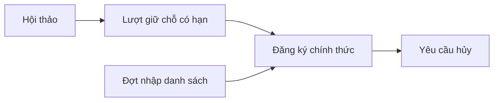
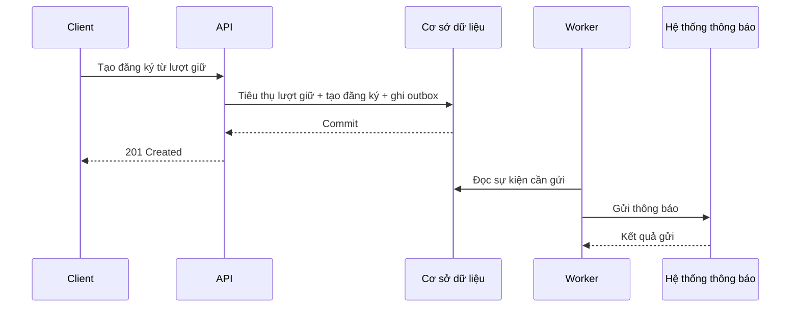

# Thiết kế tài nguyên cho nghiệp vụ vượt CRUD

## Mục tiêu bài học

Trong chương **Mô hình tài nguyên** của module **INTEGRATION_API_REST**, bạn đã cần nhìn tài nguyên như một khái niệm nghiệp vụ có danh tính và hợp đồng. Bài này đi tiếp đến những yêu cầu khó biểu đạt bằng bốn thao tác tạo, đọc, sửa và xóa: giữ chỗ, xác nhận, phê duyệt, tính toán, xử lý hàng loạt và phối hợp nhiều hệ thống.

Sau bài học, bạn có thể:

- Nhận ra khi nào một yêu cầu vượt quá việc sửa dữ liệu đơn thuần.
- Chọn giữa cập nhật tài nguyên hiện có, tạo tài nguyên nghiệp vụ mới và cung cấp một thao tác rõ nghĩa.
- Thiết kế request/response cho nghiệp vụ có điều kiện, tác động phụ hoặc xử lý dài.
- Xác định ranh giới giao dịch, bảo đảm chống lặp, xử lý cạnh tranh và thất bại một phần.
- Viết hợp đồng đủ rõ để triển khai và kiểm thử bằng Java/Spring hoặc công nghệ tương đương.

Ví dụ chính là API đăng ký chỗ tham dự một hội thảo. Các điều kiện, thời hạn và mã lỗi trong bài là quy ước của hệ thống minh họa.

## 1. Vì sao ánh xạ mọi nghiệp vụ thành CRUD là chưa đủ?

CRUD mô tả các thao tác phổ biến trên dữ liệu:

| Thao tác | Ví dụ đơn giản |
| --- | --- |
| Create | Tạo hồ sơ người tham dự |
| Read | Đọc thông tin hội thảo |
| Update | Sửa tên hiển thị |
| Delete | Xóa một bản nháp không còn dùng |

Nhưng người dùng thường diễn đạt nhu cầu bằng ý định:

- “Giữ cho tôi hai chỗ trong vài phút.”
- “Xác nhận đăng ký từ số chỗ đang giữ.”
- “Hủy đăng ký và trả chỗ về quỹ chung.”
- “Cho biết tổng phí dự kiến trước khi tôi đăng ký.”
- “Nhập danh sách 5.000 người và cho biết từng dòng thất bại vì sao.”

Nếu chỉ thiết kế endpoint sửa cột, client sẽ phải tự điều phối quy tắc:

```http
PATCH /events/evt-2026
Content-Type: application/json

{
  "remainingSeats": 18
}
```

Request này không cho server biết người gọi muốn giữ chỗ, xác nhận đăng ký hay sửa cấu hình. Nó còn cho phép client đưa vào một số dư đã lỗi thời, dẫn đến mất cập nhật hoặc vượt sức chứa.

Tương tự, việc cho client gửi `bookingStatus = CONFIRMED` chưa tự bảo đảm đã có chỗ hợp lệ, đúng người đăng ký và chưa xác nhận một lần trước đó.

Thiết kế vượt CRUD bắt đầu bằng **ý định, điều kiện và kết quả nghiệp vụ**. Sau đó mới chọn tài nguyên, URI và phương thức HTTP phù hợp.

## 2. Khám phá nghiệp vụ bằng một bảng ngắn

Trước khi đặt tên endpoint, mô tả mỗi khả năng theo các câu hỏi:

1. Ai muốn làm gì và với đối tượng nào?
2. Điều kiện nào phải đúng trước khi thực hiện?
3. Dữ liệu nào do client cung cấp, dữ liệu nào do server quyết định?
4. Kết quả có danh tính, cần đọc lại hoặc theo dõi không?
5. Những dữ liệu nào phải thay đổi cùng nhau?
6. Điều gì xảy ra khi gửi lại, cạnh tranh hoặc mất kết nối?

Áp dụng vào hệ thống hội thảo:

| Ý định | Điều kiện chính | Kết quả cần quan sát |
| --- | --- | --- |
| Giữ chỗ | Hội thảo mở đăng ký, còn đủ chỗ, số lượng hợp lệ | Một lượt giữ chỗ có hạn dùng |
| Xác nhận đăng ký | Lượt giữ còn hiệu lực, thuộc người gọi, chưa được dùng | Một đăng ký chính thức |
| Hủy đăng ký | Đúng quyền, còn trong thời hạn hủy, chưa check-in | Kết quả hủy và số chỗ được trả |
| Check-in | Đăng ký hợp lệ, đúng thời gian và nhân viên có quyền | Đăng ký được đánh dấu đã tham dự |
| Ước tính phí | Đầu vào hợp lệ theo chính sách hiện tại | Bảng phí dự kiến |
| Nhập hàng loạt | Tệp hợp lệ, được phép thao tác trên hội thảo | Tiến trình nhập và kết quả từng dòng |

Bảng này cũng giúp nhận diện các bất biến:

- Số chỗ khả dụng không âm.
- Một lượt giữ chỗ chỉ được dùng để tạo tối đa một đăng ký.
- Giữ chỗ hết hạn không được xác nhận.
- Hủy cùng một đăng ký không trả chỗ nhiều lần.
- Một người không được thao tác trên lượt giữ chỗ của người khác chỉ vì biết ID.

Đây là trách nhiệm của server. Việc giao diện ẩn nút hoặc kiểm tra số lượng trước khi gửi request chỉ cải thiện trải nghiệm, không bảo vệ được bất biến.

## 3. Chọn hình thức API theo bản chất kết quả

Không phải mọi ý định đều cần một tài nguyên mới. Có ba hướng thường gặp.

### 3.1. Cập nhật thuộc tính của tài nguyên hiện có

Ví dụ sửa tên người tham dự:

```http
PATCH /attendees/att-91
Content-Type: application/merge-patch+json

{
  "displayName": "Nguyễn An"
}
```

Cách này phù hợp khi thay đổi chủ yếu là dữ liệu của tài nguyên, có thể kiểm tra và hoàn tất trong một lần xử lý, không cần hồ sơ nghiệp vụ riêng.

Vẫn cần quy định field được sửa. Không ánh xạ toàn bộ request lên entity rồi cho phép sửa những field như `ownerId`, `confirmedAt` hoặc `remainingSeats`.

### 3.2. Tạo tài nguyên biểu diễn ý định hoặc kết quả nghiệp vụ

Giữ chỗ có người sở hữu, số lượng, hạn dùng và trạng thái riêng. Nó đáng có danh tính:

```http
POST /seat-holds
Content-Type: application/json

{
  "eventId": "evt-2026",
  "quantity": 2
}
```

Tương tự, một đợt nhập danh sách có thể cần một tài nguyên tác vụ để theo dõi tiến trình. Tài nguyên này không nhất thiết tương ứng một bảng duy nhất; đó là hợp đồng bên ngoài mà server chịu trách nhiệm thực hiện.

### 3.3. Cung cấp thao tác rõ nghĩa trên tài nguyên

Một thao tác nhỏ, không có vòng đời độc lập đối với client, có thể được công khai trực tiếp:

```http
POST /bookings/bkg-501/check-in
```

Thiết kế này cần mô tả rõ điều kiện, kết quả, quyền và hành vi khi gọi lặp. Không dùng `GET` để check-in vì GET có ngữ nghĩa an toàn, không dành cho việc gây thay đổi nghiệp vụ theo yêu cầu của người gọi.

Nếu check-in có nhiều lần thử, thiết bị quét, điều tra gian lận hoặc cần tra cứu từng bản ghi, có thể chuyển sang tài nguyên `check-ins`. Hình dạng API phụ thuộc vào nhu cầu quan sát và quản lý nghiệp vụ.

### Bảng quyết định

| Câu hỏi | Nếu câu trả lời là có |
| --- | --- |
| Chỉ sửa dữ liệu thuộc tài nguyên hiện tại? | Cân nhắc `PATCH` hoặc `PUT` theo hợp đồng |
| Kết quả có ID, lịch sử hoặc quyền riêng? | Cân nhắc tài nguyên nghiệp vụ mới |
| Cần theo dõi tiến trình, thử lại hoặc lỗi riêng? | Cân nhắc tài nguyên yêu cầu/tác vụ |
| Thao tác ngắn, gắn chặt với tài nguyên, không cần đọc riêng? | Một endpoint thao tác bằng POST có thể hợp lý |
| Chỉ tính toán và trả kết quả? | Có thể trả biểu diễn tính toán mà không cần lưu một bản ghi lâu dài |

Đổi `cancel` thành `cancellation` chỉ có ích nếu bạn định nghĩa được tài nguyên đó biểu đạt gì. Ngược lại, một endpoint có động từ trong đường dẫn không tự làm API mất ngữ nghĩa HTTP.

## 4. Một mô hình tài nguyên cho hệ thống đặt chỗ

Chọn mô hình minh họa:

| Tài nguyên | URI mẫu | Ý nghĩa |
| --- | --- | --- |
| Hội thảo | `/events/evt-2026` | Thông tin và chính sách đăng ký |
| Thông tin chỗ trống | `/events/evt-2026/availability` | Ảnh chụp khả năng còn chỗ tại thời điểm đọc |
| Lượt giữ chỗ | `/seat-holds/hold-81` | Quyền giữ một số chỗ đến một hạn định |
| Đăng ký | `/bookings/bkg-501` | Xác nhận tham dự chính thức |
| Yêu cầu hủy | `/bookings/bkg-501/cancellations/can-18` | Hồ sơ xử lý hủy và lý do |
| Đợt nhập danh sách | `/registration-imports/imp-72` | Tiến trình và kết quả một lần nhập |

Các quan hệ chính:



Mũi tên biểu thị quan hệ nghiệp vụ, không khẳng định mọi bước chạy trong cùng một giao dịch.

Ở mô hình này, tạo một `booking` là cách diễn đạt “xác nhận đăng ký”. Không cần thêm endpoint `confirm` nếu đăng ký chưa tồn tại trước đó. Nếu hệ thống có đăng ký nháp, bạn có thể chọn mô hình khác; cần tránh công khai nhiều đường đi có cùng tác động nhưng quy tắc khác nhau.

Tài nguyên `cancellation` được chọn vì bộ phận hỗ trợ cần tra cứu lý do, người yêu cầu và kết quả xử lý. Nếu sản phẩm không có nhu cầu đó, một thao tác hủy đơn giản có thể đủ.

## 5. Thiết kế thao tác giữ chỗ

### Request thể hiện nhu cầu, không quyết định kết quả

```http
POST /seat-holds HTTP/1.1
Content-Type: application/json
Accept: application/json
Idempotency-Key: hold-request-7a91

{
  "eventId": "evt-2026",
  "quantity": 2
}
```

Server tự xác định:

- Người sở hữu từ danh tính đã xác thực.
- Thời điểm tạo và thời điểm hết hạn.
- Số chỗ còn lại theo dữ liệu đáng tin cậy.
- Chính sách giới hạn số chỗ một người được giữ.

Không cho client tự khai `ownerId` để giữ chỗ cho bất kỳ người nào, trừ khi đó là khả năng được phân quyền rõ ràng.

### Response có danh tính và hạn dùng

```http
HTTP/1.1 201 Created
Location: /seat-holds/hold-81
Content-Type: application/json
Cache-Control: no-store

{
  "id": "hold-81",
  "eventId": "evt-2026",
  "quantity": 2,
  "status": "ACTIVE",
  "expiresAt": "2026-11-17T03:05:00Z",
  "links": {
    "self": "/seat-holds/hold-81",
    "bookings": "/bookings"
  }
}
```

`201 Created` cho biết lượt giữ chỗ đã được tạo. `Location` chỉ URI của lượt giữ, không phải lời hứa rằng đăng ký chính thức đã hoàn tất.

`expiresAt` phải có quy tắc rõ ràng: trong ví dụ, lượt giữ chỉ được dùng khi thời gian server nhỏ hơn hạn này. Đồng hồ client chỉ phục vụ hiển thị đếm ngược.

### Bảo vệ số chỗ khi có cạnh tranh

Hai request cùng đọc “còn hai chỗ” không có nghĩa cả hai đều được giữ hai chỗ. Việc kiểm tra và cấp chỗ cần được thực hiện nguyên tử trong ranh giới dữ liệu phù hợp.

Một cách triển khai là giảm số chỗ khả dụng có điều kiện, đồng thời tạo bản ghi giữ chỗ trong cùng giao dịch. Nếu hết chỗ, không được để lại lượt giữ ở trạng thái thành công.

Với cách triển khai dùng bộ đếm, việc hết hạn và trả chỗ cũng cần bảo vệ để không trả nhiều lần. Với cách tính từ các lượt giữ còn hiệu lực, truy vấn và cơ chế khóa vẫn phải bảo đảm bất biến khi cạnh tranh. Không có một câu `SELECT` trước khi ghi nào tự tạo ra bảo đảm đó.

Tác vụ dọn lượt giữ hết hạn có thể chạy trễ. Vì vậy, khi xác nhận đăng ký, server vẫn phải kiểm tra hạn dùng; không chỉ kiểm tra field `status = ACTIVE`.

## 6. Xác nhận đăng ký bằng cách tạo tài nguyên kết quả

Khi người dùng đồng ý đăng ký từ lượt giữ chỗ:

```http
POST /bookings HTTP/1.1
Content-Type: application/json
Idempotency-Key: booking-request-b18f

{
  "seatHoldId": "hold-81",
  "attendee": {
    "displayName": "Nguyễn An",
    "email": "an@example.com"
  }
}
```

Request không chứa:

- `status: CONFIRMED` do client tự quyết định.
- `confirmedAt` hoặc `ownerId`.
- Số chỗ mới khác với số lượng đã giữ.
- Số dư còn lại của hội thảo.

Server cần kiểm tra quyền đối với lượt giữ, hiệu lực, dữ liệu người tham dự và các quy tắc đăng ký. Khi thành công:

```http
HTTP/1.1 201 Created
Location: /bookings/bkg-501
Content-Type: application/json
ETag: "booking-bkg-501-v1"
Cache-Control: no-store

{
  "id": "bkg-501",
  "eventId": "evt-2026",
  "seatHoldId": "hold-81",
  "quantity": 2,
  "status": "CONFIRMED",
  "confirmedAt": "2026-11-17T03:02:00Z",
  "links": {
    "self": "/bookings/bkg-501",
    "cancellations": "/bookings/bkg-501/cancellations"
  }
}
```

### Những thay đổi phải nhất quán

Ở triển khai dùng một cơ sở dữ liệu, giao dịch xác nhận có thể bao gồm:

1. Kiểm tra và tiêu thụ lượt giữ còn hiệu lực.
2. Tạo đăng ký chính thức.
3. Ghi lịch sử cần thiết.
4. Ghi sự kiện vào outbox nếu cần gửi thông báo sau đó.

Một ràng buộc duy nhất trên quan hệ đăng ký với lượt giữ giúp bảo vệ quy tắc “một lượt giữ chỉ tạo một đăng ký”. Nó bổ sung cho kiểm tra nghiệp vụ và cơ chế chống lặp, thay vì phụ thuộc hoàn toàn vào thao tác đọc trước khi ghi.

Tiêu thụ lượt giữ là chuyển quyền sử dụng chỗ sang đăng ký. Không được vừa giữ nguyên lượt giữ đang chiếm chỗ vừa trừ thêm chỗ một lần nữa cho đăng ký.

Email xác nhận có thể được gửi sau khi giao dịch cục bộ hoàn tất. Nếu email lỗi, đăng ký vẫn có thể đã thành công; hệ thống cần theo dõi và gửi lại thông báo mà không tạo lại đăng ký.

## 7. Phân biệt tài nguyên tính toán với cam kết nghiệp vụ

Trước khi giữ chỗ, client có thể cần ước tính phí:

```http
POST /booking-estimates HTTP/1.1
Content-Type: application/json

{
  "eventId": "evt-2026",
  "quantity": 2,
  "discountCode": "EARLY_ACCESS"
}
```

```http
HTTP/1.1 200 OK
Content-Type: application/json
Cache-Control: no-store

{
  "eventId": "evt-2026",
  "quantity": 2,
  "estimatedTotal": {
    "amount": "900000",
    "currency": "VND"
  },
  "calculatedAt": "2026-11-17T03:00:00Z",
  "binding": false
}
```

Trong hợp đồng này, API trả kết quả tính toán tại thời điểm xử lý. Không có tài nguyên lâu dài để đọc lại nên response không đưa một ID giả hoặc `Location` không tồn tại.

POST có thể phù hợp khi đầu vào tính toán có cấu trúc phức tạp. Dù nghiệp vụ này không thay đổi dữ liệu kinh doanh, không nên giả định các thành phần HTTP sẽ xử lý POST như GET để tự động cache hoặc thử lại.

Cần phân biệt ba mức:

| Khả năng | Cam kết |
| --- | --- |
| Đọc khả năng còn chỗ | Thông tin tham khảo tại thời điểm đọc |
| Tính phí dự kiến | Kết quả tính theo đầu vào và chính sách hiện tại |
| Tạo lượt giữ chỗ | Cam kết giữ số chỗ theo thời hạn và điều kiện đã công bố |

Nếu sản phẩm cần một mức giá được bảo đảm trong thời hạn, hãy thiết kế tài nguyên báo giá có ID, hạn dùng và điều kiện sử dụng. Không gọi một ước tính là báo giá ràng buộc nếu server có thể tùy ý tính lại khi xác nhận.

Kết quả xem trước cũng không miễn cho server việc kiểm tra lại tại thời điểm thực thi. Quyền, sức chứa hoặc chính sách có thể thay đổi giữa hai request.

## 8. Hủy là một nghiệp vụ, không chỉ là xóa dữ liệu

Giả sử đăng ký đã xác nhận phải được giữ để hỗ trợ tra cứu và thống kê. Khi đó, hủy đăng ký nên được biểu đạt theo nghiệp vụ:

```http
POST /bookings/bkg-501/cancellations HTTP/1.1
Content-Type: application/json
Idempotency-Key: cancellation-request-c301

{
  "reasonCode": "ATTENDEE_REQUEST",
  "comment": "Không sắp xếp được thời gian tham dự"
}
```

Nếu xử lý ngay, server có thể trả:

```http
HTTP/1.1 201 Created
Location: /bookings/bkg-501/cancellations/can-18
Content-Type: application/json
Cache-Control: no-store

{
  "id": "can-18",
  "bookingId": "bkg-501",
  "status": "COMPLETED",
  "bookingStatusAfter": "CANCELLED",
  "releasedQuantity": 2
}
```

Giao dịch cục bộ cần bảo đảm việc đổi trạng thái đăng ký và trả chỗ không tách rời nhau theo cách gây sai số.

`DELETE /bookings/bkg-501` có thể được định nghĩa cho việc xóa tài nguyên, nhưng không tự nói rõ nghĩa “hủy với lý do, áp dụng chính sách và giữ hồ sơ”. Đừng chọn DELETE chỉ vì nút giao diện có nhãn “Hủy”.

Nếu sau này có hoàn phí qua hệ thống thanh toán, mô hình hủy cần mô tả quan hệ với hoàn phí: đã nhận yêu cầu, đã hủy quyền tham dự và đã hoàn tiền là các kết quả khác nhau. Không trả trạng thái hoàn tất chung chung khi còn một nghĩa vụ chưa xử lý.

### Khi một thao tác trực tiếp là đủ

Với check-in, hợp đồng có thể chọn:

```http
POST /bookings/bkg-501/check-in HTTP/1.1
Idempotency-Key: checkin-scan-88
```

Response trả đăng ký đã check-in bằng `200 OK`. Hợp đồng quy định gọi lặp cùng ý định không ghi thêm lần check-in hay tăng bộ đếm tham dự.

Nếu đăng ký đã bị hủy, thao tác bị từ chối. Nếu nhân viên quét mã không có quyền trên hội thảo, server phải kiểm tra quyền dù mã đăng ký hợp lệ.

## 9. Dùng tài nguyên tác vụ cho xử lý dài

Nhập danh sách lớn không nên giữ kết nối HTTP vô thời hạn rồi khiến client không biết kết quả khi mất mạng.

Giả sử người dùng đã tải tệp lên kho dữ liệu do hệ thống quản lý và nhận được `fileId`. Họ tạo một đợt nhập:

```http
POST /registration-imports HTTP/1.1
Content-Type: application/json
Idempotency-Key: import-request-81af

{
  "eventId": "evt-2026",
  "fileId": "file-77",
  "mode": "PARTIAL"
}
```

```http
HTTP/1.1 202 Accepted
Location: /registration-imports/imp-72
Content-Type: application/json
Cache-Control: no-store

{
  "id": "imp-72",
  "status": "QUEUED",
  "processedRows": 0,
  "links": {
    "self": "/registration-imports/imp-72",
    "rowResults": "/registration-imports/imp-72/row-results"
  }
}
```

`202 Accepted` cho biết request đã được tiếp nhận để xử lý. Nó không khẳng định mọi dòng đã được đăng ký thành công.

Việc đã tạo hồ sơ tác vụ và việc nghiệp vụ nhập chưa hoàn tất là hai sự kiện khác nhau. Một hợp đồng cũng có thể chọn `201 Created` để nhấn mạnh đã tạo tài nguyên tác vụ; nếu chọn cách đó vẫn phải mô tả trạng thái đang chờ xử lý. Bài này dùng `202` để nhấn mạnh kết quả nghiệp vụ còn đang chờ.

### Theo dõi kết quả

```http
GET /registration-imports/imp-72 HTTP/1.1
Accept: application/json
```

```http
HTTP/1.1 200 OK
Content-Type: application/json
Cache-Control: no-store

{
  "id": "imp-72",
  "status": "COMPLETED_WITH_ERRORS",
  "totalRows": 5000,
  "processedRows": 5000,
  "succeededRows": 4980,
  "failedRows": 20,
  "completedAt": "2026-11-17T03:12:00Z",
  "links": {
    "rowResults": "/registration-imports/imp-72/row-results"
  }
}
```

HTTP `200` chỉ nói rằng đọc tài nguyên tác vụ thành công. Kết quả nhập nằm trong các field nghiệp vụ.

Tài liệu cần quy định:

- Những trạng thái nào còn đang chạy và trạng thái nào là kết thúc.
- Số liệu tiến trình có chính xác ngay hay cập nhật theo đợt.
- Cách phân trang kết quả từng dòng.
- Thời gian giữ tác vụ và tệp kết quả.
- Nhịp theo dõi được khuyến nghị, backoff hoặc cơ chế thông báo thay thế.
- Hành vi sau lỗi worker và sau khi tiến trình được khởi động lại.
- Quyền đọc tệp, xem lỗi và tải dữ liệu kết quả.

Không cho worker đọc tùy ý một URL do client nhập chỉ vì request có field `sourceUrl`. Trong ví dụ, server kiểm tra `fileId` thuộc phạm vi truy cập và loại dữ liệu được phép xử lý.

## 10. Quyết định rõ xử lý hàng loạt là nguyên tử hay từng phần

“Nhập danh sách” chưa đủ để định nghĩa hành vi. Cần chọn một mô hình thực thi.

### Toàn bộ hoặc không có gì

Nếu một dòng lỗi thì toàn bộ đợt không tạo đăng ký.

Ưu điểm là người dùng dễ hiểu kết quả tổng thể. Tuy nhiên, việc áp dụng nguyên tử cho một tệp lớn có thể đòi hỏi giao dịch dài, khóa nhiều dữ liệu và dùng nhiều tài nguyên. Cần thiết kế theo giới hạn thực tế.

Chỉ kiểm tra toàn bộ tệp trước rồi lần lượt ghi từng dòng không tự tạo ra tính nguyên tử. Dữ liệu có thể đổi giữa lúc kiểm tra và lúc ghi; tiến trình cũng có thể dừng sau một phần kết quả.

### Thành công từng phần

Trong ví dụ, `mode = PARTIAL` cho phép từng dòng độc lập thành công hoặc thất bại:

```json
{
  "items": [
    {
      "rowNumber": 1,
      "status": "SUCCEEDED",
      "bookingId": "bkg-601"
    },
    {
      "rowNumber": 2,
      "status": "FAILED",
      "code": "EVENT_CAPACITY_EXCEEDED"
    }
  ],
  "nextCursor": "opaque-next-page"
}
```

Cần làm rõ thêm:

- Mỗi dòng phải được xử lý nguyên tử trong phạm vi của nó.
- Khi worker thử lại, một dòng đã thành công không tạo đăng ký thứ hai.
- Thứ tự cấp những chỗ cuối cùng là theo dòng, theo đợt hay không được bảo đảm.
- Người dùng gửi lại các dòng lỗi bằng một tác vụ mới hay yêu cầu tiếp tục tác vụ cũ.
- Bản ghi thất bại có giữ dữ liệu cá nhân bao lâu.

Một khóa idempotency cho request tạo tác vụ chỉ chống tạo trùng tác vụ. Nó không tự bảo vệ từng dòng bên trong. Có thể cần danh tính ổn định cho dòng và ràng buộc tương ứng ở nơi ghi kết quả.

Mã HTTP của thao tác đọc tác vụ không nên bị dùng để che giấu các lỗi từng dòng. Khi tác vụ kết thúc có lỗi, client cần một trạng thái và cấu trúc kết quả rõ ràng.

## 11. Xác định ranh giới giao dịch và cách phục hồi

Một request HTTP có thể điều phối nhiều thành phần. Nó không tự biến toàn bộ chuỗi thành một giao dịch nguyên tử.

Ví dụ:



Đăng ký có thể đã được tạo ngay cả khi bước gửi thông báo chưa thành công. Server cần thiết kế phục hồi đúng theo ý nghĩa đó.

### Với nhiều hệ thống độc lập

Nếu giữ chỗ, thanh toán và phát vé ở ba dịch vụ khác nhau, cần quyết định:

- Bước nào tạo cam kết với người dùng.
- Trạng thái nào phản ánh đang chờ.
- Bước nào có thể thử lại an toàn.
- Khi không tiếp tục được thì cần bù điều gì.
- Tình huống nào cần nhân viên xử lý.

Thao tác bù là một nghiệp vụ mới, không phải quay ngược thời gian. Email đã gửi không thể “chưa từng được gửi”; khoản thu đã thực hiện có thể cần một giao dịch hoàn tiền riêng.

API nên thể hiện kết quả đủ rõ để client biết liệu cần chờ, sửa đầu vào, gửi lại với cùng ý định hay liên hệ hỗ trợ. Không trả thành công cuối cùng chỉ vì đã đưa một thông điệp vào hàng đợi.

## 12. Phân biệt chống lặp, phiên bản và điều kiện nghiệp vụ

Ba vấn đề này thường xuất hiện cùng nhau:

| Vấn đề | Ví dụ | Cơ chế cần cân nhắc |
| --- | --- | --- |
| Request bị gửi lại | Client không nhận được response tạo đăng ký | Khóa idempotency và lưu kết quả xử lý |
| Nhiều người cùng tranh dữ liệu | Hai người giữ những chỗ cuối | Giao dịch, khóa, cập nhật có điều kiện |
| Client sửa từ biểu diễn đã cũ | Nhân viên hủy đăng ký sau khi nó đã check-in | ETag/`If-Match` hoặc cơ chế phiên bản theo hợp đồng |
| Điều kiện không còn đúng | Lượt giữ đã hết hạn | Kiểm tra nghiệp vụ tại thời điểm thực thi |

`If-Match` không thay thế bảo vệ sức chứa giữa nhiều tài nguyên. Khóa idempotency cũng không tự ngăn hai người khác nhau tranh cùng chỗ.

Đối với các ví dụ dùng `Idempotency-Key`, hợp đồng cần định nghĩa tối thiểu:

- Phạm vi khóa gắn với người gọi/tenant và loại thao tác.
- Cách nhận diện payload tương đương.
- Kết quả khi cùng khóa được dùng với payload khác.
- Thời hạn lưu khóa và kết quả.
- Cách xử lý hai request cùng khóa đang chạy đồng thời.
- Quan hệ nhất quán giữa bản ghi chống lặp và dữ liệu nghiệp vụ.

Header này được dùng như một quy ước API trong bài. Server phải thực sự triển khai việc nhận diện và phân xử request; tên header tự nó không tạo ra bảo đảm.

Client bị timeout không biết chắc request thất bại. Nó cần dùng cùng khóa cho cùng ý định hoặc đọc tài nguyên kết quả đã biết, thay vì tự tạo một ý định mới ngay lập tức.

## 13. Trả lỗi có cấu trúc và hỗ trợ quyết định tiếp theo

Giả sử người dùng xác nhận một lượt giữ đã hết hạn:

```http
HTTP/1.1 409 Conflict
Content-Type: application/problem+json

{
  "type": "https://api.example.com/problems/seat-hold-expired",
  "title": "Lượt giữ chỗ đã hết hạn",
  "status": 409,
  "detail": "Không thể tạo đăng ký từ lượt giữ chỗ này.",
  "instance": "/seat-holds/hold-81",
  "code": "SEAT_HOLD_EXPIRED"
}
```

Client có thể dựa vào `code` để đề nghị tạo lượt giữ mới. Không nên tự phân tích câu chữ `detail`.

Một bảng lỗi minh họa:

| Tình huống | HTTP | Mã nghiệp vụ ví dụ |
| --- | --- | --- |
| JSON không đọc được | `400 Bad Request` | `MALFORMED_REQUEST` |
| Số lượng ngoài giới hạn của request | `422 Unprocessable Content` | `INVALID_HOLD_QUANTITY` |
| Chưa có thông tin xác thực hợp lệ | `401 Unauthorized` | `AUTHENTICATION_REQUIRED` |
| Không có quyền trên hội thảo | `403 Forbidden` | `EVENT_ACCESS_DENIED` |
| Tài nguyên không tồn tại | `404 Not Found` | `RESOURCE_NOT_FOUND` |
| Không còn đủ chỗ | `409 Conflict` | `EVENT_CAPACITY_EXCEEDED` |
| Cùng khóa idempotency nhưng nội dung khác | `409 Conflict` | `IDEMPOTENCY_KEY_REUSED` |
| Điều kiện `If-Match` không khớp | `412 Precondition Failed` | `RESOURCE_VERSION_MISMATCH` |

Đây là lựa chọn của hợp đồng minh họa. Điều cần giữ là cách phân loại nhất quán và client biết khi nào sửa request, đọc lại hay dừng.

Một lỗi hệ thống tạm thời sau khi có thể đã commit cần được xử lý thận trọng. Client không nên kết luận dữ liệu chưa thay đổi chỉ dựa trên việc nhận lỗi hoặc mất response. Cơ chế chống lặp và tra cứu kết quả giúp giải quyết sự không chắc chắn đó.

## 14. Phác thảo ranh giới triển khai bằng Java

Không nên để controller trực tiếp sửa bộ đếm chỗ rồi tạo bản ghi đăng ký bằng nhiều lệnh rời rạc.

Một lớp ứng dụng có thể công khai những khả năng nghiệp vụ:

```java
public interface RegistrationUseCases {
    SeatHoldResult createSeatHold(
            Caller caller,
            CreateSeatHoldCommand command,
            String idempotencyKey);

    BookingResult createBooking(
            Caller caller,
            CreateBookingCommand command,
            String idempotencyKey);

    CancellationResult cancelBooking(
            Caller caller,
            CancelBookingCommand command,
            String idempotencyKey);
}
```

Các kiểu `Caller`, `Command` và `Result` ở đây là kiểu minh họa của ứng dụng, không phải API của một thư viện cụ thể.

Ví dụ đầu vào tạo đăng ký:

```java
public record CreateBookingCommand(
        String seatHoldId,
        String attendeeDisplayName,
        String attendeeEmail
) {}
```

Không có field `confirmedAt`, `remainingSeats` hoặc `ownerId` để client tự gán. Dữ liệu định danh người gọi đi qua một tham số riêng do lớp xác thực tạo ra.

Phân công trách nhiệm:

| Lớp | Trách nhiệm chính |
| --- | --- |
| HTTP/controller | Đọc URI, header, DTO; kiểm tra cấu trúc; ánh xạ response |
| Lớp ứng dụng | Điều phối quyền, chống lặp, giao dịch và các bước nghiệp vụ |
| Mô hình miền/chính sách | Bảo vệ điều kiện và bất biến |
| Persistence | Lưu dữ liệu, ràng buộc duy nhất, cơ chế đồng thời |
| Worker/tích hợp | Xử lý tác vụ dài, thử lại, theo dõi tác động ngoài |

Trong Java/Spring, các ranh giới này có thể được triển khai bằng controller, service, repository và worker. Dù framework hỗ trợ giao dịch, vẫn cần kiểm tra rằng thao tác đọc–kiểm tra–ghi và các ràng buộc thực tế bảo vệ được bất biến khi cạnh tranh.

Không trả entity persistence trực tiếp chỉ vì nó có sẵn field `status`. Response DTO giúp công khai đúng thông tin nghiệp vụ và tránh lộ các field nội bộ.

## 15. Đưa các quyết định vào hợp đồng API

Đối với mỗi khả năng vượt CRUD, OpenAPI và tài liệu đi kèm cần trả lời được:

| Nhóm thông tin | Nội dung cần có |
| --- | --- |
| Ngữ nghĩa | Thao tác thể hiện ý định gì, tạo hoặc đổi tài nguyên nào |
| Đầu vào | Schema riêng, field bắt buộc, giới hạn và nguồn dữ liệu đáng tin cậy |
| Quyền | Ai được thao tác và trên tài nguyên thuộc phạm vi nào |
| Thành công | HTTP, body, `Location`, trạng thái nghiệp vụ và tác động đã hoàn tất |
| Cạnh tranh | Phiên bản, điều kiện, hành vi khi nhiều request tranh nhau |
| Gửi lại | Khóa idempotency, thời hạn và kết quả khi lặp |
| Bất đồng bộ | Tài nguyên theo dõi, trạng thái kết thúc, kết quả và lỗi |
| Hàng loạt | Toàn bộ hay từng phần, thứ tự, phân trang và cách tiếp tục |
| Vận hành | Thời hạn dữ liệu, giới hạn request và cách phục hồi |

Đặt `operationId` theo ý định như `createSeatHold` hoặc `createBooking` giúp người dùng SDK hiểu hành vi. Nó không thay thế mô tả điều kiện, lỗi và tác động phụ.

Không chỉ mô tả rằng endpoint “trả về thành công”. Hãy nói rõ thành công có nghĩa là đã giữ chỗ, đã tạo đăng ký hay mới nhận yêu cầu chờ xử lý.

### Những tình huống cần kiểm thử ở mức hành vi

- Hai người tranh chỗ cuối cùng: không vượt sức chứa.
- Hai request cùng dùng một lượt giữ: không tạo hai đăng ký.
- Lượt giữ hết hạn nhưng tác vụ dọn chưa chạy: vẫn không xác nhận được.
- Client gửi lại sau khi mất response: nhận được kết quả phù hợp mà không lặp tác động.
- Hủy lặp hoặc worker thử lại: không trả chỗ nhiều lần.
- Người dùng biết ID của người khác: không đọc hoặc thao tác ngoài quyền.
- Tác vụ nhập dừng giữa chừng rồi chạy lại: không nhân đôi các dòng đã thành công.
- Thông báo lỗi sau khi đăng ký đã commit: đăng ký được giữ đúng và thông báo có thể được xử lý lại.

Các kiểm thử cần quan sát dữ liệu cuối cùng và tác động nghiệp vụ, không chỉ kiểm tra mã HTTP.

## 16. Những thiết kế nên xem xét lại

| Thiết kế | Vấn đề thường gặp | Hướng cải thiện |
| --- | --- | --- |
| `PATCH remainingSeats` từ client | Client tự tính tài nguyên dùng chung | Tạo lượt giữ hoặc đăng ký qua nghiệp vụ có điều kiện |
| Một endpoint `/execute` với `action` tùy ý | Khó mô tả schema, quyền và lỗi của từng khả năng | Công khai từng khả năng với hợp đồng rõ |
| Tạo `operation` cho mọi thay đổi nhỏ | Nhiều tài nguyên trung gian không có nhu cầu quan sát | Dùng cập nhật đơn giản khi đủ |
| `GET /confirmBooking` | GET gây tác động theo yêu cầu của người gọi | Dùng phương thức và hợp đồng thích hợp |
| Trả `202` nhưng không có cách biết kết quả | Người dùng chỉ biết đã gửi request | Cung cấp tài nguyên theo dõi và trạng thái kết thúc |
| Tệp nhập có lỗi nhưng response chỉ nói “OK” | Không biết dòng nào cần xử lý lại | Có kết quả từng dòng và chính sách từng phần |
| Kiểm tra quyền chỉ ở giao diện | Người gọi trực tiếp có thể vượt kiểm tra | Kiểm tra quyền trên tài nguyên tại server |
| Gửi lệnh sang nhiều dịch vụ rồi coi là nguyên tử | Không có kế hoạch cho thất bại giữa chừng | Mô hình quy trình, thử lại và bù rõ ràng |

Một endpoint tổng quát đôi khi có lý do tồn tại trong một giao thức hoặc hệ thống công cụ riêng. Với API nghiệp vụ cho client thông thường, phải cân nhắc chi phí mất khả năng mô tả và kiểm soát từng hành vi.

## 17. Bài tập áp dụng

Thiết kế API mượn sách với các yêu cầu:

- Người đọc xem số bản còn có thể mượn.
- Người đọc giữ một bản trong 15 phút.
- Nhân viên xác nhận cho mượn từ một lượt giữ hợp lệ.
- Trả sách có thể phát sinh kiểm tra tình trạng sách.
- Thư viện nhập 10.000 bản ghi trả sách từ một hệ thống cũ.
- Request có thể bị gửi lại và nhiều người có thể cùng tranh bản cuối.

Hãy thực hiện:

1. Liệt kê ý định, điều kiện và kết quả cần quan sát.
2. Chọn tài nguyên cho giữ sách, lượt mượn và đợt nhập.
3. Nêu một thao tác không cần tài nguyên có vòng đời riêng và giải thích lựa chọn.
4. Viết request/response cho giữ sách và xác nhận cho mượn.
5. Phân biệt thông tin “còn sách” với cam kết “đã giữ sách”.
6. Mô tả tính nguyên tử, chống lặp và xử lý lỗi từng phần.
7. Chọn các bất biến và tình huống cạnh tranh cần kiểm thử.

Tự đối chiếu thiết kế bằng một câu hỏi: nếu một request được gửi lại, đến muộn hoặc chạy đồng thời với request khác, server còn bảo vệ được ý nghĩa nghiệp vụ mà hợp đồng đã hứa hay không?
