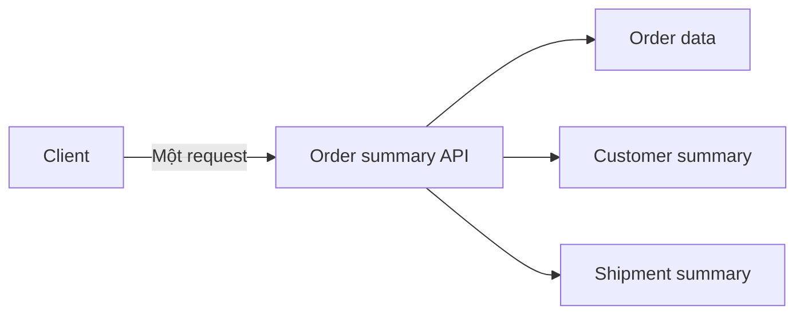

# Đánh đổi độ hạt API, số lượt gọi và mức phụ thuộc client

## 1. Vì sao độ hạt là một quyết định về hợp đồng API?

Trong chương **Mô hình tài nguyên** của module **INTEGRATION_API_REST**, ta đã đặt trọng tâm vào cách diễn đạt nghiệp vụ bằng tài nguyên. Khi đưa mô hình đó thành API, một câu hỏi tiếp theo xuất hiện: một request nên cung cấp hoặc thay đổi bao nhiêu thông tin?

Giả sử ứng dụng cần hiển thị trang chi tiết đơn hàng. Trang này cần thông tin đơn hàng, các dòng hàng, tên người mua và tình trạng vận chuyển. Có thể thiết kế nhiều tài nguyên nhỏ để client tự kết hợp, hoặc cung cấp một tài nguyên tổng hợp đã chứa phần lớn dữ liệu cần thiết. Hai lựa chọn đều có thể dùng URI theo resource, phương thức HTTP và mã trạng thái rõ ràng; sự khác biệt nằm ở chi phí và trách nhiệm mà mỗi bên phải gánh.

**Độ hạt API** thể hiện phạm vi dữ liệu hoặc nghiệp vụ được bao phủ bởi một tương tác. API có độ hạt mịn chia tương tác thành các phần nhỏ; API có độ hạt thô gom nhiều phần vào cùng một hợp đồng. Đây là một phổ thiết kế, không phải hai loại loại trừ lẫn nhau.

Bài học này giúp bạn:

- Phân biệt độ hạt của tài nguyên, biểu diễn dữ liệu và thao tác ghi.
- Ước lượng tác động của số lượt gọi, kích thước payload và quan hệ phụ thuộc giữa các request.
- Nhận diện mức phụ thuộc của client vào cấu trúc nghiệp vụ và cách triển khai phía server.
- Chọn giữa tài nguyên độc lập, embedding, expansion, tài nguyên tổng hợp và BFF.
- Giữ hợp đồng HTTP, xác thực, phân quyền, xử lý lỗi và khả năng kiểm thử rõ ràng khi thay đổi độ hạt.

## 2. Ba chiều độ hạt cần tách riêng

### 2.1. Độ hạt của tài nguyên

Độ hạt tài nguyên trả lời câu hỏi: **đối tượng nào có danh tính, ý nghĩa và vòng đời đáng được thể hiện trong API?**

Ví dụ:

```text
/orders/o_1042
/orders/o_1042/items/i_1
/shipments/s_208
```

Một shipment có thể thay đổi địa chỉ giao, trạng thái và mã theo dõi theo vòng đời riêng. Việc cho shipment một URI riêng có giá trị dù nó cũng xuất hiện trong biểu diễn tổng hợp của đơn hàng.

Ngược lại, một trường như `postalCode` thường chỉ là thành phần của địa chỉ. Không cần tạo `/orders/o_1042/shipping-address/postal-code` chỉ vì có thể truy cập trường đó trong cơ sở dữ liệu. Chỉ nên tách thành tài nguyên khi có lý do nghiệp vụ, quyền truy cập, vòng đời hoặc cách sử dụng đủ rõ.

**Bảng cơ sở dữ liệu không quyết định trực tiếp tài nguyên công khai.** Một resource có thể lấy dữ liệu từ nhiều bảng; một bảng cũng có thể góp phần vào nhiều biểu diễn.

### 2.2. Độ hạt của biểu diễn

Cùng một tài nguyên đơn hàng có thể có biểu diễn tối thiểu hoặc biểu diễn giàu thông tin hơn:

```http
GET /orders/o_1042 HTTP/1.1
Accept: application/json
```

```json
{
  "id": "o_1042",
  "status": "CONFIRMED",
  "total": { "amountMinor": 15900000, "currency": "VND" },
  "customerId": "c_17",
  "shipmentId": "s_208"
}
```

Ở đây `amountMinor` là số nguyên theo đơn vị tiền tệ nhỏ nhất đã quy định trong hợp đồng; ví dụ sử dụng VND, với đơn vị là đồng.

Nếu client thường xuyên cần tên người mua và một trạng thái vận chuyển ngắn, server có thể nhúng các phần tóm tắt đó vào biểu diễn. Điều này không bắt buộc xóa URI độc lập của customer hoặc shipment.

Tách hai câu hỏi sẽ tránh được kết luận sai: “muốn ít request thì phải gom tất cả thành một tài nguyên khổng lồ”. Trong nhiều trường hợp, giữ tài nguyên rõ ràng rồi điều chỉnh biểu diễn là đủ.

### 2.3. Độ hạt của thao tác ghi

Độ hạt ghi trả lời câu hỏi: **một yêu cầu nghiệp vụ nên thành công hoặc thất bại trên phạm vi nào?**

Ví dụ, tạo một đơn hàng với các dòng hàng ban đầu thường là một ý định nghiệp vụ duy nhất:

```http
POST /orders HTTP/1.1
Content-Type: application/json

{
  "customerId": "c_17",
  "items": [
    { "productId": "p_10", "quantity": 2 },
    { "productId": "p_11", "quantity": 1 }
  ]
}
```

Tách thành “tạo đơn hàng rỗng”, “thêm dòng thứ nhất”, “thêm dòng thứ hai” buộc client xử lý trạng thái dở dang nếu request thứ ba thất bại. Có hệ thống chủ động hỗ trợ đơn nháp theo cách này, nhưng đó phải là mô hình nghiệp vụ có chủ đích.

Gom các thay đổi vào một HTTP request cũng **không tự tạo ra giao dịch nguyên tử** giữa kho hàng, thanh toán và vận chuyển. Phạm vi transaction, trạng thái trung gian và cơ chế bù trừ vẫn cần được thiết kế riêng.

## 3. Cùng một trang đơn hàng, ba cách thiết kế

### Phương án A: Client ghép các tài nguyên nhỏ

```text
GET /orders/o_1042
GET /orders/o_1042/items?limit=20
GET /customers/c_17
GET /shipments/s_208
```

Client cần biết cách lấy các ID, thứ tự gọi và cách ghép dữ liệu. Nếu `customerId` và `shipmentId` chỉ có sau khi lấy order thì hai request tương ứng chưa thể chạy ngay từ đầu.

Ưu điểm là dữ liệu có thể được lấy theo nhu cầu và cache độc lập. Một ứng dụng chỉ cần trạng thái đơn không phải tải cả danh sách dòng hàng hoặc dữ liệu vận chuyển.

Đổi lại, client phải quản lý nhiều trạng thái tải, lỗi, retry và quyền truy cập hơn. Nếu mọi ứng dụng đều tự viết cùng một quy trình ghép dữ liệu, phần kiến thức nghiệp vụ đó bị sao chép sang nhiều nơi.

### Phương án B: Tài nguyên gốc có phần nhúng có kiểm soát

```http
GET /orders/o_1042?include=customer-summary,shipment-summary HTTP/1.1
Accept: application/json
```

`include` trong ví dụ là quy ước riêng của API này. Hợp đồng cần khai báo các giá trị được hỗ trợ; HTTP không tự quy định cú pháp hay hành vi expansion này.

Server trả về order và hai phần tóm tắt nhỏ. Danh sách dòng hàng dài vẫn có thể được truy cập qua collection riêng có phân trang. Client giảm số request mà không buộc server trả toàn bộ hồ sơ khách hàng hay lịch sử vận chuyển.

### Phương án C: Tài nguyên tổng hợp phục vụ một nhu cầu ổn định

```http
GET /orders/o_1042/summary HTTP/1.1
Accept: application/json
```

Đây là biểu diễn tóm tắt đơn hàng được thiết kế cho một nhóm nhu cầu đọc rõ ràng. Resource này có thể là read model, được xây dựng từ dữ liệu của nhiều nguồn.

Tên `summary` không làm thiết kế tự động tốt hơn. Giá trị của nó đến từ hợp đồng: trường nào có mặt, ai được xem, dữ liệu có thể cũ bao lâu, khi nào phản hồi được coi là đầy đủ và khi nào phải báo lỗi.

Không nên đặt `/orders/o_1042/mobile-screen-v7` chỉ để phản chiếu chính xác bố cục nhất thời nếu hợp đồng được dùng chung lâu dài. Trong một BFF chuyên phục vụ ứng dụng mobile, mức gắn với trải nghiệm giao diện có thể là lựa chọn chấp nhận được, nhưng phải có chủ sở hữu và phạm vi sử dụng rõ ràng.

| Khía cạnh | Tài nguyên nhỏ, client ghép | Nhúng có kiểm soát | Tài nguyên tổng hợp |
| --- | --- | --- | --- |
| Số request bên ngoài | Thường cao hơn | Giảm với phần được nhúng | Thường ít cho nhu cầu đã định |
| Dữ liệu tải thừa | Có thể thấp | Phụ thuộc cách chọn include | Có thể cao nếu dùng sai nhu cầu |
| Tái sử dụng từng phần | Tốt khi phần có nghĩa độc lập | Vẫn giữ được URI riêng | Cần thiết kế để tránh quá đặc thù |
| Cache | Dễ tách theo từng tài nguyên | Nhiều biến thể cache | Chính sách phụ thuộc dữ liệu hợp thành |
| Ghép dữ liệu | Client chịu chính | Server chịu phần nhúng | Server hoặc BFF chịu chính |
| Tính sẵn sàng | Từng phần có thể lỗi riêng | Phụ thuộc chính sách nhúng | Cần chính sách lỗi từng phần rõ |
| Tiến hóa hợp đồng | Dễ bị lộ nhiều quan hệ nội bộ | Phải giữ ổn định các phần nhúng | Có thể che thay đổi nội bộ tốt hơn |

## 4. Số lượt gọi ảnh hưởng độ trễ như thế nào?

### 4.1. Đo chuỗi phụ thuộc, không chỉ đếm endpoint

Với một chuỗi request tuần tự, có thể ước lượng đơn giản:

```text
T_tổng ≈ Σ (RTT + thời gian xử lý + thời gian truyền dữ liệu)
```

RTT là thời gian khứ hồi trên mạng. Mô hình trên phục vụ suy luận ban đầu, chưa phản ánh đầy đủ thời gian thiết lập kết nối, xếp hàng, tranh chấp tài nguyên hoặc retry.

Với nhiều request độc lập được chạy đồng thời, thời gian hoàn thành của nhóm thường gần thời gian của request chậm nhất, cộng các chi phí phối hợp. Nếu chúng có quan hệ phụ thuộc, cần nhìn vào **đường đi mất thời gian lâu nhất qua các bước phụ thuộc**.

Giả sử, chỉ để minh họa:

- RTT từ mobile đến API là 80 ms.
- Mỗi request nhỏ mất 20 ms để xử lý.
- Tạm bỏ qua thời gian truyền payload và các chi phí khác.
- Dữ liệu chưa có trong cache.

Khi đó:

| Cách thực hiện | Thời gian minh họa |
| --- | --- |
| Bốn request tuần tự | `4 × (80 + 20) = 400 ms` |
| Bốn request độc lập chạy đồng thời | Khoảng `100 ms` nếu đủ tài nguyên |
| Lấy order, sau đó ba request còn lại chạy đồng thời | Khoảng `100 + 100 = 200 ms` |
| Một summary, server xử lý tổng hợp trong 50 ms | Khoảng `80 + 50 = 130 ms` |

Các con số không phải cam kết hiệu năng. Nếu server tổng hợp tuần tự qua nhiều dependency chậm, summary có thể chậm hơn cả phương án client gọi đồng thời.

HTTP/2 hoặc HTTP/3 có thể giảm một số chi phí truyền tải và hỗ trợ nhiều request trên kết nối. Chúng không xóa quan hệ phụ thuộc khi client phải đợi request trước trả về ID mới gọi được request sau.

### 4.2. Ít request bên ngoài chưa chắc ít công việc bên trong

Một request summary có thể tạo ra:



Client chỉ thấy một request, nhưng server vẫn cần điều phối nhiều nguồn. Nếu mỗi nguồn lại gọi thêm nhiều nguồn khác, tải và rủi ro lỗi đã được chuyển vào phía server.

Vì vậy phải đo cả hai lớp:

- Bên ngoài: số request cho một tác vụ, số byte, thời gian hiển thị, tỷ lệ hoàn thành.
- Bên trong: số truy vấn, số lời gọi downstream, thời gian chờ, tỷ lệ cache hit, timeout và mức sử dụng tài nguyên.

Một endpoint nhận nhiều ID cũng không mặc nhiên có hiệu quả. Nếu server lặp qua từng ID và chạy một truy vấn riêng, vấn đề N+1 vẫn tồn tại dù client chỉ gửi một request.

### 4.3. Payload lớn cũng có giá

Nhúng toàn bộ dòng hàng, ảnh sản phẩm, hồ sơ người mua và lịch sử vận chuyển có thể giảm request nhưng làm tăng:

- Thời gian truyền trên mạng chậm.
- Chi phí parse JSON và bộ nhớ trên thiết bị.
- Công việc truy vấn và serialize phía server.
- Lượng dữ liệu phải tải lại khi chỉ một phần thay đổi.
- Khả năng lộ trường không cần thiết cho người gọi.

Số request và số byte là hai chỉ số riêng. Một request trả 2 MB không đương nhiên tốt hơn ba request chỉ trả tổng cộng 30 KB.

## 5. Mức phụ thuộc client gồm những gì?

### 5.1. Phụ thuộc vào cấu trúc dữ liệu và quan hệ

Client cần biết `order.customerId` để lấy customer. Đây là phụ thuộc bình thường khi quan hệ đó là một phần ổn định của nghiệp vụ.

Vấn đề xuất hiện khi client phải biết những chi tiết như:

```text
order -> fulfillmentPlanId -> warehouseReservationId
      -> shipmentDraftId -> shipmentId
```

Nếu các bước trên chỉ phản ánh cách server triển khai, client đang gắn với cấu trúc nội bộ. Một lần server đổi quy trình fulfillment có thể buộc nhiều client thay đổi dù nhu cầu “xem tiến độ giao đơn” không đổi.

Tài nguyên tổng hợp có thể che chuỗi này và cung cấp `shipmentSummary` ổn định. Đổi lại, server phải chịu trách nhiệm duy trì phép tổng hợp đó.

### 5.2. Phụ thuộc vào trình tự và quy tắc nghiệp vụ

Khi client phải tự suy luận “đơn được hủy nếu trạng thái A, chưa có shipment B và payment chưa ở C”, quy tắc nghiệp vụ có nguy cơ bị nhân bản giữa web, mobile và các hệ thống tích hợp.

API có thể công bố trạng thái hoặc khả năng thao tác để hỗ trợ giao diện, nhưng **server vẫn phải kiểm tra lại điều kiện khi nhận yêu cầu ghi**. Một nút hủy đang được bật không bảo đảm đơn vẫn hủy được sau vài giây.

Không nên giảm request bằng cách giao cho client tự tính tổng tiền chính thức, tự quyết định quyền hay tự suy ra trạng thái hoàn tất từ các mảnh dữ liệu. Những quyết định đó cần nguồn có thẩm quyền phía server.

### 5.3. Phụ thuộc vào lịch phát hành và hợp đồng

Một DTO khổng lồ dùng chung có thể tạo phụ thuộc mới: mọi ứng dụng phải chờ cùng một nhóm backend để bổ sung trường, hoặc một thay đổi phục vụ ứng dụng này làm ứng dụng khác tải thừa dữ liệu.

Mức phụ thuộc thấp không có nghĩa là client không biết gì về domain. Mục tiêu là client biết **hợp đồng cần thiết và ổn định**, không phải biết cách server chia bảng, chia service hay điều phối nội bộ.

Thêm trường thường dễ tương thích hơn đổi nghĩa trường, nhưng chỉ an toàn khi client chấp nhận trường chưa biết. Đổi kiểu dữ liệu, đổi đơn vị tiền, đổi ý nghĩa `null` hoặc bỏ trường vẫn là thay đổi hợp đồng đáng chú ý.

## 6. Các cách điều chỉnh độ hạt và điều kiện sử dụng

### 6.1. Giữ tài nguyên độc lập khi có nhu cầu độc lập

Tài nguyên riêng phù hợp khi một phần dữ liệu:

- Có danh tính và vòng đời độc lập.
- Được nhiều luồng sử dụng trực tiếp.
- Có chính sách quyền hoặc cache khác phần còn lại.
- Có thể lớn hoặc cần phân trang riêng.

Ví dụ, `/orders/o_1042/items?limit=20` phù hợp với đơn có nhiều dòng hàng. Không nên bắt mọi lần xem trạng thái đơn phải trả toàn bộ collection không giới hạn.

Quan hệ nhúng vẫn có thể cung cấp vài dòng xem trước, nhưng phải nói rõ đó là preview, có bị cắt hay không và cách truy cập collection đầy đủ.

### 6.2. Nhúng phần tóm tắt thường được đọc cùng nhau

Embedding hiệu quả khi dữ liệu nhỏ, có nhu cầu đọc cùng cao và có giới hạn rõ:

```json
{
  "id": "o_1042",
  "status": "CONFIRMED",
  "customerSummary": {
    "id": "c_17",
    "displayName": "Nguyễn An"
  },
  "links": {
    "items": "/orders/o_1042/items?limit=20",
    "shipment": "/shipments/s_208"
  }
}
```

`customerSummary` là hợp đồng tóm tắt do API sở hữu, không phải toàn bộ customer entity được serialize tự động. Tên hiển thị có thể là dữ liệu hiện tại hoặc ảnh chụp lúc đặt đơn; phải chọn và ghi rõ vì hai ý nghĩa khác nhau.

Các link giúp client tìm tài nguyên liên quan mà không tự ghép mọi URI. Link vẫn cần quan hệ và schema được mô tả; việc thêm `links` không tự loại bỏ mọi mức phụ thuộc.

### 6.3. Expansion và lựa chọn trường

Một API có thể hỗ trợ:

```text
GET /orders/o_1042?include=shipment-summary
GET /orders/o_1042?fields=id,status,total
```

Hai query parameter này đều là quy ước cần định nghĩa. Để chúng không biến thành ngôn ngữ truy vấn không kiểm soát, hợp đồng nên quy định:

- Danh sách include và field cho phép.
- Giới hạn độ sâu, số phần mở rộng và kích thước phản hồi.
- Cách xử lý tên không hỗ trợ, chẳng hạn trả `400 Bad Request` với lỗi rõ ràng.
- Schema phần cơ bản, schema phần mở rộng và ý nghĩa của trường vắng mặt.
- Cách kiểm tra quyền cho từng phần được yêu cầu.

Cache và tầng ứng dụng phải phân biệt các biến thể query. Nếu tự chuẩn hóa thứ tự field hoặc include trong cache key, chỉ được làm khi hợp đồng xác định thứ tự đó không thay đổi ý nghĩa.

### 6.4. Tài nguyên tổng hợp và BFF

Một read model tổng hợp hữu ích khi nhiều client liên tục cần cùng một nhóm dữ liệu hoặc cùng một phép tính nghiệp vụ. Ví dụ, summary có thể trả trạng thái đơn, tổng tiền chính thức và phần vận chuyển ngắn gọn.

**BFF — Backend for Frontend** — là lớp backend phục vụ một nhóm trải nghiệm client. BFF có thể điều phối API nền, chọn trường và áp dụng chính sách timeout phù hợp với web hoặc mobile.

BFF giúp client nhẹ hơn nhưng cũng tạo nơi phải vận hành, kiểm thử và phát triển. Không nên để BFF tự định nghĩa lại quy tắc tính tiền hay phân quyền trái với service có thẩm quyền. Việc chuyển orchestration vào BFF chỉ có ích nếu chủ sở hữu, hợp đồng và giới hạn trách nhiệm rõ ràng.

### 6.5. Batch giải quyết số lượt gọi, không thay thế mô hình tài nguyên

Ví dụ, một chức năng cần đọc trạng thái của một danh sách đơn đã biết:

```http
POST /order-status-queries HTTP/1.1
Content-Type: application/json

{
  "orderIds": ["o_1042", "o_1043", "o_1044"]
}
```

Đây là lựa chọn thiết kế cho một truy vấn theo lô, không phải yêu cầu bắt buộc của REST. Với danh sách nhỏ, một collection có bộ lọc trên GET có thể đơn giản hơn và tận dụng cache HTTP thuận tiện hơn. Với POST, không nên mặc định cache trung gian sẽ tái sử dụng kết quả như GET.

Batch cần giới hạn số ID, kiểm tra quyền từng đối tượng, quy định kết quả theo từng phần tử và nêu rõ hành vi khi một phần thất bại. Batch tùy ý trộn nhiều thao tác ghi không tự có tính nguyên tử chỉ vì chúng nằm trong cùng payload.

## 7. Cache, tính mới và tính nhất quán khi gom dữ liệu

### 7.1. Các thành phần thường có nhịp thay đổi khác nhau

Tên sản phẩm có thể ít đổi; trạng thái shipment có thể cập nhật thường xuyên. Nếu gom chúng vào cùng một response, chính sách cache của response phải phù hợp với dữ liệu nhạy với độ cũ nhất trong phạm vi cam kết.

Tài nguyên tách riêng cho phép các phần có thời hạn cache khác nhau. Tài nguyên tổng hợp thường cần thời hạn ngắn hơn hoặc có cơ chế xác thực lại đáng tin cậy.

Có thể dùng ETag để xác thực lại một biểu diễn:

```http
GET /orders/o_1042/summary HTTP/1.1
If-None-Match: "summary-v41"
```

Server chỉ trả `304 Not Modified` khi validator còn hợp lệ cho đúng biểu diễn đã chọn. Nếu một phần nhúng thay đổi theo cách làm đổi biểu diễn, không thể tiếp tục coi ETag cũ là còn đúng.

`304` giảm dữ liệu truyền khi client đã có bản dùng được; request xác thực lại vẫn tiêu tốn một lượt gọi. Cache còn tươi được dùng trực tiếp mới có thể loại bỏ lượt gọi đó.

Với thông tin theo người dùng hoặc tenant, không được để cache dùng chung trả nhầm dữ liệu. Cần chọn chính sách HTTP và cache key phù hợp với danh tính, quyền và biến thể biểu diễn; chỉ thay đổi độ hạt không giải quyết vấn đề này.

### 7.2. Một response không bảo đảm một snapshot nguyên tử

Nếu order được đọc lúc 10:00:00 và shipment lúc 10:00:01, summary có thể chứa hai phần từ hai thời điểm. Một request duy nhất chỉ nói về cách trao đổi HTTP, không chứng minh dữ liệu được đọc trong một transaction chung.

Có thể chọn một trong các cam kết phù hợp nghiệp vụ:

- Đọc từ một read model có version và độ trễ cập nhật đã biết.
- Chấp nhận nhất quán cuối cùng cho một số phần không quyết định nghiệp vụ.
- Đọc snapshot nhất quán trong phạm vi kho dữ liệu thực sự hỗ trợ.
- Giữ trường quyết định nghiệp vụ ở nguồn có thẩm quyền và xử lý lệch trạng thái rõ ràng.

Các trường như `observedAt` hoặc `version` chỉ hữu ích nếu hợp đồng giải thích chúng thuộc toàn bộ snapshot hay từng phần. Một timestamp tạo response không chứng minh mọi dữ liệu bên trong đều mới tại thời điểm đó.

## 8. Lỗi từng phần, timeout và phân quyền

### 8.1. Phân loại dữ liệu bắt buộc và dữ liệu bổ sung

Với summary đơn hàng, giả sử order và tổng tiền chính thức là bắt buộc, shipment summary là bổ sung. Khi shipment service chậm, API có thể trả:

```http
HTTP/1.1 200 OK
Content-Type: application/json
Cache-Control: private, no-store
```

```json
{
  "order": {
    "id": "o_1042",
    "status": "CONFIRMED",
    "total": { "amountMinor": 15900000, "currency": "VND" }
  },
  "shipmentSummary": {
    "availability": "UNAVAILABLE",
    "data": null
  }
}
```

Trong hợp đồng minh họa này, `200` có nghĩa request đã tạo được một summary hợp lệ, và schema cho phép phần bổ sung ở trạng thái không sẵn sàng. Client có thể hiển thị thông tin đơn cùng thông báo chưa tải được vận chuyển.

Không được thay lỗi dependency bằng `shipmentStatus: "NOT_SHIPPED"`. “Chưa giao” là trạng thái nghiệp vụ; “chưa đọc được dữ liệu” là trạng thái truy xuất. Trộn chúng làm client đưa ra kết luận sai.

Nếu không lấy được order hoặc tổng tiền bắt buộc, API phải trả lỗi phù hợp. Không nên gửi một response thành công nhưng thiếu các trường mà hợp đồng luôn yêu cầu. `503 Service Unavailable` có thể phù hợp khi hệ thống tạm không cung cấp được kết quả; mã cụ thể phải nhất quán với vai trò và nguyên nhân lỗi của API.

Các mã `206 Partial Content` không dùng để biểu đạt tùy ý việc thiếu một phần JSON do dependency lỗi; nó phục vụ ngữ nghĩa trả về các phần của representation theo cơ chế range của HTTP.

### 8.2. Thiết kế timeout theo ngân sách chung

Nếu thời gian đáp ứng mục tiêu là 500 ms, không thể cấp cho mỗi dependency 500 ms rồi gọi tuần tự. Endpoint tổng hợp cần ngân sách cho xác thực, dữ liệu chính, dữ liệu bổ sung, serialize và khoảng dự phòng.

Gọi song song có thể giảm độ trễ nhưng phải giới hạn concurrency. Retry nhiều lớp có thể nhân tải đúng lúc downstream đang yếu; retry cần ngân sách, giới hạn và điều kiện phù hợp. Một request ghi có kết quả chưa rõ không nên được gửi lại tùy tiện chỉ vì timeout.

Cần quyết định trước: phần nào được phép timeout riêng, phần nào có fallback đã được chấp thuận và phần nào khiến toàn request thất bại.

### 8.3. Mỗi phần nhúng vẫn cần kiểm tra quyền

Quyền xem order không tự kéo theo quyền xem toàn bộ customer, địa chỉ hay lịch sử thanh toán. Khi nhúng dữ liệu, server phải chọn DTO đúng phạm vi và kiểm tra cả quyền trên đối tượng lẫn trường dữ liệu nhạy cảm.

Một chính sách hợp đồng có thể là:

- Người gọi không được xem order: xử lý `403` hoặc `404` theo chính sách che giấu sự tồn tại đã thống nhất.
- Người gọi được xem summary nhưng không được xem một phần nhạy cảm: bỏ phần đó hoặc trả trạng thái đã quy định, không tiết lộ dữ liệu cấm.
- Dependency không sẵn sàng: biểu diễn lỗi truy xuất theo hợp đồng, tách với trường hợp bị từ chối quyền.

Không dùng trạng thái `UNAVAILABLE` như cách lách kiểm tra quyền. Server cũng phải kiểm tra tenant của từng đối tượng; việc các ID đi qua cùng một summary không chứng minh chúng thuộc cùng tenant.

## 9. Độ hạt đọc và độ hạt ghi có thể khác nhau

Một API có thể trả summary giàu dữ liệu khi đọc nhưng chỉ chấp nhận một DTO hẹp khi ghi:

```text
GET  /orders/o_1042/summary
POST /orders/o_1042/cancellations
```

`cancellations` mô hình hóa yêu cầu hủy như một tài nguyên nghiệp vụ khi nhu cầu thực sự có danh tính, lý do hoặc vòng đời riêng. Đây không phải công thức để biến mọi động từ thành một collection mới.

Không nên gửi nguyên response summary ngược vào một PUT chỉ để đổi một thuộc tính. Cách đó có thể:

- Ghi đè dữ liệu mà client không sở hữu.
- Gửi lại các trường chỉ đọc hoặc đã cũ.
- Làm client phải hiểu cấu trúc của nhiều resource để thực hiện một ý định nhỏ.
- Tạo lỗ hổng mass assignment nếu server bind tùy ý vào entity.

Với thao tác ghi, hãy chọn phạm vi theo bất biến nghiệp vụ và chủ sở hữu dữ liệu. Nếu một yêu cầu tạo order với các dòng ban đầu phải thành công cùng nhau trong một cơ sở dữ liệu, transaction cần thể hiện đúng cam kết đó. Nếu liên quan nhiều hệ thống, hợp đồng phải mô tả trạng thái trung gian hoặc cách theo dõi kết quả.

Khi giảm nhiều request ghi thành một yêu cầu lớn hơn, còn phải xác định hành vi retry. Có thể hỗ trợ khóa idempotency theo hợp đồng ứng dụng: cùng khóa, cùng phạm vi người gọi và cùng payload phải có hành vi được quy định; tái dùng khóa cho payload khác phải được xử lý rõ. Chỉ thêm header mà không lưu và kiểm tra kết quả không tạo ra idempotency.

Với quy trình xử lý bất đồng bộ, `202 Accepted` chỉ cho biết đã chấp nhận yêu cầu xử lý. Client cần URI hoặc cơ chế theo dõi đã mô tả để biết kết quả cuối cùng, thay vì suy ra thành công nghiệp vụ ngay từ `202`.

## 10. Minh họa tổ chức hợp đồng bằng Java/Spring

Ví dụ sau chỉ minh họa ranh giới DTO và orchestration. Đây là phần trích lược; repository, xác thực, kiểm tra quyền, timeout, exception mapping và cấu hình ứng dụng cần được triển khai trong hệ thống thật. Cú pháp `record` yêu cầu phiên bản Java hỗ trợ records.

```java
import org.springframework.web.bind.annotation.GetMapping;
import org.springframework.web.bind.annotation.PathVariable;
import org.springframework.web.bind.annotation.RequestMapping;
import org.springframework.web.bind.annotation.RestController;

record MoneyView(long amountMinor, String currency) {}

record OrderCoreView(
        String id,
        String status,
        MoneyView total) {}

record ShipmentDataView(
        String shipmentId,
        String status) {}

enum ShipmentAvailability {
    AVAILABLE, NOT_CREATED, UNAVAILABLE
}

record ShipmentSection(
        ShipmentAvailability availability,
        ShipmentDataView data) {}

record OrderSummaryView(
        OrderCoreView order,
        ShipmentSection shipmentSummary) {}

interface OrderSummaryQuery {
    OrderSummaryView findForCurrentCaller(String orderId);
}

@RestController
@RequestMapping("/orders")
class OrderSummaryController {
    private final OrderSummaryQuery query;

    OrderSummaryController(OrderSummaryQuery query) {
        this.query = query;
    }

    @GetMapping("/{orderId}/summary")
    OrderSummaryView getSummary(@PathVariable("orderId") String orderId) {
        return query.findForCurrentCaller(orderId);
    }
}
```

Hợp đồng của `OrderSummaryQuery` cần quy định:

1. Xác định người gọi và tenant từ ngữ cảnh xác thực tin cậy; kiểm tra quyền đọc order.
2. Lấy phần order bắt buộc từ nguồn có thẩm quyền; không tìm thấy hoặc không được đọc phải đi vào xử lý lỗi đã thống nhất.
3. Chỉ lấy các trường shipment được phép lộ cho người gọi.
4. Áp dụng timeout và phân biệt `NOT_CREATED` với `UNAVAILABLE`.
5. Dựng DTO theo schema, không serialize trực tiếp persistence entity.

Các trạng thái section có ràng buộc:

| `availability` | `data` | Ý nghĩa |
| --- | --- | --- |
| `AVAILABLE` | Bắt buộc có giá trị | Đã đọc được dữ liệu shipment được phép xem |
| `NOT_CREATED` | `null` | Đã xác định chưa có shipment |
| `UNAVAILABLE` | `null` | Chưa đọc được phần bổ sung do sự cố tạm thời |

Record Java ở trên chưa tự cưỡng chế mọi ràng buộc này. Service hoặc factory dựng DTO phải bảo đảm chúng; schema OpenAPI và kiểm thử hợp đồng cũng cần mô tả cùng một ý nghĩa.

Nếu production dùng ORM, cần chủ động projection hoặc chiến lược truy vấn để tránh lazy loading khi serialize. Với collection nhiều order, phải kiểm soát N+1 và giới hạn kích thước, không dùng cách mở rộng dữ liệu không giới hạn để đạt một request bên ngoài.

Controller mỏng không chứng minh endpoint đã hiệu quả hay an toàn. Chất lượng thiết kế nằm ở hợp đồng, truy vấn, orchestration và cách kiểm tra quyền phía sau nó.

## 11. Đưa quyết định độ hạt vào OpenAPI và kiểm thử

Độ hạt chỉ hữu ích nếu client hiểu chính xác dữ liệu nhận được. Hợp đồng cần mô tả:

- Phần bắt buộc, phần tùy chọn, trường có thể `null` và ý nghĩa của trường bị bỏ.
- Các include hoặc field hợp lệ cùng giới hạn sử dụng.
- Giới hạn collection, quy tắc phân trang và cách nhận biết preview bị cắt.
- Đơn vị tiền, ý nghĩa timestamp, version và mức nhất quán đã cam kết.
- Các phản hồi thành công, lỗi quyền, không tìm thấy, quá tải và dependency không sẵn sàng.
- Trạng thái section bổ sung và cách client có thể phục hồi.

Không được dùng một ví dụ JSON để thay thế schema. Nếu `shipmentSummary.data` chỉ có khi `availability` là `AVAILABLE`, schema nên diễn đạt các biến thể và ví dụ tương ứng một cách phù hợp với phiên bản OpenAPI được chọn.

Các kiểm thử có giá trị cho lựa chọn độ hạt gồm:

| Tình huống | Điều cần xác minh |
| --- | --- |
| Summary đầy đủ | Đủ trường bắt buộc, đúng tổng tiền và quyền xem |
| Shipment timeout | Chính sách lỗi từng phần đúng, không giả thành `NOT_CREATED` |
| Order bắt buộc không lấy được | Không trả thành công với summary sai hợp đồng |
| Truy cập order khác tenant | Không lộ dữ liệu dù biết ID |
| Yêu cầu include không hỗ trợ | Phản hồi lỗi theo hợp đồng, không truy vấn tùy ý |
| Collection lớn | Có giới hạn, phân trang và không phát sinh N+1 ngoài dự kiến |
| Xác thực lại bằng ETag | Thay đổi phần nhúng làm validator phản ánh đúng representation |
| Client cũ gặp trường mới | Vẫn đọc được các phần hợp đồng mà nó hỗ trợ |

Kiểm thử hiệu năng cần dùng dữ liệu có kích thước và phân bố gần thực tế. Một đơn có một dòng hàng không đại diện cho đơn có hàng nghìn dòng; môi trường cùng máy không đại diện cho mobile qua mạng có RTT cao.

## 12. Cách ra quyết định dựa trên một luồng sử dụng cụ thể

### Bước 1: Xác định tác vụ và dữ liệu thực sự cần

Viết rõ: “người mua mở trang chi tiết để biết trạng thái đơn, số tiền và tiến độ giao”. Liệt kê trường cần cho lần hiển thị đầu; phân biệt phần có thể tải sau.

Không bắt đầu bằng mục tiêu “còn đúng một endpoint”. Một phần dữ liệu nặng nhưng chưa hiển thị có thể nên tải theo nhu cầu.

### Bước 2: Vẽ quan hệ phụ thuộc giữa các lời gọi

Đánh dấu request nào độc lập, request nào cần ID từ kết quả trước, phần nào đã có cache và phần nào cần làm mới. Tính đường đi chi phối độ trễ theo điều kiện mạng của người dùng mục tiêu.

### Bước 3: Xác định ranh giới nghiệp vụ và quyền

Xác định nguồn có thẩm quyền cho tổng tiền, trạng thái và các trường nhạy cảm. Không để nhu cầu giảm request làm mờ ranh giới tenant hoặc biến client thành nơi quyết định nghiệp vụ.

### Bước 4: Chọn mức tổng hợp nhỏ nhất giải quyết được vấn đề

Nếu chỉ thiếu tên người mua, một summary nhỏ có thể đủ. Nếu cả ba ứng dụng cùng lặp lại một phép ghép phức tạp, một read model dùng chung có thể hợp lý. Nếu mỗi giao diện có nhu cầu khác biệt lớn, cân nhắc BFF với trách nhiệm được giới hạn.

Giữ collection lớn có phân trang; giữ tài nguyên có vòng đời riêng có thể truy cập độc lập.

### Bước 5: Mô tả cache, tính mới, lỗi và retry

Chốt chính sách trước khi triển khai: phần nào bắt buộc, phần nào có thể vắng do lỗi, dữ liệu cũ đến mức nào được dùng, request nào có thể retry và ai sở hữu việc phục hồi.

### Bước 6: Đo rồi điều chỉnh

Theo dõi số request và byte cho mỗi tác vụ, độ trễ p50/p95/p99, tỷ lệ hoàn thành và lỗi từng phần. Đo thêm fan-out, truy vấn, cache hit và chi phí vận hành phía server.

Các percentile cao giúp thấy trải nghiệm chậm mà giá trị trung bình che khuất. Tuy nhiên, không suy ra p95 của endpoint chỉ bằng cách cộng cơ học p95 của các dependency; cần đo luồng thực vì quan hệ thời gian và phân bố không đơn giản như vậy.

## 13. Những dấu hiệu cho thấy độ hạt đang gây vấn đề

| Dấu hiệu | Nguyên nhân có thể có | Hướng xem xét |
| --- | --- | --- |
| Client gọi nhiều API theo chuỗi chỉ để lấy vài nhãn | Biểu diễn quá mỏng hoặc lộ quan hệ nội bộ | Nhúng summary nhỏ, trả link ổn định hoặc tạo read model |
| Mỗi client tự viết cùng quy tắc ghép trạng thái | Logic nghiệp vụ bị phân tán | Đưa quyết định có thẩm quyền về backend |
| Một request trả rất nhiều dữ liệu không dùng | Biểu diễn quá rộng | Tách collection, giảm phần mặc định, lựa chọn trường có kiểm soát |
| Summary thường lỗi vì một hệ thống bổ sung | Phụ thuộc bắt buộc quá rộng | Xác định section tùy chọn, timeout và fallback theo hợp đồng |
| Chỉ đổi một trường nhưng phải gửi lại cả đồ thị | Độ hạt ghi không khớp ý định | DTO ghi hẹp, thao tác phù hợp bất biến nghiệp vụ |
| Request bên ngoài ít nhưng DB quá tải | Fan-out hoặc N+1 bị che bên trong | Đo downstream, tối ưu truy vấn và giới hạn expansion |
| Một thay đổi nội bộ buộc mọi client phát hành | Hợp đồng lộ cấu trúc triển khai | Ổn định resource và DTO theo nhu cầu nghiệp vụ |
| Endpoint tổng hợp lộ dữ liệu qua tenant khác | Kiểm tra quyền chỉ ở lớp ngoài | Kiểm tra từng đối tượng và dữ liệu được nhúng |

Không có quy tắc chung rằng API càng nhỏ càng “REST”, hoặc càng ít request càng tốt. Một resource tổng hợp vẫn có thể có danh tính, biểu diễn và ngữ nghĩa HTTP rõ ràng. Một API nhiều tài nguyên cũng có thể phù hợp nếu chúng được dùng độc lập và chi phí ghép nằm trong giới hạn chấp nhận được.

Quyết định tốt là quyết định có thể giải thích bằng một luồng sử dụng, ranh giới nghiệp vụ, hợp đồng dữ liệu và số đo. Khi chọn độ hạt, hãy làm rõ phần trách nhiệm đang chuyển giữa client và server, cùng chi phí của sự chuyển dịch đó.
