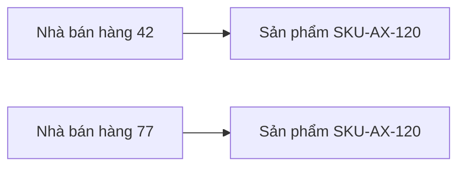

# Định danh số, UUID, khóa tự nhiên và khóa ghép

Trong một REST API, URI phải giúp client tham chiếu đúng resource qua nhiều lần gọi. Đoạn `1842` trong `/orders/1842` có thể là số tự tăng trong cơ sở dữ liệu, một mã công khai do dịch vụ cấp hoặc một khóa nghiệp vụ. Hình thức giống nhau không có nghĩa là các hợp đồng định danh giống nhau.

Bài học thuộc chương **Thiết kế URI** của module **INTEGRATION_API_REST**. Trọng tâm là chọn và biểu diễn định danh sao cho URI ổn định, hợp đồng dữ liệu rõ ràng và có thể triển khai trong Java/Spring hoặc công nghệ tương đương. Các quyết định này còn ảnh hưởng đến phân quyền, cache, idempotency và kiểm thử API.

Sau bài học, người học có thể:

- Phân biệt khóa lưu trữ, định danh công khai và khóa nghiệp vụ.
- So sánh định danh số, UUID, khóa tự nhiên và khóa ghép theo yêu cầu cụ thể.
- Thiết kế URI, quy tắc chuẩn hóa và phản hồi lỗi cho từng dạng định danh.
- Tránh dùng độ khó đoán của ID để thay thế kiểm tra quyền truy cập.
- Giữ liên kết hoạt động khi dữ liệu nghiệp vụ hoặc mô hình lưu trữ thay đổi.

## 1. Định danh là hợp đồng về danh tính resource

Xét một đơn hàng có dữ liệu nội bộ như sau:

```text
database_id = 1842
public_id   = 8c8f0a62-d1b7-4b85-9aa4-2a2c6f2e7b31
order_no    = DH-2026-01842
```

Ba giá trị phục vụ ba mục đích khác nhau:

| Khái niệm | Vai trò | Có nhất thiết xuất hiện trong URI? |
| --- | --- | --- |
| Khóa lưu trữ | Liên kết bản ghi, tạo khóa ngoại, phục vụ truy vấn | Không |
| Định danh công khai | Tham chiếu resource trong API và các tích hợp | Thường có |
| Khóa nghiệp vụ | Tra cứu, đối soát, hiển thị cho người dùng | Tùy độ ổn định và phạm vi duy nhất |

Một thiết kế có thể chọn:

```http
GET /orders/8c8f0a62-d1b7-4b85-9aa4-2a2c6f2e7b31
```

```json
{
  "id": "8c8f0a62-d1b7-4b85-9aa4-2a2c6f2e7b31",
  "orderNumber": "DH-2026-01842",
  "status": "PENDING"
}
```

`database_id` không cần xuất hiện trong response. Đổi từ một bảng sang nhiều bảng hoặc chuyển hệ quản trị cơ sở dữ liệu không bắt buộc phải đổi URI công khai.

Tách hai loại ID cũng có chi phí: cần cột và chỉ mục bổ sung, ràng buộc duy nhất và bước ánh xạ khi truy vấn. Với một hệ thống nhỏ, ID số nội bộ có thể dùng trực tiếp nếu đáp ứng hợp đồng lâu dài. Tách ID là một lựa chọn kiến trúc, không phải điều kiện để API được gọi là REST.

### 1.1. Bốn câu hỏi trước khi chọn kiểu ID

1. **Duy nhất trong phạm vi nào?** Toàn dịch vụ, trong một tenant hay trong một resource cha?
2. **Có thay đổi không?** Đổi tên, chuyển chủ sở hữu hoặc sửa sai nghiệp vụ có làm đổi ID không?
3. **Ai cấp ID?** Một cơ sở dữ liệu trung tâm, nhiều dịch vụ hay client?
4. **Phải duy trì tham chiếu bao lâu?** Chỉ trong một phiên làm việc hay qua nhiều năm tích hợp?

Trong API nhiều tenant, `invoiceNumber = 1001` có thể lặp lại ở hai tenant. Khi đó, chỉ `1001` chưa đủ xác định hóa đơn. Phạm vi tenant phải được thể hiện bằng URI hoặc một ngữ cảnh được xác định rõ và được xác thực.

### 1.2. ID nên được client coi là opaque

Opaque nghĩa là client lưu và gửi lại nguyên giá trị, không suy ra quy tắc nghiệp vụ từ cấu trúc bên trong. Nếu ID là `1842`, client không nên tự tạo ID tiếp theo bằng `1842 + 1`. Nếu ID có dạng UUID, client không nên suy ra thời điểm tạo hay quyền sở hữu từ các ký tự của nó.

Tính opaque không có nghĩa là không có cú pháp. API vẫn cần công bố hình thức hợp lệ để client truyền đúng, nhưng không nên yêu cầu client hiểu thuật toán cấp ID.

## 2. Định danh số: đơn giản nhưng cần hợp đồng rõ ràng

Ví dụ:

```http
GET /orders/1842
GET /customers/926
```

Định danh số thường xuất phát từ sequence hoặc cột tự tăng. Trong một nơi cấp số được kiểm soát, nó ngắn, dễ đọc trong log và thuận tiện khi tra cứu thủ công.

### 2.1. Ưu điểm và giới hạn

- Nhỏ gọn, thuận tiện cho thao tác hỗ trợ vận hành.
- Thường phù hợp với khóa chính số nguyên đã có trong mô hình lưu trữ.
- Cần cơ chế cấp số phù hợp nếu nhiều nơi tạo dữ liệu độc lập.
- Dễ bị thử tuần tự; có thể hé lộ xu hướng về số lượng hoặc thứ tự cấp mã.
- Không đảm bảo liên tục: rollback, xóa bản ghi hoặc cấp trước một khoảng số đều có thể tạo khoảng trống.

Số lớn hơn không mặc nhiên có nghĩa là đơn hàng hoàn thành muộn hơn. Thứ tự cấp ID và thứ tự commit hoặc xử lý nghiệp vụ có thể khác nhau. Khi cần sắp xếp theo thời gian, hợp đồng phải có trường thời gian và quy tắc sắp xếp riêng.

### 2.2. Định nghĩa cú pháp ngay từ đầu

Một hợp đồng cho ID số dương có thể quy định:

```text
Cú pháp: [1-9][0-9]*
Phạm vi: 1 đến 9223372036854775807
Dạng chuẩn: không có dấu +, dấu -, khoảng trắng hoặc số 0 ở đầu
```

Theo hợp đồng này:

| Đường dẫn | Diễn giải |
| --- | --- |
| `/orders/1842` | ID đúng cú pháp |
| `/orders/001842` | Sai dạng chuẩn |
| `/orders/+1842` | Sai cú pháp |
| `/orders/0` | Ngoài miền ID đã quy định |
| `/orders/99999999999999999999999` | Vượt phạm vi hỗ trợ |

Đây là quy ước của API minh họa. Có hệ thống chấp nhận `0` hoặc số 0 ở đầu; điều quan trọng là công bố và áp dụng nhất quán. Nếu `001842` khác `1842` trong nghiệp vụ, giá trị đó nên được xem là mã chuỗi, không phải số để tính toán.

Không chỉ kiểm tra biểu thức chính quy. Một chuỗi chỉ gồm chữ số vẫn có thể vượt miền của kiểu `long`; cần xử lý lỗi chuyển đổi trước khi gọi tầng dữ liệu.

### 2.3. ID số trong URI và JSON

Path parameter luôn được truyền dưới dạng văn bản trên đường dẫn. Vấn đề mất chính xác thường xuất hiện khi ID lớn được đưa vào JSON dạng number rồi client xử lý bằng kiểu số không đủ chính xác.

Ví dụ, JavaScript `Number` chỉ biểu diễn chính xác mọi số nguyên trong miền an toàn đến `9007199254740991`. Java `long` có miền lớn hơn. Vì ID không phải đại lượng để cộng trừ, API có thể thống nhất trả ID dưới dạng chuỗi:

```json
{
  "id": "9223372036854775806"
}
```

Khi chọn cách này, hợp đồng dữ liệu cũng phải khai báo `id` là chuỗi. Không trả số ở endpoint này và chuỗi ở endpoint khác cho cùng một loại resource.

## 3. UUID: cấp ID phân tán với đánh đổi về độ dài

Ví dụ một UUID dạng văn bản:

```text
8c8f0a62-d1b7-4b85-9aa4-2a2c6f2e7b31
```

```http
GET /orders/8c8f0a62-d1b7-4b85-9aa4-2a2c6f2e7b31
```

UUID có giá trị 128 bit, thường được trình bày thành 36 ký tự gồm các nhóm chữ số hệ mười sáu và dấu gạch nối. Nó cho phép nhiều nơi tạo ID mà không cần xin từng số từ cùng một sequence trung tâm.

### 3.1. Khi nào UUID có ích?

- Nhiều node hoặc dịch vụ cần tạo resource độc lập.
- Cần cấp định danh trước khi lưu bản ghi.
- Cần hợp nhất dữ liệu từ nhiều nguồn mà ít phụ thuộc vào bộ đếm chung.
- Muốn tránh lộ trực tiếp một bộ đếm công khai.

UUID ngẫu nhiên có xác suất trùng rất thấp khi được tạo đúng, nhưng xác suất thấp không phải bảo đảm tuyệt đối. Vẫn cần ràng buộc duy nhất trong nơi lưu trữ và cách xử lý lỗi trùng phù hợp.

Một ví dụ tạo UUID trong Java:

```java
import java.util.UUID;

UUID publicId = UUID.randomUUID();
String pathSegment = publicId.toString();
```

`UUID.randomUUID()` tạo UUID ngẫu nhiên phiên bản 4. Ví dụ này không yêu cầu client biết phiên bản hoặc tự tạo UUID. Quyền cấp ID vẫn thuộc hợp đồng API.

### 3.2. UUID không tự động nhanh hơn hoặc an toàn hơn

UUID dài hơn ID số, khó đọc qua điện thoại và chiếm nhiều dung lượng hơn trong log hoặc chỉ mục nếu lưu theo dạng chuỗi. Chèn UUID ngẫu nhiên vào một số kiểu chỉ mục có thể kém thuận lợi về tính cục bộ so với khóa tăng dần. Hiệu năng thực tế còn phụ thuộc cơ sở dữ liệu, kiểu cột, chỉ mục và tải ghi; cần đo trên hệ thống cụ thể.

Có thể dùng khóa số nội bộ cho quan hệ dữ liệu và UUID làm định danh công khai. Cũng có thể dùng UUID trực tiếp làm khóa chính. Không thể chọn chỉ bằng việc nhìn hình thức URI.

UUID khó đoán hơn số tự tăng, nhưng người dùng vẫn có thể biết UUID của resource khác qua log, liên kết được chia sẻ hoặc dữ liệu bị lộ. Mọi lần truy cập vẫn phải kiểm tra quyền trên đúng resource.

### 3.3. Quy định một dạng chuẩn

Ví dụ hợp đồng chọn UUID chữ thường có dấu gạch nối:

```text
xxxxxxxx-xxxx-xxxx-xxxx-xxxxxxxxxxxx
x thuộc 0-9 hoặc a-f
```

Cần quyết định rõ cách xử lý chữ hoa, dạng không có gạch nối và khoảng trắng. Không nên để một tầng chấp nhận dạng này trong khi gateway, cache và tầng ứng dụng hiểu theo dạng khác.

Một cách đơn giản là chỉ nhận dạng chuẩn. Cách khác là nhận một số biến thể rồi chuyển về URI chuẩn theo chính sách đã công bố. Với request làm thay đổi dữ liệu, không nên dựa vào một redirect chưa được thiết kế và kiểm thử để sửa đường dẫn cho client.

Đối với parser có thể nhận đầu vào rộng hơn hợp đồng, cần kiểm tra hình thức văn bản trước khi parse. Parse được không đồng nghĩa với đúng cú pháp công khai đã hứa với client.

## 4. Khóa tự nhiên: gần nghiệp vụ nhưng dễ kéo theo thay đổi

Khóa tự nhiên là thuộc tính hoặc tổ hợp thuộc tính có ý nghĩa trong miền nghiệp vụ và có thể dùng để phân biệt đối tượng. Ví dụ gồm mã quốc gia, tên đăng nhập, mã sản phẩm do tổ chức quản lý hoặc mã sân bay.

```http
GET /countries/VN
GET /products/SKU-AX-120
```

Một giá trị chỉ là tên gọi quen thuộc chưa chắc đã là khóa. Muốn dùng làm định danh, nó phải duy nhất trong phạm vi đã chọn và có quy tắc vòng đời rõ ràng.

### 4.1. Ba rủi ro cần kiểm tra

**Khả năng thay đổi.** Người dùng có thể đổi email hoặc username. Doanh nghiệp có thể đổi quy ước SKU. Nếu URI chứa trực tiếp giá trị đó, tất cả tham chiếu cũ cần được xử lý khi giá trị thay đổi.

**Phạm vi duy nhất.** SKU có thể duy nhất trong một nhà bán hàng, nhưng trùng giữa hai nhà bán hàng. Mã nhân viên có thể lặp lại giữa các công ty hoặc được cấp lại sau nhiều năm.

**Chuẩn hóa.** `abc`, `ABC` và ` abc ` có phải cùng một khóa không? Dấu, Unicode, khoảng trắng và quy tắc so sánh trong cơ sở dữ liệu có thống nhất với API không?

Không nên tự động viết thường mọi khóa. Với một số miền, chữ hoa và chữ thường là một phần của giá trị. Quy tắc phải do nghiệp vụ và hợp đồng dữ liệu quyết định.

### 4.2. Tách tra cứu theo nghiệp vụ khỏi URI chuẩn

Nếu email có thể đổi, nên dùng ID ổn định làm URI chính:

```http
GET /users/8c8f0a62-d1b7-4b85-9aa4-2a2c6f2e7b31
```

Thao tác tìm theo email có thể là truy vấn trên collection, nếu chính sách truy cập cho phép:

```http
GET /users?email=lan%40example.com
```

Endpoint collection vẫn trả cấu trúc danh sách theo hợp đồng, kể cả khi chỉ có tối đa một kết quả. Không nên lúc trả mảng, lúc trả một object chỉ vì bộ lọc hiện tại khớp đúng một người dùng.

Email là dữ liệu cá nhân và không phải bí mật. Đưa email vào path hoặc query đều có thể khiến nó xuất hiện trong access log, lịch sử hoặc hệ thống quan sát. HTTPS không tự loại bỏ việc ghi lại URL ở các thành phần được phép xem request. Với tra cứu nhạy cảm, cần chọn giao diện và chính sách logging phù hợp; không chuyển dữ liệu giữa path và query rồi coi như đã giải quyết vấn đề.

### 4.3. Slug không luôn là định danh bền vững

```http
GET /articles/thiet-ke-rest-api
```

Slug giúp đọc URI nhưng có thể đổi theo tiêu đề và có thể trùng. Nếu bài viết cần liên kết lâu dài, có thể chọn ID ổn định làm định danh và để slug là thuộc tính hiển thị. Nếu dùng URI chứa cả ID và slug, phải xác định ID là phần quyết định danh tính, cách xử lý slug cũ và URI chuẩn được trả về.

Đổi khóa tự nhiên rồi cấp lại khóa cũ cho đối tượng khác là tình huống đặc biệt nguy hiểm: một liên kết cũ có thể dẫn đến một người dùng hoặc sản phẩm mới. Hợp đồng cần nêu việc có tái sử dụng khóa hay giữ alias hoặc tombstone cho khóa đã ngừng dùng.

## 5. Khóa ghép: danh tính phụ thuộc nhiều thành phần

Khóa ghép gồm từ hai thành phần trở lên. Các thành phần có thể là khóa tự nhiên, khóa thay thế hoặc hỗn hợp. Đây là cách tổ chức danh tính, không phải một kiểu ký tự đối lập với số hay UUID.

Ví dụ, SKU chỉ duy nhất trong một nhà bán hàng:

```text
(sellerId, sku)
```

Một URI phù hợp có thể là:

```http
GET /sellers/42/products/SKU-AX-120
```

Đơn hàng có dòng hàng được đánh số trong phạm vi đơn:

```http
GET /orders/1842/lines/3
```

Hai dòng hàng `(1842, 3)` và `(1900, 3)` là hai resource khác nhau. Giá trị `3` không định danh duy nhất dòng hàng trên toàn hệ thống.

### 5.1. Path lồng nhau diễn tả phạm vi sở hữu



Cùng SKU nhưng hai nhà bán hàng tạo ra hai danh tính khác nhau. Tầng dữ liệu nên có ràng buộc duy nhất tương ứng, chẳng hạn `UNIQUE(seller_id, sku)`.

Khi xử lý `/sellers/42/products/SKU-AX-120`, truy vấn và kiểm tra quyền phải ràng buộc cả hai thành phần. Không chỉ tìm theo SKU rồi bỏ qua `sellerId` trên đường dẫn.

### 5.2. Không nối chuỗi tùy tiện

Thiết kế sau cần một quy tắc phân tách bổ sung:

```http
GET /products/42-SKU-AX-120
```

Nếu một thành phần được phép chứa dấu phân tách, việc tách ngược trở nên dễ sai. Với phép nối không có quy tắc, `(ab-c, d)` và `(ab, c-d)` đều có thể thành `ab-c-d`.

Có ba hướng thường dùng:

| Hướng | Ví dụ | Khi phù hợp |
| --- | --- | --- |
| Tách thành các path segment | `/sellers/42/products/SKU-AX-120` | Quan hệ phạm vi là một phần tự nhiên của danh tính |
| Cấp ID công khai độc lập | `/products/8c8f0a62-d1b7-4b85-9aa4-2a2c6f2e7b31` | Cần tham chiếu toàn cục và ít phụ thuộc vào cấu trúc cha |
| Mã hóa tuple thành một token | `/memberships/{membershipKey}` | Có nhu cầu cụ thể và một codec được quy định, kiểm thử rõ ràng |

Token mã hóa không mặc nhiên là mã hóa bảo mật. Base64 hoặc cách ghép có thể giải mã chỉ giải quyết biểu diễn; nó không tạo quyền truy cập và cũng không thay thế ràng buộc duy nhất.

### 5.3. Kiểm tra tính ổn định của resource cha

Nếu sản phẩm chuyển từ nhà bán hàng `42` sang `77`, URI lồng nhau có thay đổi không? Có hai mô hình khác nhau:

- Sản phẩm là một resource độc lập, có thể đổi nhà bán hàng: ID công khai riêng thường giúp giữ URI ổn định.
- Resource thực chất là một mặt hàng do một nhà bán hàng chào bán: đổi nhà bán hàng có thể tạo resource chào bán mới.

Độ sâu của path phải phản ánh danh tính nghiệp vụ. Không cần đưa toàn bộ quan hệ cơ sở dữ liệu vào URI như `/regions/1/companies/2/departments/3/users/4/orders/5` nếu chỉ `orderId` đã đủ và các cấp cha không thuộc danh tính của đơn hàng.

## 6. Bảng lựa chọn theo yêu cầu thực tế

| Tiêu chí | Số được cấp tập trung | UUID ngẫu nhiên | Khóa tự nhiên | Khóa ghép |
| --- | --- | --- | --- | --- |
| Độ ngắn, dễ đọc | Thường thuận tiện | Dài, khó đọc thủ công | Tùy giá trị nghiệp vụ | Tăng theo số thành phần |
| Tạo độc lập ở nhiều nơi | Cần thiết kế cấp số | Thuận tiện | Phụ thuộc quy tắc nghiệp vụ | Phụ thuộc từng thành phần |
| Giữ ổn định khi đổi thuộc tính | Tốt nếu không tái cấp | Tốt nếu không tái cấp | Có thể khó | Phụ thuộc độ ổn định của mọi thành phần |
| Ý nghĩa nghiệp vụ | Thường ít | Thường ít | Rõ | Có thể thể hiện phạm vi |
| Bảo mật truy cập | Phải kiểm tra quyền | Phải kiểm tra quyền | Phải kiểm tra quyền | Phải kiểm tra quyền trên đủ phạm vi |
| Ràng buộc dữ liệu | Duy nhất trong phạm vi cấp số | Ràng buộc duy nhất cho UUID | Duy nhất theo cách chuẩn hóa đã chọn | Duy nhất trên cả tuple |

Không có một kiểu ID tối ưu cho mọi resource trong cùng dịch vụ. Chẳng hạn, mã quốc gia có thể là khóa tự nhiên thích hợp, đơn hàng dùng UUID công khai và dòng hàng dùng khóa ghép `(orderId, lineNumber)`.

Một thứ tự quyết định hữu ích là: xác định danh tính nghiệp vụ, xác định phạm vi duy nhất, kiểm tra tính ổn định, sau đó mới chọn biểu diễn số hay chuỗi và cách tạo ID.

## 7. URI chuẩn, ký tự đặc biệt và route không mơ hồ

### 7.1. Mỗi thành phần có một cách biểu diễn rõ ràng

Nếu khóa tự nhiên chứa `/`, `?`, `#`, `%` hoặc khoảng trắng, không thể chèn nguyên giá trị vào đường dẫn rồi mong router hiểu nó là một segment duy nhất.

- `/` phân chia path segment.
- `?` bắt đầu query.
- `#` bắt đầu fragment; phần fragment không được gửi trong HTTP request target tới server.
- `%` tham gia biểu diễn percent-encoding.

Client phải dùng công cụ tạo URI để mã hóa đúng từng thành phần, không mã hóa cả URL như một chuỗi dữ liệu. Không decode nhiều lần ở các tầng khác nhau.

Ngay cả khi dấu `/` trong giá trị được biểu diễn thành `%2F`, gateway hoặc server có thể từ chối hay chuẩn hóa nó trước khi controller nhận được request. Nếu khóa nghiệp vụ cần chứa những ký tự gây khó cho routing, cân nhắc dùng ID công khai khác hoặc một endpoint tra cứu có hợp đồng rõ ràng. Quyết định phải được kiểm tra trên cả chuỗi proxy, gateway và ứng dụng.

### 7.2. Tránh hai namespace dùng cùng một route

Giả sử API vừa nhận UUID vừa nhận username qua cùng một mẫu:

```http
GET /users/{idOrUsername}
```

Nếu username có thể mang hình thức UUID, server không còn biết chắc client muốn tra cứu theo loại nào. Dù hiện tại không trùng, quy tắc đoán từ hình thức tạo ra một ràng buộc ngầm lên dữ liệu tương lai.

Một thiết kế rõ hơn:

```http
GET /users/{userId}
GET /users?username=lan
```

Nếu chọn một route tra cứu riêng như `/users/by-username/{username}`, cần công bố namespace đó và giải quyết từ khóa dành riêng. Tương tự, `/users/me` phải là một route được định nghĩa rõ, không để username `me` vô tình tranh chấp với định danh người dùng hiện tại.

### 7.3. Tính nhất quán giúp cache và liên kết ổn định

`/orders/1842`, `/orders/001842` và một alias cũ có thể tạo nhiều khóa cache hoặc nhiều liên kết cho cùng resource nếu hệ thống chấp nhận tất cả. Điều đó làm phức tạp việc vô hiệu hóa cache và đối chiếu log.

API nên trả URI chuẩn khi tạo resource và sử dụng cùng dạng ID trong response, liên kết và tài liệu. Không dùng dạng ID khác nhau chỉ vì một endpoint đi qua bảng dữ liệu khác. URI chuẩn cũng không tự quyết định response có được cache chia sẻ hay không; chính sách cache còn phải xét thông tin người dùng và quyền truy cập.

## 8. Tạo resource, định danh và idempotency

Khi server cấp ID:

```http
POST /orders
Content-Type: application/json

{
  "customerId": "6f9619ff-8b86-4e2d-a49b-828c242b2d65",
  "items": [
    {"productId": "SKU-AX-120", "quantity": 2}
  ]
}
```

```http
HTTP/1.1 201 Created
Location: /orders/8c8f0a62-d1b7-4b85-9aa4-2a2c6f2e7b31
Content-Type: application/json

{
  "id": "8c8f0a62-d1b7-4b85-9aa4-2a2c6f2e7b31",
  "orderNumber": "DH-2026-01842",
  "status": "PENDING"
}
```

`Location` và `id` phải tham chiếu cùng resource. Khóa nghiệp vụ như `orderNumber` có thể được cấp theo quy trình riêng.

Nếu client gửi lại `POST` vì không nhận được response, việc server dùng UUID không ngăn tạo hai đơn hàng với hai UUID khác nhau. ID resource và khóa chống lặp request là hai khái niệm riêng:

| Giá trị | Xác định điều gì? | Vòng đời điển hình |
| --- | --- | --- |
| Resource ID | Resource nào đang được tham chiếu | Gắn với vòng đời resource |
| Khóa idempotency | Lần yêu cầu nghiệp vụ nào đang được gửi lại | Theo phạm vi và thời gian lưu chống lặp đã công bố |
| Khóa nghiệp vụ | Đối tượng hoặc chứng từ trong nghiệp vụ | Theo quy tắc nghiệp vụ |

Cho phép client tự chọn ID, chẳng hạn qua `PUT /orders/{clientChosenId}`, cần hợp đồng về quyền tạo, nội dung thay thế và xử lý xung đột. Không thể suy ra rằng `PUT` phù hợp chỉ vì client có thể tạo UUID.

## 9. Kiểm tra ID và trả lỗi có chủ đích

Một luồng xử lý tham khảo:

1. Xác thực caller theo chính sách endpoint.
2. Kiểm tra hình thức và phạm vi của ID.
3. Xác định resource trong đúng tenant hoặc resource cha.
4. Kiểm tra quyền thao tác trên resource.
5. Trả representation hoặc lỗi theo chính sách công bố.

Thứ tự cụ thể có thể được tích hợp ở gateway, bộ lọc bảo mật và tầng dịch vụ. Điểm cốt lõi là không tra cứu sai phạm vi và không bỏ qua kiểm tra quyền chỉ vì ID hợp lệ.

| Tình huống | Phản hồi trong hợp đồng minh họa |
| --- | --- |
| UUID không đúng dạng chuẩn hoặc ID số vượt phạm vi | `400 Bad Request` |
| ID hợp lệ nhưng không có resource trong phạm vi truy cập | `404 Not Found` |
| Caller đã xác thực nhưng không được phép thao tác | `403 Forbidden`, hoặc `404` theo chính sách che giấu sự tồn tại |
| Tạo mới với khóa nghiệp vụ hoặc khóa ghép bị trùng | `409 Conflict` nếu API định nghĩa đây là xung đột trạng thái |

Bảng này là lựa chọn hợp đồng, không mô tả hành vi tự động của mọi framework. Nếu route chỉ khớp chữ số, `/orders/abc` có thể không khớp route và trả `404` trước khi tới controller. Nếu muốn trả `400` cho ID sai cú pháp, thiết kế routing và xử lý lỗi phải thực hiện được điều đó.

Không trả stack trace, câu SQL hoặc tên cột khóa chính trong lỗi công khai. Cũng không nói chi tiết rằng một ID thuộc tenant khác nếu chính sách bảo mật không cho phép tiết lộ.

Với URI ghép, cần kiểm tra cả trường hợp thành phần con tồn tại dưới một cha khác. Ví dụ `/orders/1842/lines/3` phải truy vấn dòng số `3` thuộc đơn `1842`, không phải bất kỳ dòng nào có số `3`.

## 10. Ví dụ Java/Spring: ID công khai có kiểu và parser riêng

Ví dụ dưới đây chọn hợp đồng UUID chữ thường có dấu gạch nối. Mục tiêu là tách việc kiểm tra hình thức ID khỏi việc tìm resource và kiểm tra quyền. Các đoạn mã minh họa cách tích hợp; không phải một ứng dụng Spring hoàn chỉnh.

### 10.1. Biểu diễn ID bằng một kiểu riêng

```java
import java.util.Objects;
import java.util.UUID;
import java.util.regex.Pattern;

public record OrderId(UUID value) {
    private static final Pattern CANONICAL = Pattern.compile(
        "[0-9a-f]{8}-[0-9a-f]{4}-[0-9a-f]{4}-"
        + "[0-9a-f]{4}-[0-9a-f]{12}"
    );

    public OrderId {
        Objects.requireNonNull(value, "value");
    }

    public static OrderId parse(String raw) {
        if (raw == null || !CANONICAL.matcher(raw).matches()) {
            throw new IllegalArgumentException("Invalid order ID");
        }
        return new OrderId(UUID.fromString(raw));
    }

    public String asPathSegment() {
        return value.toString();
    }
}
```

`matches()` kiểm tra toàn bộ chuỗi. Parser không tự `trim()` hay đổi chữ hoa thành chữ thường vì hợp đồng ví dụ chỉ nhận dạng chuẩn. Biểu thức trên kiểm tra hình thức chung của UUID; nó không buộc client phải cung cấp một phiên bản UUID cụ thể. Nếu API có giới hạn phiên bản hoặc cấm một giá trị đặc biệt, cần bổ sung kiểm tra tương ứng.

Một kiểu `OrderId` riêng giúp tránh truyền nhầm UUID của loại resource khác trong mã Java. Nó không tự chứng minh rằng ID tồn tại hoặc caller có quyền đọc.

### 10.2. Controller chuyển lỗi cú pháp thành lỗi API

```java
import java.util.Optional;
import org.springframework.http.HttpStatus;
import org.springframework.web.bind.annotation.GetMapping;
import org.springframework.web.bind.annotation.PathVariable;
import org.springframework.web.bind.annotation.RequestMapping;
import org.springframework.web.bind.annotation.RestController;
import org.springframework.web.server.ResponseStatusException;

@RestController
@RequestMapping("/orders")
class OrderController {
    private final OrderReader orderReader;

    OrderController(OrderReader orderReader) {
        this.orderReader = orderReader;
    }

    @GetMapping("/{orderId}")
    OrderView get(@PathVariable("orderId") String rawId) {
        final OrderId orderId;
        try {
            orderId = OrderId.parse(rawId);
        } catch (IllegalArgumentException invalidId) {
            throw new ResponseStatusException(
                HttpStatus.BAD_REQUEST, "Invalid order ID"
            );
        }

        return orderReader.findVisibleToCurrentCaller(orderId)
            .orElseThrow(() -> new ResponseStatusException(
                HttpStatus.NOT_FOUND, "Order not found"
            ));
    }
}

interface OrderReader {
    Optional<OrderView> findVisibleToCurrentCaller(OrderId orderId);
}

record OrderView(String id, String orderNumber, String status) {}
```

`OrderReader` cần có implementation và được đăng ký làm bean trong ứng dụng thật. Contract của phương thức yêu cầu tầng dịch vụ sử dụng ngữ cảnh caller đã xác thực, giới hạn tenant và kiểm tra quyền. Tên phương thức không thay thế việc triển khai những kiểm tra đó. Ví dụ chọn `404` cho resource không tìm thấy trong phạm vi được phép nhìn thấy.

Khi ánh xạ dữ liệu thành `OrderView`, giá trị `id` phải lấy từ ID công khai, chẳng hạn `orderId.asPathSegment()`. Không vô tình dùng khóa số nội bộ chỉ vì entity cũng có thuộc tính tên `id`.

Parser này có thể tái sử dụng trong controller, bộ chuyển đổi tham số hoặc lớp biên của ứng dụng. Không nên rải nhiều phiên bản kiểm tra UUID khác nhau ở các endpoint.

### 10.3. Hợp đồng dữ liệu cần mô tả hơn tên kiểu

Khi đưa ID vào OpenAPI hoặc tài liệu API, cần ghi rõ:

- Path parameter là bắt buộc, có kiểu chuỗi và có ý nghĩa định danh đơn hàng.
- Dạng văn bản được chấp nhận, ví dụ UUID chữ thường có dấu gạch nối.
- Ví dụ giá trị đúng và phản hồi khi sai cú pháp.
- Tính duy nhất, khả năng thay đổi và việc server hay client cấp ID.
- Quan hệ giữa ID trong path, `id` trong response và `Location` khi tạo.

Một khai báo `format: uuid` giúp công cụ hiểu loại dữ liệu, nhưng không thay thế parser và kiểm tra ở server. Mô tả cũng phải khớp với chính sách thực tế, chẳng hạn việc chấp nhận chữ hoa hoặc giới hạn phiên bản.

## 11. Giữ ổn định định danh khi hệ thống thay đổi

### 11.1. Đổi khóa nghiệp vụ

Giả sử sản phẩm có `publicId` cố định và SKU được đổi từ `SKU-OLD` thành `SKU-NEW`. Nếu URI chính dùng `publicId`, client vẫn truy cập cùng resource. API chỉ cập nhật thuộc tính `sku` và quy tắc tra cứu theo SKU.

Nếu URI chính dùng SKU, cần quyết định cách xử lý liên kết cũ: giữ alias, redirect phù hợp, ngừng hỗ trợ có thông báo hay trả lỗi. Nếu alias được giữ, phải xác định thời hạn và tránh cấp SKU cũ cho sản phẩm khác trong thời gian đó.

### 11.2. Chuyển từ ID số công khai sang UUID

Không chỉ đổi kiểu cột rồi trả UUID trong response. Client có thể đang lưu URI số trong dữ liệu tích hợp, webhook, công việc nền hoặc tài liệu đối soát.

Một kế hoạch chuyển đổi có thể gồm:

1. Cấp UUID công khai và lưu ánh xạ một-một với các resource hiện có.
2. Duy trì các URI số theo hợp đồng tương thích trong giai đoạn chuyển tiếp.
3. Trả URI chuẩn mới qua response và liên kết được công bố.
4. Cập nhật tài liệu, SDK và các luồng tích hợp có lưu định danh.
5. Chỉ dừng URI cũ sau chính sách ngừng hỗ trợ đã thông báo.

Nếu chấp nhận hai dạng ID trên cùng một route, phải có quy tắc phân biệt không mơ hồ và không gây xung đột với các route khác. Dùng alias là một quyết định tương thích cần thiết kế, không phải lý do để mọi endpoint được tùy ý phát ra định danh khác nhau.

### 11.3. Không tái sử dụng ID ổn định

Sau khi một đơn hàng bị xóa, không nên cấp lại ID của nó cho đơn hàng khác. Các tham chiếu cũ, cache và sự kiện lưu trữ có thể khiến client hiểu nhầm đối tượng mới là đối tượng cũ.

Khi nhập dữ liệu hoặc khôi phục từ bản sao, cần giữ các ràng buộc duy nhất và ánh xạ ID. Tránh tái tạo toàn bộ public ID một cách tùy tiện, vì đó là thay đổi danh tính đối với các client đang tham chiếu chúng.

## 12. Áp dụng vào một thiết kế cụ thể

Giả sử hệ thống có nhiều nhà bán hàng, mỗi nhà bán hàng quản lý SKU riêng; đơn hàng được tạo trên nhiều node; mã đơn phải dễ đọc cho nhân viên hỗ trợ.

Một phương án có thể là:

| Resource hoặc thuộc tính | Quyết định | Lý do |
| --- | --- | --- |
| Đơn hàng | UUID công khai, URI `/orders/{orderId}` | Có thể cấp ID ở nhiều node, ít gắn với mô hình lưu trữ |
| Mã đơn hiển thị | `orderNumber` trong representation | Phục vụ đối soát, không ép client phân tích nó như ID |
| Sản phẩm do nhà bán hàng chào bán | `(sellerId, sku)` nếu quan hệ này ổn định | SKU chỉ duy nhất trong phạm vi nhà bán hàng |
| Sản phẩm độc lập có thể đổi nhà bán hàng | Public ID riêng | Giữ URI ổn định khi quan hệ nghiệp vụ thay đổi |
| Dòng đơn hàng | `(orderId, lineNumber)` nếu số dòng không thay đổi | Danh tính có phạm vi trong đơn |
| Quốc gia | Mã nghiệp vụ như `VN` | Ngắn, có ý nghĩa và có phạm vi được xác định rõ |

Với số dòng đơn hàng, cần phân biệt số định danh với thứ tự hiển thị. Nếu xóa dòng số `2` rồi đánh lại số tất cả dòng, URI `/orders/{orderId}/lines/3` có thể trỏ sang dòng khác. Khi thứ tự có thể đổi, dùng ID dòng ổn định và một trường `position` riêng, hoặc quy định số định danh không bị đánh lại.

Các tình huống cần xác minh khi triển khai hợp đồng định danh gồm: ID sai cú pháp, ID số vượt miền, UUID không đúng dạng chuẩn, resource không tồn tại, cùng khóa con ở hai cha, truy cập chéo tenant và liên kết cũ sau khi đổi khóa nghiệp vụ. Với trường hợp số lớn, cần kiểm tra cả client để phát hiện mất chính xác khi đọc JSON. Các trường hợp này kiểm chứng hành vi API, không chỉ khả năng parser chuyển được chuỗi thành một giá trị.

Quyết định tốt bắt đầu từ câu hỏi resource nào phải giữ nguyên danh tính qua thời gian. Sau đó mới chọn số, UUID, khóa nghiệp vụ hay tuple để biểu diễn danh tính ấy, rồi thống nhất URI, hợp đồng dữ liệu, ràng buộc duy nhất và kiểm tra quyền theo cùng một quyết định.
