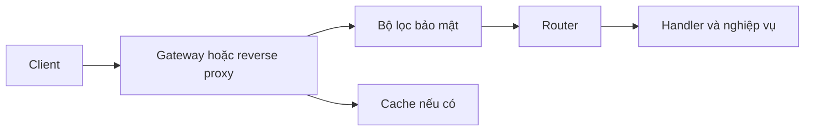

# Phân biệt dấu gạch chéo cuối, chữ hoa thường và quy tắc định tuyến

Trong chương **Thiết kế URI** của module **INTEGRATION_API_REST**, một đường dẫn dễ đọc mới chỉ là điểm khởi đầu. API còn cần quy định chính xác `/products` khác `/products/` thế nào, chữ hoa có được chấp nhận hay không và request nào khớp với route nào. Các quyết định này ảnh hưởng trực tiếp đến hợp đồng API, cache, liên kết, phân quyền và khả năng kiểm thử.

Bài học sử dụng một API danh mục sản phẩm để xây dựng chính sách URI có thể triển khai bằng Java/Spring hoặc công nghệ tương đương. Sau bài học, bạn có thể:

- Phân biệt quy tắc so sánh URI với quy tắc định tuyến của ứng dụng.
- Chọn cách xử lý dấu `/` cuối và chữ hoa thường một cách nhất quán.
- Thiết kế route cố định, route có tham số và giới hạn định dạng ID.
- Nhận diện các lỗi do chuyển hướng hoặc chuẩn hóa đường dẫn giữa nhiều tầng.
- Viết tiêu chí kiểm thử để xác nhận URI công khai hoạt động đúng hợp đồng.

## 1. URI công khai và route của ứng dụng

Xét URI sau:

```text
https://api.example.com/api/v1/products/p_AbC42?sort=name#details
└─ scheme ─┘└── host ───┘└──────── path ─────────────┘└ query ┘└fragment┘
```

Các thành phần có vai trò khác nhau:

| Thành phần | Ví dụ | Ý nghĩa khi xử lý request |
|---|---|---|
| Scheme | `https` | Giao thức truy cập; được xử lý ở tầng kết nối hoặc proxy |
| Host | `api.example.com` | Máy chủ hoặc virtual host nhận request |
| Path | `/api/v1/products/p_AbC42` | Đường dẫn dùng để tìm endpoint và lấy tham số đường dẫn |
| Query | `sort=name` | Tham số của thao tác, thường dùng để lọc, sắp xếp hoặc phân trang |
| Fragment | `details` | Thông tin cho phía client; fragment không được gửi trong HTTP request tới server |

Với HTTP/1.1 thông thường, request đến origin có thể được biểu diễn như sau:

```http
GET /api/v1/products/p_AbC42?sort=name HTTP/1.1
Host: api.example.com
```

Router không nhất thiết chỉ nhìn path. Một endpoint có thể được chọn theo tổ hợp:

```text
host + HTTP method + path pattern + điều kiện query/header/media type
```

Ví dụ, `GET /products` và `POST /products` có cùng path nhưng thực hiện hai thao tác khác nhau. Trong Spring, điều kiện như `params`, `headers`, `consumes` và `produces` cũng có thể tham gia chọn handler nếu được khai báo.

Hai URI khác nhau vẫn có thể được server ánh xạ đến cùng một tài nguyên. Tuy nhiên, việc hai URI đang trả cùng JSON không tự chứng minh rằng mọi client, cache hoặc proxy sẽ coi chúng là cùng một địa chỉ.

## 2. Dấu gạch chéo cuối không tự biến endpoint thành thư mục

So sánh:

```text
/api/v1/products
/api/v1/products/
```

Đây là hai path khác nhau về mặt chuỗi. Không có quy tắc chung buộc một REST API phải coi chúng tương đương. Server có thể:

1. Chỉ chấp nhận một dạng.
2. Ánh xạ cả hai dạng đến cùng handler.
3. Chuyển hướng một dạng sang dạng chuẩn.
4. Gán hai dạng cho hai tài nguyên khác nhau, dù lựa chọn này thường gây khó hiểu cho API nghiệp vụ.

Trong nhiều web server phục vụ file, dấu `/` cuối gắn với thư mục. Cách xử lý đó không mặc nhiên áp dụng cho một API có router riêng. `/products/` không tự có nghĩa là collection, và `/products` không tự có nghĩa là một sản phẩm đơn lẻ.

Hãy phân biệt dấu `/` ngăn cách các đoạn với dấu `/` cuối đường dẫn:

```text
/api/v1/products/p_AbC42
                ↑ phân cách collection và ID

/api/v1/products/p_AbC42/
                       ↑ dấu / cuối
```

Việc bỏ dấu `/` cuối không cho phép bỏ các dấu phân cách còn lại. `/api/v1/productsp_AbC42` là một đường dẫn khác hoàn toàn.

### 2.1. Tại sao phải chọn một URI chuẩn?

Giả sử cùng một danh sách được truy cập qua cả `/products` và `/products/`:

- Client có thể lưu hai liên kết cho cùng một tài nguyên.
- Cache có thể tạo hai mục nếu khóa cache có chứa hai path khác nhau.
- Log và số liệu sử dụng có thể bị chia thành hai nhóm.
- Tài liệu OpenAPI có thể chỉ mô tả một dạng, trong khi runtime âm thầm nhận cả hai.
- Chính sách truy cập có thể kiểm tra một dạng nhưng bỏ sót dạng còn lại.

URI chuẩn, hay canonical URI, là địa chỉ mà API cam kết dùng trong tài liệu và các liên kết do server sinh ra. Việc chọn URI chuẩn giúp thu hẹp các biến thể cần hỗ trợ; tự nó không tự sửa cấu hình cache hay bảo mật.

### 2.2. Dấu `/` cuối còn ảnh hưởng đến liên kết tương đối

Xét liên kết tương đối `p_AbC42`:

| URI cơ sở | Kết quả phân giải liên kết `p_AbC42` |
|---|---|
| `https://api.example.com/api/v1/products` | `https://api.example.com/api/v1/p_AbC42` |
| `https://api.example.com/api/v1/products/` | `https://api.example.com/api/v1/products/p_AbC42` |

Khi URI cơ sở không kết thúc bằng `/`, đoạn cuối được thay thế trong quá trình phân giải liên kết tương đối. Đây là quy tắc phân giải URI, không phải quyết định route của Spring.

Nếu API phát hành liên kết trong response, hãy dùng URI tuyệt đối hoặc đường dẫn bắt đầu từ gốc như `/api/v1/products/p_AbC42` khi phù hợp với hợp đồng triển khai. Nếu dùng liên kết tương đối, phải xác định rõ URI cơ sở và kiểm thử cách phân giải. Không giả định nối chuỗi và phân giải URI luôn cho cùng kết quả.

## 3. Chữ hoa thường phải được xét theo từng thành phần

Không nên phát biểu chung rằng “URL không phân biệt chữ hoa thường”. Với URI HTTP, cần phân biệt:

| Thành phần | Cách hiểu phù hợp |
|---|---|
| Scheme | Không phân biệt chữ hoa thường; `HTTPS` và `https` có cùng ý nghĩa |
| Host dạng tên miền | Không phân biệt chữ hoa thường; `API.EXAMPLE.COM` và `api.example.com` chỉ cùng host |
| Path | Không được mặc định coi hai biến thể hoa thường là tương đương; ứng dụng có thể quy định thêm |
| Tên và giá trị query | Không có quy tắc chung bắt buộc bỏ qua hoa thường; hợp đồng API quyết định cách xử lý |
| ID hoặc slug trong path | Có thể mang ý nghĩa nghiệp vụ phân biệt hoa thường; phải giữ đúng hợp đồng định danh |

Ví dụ:

```text
https://API.EXAMPLE.COM/api/v1/products
https://api.example.com/api/v1/products
```

Hai URI này khác cách viết host nhưng không khác path. Trong khi đó:

```text
https://api.example.com/api/v1/products
https://api.example.com/api/v1/Products
```

lại khác path. API có thể chỉ khai báo dạng thứ nhất và trả `404` cho dạng thứ hai.

### 3.1. Đoạn cố định khác với định danh tài nguyên

Nên dùng chữ thường cho các đoạn cố định:

```text
/api/v1/products
/api/v1/customer-orders
```

Cách đặt tên đó giúp người đọc và người viết client ít nhầm lẫn. Nhưng nó không có nghĩa được chuyển toàn bộ request path sang chữ thường.

Giả sử hệ thống có hai ID hợp lệ:

```text
p_AbC42
p_abc42
```

Nếu hợp đồng định danh phân biệt hoa thường, chúng có thể trỏ đến hai sản phẩm khác nhau. Bộ lọc chuyển path sang chữ thường có thể làm request đến sai tài nguyên, phá chữ ký request hoặc tạo bất nhất với kiểm tra quyền.

Tương tự, slug do người dùng nhập chỉ được chuẩn hóa khi tạo theo một quy tắc đã công bố. Sau khi slug trở thành định danh, việc thay đổi quy tắc cần được xử lý như thay đổi hợp đồng.

Một quy tắc thực tế là: **các đoạn do API định nghĩa dùng chữ thường; giá trị định danh giữ nguyên theo quy tắc của loại ID**. Không dùng một lệnh `toLowerCase()` cho toàn bộ URI, bao gồm cả query.

### 3.2. Query không được tự động “sửa” theo path

Các request sau không đương nhiên có cùng ý nghĩa:

```http
GET /api/v1/products?status=ACTIVE
GET /api/v1/products?status=active
GET /api/v1/products?Status=ACTIVE
```

API có thể định nghĩa `status` là tên tham số duy nhất và `ACTIVE` là giá trị enum hợp lệ. Khi đó, cách viết khác phải được xử lý theo quy tắc tham số: từ chối giá trị, bỏ qua tham số không biết hoặc báo lỗi, tùy hợp đồng.

Không chuyển tên hoặc giá trị query sang chữ thường chỉ vì các đoạn cố định của path được viết thường.

## 4. Ba chiến lược xử lý URI không chuẩn

Trước khi cấu hình router, hãy chọn cách xử lý biến thể. Không để hành vi tình cờ của thư viện trở thành chính sách công khai.

| Chiến lược | Ví dụ với `/products/` | Ưu điểm | Điều cần quản lý |
|---|---|---|---|
| Khớp nghiêm ngặt | Trả `404` khi chỉ khai báo `/products` | Hợp đồng hẹp, dễ biết URI nào được hỗ trợ | Client phải gọi đúng địa chỉ |
| Khai báo alias | Cả hai path trả cùng representation | Hỗ trợ client cũ mà không thêm lượt chuyển hướng | Nhiều URI vẫn tồn tại; cần kiểm soát cache, liên kết và quyền |
| Chuyển hướng | Trả redirect đến `/products` | Hướng client về URI chuẩn | Tăng lượt request; phải chọn mã và kiểm tra cách client gửi lại |

Alias nên được khai báo có chủ đích. Ví dụ, một handler Spring có thể khai báo hai path cụ thể bằng `@GetMapping({"/api/v1/products", "/api/v1/products/"})` khi không dùng thêm tiền tố ở cấp lớp. Khai báo như vậy chỉ thể hiện chủ đích của endpoint đó; không nên bật một phép chuẩn hóa toàn hệ thống chỉ để sửa một route.

### 4.1. Chuyển hướng và phương thức HTTP

Không phải mọi mã redirect có cùng tác động:

| Mã | Mục đích chính | Điều cần nhớ với phương thức |
|---|---|---|
| `301 Moved Permanently` | Đổi địa chỉ lâu dài | Client được phép đổi `POST` thành `GET` khi tự theo redirect |
| `302 Found` | Chuyển hướng tạm thời | Cũng có khả năng `POST` được đổi thành `GET` |
| `303 See Other` | Chỉ client đến tài nguyên để truy xuất sau thao tác | Thường dùng để truy xuất bằng `GET`, không dùng để giữ nguyên thao tác ghi |
| `307 Temporary Redirect` | Chuyển hướng tạm thời và giữ phương thức | Client tự theo redirect phải giữ phương thức |
| `308 Permanent Redirect` | Chuyển hướng lâu dài và giữ phương thức | Client tự theo redirect phải giữ phương thức |

Việc giữ phương thức của `307`/`308` cho phép client gửi lại thao tác cùng nội dung request khi nó chấp nhận theo chuyển hướng. Điều này không bảo đảm mọi client sẽ tự theo redirect, hoặc việc xác thực luôn được chuyển tiếp, đặc biệt khi đổi origin.

Ví dụ chuyển hướng cho một request đọc:

```http
GET /api/v1/products/?page=2 HTTP/1.1
Host: api.example.com
```

```http
HTTP/1.1 308 Permanent Redirect
Location: /api/v1/products?page=2
Content-Length: 0
```

Query phải được giữ đúng ý nghĩa và mã hóa. Không được tạo `Location` bằng cách giải mã toàn bộ query rồi nối chuỗi tùy tiện. Với endpoint đã quyết định đổi URI lâu dài, cần tính cả việc client hoặc cache có thể ghi nhớ redirect.

Đối với thao tác ghi, đừng dùng redirect như một biện pháp tự động làm request trở nên idempotent. `POST /orders/` được chuyển hướng sang `/orders` vẫn có thể tạo đơn hàng trùng nếu client gửi lại. Idempotency phải được thiết kế ở tầng nghiệp vụ bằng cơ chế phù hợp, chẳng hạn khóa idempotency cho thao tác cần chống lặp.

## 5. Chính sách URI được chọn cho API ví dụ

Bài học chọn hợp đồng sau để các ví dụ có cùng cách diễn giải:

| Hạng mục | Chính sách |
|---|---|
| URI chuẩn | Không có `/` cuối, ngoại trừ path gốc `/` |
| Đoạn cố định | Dùng chữ thường và dấu `-` nếu cần tách từ |
| ID sản phẩm | Tiền tố `p_`, sau đó là một hoặc nhiều chữ cái ASCII hoặc chữ số; phân biệt hoa thường |
| Path khác hoa thường ở đoạn cố định | Không tự chuyển đổi; không có route tương ứng thì trả `404` |
| ID khác hoa thường | Tìm đúng ID đã gửi; không đổi sang ID khác |
| Biến thể có `/` cuối | Trong giai đoạn tương thích, chỉ `GET`/`HEAD` của route đã biết được chuyển hướng `308` về URI chuẩn |
| Phương thức ghi tại biến thể có `/` cuối | Không chuyển hướng; trả `404` vì path đó không được khai báo |
| URI được server sinh ra | Luôn dùng dạng chuẩn trong `Location`, liên kết và tài liệu |

Chuyển hướng ở đây là một chính sách tương thích được cấu hình tường minh, không phải một đặc tính sẵn có của REST hoặc của đoạn mã controller bên dưới. Nếu không cần tương thích với client cũ, có thể chọn `404` cho mọi biến thể có `/` cuối; khi đó phải cập nhật hợp đồng và kỳ vọng kiểm thử tương ứng.

Chỉ redirect khi dạng sau chuẩn hóa khớp một route cho phương thức được phép. Không biến mọi path kết thúc bằng `/` thành redirect; `/api/v1/unknown/` vẫn phải đi đến xử lý không tìm thấy route.

Ví dụ:

```text
GET  /api/v1/products/             → 308 về /api/v1/products
HEAD /api/v1/products/p_AbC42/      → 308 về /api/v1/products/p_AbC42
GET  /api/v1/Products              → 404
GET  /api/v1/products/p_AbC42       → tìm đúng sản phẩm p_AbC42
GET  /api/v1/products/p_abc42       → tìm đúng sản phẩm p_abc42
POST /api/v1/products/             → 404
```

Một route chi tiết có thể hợp lệ dù tài nguyên tương ứng không tồn tại. Vì vậy, request có `/` cuối có thể được chuyển hướng về path hợp lệ rồi mới nhận `404` khi thực hiện request tiếp theo. Không cần truy vấn cơ sở dữ liệu chỉ để quyết định dạng chuẩn của path.

## 6. Quy tắc định tuyến: tách cú pháp đường dẫn và dữ liệu nghiệp vụ

Một bảng route đọc sản phẩm có thể được thiết kế như sau:

| Phương thức | Path | Cách hiểu |
|---|---|---|
| `GET` | `/api/v1/products` | Lấy collection sản phẩm |
| `GET` | `/api/v1/products/featured` | Lấy collection con hoặc góc nhìn sản phẩm nổi bật |
| `GET` | `/api/v1/products/{productId}` | Lấy một sản phẩm theo ID có dạng `p_...` |

`featured` là một đoạn cố định do API định nghĩa. `{productId}` là tham số lấy từ request. Dấu ngoặc nhọn thuộc ký pháp mô tả route, không phải ký tự client gửi trong path.

### 6.1. Tránh xung đột route cố định và route động

Nếu khai báo tham số hoàn toàn tự do:

```text
/api/v1/products/featured
/api/v1/products/{productId}
```

thì chuỗi `featured` cũng có thể bị xem là một ID. Một số router ưu tiên route cố định, một số hệ thống còn phụ thuộc cách khai báo hoặc cấu hình. Không nên dựa vào thứ tự tình cờ mà không hiểu bộ định tuyến đang dùng.

Với chính sách ID của bài học:

```text
productId = p_ + một hoặc nhiều ký tự [A-Za-z0-9]
```

`featured` không thỏa điều kiện ID nên hai route được tách rõ. Cách này cũng giúp tránh các tên cố định mới chiếm mất một ID cũ.

Nếu nghiệp vụ thật sự cho phép ID tự do, cần thiết kế không gian tên khác hoặc dành trước các từ khóa cố định. Giới hạn của regex phải xuất phát từ hợp đồng ID; không tự thu hẹp một loại ID đang có chỉ để router dễ cấu hình hơn.

### 6.2. Khớp path chưa có nghĩa là tìm thấy tài nguyên

Các bước cần được phân biệt:

```text
GET /api/v1/products/p_AbC42
        ↓
Khớp route chi tiết và kiểm tra định dạng ID
        ↓
Xác thực, phân quyền theo chính sách của API
        ↓
Tra cứu đúng ID p_AbC42
        ↓
Trả representation hoặc lỗi nghiệp vụ phù hợp
```

Sơ đồ thể hiện các trách nhiệm, không bắt buộc thứ tự thực thi của mọi framework. Một bộ lọc bảo mật có thể chạy trước router. Dù thứ tự triển khai thế nào, tầng kiểm tra quyền và tầng truy cập dữ liệu phải thống nhất về tài nguyên mà path đại diện.

Định dạng ID hợp lệ không chứng minh ID tồn tại. Một regex khớp cũng không chứng minh người gọi có quyền đọc sản phẩm đó.

### 6.3. Phân biệt `404`, `405` và lỗi dữ liệu

Với request đã đáp ứng các điều kiện xác thực cần thiết:

| Tình huống | Kết quả theo thiết kế |
|---|---|
| Không có route cho path | `404 Not Found` |
| Có tài nguyên đích nhưng phương thức không được hỗ trợ | `405 Method Not Allowed`, kèm `Allow` |
| Route và định dạng ID hợp lệ, nhưng sản phẩm không tồn tại | Thông thường `404 Not Found` |
| Handler nhận request nhưng tham số query không hợp lệ | Thông thường `400 Bad Request`, theo hợp đồng lỗi |

Với route chỉ hỗ trợ đọc một sản phẩm, một phản hồi có thể là:

```http
HTTP/1.1 405 Method Not Allowed
Allow: GET, HEAD, OPTIONS
```

Danh sách thực tế phải phản ánh phương thức được hỗ trợ; `OPTIONS` có thể do framework xử lý. Không sao chép cố định danh sách này cho mọi endpoint.

Nếu regex của route loại bỏ ID sai cú pháp, request có thể nhận `404` ngay vì không khớp route. Nếu muốn trả `400` kèm mô tả định dạng ID, có thể cho route nhận đoạn ID rộng hơn rồi kiểm tra tại handler hoặc tầng validation. Hai lựa chọn có hành vi khác nhau và cần được ghi rõ trong hợp đồng.

Tầng xác thực hoặc chính sách che giấu sự tồn tại của tài nguyên có thể thay đổi phản hồi quan sát được. Khi kiểm thử riêng định tuyến, nên dùng thông tin xác thực hợp lệ để tránh nhầm `401`/`403` với lỗi route.

## 7. Ví dụ triển khai các route đọc bằng Java/Spring

Đoạn mã sau minh họa khai báo path chuẩn và điều kiện ID. `ProductCatalog` là thành phần nghiệp vụ cần được cung cấp dưới dạng bean; ví dụ không triển khai lưu trữ, phân trang hoặc bộ lọc chuyển hướng.

```java
import java.math.BigDecimal;
import java.util.List;
import java.util.Optional;

import org.springframework.http.HttpStatus;
import org.springframework.web.bind.annotation.GetMapping;
import org.springframework.web.bind.annotation.PathVariable;
import org.springframework.web.bind.annotation.RequestMapping;
import org.springframework.web.bind.annotation.RestController;
import org.springframework.web.server.ResponseStatusException;

@RestController
@RequestMapping("/api/v1/products")
class ProductController {
    private final ProductCatalog catalog;

    ProductController(ProductCatalog catalog) {
        this.catalog = catalog;
    }

    @GetMapping
    public List<ProductView> list() {
        return catalog.findAll();
    }

    @GetMapping("/featured")
    public List<ProductView> featured() {
        return catalog.findFeatured();
    }

    @GetMapping("/{productId:p_[A-Za-z0-9]+}")
    public ProductView get(
            @PathVariable("productId") String productId) {
        // Giữ nguyên ID nhận được, bao gồm chữ hoa thường.
        return catalog.findById(productId)
                .orElseThrow(() -> new ResponseStatusException(
                        HttpStatus.NOT_FOUND, "Product not found"));
    }
}

record ProductView(String id, String name, BigDecimal price) {}

interface ProductCatalog {
    List<ProductView> findAll();
    List<ProductView> findFeatured();
    Optional<ProductView> findById(String productId);
}
```

Các điểm cần đọc từ ví dụ:

- `@RequestMapping` ở lớp tạo tiền tố chung; các `@GetMapping` bổ sung phần còn lại.
- Route cố định `/featured` không khớp mẫu ID `p_...`.
- `@PathVariable("productId")` liên kết tham số theo tên tường minh.
- Không có thao tác đổi ID sang chữ thường trước khi tra cứu.
- Định dạng ID không hợp lệ không khớp route chi tiết này.

Chính sách phân biệt hoa thường còn phải được giữ ở tầng nghiệp vụ và cơ sở dữ liệu. Ví dụ, một cột ID được so sánh bằng collation không phân biệt hoa thường có thể khiến hai ID bị coi là một, dù controller giữ nguyên chuỗi.

Hành vi tự khớp dấu `/` cuối và cách phân biệt hoa thường có thể khác theo framework, phiên bản, bộ so khớp đường dẫn và cấu hình. Đoạn annotation trên chỉ khai báo các route chủ đích; hãy kiểm chứng hành vi thực tế của cấu hình đang triển khai. Không dựa vào mặc định của một phiên bản để cam kết hợp đồng cho mọi phiên bản.

Nếu áp dụng chính sách chuyển hướng của bài, cần có cấu hình ở proxy hoặc thành phần chuyên trách để nhận diện alias đọc và tạo `308`. Chọn một nơi chịu trách nhiệm chính để tránh hai tầng chuyển hướng qua lại giữa dạng có và không có `/` cuối.

## 8. Chuẩn hóa đường dẫn phải nhất quán qua các tầng

Request công khai thường đi qua nhiều thành phần:



Nếu mỗi tầng nhìn một path khác nhau, một chính sách đúng riêng lẻ vẫn có thể sai khi ghép lại. Ví dụ, proxy giữ nguyên hai dấu `/`, bộ lọc quyền kiểm tra chuỗi thô, còn router gộp chúng thành một dấu trước khi tìm handler.

Các dạng cần có quyết định rõ ràng:

| Dạng request | Rủi ro khi các tầng hiểu khác nhau | Hướng xử lý cho hợp đồng ví dụ |
|---|---|---|
| `/api//v1/products` | Hai dấu `/` có thể bị giữ nguyên hoặc gộp | Không xem là alias công khai; từ chối theo quy tắc đã cấu hình |
| `/api/v1/products/p_A%2FB` | `%2F` có thể bị hiểu thành dấu phân cách path | ID không cho phép `/`; từ chối thay vì suy ra route con |
| `/api/v1/products/p_A%252FB` | Giải mã nhiều lần có thể làm xuất hiện `%2F`, rồi `/` | Không cho mỗi tầng tự giải mã lặp lại |
| `/api/v1/./products` hoặc đoạn `..` | Các tầng có thể loại bỏ dot-segment khác nhau | Chặn biến thể ngoài hợp đồng ở biên hoặc thống nhất cách xử lý |
| Path có ký tự Unicode | Khác biểu diễn mã hóa hoặc chuẩn hóa Unicode | Với ID của bài, chỉ cho tập ASCII đã công bố |

Mã lỗi chính xác cho các path bị tầng HTTP hoặc gateway từ chối phải được quy định theo hệ thống. Không giả định mọi request bất thường đều tới controller rồi nhận `404`; tầng trước có thể trả `400` hoặc một lỗi đã cấu hình khác.

Dấu `?` hoặc `/` được mã hóa cũng không được thay thế hàng loạt trong toàn bộ request-target trước khi phân tích cấu trúc. Ký tự có vai trò phân cách phải được xử lý trong đúng ngữ cảnh của nó.

Việc một tầng giải mã path rồi chuyển một biểu diễn đã có cấu trúc cho tầng sau khác với việc nhiều tầng giải mã lại cùng một chuỗi. Hãy xác định rõ ứng dụng đang nhận path thô, path đã giải mã hay các segment đã tách; bảo đảm định tuyến, cache và kiểm tra quyền cùng hiểu một tài nguyên đích.

Khi tạo redirect, chỉ dùng path thuộc origin được API cho phép và giữ query theo cơ chế xây dựng URI phù hợp. Không dùng host tùy ý từ đầu vào không tin cậy để tạo địa chỉ chuyển hướng.

## 9. Ma trận kiểm thử hợp đồng

Giả sử dữ liệu kiểm thử có sản phẩm `p_AbC42` nhưng không có `p_abc42`. Gateway đã cài đặt chuyển hướng `GET`/`HEAD` cho alias có một dấu `/` cuối; các request dùng thông tin xác thực hợp lệ. Các route đọc được khai báo như ví dụ Java.

| Request | Kỳ vọng | Điều được xác nhận |
|---|---|---|
| `GET /api/v1/products` | `200` | URI chuẩn của collection |
| `GET /api/v1/products/` | `308`, `Location: /api/v1/products` | Alias đọc được chuyển về dạng chuẩn |
| `GET /api/v1/products/?page=2` | `308`, giữ `?page=2` trong `Location` | Redirect giữ nguyên ý nghĩa query |
| `HEAD /api/v1/products/` | `308`, có `Location`, không có response body | Chính sách alias cũng áp dụng cho `HEAD` |
| `GET /api/v1/Products` | `404` | Đoạn cố định có phân biệt hoa thường theo cấu hình |
| `GET /api/v1/products/featured` | `200` | Route cố định không bị bắt nhầm thành ID |
| `GET /api/v1/products/p_AbC42` | `200`, đúng `id` trong body | Giữ nguyên ID khi tra cứu |
| `GET /api/v1/products/p_abc42` | `404` với dữ liệu đã nêu | Không tự đổi hoa thường để tìm sản phẩm khác |
| `GET /api/v1/products/abc42` | `404` | ID không đúng cú pháp không khớp route |
| `POST /api/v1/products/p_AbC42` | `405`, có `Allow` phù hợp | Path có hỗ trợ đọc nhưng không hỗ trợ phương thức này |
| `POST /api/v1/products/` | `404`, không redirect | Không tự gửi lại thao tác ghi qua alias |
| `GET /api/v1/unknown/` | `404`, không redirect | Chỉ chuyển hướng alias của route đã biết |

Tham số `page=2` trong ca redirect được dùng để kiểm tra bảo toàn query. Việc endpoint sau chuyển hướng có thực thi phân trang hay không là một hợp đồng riêng, không được suy ra từ phép kiểm tra này.

Kiểm tra redirect ở hai chế độ:

1. Không tự theo redirect: kiểm tra mã `308` và `Location` của response đầu tiên.
2. Theo redirect có kiểm soát: xác nhận chỉ một lần chuyển hướng, URI cuối là dạng chuẩn và kết quả đúng tài nguyên.

Ví dụ quan sát response đầu tiên bằng curl:

```bash
curl --path-as-is -i 'https://api.example.com/api/v1/products/?page=2'
```

Lệnh không có `-L`, nên không tự theo redirect. Tùy môi trường, thêm thông tin xác thực cần thiết. Với các ca hai dấu `/`, dot-segment hoặc percent-encoding, kiểm tra path thực sự được gửi và path từng tầng ghi nhận; một số client có thể chuẩn hóa trước khi request rời máy.

Kiểm thử trực tiếp controller hữu ích để xác nhận route và ID. Kiểm thử qua địa chỉ công khai còn cần thiết để xác nhận redirect, gateway, bộ lọc bảo mật và cache. Hai mức này kiểm chứng những phần khác nhau của hợp đồng.

## 10. Ghi hợp đồng vào OpenAPI và thay đổi URI đang sử dụng

Trong OpenAPI, chỉ khai báo các path chuẩn cho những thao tác mà API cung cấp. Với ID của ví dụ, phần schema có thể mô tả:

```yaml
paths:
  /api/v1/products/{productId}:
    get:
      summary: Lấy một sản phẩm theo ID
      parameters:
        - name: productId
          in: path
          required: true
          description: ID phân biệt chữ hoa thường, giữ nguyên giá trị khi gọi API.
          schema:
            type: string
            pattern: '^p_[A-Za-z0-9]+$'
      responses:
        '200':
          description: Tìm thấy sản phẩm
        '404':
          description: Không tìm thấy sản phẩm hoặc path không được hỗ trợ
```

Đây là đoạn trích mô tả route, chưa phải tài liệu OpenAPI hoàn chỉnh. Trường `pattern` giúp truyền đạt định dạng cho người dùng và công cụ; nó không tự cấu hình router hay bắt server kiểm tra dữ liệu. Hành vi runtime phải được triển khai tương ứng.

Không cần nhân đôi toàn bộ các path chỉ để ghi cả dạng có và không có `/` cuối. Nếu alias được hỗ trợ trong giai đoạn chuyển đổi, hãy mô tả riêng chính sách redirect, mã phản hồi, cách giữ query và các phương thức được áp dụng. URI trong ví dụ, SDK, liên kết và header `Location` phải theo cùng dạng chuẩn.

Khi API đã có client dùng nhiều dạng URI, thay đổi cách chuẩn hóa cũng là thay đổi hành vi công khai. Có thể chuyển đổi theo trình tự:

1. Xác định biến thể đang được sử dụng từ log đã thu thập hợp lệ.
2. Công bố URI chuẩn và chính sách cho từng phương thức.
3. Cập nhật liên kết do server phát hành, tài liệu và client do nhóm quản lý.
4. Cài alias hoặc redirect có giới hạn nếu cần tương thích.
5. Kiểm tra lỗi, số lần redirect và lưu lượng trước khi ngừng biến thể cũ.

Nếu URI tham gia chữ ký request, phải xác định chữ ký được tính theo dạng nào và nơi nào được phép chuẩn hóa. Việc âm thầm sửa path sau hoặc trước bước kiểm chữ ký có thể làm request hợp lệ bị từ chối hoặc tạo khác biệt trong cách xác định tài nguyên.

## 11. Bài tập áp dụng

Một hệ thống hiện chấp nhận cả bốn dạng:

```text
/api/v1/Products/p_AbC42
/api/v1/products/p_AbC42
/api/v1/products/p_AbC42/
/api/v1/products/p_abc42
```

Nhóm phát triển muốn chuyển toàn bộ request path sang chữ thường rồi xóa mọi dấu `/` cuối trước khi route.

Hãy thực hiện các bước sau trên bản thiết kế:

1. Chọn URI chuẩn cho tài nguyên `p_AbC42` và xác định phần nào được phép đổi cách viết.
2. Giải thích vì sao đổi toàn bộ path sang chữ thường có thể làm thay đổi tài nguyên đích.
3. Chọn hành vi cho `GET`, `HEAD` và `POST` tại path có `/` cuối; nêu rõ có chuyển hướng hay không.
4. Bổ sung route `/api/v1/products/featured` mà không xung đột không gian ID.
5. Viết các ca kiểm thử cho route, header `Location`, phương thức sau chuyển hướng và dữ liệu trả về.
6. Chỉ ra nơi chịu trách nhiệm chuẩn hóa, cùng cách bảo đảm tầng phân quyền và truy vấn dữ liệu dùng cùng một ID.

Một lời giải phù hợp với chính sách của bài giữ URI chuẩn `/api/v1/products/p_AbC42`, giữ nguyên ID và không dùng thao tác đổi chữ thường trên cả path. Biến thể đọc có `/` cuối được chuyển hướng có kiểm soát; biến thể ghi không được tự động sửa địa chỉ. Path khác hoa thường ở đoạn cố định chỉ được nhận nếu có chính sách tương thích được khai báo riêng. Route cố định `featured` được tách khỏi ID nhờ hợp đồng `p_...`.