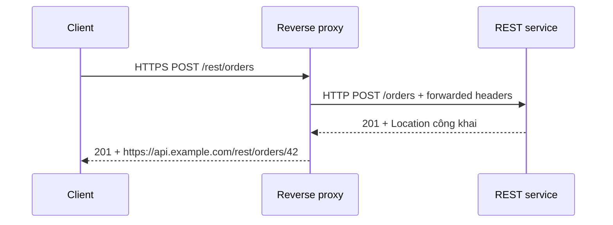

# Liên kết tương đối, tuyệt đối và base URL sau proxy

## 1. Mục tiêu và tình huống xuyên suốt

Trong chương **Thiết kế URI** của module **INTEGRATION_API_REST**, một URI phải nhận diện đúng resource từ góc nhìn của người gọi API. Tên resource và phương thức HTTP có thể đúng, nhưng API vẫn khó sử dụng nếu liên kết phân trang mất prefix, `Location` trỏ vào hostname nội bộ hoặc tài liệu OpenAPI gửi request qua HTTP trong khi điểm vào công khai dùng HTTPS.

Sau bài này, người học có thể:

- Phân biệt URL tuyệt đối, tham chiếu theo đường dẫn và tham chiếu bắt đầu từ root.
- Xác định base URI để phân giải liên kết trong response.
- Giải thích vì sao dấu `/` cuối base làm thay đổi URI đích.
- Khôi phục scheme, host, port và prefix công khai khi service đứng sau reverse proxy.
- Sinh liên kết bằng Java/Spring và xây dựng các ca kiểm thử qua gateway.

Giả sử API quản lý đơn hàng có ánh xạ sau:

```text
Client gọi:        https://api.example.com/rest/orders/42
Reverse proxy:    kết thúc TLS và bỏ prefix /rest
Service nhận:     http://rest-service:8080/orders/42
Controller route: /orders/{id}
```

Đơn hàng `42` vẫn là cùng một resource. `rest-service:8080` chỉ phục vụ định tuyến bên trong hạ tầng; hợp đồng dành cho client sử dụng địa chỉ công khai.

## 2. Tách origin, API base và URI của resource

Với URL:

```text
https://api.example.com/rest/orders/42?view=summary
```

Ta có:

| Thành phần | Giá trị trong ví dụ | Ý nghĩa |
| --- | --- | --- |
| Scheme | `https` | Giao thức phía client sử dụng |
| Authority | `api.example.com` | Host và port nếu được ghi tường minh |
| Origin | `https://api.example.com` | Scheme, host và port hiệu lực; chưa có path |
| Prefix công khai | `/rest` | Phần đường dẫn gateway dùng để đưa request vào API |
| Path | `/rest/orders/42` | Đường dẫn tới resource trong không gian URI công khai |
| Query | `view=summary` | Tham số của request |
| API base theo quy ước của bài | `https://api.example.com/rest/` | Gốc có dấu slash cuối để phân giải đường dẫn con |

“Base URL” thường được dùng cho nhiều giá trị khác nhau. Khi thảo luận thiết kế, hãy ghi rõ đó là **origin**, **gốc API** hay **URL của response hiện tại**. Cả ba đều có thể xuất hiện trong cùng một ứng dụng.

Ví dụ, frontend nằm ở `https://shop.example.com/`, nhưng API nằm ở `https://api.example.com/rest/`. Origin của trang frontend không phải base của các liên kết API.

## 3. Các dạng liên kết và kết quả phân giải

Một URI-reference có thể là URI tuyệt đối hoặc tham chiếu tương đối. Tham chiếu bắt đầu bằng một dấu `/` có path tuyệt đối nhưng vẫn cần scheme và authority từ base. Đây không phải URL tuyệt đối đầy đủ. Các quy tắc phân giải được mô tả trong [RFC 3986, mục 4–5](https://www.rfc-editor.org/rfc/rfc3986.html#section-5).

Với base:

```text
https://api.example.com/rest/orders/42?view=summary
```

Kết quả của các ví dụ tự xây dựng trong bài:

| Tham chiếu | Dạng | URI đích |
| --- | --- | --- |
| `https://api.example.com/rest/orders/43` | URL tuyệt đối | `https://api.example.com/rest/orders/43` |
| `43` | Path tương đối | `https://api.example.com/rest/orders/43` |
| `./43` | Path tương đối | `https://api.example.com/rest/orders/43` |
| `../customers/7` | Lùi một cấp rồi đi tiếp | `https://api.example.com/rest/customers/7` |
| `/orders/43` | Path từ root | `https://api.example.com/orders/43` |
| `/rest/orders/43` | Path từ root, đã mang prefix | `https://api.example.com/rest/orders/43` |
| `?view=detail` | Chỉ thay query | `https://api.example.com/rest/orders/42?view=detail` |
| `//other.example.net/orders/43` | Tham chiếu có authority, thiếu scheme | `https://other.example.net/orders/43` |

Hai lỗi dễ xuất hiện:

1. Client ghép `/orders/43` vào “API base” và tưởng rằng `/rest` được giữ lại.
2. Client xem `//other.example.net/...` như đường dẫn cùng host, trong khi authority đã thay đổi.

Không nên dùng dạng `//host/path` làm quy ước cho API mới. Scheme phụ thuộc base và địa chỉ đích khó nhận biết khi chỉ kiểm tra ký tự đầu.

### 3.1. Dấu slash cuối base có ý nghĩa

So sánh:

```text
Base: https://api.example.com/rest/orders
Ref:  42
Đích: https://api.example.com/rest/42

Base: https://api.example.com/rest/orders/
Ref:  42
Đích: https://api.example.com/rest/orders/42
```

Trong ví dụ thứ nhất, segment cuối `orders` bị thay thế. Tên “collection” trong mô hình nghiệp vụ không khiến bộ phân giải tự coi đường dẫn là một thư mục.

Tương tự:

```text
Base https://api.example.com/rest/ + orders/42
  -> https://api.example.com/rest/orders/42

Base https://api.example.com/rest + orders/42
  -> https://api.example.com/orders/42
```

Hãy quy định slash cuối cho **gốc dùng làm base**. Quy định đó độc lập với việc endpoint collection thực tế được công bố dưới `/orders` hay `/orders/`.

### 3.2. Đừng ghép URI bằng phép cộng chuỗi

Cách ghép sau không giải quyết encoding, query hay slash:

```java
String target = baseUrl + "/" + resourcePath;
```

Nếu `resourcePath` đã bắt đầu bằng `/`, kết quả có thể chứa slash kép. Nếu dữ liệu có `?`, `#` hoặc `&`, chúng có thể bị hiểu thành cú pháp URI.

Dùng bộ dựng URI để thêm path segment và query parameter. Xác định rõ đầu vào là dữ liệu chưa encode hay URI đã encode để tránh encode hai lần. Với ID nghiệp vụ cho phép ký tự đặc biệt, cần thống nhất thêm quy tắc xử lý encoded slash giữa gateway và router.

## 4. Base của liên kết trong JSON phải là một phần hợp đồng

Một field JSON mang tên `href` không tự làm client biết quy tắc phân giải. API có thể dùng media type có ngữ nghĩa liên kết riêng, hoặc tự công bố quy ước rõ ràng.

Trong ví dụ này, hợp đồng ghi:

> Các giá trị trong `links` là URI-reference. Khi chúng là tham chiếu tương đối, client phân giải dựa trên URL công khai cuối cùng đã dùng để nhận response đó.

Request:

```http
GET /rest/orders?status=paid&page=1&size=20 HTTP/1.1
Host: api.example.com
```

Response minh họa:

```json
{
  "items": [
    {
      "id": 42,
      "links": {
        "self": "orders/42"
      }
    }
  ],
  "links": {
    "self": "?status=paid&page=1&size=20",
    "next": "?status=paid&page=2&size=20"
  }
}
```

Với base `https://api.example.com/rest/orders?status=paid&page=1&size=20`:

- `orders/42` trở thành `https://api.example.com/rest/orders/42`.
- `next` giữ đường dẫn collection và mang đầy đủ bộ lọc cần duy trì.
- `?page=2` riêng lẻ sẽ thay toàn bộ query; `status=paid` và `size=20` không tự được kế thừa.

Client JavaScript minh họa:

```javascript
const response = await fetch(
  "https://api.example.com/rest/orders?status=paid&page=1&size=20"
);
if (!response.ok) {
  throw new Error("Không lấy được danh sách đơn hàng");
}

const body = await response.json();
const self = new URL(body.items[0].links.self, response.url);
console.log(self.href);
// https://api.example.com/rest/orders/42

if (body.links.next) {
  const next = new URL(body.links.next, response.url);
  console.log(next.href);
  // https://api.example.com/rest/orders?status=paid&page=2&size=20
}
```

Ở đây cần truyền `response.url` làm base. Nếu chỉ gọi `fetch(body.links.next)` từ trang web, môi trường trình duyệt sẽ dùng base của trang và request có thể đi nhầm frontend.

Nếu sao chép JSON sang hàng đợi hoặc lưu thành file, URL lấy response có thể bị mất. Khi đó cần giữ kèm base hoặc chọn URL tuyệt đối cho liên kết phải tồn tại độc lập. Nếu client và API khác origin, cấu hình CORS phải cho phép luồng đọc response tương ứng.

## 5. Location khi tạo resource: kiểm tra cả request URI

HTTP cho phép `Location` chứa URI-reference. Tham chiếu tương đối được phân giải theo target URI của request; với `201 Created`, nó chỉ tới resource chính vừa tạo. Đây là quy tắc của header HTTP, độc lập với hợp đồng JSON ở trên. [RFC 9110, mục 10.2.2](https://www.rfc-editor.org/rfc/rfc9110.html#section-10.2.2)

Giả sử client gửi `POST https://api.example.com/rest/orders`, không có slash cuối:

| Giá trị Location | URI client nhận diện | Đánh giá trong tình huống này |
| --- | --- | --- |
| `42` | `https://api.example.com/rest/42` | Sai resource |
| `orders/42` | `https://api.example.com/rest/orders/42` | Đúng với request URI đã nêu |
| `/orders/42` | `https://api.example.com/orders/42` | Mất prefix |
| `/rest/orders/42` | `https://api.example.com/rest/orders/42` | Đúng trên cùng origin |
| `https://api.example.com/rest/orders/42` | Giữ nguyên | Đúng và tự chứa |
| `http://rest-service:8080/orders/42` | Giữ nguyên | Lộ địa chỉ nội bộ, client có thể không truy cập được |

Response được chọn cho bài này:

```http
HTTP/1.1 201 Created
Location: https://api.example.com/rest/orders/42
Content-Type: application/json

{
  "id": 42,
  "links": {
    "self": "https://api.example.com/rest/orders/42"
  }
}
```

`201` thông báo kết quả tạo thành công; client có thể chủ động gọi `GET` theo `Location`. Không nên giả định client sẽ tự chuyển hướng như khi nhận response redirect.

Nếu đổi endpoint nhận POST thành `/rest/orders/`, cùng chuỗi `orders/42` sẽ có ý nghĩa khác. Vì vậy, lựa chọn liên kết tương đối phải đi cùng quy định đường dẫn canonical và slash cuối.

## 6. Vì sao reverse proxy làm base URL bị sai?

Sơ đồ triển khai:



Các giá trị có thể thay đổi trên chặng proxy → service:

| Dữ liệu | Client nhìn thấy | Kết nối tới service |
| --- | --- | --- |
| Scheme | `https` | `http` |
| Host | `api.example.com` | `rest-service` |
| Port | `443` | `8080` |
| Path | `/rest/orders` | `/orders` |
| Prefix | `/rest` | Đã bị proxy bỏ |

Nếu code lấy thông tin thô của kết nối phía service để dựng URL, nó không đủ dữ liệu để tái tạo địa chỉ công khai.

Ba lớp cần phối hợp:

1. Proxy chuyển tiếp thông tin công khai theo hợp đồng đã thống nhất.
2. Ứng dụng xử lý thông tin đó trong một ranh giới tin cậy.
3. Code dựng URI sử dụng request đã được xử lý hoặc public base cấu hình.

Chỉ thêm HTTPS ở controller không giải quyết host, port và prefix. Chỉ cấu hình Swagger cũng không sửa các URL trong response nghiệp vụ.

## 7. Forwarded headers và ranh giới tin cậy

Header chuẩn có thể biểu diễn chặng ngoài như sau:

```http
Forwarded: for=203.0.113.10;proto=https;host=api.example.com
```

`proto` và `host` cung cấp thông tin phục vụ dựng địa chỉ. `for` mô tả phía gửi của chặng tương ứng, không phải API base. RFC 7239 không định nghĩa một tham số prefix đường dẫn dùng chung cho mọi proxy. Header có thể bị client hoặc các node trên đường đi sửa đổi, nên bản thân nó không chứng minh nguồn đáng tin. [RFC 7239, mục 5 và 8.1](https://www.rfc-editor.org/rfc/rfc7239.html#section-8.1)

Một hợp đồng dùng họ header phổ biến khác:

```http
X-Forwarded-Proto: https
X-Forwarded-Host: api.example.com
X-Forwarded-Port: 443
X-Forwarded-Prefix: /rest
```

`X-Forwarded-Prefix` là quy ước triển khai. Nhóm vận hành phải thống nhất prefix mô tả phần nào và framework sẽ thay thế hay bổ sung context path ra sao. Không suy ra rằng mọi server đều hỗ trợ như nhau. [Spring MVC: Forwarded Headers](https://docs.spring.io/spring-framework/reference/web/webmvc/filters.html#filters-forwarded-headers)

### 7.1. Chính sách cho mô hình một proxy biên

Đối với mô hình của bài:

- Service chỉ nhận kết nối từ proxy hoặc mạng nội bộ đã kiểm soát.
- Proxy loại bỏ giá trị forwarded do client gửi, rồi tự đặt bộ giá trị đã chuẩn hóa.
- Chỉ chấp nhận các host công khai đã đăng ký.
- Ứng dụng xử lý một bộ header thống nhất; tránh để `Forwarded` và `X-Forwarded-*` chứa giá trị mâu thuẫn.
- Header prefix và host không được dùng thay cho thông tin xác thực hay quyền truy cập tenant.

Ví dụ tấn công cần kiểm tra là client tự gửi `X-Forwarded-Host: attacker.example`. Nếu giá trị đó đi thẳng vào URL reset mật khẩu hoặc `Location`, API đã biến dữ liệu bên ngoài thành địa chỉ được tin tưởng.

Khi có CDN → ingress → service, phải xác định từng hop được tin, nơi xóa dữ liệu ngoài và cách giữ thông tin HTTPS ban đầu. Không chọn tùy tiện phần tử đầu hoặc cuối trong một danh sách header.

### 7.2. Ví dụ Nginx với một điểm vào cố định

Đoạn cấu hình sau nằm trong `server` đã cấu hình TLS cho `api.example.com`. Service chỉ mở cho proxy. Đây là ví dụ một origin cố định, không có CDN ở trước:

```nginx
location /rest/ {
    proxy_pass http://rest-service:8080/;
    proxy_http_version 1.1;

    proxy_set_header Host rest-service:8080;

    # Không giữ header chuẩn do client cung cấp.
    proxy_set_header Forwarded "";

    # Ghi đè các giá trị mà ứng dụng trong ví dụ sử dụng.
    proxy_set_header X-Forwarded-Proto https;
    proxy_set_header X-Forwarded-Host api.example.com;
    proxy_set_header X-Forwarded-Port 443;
    proxy_set_header X-Forwarded-Prefix /rest;
    proxy_set_header X-Forwarded-For $remote_addr;
    proxy_set_header X-Forwarded-Ssl "";

    # Ứng dụng chịu trách nhiệm sinh Location công khai.
    proxy_redirect off;
}
```

Với cấu hình này, `/rest/orders?status=paid` được chuyển thành `/orders?status=paid` tới upstream. URI `/` trong `proxy_pass` thay phần path khớp `location /rest/`. Bỏ slash cuối ở `proxy_pass` sẽ thay đổi cách chuyển path; không coi hai cấu hình là tương đương. [Nginx: proxy_pass](https://nginx.org/en/docs/http/ngx_http_proxy_module.html#proxy_pass)

Gateway còn cần chính sách xử lý đường dẫn `/rest` không có slash cuối và từ chối host lạ. Đoạn trên minh họa hợp đồng forwarded được tiêu thụ trong bài; khi hệ thống dùng thêm header thay thế, phải loại bỏ hoặc chuẩn hóa chúng tại biên tương ứng.

Việc rewrite `Location` ở proxy không tự sửa URL nằm trong JSON. Nếu ứng dụng sinh liên kết sai ở cả hai nơi, hãy sửa nguồn dựng URI.

## 8. Dựng URI công khai với Java/Spring

### 8.1. Chọn lớp xử lý forwarded headers

Với Spring Boot Servlet, một lựa chọn là để Spring Framework xử lý:

```yaml
server:
  forward-headers-strategy: framework
```

Boot cũng có chiến lược `native` dùng khả năng của web server và `none` không bật xử lý tự động. Khả năng cụ thể phụ thuộc container và phiên bản, đặc biệt khi cần prefix. Hãy chọn một lớp chịu trách nhiệm chính và kiểm tra cấu hình đang sử dụng. [Spring Boot: Running Behind a Front-end Proxy Server](https://docs.spring.io/spring-boot/how-to/webserver.html#howto.webserver.use-behind-a-proxy-server)

Không đăng ký thêm filter trùng chức năng chỉ vì thấy URI vẫn sai. Trước hết kiểm tra header thực tế và request sau xử lý. Với WebFlux, cơ chế tương ứng là `ForwardedHeaderTransformer`.

`ForwardedHeaderFilter` điều chỉnh góc nhìn của request; nó không tự nhận biết client đã giả mạo header. Việc giới hạn đường vào và chuẩn hóa header thuộc hợp đồng triển khai. [Javadoc ForwardedHeaderFilter](https://docs.spring.io/spring-framework/docs/current/javadoc-api/org/springframework/web/filter/ForwardedHeaderFilter.html)

### 8.2. Dựng Location từ request đã được xử lý

Đây là tiện ích dùng trong request Spring MVC, khi ứng dụng có context nội bộ rỗng và proxy công bố prefix `/rest`:

```java
import java.net.URI;
import org.springframework.web.servlet.support.ServletUriComponentsBuilder;

public final class OrderLinks {

    private OrderLinks() {
    }

    public static URI order(long id) {
        return ServletUriComponentsBuilder
                .fromCurrentContextPath()
                .pathSegment("orders", "{id}")
                .buildAndExpand(id)
                .toUri();
    }
}
```

Khi forwarded metadata được áp dụng đúng, kết quả của `OrderLinks.order(42)` trong tình huống này phải là:

```text
https://api.example.com/rest/orders/42
```

Controller sử dụng cùng một URI cho header và body. Trong đoạn minh họa sau, `orderService`, `CreateOrder` và `OrderView` là các thành phần nghiệp vụ của ứng dụng; `OrderView` chứa ID và liên kết self:

```java
@PostMapping("/orders")
public ResponseEntity<OrderView> create(
        @Valid @RequestBody CreateOrder input) {

    var saved = orderService.create(input);
    URI location = OrderLinks.order(saved.id());

    var body = new OrderView(
            saved.id(),
            location.toASCIIString());

    return ResponseEntity.created(location).body(body);
}
```

Builder này đọc request hiện tại, nên không sử dụng trực tiếp trong background job không có request. `ServletUriComponentsBuilder` cũng không tự đọc forwarded headers để sửa request; cần lớp xử lý trước đó. [Javadoc ServletUriComponentsBuilder](https://docs.spring.io/spring-framework/docs/current/javadoc-api/org/springframework/web/servlet/support/ServletUriComponentsBuilder.html)

Nếu dựng từ `fromCurrentRequestUri()`, cần nhớ nó mang path hiện tại. Thêm `orders/{id}` vào request đã có `/orders` sẽ lặp segment. Nếu dựng từ `fromCurrentRequest()`, cần quản lý cả query để tránh mang nhầm bộ lọc sang link resource vừa tạo.

Với URI có dữ liệu chuỗi, dùng template và chiến lược encoding của builder phù hợp. Không đưa cả path chưa kiểm soát vào một biến vốn được coi là ID.

### 8.3. Cấu hình public base tường minh

Khi URL phải được sinh từ job nền, email hoặc sự kiện, có thể dùng cấu hình ứng dụng:

```yaml
app:
  public-api-base-url: https://api.example.com/rest/
```

Đây là property do ứng dụng tự định nghĩa và bind, không phải property có sẵn của Spring Boot.

Ví dụ hàm dựng URI:

```java
import java.net.URI;
import org.springframework.web.util.UriComponentsBuilder;

public static URI orderAt(URI publicBase, long id) {
    return UriComponentsBuilder.fromUri(publicBase)
            .pathSegment("orders", "{id}")
            .buildAndExpand(id)
            .toUri();
}
```

Khi nạp cấu hình, kiểm tra public base có scheme, host được phép, prefix đúng và không có user-info, query hay fragment ngoài dự kiến. Mỗi môi trường phải có giá trị riêng; môi trường production của ví dụ chỉ công bố HTTPS.

Nếu API phục vụ nhiều domain hoặc tenant, cần ánh xạ tenant đã xác thực sang public base đã đăng ký. Không lấy host tùy ý trong request để chọn URL gửi qua email. Với cả hai cách dựng URI, request tới resource đích vẫn phải được xác thực và phân quyền bình thường.

## 9. Chọn dạng liên kết theo nhu cầu sử dụng

| Nhu cầu | Lựa chọn có thể áp dụng | Điều kiện |
| --- | --- | --- |
| Client đang duyệt response trên cùng API | Tham chiếu tương đối | Giữ base và công bố quy tắc phân giải |
| Liên kết cùng origin, muốn chỉ rõ path công khai | Path từ root như `/rest/orders/42` | Prefix phải được dựng đúng cho môi trường |
| Location hoặc link cần tự chứa | URL tuyệt đối công khai | Nguồn scheme, host, port, prefix đáng tin |
| Email, job nền, sự kiện lưu dài hạn | URL tuyệt đối từ public base cấu hình | Không phụ thuộc request đang chạy |
| Môi trường đổi domain thường xuyên | Tham chiếu tương đối hoặc cấu hình theo môi trường | Client không tự đoán base |

Đây là lựa chọn hợp đồng của hệ thống minh họa, không phải yêu cầu mọi REST API phải dùng duy nhất một dạng. API có thể dùng absolute `Location` và relative link phân trang nếu tài liệu giải thích rõ.

Liên kết tương đối giúp giảm phụ thuộc hostname, nhưng vẫn có thể mất prefix. Liên kết tuyệt đối dễ chuyển tiếp, nhưng phải cập nhật khi đổi địa chỉ công khai.

Nếu response được cache và chứa URL phụ thuộc domain hoặc tenant, tầng cache cần phân vùng dữ liệu theo các yếu tố đó. Không để một response mang host của tenant này được phục vụ lại cho tenant khác.

## 10. Đồng bộ với OpenAPI

Một mô tả OpenAPI rút gọn cho địa chỉ công khai:

```yaml
openapi: 3.1.1
info:
  title: Order API
  version: "1.0"
servers:
  - url: https://api.example.com/rest
paths:
  /orders:
    get:
      responses:
        "200":
          description: Danh sách đơn hàng
```

Ở đây endpoint là `https://api.example.com/rest/orders`. OpenAPI quy định nối key path vào server URL, không áp dụng phép phân giải tham chiếu root-relative thông thường cho key `/orders`. [OpenAPI 3.1.1: Paths Object](https://spec.openapis.org/oas/v3.1.1.html#paths-object)

Vì vậy không dùng kết quả `new URL("/orders", "https://api.example.com/rest")` để dự đoán endpoint của đoạn OpenAPI trên.

Các lỗi cấu hình dễ gặp trong ví dụ:

- `servers.url` là `http://rest-service:8080`: công cụ thử API gọi nhầm địa chỉ nội bộ.
- Prefix xuất hiện trong cả `servers.url` và key path: endpoint thành `/rest/rest/orders`.
- Tài liệu ở một domain khác nhưng server URL tương đối chưa được kiểm tra theo vị trí phục vụ tài liệu.

Cấu hình OpenAPI và code sinh `Location` cần cùng phản ánh địa chỉ công khai. Sửa một bên không tự thay đổi bên còn lại.

## 11. Kiểm thử theo hợp đồng qua proxy

Một bài kiểm thử controller chỉ dùng `localhost` thường không phát hiện lỗi thiếu prefix hay sai HTTPS. Bổ sung các ca kiểm thử cho đường đi công khai của ví dụ.

| Ca | Đầu vào | Kết quả cần xác nhận |
| --- | --- | --- |
| Tạo resource qua gateway | POST `https://api.example.com/rest/orders` | `201`; Location có HTTPS, host công khai, prefix đúng |
| Đi theo Location | GET URI vừa nhận với thông tin xác thực phù hợp | Nhận đúng resource vừa tạo |
| Chuyển trang có bộ lọc | GET collection với `status=paid` và `size=20` | Link next giữ bộ lọc, size, prefix |
| Response có link tương đối | Phân giải bằng URL response | URI đích đúng hợp đồng |
| Host giả mạo | Gửi forwarded host ngoài danh sách qua gateway | Không sinh URL tới host của kẻ gửi |
| Truy cập service trực tiếp | Kết nối từ ngoài vùng cho phép | Bị chặn tại lớp mạng hoặc điểm vào tương ứng |
| Public port khác mặc định | Môi trường thử dùng HTTPS port `8443` | Absolute link có port công khai đúng |
| Quy tắc slash cuối | Thử URI canonical và biến thể có slash | Hành vi khớp tài liệu, không tạo link sai cấp |
| Tài liệu OpenAPI | Thực hiện request từ công cụ thử API | Endpoint mang đúng scheme, host và prefix |

Các ca này là hướng dẫn thực hành, không phải kết quả kiểm thử một hệ thống đã chạy trong bài.

Có thể kiểm tra response tạo resource bằng công cụ HTTP:

```bash
curl -i -X POST "https://api.example.com/rest/orders" \
  -H "Content-Type: application/json" \
  -H "Authorization: Bearer <access-token>" \
  --data '{"sku":"BOOK-REST","quantity":1}'
```

Đọc status, `Location` và body trước khi đi theo liên kết. Với client trình duyệt khác origin cần đọc `Location`, gateway/API phải expose header đó qua CORS, chẳng hạn `Access-Control-Expose-Headers: Location`.

Nếu dùng MockMvc, gắn forwarded headers vào request mô phỏng và bảo đảm filter thực sự nằm trong test chain. Ca mô phỏng xác nhận cách Spring dựng URI; ca qua gateway mới xác nhận proxy có rewrite path và xử lý header đúng như triển khai.

## 12. Chẩn đoán lỗi và bài thực hành

| Triệu chứng | Điều cần kiểm tra đầu tiên |
| --- | --- |
| Location chứa `http://` | Nơi kết thúc TLS, header proto và lớp xử lý forwarded |
| Location chứa `:8080` | Host/port công khai có được phục hồi hay không |
| Location thiếu `/rest` | Gateway đã bỏ prefix nhưng chưa truyền hoặc chưa áp dụng prefix |
| Location có `/rest/rest` | Prefix bị thêm ở nhiều lớp |
| Link `42` trỏ tới `/rest/42` | Base collection không có slash cuối |
| Link phân trang làm mất bộ lọc | Query mới chưa chứa đầy đủ tham số cần giữ |
| Swagger gọi đúng nhưng JSON sai | Cấu hình server URL và code dựng URI đang dùng nguồn khác nhau |
| Chỉ một số tenant nhận link sai | Ánh xạ public base và khóa cache có tách theo tenant không |

Bài thực hành cho người học:

1. Vẽ lại ánh xạ `https://api.example.com/rest/orders` → `http://rest-service:8080/orders`, ghi rõ thành phần nào mất trên chặng nội bộ.
2. Thiết kế response tạo đơn hàng có absolute `Location` và danh sách phân trang có relative `next`.
3. Chọn chiến lược forwarded headers hoặc public base cho từng luồng: request trực tiếp, email và job nền.
4. Thay prefix công khai từ `/rest` sang `/partner/rest`; xác nhận không phải sửa route nghiệp vụ `/orders`.
5. Gửi header host giả mạo qua gateway và kiểm tra URL được sinh.
6. Giải thích tại sao `/orders/42`, `orders/42` và `42` có thể đi tới ba địa chỉ khác nhau từ cùng một base.

Mẫu đáp án cho câu cuối, dùng base `https://api.example.com/rest/orders`:

```text
/orders/42  -> https://api.example.com/orders/42
orders/42   -> https://api.example.com/rest/orders/42
42          -> https://api.example.com/rest/42
```

Một thiết kế hoàn chỉnh cần ghi rõ dạng liên kết được phép, nguồn base đáng tin, quy tắc slash/prefix và cách client phân giải. Khi các điểm này được đưa vào hợp đồng dữ liệu và kiểm thử qua gateway, URI của resource giữ được ý nghĩa dù service di chuyển trong hạ tầng.
