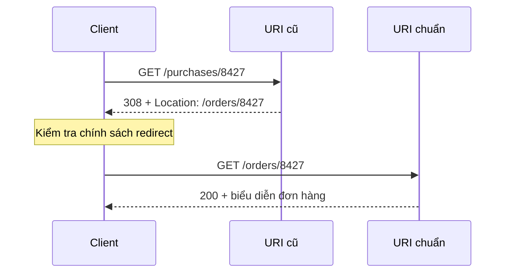

# Đổi URI, redirect và giữ liên kết cũ hoạt động

## 1. Mục tiêu và tình huống xuyên suốt

Trong chương **Thiết kế URI** của module **INTEGRATION_API_REST**, bài này tập trung vào cách thay địa chỉ tài nguyên mà vẫn duy trì các tích hợp đang sử dụng địa chỉ cũ. Mục tiêu là thiết kế một quá trình chuyển đổi có hợp đồng HTTP rõ ràng, có thể triển khai với Java/Spring hoặc công nghệ tương đương.

Sau bài học, bạn có thể:

- Phân biệt thay địa chỉ tài nguyên với thay hợp đồng dữ liệu hoặc thay danh tính tài nguyên.
- Chọn giữa duy trì alias, rewrite/proxy nội bộ và trả redirect.
- Lựa chọn mã trạng thái phù hợp với phương thức HTTP và khả năng của client.
- Giữ đúng định danh, query, phân trang, quyền truy cập và hành vi ghi dữ liệu khi chuyển URI.
- Công bố lộ trình chuyển đổi qua tài liệu, OpenAPI và các header vòng đời.
- Xác định các phép kiểm tra cần có trước khi đưa chuyển đổi vào môi trường thực tế.

Giả sử hệ thống bán hàng đã công bố:

```http
GET /purchases/8427
POST /purchases
GET /purchases?customerId=27&page=2&size=20
```

Nhóm phát triển muốn dùng danh từ thống nhất là `orders`:

```http
GET /orders/8427
POST /orders
GET /orders?customerId=27&page=2&size=20
```

Trong tình huống này, `purchases/8427` và `orders/8427` cùng chỉ đơn hàng có định danh `8427`. Schema dữ liệu, ý nghĩa nghiệp vụ, quyền và quy ước phân trang ban đầu được giữ tương đương. Nếu những điều kiện này không đúng, việc đổi URI cần thêm một lớp tương thích hoặc kế hoạch chuyển hợp đồng dữ liệu.

Một SDK cũ có thể vẫn gọi `/purchases` nhiều tháng sau khi máy chủ đã hỗ trợ `/orders`. Một hệ thống đối tác cũng có thể lưu URI đơn hàng trong cơ sở dữ liệu. Vì vậy, công việc không kết thúc ở việc đổi annotation của controller.

## 2. Xem URI đã công bố như một phần của hợp đồng

### 2.1. Đổi cấu trúc nội bộ không bắt buộc đổi URI công khai

Việc đổi tên lớp `PurchaseController` thành `OrderController`, tách một service hoặc đổi bảng dữ liệu không tự tạo ra nhu cầu đổi URI. Có thể giữ URI công khai ổn định trong khi thay toàn bộ cách triển khai phía sau.

Trước khi đổi URI, cần trả lời được lợi ích cụ thể: giải quyết thuật ngữ gây hiểu nhầm, thống nhất mô hình tài nguyên, chuyển hostname hay loại bỏ cấu trúc đường dẫn gắn chặt với một hệ thống cũ.

Nếu chỉ muốn tên mã nguồn đẹp hơn, giữ URI thường là lựa chọn ít tốn chi phí vận hành hơn.

### 2.2. Có ba loại thay đổi cần xử lý khác nhau

| Loại thay đổi | Ví dụ | Hướng xử lý ban đầu |
| --- | --- | --- |
| Cùng tài nguyên, cùng hợp đồng, khác địa chỉ | `/purchases/8427` → `/orders/8427` | Alias hoặc redirect có kiểm soát |
| Cùng nghiệp vụ nhưng khác hợp đồng | `/v1/orders` dùng số tiền thập phân; `/v2/orders` dùng số nguyên theo đơn vị nhỏ nhất | Phiên bản hoặc adapter dữ liệu, kế hoạch nâng cấp client |
| Tài nguyên không còn tồn tại hoặc không có đích tương đương | Một báo cáo đã bị xóa, không có báo cáo thay thế tương ứng | Phản hồi lỗi theo hợp đồng, có thể dùng `410` khi biết việc mất là lâu dài |

Không chuyển tất cả URI đã biến mất về một endpoint tổng quát chỉ để tránh lỗi. Chuyển `/purchases/8427` tới `/orders` có thể làm client nhận danh sách thay vì chi tiết đơn hàng. Một phản hồi HTTP thành công như vậy vẫn làm hỏng tích hợp.

Không tái sử dụng URI cũ cho một đối tượng nghiệp vụ khác. Client có thể giữ địa chỉ đó lâu hơn dự kiến.

## 3. Ba cách duy trì đường dẫn cũ

### 3.1. Alias: cả hai URI đều được máy chủ xử lý

```text
GET /purchases/8427 ──┐
                     ├──> OrderApplicationService ──> cùng đơn hàng
GET /orders/8427 ─────┘
```

Client cũ tiếp tục nhận phản hồi nghiệp vụ trực tiếp. Máy chủ có thể phát thêm thông tin ngừng khuyến nghị dùng đường dẫn cũ.

Alias phù hợp khi:

- Client không tự theo redirect hoặc không sửa được cấu hình HTTP.
- Endpoint nhận webhook từ đối tác có chính sách redirect chưa được xác nhận.
- Request ghi có chữ ký phụ thuộc đường dẫn hoặc body không thể phát lại.
- Cần duy trì dữ liệu đầu ra của hợp đồng cũ trong khi đường dẫn mới tiến hóa riêng.

Hai controller nên gọi chung application service hoặc một adapter có mục đích rõ ràng. Sao chép toàn bộ logic xử lý sẽ làm hai đường dẫn khác nhau dần theo thời gian.

### 3.2. Rewrite hoặc proxy: chuyển tuyến bên trong hạ tầng

Gateway có thể nhận `/purchases/8427` rồi chuyển đến backend ở `/orders/8427`. Client vẫn chỉ gửi một request tới địa chỉ cũ và nhận phản hồi cuối.

Cần mô tả rõ vị trí xác thực, nơi kiểm tra chữ ký và đường dẫn mà backend dùng để sinh liên kết. Một rewrite chỉ sửa request có thể để lọt `Location` trỏ tới hostname nội bộ hoặc tạo các liên kết phân trang sai.

Nếu gateway chuyển tiếp sang hệ thống khác, cần giữ chính sách timeout, kích thước body, phân quyền và quan sát lỗi nhất quán. Đây là trách nhiệm của một tuyến tương thích, không chỉ là phép thay chuỗi.

### 3.3. Redirect: yêu cầu client tạo request tiếp theo



Server trả mã redirect cùng `Location`; việc phát request tiếp theo thuộc client. Một thư viện có thể tự thực hiện, yêu cầu bật tùy chọn hoặc trả nguyên phản hồi redirect cho ứng dụng. Cần kiểm tra client thực tế thay vì suy từ hành vi của trình duyệt. Xem [MDN: Redirections in HTTP](https://developer.mozilla.org/en-US/docs/Web/HTTP/Guides/Redirections).

Redirect có thêm một lượt trao đổi khi client còn dùng đường dẫn cũ. Ưu điểm là server có thể chỉ rõ địa chỉ nên dùng về sau mà không vận hành hai bản xử lý nghiệp vụ độc lập.

## 4. Chọn đúng mã trạng thái

Hai câu hỏi cần trả lời là: địa chỉ mới có tính lâu dài không, và request tiếp theo có cần giữ phương thức/body không?

| Mã | Ý nghĩa chính | Điểm cần nhớ khi chuyển API |
| --- | --- | --- |
| [301 Moved Permanently](https://developer.mozilla.org/en-US/docs/Web/HTTP/Reference/Status/301) | Địa chỉ mới lâu dài | Không dùng để bảo đảm giữ `POST` |
| [302 Found](https://developer.mozilla.org/en-US/docs/Web/HTTP/Reference/Status/302) | Địa chỉ thay thế tạm thời | Có thể dẫn đến `POST` chuyển thành `GET` |
| [303 See Other](https://developer.mozilla.org/en-US/docs/Web/HTTP/Reference/Status/303) | Xem tài nguyên khác để lấy kết quả | Phù hợp luồng đọc kết quả, không phải phát lại thao tác ghi |
| [307 Temporary Redirect](https://developer.mozilla.org/en-US/docs/Web/HTTP/Reference/Status/307) | Chuyển tạm thời | Giữ phương thức và body khi theo redirect |
| [308 Permanent Redirect](https://developer.mozilla.org/en-US/docs/Web/HTTP/Reference/Status/308) | Chuyển lâu dài | Giữ phương thức và body khi theo redirect |

### 4.1. Khi nào chọn 301 hoặc 302?

Với endpoint chỉ đọc, `301` có thể diễn đạt việc chuyển lâu dài; `302` có thể diễn đạt việc chuyển tạm thời. Tuy nhiên, với `POST`, HTTP cho phép client đổi sang `GET` khi theo hai mã này. Không thiết kế luồng ghi dựa vào giả định mọi client đều giữ phương thức. Hành vi này cũng được giải thích trong tài liệu [301](https://developer.mozilla.org/en-US/docs/Web/HTTP/Reference/Status/301) và [302](https://developer.mozilla.org/en-US/docs/Web/HTTP/Reference/Status/302) của MDN.

Ví dụ, điều cần tránh là:

```text
POST /purchases
    -> 302 Location: /orders
    -> client gửi GET /orders
    -> nhận danh sách đơn hàng, không tạo đơn hàng
```

Người vận hành có thể chỉ nhìn thấy mã cuối `200` và tưởng yêu cầu tạo đơn đã thành công. Vì vậy, kiểm tra chuyển đổi phải theo dõi cả phương thức và kết quả nghiệp vụ.

### 4.2. Khi nào chọn 307 hoặc 308?

Dùng `307` cho tuyến thay thế tạm thời; dùng `308` khi đã quyết định địa chỉ mới là lâu dài. Với hai mã này, request theo redirect giữ phương thức và body. Điều đó không có nghĩa client bắt buộc tự theo redirect hoặc luôn phát lại được body dạng stream. Xem mô tả [307](https://developer.mozilla.org/en-US/docs/Web/HTTP/Reference/Status/307) và [308](https://developer.mozilla.org/en-US/docs/Web/HTTP/Reference/Status/308).

Trong ví dụ bán hàng, phản hồi chuyển lâu dài cho request đọc có thể là:

```http
HTTP/1.1 308 Permanent Redirect
Location: /orders/8427
Cache-Control: no-store
Content-Length: 0
```

Đây là lựa chọn minh họa cho một hợp đồng đã quyết định chuyển lâu dài nhưng chưa muốn lưu phản hồi redirect vào cache trong giai đoạn đầu.

### 4.3. Dùng 303 để đọc kết quả, không để chuyển một lệnh ghi

Một API tạo báo cáo có thể thực hiện:

```text
POST /report-requests
    -> 303 Location: /reports/519
    -> GET /reports/519
```

`303` hướng client tới thao tác lấy một tài nguyên khác, thường bằng `GET`; `HEAD` cũng là phương thức lấy metadata phù hợp trong HTTP. Đây là mô hình đọc kết quả sau thao tác, khác mục tiêu giữ nguyên một `POST` sang URI mới. Xem [RFC 9110, mục 15.4.4](https://www.rfc-editor.org/rfc/rfc9110.html#section-15.4.4).

Tương tự, `201 Created` kèm `Location` là phản hồi tạo tài nguyên thành công. Việc có `Location` trong `201` không biến nó thành một phản hồi redirect.

## 5. Thiết kế phép ánh xạ giữa URI cũ và mới

Không viết một quy tắc chuyển tuyến trước khi xác định rõ điều gì phải được giữ lại. Với ví dụ xuyên suốt, có thể lập bảng hợp đồng:

| Thành phần | Quy tắc chuyển đổi của ví dụ |
| --- | --- |
| Định danh `8427` | Giữ nguyên; không sinh một đơn hàng mới |
| Tenant và khách hàng | Giữ đúng phạm vi dữ liệu ban đầu |
| Phương thức | Giữ nguyên với tuyến redirect cần bảo toàn thao tác |
| Query `customerId`, `page`, `size` | Giữ giá trị và ý nghĩa |
| Body JSON | Giữ tương thích với schema cũ |
| Header điều kiện | Đánh giá lại tính tương thích của `If-Match`, `If-None-Match` |
| Khóa chống lặp | Cùng một thao tác nghiệp vụ trên cả hai tuyến |
| Liên kết server trả ra | Đường dẫn mới cho các liên kết thuộc hợp đồng mới |

### 5.1. Query không phải chi tiết có thể bỏ qua

Với request:

```http
GET /purchases?customerId=27&page=2&size=20
```

Đích tương ứng theo hợp đồng của ví dụ là:

```http
Location: /orders?customerId=27&page=2&size=20
```

Nếu `Location` chỉ là `/orders`, client không tự biết cần phục hồi bộ lọc hoặc trang nào. Kết quả có thể chứa dữ liệu rộng hơn dự kiến.

Không sao chép mọi query một cách mù quáng. Hãy liệt kê tham số được hỗ trợ, quy tắc cho tham số lặp, giá trị rỗng và cách báo lỗi cho tham số chưa hợp lệ. Khi đổi tên query, cần có ánh xạ được tài liệu hóa; chẳng hạn `customer_id` sang `customerId`.

Không nối chuỗi thủ công với giá trị chưa mã hóa. Một giá trị chứa dấu `&` phải nằm trong một giá trị query, không được vô tình trở thành tham số khác.

### 5.2. Phân trang cần giữ ngữ nghĩa, không chỉ giữ tên tham số

Nếu URI cũ dùng `page=1` cho trang đầu còn URI mới dùng `page=0`, chép nguyên query không giữ tương thích. Cần adapter hoặc một hợp đồng phiên bản riêng.

Cursor có thể mã hóa bộ lọc, thứ tự sắp xếp hoặc phiên bản định dạng. Đừng giả định token phân trang do tuyến cũ sinh ra sẽ hợp lệ ở tuyến mới. Có thể duy trì bộ giải mã cũ trong thời gian chuyển đổi hoặc cho tuyến cũ tiếp tục xử lý cursor cũ qua alias.

Các liên kết `next`, `prev` và `self` phải được kiểm tra cùng với dữ liệu trang. Client thường đi tiếp bằng các liên kết này mà không dựng URI bằng tay.

### 5.3. Định danh và slug

Nếu đổi:

```text
/articles/huong-dan-rest
    -> /articles/912
```

cần một ánh xạ xác định slug cũ thuộc bài nào. Nếu tiêu đề tiếp tục thay đổi, mọi slug cũ còn được hỗ trợ nên đi thẳng tới URI chuẩn hiện tại.

Định danh bền vững giúp giảm số lần phải sửa liên kết. Tuy nhiên, không nên âm thầm làm mất các slug cũ đã xuất hiện trong email, tài liệu hay dữ liệu của đối tác.

### 5.4. ETag và request có điều kiện

Giả sử client đã đọc `/purchases/8427`, nhận ETag rồi gửi `If-Match` khi cập nhật. Nếu tuyến mới có cách biểu diễn hoặc sinh ETag khác, giá trị cũ có thể không còn phù hợp.

Cần xác định validator đang đại diện cho biểu diễn nào và cách thực hiện optimistic locking. Không bỏ `If-Match` để vượt qua lỗi trong thời gian chuyển đổi; làm vậy có thể khiến cập nhật cũ ghi đè dữ liệu mới hơn. Nếu không bảo toàn được hợp đồng điều kiện, dùng lớp tương thích thay vì hứa rằng đổi địa chỉ là hoàn toàn trong suốt.

## 6. Request ghi: redirect không thay thế idempotency

Xét yêu cầu:

```http
POST /purchases HTTP/1.1
Host: api.example.com
Content-Type: application/json
Idempotency-Key: checkout-27-0042

{"customerId":27,"items":[{"productId":501,"quantity":2}]}
```

Nếu tuyến cũ chỉ có nhiệm vụ redirect, nó nên trả redirect **trước khi thực hiện tạo đơn**. Sau đó, tuyến mới mới thực hiện nghiệp vụ.

Một thiết kế sai là tạo đơn tại `/purchases`, trả `308` tới `/orders` rồi để client phát lại `POST`. Khi đó, cùng một lần gọi có thể tạo hai đơn.

Ngay cả thiết kế không xử lý ở tuyến cũ cũng cần đối phó với retry do timeout. Ví dụ: tuyến mới đã tạo đơn nhưng client không nhận được phản hồi, rồi gửi lại request qua tuyến cũ.

Trong hợp đồng minh họa, `Idempotency-Key` là cơ chế do API quy định. Nó chỉ có tác dụng khi server lưu và kiểm tra trạng thái tương ứng. Có thể thiết kế khóa nghiệp vụ dạng:

```text
(tenantId, operation="CREATE_ORDER", idempotencyKey)
```

Không chia riêng kho chống lặp thành `POST /purchases` và `POST /orders` nếu hai đường dẫn đại diện cùng một lệnh tạo đơn. Cùng khóa trong hai đường dẫn cần được nhận diện theo cùng quy tắc nghiệp vụ.

Cũng phải quy định:

- Cùng khóa nhưng body khác thì bị từ chối như thế nào.
- Thời gian duy trì kết quả chống lặp.
- Hành vi khi hai request cùng khóa đến đồng thời.
- Cách trả kết quả khi lần thực hiện trước đang xử lý hoặc đã hoàn tất.

Đây là những quyết định của API, không phải đảm bảo tự có từ mã `307` hoặc `308`.

Nếu client không thể phát lại body lớn hoặc chữ ký bao gồm đường dẫn request, alias/proxy tương thích thường phù hợp hơn redirect cho tuyến ghi. Khi cần thay chữ ký, client phải hiểu và ký lại request theo giao thức đã thống nhất.

## 7. Cache và khả năng quay lui

`301` và `308` có thể được cache theo suy luận khi đủ điều kiện; `307` cũng không đồng nghĩa tuyệt đối cấm cache. Phải xét phương thức và header cụ thể. Xem [RFC 9110, mục 15.4](https://www.rfc-editor.org/rfc/rfc9110.html#section-15.4).

Trong một đợt chuyển đổi còn cần kiểm soát chặt, có thể trả:

```http
Cache-Control: no-store
```

Khi việc ánh xạ GET đã ổn định và hoàn toàn độc lập với người dùng, có thể cân nhắc một thời gian cache hữu hạn theo chính sách hệ thống, ví dụ:

```http
Cache-Control: public, max-age=300
```

`no-store` yêu cầu cache không lưu phản hồi; `no-cache` cho phép lưu nhưng yêu cầu xác thực lại trước khi tái sử dụng. `public` cần được cân nhắc kỹ với dữ liệu xác thực hoặc đích phụ thuộc tenant/người dùng. Các chỉ thị được mô tả trong [RFC 9111, mục 5.2.2](https://www.rfc-editor.org/rfc/rfc9111.html#section-5.2.2).

Con số `300` chỉ là ví dụ lựa chọn vận hành, không phải thời hạn được HTTP khuyến nghị cho mọi hệ thống.

Một kế hoạch quay lui cần tính đến các client đã biết URI mới:

1. Giữ URI mới hoạt động ngay cả khi tạm ngừng phát redirect từ URI cũ.
2. Giữ khả năng xóa cache tại CDN/gateway trong phạm vi mình kiểm soát.
3. Không kỳ vọng thay header hôm nay sẽ thu hồi ngay các redirect đã lưu trước đó ở mọi client.
4. Theo dõi lỗi tại cả địa chỉ cũ và mới để không bỏ sót client đã chuyển.

Chọn mã tạm thời khi bản chất chuyển tuyến là tạm thời. Nếu quyết định chuyển lâu dài đã được chốt, mã lâu dài vẫn cần một chiến lược cache rõ ràng.

## 8. Xác thực, phân quyền và an toàn của Location

### 8.1. Quyền tại URI mới phải đầy đủ

Giả sử người dùng chỉ được xem đơn của khách hàng `27`. Việc biết `/orders/8427` không tạo thêm quyền truy cập. Endpoint mới phải tự kiểm tra quyền tài nguyên, tenant và scope theo chính sách của API.

Cũng cần kiểm tra matcher bảo mật của đường dẫn cũ. Một thay đổi controller có thể bỏ sót cấu hình bảo vệ `/orders/**` hoặc giữ quy tắc rộng hơn dự kiến ở `/purchases/**`.

Nếu `Location` tiết lộ sự tồn tại của một tài nguyên mà người gọi không được biết, phải xác định điểm kiểm tra quyền trước khi trả redirect. Không dùng chung một quy tắc redirect công khai cho mọi tài nguyên nhạy cảm.

### 8.2. Redirect khác origin cần kế hoạch riêng

Chuyển từ `https://api.example.com` sang `https://api2.example.com` ảnh hưởng nhiều hơn một path:

- Token có thể có audience không phù hợp với dịch vụ mới.
- Cookie có thể không được gửi theo miền mới.
- Client có thể không chuyển tiếp thông tin xác thực.
- Trình duyệt có thể cần cấu hình CORS và xử lý preflight phù hợp.
- Chữ ký request và danh sách hostname được phép có thể phải cập nhật.

Ví dụ, curl không mặc định chuyển tiếp credential sang đích khác host trong luồng redirect; tùy chọn `--location-trusted` thay đổi hành vi này và có thể làm lộ bí mật nếu dùng thiếu kiểm soát. Xem [tài liệu curl về --location](https://curl.se/docs/manpage.html#-L) và [--location-trusted](https://curl.se/docs/manpage.html#--location-trusted).

Vì vậy, một phép thử GET không xác thực trên trình duyệt chưa đủ để xác nhận chuyển hostname an toàn cho hệ thống đối tác.

### 8.3. Tạo đích từ quy tắc do server kiểm soát

Tránh thiết kế:

```text
GET /purchases/8427?redirectTo=https://untrusted.example
    -> Location lấy trực tiếp từ redirectTo
```

Đây có thể trở thành open redirect. Ưu tiên template cố định và dữ liệu định danh đã kiểm tra. Nếu cần đích bên ngoài, kiểm tra các thành phần URI đã parse với danh sách được phép; không kiểm tra bằng một phép tìm chuỗi hostname. Xem [OWASP: Unvalidated Redirects and Forwards](https://cheatsheetseries.owasp.org/cheatsheets/Unvalidated_Redirects_and_Forwards_Cheat_Sheet.html).

Với ví dụ cùng origin, `Location: /orders/8427` giúp tránh dựng hostname từ dữ liệu request không tin cậy. Tuy nhiên, nếu API được xuất bản sau prefix như `/api`, đích công khai có thể phải là `/api/orders/8427`. Cần thống nhất prefix ở gateway và ứng dụng.

Không lấy `Host` hoặc `X-Forwarded-Host` tùy ý để tạo URI tuyệt đối. Khi thật sự cần URI tuyệt đối, dùng base URL cấu hình hoặc cấu hình trusted proxy rõ ràng.

Không hạ từ HTTPS về HTTP trong lộ trình chuyển đổi.

## 9. Ví dụ triển khai redirect đọc trong Spring MVC

Ví dụ sau chỉ chuyển URI chi tiết đơn hàng. Nó giả định API được công bố ở root của cùng origin, tuyến `/orders/{id}` đã hoạt động và chính sách bảo mật cho cả hai đường dẫn đã được cấu hình.

```java
import java.net.URI;

import org.springframework.http.CacheControl;
import org.springframework.http.HttpStatus;
import org.springframework.http.ResponseEntity;
import org.springframework.web.bind.annotation.GetMapping;
import org.springframework.web.bind.annotation.PathVariable;
import org.springframework.web.bind.annotation.RestController;
import org.springframework.web.util.UriComponentsBuilder;

@RestController
public class LegacyPurchaseController {

    @GetMapping("/purchases/{id}")
    public ResponseEntity<Void> redirectOrder(
            @PathVariable("id") long id) {

        if (id <= 0) {
            return ResponseEntity.badRequest().build();
        }

        URI target = UriComponentsBuilder
                .fromPath("/orders/{id}")
                .buildAndExpand(id)
                .toUri();

        return ResponseEntity
                .status(HttpStatus.PERMANENT_REDIRECT)
                .location(target)
                .cacheControl(CacheControl.noStore())
                .build();
    }
}
```

`ResponseEntity` cho phép biểu diễn rõ mã trạng thái và header của phản hồi. `UriComponentsBuilder` hỗ trợ dựng URI theo thành phần và mở rộng biến template. Xem tài liệu Spring về [ResponseEntity](https://docs.spring.io/spring-framework/docs/current/javadoc-api/org/springframework/http/ResponseEntity.html) và [UriComponentsBuilder](https://docs.spring.io/spring-framework/docs/current/javadoc-api/org/springframework/web/util/UriComponentsBuilder.html).

Trong ví dụ:

- Controller cũ không gọi thao tác tạo hoặc cập nhật đơn hàng.
- `id` được đọc dưới dạng số, không được dùng làm một URL tùy ý.
- Đích lấy từ template cố định, không lấy từ query do người gọi truyền.
- Quy tắc chỉ được khai báo cho request đọc; không tự biến nó thành quy tắc chung cho mọi phương thức.
- `no-store` là chính sách giai đoạn đầu đã chọn cho ví dụ.

Controller không kiểm tra đơn hàng có tồn tại. Nó chỉ công bố phép đổi địa chỉ; endpoint mới quyết định phản hồi nghiệp vụ cuối. Nếu chính sách bảo mật yêu cầu kiểm tra quyền hoặc che giấu sự tồn tại trước redirect, phải bổ sung kiểm tra thích hợp trước khi sinh `Location`.

Ví dụ cũng không xử lý query cho collection. Có thể dựng URI collection riêng bằng builder sau khi đã kiểm tra các tham số:

```java
String customerId = "27";
int page = 2;
int size = 20;

URI target = UriComponentsBuilder
        .fromPath("/orders")
        .queryParam("customerId", "{customerId}")
        .queryParam("page", page)
        .queryParam("size", size)
        .encode()
        .buildAndExpand(customerId)
        .toUri();
```

Đoạn này minh họa cách dựng URI, không thay thế validation về quyền khách hàng, giới hạn `size` và quy ước `page`.

Nếu cần giữ client cũ không theo redirect, thay vì controller trên, có thể để tuyến cũ gọi chung service:

```text
LegacyPurchaseController -> adapter hợp đồng cũ ──┐
                                                ├-> OrderApplicationService
OrderController -> hợp đồng hiện tại ────────────┘
```

Khi hai hợp đồng hoàn toàn giống nhau, lớp adapter có thể rất mỏng. Khi khác nhau, phải xác định rõ phép chuyển đổi dữ liệu và lỗi; tránh làm nó thành một nơi sửa dữ liệu ngầm không có tài liệu.

## 10. Thông báo deprecation và thời điểm dừng phục vụ

### 10.1. Phân biệt hai thông điệp vòng đời

**Deprecation** thông báo tài nguyên đã hoặc sẽ không còn được khuyến nghị sử dụng. Nó không tự thay đổi hành vi endpoint. Theo RFC 9745, giá trị `Deprecation` là ngày theo Structured Fields, viết dạng `@` cùng số giây Unix. Ví dụ `@1798761600` tương ứng 00:00:00 UTC ngày 01/01/2027. Xem [RFC 9745, mục 2](https://www.rfc-editor.org/rfc/rfc9745.html#section-2).

**Sunset** thông báo thời điểm dự kiến tài nguyên không còn đáp ứng. Giá trị là HTTP-date. Chỉ công bố thời hạn khi có kế hoạch dừng phục vụ thực tế. Xem [RFC 8594, mục 3](https://www.rfc-editor.org/rfc/rfc8594.html#section-3).

Một phản hồi minh họa từ alias cũ có thể là:

```http
HTTP/1.1 200 OK
Content-Type: application/json
Cache-Control: private, no-store
Deprecation: @1798761600
Sunset: Thu, 01 Jul 2027 00:00:00 GMT
Link: <https://docs.example.com/migrations/purchases-to-orders>; rel="deprecation"; type="text/html"

{"id":8427,"status":"CONFIRMED"}
```

Đây là thời gian giả định của bài học. Header `Deprecation` và `Sunset` dùng hai định dạng khác nhau; không viết `Deprecation: true` như thể đó là cú pháp ngày của RFC 9745.

Header `Link` với quan hệ `deprecation` dẫn tới tài liệu chuyển đổi. Tài liệu cần nêu rõ các endpoint chịu ảnh hưởng và cách thay thế. Xem [RFC 9745, mục 3](https://www.rfc-editor.org/rfc/rfc9745.html#section-3).

### 10.2. Nội dung thông báo cần giúp client hành động được

Một thông báo hữu ích cho tình huống này nên ghi:

1. Các đường dẫn cũ bị ảnh hưởng: collection, chi tiết và tài nguyên con nào.
2. Phép ánh xạ tới đường dẫn mới, gồm query và tham số đường dẫn.
3. Phần nào giữ nguyên và phần nào thay đổi trong schema, lỗi, phân trang, quyền.
4. Hành vi thực tế của tuyến cũ: trả dữ liệu qua alias hay trả mã redirect nào.
5. Ngày bắt đầu deprecation và thời điểm dừng phục vụ, nếu có.
6. Cách cập nhật SDK, cấu hình và kiểm tra tích hợp.
7. Kênh hỗ trợ và cơ chế phản hồi khi phát hiện client chưa chuyển được.

Không phụ thuộc hoàn toàn vào header: một số client không đọc hoặc không hiển thị chúng. Cần phối hợp với tài liệu dành cho người tích hợp và quy trình thông báo đã thống nhất.

Nếu cam kết giữ URI cũ lâu dài bằng redirect, có thể công bố deprecation để khuyến khích chuyển đi mà không ấn định Sunset. Không tự đặt ngày dừng chỉ vì endpoint đã bị đánh dấu deprecated.

### 10.3. Khi đã dừng tuyến cũ

Nếu một URI đã được rút vĩnh viễn và không còn được chuyển tiếp, `410 Gone` có thể diễn đạt việc mất tài nguyên được biết là lâu dài; `404` cũng có vai trò theo chính sách công bố tài nguyên. Xem [RFC 9110, mục 15.5.10 và 15.5.11](https://www.rfc-editor.org/rfc/rfc9110.html#section-15.5.10).

Hợp đồng có thể trả lỗi dạng `application/problem+json` với nội dung hướng dẫn chuyển đổi, chẳng hạn:

```http
HTTP/1.1 410 Gone
Content-Type: application/problem+json
Cache-Control: no-store

{
  "type": "https://docs.example.com/problems/legacy-uri-retired",
  "title": "Đường dẫn cũ đã ngừng phục vụ",
  "status": 410,
  "detail": "Dùng /orders/8427 theo hướng dẫn chuyển đổi.",
  "instance": "/purchases/8427"
}
```

Phản hồi này là thông báo lỗi, không duy trì khả năng đọc đơn hàng cho client cũ. Nếu mục tiêu vẫn là giữ liên kết hoạt động, phải tiếp tục alias hoặc redirect tới một đích có thể phục vụ.

Không biến lỗi xác thực hoặc lỗi backend tạm thời thành `410`; làm vậy mô tả sai vòng đời tài nguyên.

## 11. Công bố hành vi chuyển đổi trong OpenAPI và liên kết dữ liệu

Không xóa đường dẫn cũ khỏi mô tả API ngay khi bắt đầu chuyển đổi. Client cần biết hợp đồng của cả hai tuyến trong giai đoạn hỗ trợ song song.

Trong OpenAPI, `deprecated: true` đánh dấu operation không còn được khuyến nghị. Nó không tự triển khai redirect, không xác định thời hạn dừng và không bảo đảm SDK sinh ra sẽ tự theo `308`. Có thể mô tả phản hồi cùng các header trong Responses Object. Xem [OpenAPI 3.0.3: Operation Object](https://spec.openapis.org/oas/v3.0.3.html#operation-object).

Ví dụ sau là **trích đoạn** đặt trong tài liệu OpenAPI 3.0.3 đang có:

```yaml
paths:
  /purchases/{id}:
    get:
      operationId: getLegacyPurchase
      deprecated: true
      summary: Đọc đơn hàng qua đường dẫn cũ
      description: >
        Đường dẫn này chuyển lâu dài tới /orders/{id}.
        Client cần kiểm tra hỗ trợ 308 và chuyển sang gọi URI mới.
      parameters:
        - name: id
          in: path
          required: true
          schema:
            type: integer
            format: int64
            minimum: 1
      responses:
        '308':
          description: Dùng URI chuẩn trong Location
          headers:
            Location:
              description: Đích cùng origin theo đường dẫn công khai của API
              schema:
                type: string
                example: /orders/8427
            Cache-Control:
              schema:
                type: string
                example: no-store
        '400':
          description: Định danh không hợp lệ

  /orders/{id}:
    get:
      operationId: getOrder
      summary: Đọc đơn hàng
      parameters:
        - name: id
          in: path
          required: true
          schema:
            type: integer
            format: int64
            minimum: 1
      responses:
        '200':
          description: Biểu diễn đơn hàng
        '404':
          description: Không tìm thấy đơn hàng theo chính sách API
```

Khi ghép vào hợp đồng thật, cần bổ sung schema nội dung, security và các phản hồi như `401`, `403`, `429` nếu chúng thuộc chính sách API. Trích đoạn không thay thế tài liệu đầy đủ của một hệ thống sản xuất.

Cùng lúc, sửa nơi **sinh ra** URI:

- Header `Location` sau khi tạo đơn hàng tại tuyến mới.
- Trường liên kết `self` trong dữ liệu trả về nếu API có thiết kế này.
- Liên kết phân trang và liên kết tài nguyên con.
- Ví dụ trong tài liệu, SDK và cấu hình tích hợp mẫu.

Nếu đang duy trì một adapter hợp đồng cũ, cần xem việc đổi các liên kết trả về có tương thích với client cũ không. Một client có thể theo liên kết nhưng không hỗ trợ đường dẫn mới hoặc redirect; khi đó adapter phải tiếp tục đáp ứng hợp đồng đã cam kết.

Redirect là nơi đỡ cho các tham chiếu cũ, còn các phản hồi và tài liệu mới nên hướng client tới địa chỉ chuẩn theo lộ trình đã công bố.

## 12. Kiểm tra hành vi chuyển đổi

Các đoạn dưới đây là ví dụ để người học thực hiện trong môi trường có API tương ứng. Chúng không phải tuyên bố rằng API đã được triển khai hoặc các phép thử đã chạy.

### 12.1. Quan sát riêng phản hồi ở URI cũ

Lệnh một dòng dùng được với `curl.exe` trên Windows; trên môi trường khác có thể dùng `curl`:

```shell
curl.exe --silent --show-error --dump-header - --output NUL "https://api.example.com/purchases/8427"
```

Không có `--location` nên phép thử quan sát trực tiếp phản hồi đầu. Với controller minh họa, cần thấy `308` và `Location: /orders/8427`. `NUL` là đích bỏ nội dung trên Windows; có thể thay bằng `/dev/null` trên Linux/macOS.

Sau đó kiểm tra cả chuỗi:

```shell
curl.exe --silent --show-error --location --max-redirs 3 --proto-redir =https --dump-header - "https://api.example.com/purchases/8427"
```

Lệnh thứ hai cho phép theo redirect, giới hạn số lần và chỉ cho phép giao thức HTTPS ở đích chuyển tiếp. Xem [tài liệu curl](https://curl.se/docs/manpage.html#-L).

Với hệ thống cần xác thực, phải bổ sung credential của môi trường thử theo cách được hệ thống hỗ trợ. Không sử dụng token sản xuất trong ví dụ chia sẻ.

Không chỉ nhìn mã cuối: cần xem chuỗi header có vòng lặp hay chuyển hostname ngoài dự kiến không.

### 12.2. Thử request ghi mà không che lỗi đổi phương thức

Trong môi trường thử cô lập, có thể dùng:

```shell
curl.exe --location --max-redirs 3 --proto-redir =https --header "Content-Type: application/json" --header "Idempotency-Key: migration-lab-0042" --data-raw '{"customerId":27,"items":[{"productId":501,"quantity":2}]}' "https://api.example.com/purchases"
```

`--data-raw` làm curl gửi `POST`. Cố ý không ép `-X POST`, vì `--request` có thể ghi đè cách curl chọn phương thức sau redirect và che mất lỗi khi server dùng `301/302`. Hành vi các tùy chọn được giải thích trong [tài liệu --location của curl](https://curl.se/docs/manpage.html#-L).

Đây là cú pháp shell minh họa; khả năng truyền dấu nháy cho chương trình native phụ thuộc shell và phiên bản PowerShell. Có thể nạp JSON từ file dữ liệu của môi trường thực hành nếu shell làm thay đổi body. Phép kiểm tra cuối cùng phải dựa trên request máy chủ nhận và trạng thái nghiệp vụ.

Cần đối chiếu ở server:

- Tuyến cũ chưa thực hiện thao tác tạo trước khi trả redirect.
- Tuyến mới nhận đúng phương thức, body và thông tin xác thực cần thiết.
- Chỉ một đơn hàng được tạo.
- Gửi lại cùng khóa vào cả URI cũ lẫn URI mới cho kết quả theo cùng hợp đồng chống lặp.
- Gửi cùng khóa với body khác bị xử lý theo chính sách đã công bố.

Không dùng `--location-trusted` để làm biến mất lỗi xác thực khi chưa xác định và tin cậy đích chuyển tiếp.

### 12.3. Kiểm tra controller với MockMvc

Ví dụ JUnit 5 sau kiểm tra phản hồi của controller đọc ở mục 9:

```java
import org.junit.jupiter.api.Test;
import org.springframework.test.web.servlet.MockMvc;
import org.springframework.test.web.servlet.setup.MockMvcBuilders;

import static org.springframework.test.web.servlet.request.MockMvcRequestBuilders.get;
import static org.springframework.test.web.servlet.result.MockMvcResultMatchers.header;
import static org.springframework.test.web.servlet.result.MockMvcResultMatchers.status;

class LegacyPurchaseControllerTest {

    private final MockMvc mvc = MockMvcBuilders
            .standaloneSetup(new LegacyPurchaseController())
            .build();

    @Test
    void redirectsOldDetailUriToCanonicalOrderUri() throws Exception {
        mvc.perform(get("/purchases/8427"))
                .andExpect(status().is(308))
                .andExpect(header().string("Location", "/orders/8427"))
                .andExpect(header().string("Cache-Control", "no-store"));
    }

    @Test
    void rejectsNonPositiveIdInsteadOfBuildingRedirect() throws Exception {
        mvc.perform(get("/purchases/0"))
                .andExpect(status().isBadRequest())
                .andExpect(header().doesNotExist("Location"));
    }
}
```

`standaloneSetup` trong ví dụ không nạp đầy đủ gateway hoặc cấu hình Spring Security của ứng dụng. Hai test này chỉ kiểm tra quy tắc trả phản hồi tại controller. Kiểm tra quyền, tenant, prefix và chuỗi chuyển tiếp cần được thực hiện trong ngữ cảnh tích hợp tương ứng.

### 12.4. Ma trận kiểm tra tối thiểu

| Tình huống | Kết quả cần xác nhận |
| --- | --- |
| GET URI cũ, không theo redirect | Mã và Location đúng hợp đồng |
| GET và HEAD có theo redirect | Đúng tài nguyên; HEAD không trả body nghiệp vụ |
| Collection có filter và phân trang | Không mất bộ lọc, trang, thứ tự hoặc cursor |
| Ghi dữ liệu qua URI cũ | Không mất body, không đổi phương thức ngoài dự kiến |
| Retry qua cả hai URI | Không tạo trùng theo hợp đồng idempotency |
| Client không hỗ trợ redirect | Có alias hoặc lộ trình nâng cấp rõ ràng |
| Request không có quyền, sai tenant | Không vượt quyền hoặc lộ thông tin trái chính sách |
| URL triển khai có prefix | Location dùng đúng địa chỉ công khai |
| Redirect có cache và khi rollback | Không đưa client tới đích đã bị tắt |
| URI không có đích tương đương | Lỗi rõ nghĩa, không chuyển bừa về collection |
| Liên kết trong response | Không tiếp tục sinh URI cũ ngoài cam kết tương thích |

## 13. Lộ trình triển khai và quan sát vận hành

Có thể triển khai chuyển đổi của ví dụ theo các giai đoạn sau.

### Giai đoạn 1: Lập danh sách phụ thuộc

Kiểm kê các đường dẫn chi tiết, collection, tài nguyên con, liên kết phân trang, callback và SDK có liên quan. Ghi lại từng nhóm client, khả năng theo redirect, hỗ trợ phương thức ghi và chu kỳ phát hành.

Danh sách cần dựa trên cả lưu lượng và thông tin tích hợp. Một client chạy cuối tháng có thể không xuất hiện trong vài ngày quan sát.

### Giai đoạn 2: Cho URI mới hoạt động trước

Triển khai `/orders` với đầy đủ nghiệp vụ, quyền, lỗi và khả năng quan sát. Trong giai đoạn hỗ trợ song song, giữ tuyến cũ bằng alias nếu chưa có đủ bằng chứng rằng client theo redirect an toàn.

Chỉ phát redirect sau khi đích đã sẵn sàng. Việc triển khai tuyến cũ trước có thể đưa toàn bộ client tới một đường dẫn chưa tồn tại.

### Giai đoạn 3: Ngừng tạo phụ thuộc mới vào URI cũ

Cập nhật tài liệu và SDK, hướng các liên kết mới tới URI chuẩn. Công bố deprecation với phạm vi cụ thể.

Nếu hỗ trợ cả alias và redirect cho các nhóm client khác nhau, tiêu chí phân nhóm phải rõ ràng và kiểm tra được. Tránh đoán khả năng của client chỉ từ một User-Agent không đáng tin.

### Giai đoạn 4: Chuyển các tuyến đủ điều kiện

Chọn mã theo tính lâu dài và phương thức, đồng thời áp dụng chính sách cache đã quyết định. Cập nhật quy tắc cũ để đi thẳng tới đích chuẩn.

Ví dụ, khi từng có:

```text
/purchases/8427 -> /sales-orders/8427 -> /orders/8427
```

hãy hướng cả hai URI cũ trực tiếp tới `/orders/8427` nếu hợp đồng và quyền cho phép. Tránh tích lũy chuỗi redirect qua từng lần đổi tên.

Kiểm tra đặc biệt lỗi cấu hình đối nghịch: gateway ép bỏ dấu gạch chéo cuối trong khi ứng dụng ép thêm lại có thể tạo vòng lặp. Mỗi tầng cần thống nhất một quy tắc URI chuẩn.

### Giai đoạn 5: Quyết định duy trì hay dừng tuyến cũ

Một tiêu chí dừng có thể dựa trên:

- Các client được hỗ trợ đã xác nhận chuyển đổi.
- Lưu lượng còn lại đã được phân loại, không chỉ nhìn số tổng.
- Đã quan sát đủ ít nhất các chu kỳ sử dụng có ý nghĩa với hệ thống.
- Hết thời hạn hỗ trợ đã cam kết.
- Có kế hoạch xử lý client còn sót và khả năng phục hồi cần thiết.

Không có quy tắc HTTP bắt buộc xóa redirect sau một số ngày cố định. Nếu chi phí thấp và liên kết cũ vẫn có giá trị, có thể duy trì ánh xạ lâu dài.

### Các tín hiệu cần theo dõi

| Tín hiệu | Ý nghĩa vận hành |
| --- | --- |
| Lưu lượng URI cũ theo client và phương thức | Nhóm nào còn phụ thuộc tuyến cũ |
| Số redirect và lỗi tại đích | Chuyển tuyến có thực sự đưa tới tài nguyên dùng được |
| `401/403` sau khi chuyển | Có thể có vấn đề token, scope, cookie hoặc tenant |
| `404/405` tại URI mới | Có thể ánh xạ sai tài nguyên hoặc mất phương thức |
| Độ trễ và số hop | Tác động của chuyển tiếp lên thời gian đáp ứng |
| Số nghiệp vụ tạo trùng | Bất thường trong xử lý ghi hoặc chống lặp |
| Tỷ lệ dùng URI cũ theo thời gian | Tiến độ chuyển đổi và thời điểm cần hỗ trợ |

Số request tới tuyến cũ giảm chưa chứng minh mọi client đã nâng cấp: cache redirect có thể khiến chúng đi thẳng tới URI mới. Cần kết hợp lưu lượng tại đích, phiên bản SDK và thông tin nhóm tích hợp.

Dùng route template cho nhãn metric, chẳng hạn `/purchases/{id}`, thay vì đưa từng URI định danh vào nhãn. Không ghi credential hoặc dữ liệu nhạy cảm chỉ để theo dấu chuyển đổi. Nếu cần nối các lượt gọi trong chuỗi redirect, phải có cơ chế correlation phù hợp với client; không mặc định các request tự chia sẻ cùng một trace.

Một chuyển đổi hoàn chỉnh giữ được đường đi của client cũ, đưa các tích hợp mới tới URI chuẩn và bảo toàn ý nghĩa tài nguyên, thao tác HTTP, dữ liệu cùng quyền truy cập trong suốt lộ trình.
