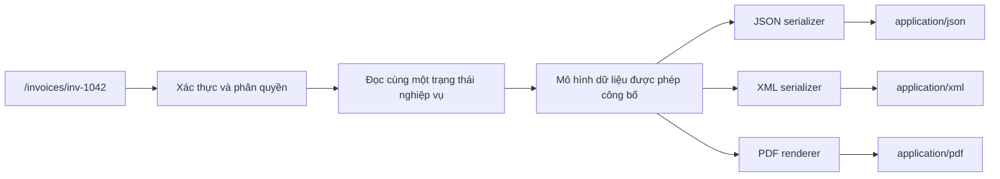

# Tách tài nguyên khỏi biểu diễn JSON, XML hoặc nhị phân

## 1. Bài toán: cùng một hóa đơn, nhiều cách trao đổi

Một hệ thống bán hàng có hóa đơn `inv-1042`. Ứng dụng web cần đọc dữ liệu có cấu trúc để dựng giao diện; đối tác kế toán tiếp nhận XML; khách hàng cần tải bản PDF. Nếu mỗi nhu cầu dẫn tới một mô hình nghiệp vụ và một tập quy tắc tính tiền riêng, hệ thống dễ trả về ba kết quả khác nhau cho cùng một hóa đơn.

Trong chương **Biểu diễn dữ liệu** của module `INTEGRATION_API_REST`, bài học này đặt ranh giới giữa đối tượng mà API quản lý và hình thức dữ liệu truyền qua HTTP. Ranh giới đó giúp thiết kế resource, URI, phương thức, mã trạng thái và hợp đồng dữ liệu nhất quán; đồng thời tạo nền tảng cho cache, phân quyền, OpenAPI và kiểm thử API bằng Java/Spring hoặc công nghệ tương đương.

Sau bài học, bạn có thể:

- Phân biệt tài nguyên, trạng thái tài nguyên, biểu diễn và dữ liệu lưu trữ.
- Dùng một URI để cung cấp những biểu diễn phù hợp cho nhiều client.
- Đọc đúng `Accept`, `Content-Type`, `Content-Encoding` và các lỗi liên quan.
- Tách xử lý nghiệp vụ khỏi DTO, serializer và bộ dựng tài liệu nhị phân.
- Xác định khi nào một bản xuất nên trở thành tài nguyên có vòng đời riêng.

## 2. Tài nguyên và biểu diễn là hai khái niệm khác nhau

**Tài nguyên** (*resource*) là đối tượng hoặc khái niệm mà API cho phép tương tác thông qua định danh. **Biểu diễn** (*representation*) gồm dữ liệu và metadata mô tả trạng thái được truyền đi. Một tài nguyên có thể có nhiều biểu diễn. Cách phân biệt này được trình bày trong [RFC 9110, mục 3.1–3.2](https://www.rfc-editor.org/rfc/rfc9110.html#section-3.1).

Với ví dụ hóa đơn:

| Khái niệm | Ví dụ | Trách nhiệm thiết kế |
| --- | --- | --- |
| Tài nguyên | Hóa đơn `inv-1042` | Xác định đối tượng, quyền truy cập và vòng đời nghiệp vụ |
| URI của tài nguyên | `/invoices/inv-1042` | Cung cấp địa chỉ ổn định để client tương tác |
| Trạng thái nghiệp vụ | Đã phát hành, tổng tiền 1.250.000 VND | Thực thi quy tắc tính tiền và chuyển trạng thái |
| Biểu diễn | JSON, XML, PDF của hóa đơn | Chọn dữ liệu được công bố và quy tắc thể hiện |
| Dữ liệu lưu trữ | Các bảng invoice, invoice_line, payment | Phục vụ cách tổ chức dữ liệu bên trong |
| Đối tượng trong bộ nhớ | Java entity hoặc domain object | Thực hiện logic và liên kết trong ứng dụng |

Một hóa đơn có thể được tổng hợp từ nhiều bảng, một dịch vụ thuế và một dịch vụ thanh toán. Vì vậy, tài nguyên không bắt buộc tương ứng với một hàng trong cơ sở dữ liệu. Ngược lại, một entity có thể chứa ghi chú nội bộ, phiên bản khóa lạc quan hoặc thông tin vận hành mà API không công bố.

Biểu diễn cũng không nhất thiết là bản sao toàn bộ trạng thái. Một màn hình danh sách chỉ cần mã hóa đơn và tổng tiền; màn hình chi tiết cần thêm dòng hàng. Tuy nhiên, mỗi dạng công bố phải có hợp đồng rõ ràng để client biết dữ liệu nào có mặt và có ý nghĩa gì.



Trong sơ đồ này, quyền đọc hóa đơn được quyết định trước khi dữ liệu tới các bộ biểu diễn. Việc thêm PDF không tạo thêm một con đường bỏ qua phân quyền.

## 3. Ví dụ xuyên suốt: một URI, ba biểu diễn

Giả sử API công bố một hợp đồng hóa đơn rút gọn, gồm định danh, khách hàng, trạng thái, thời điểm phát hành, tổng tiền và liên kết tới chính hóa đơn. Các ví dụ bên dưới là những lần đọc cùng một trạng thái; các header không liên quan đã được lược bớt.

### 3.1. Biểu diễn JSON cho ứng dụng

Client yêu cầu:

```http
GET /invoices/inv-1042 HTTP/1.1
Host: api.example.com
Accept: application/json
```

Server trả về:

```http
HTTP/1.1 200 OK
Content-Type: application/json
Vary: Accept
Cache-Control: no-store

{
  "id": "inv-1042",
  "customerId": "cus-27",
  "status": "ISSUED",
  "issuedAt": "2026-11-17T08:30:00Z",
  "total": {
    "amount": "1250000",
    "currency": "VND"
  },
  "links": {
    "self": "/invoices/inv-1042"
  }
}
```

Trường `status` trong JSON là trạng thái nghiệp vụ của hóa đơn. Nó khác với mã HTTP `200`, vốn cho biết kết quả xử lý yêu cầu đọc.

### 3.2. Biểu diễn XML cho đối tác

Client vẫn đọc cùng URI:

```http
GET /invoices/inv-1042 HTTP/1.1
Host: api.example.com
Accept: application/xml
```

Server trả về một cấu trúc XML có ý nghĩa tương ứng:

```http
HTTP/1.1 200 OK
Content-Type: application/xml
Vary: Accept
Cache-Control: no-store

<?xml version="1.0" encoding="UTF-8"?>
<invoice>
  <id>inv-1042</id>
  <customerId>cus-27</customerId>
  <status>ISSUED</status>
  <issuedAt>2026-11-17T08:30:00Z</issuedAt>
  <total>
    <amount>1250000</amount>
    <currency>VND</currency>
  </total>
  <links>
    <self>/invoices/inv-1042</self>
  </links>
</invoice>
```

Nhóm phát triển phải quyết định tên root element, cách thể hiện tập hợp, namespace và giá trị rỗng. Việc một thư viện tự chuyển object sang XML chưa đủ để khẳng định đầu ra đúng hợp đồng với đối tác.

### 3.3. Biểu diễn PDF cho người nhận

```http
GET /invoices/inv-1042 HTTP/1.1
Host: api.example.com
Accept: application/pdf
```

Phần đầu phản hồi có thể là:

```http
HTTP/1.1 200 OK
Content-Type: application/pdf
Content-Disposition: attachment; filename="invoice-inv-1042.pdf"
Vary: Accept
Cache-Control: no-store
```

Body của phản hồi này là các byte PDF thực tế. Không đặt một chuỗi JSON chứa tên file vào body rồi gắn `Content-Type: application/pdf`. `Content-Disposition` hỗ trợ quyết định cách tải hoặc đặt tên file; nó không thay thế media type.

Trong thiết kế đang xét, PDF là bản trình bày được dựng từ cùng trạng thái hóa đơn. Bố cục, font chữ và vị trí các mục có thể khác JSON/XML, nhưng mã hóa đơn, số tiền và trạng thái phải phù hợp với cùng lần chụp dữ liệu. Nếu dựng PDF bằng cách gọi lại nhiều dịch vụ, cần tránh trộn dữ liệu của những thời điểm khác nhau.

## 4. Định danh theo đối tượng, lựa chọn biểu diễn theo hợp đồng

Một nhóm endpoint dễ xuất hiện khi thiết kế bắt đầu từ chức năng xuất dữ liệu:

```text
/getInvoiceJson?id=inv-1042
/getInvoiceXml?id=inv-1042
/downloadInvoicePdf?id=inv-1042
```

Với mô hình một hóa đơn có nhiều biểu diễn, có thể dùng:

```text
GET /invoices/inv-1042
Accept: application/json | application/xml | application/pdf
```

Khi đó, logic tìm hóa đơn, kiểm tra quyền và xử lý hóa đơn không tồn tại có cùng điểm kiểm soát. Thêm một cách trình bày không buộc client đang dùng JSON thay đổi URI.

Hậu tố `.json`, `.xml` hoặc tham số `?format=pdf` vẫn có thể là lựa chọn có chủ đích, chẳng hạn với client khó tùy chỉnh header hoặc hệ thống phân phối file đã có quy ước riêng. Tuy nhiên, chúng tạo ra các URI khác nhau và cần chính sách liên kết, cache và ưu tiên lựa chọn rõ ràng. Nếu API hỗ trợ cả `format` và `Accept`, phải công bố cách giải quyết khi chúng mâu thuẫn.

Không thể kết luận một URI có đuôi `.pdf` là sai REST chỉ từ hình thức của nó. Câu hỏi cần trả lời là URI đó định danh điều gì và client được bảo đảm hành vi nào.

### Khi nào bản xuất là tài nguyên riêng?

Hãy so sánh hai yêu cầu:

| Nhu cầu | Thiết kế có thể phù hợp |
| --- | --- |
| Xem hóa đơn hiện tại dưới dạng PDF, dựng ngay khi đọc | `GET /invoices/{id}` với `Accept: application/pdf` |
| Theo dõi một tác vụ xuất hàng triệu hóa đơn | Tạo và theo dõi `/invoice-exports/{exportId}` |
| Tải một tài liệu đã ký, có mã lưu trữ và thời hạn riêng | Định danh `/documents/{documentId}` và liên kết từ hóa đơn |
| Xem các phiên bản tài liệu đã phát hành | Có tài nguyên hoặc URI phiên bản được định nghĩa rõ |

Khi tài liệu có định danh, trạng thái xử lý, quyền truy cập hoặc vòng đời lưu trữ riêng, việc mô hình hóa nó thành tài nguyên riêng thường giúp hợp đồng chính xác hơn. Quyết định này đến từ nghiệp vụ, không chỉ từ việc byte đầu ra có định dạng nhị phân.

## 5. Phân biệt các header điều khiển dữ liệu

### 5.1. `Accept` và `Content-Type`

`Accept` trong request nêu các media type client muốn nhận; `Content-Type` mô tả loại nội dung thực sự được gửi trong message tương ứng. Đây là hai chiều khác nhau của trao đổi dữ liệu. Có thể đọc định nghĩa tại [RFC 9110, mục 8.3](https://www.rfc-editor.org/rfc/rfc9110.html#section-8.3) và [mục 12.5.1](https://www.rfc-editor.org/rfc/rfc9110.html#section-12.5.1).

Ví dụ client gửi yêu cầu tạo hóa đơn bằng JSON nhưng muốn nhận kết quả bằng XML:

```http
POST /invoices HTTP/1.1
Host: api.example.com
Content-Type: application/json
Accept: application/xml

{
  "customerId": "cus-27",
  "lines": [
    { "productId": "prd-9", "quantity": 2 }
  ]
}
```

Theo hợp đồng của ví dụ, server đọc JSON để tạo lệnh nghiệp vụ. Nếu tạo thành công và trả về hóa đơn mới bằng XML, phản hồi dùng `201 Created`, `Location` trỏ tới URI hóa đơn mới và `Content-Type: application/xml`. Request không cần được gửi bằng XML để nhận XML.

| Vị trí | Header | Câu hỏi thực hành |
| --- | --- | --- |
| Request có body | `Content-Type` | Server nên dùng bộ đọc nào cho dữ liệu client gửi? |
| Request | `Accept` | Client chấp nhận những kiểu phản hồi thành công nào? |
| Response có body | `Content-Type` | Client cần dùng bộ đọc nào cho dữ liệu nhận được? |

Gắn `Content-Type: application/json` vào một request GET không có body không phải cách yêu cầu server trả JSON. Client cần gửi `Accept: application/json`.

### 5.2. Chính sách thương lượng nội dung

Bài học chọn chính sách API: mặc định trả JSON nếu không có ưu tiên; nếu client nêu các kiểu không được hỗ trợ thì trả `406`. Chính sách này cần được cấu hình và ghi vào hợp đồng. HTTP cho phép server bỏ qua ưu tiên thương lượng trong một số trường hợp, nên không coi mọi server trả kiểu khác `Accept` đều vi phạm giao thức. [RFC 9110, mục 12.4](https://www.rfc-editor.org/rfc/rfc9110.html#section-12.4).

Ví dụ sau thể hiện mức ưu tiên:

```http
Accept: application/xml;q=1, application/json;q=0.8
```

Trong API đang xét, XML được ưu tiên nếu có thể cung cấp; nếu chỉ hỗ trợ JSON thì JSON vẫn là lựa chọn được client chấp nhận. Với `q=0`, một kiểu bị loại khỏi lựa chọn theo chính sách tôn trọng `Accept` này. Khi cùng mức ưu tiên, API cần có cách chọn ổn định đã công bố.

Trong mã ứng dụng, tránh tự xử lý toàn bộ header bằng một phép `contains("json")`. Cách đó dễ chọn nhầm khi có `q=0`, wildcard hoặc tham số media type. Nên dùng cơ chế thương lượng của framework và cấu hình chính sách mặc định rõ ràng.

### 5.3. `406`, `415` và `400` giải quyết các vấn đề khác nhau

Giả sử endpoint đọc hỗ trợ JSON/XML/PDF, endpoint tạo chỉ nhận JSON:

| Tình huống theo hợp đồng này | Phản hồi phù hợp | Hướng sửa của client |
| --- | --- | --- |
| GET với `Accept: image/png` | `406 Not Acceptable` | Chọn một kiểu phản hồi được hỗ trợ |
| POST có body XML với `Content-Type: application/xml` | `415 Unsupported Media Type` | Gửi body theo media type mà endpoint nhận |
| POST khai báo JSON nhưng body bị thiếu dấu đóng ngoặc | `400 Bad Request` | Sửa cú pháp nội dung |
| POST có JSON hợp lệ nhưng số lượng hàng bằng 0 | Mã lỗi validation theo hợp đồng, ví dụ `422 Unprocessable Content` | Sửa giá trị nghiệp vụ |

Không gộp mọi lỗi đọc/ghi dữ liệu thành `500`. Cũng không gắn nhãn XML cho một thông báo lỗi được tạo bằng JSON. Nếu API dùng một media type riêng cho lỗi, phải mô tả chính sách đó, kể cả trường hợp không thể đáp ứng `Accept` và phản hồi lỗi không có body.

### 5.4. Media type khác với nén

Một client có thể nhận JSON được nén:

```http
Content-Type: application/json
Content-Encoding: gzip
Vary: Accept, Accept-Encoding
```

Trong thiết kế này, client giải nén gzip rồi phân tích JSON. Nếu endpoint phục vụ một file `.gz` như một đối tượng tải xuống, đó lại là hợp đồng file khác. Không chọn `application/octet-stream` chỉ vì JSON đã được nén.

## 6. Hợp đồng dữ liệu cần bảo toàn ý nghĩa qua các định dạng

JSON và XML chỉ cung cấp cấu trúc. Các bên vẫn cần thống nhất ý nghĩa của từng trường. Ví dụ hóa đơn ở trên dùng các quy ước sau:

| Trường | Quy ước của ví dụ | Mục đích |
| --- | --- | --- |
| `id`, `customerId` | Chuỗi định danh không mang quy tắc tính toán | Client không phụ thuộc kiểu khóa trong database |
| `status` | Một trong `ISSUED`, `PAID`, `CANCELLED` | Có tập giá trị nghiệp vụ rõ ràng |
| `issuedAt` | Chuỗi thời điểm UTC, ví dụ `2026-11-17T08:30:00Z` | Tránh phụ thuộc múi giờ mặc định của máy |
| `total.amount` | Chuỗi chữ số, số tiền nguyên VND không âm | Tránh chuyển qua số dấu phẩy động ở client |
| `total.currency` | `VND` trong phạm vi ví dụ | Nêu đơn vị của giá trị tiền |
| `links.self` | URI tham chiếu tới hóa đơn | Cho phép client xác định liên kết tài nguyên |

Chọn chuỗi cho `amount` là quyết định hợp đồng của ví dụ. Một API khác có thể dùng số nguyên theo đơn vị nhỏ nhất, miễn công bố giới hạn và đơn vị. Khi mở rộng nhiều loại tiền, cần định nghĩa quy tắc phần thập phân hoặc đơn vị nhỏ nhất; không mặc định mọi tiền tệ đều có hai chữ số thập phân.

JSON không có kiểu ngày giờ hay kiểu tiền riêng. Ngoài ra, khả năng biểu diễn chính xác số lớn phụ thuộc cách triển khai bộ đọc; UTF-8 là yêu cầu cho JSON trao đổi giữa các hệ thống mở. Những đặc điểm này cần được tính tới khi xây dựng hợp đồng. [RFC 8259, mục 6–8](https://www.rfc-editor.org/rfc/rfc8259.html#section-6).

### Phân biệt vắng mặt, `null` và rỗng

Giả sử sau này thêm ghi chú của người nhận:

```json
{ "note": null }
```

```json
{ "note": "" }
```

```json
{}
```

Đây là ba cấu trúc khác nhau. Hợp đồng phải nói rõ `note` có bắt buộc hay không, có cho phép `null` không và chuỗi rỗng có hợp lệ không. Với XML, việc thiếu `<note>`, có `<note/>` hoặc dùng một cơ chế biểu diễn null cũng cần được định nghĩa tương ứng.

Đối với cập nhật một phần, sự khác biệt này càng quan trọng: thiếu trường có thể nghĩa là giữ nguyên, còn giá trị null có thể nghĩa là xóa. Không suy ra quy tắc cập nhật từ việc hai đầu ra trông gần giống nhau. Media type và hợp đồng của thao tác cập nhật mới quyết định ý nghĩa đó.

### Đổi định dạng không tự tạo phiên bản nghiệp vụ mới

Chuyển cùng thông tin từ JSON sang XML là thay đổi cách biểu diễn. Đổi `amount` từ VND sang nghìn VND, đổi ý nghĩa `status` hoặc loại bỏ trường bắt buộc là thay đổi hợp đồng. Cùng media type `application/json` vẫn có thể chứa hai hợp đồng không tương thích.

Client nên đọc những trường đã được công bố và không phụ thuộc thứ tự thuộc tính JSON. Server cần đánh giá tác động tới client khi thay đổi enum, trường bắt buộc, kiểu dữ liệu hay cấu trúc lồng nhau. Một thay đổi có vẻ chỉ là cấu hình serializer vẫn có thể phá vỡ tích hợp.

## 7. Tách domain, DTO và bộ biểu diễn trong Java/Spring

Một luồng xử lý có thể được tổ chức như sau:

```text
HTTP request
  -> chọn thao tác và media type
  -> kiểm tra quyền, thực hiện use case
  -> lấy dữ liệu nghiệp vụ nhất quán
  -> ánh xạ sang DTO được phép công bố
  -> serialize JSON/XML hoặc render PDF
  -> HTTP response
```

Với request ghi, luồng đi từ bộ giải mã vào request DTO, validation và lệnh nghiệp vụ. Không lấy mọi trường client gửi để gán trực tiếp lên entity. Trường như `approvedBy`, `internalCost` hoặc tổng tiền do server tính không tự trở thành quyền ghi của client chỉ vì entity có setter.

### 7.1. Một mô hình phản hồi độc lập với persistence

Đoạn Java sau minh họa ánh xạ dữ liệu. `InvoiceSnapshot` là kết quả đọc của tầng nghiệp vụ; ví dụ dùng Java 17 trở lên với record. Tầng nghiệp vụ bảo đảm hóa đơn đã phát hành có `issuedAt` và số tiền VND nguyên không âm.

```java
import java.time.Instant;

record InvoiceSnapshot(
        String id,
        String customerId,
        String status,
        Instant issuedAt,
        long totalVnd) {
}

record MoneyView(String amount, String currency) {
}

record LinksView(String self) {
}

record InvoiceView(
        String id,
        String customerId,
        String status,
        String issuedAt,
        MoneyView total,
        LinksView links) {

    static InvoiceView from(InvoiceSnapshot invoice) {
        return new InvoiceView(
                invoice.id(),
                invoice.customerId(),
                invoice.status(),
                invoice.issuedAt().toString(),
                new MoneyView(Long.toString(invoice.totalVnd()), "VND"),
                new LinksView("/invoices/" + invoice.id()));
    }
}
```

Ví dụ giả định mã hóa đơn dùng bảng ký tự an toàn như `inv-1042`. Nếu định danh chứa ký tự đặc biệt, cần dùng bộ dựng URI để mã hóa path segment đúng cách. Trong ứng dụng thật, các record và controller được đặt vào file/package phù hợp; chúng không phải một file Java hoàn chỉnh khi ghép toàn bộ các khối minh họa.

Tách DTO giúp schema công khai không phụ thuộc cột mới thêm vào database. DTO cũng tránh vô tình serialize quan hệ ORM, vòng tham chiếu, dữ liệu riêng tư hoặc chi tiết của cơ chế tải lười.

### 7.2. Controller chọn biểu diễn, dùng chung nguồn dữ liệu

Spring MVC dùng `produces` để giới hạn kiểu phản hồi, `consumes` để giới hạn kiểu request body và `HttpMessageConverter` để đọc/ghi body. Các cơ chế này được mô tả trong [tài liệu mapping request của Spring](https://docs.spring.io/spring-framework/reference/web/webmvc/mvc-controller/ann-requestmapping.html) và [tài liệu HTTP message conversion](https://docs.spring.io/spring-framework/reference/web/webmvc/message-converters.html).

Ví dụ dưới đây dùng converter JSON đã được cấu hình. XML và PDF được dựng thành byte bởi các thành phần do ứng dụng cung cấp, để ranh giới của từng biểu diễn hiện rõ:

```java
import org.springframework.http.CacheControl;
import org.springframework.http.HttpHeaders;
import org.springframework.http.MediaType;
import org.springframework.http.ResponseEntity;
import org.springframework.web.bind.annotation.GetMapping;
import org.springframework.web.bind.annotation.PathVariable;
import org.springframework.web.bind.annotation.RequestMapping;
import org.springframework.web.bind.annotation.RestController;

interface InvoiceQueries {
    // Triển khai phải kiểm tra quyền đọc của principal hiện tại.
    InvoiceSnapshot findVisibleToCurrentUser(String id);
}

interface InvoiceXmlWriter {
    // Tạo XML UTF-8 đúng schema đã công bố bằng thư viện XML.
    byte[] writeUtf8(InvoiceView invoice);
}

interface InvoicePdfRenderer {
    // Tạo tài liệu PDF hợp lệ từ cùng dữ liệu được phép công bố.
    byte[] render(InvoiceView invoice);
}

@RestController
@RequestMapping("/invoices")
public class InvoiceController {
    private final InvoiceQueries queries;
    private final InvoiceXmlWriter xmlWriter;
    private final InvoicePdfRenderer pdfRenderer;

    public InvoiceController(
            InvoiceQueries queries,
            InvoiceXmlWriter xmlWriter,
            InvoicePdfRenderer pdfRenderer) {
        this.queries = queries;
        this.xmlWriter = xmlWriter;
        this.pdfRenderer = pdfRenderer;
    }

    @GetMapping(value = "/{id}", produces = MediaType.APPLICATION_JSON_VALUE)
    public ResponseEntity<InvoiceView> getJson(@PathVariable("id") String id) {
        return response(load(id), MediaType.APPLICATION_JSON);
    }

    @GetMapping(value = "/{id}", produces = MediaType.APPLICATION_XML_VALUE)
    public ResponseEntity<byte[]> getXml(@PathVariable("id") String id) {
        return response(xmlWriter.writeUtf8(load(id)), MediaType.APPLICATION_XML);
    }

    @GetMapping(value = "/{id}", produces = MediaType.APPLICATION_PDF_VALUE)
    public ResponseEntity<byte[]> getPdf(@PathVariable("id") String id) {
        return response(pdfRenderer.render(load(id)), MediaType.APPLICATION_PDF);
    }

    private InvoiceView load(String id) {
        return InvoiceView.from(queries.findVisibleToCurrentUser(id));
    }

    private <T> ResponseEntity<T> response(T body, MediaType mediaType) {
        return ResponseEntity.ok()
                .contentType(mediaType)
                .header(HttpHeaders.VARY, HttpHeaders.ACCEPT)
                .cacheControl(CacheControl.noStore())
                .body(body);
    }
}
```

Các handler cùng method và path được phân biệt bằng `produces`. Ví dụ này cần các bean triển khai ba interface, converter JSON tương thích record và converter byte array. Nó cũng cần cấu hình ưu tiên JSON khi request không có `Accept` hoặc dùng `*/*`; không dựa vào thứ tự khai báo các phương thức để làm quy tắc mặc định.

Nếu chọn để Spring serialize trực tiếp cùng DTO sang cả JSON và XML, phải cài đặt và cấu hình converter XML phù hợp, đồng thời kiểm soát root element, collection và null. Chỉ thêm `application/xml` vào `produces` không tự bảo đảm XML được sinh đúng hợp đồng. Có thể dùng DTO riêng cho từng định dạng khi cần; logic tính tiền và phân quyền vẫn dùng chung.

Controller trên tập trung vào đường thành công. Cách ánh xạ lỗi không tìm thấy, từ chối truy cập, `406` và lỗi dựng tài liệu phải được bổ sung ở tầng xử lý lỗi của ứng dụng. Các giá trị media type, body thực tế và phản hồi lỗi cần được kiểm tra sau khi ứng dụng đã cấu hình đầy đủ.

## 8. Nhị phân: chọn đúng đối tượng và cách truyền

Mọi dữ liệu trên đường truyền cuối cùng đều là byte. Khi nói “biểu diễn nhị phân”, người thiết kế thường muốn phân biệt PDF, ảnh, audio hoặc một định dạng mã hóa nhị phân với JSON/XML dạng văn bản.

| Lựa chọn | Khi phù hợp | Điểm cần công bố |
| --- | --- | --- |
| JSON | Dữ liệu ứng dụng có cấu trúc, client phổ biến | Schema, kiểu dữ liệu và quy tắc giá trị |
| XML | Tích hợp có schema/namespace hoặc yêu cầu đối tác | Cấu trúc element, namespace và quy tắc validation |
| PDF, ảnh, audio | Client cần tài liệu hoặc nội dung media trực tiếp | Media type chính xác, kích thước và cách tải |
| Định dạng cấu trúc nhị phân | Hai bên có codec và schema tương thích | Cách mã hóa, schema và chiến lược tiến hóa |

### Hạn chế nhúng file lớn dưới dạng Base64

Một cấu trúc như sau có thể dùng cho dữ liệu nhỏ theo hợp đồng riêng:

```json
{
  "id": "doc-81",
  "fileName": "invoice.pdf",
  "contentBase64": "..."
}
```

Nó khiến payload lớn hơn và yêu cầu client giải mã trước khi sử dụng. Base64 dùng khoảng bốn ký tự cho mỗi ba byte đầu vào, chưa tính JSON bao ngoài và trước nén. Với file lớn, nên cân nhắc trả byte trực tiếp hoặc cung cấp liên kết tới tài nguyên nội dung đã được kiểm soát quyền truy cập.

Mẫu `byte[]` trong controller chỉ phù hợp để minh họa hoặc phục vụ dữ liệu đủ nhỏ. Với file lớn, cần cơ chế streaming thích hợp thay vì nạp toàn bộ file vào heap, đồng thời xử lý hủy tải và giải phóng tài nguyên. Không tự thêm `Accept-Ranges: bytes` nếu hệ thống chưa triển khai đọc theo khoảng byte.

Đối với XML đầu vào, cấu hình parser để không tùy tiện tải external entity hoặc tài nguyên mạng. Đối với file nhị phân đầu vào, áp dụng giới hạn kích thước và kiểm tra định dạng thực tế. Tách resource khỏi representation không làm mất trách nhiệm kiểm soát dữ liệu không tin cậy.

## 9. Cache lưu một biểu diễn cụ thể

Giả sử hệ thống bắt đầu cho phép cache riêng của client lưu phản hồi hóa đơn. Client A chọn JSON, client B chọn XML. Nếu cache chỉ xét URI và bỏ qua `Accept`, một client có thể nhận cấu trúc dành cho client còn lại.

`Vary: Accept` bổ sung chiều lựa chọn theo header vào việc khớp phản hồi đã lưu. Quy tắc cache cho `Vary` được định nghĩa tại [RFC 9111, mục 4.1](https://www.rfc-editor.org/rfc/rfc9111.html#section-4.1). Cần gửi header này nhất quán cả ở phản hồi mặc định. Khi nén cũng tham gia lựa chọn, phải giữ cả chiều `Accept-Encoding`.

Một cặp validator minh họa có thể là:

```http
Content-Type: application/json
ETag: "inv-1042-json-a91f"
Vary: Accept
Cache-Control: private, max-age=60
```

```http
Content-Type: application/xml
ETag: "inv-1042-xml-b73c"
Vary: Accept
Cache-Control: private, max-age=60
```

Hai giá trị ETag trên chỉ minh họa ý tưởng; phần đuôi không phải thuật toán băm để sao chép nguyên vào ứng dụng. Với strong ETag, cách sinh phải phân biệt dữ liệu biểu diễn khác nhau, kể cả khi chỉ thay đổi template hoặc cách serialize. Không dùng chung một strong ETag chỉ vì JSON và XML được dựng từ cùng phiên bản hàng dữ liệu.

Client đã lưu JSON nên tái xác thực trong cùng ngữ cảnh lựa chọn JSON:

```http
GET /invoices/inv-1042 HTTP/1.1
Host: api.example.com
Accept: application/json
If-None-Match: "inv-1042-json-a91f"
```

Nếu điều kiện tái xác thực thỏa mãn, client có thể tái sử dụng biểu diễn đã lưu theo phản hồi `304`. Không dùng validator lấy từ một bản PDF để tự kết luận rằng mọi biểu diễn khác đều còn phù hợp. Phân biệt strong/weak validator và biểu diễn có content coding được trình bày tại [RFC 9110, mục 8.8](https://www.rfc-editor.org/rfc/rfc9110.html#section-8.8).

Các ví dụ thành công và controller trước đó dùng `no-store`, nên không cần triển khai luồng cache này để sử dụng chúng. Khi bật cache, phải chọn chính sách theo độ nhạy của dữ liệu. `Vary` không thay thế phân quyền và không tự cô lập dữ liệu giữa người dùng; chính sách `private`, `no-store` và cách tổ chức cache ứng dụng phải được quyết định riêng. `private` cho phép cache riêng lưu khi các điều kiện khác đáp ứng, còn `no-store` yêu cầu không lưu phản hồi. [RFC 9111, mục 5.2.2](https://www.rfc-editor.org/rfc/rfc9111.html#section-5.2.2).

## 10. Mô tả nhiều biểu diễn trong OpenAPI

Trong OpenAPI, một phản hồi có thể mô tả nhiều media type trong `content`. JSON/XML có thể tham chiếu cùng schema logic khi cách ánh xạ phù hợp; PDF là dữ liệu file. Cách mô tả `content` và file nhị phân dưới đây dùng [OpenAPI 3.0.3](https://spec.openapis.org/oas/v3.0.3.html#media-type-object).

Đặc tả rút gọn sau chỉ mô tả đường đọc và những mã phản hồi liên quan trực tiếp tới biểu diễn. Một đặc tả dùng trong hệ thống thật cần thêm chính sách bảo mật và các phản hồi lỗi của ứng dụng.

```yaml
openapi: 3.0.3
info:
  title: Invoice Representation Example
  version: 1.0.0
paths:
  /invoices/{id}:
    get:
      summary: Đọc hóa đơn theo media type client chấp nhận
      parameters:
        - name: id
          in: path
          required: true
          schema:
            type: string
      responses:
        '200':
          description: Biểu diễn hóa đơn
          content:
            application/json:
              schema:
                $ref: '#/components/schemas/Invoice'
            application/xml:
              schema:
                $ref: '#/components/schemas/Invoice'
            application/pdf:
              schema:
                type: string
                format: binary
        '406':
          description: Không cung cấp được media type client chấp nhận
components:
  schemas:
    Invoice:
      type: object
      xml:
        name: invoice
      required: [id, customerId, status, issuedAt, total, links]
      properties:
        id:
          type: string
          example: inv-1042
        customerId:
          type: string
          example: cus-27
        status:
          type: string
          enum: [ISSUED, PAID, CANCELLED]
        issuedAt:
          type: string
          format: date-time
        total:
          type: object
          required: [amount, currency]
          properties:
            amount:
              type: string
              pattern: '^[0-9]+$'
              example: '1250000'
            currency:
              type: string
              enum: [VND]
        links:
          type: object
          required: [self]
          properties:
            self:
              type: string
              example: /invoices/inv-1042
```

`format: binary` ở đây mô tả file trong response của OpenAPI 3.0.3; nó không yêu cầu bọc PDF vào chuỗi JSON. Đối với request ghi, khai báo các media type nhận được trong `requestBody.content`, độc lập với danh sách media type phản hồi.

Đặc tả cũng cần ghi quy tắc mặc định và chọn ưu tiên khi client gửi nhiều media type. Việc liệt kê JSON trước XML trong tài liệu không đủ để cấu hình hành vi của server. Ví dụ response, cấu hình serializer và schema OpenAPI phải mô tả cùng một hợp đồng.

## 11. Kiểm chứng hợp đồng qua HTTP

Khi triển khai bài học thành ứng dụng, có thể kiểm tra thủ công bằng các lệnh sau. Đây là hướng dẫn thực hành; hostname, hóa đơn và thông tin xác thực phải được thay theo môi trường thật. Dùng `curl.exe` trên Windows để tránh nhầm với alias của PowerShell.

```powershell
curl.exe -i -H "Accept: application/json" "https://api.example.com/invoices/inv-1042"
```

```powershell
curl.exe -i -H "Accept: application/xml" "https://api.example.com/invoices/inv-1042"
```

```powershell
curl.exe --fail --dump-header - -H "Accept: application/pdf" --output "invoice-inv-1042.pdf" "https://api.example.com/invoices/inv-1042"
```

Lệnh PDF ghi file vào thư mục đang đứng và in header ra terminal. Chỉ kiểm tra tên hoặc phần mở rộng của file là chưa đủ: cần xác nhận status, `Content-Type` và khả năng mở PDF bằng bộ đọc phù hợp.

Các tình huống kiểm thử tích hợp nên tập trung vào ranh giới giữa resource và representation:

| Tình huống | Điều cần quan sát |
| --- | --- |
| Đọc JSON và XML trên cùng dữ liệu cố định | Cùng định danh, trạng thái và tổng tiền sau khi parse |
| Đọc PDF trên dữ liệu đó | Tài liệu hợp lệ, thông tin hóa đơn phù hợp |
| Không gửi `Accept` hoặc gửi `*/*` | Chính sách mặc định JSON được thực hiện ổn định |
| Chỉ chấp nhận một media type không hỗ trợ | Nhận `406` theo hợp đồng |
| Gửi kiểu request body không được endpoint hỗ trợ | Nhận `415`, không thực hiện ghi dữ liệu |
| Gửi body sai cú pháp của kiểu đã khai báo | Nhận lỗi cú pháp theo hợp đồng, ví dụ `400` |
| Đọc hóa đơn thuộc người dùng khác bằng từng định dạng | Cùng chính sách kiểm tra quyền, không rò rỉ qua PDF/XML |
| Đọc hóa đơn không tồn tại | Cùng chính sách xử lý không tìm thấy ở các định dạng |
| Thay đổi template hoặc serializer khi có cache | Validator và các biến thể cache vẫn phù hợp |

Đối với JSON/XML, so sánh giá trị sau khi parse thường có ý nghĩa hơn so sánh toàn bộ chuỗi: khoảng trắng và thứ tự thuộc tính không phải mục tiêu nghiệp vụ. Với PDF, không nên dùng toàn bộ byte làm tiêu chí duy nhất vì bộ dựng có thể thêm metadata biến động. Nên kiểm tra cấu trúc tài liệu và các thông tin quan trọng bằng công cụ phù hợp.

Các yêu cầu ghi còn cần kiểm thử tính nhất quán của lệnh nghiệp vụ. Một `PUT` không trở nên mất hay có tính idempotent chỉ vì chuyển body từ JSON sang XML; hợp đồng của thao tác và cách xử lý trạng thái mới quyết định điều đó. Tương tự, retry lệnh tạo cần chính sách chống tạo trùng phù hợp, không thể giải quyết chỉ bằng serializer.

## 12. Những lỗi thiết kế thường gặp

| Lỗi | Hệ quả | Cách điều chỉnh |
| --- | --- | --- |
| Tính lại tổng tiền ở từng JSON/XML/PDF handler | Cùng hóa đơn trả kết quả khác nhau | Dùng một use case và dữ liệu nghiệp vụ dùng chung |
| Trả entity ORM trực tiếp | Lộ trường nội bộ, quan hệ và phụ thuộc persistence | Ánh xạ DTO theo hợp đồng công khai |
| Dùng `Content-Type` request để chọn response | Gửi JSON rồi không thể yêu cầu XML đúng cách | Tách chiều đọc body và chiều chọn phản hồi |
| Đổi nhãn `Content-Type` nhưng giữ nguyên body | Client dùng sai parser | Sinh dữ liệu đúng định dạng rồi gắn media type tương ứng |
| Coi nhị phân đồng nghĩa với `application/octet-stream` | Mất thông tin kiểu nội dung cụ thể | Dùng `application/pdf`, `image/png` hoặc kiểu đã xác định |
| Cấp quyền ở riêng JSON handler | XML/PDF có thể trở thành đường rò rỉ | Kiểm tra quyền ở use case dùng chung |
| Bật cache nhưng bỏ chiều lựa chọn `Accept` | Client nhận nhầm biểu diễn đã lưu | Dùng `Vary` và cấu hình cache phù hợp |
| Cho rằng mọi bản xuất chỉ là biểu diễn hiện tại | Không quản lý được tác vụ, chữ ký hoặc phiên bản | Tạo tài nguyên tài liệu/tác vụ khi có vòng đời riêng |

## 13. Áp dụng khi thiết kế endpoint mới

Trước khi chọn JSON, XML hay nhị phân, hãy viết rõ đối tượng nào đang được định danh, trạng thái nào được phép công bố và ai được đọc hoặc thay đổi trạng thái đó. Sau đó xác định từng nhóm client cần biểu diễn nào và liệu chúng đang xem cùng một trạng thái hay truy cập các tài liệu có vòng đời riêng.

Khi đã có ranh giới, xác định schema công khai, ánh xạ dữ liệu, media type đầu vào/đầu ra, chính sách thương lượng và mã lỗi. Mọi biểu diễn của cùng nghiệp vụ cần đi qua các quy tắc tính toán và kiểm tra quyền thích hợp. Nếu có cache, phải thiết kế cách phân biệt biến thể và validator ngay cùng hợp đồng biểu diễn.

Ở ví dụ hóa đơn, định danh `inv-1042` và quy tắc nghiệp vụ vẫn là điểm chung. JSON phục vụ ứng dụng, XML phục vụ đối tác và PDF phục vụ việc đọc tài liệu; mỗi dạng có bộ thể hiện riêng nhưng đều dựa trên dữ liệu được phép công bố của hóa đơn đó.
