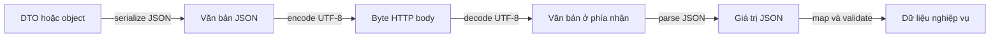

# Charset, UTF-8 và quy tắc xử lý JSON

## 1. Mục tiêu và tình huống thực tế

Trong chương **Biểu diễn dữ liệu** của module **INTEGRATION_API_REST**, một hợp đồng REST API cần mô tả cả cấu trúc dữ liệu lẫn cách chuyển dữ liệu thành byte. URI và phương thức HTTP có thể đúng, mã trạng thái có thể hợp lý, nhưng tên khách hàng vẫn bị hỏng nếu client và server giải mã khác nhau.

Giả sử client gửi yêu cầu đổi tên hiển thị của khách hàng:

```http
PUT /customers/cus-204/profile HTTP/1.1
Host: api.example.test
Content-Type: application/json
Accept: application/json

{
  "displayName": "Nguyễn Thị Hồng 😀",
  "bio": "Tôi thích cà phê."
}
```

Hợp đồng cần trả lời các câu hỏi cụ thể:

- Body dùng những byte nào để biểu diễn tiếng Việt và emoji?
- Chuỗi JSON có được chứa dấu xuống dòng trực tiếp không?
- Server xử lý thế nào khi một object có hai khóa cùng tên?
- `null` khác trường bị thiếu như thế nào?
- Client JavaScript có giữ nguyên một mã số định danh quá lớn không?
- Dữ liệu lỗi bị từ chối ở bước giải mã, phân tích cú pháp hay kiểm tra nghiệp vụ?

Sau bài học, người học có thể thiết kế quy tắc JSON cho một resource, triển khai bằng Java/Spring hoặc công nghệ tương đương và đề xuất kiểm thử từ byte HTTP đến dữ liệu được lưu. Những quy tắc này cũng giúp biểu diễn trang kết quả, cache và đối chiếu yêu cầu idempotent nhất quán.

## 2. Phân biệt Unicode, charset và UTF-8

### 2.1. Những khái niệm dễ nhầm

| Khái niệm | Ý nghĩa | Ví dụ |
| --- | --- | --- |
| Unicode | Hệ thống mã hóa ký tự với các code point | `é` có code point `U+00E9` |
| Code point | Giá trị mã của một phần tử trong không gian Unicode | `😀` là `U+1F600` |
| Charset/character encoding | Quy tắc ánh xạ văn bản thành byte và ngược lại | UTF-8, UTF-16 |
| UTF-8 | Biểu diễn Unicode bằng các đơn vị 8 bit, mỗi Unicode scalar value dùng 1–4 byte | `é` thành `C3 A9` |
| Code unit | Đơn vị cơ sở của một dạng mã hóa | UTF-8 dùng 8 bit; UTF-16 dùng 16 bit |
| Grapheme cluster | Cụm ký tự thường tương ứng một đơn vị người dùng nhìn thấy | Một chữ có dấu ghép hoặc emoji ghép có thể gồm nhiều code point |

Unicode không đồng nghĩa với “mỗi ký tự chiếm hai byte”. UTF-8 và UTF-16 là các cách biểu diễn Unicode khác nhau. Xem giải thích của [Unicode Consortium về UTF](https://www.unicode.org/faq/utf_bom.html).

Ví dụ byte UTF-8 sau chỉ tính phần văn bản, chưa tính dấu ngoặc kép hay cấu trúc JSON:

| Văn bản | Code point | Byte UTF-8 dạng hex | Số byte |
| --- | --- | --- | --- |
| `A` | `U+0041` | `41` | 1 |
| `é` | `U+00E9` | `C3 A9` | 2 |
| `ế` | `U+1EBF` | `E1 BA BF` | 3 |
| `😀` | `U+1F600` | `F0 9F 98 80` | 4 |

Một giới hạn “100 ký tự” cần được định nghĩa rõ: 100 byte, 100 code point hay 100 grapheme cluster. Những giới hạn này cho kết quả khác nhau với tiếng Việt và emoji.

### 2.2. JSON là văn bản; HTTP vận chuyển byte



Sơ đồ thể hiện các bước về mặt khái niệm. Thư viện có thể kết hợp giải mã và parse khi đọc trực tiếp một stream.

Cần xác định đúng lớp lỗi:

| Lớp | Ví dụ lỗi | Cách xử lý trong API ví dụ |
| --- | --- | --- |
| Byte → văn bản | Chuỗi byte UTF-8 bị cắt giữa chừng | Từ chối yêu cầu, không âm thầm sửa tên |
| Văn bản → JSON | Thiếu dấu ngoặc kép hoặc có dấu phẩy cuối | Trả lỗi cú pháp |
| JSON → DTO | `displayName` là object thay vì string | Trả lỗi hợp đồng dữ liệu |
| DTO → nghiệp vụ | Tên chỉ có khoảng trắng | Trả lỗi validation |

Một body giải mã đúng UTF-8 chưa chắc là JSON hợp lệ. JSON hợp lệ cũng chưa chắc đáp ứng schema của resource.

## 3. Quy tắc HTTP cho body JSON

### 3.1. Quy tắc encoding nền tảng

JSON trao đổi giữa những hệ thống ngoài một hệ sinh thái đóng phải dùng UTF-8. Bên gửi không thêm BOM vào đầu JSON truyền qua mạng; parser được phép bỏ qua BOM để tương thích. Đăng ký `application/json` không định nghĩa tham số `charset`. Xem [RFC 8259, mục 8.1 và 11](https://www.rfc-editor.org/rfc/rfc8259.html#section-8.1).

Hợp đồng trong bài chọn cách gửi đơn giản:

```http
Content-Type: application/json
Accept: application/json
```

Client mã hóa body bằng UTF-8. Server trả JSON bằng UTF-8. Việc không ghi `charset` trong header này không có nghĩa là server được tự chọn một bảng mã tùy môi trường.

Một số hệ thống vẫn gửi `application/json; charset=UTF-8`. Khi tích hợp với hệ thống đó, cần kiểm tra khả năng tương thích thực tế và ghi nhận chính sách của API. Thêm tham số này không biến body Windows-1258 hoặc UTF-16 thành UTF-8.

### 3.2. Những header không thay thế cho nhau

| Header | Vai trò | Không dùng để làm gì |
| --- | --- | --- |
| `Content-Type: application/json` | Mô tả kiểu nội dung của body đang gửi | Không sửa các byte đã mã hóa sai |
| `Accept: application/json` | Nêu kiểu response client chấp nhận | Không khai báo encoding của request |
| `Content-Encoding: gzip` | Nêu phép nén đã áp dụng cho nội dung | Không chỉ charset |
| `Content-Length` | Độ dài nội dung theo byte khi header này được dùng | Không lấy từ số ký tự Java |

Nếu gửi JSON có gzip, phía nhận cần giải nén trước khi xử lý các byte JSON. Chính sách giới hạn dung lượng phải tính cả nguy cơ nội dung sau giải nén quá lớn.

Không đặt `Content-Length` thủ công bằng `String.length()`. HTTP client hoặc framework nên tính độ dài từ các byte thực sự gửi. Response `204 No Content` không có body; không thêm `{}` hoặc `null` để “cho đủ JSON”.

### 3.3. Chính sách BOM

BOM UTF-8 là ba byte `EF BB BF` ở đầu stream. API ví dụ quy định:

- Response và request do hệ thống phát sinh luôn không có BOM.
- Request có BOM bị từ chối theo chính sách đầu vào nghiêm ngặt.
- Nếu cần tương thích một đối tác gửi BOM, phải ghi rõ ngoại lệ và kiểm thử toàn bộ đường đi qua gateway.

Quy tắc từ chối BOM ở đây là lựa chọn của API; không được diễn giải rằng mọi parser JSON đều bắt buộc từ chối BOM.

## 4. Các quy tắc cú pháp JSON cần thống nhất

JSON có object, array, string, number, boolean và `null`. Cú pháp không tự quy định mô hình nghiệp vụ hay cách ánh xạ sang lớp Java; những ý nghĩa đó phải nằm trong hợp đồng API. Đây là sự phân biệt được nêu trong [ECMA-404](https://ecma-international.org/publications-and-standards/standards/ecma-404/).

### 4.1. Dùng cú pháp chuẩn thay vì mở rộng của parser

| Quy tắc | Hợp lệ | Không dùng |
| --- | --- | --- |
| Tên thuộc tính là string với dấu nháy kép | `{"name":"An"}` | `{name:"An"}` |
| String dùng dấu nháy kép | `{"name":"An"}` | `{'name':'An'}` |
| Boolean và null viết thường | `true`, `false`, `null` | `True`, `NULL`, `undefined` |
| Không có dấu phẩy thừa | `["a","b"]` | `["a","b",]` |
| Không có comment trong JSON chuẩn | `{"page":1}` | `{"page":1 /* trang đầu */}` |
| Không có số với số 0 dư ở đầu | `0`, `12` | `01` |
| Số thập phân có đủ phần cần thiết | `0.5`, `1.0`, `1e3` | `.5`, `1.` |
| Không có literal số đặc biệt | `12.5` | `NaN`, `Infinity` |

`01` có thể là mã nghiệp vụ hợp lệ nếu biểu diễn bằng string `"01"`. Chọn string còn giúp giữ nguyên các số 0 đầu của số điện thoại hoặc mã bưu chính.

Whitespace ngoài string được JSON chấp nhận gồm space, tab, LF và CR. Một khoảng trắng Unicode nhìn giống space không tự động là whitespace hợp lệ giữa các token.

Một JSON text có thể có giá trị gốc là `"ok"`, `42`, `true` hoặc `null`. API ví dụ chủ động yêu cầu body gốc là object để dễ mở rộng schema; đó là quy tắc của endpoint, không phải giới hạn chung của JSON.

### 4.2. Thứ tự và tên thuộc tính

Object được sử dụng như tập ánh xạ tên → giá trị. Client không nên yêu cầu server xuất `id` trước `displayName`. Array có thứ tự; khi thứ tự phần tử thể hiện danh sách xếp hạng hoặc kết quả phân trang, phải mô tả rõ ý nghĩa đó.

Tên thuộc tính phân biệt hoa thường. `displayName` và `displayname` là hai tên khác nhau. API nên chọn một quy ước đặt tên và áp dụng ổn định cho request, response và OpenAPI.

JSON không tự có kiểu ngày, tiền hay dữ liệu nhị phân. Ví dụ `"2026-11-17T09:30:00Z"` vẫn là string; hợp đồng phải bổ sung định dạng và ý nghĩa múi giờ.

## 5. Escape, dấu tiếng Việt và emoji

### 5.1. Escape JSON khác với encode UTF-8

Hai tài liệu sau cho cùng giá trị `name` sau khi parse:

```json
{"name":"Hồng"}
```

```json
{"name":"H\u1ed3ng"}
```

`\u1ed3` là cách viết escape trong cú pháp JSON. Những byte của dấu `\`, chữ `u` và bốn chữ số hex vẫn được truyền bằng UTF-8. Đây không phải một charset khác.

Không cần biến toàn bộ tiếng Việt thành escape để gửi JSON an toàn. Ngược lại, không được tự gọi một hàm “unescape Unicode” sau khi parser đã xử lý escape, vì có thể biến văn bản người dùng muốn giữ nguyên thành nội dung khác.

### 5.2. Các ký tự phải escape bên trong string

Dấu ngoặc kép, dấu gạch chéo ngược và ký tự điều khiển U+0000–U+001F phải được escape. Một số cách viết thường gặp:

| Muốn chứa trong giá trị | Cách viết trong JSON |
| --- | --- |
| Dấu `"` | `\"` |
| Dấu `\` | `\\` |
| Xuống dòng | `\n` |
| Tab | `\t` |
| Carriage return | `\r` |

Ví dụ JSON hợp lệ:

```json
{
  "message": "Anh ấy nói: \"Xin chào\"",
  "path": "C:\\reports\\thang-11",
  "note": "Dòng thứ nhất\nDòng thứ hai"
}
```

Trong ví dụ, `\n` gồm hai ký tự ở văn bản JSON; sau parse nó trở thành một ký tự xuống dòng trong giá trị. Chèn trực tiếp một LF vào giữa dấu ngoặc kép sẽ làm JSON không hợp lệ.

Serializer cần thực hiện escaping. Không nối dữ liệu người dùng vào JSON bằng chuỗi vì dấu nháy, dấu gạch chéo hoặc newline trong tên có thể phá cấu trúc.

### 5.3. Emoji và surrogate pair

Emoji `😀` có thể xuất trực tiếp trong JSON UTF-8 hoặc dưới dạng escape:

```json
{"reaction":"\uD83D\uDE00"}
```

Đây là một cặp surrogate UTF-16 biểu diễn code point U+1F600. Một escape surrogate đứng lẻ như `"\uD83D"` không phải dữ liệu Unicode có thể trao đổi đáng tin cậy.

Hợp đồng của bài từ chối surrogate đứng lẻ, dù một parser có thể chấp nhận văn bản đó về mặt cú pháp. Giải mã UTF-8 nghiêm ngặt chưa kiểm tra được trường hợp này: chuỗi escape chỉ chứa byte ASCII, và lỗi chỉ xuất hiện khi diễn giải giá trị string.

Không cắt chuỗi tùy ý theo byte hoặc theo một `char` Java; có thể làm hỏng một ký tự nhiều byte hoặc một cặp surrogate.

## 6. Chọn chính sách JSON để các bên hiểu cùng một dữ liệu

### 6.1. Từ chối khóa trùng ngay khi parse

Body sau gây mơ hồ:

```json
{
  "role": "reader",
  "role": "admin"
}
```

Nếu gateway nhìn thấy giá trị đầu và ứng dụng giữ giá trị cuối, cùng một body có thể được hiểu khác nhau tại hai lớp bảo vệ.

API ví dụ chọn **từ chối khóa trùng trong cùng object**, kể cả khi một tên dùng escape:

```json
{
  "role": "reader",
  "\u0072ole": "admin"
}
```

Sau giải mã escape, cả hai tên đều là `role`. Phát hiện phải diễn ra ở parser; khi đã chuyển thành một `Map` thông thường và mất một giá trị, kiểm tra DTO có thể quá muộn.

I-JSON đặt thêm các ràng buộc để tăng tính tương tác, gồm tên thuộc tính không trùng và hạn chế một số giá trị Unicode hoặc số. Hợp đồng ở đây chọn một số chính sách tương tự, không tự tuyên bố đã tuân thủ toàn bộ I-JSON. Xem [RFC 7493, mục 2](https://www.rfc-editor.org/rfc/rfc7493.html#section-2).

### 6.2. Phân biệt thiếu trường, null và chuỗi rỗng

| Request | Thông tin thực tế | Chính sách ví dụ với bio |
| --- | --- | --- |
| `{}` | Không có thuộc tính `bio` | Với PATCH đã định nghĩa riêng: giữ giá trị hiện tại |
| `{"bio":null}` | Có thuộc tính, giá trị null | Với PATCH đó: xóa giá trị |
| `{"bio":""}` | Có thuộc tính, string dài 0 | Lưu string rỗng nếu được phép |
| `{"bio":" "}` | String chứa một space | Áp dụng quy tắc trim/validation đã công bố |

Bảng minh họa một hợp đồng PATCH cụ thể. JSON thường không tự tạo ra các ngữ nghĩa “giữ nguyên” hoặc “xóa”. Nếu dùng JSON Merge Patch thì phải theo đúng media type và ngữ nghĩa của định dạng đó.

Đối với `PUT /customers/{id}/profile` ở đầu bài, API yêu cầu cả `displayName` và `bio`; `bio` được phép null. Bỏ `bio` là thiếu dữ liệu của phép thay thế, không tự hiểu thành giữ nguyên.

Một DTO chỉ dùng trường tham chiếu có thể ánh xạ cả trường bị thiếu lẫn null thành `null`. Nếu cần phân biệt, phải theo dõi sự hiện diện của trường, dùng mô hình đầu vào phù hợp hoặc đọc cây JSON trước khi map.

### 6.3. Không làm tròn định danh và tiền

Client JavaScript dùng kiểu số phổ biến không thể giữ chính xác mọi số nguyên lớn. API ví dụ chọn:

```json
{
  "id": "9007199254740993",
  "amount": "125000.50",
  "currency": "VND",
  "quantity": 2
}
```

`id` là string vì là định danh, không phải đại lượng để cộng trừ. `amount` là string thập phân theo hợp đồng ví dụ, còn `quantity` là integer có giới hạn nhỏ.

Với kiểu số IEEE 754 binary64, miền số nguyên an toàn thường dùng là từ `-9007199254740991` đến `9007199254740991`. Nếu hợp đồng chọn decimal string, phải quy định dấu thập phân, số chữ số và cấm định dạng phụ thuộc locale như `"125.000,50"`.

Phía Java có thể chuyển decimal string thành `BigDecimal` sau khi kiểm tra định dạng. Không chuyển qua `double` rồi mới tạo `BigDecimal` vì giá trị có thể đã bị xấp xỉ.

### 6.4. Trường lạ và coercion cần có quyết định rõ

API ví dụ yêu cầu `displayName` là string, không tự đổi `123` thành `"123"`. Đầu vào cập nhật hồ sơ cũng từ chối trường không công bố để phát hiện lỗi như `displayNmae`.

Đây là lựa chọn thiết kế. API khác có thể bỏ qua trường lạ để hỗ trợ tiến hóa hợp đồng. Cần quyết định riêng cho request và response, cấu hình mapper tương ứng và kiểm tra tác động đến client cũ. Không coi hành vi mặc định của thư viện là hợp đồng công khai.

## 7. Unicode normalization không phải sửa encoding

Hai string sau có thể hiển thị cùng chữ `é` nhưng khác chuỗi code point:

- `"\u00E9"`: một code point có sẵn dấu.
- `"e\u0301"`: chữ `e` và dấu sắc kết hợp.

NFC có thể đưa các chuỗi tương đương chuẩn tắc về cùng dạng. Normalization không tự diễn ra chỉ vì JSON được mã hóa UTF-8. Xem [Unicode UAX #15](https://www.unicode.org/reports/tr15/).

Ví dụ Java:

```java
import java.text.Normalizer;

String composed = "\u00E9";
String decomposed = "e\u0301";

boolean sameBefore = composed.equals(decomposed); // false
boolean sameAfter = Normalizer.normalize(composed, Normalizer.Form.NFC)
        .equals(Normalizer.normalize(decomposed, Normalizer.Form.NFC)); // true
```

Nếu API chọn NFC cho tên hiển thị, hợp đồng cần nêu thời điểm chuẩn hóa, cách kiểm tra độ dài và giá trị nào được lưu hoặc trả lại. Không tự áp dụng normalization cho token, chữ ký hoặc dữ liệu nhạy với byte.

Normalization cũng không phải bỏ dấu, đổi chữ hoa thành chữ thường hay làm cho mọi ký tự nhìn giống nhau trở thành cùng một ký tự. Các yêu cầu tìm kiếm và định danh cần quy tắc riêng.

## 8. Áp dụng trong Java

### 8.1. Đếm code unit, code point và byte riêng biệt

```java
import java.nio.charset.StandardCharsets;

String text = "A😀";

int javaLength = text.length();                    // 3 code unit UTF-16
int codePoints = text.codePointCount(0, text.length()); // 2 code point
int utf8Bytes = text.getBytes(StandardCharsets.UTF_8).length; // 5 byte
```

`String.length()` đếm code unit UTF-16. `codePointCount` không đếm grapheme cluster; emoji ghép hoặc dấu kết hợp vẫn cần xử lý khác nếu giới hạn dựa trên cách người dùng nhìn thấy. Hợp đồng phải chọn đơn vị thay vì gọi chung là “độ dài chuỗi”. Xem [Java String API](https://docs.oracle.com/en/java/javase/21/docs/api/java.base/java/lang/String.html).

### 8.2. Chỉ rõ charset tại biên byte

```java
import java.nio.charset.StandardCharsets;

byte[] outbound = jsonText.getBytes(StandardCharsets.UTF_8);
String inbound = new String(outbound, StandardCharsets.UTF_8);
```

Không dựa vào `getBytes()` hoặc `new String(byte[])` khi cần hợp đồng encoding rõ ràng. Charset mặc định của runtime không thay thế được thỏa thuận giữa các hệ thống.

Cách tạo `String` ở trên thuận tiện cho round trip với byte hợp lệ do chính mình sinh ra. Với request không đáng tin cậy, cần xem chính sách xử lý byte lỗi của API đang dùng; không mặc định rằng mọi phép giải mã đều từ chối lỗi.

### 8.3. Giải mã UTF-8 nghiêm ngặt khi tự đọc body

Ví dụ dưới là tiện ích độc lập, minh họa việc báo lỗi thay cho thay thế byte hỏng:

```java
import java.nio.ByteBuffer;
import java.nio.charset.CharacterCodingException;
import java.nio.charset.CodingErrorAction;
import java.nio.charset.StandardCharsets;

public final class StrictUtf8 {
    private StrictUtf8() {
    }

    public static String decode(byte[] bytes)
            throws CharacterCodingException {
        return StandardCharsets.UTF_8.newDecoder()
                .onMalformedInput(CodingErrorAction.REPORT)
                .onUnmappableCharacter(CodingErrorAction.REPORT)
                .decode(ByteBuffer.wrap(bytes))
                .toString();
    }
}
```

Ví dụ hai byte `C3 28` không tạo thành UTF-8 hợp lệ:

```java
byte[] invalid = {(byte) 0xC3, (byte) 0x28};
String text = StrictUtf8.decode(invalid); // ném CharacterCodingException
```

Tạo decoder riêng cho mỗi lần gọi như ví dụ tránh chia sẻ một decoder có trạng thái giữa nhiều thread. Hành vi báo lỗi và giới hạn dùng đồng thời được mô tả trong [Java CharsetDecoder API](https://docs.oracle.com/en/java/javase/21/docs/api/java.base/java/nio/charset/CharsetDecoder.html).

Tiện ích này chỉ giải mã byte. Nó chưa parse JSON, chưa phát hiện khóa trùng, chưa kiểm tra surrogate escape, chưa thực thi schema và chưa đặt giới hạn dung lượng. Nếu đọc body theo stream, cần giữ trạng thái decoder qua các chunk vì một ký tự có thể nằm giữa hai chunk.

## 9. Áp dụng trong Spring MVC

### 9.1. Để message converter xử lý DTO

Controller tối giản sau minh họa biên request/response; chưa triển khai lưu trữ, xác thực và validation theo hợp đồng:

```java
import org.springframework.http.MediaType;
import org.springframework.web.bind.annotation.PathVariable;
import org.springframework.web.bind.annotation.PutMapping;
import org.springframework.web.bind.annotation.RequestBody;
import org.springframework.web.bind.annotation.RestController;

@RestController
public class ProfileController {
    public record ReplaceProfileRequest(String displayName, String bio) {
    }

    public record ProfileResponse(String id, String displayName, String bio) {
    }

    @PutMapping(
            value = "/customers/{id}/profile",
            consumes = MediaType.APPLICATION_JSON_VALUE,
            produces = MediaType.APPLICATION_JSON_VALUE)
    public ProfileResponse replace(
            @PathVariable("id") String id,
            @RequestBody ReplaceProfileRequest request) {
        return new ProfileResponse(id, request.displayName(), request.bio());
    }
}
```

`@RequestBody` dùng `HttpMessageConverter` để đọc và deserialize body. `@RestController` cho phép serialize giá trị trả về qua cơ chế response body. Xem tài liệu [Spring về @RequestBody](https://docs.spring.io/spring-framework/reference/web/webmvc/mvc-controller/ann-methods/requestbody.html) và [@ResponseBody](https://docs.spring.io/spring-framework/reference/web/webmvc/mvc-controller/ann-methods/responsebody.html).

Trong ứng dụng đã cấu hình JSON converter phù hợp, nên nhận DTO và trả DTO. Không tạo JSON response bằng phép nối chuỗi. Một filter chỉ đổi header hoặc thiết lập encoding không sửa được giá trị đã bị đọc sai trước đó.

### 9.2. Những phần cần bổ sung để thực hiện hợp đồng

Controller trên chưa tự bảo đảm toàn bộ chính sách của bài. Khi triển khai thực tế, cần nối các yêu cầu sau với đúng lớp xử lý:

| Yêu cầu | Nơi cần thực hiện |
| --- | --- |
| Chỉ nhận body UTF-8, chính sách BOM | Biên đọc body/converter và kiểm thử HTTP |
| Từ chối khóa trùng | JSON parser trước khi mất thông tin khóa |
| Không chấp nhận comment, dấu phẩy cuối hoặc nhiều giá trị gốc | Cấu hình parser và kiểm tra đã tiêu thụ toàn bộ tài liệu |
| Từ chối surrogate escape đứng lẻ | Kiểm tra giá trị string sau parse khi parser chưa bảo đảm |
| Từ chối trường lạ, sai kiểu hoặc coercion ngoài hợp đồng | Cấu hình mapping và kiểm tra schema |
| Phân biệt thiếu bio với bio null | Mô hình đầu vào theo dõi sự hiện diện của trường |
| Kiểm tra displayName, quyền cập nhật resource | Validation và lớp dịch vụ/phân quyền |
| Giới hạn body, độ sâu JSON, độ dài string | Gateway, server và parser theo từng loại giới hạn |

Tên option và hành vi mặc định có thể khác giữa phiên bản Jackson/Spring. Cần kiểm tra phiên bản được dự án sử dụng và cấu hình converter thực sự nhận request; không chỉ tạo một mapper phụ rồi giả định endpoint sẽ dùng nó.

Nếu filter cần đọc body để kiểm tra hoặc ghi log, phải có cơ chế cung cấp lại body cho bước sau. Đọc stream rồi bỏ đi có thể khiến controller nhận body rỗng. Không ghi toàn bộ hồ sơ hoặc token vào log để dò encoding.

## 10. Hợp đồng và lỗi cho endpoint ví dụ

### 10.1. Bộ quy tắc được công bố

Với `PUT /customers/{id}/profile`, giả sử API thống nhất:

| Thành phần | Quy tắc |
| --- | --- |
| Media type | Request và response thành công dùng `application/json` |
| Encoding | UTF-8 không BOM |
| Giá trị gốc | Một object duy nhất; không có tài liệu thứ hai phía sau |
| Thuộc tính | Chỉ có `displayName` và `bio`; không có khóa trùng |
| displayName | Bắt buộc, string không null, không chỉ chứa whitespace |
| bio | Bắt buộc hiện diện; string hoặc null |
| Độ dài | displayName tối đa 100 code point; bio tối đa 1.000 code point |
| Dung lượng | Body sau giải nén tối đa 16 KiB |
| Unicode | Từ chối surrogate đứng lẻ; không âm thầm thay thế dữ liệu lỗi |
| Normalization | Không tự chuẩn hóa trong ví dụ này; giữ chuỗi hợp lệ nhận được |

Các ngưỡng 100, 1.000 và 16 KiB là lựa chọn minh họa, không phải giới hạn của JSON hoặc HTTP. Nếu thêm NFC sau này, cần đánh giá tác động đến dữ liệu cũ và cách đo độ dài.

OpenAPI có thể mô tả media type, trường required, kiểu dữ liệu và giới hạn. Những chính sách như BOM, khóa trùng, đơn vị đo độ dài và xử lý byte lỗi cần được giải thích rõ và kiểm chứng ở runtime. Có tài liệu OpenAPI không tự khiến parser thực thi các chính sách đó.

### 10.2. Phân loại lỗi có ích cho client

| Tình huống | Mã trạng thái được chọn trong ví dụ | Ý nghĩa |
| --- | --- | --- |
| Byte UTF-8 hỏng, BOM bị cấm hoặc JSON sai cú pháp | `400 Bad Request` | Không đọc được tài liệu theo hợp đồng |
| JSON hợp lệ nhưng sai kiểu, thiếu trường hoặc vi phạm độ dài | `400 Bad Request` | Request không đáp ứng quy tắc đầu vào |
| Request dùng media type không được hỗ trợ | `415 Unsupported Media Type` | Không có biểu diễn đầu vào phù hợp |
| Body vượt giới hạn | `413 Content Too Large` | Dữ liệu quá lớn |
| Không tạo được response theo Accept | `406 Not Acceptable` | Không có biểu diễn đầu ra phù hợp |

Đây là chính sách lỗi của API ví dụ. Nếu hệ thống chọn `422 Unprocessable Content` cho một nhóm lỗi validation, phải mô tả và triển khai nhất quán.

Một error body JSON tùy biến có thể là:

```http
HTTP/1.1 400 Bad Request
Content-Type: application/json

{
  "code": "INVALID_JSON",
  "message": "Nội dung yêu cầu không hợp lệ.",
  "requestId": "req-7f32"
}
```

Thông báo cho client nên ổn định, còn log nội bộ có thể ghi loại lỗi và vị trí byte khi có thể xác định. Không trả stack trace, đường dẫn máy chủ hoặc chép lại toàn bộ body lỗi. Nếu dùng một định dạng lỗi chuẩn khác, phải chọn media type và schema tương ứng với định dạng đó.

## 11. Các tình huống kiểm thử nên có

Kiểm thử phải đi qua đường HTTP thực tế của ứng dụng khi cần xác minh converter, filter hoặc gateway. Chỉ serialize một object trong unit test không xác nhận được encoding của endpoint.

| Đầu vào/tình huống | Kết quả mong đợi theo hợp đồng ví dụ |
| --- | --- |
| Tên `Nguyễn Thị Hồng` và emoji `😀` | Giá trị trả về và lưu trữ giữ nguyên code point |
| `"Hồng"` và `"H\u1ed3ng"` | Cùng giá trị sau parse |
| Dấu `"`, `\` và newline đã escape | Đọc đúng, serialize lại thành JSON hợp lệ |
| Byte `C3 28` | `400`, không lưu chuỗi đã bị thay bằng ký tự khác |
| Ký tự UTF-8 bị cắt ở cuối body | `400`, không chấp nhận phần dữ liệu còn lại |
| UTF-8 BOM đầu body | `400` theo chính sách đã chọn |
| Một khóa trùng, kể cả dạng escape tương đương | `400` |
| Escape surrogate đứng lẻ | `400` |
| Comment, nháy đơn, dấu phẩy cuối | `400` |
| `{} {}` | `400`; không chỉ đọc object đầu rồi bỏ qua phần sau |
| `displayName` là số hoặc object | `400`, không coercion ngoài hợp đồng |
| Thiếu bio và bio null | Thiếu bị từ chối; null được chấp nhận |
| Tên vượt 100 code point hoặc body quá 16 KiB | Lỗi tương ứng với giới hạn bị vi phạm |
| Media type đầu vào không được hỗ trợ | `415` |
| Một chuỗi ghép dấu và chuỗi dựng sẵn tương đương | Giữ nguyên từng chuỗi theo chính sách không normalization |

Bổ sung kiểm tra dữ liệu sau khi đọc lại từ nơi lưu trữ; database, driver hoặc hàng đợi cũng có thể là điểm làm hỏng Unicode.

Khi tự tạo byte request trong Java, dùng `StandardCharsets.UTF_8`. Để kiểm tra byte lỗi, gửi trực tiếp `byte[]` đã chuẩn bị thay vì đi qua một string có thể tự sửa hoặc thay thế byte trước khi request rời client.

Không so sánh toàn bộ văn bản JSON để kiểm tra hai object tương đương khi thứ tự khóa hoặc kiểu escape không thuộc hợp đồng. Hãy parse rồi so sánh giá trị; riêng kiểm tra encoding, BOM hoặc chữ ký theo byte cần đánh giá byte thực tế.

## 12. Chẩn đoán lỗi và ảnh hưởng đến REST API

### 12.1. Khi tiếng Việt hiển thị sai

Nếu `é` biến thành `é`, một giả thuyết phổ biến là byte UTF-8 đã bị giải mã bằng một bảng mã khác rồi encode lại. Đây là dấu hiệu điều tra, không phải bằng chứng duy nhất.

Quy trình tìm điểm lỗi:

1. Xác định nội dung nguồn bằng code point hoặc giá trị đã biết.
2. Quan sát byte ở biên gửi và biên nhận bằng dữ liệu kiểm thử không nhạy cảm.
3. Kiểm tra header và converter thực sự được dùng.
4. So sánh giá trị ngay sau parse, trước lưu trữ và sau khi đọc lại.
5. Xác định bước đầu tiên làm thay đổi giá trị; sửa tại bước đó.

Nếu gặp `�`, có thể một decoder trước đó đã thay thế byte không hợp lệ bằng U+FFFD. Tuy nhiên, U+FFFD cũng có thể được người dùng gửi hợp lệ; không được coi sự xuất hiện của nó là bằng chứng chắc chắn body hiện tại sai UTF-8.

Không áp dụng đại trà phép đổi qua ISO-8859-1 rồi về UTF-8 để “sửa tiếng Việt”. Cách đó có thể phá dữ liệu vốn đã đúng và không khôi phục được thông tin đã bị mất. Sửa cấu hình encoding không tự sửa các bản ghi cũ.

### 12.2. Cache, chữ ký và idempotency

Hai body có thể cho cùng một object sau parse nhưng khác byte do khoảng trắng, thứ tự khóa hoặc cách escape. Ví dụ:

```json
{"name":"Hồng","active":true}
```

```json
{"active": true, "name": "H\u1ed3ng"}
```

Vì vậy, cache hoặc cơ chế đối chiếu yêu cầu idempotent cần định nghĩa đang so sánh byte nguyên bản hay dữ liệu theo một mô hình đã chuẩn hóa. Không dùng phép hash body tùy ý rồi coi đó là tương đương nghiệp vụ.

Nếu chữ ký bao phủ byte HTTP body, bên xác minh phải dùng đúng những byte được quy định. Parse rồi serialize lại có thể làm chữ ký không còn khớp. Nếu cần ký một dạng JSON chuẩn hóa, phải chọn một thuật toán được xác định đầy đủ; chỉ “sắp xếp khóa” là chưa đủ để xử lý số, escape và Unicode.

### 12.3. Những quyết định cần mang sang thiết kế API

Trước khi công bố endpoint, người thiết kế cần chốt được cách gửi UTF-8, chính sách BOM, quy tắc parse nghiêm ngặt, kiểu dữ liệu của từng trường và cách báo lỗi. Sau đó dùng dữ liệu tiếng Việt, dấu kết hợp và emoji để kiểm tra đường đi thực tế.

Một hợp đồng rõ ràng kết nối biểu diễn dữ liệu với resource, phương thức HTTP, mã trạng thái, tài liệu OpenAPI và kiểm thử. Đó là cơ sở để Java/Spring và các client dùng công nghệ khác trao đổi cùng một dữ liệu mà không phụ thuộc vào charset mặc định hoặc hành vi ngầm của parser.
