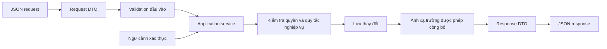

# DTO cho yêu cầu, phản hồi và các trường chỉ đọc

## 1. Vai trò của DTO trong biểu diễn dữ liệu REST

Một resource REST có định danh, trạng thái nghiệp vụ và một hoặc nhiều cách biểu diễn. JSON mà client gửi lên hoặc nhận về là một biểu diễn được API công bố; nó không nhất thiết có cấu trúc giống bảng cơ sở dữ liệu hay lớp entity bên trong ứng dụng.

Trong chương **Biểu diễn dữ liệu** của module **INTEGRATION_API_REST**, bài này tập trung vào cách thiết kế hợp đồng dữ liệu tại ranh giới HTTP: client được đề nghị thay đổi điều gì, server trả lại thông tin gì và những giá trị nào chỉ server có quyền quyết định. Các ví dụ dùng resource khách hàng, URI `/customers`, phương thức HTTP, mã trạng thái và Java/Spring để nối thiết kế hợp đồng với cách triển khai.

**DTO — Data Transfer Object** là đối tượng mang dữ liệu qua một ranh giới của hệ thống. Với REST API, DTO thường mô tả dữ liệu của request body hoặc response body. DTO có thể chứa annotation về định dạng và validation, nhưng không nên trở thành nơi thực hiện truy vấn, kiểm tra quyền hoặc thay đổi trạng thái nghiệp vụ.

Sau bài này, người học có thể:

- Tách DTO tạo mới, thay thế và phản hồi theo mục đích của từng thao tác.
- Xác định trường client được ghi, trường chỉ đọc và thông tin nội bộ không được công bố.
- Ánh xạ có kiểm soát giữa JSON, DTO và mô hình ứng dụng.
- Phân biệt thiếu trường, `null`, giá trị mặc định và ý nghĩa cập nhật một phần.
- Mô tả hợp đồng bằng OpenAPI và xác định những kiểm thử cần bảo vệ hợp đồng đó.

## 2. Entity, mô hình nghiệp vụ và DTO trả lời các câu hỏi khác nhau

Giả sử dữ liệu nội bộ của một khách hàng gồm:

```text
Customer
  id
  tenantId
  name
  email
  phone
  creditLimit
  riskScore
  createdAt
  updatedAt
  deletedAt
  databaseVersion
```

Một entity có thể cần `tenantId` để cách ly dữ liệu, `databaseVersion` để kiểm soát cập nhật đồng thời và `deletedAt` để triển khai xóa mềm. Những trường đó không tự động trở thành thành phần của API công khai.

| Mô hình | Câu hỏi cần trả lời | Ví dụ |
| --- | --- | --- |
| Entity lưu trữ | Dữ liệu được lưu và liên kết thế nào? | Khóa chính, khóa ngoại, phiên bản bản ghi |
| Mô hình nghiệp vụ | Trạng thái và chuyển đổi nào hợp lệ? | Ai được đổi hạn mức, khi nào khách hàng bị khóa |
| Request DTO | Client được gửi dữ liệu gì cho thao tác này? | Tên, email và điện thoại khi tạo khách hàng |
| Response DTO | Người gọi được nhận biểu diễn nào? | Mã khách hàng, thông tin liên hệ và thời điểm tạo |

Trả entity trực tiếp từ controller tạo ra sự phụ thuộc giữa API và cách lưu dữ liệu. Khi entity có thêm getter hoặc quan hệ, JSON có thể đổi ngoài ý muốn; quan hệ tải lười cũng có thể kéo theo truy vấn phát sinh hoặc vòng tham chiếu khi serialize.

Nhận entity trực tiếp làm request còn dễ dẫn tới **mass assignment**: dữ liệu do client cung cấp được gán vào quá nhiều thuộc tính nội bộ. Nếu client gửi `creditLimit`, `tenantId` hay `riskScore`, một cơ chế bind hoặc sao chép tổng quát có thể biến chúng thành thay đổi thật.

DTO giúp thu hẹp tập dữ liệu được xử lý. Tuy nhiên, chỉ đặt hậu tố `Dto` vào tên lớp không tạo ra cơ chế bảo vệ: nếu DTO vẫn chứa mọi trường rồi được sao chép nguyên khối vào entity, rủi ro vẫn còn.

## 3. Thiết kế hợp đồng trước khi viết lớp Java

Với API khách hàng trong bài, giả định:

- Người gọi đã được xác thực và thuộc một tenant xác định.
- Client được đặt tên, email và điện thoại của khách hàng.
- Server cấp `id`, xác định tenant và quản lý thời điểm tạo/cập nhật.
- Hạn mức tín dụng và điểm rủi ro thuộc quy trình nghiệp vụ khác.
- Phản hồi công khai ở đây chỉ phục vụ người có quyền xem khách hàng đó.

Đây là quy ước của ví dụ, không phải quy định bắt buộc cho mọi REST API. Chẳng hạn, một hệ thống có thể cho client cấp mã định danh khi tạo resource; khi đó phải thiết kế rõ hợp đồng, kiểm tra quyền và xử lý trùng mã tương ứng.

### 3.1. Lập ma trận quyền đối với từng trường

| Trường | Request tạo mới | Request thay thế | Response chi tiết | Nguồn quyết định |
| --- | --- | --- | --- | --- |
| `id` | Không nhận | Không nhận trong body; dùng URI | Có | Server cấp khi tạo |
| `name` | Bắt buộc | Bắt buộc | Có | Client gửi, server kiểm tra |
| `email` | Bắt buộc | Bắt buộc | Có | Client gửi, server kiểm tra |
| `phone` | Tùy chọn | Tùy chọn; thiếu hoặc `null` nghĩa là xóa | Có, có thể `null` | Client gửi theo hợp đồng |
| `createdAt` | Không nhận | Không nhận | Có | Server cấp khi tạo |
| `updatedAt` | Không nhận | Không nhận | Có | Server quản lý khi trạng thái thay đổi |
| `tenantId` | Không nhận | Không nhận | Không trong biểu diễn này | Ngữ cảnh xác thực đã được server kiểm chứng |
| `creditLimit`, `riskScore` | Không nhận | Không nhận | Không trong biểu diễn này | Quy trình nghiệp vụ riêng |
| `databaseVersion`, `deletedAt` | Không nhận | Không nhận | Không trong biểu diễn này | Chi tiết triển khai nội bộ |

Ma trận này phân biệt ba việc dễ bị gộp lẫn:

1. Client có được gửi tên trường đó hay không.
2. Client có quyền yêu cầu thay đổi giá trị đó hay không.
3. Người gọi có quyền xem giá trị đó trong response hay không.

Ví dụ, `id` được xem nhưng không được sửa trong body. `tenantId` trong ví dụ không được gửi và cũng không cần xuất hiện trong response. Một trường không có trong request chưa chắc đã phải xuất hiện trong response.

### 3.2. Request và response không cần đối xứng

Tạo khách hàng:

```http
POST /customers HTTP/1.1
Host: api.example.test
Content-Type: application/json
Accept: application/json

{
  "name": "Nguyễn An",
  "email": "an@example.test",
  "phone": "+84901234567"
}
```

Phản hồi:

```http
HTTP/1.1 201 Created
Location: /customers/4c352f11-4e1d-4f92-b44f-7d2f0e68c397
Content-Type: application/json

{
  "id": "4c352f11-4e1d-4f92-b44f-7d2f0e68c397",
  "name": "Nguyễn An",
  "email": "an@example.test",
  "phone": "+84901234567",
  "createdAt": "2026-11-17T03:00:00Z",
  "updatedAt": "2026-11-17T03:00:00Z"
}
```

`201 Created` mô tả kết quả tạo resource; `Location` chỉ tới URI của resource vừa tạo. Response DTO mang biểu diễn đã được server chấp nhận, bao gồm những giá trị server cấp. Client không nên lấy nguyên response làm request cho lần ghi tiếp theo nếu hai hợp đồng có tập trường khác nhau.

Định dạng thời gian trong ví dụ là chuỗi ISO 8601 có múi giờ UTC. Tên trường JSON, cách biểu diễn `null` và định dạng thời gian đều thuộc hợp đồng công khai, không chỉ là chi tiết của serializer.

## 4. Tách DTO theo thao tác trong Java

Các đoạn mã dưới đây minh họa Java 17, Spring MVC 6, Jakarta Bean Validation và Jackson 2. Chúng là các phần của một thiết kế minh họa, không phải một ứng dụng hoàn chỉnh kèm cấu hình phụ thuộc, lưu trữ và bảo mật. Mỗi kiểu `public` cần nằm trong tệp Java tương ứng khi đưa vào dự án thực hành.

### 4.1. DTO tạo mới

```java
import jakarta.validation.constraints.Email;
import jakarta.validation.constraints.NotBlank;
import jakarta.validation.constraints.Pattern;
import jakarta.validation.constraints.Size;

public record CreateCustomerRequest(
        @NotBlank
        @Size(max = 100)
        String name,

        @NotBlank
        @Email
        @Size(max = 254)
        String email,

        @Pattern(regexp = "^\\+[1-9][0-9]{7,14}$")
        String phone
) {}
```

Hợp đồng của request này:

- `name` và `email` phải hiện diện với giá trị không rỗng, không chỉ gồm khoảng trắng.
- `phone` có thể thiếu hoặc bằng `null` khi tạo mới.
- Khi có điện thoại, ví dụ yêu cầu dấu `+` và từ 8 đến 15 chữ số, chữ số đầu khác `0`. Đây là quy tắc định dạng do API ví dụ chọn; nó không xác minh số điện thoại có thật hay thuộc về người gọi.
- `@Email` kiểm tra hình thức theo bộ validation đang dùng; nó không chứng minh email tồn tại hoặc đã được xác minh.

`@Pattern` và `@Size` không tự thay thế kiểm tra bắt buộc. Một trường bắt buộc vẫn cần ràng buộc phù hợp như `@NotBlank` hoặc `@NotNull`.

Dùng `record` giúp thể hiện DTO mang dữ liệu và tránh setter sau khi khởi tạo. Tuy vậy, **bất biến trong Java không có nghĩa là chỉ đọc đối với client**: Jackson vẫn có thể nhận dữ liệu qua constructor của record. Để client không điều khiển `id`, cách rõ ràng ở đây là không có `id` trong request DTO.

### 4.2. DTO thay thế phần dữ liệu client được quản lý

```java
import jakarta.validation.constraints.Email;
import jakarta.validation.constraints.NotBlank;
import jakarta.validation.constraints.Pattern;
import jakarta.validation.constraints.Size;

public record ReplaceCustomerRequest(
        @NotBlank
        @Size(max = 100)
        String name,

        @NotBlank
        @Email
        @Size(max = 254)
        String email,

        @Pattern(regexp = "^\\+[1-9][0-9]{7,14}$")
        String phone
) {}
```

Hai DTO hiện có cấu trúc giống nhau nhưng diễn đạt hai hợp đồng khác nhau. Việc tách tên giúp nhận biết thao tác tại controller và cho phép chúng tiến hóa riêng. Nếu hai thao tác thực sự có cùng hợp đồng và vòng đời, tái sử dụng một kiểu cũng là lựa chọn có thể chấp nhận; không cần nhân bản lớp chỉ để tăng số lượng DTO.

Trong ví dụ này, `PUT /customers/{id}` thay thế đầy đủ phần biểu diễn mà client được quản lý. Thiếu `name` hay `email` là request không hợp lệ; thiếu `phone` tương đương bỏ điện thoại đã lưu. Server vẫn giữ `id` và `createdAt`, đồng thời quản lý `updatedAt`.

Client cần biết quy ước đó trước khi dùng `PUT`. Nếu muốn chỉ thay email và giữ nguyên những trường còn lại, phải dùng một hợp đồng cập nhật một phần rõ ràng.

### 4.3. DTO phản hồi

```java
import java.time.Instant;
import java.util.UUID;

public record CustomerResponse(
        UUID id,
        String name,
        String email,
        String phone,
        Instant createdAt,
        Instant updatedAt
) {}
```

DTO phản hồi được ứng dụng chủ động tạo ra từ dữ liệu đã được phép công bố. Không nhận `CustomerResponse` làm `@RequestBody` cho endpoint tạo hoặc thay thế khách hàng.

Ví dụ JSON trong bài luôn có khóa `phone`; khi không có điện thoại thì giá trị là `null`. Cấu hình serialize thực tế phải phù hợp quy ước này. Nếu ứng dụng bật bỏ các thuộc tính `null`, response và tài liệu hợp đồng phải được thiết kế lại cho thống nhất. Tương tự, cần cấu hình hỗ trợ kiểu thời gian Java và định dạng chuỗi cho `Instant` khi dùng Jackson.

DTO không nên mang annotation persistence như `@Entity`, quan hệ `@ManyToOne` hay đối tượng session cơ sở dữ liệu. Nó cũng không cần chứa toàn bộ trạng thái nội bộ chỉ để tiện chuyển đổi.

## 5. Ánh xạ tường minh và phân chia trách nhiệm

Luồng xử lý điển hình:



### 5.1. Chỉ chuyển những trường thao tác cần nhận

Tầng ứng dụng có thể nhận một command riêng:

```java
public record CreateCustomerCommand(
        String name,
        String email,
        String phone
) {}
```

Ánh xạ từ request:

```java
CreateCustomerCommand command = new CreateCustomerCommand(
        request.name(),
        request.email(),
        request.phone()
);
```

Command ở đây không có `id`, `tenantId`, `riskScore` hoặc mốc thời gian. Ngữ cảnh người gọi được truyền bằng một tham số riêng đã được hạ tầng xác thực của server kiểm chứng. Không dựng ngữ cảnh đó bằng cách tin một trường `tenantId` trong JSON hay một header tùy ý do client khai báo.

Command riêng hữu ích khi tầng ứng dụng phục vụ nhiều đầu vào như HTTP, hàng đợi và tác vụ nền. Trong ứng dụng nhỏ, có thể chọn kiến trúc ít lớp hơn, miễn là quyền gán trường và trách nhiệm kiểm tra vẫn rõ ràng.

### 5.2. Minh họa controller tạo resource

```java
import jakarta.validation.Valid;
import java.net.URI;
import org.springframework.http.ResponseEntity;
import org.springframework.security.core.annotation.AuthenticationPrincipal;
import org.springframework.web.bind.annotation.PostMapping;
import org.springframework.web.bind.annotation.RequestBody;
import org.springframework.web.bind.annotation.RequestMapping;
import org.springframework.web.bind.annotation.RestController;

@RestController
@RequestMapping("/customers")
public class CustomerController {
    private final CustomerApplicationService customers;

    public CustomerController(CustomerApplicationService customers) {
        this.customers = customers;
    }

    @PostMapping
    public ResponseEntity<CustomerResponse> create(
            @Valid @RequestBody CreateCustomerRequest request,
            @AuthenticationPrincipal ApiPrincipal principal) {

        CreateCustomerCommand command = new CreateCustomerCommand(
                request.name(),
                request.email(),
                request.phone()
        );

        CustomerSnapshot saved = customers.create(command, principal);
        CustomerResponse response = CustomerResponseMapper.toResponse(saved);
        URI location = URI.create("/customers/" + response.id());

        return ResponseEntity.created(location).body(response);
    }
}
```

Trong đoạn minh họa, `ApiPrincipal` là principal tùy chỉnh do hệ thống xác thực cung cấp; endpoint phải được cấu hình yêu cầu đăng nhập và service phải xử lý ngữ cảnh không hợp lệ. `CustomerApplicationService` chịu trách nhiệm kiểm tra quyền tạo khách hàng trong tenant, quy tắc nghiệp vụ và transaction. `CustomerSnapshot` là ảnh chụp dữ liệu sau khi lưu, có các accessor mà mapper sử dụng bên dưới. Các thành phần này cần được triển khai khi dựng ứng dụng thực hành.

`@Valid @RequestBody` kết hợp giải tuần tự JSON với Bean Validation trên DTO. Với trường hợp validation đối tượng request thông thường như trên, Spring MVC mặc định chuyển lỗi thành `400 Bad Request`; ứng dụng có thể chuẩn hóa body lỗi bằng exception handler. [Tài liệu Spring MVC về `@RequestBody`](https://docs.spring.io/spring-framework/reference/6.2/web/webmvc/mvc-controller/ann-methods/requestbody.html).

Annotation validation không tự kiểm tra người dùng có thuộc tenant, có quyền tạo khách hàng hoặc email đã tồn tại hay chưa. Các quyết định đó thuộc hạ tầng bảo mật, service nghiệp vụ và ràng buộc lưu trữ tương ứng.

### 5.3. Chỉ xuất những trường đã chọn

```java
public final class CustomerResponseMapper {
    private CustomerResponseMapper() {}

    public static CustomerResponse toResponse(CustomerSnapshot customer) {
        return new CustomerResponse(
                customer.id(),
                customer.name(),
                customer.email(),
                customer.phone(),
                customer.createdAt(),
                customer.updatedAt()
        );
    }
}
```

Mapper tường minh cho thấy chính xác thông tin nào được đưa ra ngoài. `tenantId`, điểm rủi ro và chi tiết xóa mềm không xuất hiện vì không được chọn.

Các công cụ sinh mapper có thể giảm công việc lặp lại. Dù dùng công cụ nào, cần kiểm soát danh sách trường được ánh xạ. Sao chép mọi thuộc tính trùng tên từ request vào entity khiến một trường mới thêm trong tương lai có thể trở thành quyền ghi ngoài dự kiến.

Khi cập nhật, tải resource trong phạm vi mà người gọi được phép truy cập trước, rồi chỉ gán các trường của thao tác. Không dựng một entity mới từ DTO và lưu đè toàn bộ nếu điều đó có thể làm mất trạng thái nội bộ hoặc ghi sang tenant khác.

## 6. Trường chỉ đọc: hiểu đúng theo từng lớp

**Chỉ đọc đối với client** nghĩa là client có thể quan sát giá trị theo quyền truy cập, nhưng không quyết định giá trị bằng thao tác ghi đang xét. Trong ví dụ, `id`, `createdAt` và `updatedAt` là các trường do server quản lý.

| Khái niệm | Ý nghĩa | Điều không thể suy ra chỉ từ nó |
| --- | --- | --- |
| Trường chỉ đọc trong hợp đồng API | Client không được điều khiển giá trị qua thao tác ghi đó | Không tự bảo đảm server đã chặn dữ liệu gửi vào |
| `final` hoặc record trong Java | Hạn chế thay đổi đối tượng sau khi khởi tạo | Không ngăn client truyền giá trị vào constructor |
| `readOnly` trong OpenAPI | Mô tả hướng sử dụng trường cho công cụ và người đọc | Không tự thêm bộ chặn vào controller |
| Chỉ đọc ở cơ sở dữ liệu | Một quyền hoặc quy tắc tại tầng lưu trữ | Không tự thiết kế response hay quyền ở mức resource |

### 6.1. Cách dùng annotation Jackson khi cần kiểu chung

Ưu tiên thiết kế request/response rõ ràng như ví dụ trên. Nếu một API có lý do dùng một kiểu chung, Jackson hỗ trợ chỉ định hướng truy cập thuộc tính:

```java
import com.fasterxml.jackson.annotation.JsonProperty;
import java.time.Instant;
import java.util.UUID;

public final class CustomerDocument {
    @JsonProperty(access = JsonProperty.Access.READ_ONLY)
    public UUID id;

    public String name;

    @JsonProperty(access = JsonProperty.Access.READ_ONLY)
    public Instant createdAt;
}
```

Trong Jackson, `READ_ONLY` cho phép đọc thuộc tính để serialize ra JSON, nhưng không gán thuộc tính đó khi deserialize JSON. Hướng đọc/ghi được hiểu từ phía thuộc tính Java. Annotation này không tự bảo đảm response HTTP là `400` khi client gửi trường đó; chính sách xử lý trường bị bỏ qua còn phụ thuộc cấu hình. [Jackson — `JsonProperty.Access`](https://fasterxml.github.io/jackson-annotations/javadoc/2.11/com/fasterxml/jackson/annotation/JsonProperty.Access.html).

Ứng dụng vẫn phải chủ động cấp `id` và `createdAt` bằng logic server. Không suy luận rằng có annotation thì service có thể tin mọi nguồn dữ liệu khác. Annotation cũng không thay thế kiểm tra quyền khi một thao tác nội bộ hoặc giao diện quản trị được phép sửa một thuộc tính tương tự.

Nếu dùng kiểu chung, cần kiểm thử với chính cấu trúc lớp và phiên bản Jackson của ứng dụng; annotation trên field, getter hoặc constructor có thể tương tác với cấu hình nhận diện thuộc tính. Tách request DTO thường giúp tránh phải giải thích và duy trì những tương tác này.

### 6.2. Phân biệt không bind, bỏ qua và từ chối

Client gửi:

```json
{
  "name": "Nguyễn An",
  "email": "an@example.test",
  "id": "00000000-0000-0000-0000-000000000001",
  "createdAt": "2000-01-01T00:00:00Z",
  "tenantId": "tenant-khac"
}
```

Có hai chính sách hợp lý, cần chọn và công bố:

| Chính sách | Kết quả | Điểm cần cân nhắc |
| --- | --- | --- |
| Từ chối trường ngoài hợp đồng | Trả lỗi; không tạo resource | Phát hiện lỗi client sớm, nhưng yêu cầu client tuân thủ schema chặt chẽ |
| Bỏ qua trường không được nhận | Tạo resource chỉ từ trường được phép | Hỗ trợ client gửi dư trường, nhưng client có thể tưởng một giá trị đã được áp dụng |

**Bài này chọn từ chối trường ngoài hợp đồng** đối với request tạo và thay thế. Vì vậy, request trên phải bị từ chối trước khi lưu; không chỉ bỏ qua rồi trả thành công.

Với Jackson 2, `FAIL_ON_UNKNOWN_PROPERTIES` điều khiển lỗi đối với thuộc tính không được nhận diện; `FAIL_ON_IGNORED_PROPERTIES` xử lý thuộc tính đã được đánh dấu bỏ qua. Đây là hai tình huống khác nhau. Cần cấu hình mapper thực sự được HTTP message converter sử dụng và kiểm tra bằng request qua endpoint. [Các tùy chọn deserialize của Jackson](https://github.com/FasterXML/jackson-databind/wiki/Deserialization-Features).

Riêng request DTO tách biệt trong bài, `id`, `createdAt` và `tenantId` là những thuộc tính không tồn tại trong DTO. Có thể bật kiểm tra unknown property cho cơ chế bind phù hợp, đồng thời tránh annotation hoặc cơ chế bắt mọi trường dư làm mất hiệu lực chính sách này. Không nên mặc định cấu hình của một `ObjectMapper` mới tạo cũng là cấu hình của Spring MVC đang chạy.

## 7. Trường chỉ ghi và thông tin không được trả về

Trường **chỉ ghi** theo hợp đồng là dữ liệu client cần gửi nhưng API không trả lại như một phần biểu diễn thông thường. Mật khẩu khi đăng ký hoặc đổi mật khẩu là ví dụ dễ nhận biết.

Thiết kế rõ ràng là dùng `RegisterAccountRequest` có `password`, còn `AccountResponse` không có thuộc tính đó. Nếu dùng kiểu chung, `JsonProperty.Access.WRITE_ONLY` có thể hỗ trợ hướng serialize, nhưng vẫn cần kiểm soát toàn bộ đường dữ liệu.

Phân biệt:

- Mật khẩu đầu vào là dữ liệu nhạy cảm, không đưa vào response hoặc log.
- Hash mật khẩu là chi tiết lưu trữ nội bộ, cũng không đưa vào response.
- Trường chỉ đọc như `createdAt` vẫn có thể được phép công khai.
- Một trường không xuất hiện trong response chưa chắc là bí mật; nó có thể chỉ không cần thiết cho biểu diễn đó.

Việc ngăn serialize JSON không ngăn `toString()`, debugger, tracing hoặc log request làm lộ dữ liệu. Record Java tự sinh `toString()` từ các thành phần; nếu một DTO mang bí mật, không ghi log toàn bộ DTO. Thông báo validation cũng không nên lặp lại giá trị bí mật bị từ chối.

## 8. Thiếu trường, `null` và cập nhật một phần

### 8.1. Ba trạng thái cần được phân biệt

Trong JSON, các request sau khác nhau về ý định:

```json
{}
```

```json
{"phone": null}
```

```json
{"phone": "+84987654321"}
```

Với tạo mới, hai request đầu có thể cùng nghĩa là chưa có điện thoại. Với thay thế bằng `PUT` theo hợp đồng của bài, thiếu hoặc `null` cùng nghĩa là xóa điện thoại. Với cập nhật một phần, API có thể cần phân biệt giữ nguyên, xóa và thay mới.

Một record thông thường chỉ có `String phone` thường nhận `null` cho cả thiếu thuộc tính và giá trị JSON `null`. Nó không mang đủ thông tin để thực hiện mọi hợp đồng PATCH. `Optional<String>` cũng không tự bảo đảm giữ được ba trạng thái này nếu không có cơ chế bind chuyên biệt.

### 8.2. Khi chọn JSON Merge Patch

Ví dụ:

```http
PATCH /customers/4c352f11-4e1d-4f92-b44f-7d2f0e68c397 HTTP/1.1
Host: api.example.test
Content-Type: application/merge-patch+json

{
  "phone": null
}
```

Với JSON Merge Patch, thuộc tính không có trong patch được giữ nguyên; `null` yêu cầu loại bỏ thuộc tính ở biểu diễn đích. API ví dụ diễn giải việc bỏ `phone` thành xóa số điện thoại đang lưu. Quy tắc này dành cho định dạng `application/merge-patch+json`; không áp dụng mặc định cho mọi request dùng phương thức PATCH. [RFC 7396 — JSON Merge Patch](https://www.rfc-editor.org/rfc/rfc7396.html).

Ứng dụng cần:

1. Đọc patch thành cấu trúc giữ được sự hiện diện của trường, hoặc dùng kiểu giá trị chuyên biệt hỗ trợ trạng thái thiếu.
2. Chỉ chấp nhận các đường dẫn/trường được phép sửa.
3. Áp dụng patch lên biểu diễn ghi được hoặc command trung gian, thay vì merge tùy ý lên entity.
4. Kiểm tra dữ liệu sau khi áp dụng: không cho xóa `name` hoặc `email` nếu chúng bắt buộc.
5. Lưu thay đổi nguyên tử sau khi kiểm tra quyền và quy tắc nghiệp vụ.

Không dùng request DTO tạo mới cho PATCH rồi bỏ toàn bộ `@NotBlank`. Cách đó dễ làm yếu validation và vẫn không giải quyết được việc phân biệt thiếu trường với `null`.

### 8.3. Giá trị mặc định của kiểu nguyên thủy

Một trường `boolean active` hoặc `int priority` trong DTO có thể nhận giá trị mặc định khi client không gửi, tùy cấu hình bind. Nếu thiếu trường mang ý nghĩa khác với `false` hoặc `0`, kiểu nguyên thủy không thể tự diễn đạt đầy đủ ý định đó.

Nếu trường bắt buộc phải được khai báo, có thể dùng `Boolean` hoặc `Integer` kết hợp `@NotNull`. Nếu trường thuộc hợp đồng patch, cần thêm thông tin về sự hiện diện. Không dùng một giá trị đặc biệt như chuỗi rỗng hoặc số `-1` để thay cho trạng thái thiếu nếu hợp đồng không định nghĩa điều đó.

## 9. Validation, quyền truy cập và lỗi là các trách nhiệm bổ sung

### 9.1. Kiểm tra đúng tại từng lớp

| Lớp kiểm tra | Ví dụ | Trách nhiệm chính |
| --- | --- | --- |
| Parse và bind | JSON sai cú pháp, kiểu dữ liệu không phù hợp | Bộ đọc HTTP/JSON |
| Validation hình thức | Tên trống, email sai hình thức, chuỗi quá dài | Ràng buộc DTO và validator |
| Phân quyền | Người gọi có được sửa khách hàng trong tenant này không? | Chính sách bảo mật và service |
| Quy tắc nghiệp vụ | Khách hàng bị khóa không được đổi thông tin nhất định | Mô hình nghiệp vụ/service |
| Toàn vẹn lưu trữ | Email phải duy nhất trong tenant | Ràng buộc cơ sở dữ liệu và xử lý xung đột |

Validation lồng nhau cần khai báo và kích hoạt phù hợp, ví dụ `@Valid` trên DTO con. Kiểm tra một `address` tồn tại không tự có nghĩa là `address.postalCode` đã hợp lệ.

Việc kiểm tra email trùng bằng truy vấn trước khi ghi không thay thế ràng buộc duy nhất tại cơ sở dữ liệu: hai request có thể vượt qua truy vấn kiểm tra cùng lúc. Khi lưu thất bại do xung đột đã biết, chuyển nó sang lỗi API ổn định thay vì trả chi tiết exception của driver.

### 9.2. Hợp đồng lỗi nhất quán

Bài này chọn quy ước sau:

| Tình huống | Mã phản hồi dự kiến |
| --- | --- |
| JSON không đọc được, dữ liệu sai kiểu hoặc validation request thất bại | `400 Bad Request` |
| Request có trường ngoài hợp đồng | `400 Bad Request` |
| Chưa xác thực hợp lệ | `401 Unauthorized` |
| Đã xác thực nhưng không có quyền | `403 Forbidden`, hoặc chính sách che giấu resource bằng `404` nếu API đã quy định |
| Khách hàng không tồn tại trong phạm vi được truy cập | `404 Not Found` |
| Email đã được dùng trong cùng tenant theo quy tắc duy nhất | `409 Conflict` |

Một hệ thống có thể chọn `422 Unprocessable Content` cho một số lỗi nội dung. Điểm quan trọng là công bố quy ước rõ ràng, triển khai đồng nhất và có body lỗi để client xử lý được.

Ví dụ body lỗi theo cấu trúc Problem Details có phần mở rộng `errors` do API định nghĩa:

```http
HTTP/1.1 400 Bad Request
Content-Type: application/problem+json

{
  "type": "https://api.example.test/problems/invalid-request",
  "title": "Yêu cầu không hợp lệ",
  "status": 400,
  "detail": "Có trường không được chấp nhận trong yêu cầu.",
  "instance": "/customers",
  "errors": [
    {
      "field": "createdAt",
      "code": "FIELD_NOT_ALLOWED",
      "message": "Thời điểm tạo do server quản lý."
    }
  ]
}
```

Không công bố tên lớp nội bộ, SQL, stack trace hoặc giá trị nhạy cảm trong lỗi. Các annotation DTO không tự tạo ra chính xác cấu trúc trên; cần exception handler và quy ước ánh xạ lỗi của API.

## 10. Mô tả DTO bằng OpenAPI

Schema OpenAPI cần phản ánh đúng DTO và chính sách bind đang chạy. Với kiểu request/response tách biệt, việc không đưa trường chỉ đọc vào request schema giúp hợp đồng dễ hiểu.

Đoạn minh họa sau dùng **OpenAPI 3.0.3**; đây là một phần của tài liệu, chưa bao gồm định nghĩa endpoint:

```yaml
openapi: 3.0.3
info:
  title: Customer API
  version: 1.0.0
paths: {}
components:
  schemas:
    CreateCustomerRequest:
      type: object
      additionalProperties: false
      required: [name, email]
      properties:
        name:
          type: string
          minLength: 1
          maxLength: 100
          description: Không được chỉ gồm khoảng trắng.
        email:
          type: string
          format: email
          maxLength: 254
          description: Không rỗng và phải thỏa validation email của API.
        phone:
          type: string
          nullable: true
          pattern: '^\+[1-9][0-9]{7,14}$'
    CustomerResponse:
      type: object
      required: [id, name, email, phone, createdAt, updatedAt]
      properties:
        id:
          type: string
          format: uuid
          readOnly: true
        name:
          type: string
          maxLength: 100
        email:
          type: string
          format: email
        phone:
          type: string
          nullable: true
        createdAt:
          type: string
          format: date-time
          readOnly: true
        updatedAt:
          type: string
          format: date-time
          readOnly: true
```

`additionalProperties: false` diễn đạt request không nhận khóa ngoài danh sách. Nó chỉ trở thành hành vi runtime khi có bộ kiểm tra tương ứng; Spring MVC không tự thực thi mọi ràng buộc của một tệp OpenAPI. `minLength: 1` cũng chưa loại bỏ chuỗi chỉ có khoảng trắng như `@NotBlank`; phần mô tả đã nêu quy tắc bổ sung cần thực thi.

Trong OpenAPI 3.0, `readOnly: true` hướng trường về response; nếu trường đó có trong `required`, yêu cầu bắt buộc áp dụng cho response. `writeOnly` có hướng ngược lại. Không đánh dấu một trường đồng thời là `readOnly: true` và `writeOnly: true`. [OpenAPI 3.0.3 — Schema Object](https://spec.openapis.org/oas/v3.0.3.html#schema-object).

Ví dụ đặt `phone` trong `required` của response để yêu cầu khóa luôn xuất hiện, nhưng cho phép giá trị `null` bằng `nullable: true`. Vì vậy, “bắt buộc có khóa” khác với “không được null”. Khi tạo tài liệu cho `PUT`, định nghĩa hoặc tham chiếu schema thay thế có đúng quy tắc đã nêu, thay vì dùng `CustomerResponse` cho request.

Với OpenAPI 3.1, `readOnly` và `writeOnly` là các annotation; bộ công cụ cần xét hướng request/response khi áp dụng chúng. Cách biểu diễn kiểu có `null` cũng khác bản 3.0. Không chép nguyên `nullable` sang schema 3.1 rồi mặc định công cụ hiểu giống nhau. [OpenAPI 3.1.2 — Schema Object](https://spec.openapis.org/oas/v3.1.2.html#schema-object).

Khi sinh OpenAPI từ annotation Java, cần xem tài liệu sinh ra: kiểu dữ liệu, trường bắt buộc, khả năng `null`, hướng đọc/ghi và ví dụ có thể không trùng hoàn toàn với ý định của tác giả.

## 11. Chọn biểu diễn theo nhu cầu và giữ hợp đồng ổn định

### 11.1. DTO danh sách khác DTO chi tiết

Danh sách khách hàng có thể chỉ cần:

```json
{
  "items": [
    {
      "id": "4c352f11-4e1d-4f92-b44f-7d2f0e68c397",
      "name": "Nguyễn An"
    }
  ],
  "nextCursor": "opaque-next-page-token"
}
```

`CustomerSummaryResponse` có thể phù hợp cho từng phần tử hơn `CustomerResponse` đầy đủ. Khi phân trang, chỉ công bố metadata cần thiết; không trả nguyên đối tượng phân trang hoặc đối tượng truy vấn của thư viện lưu trữ nếu không muốn phụ thuộc hợp đồng vào chúng.

Tương tự, một người dùng thông thường và một nhân viên có đặc quyền có thể cần các response khác nhau. Tách DTO là cách hỗ trợ giới hạn dữ liệu, nhưng service vẫn phải kiểm tra quyền trước khi chọn và trả biểu diễn tương ứng.

### 11.2. Thay đổi entity không tự kéo theo thay đổi JSON

Thêm cột `internalReviewNote` vào cơ sở dữ liệu không nên làm response tự xuất hiện trường mới. DTO và mapper giúp giữ khoảng cách đó.

Các thay đổi cần đánh giá ở mức hợp đồng:

- Đổi `id` từ chuỗi sang số hoặc đổi tên `createdAt` có thể làm hỏng client.
- Thêm trường bắt buộc vào request có thể làm request của client cũ thất bại.
- Bỏ trường khỏi response hoặc đổi từ có khóa sang bỏ khóa khi `null` có thể ảnh hưởng client.
- Thêm trường response thường thuận lợi hơn nếu client chấp nhận trường mới, nhưng không được mặc định mọi client đều có khả năng đó.
- Đổi một trường từ cho phép ghi sang chỉ đọc làm thay đổi quyền và hành vi thao tác; cần kế hoạch chuyển đổi phù hợp.

### 11.3. DTO không thay thế hợp đồng HTTP

DTO chỉ mô tả một phần của API. Những phần liên quan vẫn cần thiết kế riêng:

- **URI và phương thức:** `id` trong path chọn resource; request body mô tả dữ liệu của thao tác.
- **Cache:** chọn các trường response và chính sách cache phù hợp người được xem. Dữ liệu cá nhân của một tenant không được chia sẻ chỉ vì hình dạng DTO giống nhau.
- **Idempotency:** tách request DTO không tự làm `POST` idempotent. Nếu endpoint hỗ trợ khóa idempotency thì việc lưu, đối chiếu và phát lại kết quả phải do server triển khai.
- **Cập nhật đồng thời:** DTO không tự ngăn ghi đè thay đổi của người khác. Có thể dùng điều kiện như `If-Match` với ETag theo hợp đồng riêng.

Nếu `PUT` đã đạt đúng trạng thái mong muốn, cập nhật lại `updatedAt` chỉ vì request được lặp có thể tạo biến động không cần thiết. Nên định nghĩa rõ thời điểm nào được tính là thay đổi nghiệp vụ và cách server xử lý một lần ghi không làm đổi trạng thái.

## 12. Những tình huống kiểm thử cần bảo vệ

Các tình huống dưới đây là định hướng kiểm thử cho người học triển khai API, không phải kết quả chạy một bộ kiểm thử trong bài.

| Tình huống | Kết quả cần kiểm chứng |
| --- | --- |
| Tạo khách hàng hợp lệ | `201`, có `Location`, ID do server cấp, response đúng schema |
| Thiếu hoặc chỉ có khoảng trắng ở `name` | `400`, không lưu khách hàng |
| Email sai hình thức hoặc quá dài | Lỗi validation theo hợp đồng |
| Gửi `id`, `createdAt`, `tenantId` hoặc trường gõ sai | `400` theo chính sách từ chối của bài; không lưu |
| Đọc khách hàng | Có các trường response đã công bố; không có điểm rủi ro hoặc dữ liệu nội bộ |
| Khách hàng không có điện thoại | Response có khóa `phone` với giá trị `null` |
| `PUT` thiếu `phone` | Điện thoại cũ bị xóa theo hợp đồng thay thế |
| `PUT` thiếu `name` | Lỗi; dữ liệu hiện có không bị thay đổi một phần |
| Merge patch không chứa `phone` | Giữ nguyên điện thoại |
| Merge patch chứa `phone: null` | Chuyển sang trạng thái không có điện thoại |
| Patch cố sửa `createdAt` | Từ chối trước khi ghi |
| Request nhắm khách hàng của tenant khác | Bị chặn theo chính sách phân quyền; dữ liệu không thay đổi |
| Response từ endpoint có dữ liệu bí mật đầu vào | Không lộ mật khẩu, hash hoặc giá trị bí mật khác |
| Email trùng dưới tải đồng thời | Ràng buộc lưu trữ được bảo vệ; lỗi xung đột được chuẩn hóa |

Kiểm thử mapper giúp phát hiện ánh xạ sai trường. Kiểm thử serialize/deserialize giúp bảo vệ tên trường và hướng đọc/ghi. Kiểm thử qua HTTP cần thiết để xác nhận cấu hình mapper, validation, authentication, exception handler và status code thực sự phối hợp đúng.

Không chỉ khẳng định `createdAt` trong response khác giá trị giả client gửi. Nếu chính sách là từ chối, phải kiểm tra response lỗi và không có thay đổi lưu trữ. Nếu một API khác chọn bỏ qua, phải kiểm tra cả giá trị cuối do server quyết định và các đường cập nhật có thể tồn tại.

## 13. Quy trình thiết kế có thể áp dụng ngay

Khi thiết kế một endpoint mới, thực hiện theo thứ tự:

1. Viết rõ thao tác trên resource: tạo, đọc, thay thế, cập nhật một phần hay một chuyển đổi nghiệp vụ riêng.
2. Liệt kê từng trường và nguồn có quyền quyết định giá trị.
3. Chọn tập trường đầu vào nhỏ nhất đủ diễn đạt thao tác.
4. Chọn tập trường phản hồi phù hợp nhu cầu và quyền của người gọi.
5. Định nghĩa trường bắt buộc, `null`, trường thiếu, mặc định và chính sách trường lạ.
6. Chọn DTO và mapper thể hiện đúng các quyết định trên.
7. Bổ sung validation, kiểm tra quyền và bảo vệ toàn vẹn dữ liệu tại đúng lớp.
8. Mô tả request/response bằng OpenAPI và kiểm thử hành vi qua HTTP.

Với khách hàng trong bài, kết quả thiết kế là: client cung cấp thông tin liên hệ qua DTO của thao tác; server quyết định định danh, tenant và thời gian; response chỉ công bố những trường đã chọn. Trường chỉ đọc được bảo vệ bằng thiết kế đầu vào và logic áp dụng thay đổi, đồng thời được mô tả nhất quán trong hợp đồng API.
