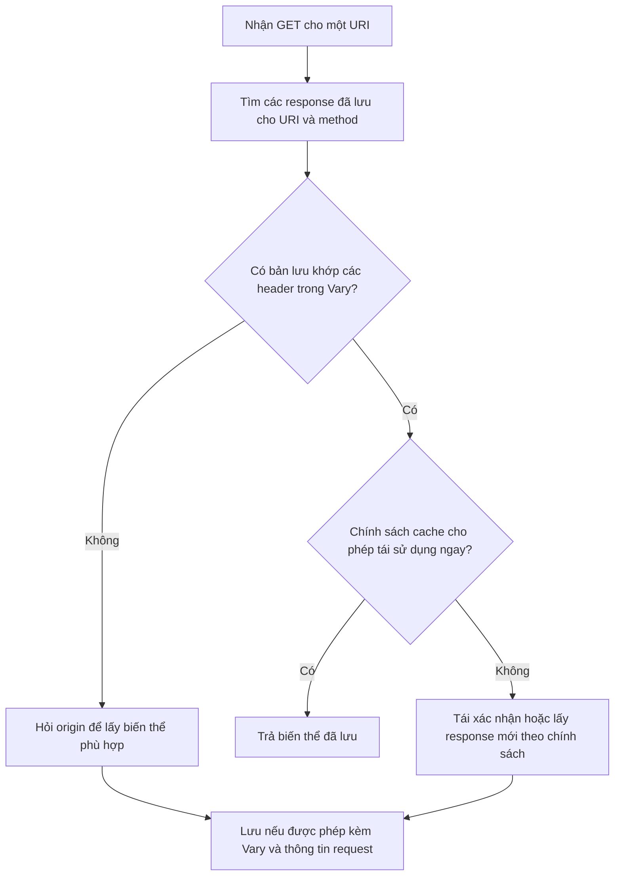

# Vary khi một URI có nhiều biểu diễn

## 1. Vì sao cùng một URI vẫn có thể trả nhầm dữ liệu?

Trong REST API, URI xác định resource, còn representation là cách biểu diễn trạng thái của resource trong một lần trao đổi HTTP. Resource sản phẩm tại `/products/42` có thể được biểu diễn bằng JSON hoặc XML, bằng tiếng Việt hoặc tiếng Anh, với dữ liệu được nén hoặc không nén. Các lựa chọn đó không nhất thiết tạo ra resource mới.

Xét API danh mục sản phẩm công khai của một ứng dụng Java/Spring. Server đọc `Accept-Language` để chọn tên sản phẩm:

```http
GET /products/42 HTTP/1.1
Host: api.example.test
Accept-Language: vi
```

```http
HTTP/1.1 200 OK
Content-Type: application/json
Content-Language: vi
Cache-Control: public, max-age=60
Vary: Accept-Language

{"id":42,"name":"Bàn phím"}
```

Một client khác yêu cầu cùng URI với `Accept-Language: en` và cần nhận `{"id":42,"name":"Keyboard"}`. Nếu cache chỉ phân biệt bằng URI, nó có thể trả lại response tiếng Việt đã lưu, dù response đó vẫn còn mới trong 60 giây.

`Vary: Accept-Language` cung cấp thông tin còn thiếu: khi xem xét tái sử dụng response này, cache phải xét cả header yêu cầu `Accept-Language`. Việc tìm đúng biến thể và việc kiểm tra thời hạn của bản lưu là hai điều kiện riêng.

Sau bài học, người học có thể xác định đúng những header ảnh hưởng đến biểu diễn, thiết kế response có `Vary` phù hợp, phối hợp với chính sách cache và validator, đồng thời kiểm tra hành vi qua cache khi triển khai REST API.

## 2. Đọc đúng hợp đồng giữa request và response

`Vary` là header của **response**, nhưng giá trị của nó là tên những header của **request** đã ảnh hưởng đến quá trình chọn biểu diễn. Nó giúp cache và client biết response phụ thuộc vào những chiều lựa chọn nào ngoài method và URI. Cú pháp và vai trò được định nghĩa trong [RFC 9110, mục 12.5.5](https://www.rfc-editor.org/rfc/rfc9110.html#section-12.5.5).

Các cặp header thường gặp:

| Client gửi trong request | Server mô tả kết quả bằng | Nếu lựa chọn phụ thuộc vào header này |
| --- | --- | --- |
| `Accept: application/json` | `Content-Type: application/json` | `Vary: Accept` |
| `Accept-Language: vi` | `Content-Language: vi` | `Vary: Accept-Language` |
| `Accept-Encoding: gzip` | `Content-Encoding: gzip` khi thực sự nén | `Vary: Accept-Encoding` |
| `Origin: https://shop.example.test` | `Access-Control-Allow-Origin` tùy origin | Thường cần `Vary: Origin` nếu response thay đổi theo origin |

Ba việc cần tách bạch:

1. **Chọn biểu diễn:** server đọc yêu cầu và quyết định định dạng, ngôn ngữ hoặc cách mã hóa.
2. **Mô tả biểu diễn đã chọn:** các header như `Content-Type`, `Content-Language`, `Content-Encoding` nói client đang nhận gì.
3. **Mô tả điều kiện tái sử dụng:** `Vary` cho biết cache cần phân biệt request theo những header nào.

Chỉ thêm `Vary` không khiến server tự chuyển JSON thành XML, tự dịch nội dung hoặc tự nén dữ liệu. Phải có bộ chọn và bộ tạo representation thực hiện các công việc tương ứng.

Không thêm một header vào `Vary` chỉ vì response có header cùng tên. Với API chọn định dạng dựa vào `Accept`, khai báo thường là `Vary: Accept`; `Vary: Content-Type` sẽ khiến cache xem **Content-Type của request**, không phải Content-Type của response.

## 3. Cú pháp, nhiều chiều lựa chọn và nhánh mặc định

Một chiều lựa chọn:

```http
Vary: Accept
```

Nhiều chiều lựa chọn:

```http
Vary: Accept, Accept-Language, Accept-Encoding
```

Response trên nói rằng các header request được liệt kê cùng tham gia vào điều kiện chọn bản lưu. Đây không phải danh sách các định dạng đang được hỗ trợ. Khai báo sau sai ý nghĩa:

```http
Vary: application/json, vi, gzip
```

Tên header không phân biệt chữ hoa và chữ thường. `Accept-Language` và `accept-language` chỉ cùng một tên trường. Giá trị bên trong từng request header vẫn cần được hiểu theo quy tắc riêng của header đó; không thể tự chuyển mọi giá trị thành chữ thường rồi giả định tương đương.

`Vary` là trường dạng danh sách. Các thành phần hệ thống có thể tạo nhiều dòng hợp lệ, chẳng hạn:

```http
Vary: Accept-Language
Vary: Accept-Encoding
```

Khi kết hợp, ý nghĩa tương ứng là:

```http
Vary: Accept-Language, Accept-Encoding
```

Ứng dụng, middleware CORS, reverse proxy và bộ nén phải giữ được hợp của các chiều lựa chọn. Ví dụ controller đã thêm `Accept-Language`, bộ nén thêm `Accept-Encoding`, middleware CORS thêm `Origin`; response cuối cùng cần giữ cả ba nếu cả ba vẫn ảnh hưởng đến response được chuyển cho client. Gán đè toàn bộ `Vary` ở một lớp có thể làm mất thông tin do lớp trước tạo ra.

### Không bỏ quên response mặc định

Giả sử thiếu `Accept-Language` thì server mặc định chọn tiếng Việt. Response mặc định vẫn cần:

```http
Content-Language: vi
Vary: Accept-Language
```

Việc request đầu tiên không gửi header không làm chiều lựa chọn biến mất. Nếu nhánh mặc định thiếu `Vary`, bản lưu đó có thể bị xem như áp dụng rộng hơn dự định và che mất các biến thể khác.

Nên duy trì tập header lựa chọn nhất quán giữa các response tương ứng của cùng endpoint. Điều này đặc biệt quan trọng khi xử lý nhánh mặc định, response do middleware tạo ra và response tái xác nhận.

## 4. Cache dùng Vary như thế nào?

Với một GET đã có thể được cache, có thể hình dung khóa tra cứu được mở rộng như sau:

```text
Khóa cơ sở: method + target URI
Điều kiện biến thể: các giá trị request header được nêu trong Vary

GET https://api.example.test/products/42
  Accept-Language = vi
  Accept-Encoding = gzip
```

Đây là mô hình giải thích, không phải định dạng khóa bắt buộc của mọi sản phẩm cache. URI bao gồm query string; các điều kiện lưu và tái sử dụng HTTP khác vẫn phải được thỏa mãn.

Một luồng xử lý đơn giản:



RFC 9111 quy định việc so khớp `Vary` và những chuẩn hóa được phép. Header bị thiếu chỉ khớp với một request cũng thiếu header đó; không tự xem thiếu header là bằng một giá trị mặc định. `Vary` chứa `*` luôn không khớp trong phép so khớp này. Tham khảo [RFC 9111, mục 4.1](https://www.rfc-editor.org/rfc/rfc9111.html#section-4.1).

Ví dụ cache đã lưu response cho request có `Accept-Language: vi`:

| Request tiếp theo | Có thể coi là cùng biến thể chỉ từ header này? | Giải thích |
| --- | --- | --- |
| `Accept-Language: vi` | Có | Giá trị khớp; vẫn phải xét chính sách cache |
| `Accept-Language: en` | Không | Yêu cầu ngôn ngữ khác |
| Không có `Accept-Language` | Không | Thiếu header khác với gửi rõ `vi` |
| `Accept-Language: vi, en;q=0.8` | Không mặc nhiên | Có danh sách ưu tiên khác; không được coi tương đương chỉ vì server có thể vẫn chọn `vi` |

Một server có thể tạo cùng body cho nhiều chuỗi `Accept-Language` khác nhau. Điều đó không có nghĩa mọi cache tự biết chúng thuộc cùng một nhóm. Việc chuẩn hóa thành nhóm `vi` hoặc `en` tại gateway là một thiết kế bổ sung: phải bảo đảm nhóm đó thực sự quyết định cùng một response và không làm mất ngữ nghĩa của yêu cầu.

### Ý nghĩa của Vary: *

```http
Vary: *
```

Dấu `*` cho biết việc chọn response có thể phụ thuộc vào những yếu tố không thể mô tả đầy đủ bằng danh sách header dùng cho so khớp. Không được hiểu nó là “cache theo tất cả header rồi dùng lại bình thường”.

Khi cần cấm lưu response, hãy thiết kế với `Cache-Control: no-store`. Không dùng `Vary: *` như tên gọi khác của `no-store`: chúng biểu đạt hai quy tắc khác nhau.

## 5. Những tình huống REST API thường gặp

### 5.1. JSON và XML cho cùng resource

Giả sử `/products/42` hỗ trợ cả JSON và XML, chọn theo `Accept`:

```http
GET /products/42 HTTP/1.1
Host: api.example.test
Accept: application/json
```

```http
HTTP/1.1 200 OK
Content-Type: application/json
Cache-Control: public, max-age=60
Vary: Accept

{"id":42,"name":"Keyboard"}
```

```http
GET /products/42 HTTP/1.1
Host: api.example.test
Accept: application/xml
```

```http
HTTP/1.1 200 OK
Content-Type: application/xml
Cache-Control: public, max-age=60
Vary: Accept

<product><id>42</id><name>Keyboard</name></product>
```

Cache phải tránh đưa body JSON cho client đang yêu cầu XML. Ngay cả khi cả hai body mô tả cùng sản phẩm, chúng là các representation có định dạng khác nhau.

Nếu server áp dụng chính sách từ chối media type không được hỗ trợ, nó có thể trả `406 Not Acceptable`. Việc chọn hoặc từ chối representation thuộc hợp đồng content negotiation; khai báo `Vary` chỉ phản ánh những chiều lựa chọn của hợp đồng đó.

### 5.2. Dữ liệu nén và không nén

Nếu response được nén dựa vào `Accept-Encoding`:

```http
HTTP/1.1 200 OK
Content-Type: application/json
Content-Encoding: gzip
Cache-Control: public, max-age=60
Vary: Accept-Encoding
```

Body của response này phải thực sự là dữ liệu gzip. Chỉ thêm `Content-Encoding: gzip` vào JSON chưa nén sẽ khiến client giải mã sai.

Biến thể không nén không gửi `Content-Encoding: gzip`, nhưng vẫn giữ `Vary: Accept-Encoding` khi endpoint có cơ chế chọn cách nén theo header này. Nếu server đồng thời chọn ngôn ngữ, cần giữ cả `Accept-Language`.

Bộ nén có thể nằm tại application server, reverse proxy hoặc CDN. Hãy xác định lớp nào thực hiện biến đổi và quan sát response tại điểm client nhận được; controller đúng chưa đủ để kết luận response sau proxy đúng.

### 5.3. CORS và response header phụ thuộc Origin

Một API chỉ cho phép một số website gọi từ trình duyệt. Khi request đến từ website đã được cho phép, server phản hồi:

```http
Access-Control-Allow-Origin: https://shop.example.test
Vary: Origin
```

Nếu server tạo `Access-Control-Allow-Origin` khác nhau theo `Origin`, cache cần phân biệt response tương ứng. Điều này vẫn có ý nghĩa khi body JSON của hai response giống hệt nhau: những header quan trọng của response cũng có thể thay đổi.

`Vary: Origin` không tự cho phép truy cập CORS. Server vẫn phải kiểm tra origin theo chính sách đã thiết kế. Nếu server luôn gửi `Access-Control-Allow-Origin: *` và không thay đổi response theo origin, không thêm chiều `Origin` chỉ vì endpoint có CORS.

Ví dụ này nói về HTTP cache của response thông thường. Cache dành cho CORS preflight có cơ chế và cấu hình riêng; không suy rằng thêm `Vary` là đã cấu hình xong thời gian lưu preflight.

## 6. Phối hợp Vary với Cache-Control và dữ liệu người dùng

Để quyết định đúng về cache, cần trả lời các câu hỏi riêng:

| Câu hỏi thiết kế | Thành phần thường dùng |
| --- | --- |
| Response có được lưu không? | `Cache-Control`, cùng điều kiện lưu của HTTP |
| Shared cache có được lưu cho nhiều người không? | Các chỉ thị như `private`, `public` và quy tắc liên quan đến xác thực |
| Response còn mới bao lâu? | `max-age`, `s-maxage`, `Age` và thời điểm response |
| Request nào có thể dùng biến thể đã lưu? | URI, method và `Vary` |
| Biểu diễn đã thay đổi chưa? | Validator như `ETag` và conditional request |

Với danh mục sản phẩm thực sự công khai và không chứa dữ liệu theo người dùng:

```http
Cache-Control: public, max-age=60
Vary: Accept, Accept-Language
```

Với response cá nhân được phép lưu trong cache riêng của client:

```http
Cache-Control: private, max-age=60
Vary: Accept-Language
```

Với nội dung yêu cầu không được lưu:

```http
Cache-Control: no-store
```

`private` cấm shared cache lưu response nhưng không có nghĩa mọi cache đều bị cấm lưu. `no-cache` cho phép lưu nhưng yêu cầu tái xác nhận trước khi dùng lại; nó cũng không đồng nghĩa với `no-store`. Các chỉ thị này được mô tả trong [RFC 9111, mục 5.2.2](https://www.rfc-editor.org/rfc/rfc9111.html#section-5.2.2).

### Không dùng Vary để thay cho xác thực và phân quyền

Giả sử `/me` trả hồ sơ theo access token. Chỉ thêm:

```http
Vary: Authorization
```

không phải một thiết kế bảo mật đầy đủ. Endpoint vẫn phải xác thực token, kiểm tra quyền và đặt chính sách cache phù hợp. Shared cache có những hạn chế riêng đối với request mang `Authorization`; không suy rằng liệt kê header này tự tạo quyền cache cho response.

Tương tự, `Vary: Cookie` có thể tạo rất nhiều biến thể và không tự bảo đảm dữ liệu cá nhân được cách ly an toàn. Không sử dụng `Cache-Control: public` cho response cá nhân chỉ vì đã thêm `Vary`.

Trong ví dụ danh mục của bài này, dữ liệu sản phẩm được giả định là công khai và giống nhau cho mọi người dùng khi đã cố định các chiều lựa chọn. Nếu giá bán, trường dữ liệu hoặc quyền xem thay đổi theo tài khoản hay tenant, phải thiết kế lại chính sách cache trước khi áp dụng ví dụ.

## 7. Phối hợp với ETag và 304 Not Modified

`Vary` phân biệt biến thể; `ETag` xác định phiên bản của biểu diễn đã chọn. Hai cơ chế phối hợp để cache không xác nhận nhầm dữ liệu.

Giả sử các response cho cùng URI có validator:

| Biểu diễn | ETag minh họa |
| --- | --- |
| JSON tiếng Việt, không nén | `"product-42-vi-json-r8"` |
| JSON tiếng Anh, không nén | `"product-42-en-json-r8"` |
| JSON tiếng Việt, gzip | `"product-42-vi-json-gzip-r8"` |

Các nhãn trên chỉ minh họa. Khi dùng strong ETag, ứng dụng phải bảo đảm validator thay đổi khi dữ liệu biểu diễn thay đổi, kể cả khác biệt mã hóa nội dung. Ghép một version của bản ghi database sẽ chưa đủ nếu kết quả serialize còn phụ thuộc vào bản dịch, định dạng hoặc phép biến đổi khác. Ví dụ chính thức về ETag cho các content coding khác nhau nằm tại [RFC 9110, mục 8.8.3.3](https://www.rfc-editor.org/rfc/rfc9110.html#section-8.8.3.3).

Client đã có JSON tiếng Việt gửi:

```http
GET /products/42 HTTP/1.1
Host: api.example.test
Accept: application/json
Accept-Language: vi
Accept-Encoding: identity
If-None-Match: "product-42-vi-json-r8"
```

Nếu biểu diễn tiếng Việt tương ứng chưa đổi, server có thể trả:

```http
HTTP/1.1 304 Not Modified
ETag: "product-42-vi-json-r8"
Cache-Control: public, max-age=60
Vary: Accept, Accept-Language, Accept-Encoding
```

Ví dụ lược bỏ một số header vận chuyển, như `Date`; response `304` không có body. Khi response `200` tương ứng sẽ có `Vary`, response `304` cũng phải gửi trường đó, theo [RFC 9110, mục 15.4.5](https://www.rfc-editor.org/rfc/rfc9110.html#section-15.4.5).

Nếu request chuyển sang `Accept-Language: en` nhưng vẫn mang ETag của tiếng Việt, server phải xét validator của **biểu diễn tiếng Anh đã chọn**. Với hai biểu diễn khác nhau như ví dụ, không được trả `304` chỉ vì version bản ghi sản phẩm vẫn là `r8`.

Thứ tự suy nghĩ đúng là: chọn resource và representation theo request, xác định validator của representation đó, rồi đánh giá điều kiện HTTP theo quy tắc applicable. Không so sánh một ETag chung của database trước rồi bỏ qua lựa chọn ngôn ngữ hoặc định dạng.

## 8. Ví dụ Java/Spring: danh mục theo ngôn ngữ

Ví dụ dưới đây dùng Java 17 trở lên và một ứng dụng Spring MVC đã có bộ chuyển đổi JSON. Controller cung cấp đúng một resource công khai, chỉ xuất JSON, và hỗ trợ hai ngôn ngữ `vi`, `en`.

Hợp đồng lựa chọn:

- Không gửi `Accept-Language`: mặc định `vi`.
- Có header: phân tích danh sách ưu tiên bằng API locale của Java, rồi lọc hai locale được hỗ trợ.
- Không có locale phù hợp: trả `406` theo chính sách của ví dụ.
- Cú pháp không phân tích được: trả `400`.
- Các response lỗi do controller này tạo ra dùng `no-store`.

`Locale.filter` phục vụ việc chọn locale; các trường hợp vùng miền cần được xác định rõ trong hợp đồng. Ví dụ không hứa tự chuyển mọi yêu cầu vùng miền như `en-US` thành `en`. Tham khảo [Java Locale API](https://docs.oracle.com/en/java/javase/17/docs/api/java.base/java/util/Locale.html#filter(java.util.List,java.util.Collection)).

```java
package example.api;

import java.time.Duration;
import java.util.List;
import java.util.Locale;
import java.util.Map;

import org.springframework.http.CacheControl;
import org.springframework.http.HttpHeaders;
import org.springframework.http.HttpStatus;
import org.springframework.http.MediaType;
import org.springframework.http.ResponseEntity;
import org.springframework.web.bind.annotation.GetMapping;
import org.springframework.web.bind.annotation.RequestHeader;
import org.springframework.web.bind.annotation.RestController;

@RestController
public class ProductController {
    private static final List<Locale> SUPPORTED_LANGUAGES = List.of(
        Locale.forLanguageTag("vi"),
        Locale.ENGLISH
    );

    public record ProductView(long id, String name) {}

    @GetMapping(
        value = "/products/42",
        produces = MediaType.APPLICATION_JSON_VALUE
    )
    public ResponseEntity<?> getProduct(
        @RequestHeader(
            name = HttpHeaders.ACCEPT_LANGUAGE,
            required = false
        ) String acceptLanguage
    ) {
        final String language;

        if (acceptLanguage == null) {
            language = "vi";
        } else {
            final List<Locale> matches;
            try {
                List<Locale.LanguageRange> ranges =
                    Locale.LanguageRange.parse(acceptLanguage);
                matches = Locale.filter(ranges, SUPPORTED_LANGUAGES);
            } catch (IllegalArgumentException exception) {
                return ResponseEntity.badRequest()
                    .cacheControl(CacheControl.noStore())
                    .varyBy(HttpHeaders.ACCEPT, HttpHeaders.ACCEPT_LANGUAGE)
                    .body(Map.of("error", "invalid_accept_language"));
            }

            if (matches.isEmpty()) {
                return ResponseEntity.status(HttpStatus.NOT_ACCEPTABLE)
                    .cacheControl(CacheControl.noStore())
                    .varyBy(HttpHeaders.ACCEPT, HttpHeaders.ACCEPT_LANGUAGE)
                    .body(Map.of("error", "supported_languages_are_vi_and_en"));
            }
            language = matches.get(0).getLanguage();
        }

        String name = language.equals("vi") ? "Bàn phím" : "Keyboard";

        return ResponseEntity.ok()
            .contentType(MediaType.APPLICATION_JSON)
            .header(HttpHeaders.CONTENT_LANGUAGE, language)
            .cacheControl(CacheControl.maxAge(Duration.ofSeconds(60)).cachePublic())
            .varyBy(HttpHeaders.ACCEPT, HttpHeaders.ACCEPT_LANGUAGE)
            .body(new ProductView(42L, name));
    }
}
```

`varyBy(...)` thêm các tên request header vào `Vary` của response được xây dựng, theo [Spring ResponseEntity.HeadersBuilder API](https://docs.spring.io/spring-framework/docs/current/javadoc-api/org/springframework/http/ResponseEntity.HeadersBuilder.html#varyBy(java.lang.String...)).

Trong ví dụ, `Accept-Language` điều khiển ngôn ngữ. `Accept` được khai báo cùng vì mapping tham gia chọn media type thông qua `produces`. Không thêm `Accept-Encoding` trong controller khi lớp này chưa thực hiện nén; nếu lớp nén hoặc proxy quyết định encoding theo request, lớp đó phải giữ hoặc bổ sung thông tin biến thể tương ứng.

Các lỗi do Spring hoặc middleware tạo ra trước khi controller chạy, như không có media type phù hợp, cần có chính sách response và cache nhất quán ở lớp xử lý lỗi chung. Không suy rằng các nhánh lỗi trong phương thức trên đã bao phủ mọi response của toàn bộ ứng dụng.

Controller này chưa cài ETag, XML, CORS hoặc cache trung gian. Các mục trước giải thích cách phối hợp khi bổ sung những khả năng đó; chỉ thêm header không tạo ra các chức năng ấy.

## 9. Mô tả hợp đồng trong OpenAPI

OpenAPI nên thể hiện định dạng response, header yêu cầu có ảnh hưởng và các header response quan trọng. Ví dụ rút gọn cho controller trên:

```yaml
openapi: 3.0.3
info:
  title: Product representation API
  version: '1.0'
paths:
  /products/42:
    get:
      summary: Lấy sản phẩm theo ngôn ngữ được hỗ trợ
      parameters:
        - in: header
          name: Accept-Language
          required: false
          description: >-
            Danh sách ưu tiên ngôn ngữ HTTP. Hỗ trợ vi và en;
            thiếu header thì chọn vi. Không tìm được locale phù hợp trả 406.
          schema:
            type: string
          example: 'en, vi;q=0.8'
      responses:
        '200':
          description: Biểu diễn JSON của sản phẩm công khai
          headers:
            Content-Language:
              description: Ngôn ngữ thực tế của biểu diễn
              schema:
                type: string
                enum: [vi, en]
            Vary:
              description: >-
                Bao gồm Accept và Accept-Language; hạ tầng có thể thêm
                chiều biến thể nếu thực hiện lựa chọn response bổ sung.
              schema:
                type: string
              example: 'Accept, Accept-Language'
            Cache-Control:
              description: Chính sách cache cho dữ liệu công khai
              schema:
                type: string
              example: 'public, max-age=60'
          content:
            application/json:
              schema:
                type: object
                required: [id, name]
                properties:
                  id:
                    type: integer
                    format: int64
                  name:
                    type: string
              example:
                id: 42
                name: Bàn phím
        '400':
          description: Accept-Language không phân tích được; response không lưu cache
        '406':
          description: Không có media type hoặc ngôn ngữ phù hợp
```

Liệt kê header trong tài liệu giúp người dùng API dự đoán hành vi. Tài liệu không tự cấu hình cache của CDN, không thay đổi filter của Spring và không chứng minh rằng header đã được giữ nguyên sau reverse proxy.

## 10. Quan sát và kiểm thử hành vi

Các lệnh sau dành cho người học chạy với ứng dụng ví dụ tại `localhost:8080`. Trên PowerShell, dùng `curl.exe` để gọi đúng chương trình cURL:

```powershell
curl.exe -i "http://localhost:8080/products/42" -H "Accept: application/json" -H "Accept-Language: vi"
curl.exe -i "http://localhost:8080/products/42" -H "Accept: application/json" -H "Accept-Language: en"
curl.exe -i "http://localhost:8080/products/42" -H "Accept: application/json"
curl.exe -i "http://localhost:8080/products/42" -H "Accept: application/json" -H "Accept-Language: en, vi;q=0.8"
curl.exe -i "http://localhost:8080/products/42" -H "Accept: application/json" -H "Accept-Language: fr"
curl.exe -i "http://localhost:8080/products/42" -H "Accept: application/json" -H "Accept-Language: vi;q=0, en;q=1"
```

Kết quả mong đợi theo hợp đồng của controller:

| Tình huống | Kết quả chính |
| --- | --- |
| `vi` | `200`, `Content-Language: vi`, tên `Bàn phím` |
| `en` | `200`, `Content-Language: en`, tên `Keyboard` |
| Không gửi header ngôn ngữ | `200`, tiếng Việt và vẫn có `Vary` |
| `en, vi;q=0.8` | `200`, tiếng Anh |
| Chỉ yêu cầu `fr` | `406`, `Cache-Control: no-store` |
| `vi;q=0, en;q=1` | `200`, tiếng Anh; không chọn ngôn ngữ bị đặt `q=0` |

Với response thành công, kiểm tra `Vary` chứa các tên cần thiết bằng cách phân tích danh sách, không so sánh một chuỗi cố định theo thứ tự. Proxy có thể thêm header hoặc tách nhiều dòng mà vẫn giữ đúng ý nghĩa.

### Tại sao gọi trực tiếp controller chưa đủ?

cURL mặc định không tạo một HTTP cache chia sẻ cho những lần gọi độc lập. Hai lệnh trả đúng ngôn ngữ khi gọi origin chỉ chứng minh logic tạo response đang hoạt động trong đường đi đó.

Để kiểm tra khả năng cách ly biến thể, chạy cùng chuỗi yêu cầu qua reverse proxy hoặc cache được cấu hình cho môi trường thực hành:

1. Làm rỗng cache của endpoint trong môi trường thử nghiệm.
2. Gọi bản tiếng Việt để làm nóng cache.
3. Gọi bản tiếng Anh và kiểm tra cả body, `Content-Language`, `Content-Type`.
4. Gọi lại bản tiếng Việt để kiểm tra hành vi tái sử dụng.
5. Lặp lại với thứ tự tiếng Anh trước, tiếng Việt sau.
6. Thử request không gửi header ngôn ngữ và request gửi rõ `vi`.

Quan sát `Age`, header chẩn đoán cache của hạ tầng và log origin nếu có. Không dựa riêng vào `Age` để suy ra mọi lần hit hoặc miss: nguồn response và chính sách hạ tầng cần được quan sát cùng nhau.

Nếu hệ thống bổ sung XML hoặc gzip, mở rộng các tình huống thử theo từng chiều lựa chọn. Với gzip, phải kiểm tra khả năng giải mã và nội dung thực tế; một response có header đúng nhưng body sai encoding vẫn là lỗi.

Nếu hệ thống bổ sung ETag, kiểm tra request có validator cùng biến thể và khác biến thể. Trường hợp validator tiếng Việt đi cùng yêu cầu tiếng Anh phải được đánh giá theo biểu diễn tiếng Anh.

## 11. Tránh làm số lượng biến thể tăng ngoài kiểm soát

Mỗi chiều lựa chọn có thể làm số nhóm response cần lưu tăng lên. Nếu hệ thống có 2 media type, 2 ngôn ngữ và 2 cách encoding thực sự được phân biệt, số tổ hợp lý tưởng đã là:

```text
2 × 2 × 2 = 8 biến thể cho một resource
```

Số bản lưu thực tế có thể lớn hơn: client gửi nhiều chuỗi `Accept` hoặc `Accept-Language` khác nhau, trong khi cache không nhất thiết gom chúng thành đúng các nhóm theo kết quả mà ứng dụng đã chọn.

Các header cần cân nhắc kỹ:

| Header | Vì sao dễ làm giảm hiệu quả cache? |
| --- | --- |
| `User-Agent` | Nhiều giá trị theo trình duyệt, thiết bị và phiên bản |
| `Cookie` | Có thể khác theo phiên, người dùng và dữ liệu theo dõi |
| `Authorization` | Token có độ phân biệt cao và liên quan dữ liệu xác thực |
| `X-Request-Id` | Thường khác trong mỗi request, dù biểu diễn không đổi |

Chỉ đưa vào `Vary` những header thực sự ảnh hưởng đến lựa chọn response cần được phân biệt. `X-Request-Id` dùng để truy vết không trở thành chiều representation chỉ vì server đọc nó để ghi log.

Nếu hợp đồng API dùng URI riêng, chẳng hạn `/products/42?lang=vi` và `/products/42?lang=en`, URI đã phân biệt hai request. Không có cú pháp `Vary: lang` dành cho query parameter. Chỉ cần `Vary: Accept-Language` nếu response tại một URI đó còn phụ thuộc vào header ngôn ngữ.

Khi cân nhắc chuẩn hóa header hoặc dùng khóa cache riêng tại CDN, phải kiểm tra tính tương đương của response sau chuẩn hóa. Một cấu hình chỉ giữ hai ký tự đầu của `Accept-Language` có thể làm sai danh sách ưu tiên, quy tắc `q=0` và những language tag phức tạp.

## 12. Chẩn đoán lỗi theo dấu hiệu

| Dấu hiệu | Nguyên nhân cần kiểm tra | Hướng xử lý |
| --- | --- | --- |
| Request tiếng Anh nhận body tiếng Việt sau khi cache nóng | Thiếu `Accept-Language` trong `Vary`, hoặc cache không phân biệt chiều đó | Kiểm tra response sau proxy và cấu hình khóa cache |
| Client yêu cầu XML nhận JSON | Thiếu `Vary: Accept` hoặc bộ chọn định dạng sai | Kiểm tra cả negotiation tại origin và lưu/tái sử dụng tại cache |
| Client không giải mã được body | Header `Content-Encoding` lệch với dữ liệu thực tế, hoặc nhầm biến thể nén | Xác minh lớp nén và `Vary: Accept-Encoding` |
| CORS chỉ lỗi với một số website sau khi có cache | Response header phụ thuộc origin nhưng bị dùng chéo | Kiểm tra `Vary: Origin` và chính sách cho phép origin |
| Response mặc định làm các biến thể khác không xuất hiện | Nhánh thiếu header request đã bỏ `Vary` | Giữ các chiều lựa chọn trên cả response mặc định |
| Có `Vary` nhưng cache gần như không hit | Header có quá nhiều giá trị hoặc chính sách không cho dùng lại ngay | Đánh giá số biến thể, chuẩn hóa hợp lệ và chính sách cache |
| Thêm bộ nén làm mất phân biệt ngôn ngữ | Một lớp đã ghi đè `Vary` của lớp trước | Gộp các tên header và quan sát response cuối cùng |
| `304` khiến client tiếp tục dùng sai biểu diễn | Validator không gắn với biểu diễn đã chọn hoặc metadata tái xác nhận sai | Kiểm tra ETag của từng biến thể và `Vary` trên `304` |

Khi sửa cấu hình `Vary`, các bản lưu cũ có thể vẫn tồn tại. Quy trình triển khai cần xử lý bản lưu bị ảnh hưởng, chẳng hạn purge các biến thể của endpoint hoặc chờ hết hiệu lực theo chính sách đã xác định. Việc origin vừa phát ra header đúng không tự sửa ngay mọi response đã nằm trong cache trước đó.

Đối với một endpoint cụ thể, hãy ghi rõ resource được định danh bằng URI nào, server đọc những header nào để chọn response, lớp nào nén hoặc thay đổi header, và cache nào nằm trên đường đi. Từ những thông tin đó, người triển khai mới xác định được tập `Vary` cần thiết và kiểm chứng rằng mỗi client nhận đúng biểu diễn trong hợp đồng API.
