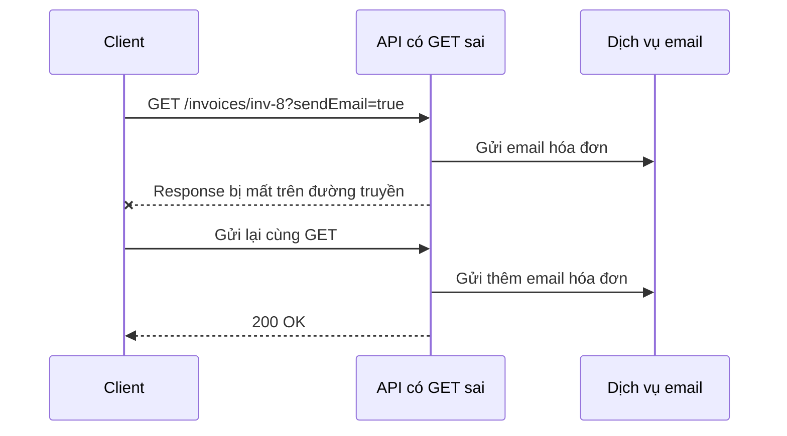

# GET để đọc và rủi ro tạo tác dụng phụ từ thao tác đọc

Trong chương **Phương thức HTTP** của module `INTEGRATION_API_REST`, GET là lời cam kết về ý nghĩa của thao tác đọc. Khi gọi một URI để xem dữ liệu, client cần có thể mở lại URI đó mà không vô tình xác nhận đơn hàng, tiêu thụ một mã dùng một lần hoặc gửi thêm email.

Bài học dùng hệ thống quản lý thông báo và đơn hàng để nối thiết kế resource, URI, mã trạng thái, hợp đồng dữ liệu, cache và kiểm soát truy cập với cách triển khai trong Java/Spring. Những quyết định này cũng áp dụng khi dùng công nghệ khác.

## 1. Kết quả cần đạt

Sau bài học, bạn có thể:

- Thiết kế GET cho một resource hoặc một tập kết quả có lọc, sắp xếp và phân trang.
- Phân biệt tính an toàn về ngữ nghĩa, tính lũy đẳng và khả năng cache.
- Nhận ra thay đổi nghiệp vụ bị giấu trong một thao tác mang tên “đọc”.
- Giải thích vì sao tải trước, quét liên kết, retry và cache làm thiết kế GET sai trở nên nguy hiểm.
- Tách đường đọc khỏi lệnh thay đổi trạng thái trong một API Java/Spring.
- Viết tiêu chí kiểm thử bao gồm cả dữ liệu trả về lẫn trạng thái và sự kiện sau khi đọc.

Kiến thức đầu vào cần có: cấu trúc request/response HTTP, path, query parameter, JSON và ý nghĩa cơ bản của xác thực, phân quyền.

## 2. GET yêu cầu điều gì?

GET yêu cầu lấy một biểu diễn của resource được URI định danh. “Safe” nghĩa là client không yêu cầu thay đổi trạng thái; “idempotent” nghĩa là lặp request có cùng tác động dự kiến như gọi một lần. Hai tính chất này không cam kết response luôn giống nhau. Xem [RFC 9110, mục 9.2–9.3](https://www.rfc-editor.org/rfc/rfc9110.html#section-9.2).

Ví dụ một API tra cứu đơn hàng:

```http
GET /orders/ord-1042 HTTP/1.1
Host: api.example.test
Accept: application/json
Authorization: Bearer <access-token>
```

```http
HTTP/1.1 200 OK
Content-Type: application/json
Cache-Control: no-store

{
  "id": "ord-1042",
  "status": "CONFIRMED",
  "total": {
    "amount": "350000",
    "currency": "VND"
  }
}
```

Hợp đồng của endpoint này là trả thông tin đơn hàng mà người gọi được phép xem. Nó không bao gồm việc chuyển đơn sang `CONFIRMED`; giá trị đó phản ánh trạng thái đã có.

Một URI cho tập kết quả có thể là:

```http
GET /orders?status=CONFIRMED&page=0&size=20&sort=createdAt,desc HTTP/1.1
Host: api.example.test
Accept: application/json
```

Ở đây, query parameter chọn tập đơn hàng và cách trình bày. Quy ước `page` bắt đầu từ 0, giới hạn `size` và các giá trị `sort` phải được công bố trong hợp đồng của API. Chúng là quyết định của ứng dụng, không phải mặc định chung cho mọi API REST.

## 3. Ba khái niệm cần tách riêng

| Khái niệm | Câu hỏi khi thiết kế | Ví dụ trong hệ thống thông báo |
| --- | --- | --- |
| An toàn về ngữ nghĩa — safe | Client có yêu cầu thực hiện một thay đổi nghiệp vụ không? | Xem nội dung thông báo chỉ lấy dữ liệu. |
| Lũy đẳng — idempotent | Gọi lại cùng yêu cầu có làm phát sinh thêm tác động dự kiến không? | Xem lại không tạo thêm lần xác nhận đã đọc. |
| Khả năng cache | Một response đã có có thể được dùng để trả lời request sau theo chính sách nào? | Danh sách thông báo cá nhân có thể được chọn `no-store`. |

Trong ví dụ của bài, ta thiết kế GET giữ nguyên tập trạng thái nghiệp vụ đang xét. Nếu một tiến trình khác vừa tạo thông báo mới, hai lần GET danh sách có thể có nội dung khác nhau dù cả hai đều tuân thủ hợp đồng đọc.

Tương tự, `generatedAt`, mã theo dõi request và thời gian xử lý có thể khác giữa các response. Khi kiểm thử tính chất đọc, đừng chỉ so sánh toàn bộ JSON rồi kết luận có hoặc không có tác dụng phụ.

Một lệnh “đặt `read=true`” có thể được thiết kế để gọi lại vẫn cho cùng trạng thái cuối. Điều đó chưa biến nó thành thao tác đọc: lần gọi đầu tiên vẫn yêu cầu một thay đổi nghiệp vụ.

Ngược lại, chọn `Cache-Control: no-store` chỉ là quyết định lưu response. Nó không sửa được một GET đang thực hiện lệnh hủy đơn hàng.

## 4. Tác dụng phụ nào cần phân biệt?

Một request đi qua hệ thống thường để lại dấu vết. Access log, metric hoặc việc nạp cache là tác động kỹ thuật đi kèm; điều cần tránh là dùng GET để yêu cầu một thay đổi nghiệp vụ. RFC không đòi mọi thao tác bên trong GET đều thuần đọc. Xem [RFC 9110, mục 9.2.1](https://www.rfc-editor.org/rfc/rfc9110.html#section-9.2.1).

Phân loại một số lựa chọn trong hệ thống mẫu:

| Hành vi bên trong đường xử lý GET | Cách đánh giá trong thiết kế này |
| --- | --- |
| Ghi log request và thời gian xử lý | Dấu vết vận hành; cần giới hạn và bảo vệ dữ liệu trong log. |
| Tăng bộ đếm request để theo dõi tải | Metric vận hành, không phải bằng chứng người dùng đã đọc nội dung. |
| Nạp cache từ nguồn dữ liệu có thẩm quyền | Có thể chấp nhận nếu chỉ tạo bản sao có thể tái tạo và không thay đổi quyền hay nghĩa vụ. |
| Đặt `notification.readAt = now()` | Thay đổi trạng thái thông báo của người dùng; cần lệnh riêng. |
| Gọi dịch vụ gửi SMS để “nhắc xem thông báo” | Phát sinh tác động bên ngoài; không gắn ngầm vào việc lấy dữ liệu. |
| Trừ lượt tải trong gói khách hàng đã mua | Trong hợp đồng mẫu này, đó là quyền lợi có thể bị tiêu hao; cần luồng nghiệp vụ rõ ràng. |
| Xóa thông báo ngay sau khi trả về | Biến việc đọc thành tiêu thụ resource; không phù hợp đường GET của bài. |

Tên gọi kỹ thuật không quyết định bản chất. Một hàng ghi vào bảng `analytics_events` vẫn là thay đổi nghiệp vụ nếu downstream dùng nó để thanh toán thưởng, gửi quà hoặc xác nhận hoàn thành đào tạo.

Ngược lại, không nên khẳng định mọi phép ghi xuống database đều làm GET sai. Cache được lưu trong database vẫn có thể chỉ là chi tiết triển khai. Cần truy ngược dữ liệu được ghi sẽ ảnh hưởng đến quyết định nào.

Với các hệ thống đo lường hoặc tính phí đặc thù, phải phân tích hợp đồng riêng; không suy ra một quy tắc chung rằng mọi thay đổi liên quan đến tiền đều có cùng ngữ nghĩa HTTP. Trong ví dụ này, việc tiêu hao quyền người dùng là hành vi được chủ động tách khỏi đọc.

## 5. Vì sao không được đồng nhất một GET với một lần bấm có chủ ý?

Giả sử ứng dụng đang cung cấp endpoint sau:

```http
GET /orders/ord-1042/cancel HTTP/1.1
Host: api.example.test
```

Nếu server hủy đơn ngay khi nhận request, bất kỳ thành phần nào lấy URI này cũng có thể khởi động nghiệp vụ hủy. Đổi tên thành `/orders/ord-1042?action=cancel` không thay đổi vấn đề.

### 5.1. Request tự động và tải trước

Một trang giao diện chứa liên kết đến endpoint trên. Trình thu thập liên kết, công cụ xem trước hoặc tính năng tải trước có thể truy cập URI mà chưa có ý định hủy đơn từ người dùng. Việc một request có đủ thông tin xác thực hay không tùy từng công cụ và môi trường; lỗi thiết kế xuất hiện khi một lượt đọc có quyền truy cập lại được diễn giải thành lệnh.

Với đường dẫn xác nhận email chứa token, công cụ kiểm tra liên kết trong email là một tình huống đặc biệt đáng chú ý: quyền thao tác có thể nằm ngay trong URI thay vì cookie. Nếu GET vừa mở trang vừa tiêu thụ token, một lượt kiểm tra tự động có thể hoàn thành hành động trước chủ tài khoản.

Trong thiết kế mẫu, GET mở trang xác nhận, còn request thay đổi trạng thái chỉ được gửi sau bước tương tác xác nhận. Token có thời hạn và việc kiểm tra quyền vẫn phải được xử lý ở server; trang xác nhận tự nó không thay thế các kiểm soát đó.

### 5.2. Retry khi mất response



Client không biết request đầu đã đi đến đâu. Nếu giao thức đọc bị dùng cho lệnh gửi email, một lỗi mạng có thể biến thành hai email thật. Khử trùng lặp có thể giảm hậu quả, nhưng endpoint này vẫn đang diễn đạt lệnh bằng GET.

### 5.3. Cache làm số lần xử lý tại server thay đổi

Hãy xét `GET /lessons/lesson-9` vừa trả nội dung vừa đánh dấu hoàn thành bài học:

1. Lần đầu gọi đi đến server và ghi nhận hoàn thành.
2. Lần sau có thể được phục vụ từ cache nếu response cho phép.
3. Server không chạy lại nhánh đánh dấu, dù giao diện đã hiển thị nội dung.

Do đó, đếm số lần endpoint chạy không phản ánh đáng tin cậy số lần người dùng đọc. Với thao tác hoàn thành bài học, hãy dùng một lệnh có định nghĩa nghiệp vụ riêng và tiêu chí chấp nhận rõ ràng.

## 6. Một sự cố mẫu: mở thông báo làm mất số chưa đọc

Giả sử ứng dụng có thông báo:

```json
{
  "id": "ntf-17",
  "ownerId": "user-7",
  "title": "Đơn hàng đã được giao",
  "readAt": null
}
```

Giao diện gọi `GET /notifications/ntf-17` để hiển thị một phần xem trước. Backend đồng thời đặt `readAt` và phát sự kiện `NotificationRead`. Khi người dùng mở danh sách, số thông báo chưa đọc đã giảm dù họ chưa vào màn hình chi tiết.

Điểm sai nằm ở việc ghép hai hợp đồng:

- “Cho tôi xem nội dung có quyền truy cập.”
- “Ghi nhận rằng tôi đã đọc thông báo.”

Có thể thiết kế resource cho hai việc này như sau:

| Mục đích | Request mẫu | Tác động được công bố |
| --- | --- | --- |
| Lấy chi tiết thông báo | `GET /notifications/ntf-17` | Trả dữ liệu, giữ nguyên `readAt`. |
| Lấy danh sách chưa đọc | `GET /notifications?read=false&page=0&size=20` | Trả danh sách theo bộ lọc. |
| Ghi nhận đã đọc cho người đang đăng nhập | `PUT /me/notification-receipts/ntf-17` với body `{"read":true}` | Tạo hoặc cập nhật biên nhận đọc thuộc người gọi. |

URI biên nhận do bài học đề xuất; không phải tên bắt buộc của REST. Một phương án khác là cập nhật một resource trạng thái bằng PATCH, hoặc tạo một yêu cầu xác nhận bằng POST nếu hợp đồng nghiệp vụ thích hợp.

Với phương án PUT ở trên, hợp đồng phải nêu rõ: lần đầu ghi thời điểm server chấp nhận, các lần đặt lại cùng trạng thái không làm thời điểm đó trượt tiếp và không phát thêm sự kiện “đọc lần đầu”. Việc triển khai cần xử lý cả request đồng thời. Chỉ đổi annotation hoặc method HTTP chưa tự giải quyết các yêu cầu này.

## 7. Xác thực, phân quyền và CSRF vẫn liên quan đến GET

### 7.1. An toàn về ngữ nghĩa không có nghĩa là công khai

`GET /notifications/ntf-17` chỉ dành cho chủ sở hữu vẫn cần xác thực và kiểm tra quyền. Không tin vào `ownerId` do client truyền để quyết định phạm vi dữ liệu.

Một thiết kế phù hợp cho hệ thống mẫu:

1. Lấy định danh tài khoản từ principal đã xác thực.
2. Truy vấn bằng cả `notificationId` và `ownerId`.
3. Nếu không có dữ liệu trong phạm vi của người gọi, trả kết quả lỗi theo chính sách đã công bố.
4. Dùng cùng quy tắc phạm vi cho API danh sách, đếm số chưa đọc và chi tiết.

Đội dự án có thể chọn `404` để không tiết lộ sự tồn tại của thông báo người khác, hoặc dùng `403` khi có chủ đích thể hiện việc từ chối. Điều quan trọng trong ví dụ là lựa chọn nhất quán, không trả nội dung rồi để giao diện tự che.

### 7.2. GET thay đổi trạng thái mở ra đường CSRF

Nếu API dùng session cookie và GET có thể hủy đơn, một trang bên ngoài có thể tìm cách khiến trình duyệt gửi request đến URI đó. Khả năng cookie đi kèm phụ thuộc cấu hình và ngữ cảnh; điều này cần được đánh giá thay vì giả định trình duyệt luôn gửi hoặc luôn chặn.

OWASP khuyến nghị không dùng GET cho thao tác đổi trạng thái và áp dụng bảo vệ CSRF cho luồng cần bảo vệ. Xem [OWASP CSRF Prevention Cheat Sheet](https://cheatsheetseries.owasp.org/cheatsheets/Cross-Site_Request_Forgery_Prevention_Cheat_Sheet.html).

Trong hệ thống mẫu, sau khi chuyển lệnh xác nhận sang PUT hoặc POST, vẫn phải áp dụng xác thực, phân quyền và bảo vệ CSRF phù hợp với cơ chế cookie đang dùng. Đổi method là sửa ngữ nghĩa, chưa phải toàn bộ phương án bảo mật.

CORS cũng không thay cho kiểm soát quyền tại server. Việc JavaScript ở một origin không đọc được response không đủ để chứng minh một request không thể gây thay đổi.

### 7.3. Đừng đưa bí mật vào query để tiện gọi GET

Ví dụ cần tránh trong API thông thường:

```text
GET /accounts/me?access_token=<secret>
GET /customers?identityNumber=<sensitive-value>
```

Trong triển khai mẫu, URL có thể đi qua log, công cụ giám sát, lịch sử hoặc nơi chia sẻ liên kết. Hãy chọn header xác thực và quy trình xử lý dữ liệu nhạy cảm phù hợp. HTTPS không loại bỏ việc các hệ thống ở hai đầu lưu URL.

URL ký sẵn có thể là một thiết kế chủ ý cho tải tài liệu. Khi đó, URI mang quyền truy cập cần được quản lý theo thời hạn, phạm vi và cách ghi log; nó không trở thành lệnh tiêu thụ quyền chỉ vì được ký.

## 8. Cache là một phần của hợp đồng đọc

Cache có thể trả lời GET mà không chạy lại controller. Vì vậy, thiết kế ở đây không đặt một tác động nghiệp vụ bắt buộc vào đường xử lý đọc.

| Header trong response | Ý nghĩa chính sách |
| --- | --- |
| `Cache-Control: public, max-age=60` | Cho phép cache dùng chung lưu response, với thời gian tươi 60 giây theo tuổi response. |
| `Cache-Control: private, max-age=30` | Cấm cache dùng chung lưu; cache riêng có thể lưu theo chính sách. |
| `Cache-Control: no-cache` | Không dùng lại response đã lưu nếu chưa xác thực lại thành công. |
| `Cache-Control: no-store` | Yêu cầu cache không lưu request/response theo chỉ thị này. |

`no-cache` không đồng nghĩa với “không lưu”; `private` cũng không đồng nghĩa với `no-store`. Xem [RFC 9111, mục 5.2.2](https://www.rfc-editor.org/rfc/rfc9111.html#section-5.2.2).

Trong ví dụ thông báo cá nhân, bài chọn `no-store` để đơn giản hóa chính sách. Một endpoint danh mục công khai có thể dùng cache với thời gian tươi ngắn. Không sao chép header `public` từ danh mục sang response chứa dữ liệu của tài khoản.

Khi sử dụng ETag, một trao đổi đọc có điều kiện có dạng:

```http
GET /public-categories HTTP/1.1
Host: api.example.test
If-None-Match: "categories-v7"
```

```http
HTTP/1.1 304 Not Modified
ETag: "categories-v7"
Cache-Control: public, max-age=60
```

Response này không chứa body. Xem [RFC 9110, mục 15.4.5](https://www.rfc-editor.org/rfc/rfc9110.html#section-15.4.5).

Đối với ứng dụng mẫu, việc không gửi lại body không được làm thiếu một thao tác nghiệp vụ nào. Nếu mỗi lần xem bắt buộc phải tạo một biên nhận nghiệp vụ, biên nhận phải có luồng riêng thay vì phụ thuộc vào nhánh `200` hay `304`.

Cache phía ứng dụng cũng cần giữ ranh giới tài khoản. Chẳng hạn, cache theo mỗi `notificationId` nhưng bỏ qua phạm vi người dùng có thể làm hỏng việc kiểm soát truy cập dù header HTTP đã chọn `no-store`.

## 9. Tham số GET và các mã trạng thái trong hợp đồng mẫu

GET có body không có ngữ nghĩa chung được chuẩn hóa cho nội dung đó; đừng dựa vào nó cho khả năng tương tác thông thường. Dùng path/query cho truy vấn phù hợp, hoặc thiết kế POST có hợp đồng riêng cho bộ tiêu chí phức tạp. Xem [RFC 9110, mục 9.3.1](https://www.rfc-editor.org/rfc/rfc9110.html#section-9.3.1).

Ví dụ danh sách thông báo:

```http
GET /notifications?read=false&page=0&size=20&sort=createdAt,desc HTTP/1.1
Host: api.example.test
Accept: application/json
```

```json
{
  "items": [
    {
      "id": "ntf-17",
      "title": "Đơn hàng đã được giao",
      "readAt": null
    }
  ],
  "page": 0,
  "size": 20,
  "hasNext": false
}
```

Tập rỗng vẫn là một tập kết quả hợp lệ, ví dụ `items: []` và `hasNext: false`. Không cần tạo lỗi “không tìm thấy danh sách” chỉ vì bộ lọc không khớp bản ghi nào.

Bảng sau là hợp đồng được chọn cho API thông báo của bài:

| Tình huống | Mã và hành vi được chọn |
| --- | --- |
| Có chi tiết trong phạm vi truy cập | `200`, trả `NotificationView`. |
| Danh sách hợp lệ, không có phần tử | `200`, trả envelope với `items: []`. |
| Query sai kiểu hoặc `size` ngoài giới hạn | `400`, trả mô tả lỗi theo schema chung. |
| Chưa xác thực đối với resource được bảo vệ | `401`, kèm challenge phù hợp cơ chế xác thực. |
| Không tìm thấy chi tiết trong phạm vi của người gọi | `404`, không tiết lộ chủ sở hữu khác. |
| Dịch vụ phụ thuộc tạm thời không đáp ứng | Ánh xạ sang lỗi `5xx` theo chính sách, không đổi thành danh sách rỗng. |

Schema lỗi cần có mã ứng dụng ổn định và thông tin đủ để client xử lý, nhưng không đưa stack trace hoặc chi tiết truy vấn nội bộ ra response. Hợp đồng đọc tốt phải phân biệt “không có dữ liệu” với “chưa đọc được dữ liệu do lỗi”.

## 10. Triển khai minh họa bằng Java/Spring

### 10.1. Mẫu có lỗi: đọc đồng thời đánh dấu đã đọc

```java
@GetMapping("/notifications/{id}")
public NotificationView get(@PathVariable("id") String id) {
    Notification entity = repository.findById(id).orElseThrow();
    entity.markAsRead(clock.instant());
    repository.save(entity);
    events.publish(new NotificationRead(entity.getId()));
    return toView(entity);
}
```

Đây là đoạn minh họa lỗi, không phải code để dùng nguyên trạng. Ngoài việc ghép lệnh vào GET, nó chưa thể hiện phạm vi người dùng. Ngay cả khi bỏ `save()`, thay đổi một entity đang được ORM quản lý vẫn có thể được ghi ở lúc flush tùy cấu hình transaction. Cần bỏ hành vi thay đổi, không chỉ bỏ một lời gọi repository.

### 10.2. Thiết kế đường đọc với dữ liệu trả về riêng

Đoạn dưới minh họa ranh giới controller và dịch vụ truy vấn. Các khai báo được đặt trong những file Java tương ứng của ứng dụng; ví dụ không bao gồm cấu hình chạy server, datasource hoặc lớp security.

Giả định lớp xác thực đã yêu cầu đăng nhập cho `/notifications/**` và `principal.getName()` trả về định danh tài khoản ổn định của hệ thống.

```java
import java.security.Principal;
import java.time.Instant;
import java.util.Optional;

import org.springframework.http.CacheControl;
import org.springframework.http.HttpStatus;
import org.springframework.http.ResponseEntity;
import org.springframework.stereotype.Service;
import org.springframework.transaction.annotation.Transactional;
import org.springframework.web.bind.annotation.GetMapping;
import org.springframework.web.bind.annotation.PathVariable;
import org.springframework.web.bind.annotation.RequestMapping;
import org.springframework.web.bind.annotation.RestController;
import org.springframework.web.server.ResponseStatusException;

record NotificationView(
        String id,
        String title,
        String body,
        Instant readAt) {
}

interface NotificationReadRepository {
    Optional<NotificationView> findVisibleByIdAndOwnerId(
            String notificationId,
            String ownerId);
}

@Service
class NotificationQueryService {
    private final NotificationReadRepository repository;

    NotificationQueryService(NotificationReadRepository repository) {
        this.repository = repository;
    }

    @Transactional(readOnly = true)
    public NotificationView getVisible(String id, String ownerId) {
        return repository.findVisibleByIdAndOwnerId(id, ownerId)
                .orElseThrow(() -> new ResponseStatusException(
                        HttpStatus.NOT_FOUND,
                        "Notification not found"));
    }
}

@RestController
@RequestMapping("/notifications")
class NotificationController {
    private final NotificationQueryService queries;

    NotificationController(NotificationQueryService queries) {
        this.queries = queries;
    }

    @GetMapping("/{id}")
    public ResponseEntity<NotificationView> get(
            @PathVariable("id") String id,
            Principal principal) {
        NotificationView view = queries.getVisible(id, principal.getName());
        return ResponseEntity.ok()
                .cacheControl(CacheControl.noStore())
                .body(view);
    }
}
```

`NotificationReadRepository` là cổng truy vấn cần có implementation do dự án cung cấp; đây không phải một Spring Data repository tự hoạt động chỉ nhờ khai báo interface. Hợp đồng của implementation là lọc theo cả ID và chủ sở hữu, ánh xạ ra dữ liệu hiển thị và không thực hiện cập nhật nghiệp vụ.

Lợi ích của cách bố trí này:

- Controller thể hiện URI, method, response và chính sách cache của thao tác đọc.
- Dịch vụ truy vấn không nhận dependency gửi email hoặc phát sự kiện thay đổi thông báo.
- DTO không chứa phương thức `markAsRead`, giảm khả năng vô tình sửa entity trong lúc tạo response.
- Phạm vi người dùng đi theo truy vấn, thay vì chỉ được kiểm tra trên giao diện.

Đây là cách giảm rủi ro bằng cấu trúc mã, không phải chứng minh đầy đủ rằng mọi implementation đều không có tác dụng phụ. Cần xem cả repository, callback ORM, interceptor và các dịch vụ được gọi tiếp.

### 10.3. `readOnly = true` là tín hiệu hỗ trợ, không phải hàng rào tuyệt đối

Theo [Spring TransactionDefinition.isReadOnly()](https://docs.spring.io/spring-framework/docs/current/javadoc-api/org/springframework/transaction/TransactionDefinition.html#isReadOnly()), cờ read-only là gợi ý cho transaction subsystem; nó không bảo đảm mọi nỗ lực ghi đều thất bại.

Trong ví dụ này, annotation giúp diễn đạt ý định và có thể hỗ trợ tối ưu tùy transaction manager. Nó không ngăn một lời gọi HTTP gửi email, một thao tác Redis, hay code ghi ngoài phạm vi transaction được quản lý.

Tài khoản database chỉ có quyền đọc có thể là lớp bảo vệ bổ sung cho một đường truy vấn chuyên biệt. Tuy nhiên, API vẫn cần thiết kế đúng các dependency và kiểm soát các hệ thống bên ngoài database đó.

## 11. Biểu diễn hợp đồng trong OpenAPI

Một đoạn trích OpenAPI cho endpoint chi tiết có thể viết như sau:

```yaml
openapi: 3.0.3
info:
  title: Notification API
  version: 1.0.0
paths:
  /notifications/{id}:
    get:
      operationId: getNotification
      summary: Lấy thông báo trong phạm vi người đang đăng nhập
      description: >-
        Trả nội dung hiện có; không đánh dấu đã đọc,
        không gửi thông báo mới và không phát sự kiện NotificationRead.
      security:
        - bearerAuth: []
      parameters:
        - name: id
          in: path
          required: true
          schema:
            type: string
      responses:
        '200':
          description: Tìm thấy thông báo thuộc phạm vi truy cập
          headers:
            Cache-Control:
              description: Chính sách của ví dụ là no-store
              schema:
                type: string
                example: no-store
          content:
            application/json:
              schema:
                $ref: '#/components/schemas/NotificationView'
        '401':
          description: Cần thông tin xác thực hợp lệ
          headers:
            WWW-Authenticate:
              schema:
                type: string
                example: Bearer
        '404':
          description: Không có thông báo trong phạm vi truy cập
components:
  securitySchemes:
    bearerAuth:
      type: http
      scheme: bearer
  schemas:
    NotificationView:
      type: object
      required: [id, title, body, readAt]
      properties:
        id:
          type: string
        title:
          type: string
        body:
          type: string
        readAt:
          type: string
          format: date-time
          nullable: true
```

Tài liệu này ghi rõ tác động mong đợi để người tích hợp không phải đoán việc GET có làm thông báo đổi trạng thái hay không. Một OpenAPI document hợp lệ vẫn cần được triển khai và kiểm thử; trường `description` không tự ràng buộc hành vi server.

Khi bổ sung endpoint biên nhận đọc, mô tả riêng điều kiện tạo/cập nhật, quyền thao tác, response và cách xử lý lặp. Không thêm `markRead=true` vào GET như một cách né việc định nghĩa lệnh.

## 12. Kiểm thử điều gì để phát hiện GET gây thay đổi?

Một test chỉ khẳng định `status == 200` và JSON có đúng `id` có thể bỏ sót việc `readAt` đã bị cập nhật hoặc email đã được gửi. Cần quan sát hậu quả sau request.

Trong hệ thống mẫu, chuẩn bị một thông báo chưa đọc của `user-7`, một thông báo của `user-8` và các dependency bên ngoài có thể quan sát. Chụp trạng thái ban đầu trong môi trường test cô lập.

| Kịch bản | Response cần quan sát | Trạng thái/hậu quả cần quan sát |
| --- | --- | --- |
| Chủ sở hữu GET chi tiết | `200`, đúng nội dung | `readAt` vẫn rỗng; không có biên nhận mới. |
| Cùng người gọi lặp GET ba lần | Các lần đọc hợp lệ | Không có `NotificationRead`, SMS hay email mới. |
| GET danh sách chưa đọc | Có thông báo đúng phạm vi | Số chưa đọc không giảm do thao tác lấy danh sách. |
| Người khác GET cùng ID | Lỗi theo chính sách `404` | Không sửa thông báo và không tiết lộ nội dung. |
| GET với query không hợp lệ | Lỗi `400` theo hợp đồng danh sách | Không có cập nhật hoặc tác vụ nghiệp vụ được tạo. |
| Request chỉ lấy metadata bằng HEAD nếu được hỗ trợ | Không có body | Không khởi động nhánh đánh dấu đã đọc. |
| Lệnh PUT biên nhận, sau đó GET | GET phản ánh trạng thái đã cập nhật | Thay đổi bắt nguồn từ lệnh PUT được xác thực. |

Mã giả của test tích hợp quan trọng nhất:

```text
given:
  user-7 sở hữu ntf-17 với readAt = null
  không có biên nhận đọc và không có sự kiện NotificationRead của ntf-17

when:
  gọi GET /notifications/ntf-17 ba lần dưới danh tính user-7
  đợi các tác vụ nền phát sinh từ request kết thúc trong môi trường test

then:
  cả ba response đều trả đúng nội dung cho user-7
  đọc lại dữ liệu bằng transaction/connection mới: readAt vẫn null
  số biên nhận và sự kiện NotificationRead của ntf-17 không tăng
  không có lời gọi gửi email hoặc SMS cho ntf-17
```

Đọc lại bằng một transaction hoặc connection mới giúp tránh chỉ nhìn object đang giữ trong bộ nhớ. Nếu hệ thống dùng queue, outbox hoặc tác vụ sau commit, test cần bao phủ ranh giới đó; rollback transaction của test có thể che một hành vi chỉ xuất hiện khi commit thật.

Có thể bổ sung kiểm tra kiến trúc để đường query không phụ thuộc vào command service, nhưng một kiểm tra dependency không thay thế test tích hợp. Ngược lại, đừng viết test buộc mọi GET không tạo bất kỳ bản ghi nào trong hệ thống: access log và metric có thể vẫn là hành vi hợp lệ.

## 13. Các thay đổi ngầm thường bị bỏ sót

### Tạo mặc định khi chưa có dữ liệu

`GET /me/preferences` gọi `findOrCreatePreferences()` để tạo thiết lập mặc định. Trong thiết kế mẫu, hãy ưu tiên trả một biểu diễn mặc định mà chưa cần lưu, hoặc khởi tạo thiết lập ở một luồng tạo tài khoản/lệnh riêng. Nếu việc tạo bản ghi ảnh hưởng đến quota, audit nghiệp vụ hay quy trình xử lý, nó cần được coi là quyết định nghiệp vụ rõ ràng.

### Trả “phần tử tiếp theo” bằng cách lấy khỏi hàng đợi

`GET /jobs/next` vừa trả job vừa khóa quyền xử lý khiến lần đọc sau nhận job khác. Nếu mục tiêu là cấp quyền nhận việc, bài đề xuất `POST /job-claims` để thể hiện việc tạo một claim. Tách riêng GET để tra cứu job hoặc claim đã có.

### Tạo báo cáo và gửi email ngay khi tải

`GET /reports/monthly?email=true` kết hợp đọc báo cáo với gửi một bản sao. Trong hợp đồng mẫu, GET chỉ tải kết quả đã có hoặc tính biểu diễn trong giới hạn được công bố; yêu cầu tạo tác vụ báo cáo dài hoặc gửi email được mô hình hóa bằng resource yêu cầu riêng.

Việc tính toán tốn CPU không tự động là lệnh thay đổi nghiệp vụ. Tuy nhiên, tạo một job lâu dài, tiêu hao hạn mức của khách hàng hoặc gửi kết quả ra ngoài là các tác động cần phân tích riêng. Chọn method không thay thế giới hạn tải, timeout hoặc phân trang.

### Cập nhật `lastSeen` mà không rõ ý nghĩa

Nếu `lastSeen` chỉ là telemetry để vận hành, nó có thể là dấu vết đi kèm. Nếu giá trị đó gia hạn đăng nhập, thay đổi hạn sử dụng tài khoản hoặc khởi động quy trình chăm sóc khách hàng, phải xem xét tác động nghiệp vụ. Đừng quyết định chỉ dựa vào tên trường.

### Chuyển GET sang một URL khác để thực hiện lệnh

Một endpoint GET trả redirect đến GET khác rồi thực hiện hủy đơn vẫn giữ cùng vấn đề. Phải sửa toàn bộ chuỗi xử lý, gồm đích redirect, callback và tác vụ nền.

## 14. Cách sửa một endpoint đã triển khai sai

Giả sử client hiện tại dùng `GET /notifications/{id}?markRead=true`. Một lộ trình sửa trong dự án mẫu:

1. Định nghĩa hợp đồng đọc: trả nội dung, kiểm tra quyền, giữ nguyên trạng thái đã đọc.
2. Thiết kế resource biên nhận hoặc lệnh cập nhật tương ứng; công bố điều kiện thành công và xử lý lặp.
3. Chuyển logic ghi và phát sự kiện sang đường command, bao gồm dependency được gọi gián tiếp.
4. Bổ sung kiểm thử trạng thái trước/sau cho GET và kiểm thử riêng cho command.
5. Cập nhật giao diện, client tích hợp và OpenAPI để việc ghi nhận đã đọc xuất phát từ hành động đã thống nhất.
6. Ngừng cho GET thực hiện lệnh theo kế hoạch tương thích được dự án công bố; trả lỗi có hướng dẫn hoặc giữ GET chỉ đọc tùy hợp đồng chuyển đổi.
7. Theo dõi lỗi client và các sự kiện nghiệp vụ trong quá trình chuyển đổi.

Nếu vẫn cho GET cũ thay đổi dữ liệu trong giai đoạn chuyển đổi, rủi ro vẫn tồn tại trong khoảng thời gian đó. Cần mô tả trung thực trạng thái triển khai, không coi việc thêm endpoint mới là đã sửa xong đường cũ.

## 15. Tiêu chí hoàn thành một thiết kế GET

Trước khi dùng endpoint đọc trong ứng dụng mẫu, hãy xác nhận:

- URI và query mô tả resource hoặc tập kết quả, không giấu một lệnh như `delete`, `confirm` hay `sendEmail`.
- Hợp đồng nói rõ dữ liệu trả về, phạm vi truy cập, phân trang và lỗi đầu vào.
- Controller, service, repository, callback và tác vụ nền không thực hiện thay đổi nghiệp vụ thuộc một lệnh khác.
- Gọi lặp không tạo thêm biên nhận, yêu cầu xử lý, thông báo gửi ra hoặc quyền bị tiêu hao trong phạm vi đã thiết kế.
- Chính sách cache phù hợp dữ liệu công khai/cá nhân và không làm rò rỉ dữ liệu giữa các tài khoản.
- Xác thực và phân quyền được thực hiện ở server, bao gồm cả các truy vấn đếm và danh sách.
- Test quan sát dữ liệu lưu bền và tác động bên ngoài, không chỉ response `200`.
- Lệnh đổi trạng thái có request riêng, điều kiện quyền riêng và tiêu chí kiểm thử riêng.

GET đáng tin cậy khi người tích hợp có thể dùng nó để lấy thông tin mà không phải đoán xem một lượt đọc có kích hoạt nghiệp vụ khác hay không. Trong hệ thống thông báo của bài, xem nội dung và ghi nhận đã đọc là hai hợp đồng được biểu diễn và kiểm thử độc lập.