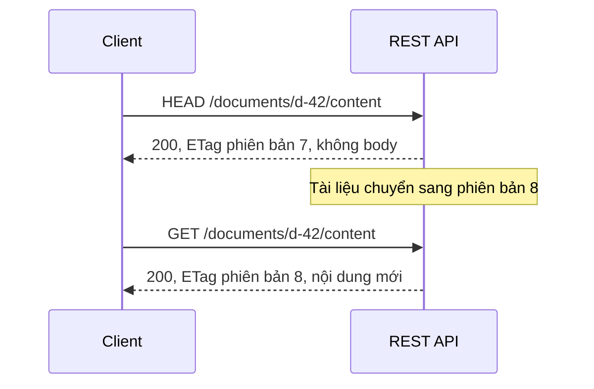

# HEAD và quan hệ metadata với GET

> Chương: Phương thức HTTP · Module: INTEGRATION_API_REST

Trong một REST API, URI xác định resource, còn phương thức HTTP diễn đạt cách tương tác với resource đó. `GET /documents/d-42/content` tải một biểu diễn của tài liệu; `HEAD` trên cùng URI giúp client tìm hiểu biểu diễn ấy qua status và header mà không tải nội dung.

Bài học sử dụng tình huống tải tài liệu để kết nối HEAD với thiết kế resource, hợp đồng HTTP, cache, xác thực, phân quyền và cách triển khai bằng Java/Spring.

## 1. Mục tiêu

Sau bài học, bạn có thể:

- Giải thích HEAD liên hệ với GET như thế nào trên cùng resource và cùng biến thể dữ liệu.
- Đọc đúng `Content-Type`, `Content-Length`, `ETag`, `Last-Modified` và các header cache.
- Phân biệt HEAD, GET có điều kiện và phản hồi `304 Not Modified`.
- Thiết kế HEAD có cùng quy tắc truy cập với GET, đồng thời tránh công việc tạo nội dung không cần thiết.
- Mô tả hợp đồng HEAD và xây dựng các tình huống kiểm thử phù hợp.

## 2. Ngữ nghĩa cốt lõi

HEAD có ngữ nghĩa tương ứng GET nhưng server không được gửi nội dung phản hồi. Header nên tương ứng với GET; server có thể bỏ những field chỉ xác định được khi tạo nội dung. HEAD thuộc nhóm safe và idempotent. Không thiết kế request body cho HEAD trong hợp đồng API thông thường. Các quy tắc này được mô tả trong [RFC 9110, mục 9.2 và 9.3.2](https://www.rfc-editor.org/rfc/rfc9110.html#section-9.3.2).

Điều đó dẫn đến ba nguyên tắc thiết kế:

1. Dùng cùng URI resource cho GET và HEAD. Không cần tạo `/documents/d-42/head` hoặc `/check-document` chỉ để đổi phương thức.
2. Giữ cùng quyết định nghiệp vụ về resource tồn tại, quyền truy cập và biểu diễn được chọn.
3. Kết thúc phản hồi HEAD sau phần header, kể cả khi kết quả là lỗi.

Safe nghĩa là client không yêu cầu thay đổi trạng thái nghiệp vụ. Một lần HEAD không được đánh dấu tài liệu là đã đọc, tăng số lượt tải tính phí hoặc kích hoạt tạo báo cáo. Log truy cập và số liệu vận hành có thể vẫn được ghi.

Idempotent không có nghĩa mọi lần gọi nhận cùng status hoặc cùng header. Nếu tài liệu bị xóa giữa hai lần gọi, lần đầu có thể trả `200`, lần sau trả `404`; HEAD vẫn không yêu cầu thay đổi tài liệu.

### 2.1. HEAD không đồng nghĩa với `204`

Trong tình huống một tài liệu có thể tải bình thường, HEAD thường trả `200 OK` và không có body. Không đổi thành `204 No Content` chỉ vì phương thức này không gửi body.

Ngược lại, một GET có thể không có body vì status riêng của nó, chẳng hạn `304`. Vì vậy, chỉ quan sát body rỗng chưa đủ để xác định ý nghĩa phản hồi.

### 2.2. Metadata của biểu diễn, không chỉ của bản ghi

Một resource có thể được biểu diễn dưới dạng PDF hoặc JSON, bằng ngôn ngữ khác nhau, hoặc với cách mã hóa nội dung khác nhau. Khi đối chiếu GET và HEAD, cần giữ cùng URI, query, thông tin xác thực và các header chọn biểu diễn.

Ví dụ, HEAD với `Accept: application/json` không phải phép đo kích thước cho một GET với `Accept: application/pdf`. Tương tự, metadata của bản nén gzip không thể tùy ý dùng cho bản identity.

## 3. Một cặp GET và HEAD cụ thể

Giả sử `/documents/d-42/content` cung cấp một tệp PDF có độ dài 1.048.576 byte. Metadata tài liệu ở dạng JSON, nếu có, thuộc hợp đồng riêng, chẳng hạn `GET /documents/d-42`.

### 3.1. GET tải nội dung

```http
GET /documents/d-42/content HTTP/1.1
Host: api.example.test
Accept: application/pdf
Accept-Encoding: identity
Authorization: Bearer <access-token>
```

Phần header của phản hồi:

```http
HTTP/1.1 200 OK
Content-Type: application/pdf
Content-Length: 1048576
ETag: "d42-pdf-v7"
Last-Modified: Tue, 17 Nov 2026 02:00:00 GMT
Cache-Control: private, max-age=60

```

Sau dòng trống, GET gửi đúng nội dung PDF. Dữ liệu nhị phân không được in trong ví dụ.

### 3.2. HEAD chỉ lấy thông tin phản hồi

```http
HEAD /documents/d-42/content HTTP/1.1
Host: api.example.test
Accept: application/pdf
Accept-Encoding: identity
Authorization: Bearer <access-token>
```

```http
HTTP/1.1 200 OK
Content-Type: application/pdf
Content-Length: 1048576
ETag: "d42-pdf-v7"
Last-Modified: Tue, 17 Nov 2026 02:00:00 GMT
Cache-Control: private, max-age=60

```

Phản hồi HEAD kết thúc tại đây. Client không chờ đọc thêm 1.048.576 byte. Giá trị `Content-Length` mô tả nội dung của GET tương ứng, không phải số byte body đã nhận trong HEAD.

Từ kết quả này, ứng dụng có thể hiển thị loại tệp và dung lượng dự kiến trước khi người dùng quyết định tải. Nếu ứng dụng chắc chắn cần tệp ngay, gọi GET trực tiếp có thể hợp lý hơn việc thêm một lượt HEAD.

## 4. Đọc đúng các header

| Header | Cách dùng trong tình huống tải tài liệu | Điều cần tránh |
| --- | --- | --- |
| `Content-Type` | Chọn cách xử lý biểu diễn, ví dụ `application/pdf`. | Cho rằng HEAD phải trả `application/json` vì API thường dùng JSON. |
| `Content-Length` | Dung lượng nội dung mà GET tương ứng sẽ gửi, nếu server biết và cung cấp. | Gán `0` chỉ vì HEAD không có body. |
| `Content-Encoding` | Nhận biết nội dung GET được mã hóa như gzip. | Dùng độ dài bản gốc làm độ dài bản đã nén. |
| `ETag` | Lưu validator để gửi lại trong request có điều kiện. | Tự diễn giải ETag thành checksum hoặc số phiên bản có định dạng cố định. |
| `Last-Modified` | Lưu thời điểm sửa đổi mà server công bố. | Coi timestamp có độ phân giải giây là cơ chế phát hiện mọi thay đổi liên tiếp. |
| `Cache-Control` | Quy định cách lưu và tái sử dụng phản hồi. | Cho phép cache công khai chỉ vì HEAD không chứa body. |
| `Vary` | Phân biệt những biến thể phụ thuộc header request. | Ghép metadata của các biến thể khác nhau chỉ dựa vào URI. |
| `Location` | Theo dõi đích chuyển hướng khi status yêu cầu. | Hiểu một phản hồi chuyển hướng là resource đã được tải thành công. |

### 4.1. `Content-Length` có thể vắng mặt

HEAD được phép thiếu `Content-Length`; nếu có, giá trị phải bằng số byte của nội dung GET tương ứng. Quy tắc về độ dài nằm trong [RFC 9110, mục 8.6](https://www.rfc-editor.org/rfc/rfc9110.html#section-8.6).

Trong giao diện tải tệp, nên biểu diễn dung lượng chưa biết bằng trạng thái như “chưa xác định”. Không tự đổi header vắng mặt thành dung lượng bằng 0.

Đối với JSON động, số ký tự Java không phải số byte UTF-8. Với dữ liệu tiếng Việt, gọi `json.length()` để tạo `Content-Length` dễ dẫn tới giá trị sai. Nếu muốn công bố độ dài, phải biết chính xác byte của biểu diễn được gửi, kể cả biến đổi nội dung áp dụng sau đó.

Không nên tạo toàn bộ một báo cáo lớn chỉ để đếm byte cho HEAD. Với resource chưa có nội dung vật chất hóa, hợp đồng có thể không cam kết cung cấp dung lượng.

### 4.2. ETag không phải hợp đồng định dạng nội bộ

Ứng dụng nên giữ nguyên ETag nhận được, bao gồm dấu nháy và tiền tố `W/` nếu có, để dùng cho request có điều kiện.

Trong ví dụ, `"d42-pdf-v7"` là giá trị minh họa do server phát hành. Client không nên tách `v7` rồi tự tạo `v8`. Server cũng không nên dùng một phiên bản bản ghi làm strong ETag nếu nội dung PDF có thể thay đổi mà phiên bản ấy không đổi.

Hai tệp khác nội dung có thể cùng dung lượng. So sánh riêng `Content-Length` không xác nhận rằng bản local còn đúng.

### 4.3. Không so sánh mọi header bằng tuyệt đối

Ngay cả khi resource không đổi, `Date`, mã theo dõi request hoặc `Age` tại cache có thể khác giữa hai lần gọi. Việc kiểm tra GET và HEAD cần tập trung vào status và metadata có ý nghĩa với hợp đồng.

Với một số nội dung động, field chỉ có thể xác định trong lúc tạo nội dung có thể không xuất hiện ở HEAD. Đừng xây dựng một phép kiểm bắt buộc mọi header của hai response giống nhau từng byte.

## 5. Status, lỗi và quyền truy cập

| Tình huống | Kết quả HEAD có thể gặp | Ý nghĩa với client |
| --- | --- | --- |
| Tệp tồn tại, người gọi được phép đọc | `200 OK` | Có thể đọc metadata hiện có; chưa tải nội dung. |
| Resource chuyển sang URI khác | `301`, `302`, `307` hoặc `308`, theo hợp đồng | Xem `Location` và chính sách đi theo redirect của client. |
| Validator trong request xác nhận bản lưu còn dùng được | `304 Not Modified` | Kết quả của request có điều kiện, không phải mặc định của HEAD. |
| Thiếu hoặc sai thông tin xác thực | `401 Unauthorized` | Thực hiện quy trình xác thực; xem header challenge khi áp dụng. |
| Đã xác thực nhưng không được phép đọc | `403 Forbidden` hoặc `404` theo chính sách che giấu resource | Không suy ra quyền đọc từ việc endpoint GET tồn tại. |
| Không tìm thấy resource | `404 Not Found` | Không có biểu diễn để tải theo yêu cầu hiện tại. |
| Máy chủ biết HEAD nhưng resource không hỗ trợ | `405 Method Not Allowed` | Kiểm tra `Allow` và hợp đồng API. |
| Server hoặc dịch vụ phụ thuộc gặp lỗi | `5xx` | Xử lý theo chính sách lỗi và retry phù hợp. |

Tất cả phản hồi cho HEAD đều không có body, bao gồm `404` và `500`. Nếu GET trả lỗi bằng `application/problem+json`, HEAD không được gửi đối tượng lỗi đó trong body. Client dùng status và những header thích hợp, chẳng hạn mã theo dõi request, để chẩn đoán.

Thiết kế an toàn cần dùng cùng cơ chế xác thực và phân quyền theo đối tượng cho GET và HEAD. Ví dụ, chỉ bảo vệ matcher `GET /documents/**` trong security filter có thể bỏ sót HEAD nếu các phương thức khác được cho phép mặc định.

Ngay cả metadata cũng có thể nhạy cảm: sự tồn tại của hồ sơ, thời điểm sửa hoặc dung lượng tệp đều tiết lộ thông tin. Với tài liệu riêng tư, quyết định trả `403` hay che giấu bằng `404` phải nhất quán giữa hai phương thức.

HEAD không thay thế `OPTIONS` hoặc request preflight CORS. Khi JavaScript chạy khác origin cần đọc một header không được trình duyệt cho phép truy cập mặc định, cấu hình CORS phải cho phép công khai header ấy, ví dụ ETag, theo nhu cầu của ứng dụng.

## 6. HEAD và request có điều kiện

HEAD quyết định việc không truyền body bằng **phương thức**. Còn `If-None-Match` giúp server đánh giá phiên bản đã lưu của client.

Giả sử client đã lưu ETag `"d42-pdf-v7"`. Nó có thể gửi:

```http
HEAD /documents/d-42/content HTTP/1.1
Host: api.example.test
Accept: application/pdf
Accept-Encoding: identity
If-None-Match: "d42-pdf-v7"
Authorization: Bearer <access-token>
```

Nếu validator vẫn phù hợp với biểu diễn được chọn, phản hồi có thể là:

```http
HTTP/1.1 304 Not Modified
ETag: "d42-pdf-v7"
Cache-Control: private, max-age=60

```

Nếu tài liệu đã đổi sang phiên bản mới, HEAD có thể trả `200 OK` cùng ETag mới, nhưng vẫn không gửi PDF. Đây là điểm dễ nhầm: HEAD `200` và HEAD `304` đều không có body, song thông tin về phiên bản khác nhau.

### 6.1. Chọn HEAD hay conditional GET

| Nhu cầu | Lựa chọn phù hợp |
| --- | --- |
| Chỉ xem loại tệp hoặc dung lượng đã biết | HEAD. |
| Kiểm tra metadata, chưa muốn nhận tệp dù tệp đã thay đổi | HEAD, có thể kèm validator. |
| Đã có bản local và muốn lấy bản mới nếu dữ liệu đổi | GET với `If-None-Match`. |
| Chắc chắn cần tải nội dung ngay | GET trực tiếp. |

Ví dụ, dùng conditional GET cho màn hình cần nội dung sẽ cho hai nhánh hữu ích trong một lượt: `304` nếu bản lưu còn dùng được, hoặc `200` kèm bản mới. Nếu dùng HEAD trước rồi GET sau khi phát hiện thay đổi, ứng dụng cần thêm lượt trao đổi.

`If-Modified-Since` có thể được dùng khi hợp đồng cung cấp `Last-Modified`. Khi gửi cả `If-None-Match` và `If-Modified-Since`, việc đánh giá cần ưu tiên validator ETag theo ngữ nghĩa HTTP; không tự ghép điều kiện theo một phép AND tùy ý.

### 6.2. HEAD không khóa kết quả cho GET kế tiếp

Giữa hai request, tài liệu có thể thay đổi hoặc quyền truy cập có thể bị thu hồi:



Vì vậy, dung lượng lấy từ HEAD chỉ là thông tin ở thời điểm phản hồi. Nếu nghiệp vụ cần tải đúng một phiên bản, hãy thiết kế URI phiên bản bất biến hoặc dùng điều kiện như `If-Match` với strong ETag và xử lý `412 Precondition Failed` khi phiên bản không còn khớp.

## 7. Quan hệ với cache

HEAD có thể được cache theo các quy tắc HTTP, nhưng thiếu body để tự đáp ứng một GET cần nội dung. Một cache đã giữ GET có thể dùng metadata ấy cho HEAD khi phù hợp.

Khi nhận HEAD `200`, cache có thể cập nhật metadata của GET đã lưu nếu biến thể phù hợp, các validator nhận được khớp và `Content-Length`, nếu được cung cấp, cũng khớp. Khi điều kiện không đạt, cache nên xem bản GET đã lưu là stale. Cơ chế này được mô tả tại [RFC 9111, mục 4.3.5](https://www.rfc-editor.org/rfc/rfc9111.html#section-4.3.5).

Trong ứng dụng tải tài liệu, điều này có hai hệ quả:

- Không thay body PDF đã lưu bằng một mảng byte rỗng chỉ vì vừa nhận HEAD.
- Không coi status `200` từ HEAD là đủ để tiếp tục dùng PDF cũ mà bỏ qua validator và biến thể.

`Cache-Control: private, max-age=60` trong ví dụ cho phép cache riêng tư sử dụng phản hồi trong khoảng freshness được quy định; nó không cấp quyền lưu ở shared cache. Nếu chính sách yêu cầu không lưu tài liệu hoặc metadata, hãy chọn `no-store` cho hợp đồng phù hợp.

Đừng tự triển khai một HTTP cache đầy đủ chỉ bằng bản đồ `URI -> ETag`. Cache còn phải xét phương thức, biến thể, tuổi phản hồi, các chỉ thị cache và điều kiện xác thực.

## 8. Triển khai với Java/Spring MVC

### 8.1. Bắt đầu từ hỗ trợ HEAD của GET

Trong Spring MVC, `@GetMapping` hỗ trợ ánh xạ HEAD tự động. Lớp xử lý HTTP loại bỏ nội dung khỏi phản hồi HEAD; vì vậy controller GET thông thường có thể phục vụ HEAD mà không cần một handler riêng. Xem [Spring Framework: HTTP HEAD, OPTIONS](https://docs.spring.io/spring-framework/reference/web/webmvc/mvc-controller/ann-requestmapping.html#page-title).

Ví dụ khai báo handler đọc metadata tài liệu:

```java
@GetMapping("/documents/{id}")
public DocumentView getDocument(@PathVariable("id") String id) {
    return documentService.findReadableDocument(id);
}
```

`DocumentView` và `documentService` là DTO và service của ứng dụng trong ví dụ. HEAD `/documents/d-42` có thể đi qua handler này; nó mô tả biểu diễn JSON của metadata tài liệu, không phải PDF tại `/documents/d-42/content`.

Điểm cần đo là công việc phía server: không gửi body qua mạng chưa chắc tránh được truy vấn, dựng DTO hoặc serialize. Với nội dung lớn, nên lấy metadata từ bản lưu đáng tin cậy thay vì tạo rồi bỏ toàn bộ nội dung.

### 8.2. Tách việc đọc metadata khỏi mở nội dung

Đoạn controller sau minh họa một resource PDF đã được lưu thành phiên bản bất biến. Ví dụ dùng Java có `record` và Spring MVC với `jakarta.servlet`; service được ứng dụng cung cấp qua dependency injection.

```java
import jakarta.servlet.http.HttpServletRequest;
import java.time.Duration;
import java.time.Instant;
import org.springframework.core.io.Resource;
import org.springframework.http.CacheControl;
import org.springframework.http.MediaType;
import org.springframework.http.ResponseEntity;
import org.springframework.web.bind.annotation.PathVariable;
import org.springframework.web.bind.annotation.RequestMapping;
import org.springframework.web.bind.annotation.RequestMethod;
import org.springframework.web.bind.annotation.RestController;

@RestController
@RequestMapping("/documents")
public class DocumentContentController {
    private final DocumentContentService service;

    public DocumentContentController(DocumentContentService service) {
        this.service = service;
    }

    @RequestMapping(
        path = "/{id}/content",
        method = {RequestMethod.GET, RequestMethod.HEAD},
        produces = MediaType.APPLICATION_PDF_VALUE
    )
    public ResponseEntity<Resource> content(
            @PathVariable("id") String id,
            HttpServletRequest request) {
        DocumentSnapshot snapshot = service.findReadableSnapshot(id);

        ResponseEntity.BodyBuilder response = ResponseEntity.ok()
            .contentType(MediaType.APPLICATION_PDF)
            .contentLength(snapshot.length())
            .eTag(snapshot.etag())
            .lastModified(snapshot.modifiedAt().toEpochMilli())
            .cacheControl(CacheControl
                .maxAge(Duration.ofSeconds(60))
                .cachePrivate());

        if ("HEAD".equals(request.getMethod())) {
            return response.build();
        }

        return response.body(service.contentResource(snapshot));
    }

    public record DocumentSnapshot(
        String storageVersion,
        long length,
        String etag,
        Instant modifiedAt
    ) {}

    public interface DocumentContentService {
        DocumentSnapshot findReadableSnapshot(String documentId);
        Resource contentResource(DocumentSnapshot snapshot);
    }
}
```

Hợp đồng của service trong ví dụ:

- `findReadableSnapshot` kiểm tra quyền đọc của người gọi và trả metadata của đúng phiên bản PDF; lỗi không tìm thấy hoặc không có quyền đi qua cơ chế lỗi chung.
- `length` là độ dài byte chính xác của PDF sẽ gửi, không phải kích thước một đối tượng Java.
- `etag` là validator hợp lệ cho biểu diễn, ví dụ `"d42-pdf-v7"`, và thay đổi khi biểu diễn cần thay đổi validator.
- `contentResource` trả resource đọc đúng `storageVersion`, không âm thầm chuyển sang phiên bản mới nhất.
- Việc tạo `Resource` chưa mở stream hoặc tải toàn bộ tệp; nội dung chỉ được đọc khi thực sự cần ghi response.

Ở nhánh HEAD, controller không gọi `contentResource`. Nhờ đó, hệ thống có thể đọc metadata từ cơ sở dữ liệu hoặc object storage mà không tải PDF.

Với `ResponseEntity` có ETag hoặc Last-Modified, Spring MVC có cơ chế xét conditional GET/HEAD và có thể chuyển kết quả sang `304` khi điều kiện phù hợp. Xem [Spring Framework: HTTP Caching](https://docs.spring.io/spring-framework/reference/web/webmvc/mvc-caching.html#page-title). Nếu cần tránh cả bước xây dựng resource cho một GET không thay đổi, có thể xét điều kiện sớm trong controller bằng API `WebRequest`, sau khi kiểm tra quyền.

Ví dụ giả định biểu diễn PDF không bị middleware đổi encoding hoặc biến đổi byte sau khi tính metadata. Nếu bật nén động, cần bảo đảm `Content-Length`, ETag và cấu hình biến thể tiếp tục mô tả đúng biểu diễn cuối cùng. Đây là lý do không sao chép độ dài tệp lưu trữ vào mọi phản hồi một cách máy móc.

### 8.3. Những phần phải đồng bộ ở các lớp khác

Handler chỉ là một phần của đường đi request. Gateway, security filter, exception handler và cơ chế cache đều cần xử lý HEAD phù hợp.

Đặc biệt, đừng để error handler ghi JSON trực tiếp ra socket cho HEAD. Cũng không miễn kiểm tra quyền cho nhánh HEAD chỉ vì nhánh đó không mở tệp. Đối chiếu hành vi ở cả ứng dụng và đường truy cập thực tế qua gateway.

## 9. Mô tả hợp đồng trong OpenAPI

Không nên dựa hoàn toàn vào việc framework tự hỗ trợ HEAD để suy ra tài liệu API đã mô tả HEAD. Với client cần chức năng này, khai báo operation và response headers một cách rõ ràng.

Đây là đoạn `paths` minh họa cho HEAD; security dùng cấu hình chung của tài liệu OpenAPI hoặc được bổ sung theo hợp đồng thực tế:

```yaml
paths:
  /documents/{id}/content:
    head:
      operationId: headDocumentContent
      summary: Đọc metadata của biểu diễn PDF có thể tải
      parameters:
        - name: id
          in: path
          required: true
          schema:
            type: string
        - name: If-None-Match
          in: header
          required: false
          schema:
            type: string
      responses:
        '200':
          description: Metadata hiện tại; phản hồi không có body
          headers:
            Content-Length:
              description: Số byte của GET tương ứng, nếu xác định được
              schema:
                type: integer
                format: int64
                minimum: 0
            ETag:
              description: Validator của biểu diễn được chọn
              schema:
                type: string
            Last-Modified:
              description: HTTP-date của lần sửa đổi được công bố
              schema:
                type: string
            Cache-Control:
              schema:
                type: string
        '304':
          description: Validator phù hợp; không có body
        '401':
          description: Chưa xác thực; không có body
        '403':
          description: Không có quyền đọc; không có body
        '404':
          description: Không tìm thấy tài liệu; không có body
```

Không thêm schema PDF hoặc JSON vào `responses.*.content` của operation HEAD. `Last-Modified` dùng định dạng HTTP-date, không phải chuỗi ISO 8601 của schema `date-time`.

`Content-Type` trong phản hồi thực tế vẫn có thể mô tả PDF như ở ví dụ HTTP. OpenAPI không dùng một response header khai báo tên `Content-Type` để thay thế quy tắc media type của nó; ghi rõ ý nghĩa này trong mô tả operation khi cần, đồng thời giữ HEAD không có response content.

## 10. Thực hành quan sát và thiết kế kiểm thử

Các lệnh sau dành cho môi trường local có API tương ứng. Trên PowerShell, gọi `curl.exe` để dùng đúng chương trình curl; thêm thông tin xác thực phù hợp nếu endpoint được bảo vệ.

Xem status và header của HEAD:

```powershell
curl.exe -sS -I -H "Accept: application/pdf" -H "Accept-Encoding: identity" http://localhost:8080/documents/d-42/content
```

So sánh với header của GET; nội dung GET vẫn được truyền, nhưng bị bỏ ở phía client:

```powershell
curl.exe -sS -D - -o NUL -H "Accept: application/pdf" -H "Accept-Encoding: identity" http://localhost:8080/documents/d-42/content
```

`-I` yêu cầu HEAD. `-i` chỉ thêm header vào đầu kết quả của request thông thường, không tự chuyển GET thành HEAD. Cách GET rồi bỏ nội dung bằng `-o NUL` cũng không mang lại mức tiết kiệm băng thông của HEAD.

### 10.1. Các tình huống kiểm thử có ý nghĩa

| Tình huống | Kết quả cần kiểm tra |
| --- | --- |
| Resource ổn định, cùng người gọi và cùng lựa chọn biểu diễn | GET và HEAD có status phù hợp, metadata của cùng phiên bản nhất quán. |
| HEAD thành công | Body nhận được có 0 byte; không ép `Content-Length` phải bằng 0. |
| HEAD với resource không tồn tại | Status lỗi đúng hợp đồng, không có body JSON lỗi. |
| HEAD thiếu token hoặc không có quyền | Quyết định truy cập nhất quán với GET. |
| HEAD có `If-None-Match` khớp | `304`, không body, validator/cache headers phù hợp. |
| HEAD có `If-None-Match` cũ | `200`, metadata mới, không body. |
| Hai tệp khác nội dung nhưng cùng độ dài | Validator thay đổi phù hợp; không coi cùng độ dài là cùng phiên bản. |
| Nội dung động không công bố dung lượng | Client vẫn xử lý được HEAD thiếu `Content-Length`. |
| HEAD đi qua gateway và nén nội dung | Không có body; metadata không bị thay sai bởi các lớp trung gian. |
| Nhánh HEAD được tối ưu bằng metadata | Không gọi thao tác mở/đọc nội dung; vẫn gọi kiểm tra quyền. |

Dùng client có thể quan sát byte phản hồi hoặc kiểm thử HTTP qua server thực để kiểm chứng việc không gửi body. Một mock chỉ kiểm tra controller trả `null` không đủ chứng minh container, filter và gateway đã xử lý đúng.

Khi framework chặn body ở lớp servlet, test controller trong bộ mock không nhất thiết mô phỏng đầy đủ đường đi đó. Chọn tầng kiểm thử theo điều cần xác nhận: quyết định nghiệp vụ ở service, tối ưu mở nội dung ở controller/service, và ngữ nghĩa trên mạng ở kiểm thử tích hợp.

### 10.2. Bài thực hành áp dụng

Với resource tài liệu của bạn:

1. Định nghĩa URI tải nội dung và xác định biểu diễn GET cung cấp.
2. Chọn nguồn metadata đáng tin cậy cho loại tệp, độ dài, phiên bản và thời điểm sửa.
3. Hỗ trợ HEAD với cùng chính sách đọc tài liệu.
4. Quan sát HEAD thường, HEAD có validator khớp và HEAD không có quyền.
5. Thay nội dung bằng một phiên bản khác có cùng độ dài rồi kiểm tra validator.
6. Đo riêng số byte truyền, số truy vấn và số lần mở stream để biết tối ưu thực sự nằm ở đâu.

Điểm cần giữ xuyên suốt hợp đồng là: metadata HEAD phải nói về biểu diễn GET tương ứng; client không nhận body từ HEAD và không được suy ra rằng dữ liệu đã tải hoặc phiên bản được giữ cố định cho lần gọi tiếp theo.
