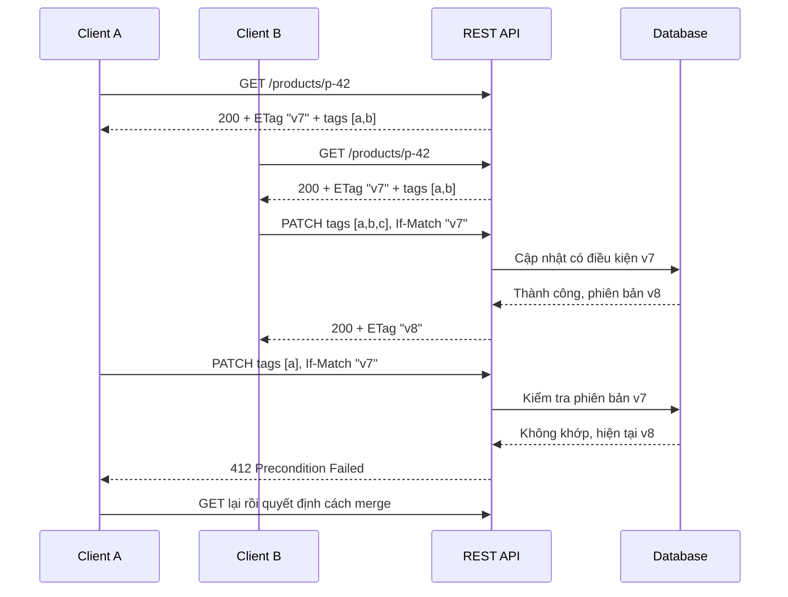

# JSON Merge Patch: ý nghĩa null và thay thế mảng

> **Chương:** Phương thức HTTP  
> **Module:** `INTEGRATION_API_REST` — thiết kế REST API theo resource, URI, phương thức và mã trạng thái HTTP; xây dựng hợp đồng dữ liệu rõ ràng, kiểm thử API, phân trang, cache, idempotency, OpenAPI, xác thực, phân quyền và xử lý lỗi với Java/Spring hoặc công nghệ tương đương.

Khi một client chỉ muốn đổi một vài thuộc tính của resource, gửi toàn bộ biểu diễn mới bằng `PUT` có thể gây cập nhật không mong muốn, đặc biệt nếu dữ liệu đã thay đổi từ lần đọc trước. `PATCH` cho phép gửi một tài liệu mô tả thay đổi. Một định dạng phổ biến là **JSON Merge Patch**, được đặc tả trong **RFC 7396** và sử dụng media type **`application/merge-patch+json`**.

Hai quy tắc quan trọng nhất của JSON Merge Patch là:

- **`null` ở một thuộc tính của đối tượng patch có nghĩa là xóa thuộc tính tương ứng khỏi đối tượng đích.** Nó không có nghĩa là “gán giá trị JSON null”.
- **Một mảng trong patch thay thế toàn bộ giá trị mảng hiện có tại vị trí đó.** JSON Merge Patch không có cú pháp chèn, xóa hay sửa riêng một phần tử theo chỉ số.

Đây là bài học về **ngữ nghĩa hợp đồng cập nhật**. Nếu hiểu sai hai quy tắc này, client có thể xóa trường ngoài ý muốn, mất phần tử trong mảng hoặc khiến dữ liệu thực tế khác với những gì UI thể hiện.

## 1. Mục tiêu học tập

Sau khi học, bạn có thể:

1. Phân biệt `PATCH`, `PUT`, JSON Merge Patch và JSON Patch về mục đích và media type.
2. Dự đoán chính xác kết quả của JSON Merge Patch với trường vắng mặt, `null`, giá trị nguyên thủy, đối tượng lồng nhau và mảng.
3. Giải thích vì sao JSON Merge Patch không phù hợp khi cần **gán giá trị JSON null** vào một thuộc tính hoặc cập nhật từng phần tử của mảng.
4. Thiết kế endpoint `PATCH` có xác thực, phân quyền theo field, kiểm tra điều kiện phiên bản, validation và thông báo lỗi rõ ràng.
5. Cài đặt thuật toán Merge Patch cơ bản bằng Java/Jackson, nhận diện giới hạn của việc ánh xạ JSON sang DTO/entity.
6. Xây dựng test cases cho nested object, deletion, array replacement, lost update, ETag và trạng thái HTTP.
7. Lựa chọn định dạng cập nhật phù hợp khi yêu cầu trở nên phức tạp hơn Merge Patch.

## 2. Đặt JSON Merge Patch vào đúng ngữ cảnh REST và HTTP

`PATCH` là **phương thức HTTP** dùng để yêu cầu áp dụng một tập thay đổi cho resource. **JSON Merge Patch** là **một định dạng của request body** giúp diễn đạt các thay đổi đó. `PATCH` không đồng nghĩa với JSON Merge Patch: cùng phương thức `PATCH` còn có thể dùng JSON Patch hoặc định dạng khác nếu API hỗ trợ và tài liệu hóa rõ.

Ví dụ:

```http
PATCH /products/p-42 HTTP/1.1
Host: api.example.test
Content-Type: application/merge-patch+json
Accept: application/json
If-Match: "v7"

{
  "name": "Bình giữ nhiệt 750 ml",
  "description": null,
  "tags": ["outdoor", "new"]
}
```

Ý nghĩa của body này phụ thuộc **định dạng được khai báo ở `Content-Type`**. Với JSON Merge Patch:

- `name` nhận chuỗi mới.
- `description` bị **xóa khỏi đối tượng JSON**, nếu đang tồn tại.
- `tags` được thay thế bằng **đúng mảng hai phần tử** đã gửi.
- Các thuộc tính khác không xuất hiện trong patch giữ nguyên, miễn là server không có quy tắc nghiệp vụ làm thay đổi chúng.

`If-Match` bảo vệ khỏi ghi đè dữ liệu đã đổi trong lúc client đang thao tác; phần sau sẽ phân tích rõ.

### So sánh ngắn gọn

| Cơ chế | Phương thức / media type | Cách diễn đạt | Điểm đáng chú ý |
| --- | --- | --- | --- |
| **PUT** | `PUT`, thường `application/json` | Gửi biểu diễn được yêu cầu thay thế trạng thái của resource tại URI theo hợp đồng API. | Thường dùng khi client gửi đầy đủ trạng thái có thể thay thế; server có thể quản lý thêm metadata không do client ghi. |
| **JSON Merge Patch** | `PATCH`, `application/merge-patch+json` | Gửi cấu trúc JSON tương tự resource, các field cần đổi và `null` để xóa. | Gọn với object; không biểu diễn gán `null` vào một thuộc tính và không sửa riêng phần tử mảng. |
| **JSON Patch** | `PATCH`, `application/json-patch+json` | Gửi danh sách thao tác như `add`, `remove`, `replace`, `test` với JSON Pointer. | Có thể nhắm tới phần tử mảng, nhưng yêu cầu xử lý thứ tự thao tác và chỉ số thận trọng. |
| **Endpoint nghiệp vụ** | Ví dụ `POST /orders/{id}/cancel` | Gửi lệnh có ý nghĩa miền, thay vì cấu trúc JSON tổng quát. | Phù hợp hành động có invariant, side effect hoặc workflow phức tạp. |

Định dạng nào “tốt hơn” phụ thuộc resource và hợp đồng. Không dùng JSON Merge Patch chỉ vì payload ngắn nếu dữ liệu cần chỉnh từng phần tử hoặc phân biệt rõ “xóa field” với “gán field thành null”.

## 3. Thuật toán cốt lõi của RFC 7396

Có thể hiểu JSON Merge Patch như một hàm **`MergePatch(target, patch)`** nhận giá trị JSON đích và tài liệu patch, trả về giá trị JSON mới.

Mã giả gần sát thuật toán trong RFC 7396:

```text
MergePatch(Target, Patch):
    if Patch is an Object:
        if Target is not an Object:
            Target = {}

        for each Name / Value pair in Patch:
            if Value is null:
                if Name exists in Target:
                    remove the Name / Value pair from Target
            else:
                Target[Name] = MergePatch(Target[Name], Value)

        return Target

    else:
        return Patch
```

Có ba nhánh cần ghi nhớ:

1. **Patch là object:** duyệt từng tên thuộc tính; `null` thì xóa, còn giá trị khác thì áp dụng đệ quy lên thuộc tính tương ứng.
2. **Patch không phải object** — chẳng hạn số, chuỗi, boolean, mảng hoặc JSON `null` ở **gốc** — thì thay thế **toàn bộ target** bằng giá trị patch đó.
3. **Patch là object nhưng target không phải object:** target tại vị trí đó trước tiên được coi là đối tượng rỗng `{}`, sau đó các thuộc tính patch mới được xử lý.

Đây là phép biến đổi ở **cấu trúc JSON**, chưa bao gồm xác thực, ràng buộc nghiệp vụ, lưu database hay transaction HTTP. API có thể từ chối kết quả hợp lệ về cú pháp Merge Patch nếu nó tạo resource không hợp lệ.

### Một ví dụ tối thiểu

**Target trước cập nhật:**

```json
{
  "name": "Tai nghe",
  "description": "Không dây",
  "stock": 12
}
```

**Patch:**

```json
{
  "name": "Tai nghe Bluetooth",
  "description": null
}
```

**Kết quả theo Merge Patch:**

```json
{
  "name": "Tai nghe Bluetooth",
  "stock": 12
}
```

`description` **không còn xuất hiện**. `stock` được giữ nguyên vì nó không có trong patch.

## 4. Ba trạng thái phải phân biệt: vắng mặt, null và giá trị cụ thể

Trong JSON, một thuộc tính **không tồn tại** khác với thuộc tính **có giá trị `null`**. Khi JSON trở thành tài liệu Merge Patch, ý nghĩa của chúng lại đặc biệt quan trọng.

Giả sử target:

```json
{
  "nickname": "Mai",
  "bio": "Thích Java",
  "active": true
}
```

| Nội dung của patch | Diễn giải | Kết quả liên quan |
| --- | --- | --- |
| `{}` | Không yêu cầu thay đổi field nào. | Giữ nguyên tất cả. |
| `{"bio": "Học REST"}` | Gán `bio` thành chuỗi mới. | `bio` = `"Học REST"`. |
| `{"bio": ""}` | Gán `bio` thành chuỗi rỗng. | `bio` tồn tại với giá trị `""`. |
| `{"bio": null}` | Xóa thuộc tính `bio`. | `bio` không còn trong object kết quả. |
| `{"active": false}` | Gán `active` thành boolean false. | `active` = `false`, không bị xem là thiếu. |
| `{"nickname": null}` | Xóa `nickname`. | Object không còn `nickname`. |
| `{"unknown": null}` | Yêu cầu xóa tên không tồn tại. | Về mặt thuật toán, không tạo thay đổi ở target. |

**Không được dùng logic kiểu “field có giá trị false/0/chuỗi rỗng thì xem như không gửi”.** Đó là các giá trị JSON hợp lệ, khác `null` và khác vắng mặt.

### Vì sao không thể “gán null” cho một thuộc tính bằng Merge Patch?

Giả sử resource cho phép:

```json
{
  "middleName": null
}
```

Client gửi:

```json
{
  "middleName": null
}
```

Theo Merge Patch, kết quả là **`{}`**, vì patch yêu cầu **xóa** `middleName`. Tương tự, nếu target đang có `"middleName": "An"`, patch trên cũng xóa thuộc tính đó. Không có cách nào trong JSON Merge Patch diễn đạt “hãy giữ thuộc tính `middleName` và đặt chính giá trị JSON của nó thành `null`” ở cấp field.

Nếu API **phân biệt nghiêm ngặt** giữa thuộc tính vắng mặt và thuộc tính có giá trị `null`, nên cân nhắc **JSON Patch**:

```http
PATCH /profiles/u-17 HTTP/1.1
Content-Type: application/json-patch+json

[
  {
    "op": "replace",
    "path": "/middleName",
    "value": null
  }
]
```

Thao tác `replace` yêu cầu đường dẫn đích tồn tại theo quy tắc JSON Patch; nếu chưa tồn tại, cân nhắc `add`. `remove` trong JSON Patch mới biểu thị xóa field:

```json
[
  { "op": "remove", "path": "/middleName" }
]
```

**Lưu ý mô hình dữ liệu:** nếu hệ thống định nghĩa “xóa thuộc tính” và “lưu database NULL” là cùng một nghiệp vụ, đó là lựa chọn ánh xạ của server. Không nên lấy sự trùng nhau trong database để nói rằng hai trạng thái JSON “vắng mặt” và “null” là giống nhau.

## 5. Thay thế mảng: toàn bộ, không theo phần tử

JSON Merge Patch hoạt động đệ quy với **object**, nhưng **không đệ quy vào array**. Khi giá trị patch tại một thuộc tính là mảng, mảng mới **thay nguyên giá trị** ở target.

Target:

```json
{
  "tags": ["java", "spring", "rest"],
  "images": [
    { "id": 1, "url": "/one.png" },
    { "id": 2, "url": "/two.png" }
  ]
}
```

Patch:

```json
{
  "tags": ["java", "api"],
  "images": [
    { "id": 2, "url": "/two-new.png" }
  ]
}
```

Kết quả:

```json
{
  "tags": ["java", "api"],
  "images": [
    { "id": 2, "url": "/two-new.png" }
  ]
}
```

Phần tử `"spring"` và `"rest"` trong `tags` biến mất. Phần tử ảnh `id = 1` cũng biến mất. **Không có bước tìm object ảnh theo `id`, không có merge theo chỉ số, không có append tự động**.

### Bốn ý nghĩa khác nhau với một field kiểu mảng

Cho target `{"roles": ["reader", "editor"]}`:

| Patch | Kết quả | Ý nghĩa |
| --- | --- | --- |
| `{}` | `{"roles": ["reader", "editor"]}` | Không thay đổi `roles`. |
| `{"roles": ["admin"]}` | `{"roles": ["admin"]}` | Thay toàn bộ danh sách bằng một phần tử. |
| `{"roles": []}` | `{"roles": []}` | Giữ field nhưng đặt thành mảng rỗng. |
| `{"roles": null}` | `{}` | Xóa hẳn thuộc tính `roles`. |

Hai thao tác “xóa field `roles`” và “đặt `roles` thành mảng rỗng” có thể dẫn tới nghiệp vụ khác nhau. Ví dụ, thiếu `roles` có thể bị validation từ chối, trong khi `roles: []` có nghĩa tài khoản không còn vai trò nào.

### JSON null bên trong mảng có bị xóa không?

Không. Vì array là một giá trị được thay thế nguyên khối, các phần tử bên trong mảng **không được xử lý theo quy tắc xóa thuộc tính của object**.

```text
Target: {"points": [1, 2, 3]}
Patch:  {"points": [null, 5]}
Result: {"points": [null, 5]}
```

`null` tại vị trí đầu tiên là **phần tử của mảng mới**. Quy tắc “`null` có nghĩa xóa” chỉ áp dụng cho cặp tên–giá trị trong **object đang được merge**.

### Vì sao thay mảng dễ gây mất cập nhật?

Hai người dùng cùng đọc một resource:

1. Client A và B đều thấy `tags = ["java", "rest"]`.
2. B thêm `"spring"` và cập nhật danh sách thành `["java", "rest", "spring"]`.
3. A muốn bỏ `"rest"`, gửi patch `{"tags": ["java"]}` dựa trên dữ liệu cũ.
4. Nếu không kiểm soát phiên bản, yêu cầu A thay cả mảng và vô tình **xóa cả `"spring"` mà B vừa thêm**.

Đây là lỗi **lost update**. Vì vậy, cập nhật mảng theo kiểu replace nên đi cùng **ETag và `If-Match`** hoặc cơ chế compare-and-swap tương đương ở tầng lưu trữ.

Khi nghiệp vụ thường xuyên thêm/xóa một phần tử độc lập, cân nhắc endpoint quản lý thành viên như `PUT /projects/{id}/members/{userId}`, `DELETE /projects/{id}/members/{userId}` hoặc JSON Patch với điều kiện tiền đề phù hợp, thay vì luôn gửi toàn bộ array cũ.

## 6. Merge đệ quy với object lồng nhau

Mảng bị thay nguyên khối, nhưng object lồng nhau được **merge theo từng field**.

Target:

```json
{
  "profile": {
    "displayName": "An",
    "contact": {
      "email": "an@example.test",
      "phone": "0900000000"
    },
    "settings": {
      "theme": "light",
      "notifications": true
    }
  }
}
```

Patch:

```json
{
  "profile": {
    "contact": {
      "phone": null
    },
    "settings": {
      "theme": "dark"
    }
  }
}
```

Kết quả:

```json
{
  "profile": {
    "displayName": "An",
    "contact": {
      "email": "an@example.test"
    },
    "settings": {
      "theme": "dark",
      "notifications": true
    }
  }
}
```

`displayName`, `email` và `notifications` giữ nguyên. `phone` bị xóa; `theme` được gán giá trị mới.

### Xóa toàn bộ object khác với xóa field bên trong

| Target | Patch | Kết quả |
| --- | --- | --- |
| `{"contact":{"email":"a","phone":"b"}}` | `{"contact":{"phone":null}}` | `{"contact":{"email":"a"}}` |
| `{"contact":{"email":"a","phone":"b"}}` | `{"contact":null}` | `{}` |
| `{"contact":{"email":"a"}}` | `{"contact":{}}` | Giữ nguyên `contact.email` |
| `{"contact":"old"}` | `{"contact":{"email":"a"}}` | `{"contact":{"email":"a"}}` |
| `{"contact":null}` | `{"contact":{"phone":null}}` | `{"contact":{}}` |

Hàng cuối thường gây bất ngờ: `contact` ở target không phải object. Thuật toán tạo object rỗng để merge, sau đó `"phone": null` không tìm thấy tên để xóa. Kết quả là **`"contact": {}`**, không phải `"contact": null` hoặc không có `contact`.

### Khi giá trị thay đổi kiểu

JSON Merge Patch không ép field giữ kiểu cũ:

```text
Target: {"limits": {"daily": 100, "monthly": 1000}}
Patch:  {"limits": 50}
Result: {"limits": 50}
```

Lúc này object `limits` bị thay bằng số. Đây là kết quả hợp lệ của **thuật toán**, nhưng rất có thể **không hợp lệ theo schema resource**. Server phải kiểm tra kiểu, giá trị và ràng buộc nghiệp vụ sau khi merge, trước khi lưu.

## 7. Patch ở gốc tài liệu: không chỉ có object

Trong thực tế, nhiều API chỉ nhận root object cho resource như sản phẩm, hồ sơ người dùng hay đơn hàng. Tuy nhiên, **thuật toán RFC 7396 áp dụng cho bất kỳ giá trị JSON hợp lệ nào**.

| Target | Patch ở gốc | Kết quả theo thuật toán |
| --- | --- | --- |
| `{"a":1}` | `{"b":2}` | `{"a":1,"b":2}` |
| `{"a":1}` | `[]` | `[]` |
| `{"a":1}` | `null` | `null` |
| `{"a":1}` | `"deleted"` | `"deleted"` |
| `["red","blue"]` | `{"a":1}` | `{"a":1}` |
| `{"a":1}` | `{}` | `{"a":1}` |

**Phân biệt hai trường hợp null:**

- Patch `{"a": null}`: xóa **thuộc tính `a`** của object gốc.
- Patch chỉ là `null`: **thay toàn bộ tài liệu JSON** bằng giá trị JSON `null`.

Một REST API yêu cầu resource gốc là object có thể trả lỗi cho body `null`, `[]` hay `"text"`. Đây là **ràng buộc hợp đồng API**, không phải lý do thay đổi thuật toán Merge Patch để ngầm coi patch gốc `null` là “xóa toàn bộ resource”. Xóa resource thường được thiết kế bằng phương thức `DELETE` theo hợp đồng API.

## 8. Ví dụ xuyên suốt: cập nhật một sản phẩm

Giả sử `GET /products/p-42` trả về:

```http
HTTP/1.1 200 OK
Content-Type: application/json
ETag: "product-42-v7"

{
  "id": "p-42",
  "name": "Bình giữ nhiệt",
  "description": "Bình inox",
  "price": 350000,
  "tags": ["outdoor", "sale"],
  "attributes": {
    "color": "xanh",
    "capacityMl": 750
  },
  "status": "ACTIVE"
}
```

Client muốn đổi tên, xóa mô tả, thay nhãn và chỉ sửa màu sắc:

```http
PATCH /products/p-42 HTTP/1.1
Content-Type: application/merge-patch+json
Accept: application/json
If-Match: "product-42-v7"

{
  "name": "Bình giữ nhiệt 750 ml",
  "description": null,
  "tags": ["outdoor", "new"],
  "attributes": {
    "color": "đen"
  }
}
```

**Kết quả JSON mong đợi theo phép merge**:

```json
{
  "id": "p-42",
  "name": "Bình giữ nhiệt 750 ml",
  "price": 350000,
  "tags": ["outdoor", "new"],
  "attributes": {
    "color": "đen",
    "capacityMl": 750
  },
  "status": "ACTIVE"
}
```

Từ ví dụ này cần rút ra:

- `description` biến mất hoàn toàn, không còn hiện diện với giá trị JSON `null`.
- `tags` thay nguyên mảng. Nhãn `"sale"` không được giữ tự động.
- `attributes` là object nên `capacityMl` vẫn bằng `750`.
- `id`, `price` và `status` giữ nguyên vì patch không đề cập.
- Nếu `description` là thuộc tính bắt buộc của resource, server phải **từ chối** kết quả này thay vì lưu một resource vi phạm invariant.
- Server phải kiểm tra người gọi có quyền sửa `name`, `description`, `tags`, `attributes.color` hay không; Merge Patch **không tự cung cấp phân quyền**.

Khi thành công, API có thể trả:

```http
HTTP/1.1 200 OK
Content-Type: application/json
ETag: "product-42-v8"

{
  "id": "p-42",
  "name": "Bình giữ nhiệt 750 ml",
  "price": 350000,
  "tags": ["outdoor", "new"],
  "attributes": {
    "color": "đen",
    "capacityMl": 750
  },
  "status": "ACTIVE"
}
```

Hoặc trả `204 No Content` nếu hợp đồng không trả body; nếu dùng `204`, có thể kèm ETag mới khi thích hợp và không được gửi response body.

## 9. Đồng thời: ETag, If-Match và cập nhật nguyên tử

JSON Merge Patch **không tự giải quyết** race condition. Nếu hai client đọc cùng một phiên bản, cả hai có thể tạo patch hợp lệ nhưng thay đổi sau ghi đè thay đổi trước. Trường hợp mảng là ví dụ rõ nhất.

### Luồng optimistic concurrency



`If-Match` kiểm tra **điều kiện tiền đề** trước khi cập nhật. ETag mạnh được dùng với so sánh mạnh cho `If-Match`; không nhầm nó với token xác thực hay quyền sở hữu resource. Khi phiên bản đã thay đổi, trả `412 Precondition Failed` thay vì âm thầm ghi đè.

Nếu API **bắt buộc** gửi precondition, trường hợp thiếu `If-Match` có thể được trả `428 Precondition Required` theo chính sách server. Cần triển khai kiểm tra phiên bản **nguyên tử cùng lúc ghi dữ liệu** (ví dụ version-column compare-and-swap hoặc transaction có khóa phù hợp). Mẫu “đọc ETag → kiểm tra → ghi không khóa” vẫn có race giữa lúc kiểm tra và lúc lưu.

### PATCH có idempotent không?

Phương thức `PATCH` **không được HTTP bảo đảm là idempotent trong mọi trường hợp**. Tuy nhiên, **phép JSON Merge Patch thuần** thường có tính idempotent trên cùng biểu diễn resource: áp dụng cùng patch một lần hoặc nhiều lần dẫn đến cùng cấu trúc JSON cuối, vì field được thay thế hoặc xóa.

Nhưng endpoint thực tế có thể cập nhật `updatedAt`, tạo audit event hoặc kích hoạt side effect mỗi lần; vì vậy không thể từ phép merge suy ra mọi HTTP response và side effect đều giống nhau. Với `If-Match`, **gửi lại cùng request sau khi lần đầu thành công** có thể trả `412` do ETag đã đổi. Client nên đọc lại resource để xác định trạng thái, tránh tự động coi `412` là thất bại chắc chắn của thao tác trước.

### Transaction của PATCH

Theo ngữ nghĩa HTTP PATCH, server cần áp dụng **toàn bộ tập thay đổi một cách nguyên tử**, không để client quan sát trạng thái chỉ mới cập nhật một phần. Với resource ánh xạ vào nhiều bảng hoặc gọi dịch vụ bên ngoài, cần thiết kế transaction, outbox, idempotency hoặc workflow phù hợp; một phép merge JSON thành công trong bộ nhớ không có nghĩa toàn bộ hệ thống đã cập nhật nguyên tử.

## 10. Cài đặt thuật toán JSON Merge Patch với Java/Jackson

Ví dụ dưới đây minh họa **phần biến đổi JSON**; nó cố ý tách khỏi lưu database và logic REST để có thể kiểm tra đúng quy tắc RFC 7396.

```java
import com.fasterxml.jackson.databind.JsonNode;
import com.fasterxml.jackson.databind.node.JsonNodeFactory;
import com.fasterxml.jackson.databind.node.ObjectNode;

import java.util.Iterator;
import java.util.Map;

public final class MergePatchUtil {
    private MergePatchUtil() {}

    public static JsonNode apply(JsonNode target, JsonNode patch) {
        if (patch == null) {
            throw new IllegalArgumentException("Patch must be a JSON node");
        }

        // Với JSON null ở gốc, patch phải là NullNode, không phải Java null.
        if (!patch.isObject()) {
            // Mảng, chuỗi, số, boolean hoặc JSON null:
            // thay thế toàn bộ target ở vị trí hiện tại.
            return patch.deepCopy();
        }

        ObjectNode result = (target != null && target.isObject())
                ? ((ObjectNode) target).deepCopy()
                : JsonNodeFactory.instance.objectNode();

        Iterator<Map.Entry<String, JsonNode>> fields = patch.fields();
        while (fields.hasNext()) {
            Map.Entry<String, JsonNode> field = fields.next();
            String name = field.getKey();
            JsonNode value = field.getValue();

            if (value.isNull()) {
                result.remove(name);
            } else {
                JsonNode merged = apply(result.get(name), value);
                result.set(name, merged);
            }
        }
        return result;
    }
}
```

Ví dụ gọi hàm:

```java
import com.fasterxml.jackson.databind.JsonNode;
import com.fasterxml.jackson.databind.ObjectMapper;

ObjectMapper mapper = new ObjectMapper();

JsonNode before = mapper.readTree(
    "{\"tags\":[\"java\",\"spring\"],\"profile\":{\"city\":\"Hue\",\"age\":20}}"
);

JsonNode patch = mapper.readTree(
    "{\"tags\":[\"api\"],\"profile\":{\"city\":null}}"
);

JsonNode after = MergePatchUtil.apply(before, patch);
// {"tags":["api"],"profile":{"age":20}}
```

**Điểm cần kiểm tra khi sử dụng:**

- `JsonNode` cho phép phân biệt **thuộc tính vắng mặt**, `NullNode` và các giá trị hợp lệ như `false`/`0`/`[]`.
- `deepCopy()` giúp không thay đổi bất ngờ `target` ban đầu trong ví dụ. Các node giá trị bất biến có thể được dùng lại theo cơ chế của Jackson.
- Với target không phải object và patch là object, thuật toán tạo `{}` trước khi merge.
- Đây là **hàm biến đổi thuần**, chưa có giới hạn kích thước/độ sâu body, bảo vệ recursion, schema validation, phân quyền hay transaction.
- Việc merge vào một DTO Java thường khiến **field vắng mặt và field null bị mất khả năng phân biệt**, vì cả hai có thể trở thành `null` trong object. Vì vậy, **không dùng kiểu “deserialize request vào DTO rồi copy mọi field khác null”** để giả lập Merge Patch: cách đó sai cả với thao tác xóa lẫn các giá trị false, 0, mảng rỗng.

Trong ứng dụng thật, có thể dùng thư viện triển khai RFC 7396 đã được kiểm thử thay vì tự viết. Dù dùng thư viện nào, server vẫn phải thực hiện kiểm tra schema, quyền chỉnh field và invariant sau merge.

## 11. Thiết kế endpoint PATCH bằng Spring

Một endpoint Spring cần công bố rõ media type và ranh giới cập nhật. Sau đây là **khung controller minh họa**; các hàm service thể hiện trách nhiệm nghiệp vụ, không phải thư viện có sẵn của Spring.

```java
@RestController
@RequestMapping("/products")
class ProductPatchController {
    private final ProductService productService;

    ProductPatchController(ProductService productService) {
        this.productService = productService;
    }

    @PatchMapping(
        path = "/{id}",
        consumes = "application/merge-patch+json",
        produces = "application/json"
    )
    ResponseEntity<JsonNode> patchProduct(
            @PathVariable String id,
            @RequestHeader(value = "If-Match", required = false)
            String ifMatch,
            @RequestBody JsonNode patch) {

        if (ifMatch == null || ifMatch.isBlank()) {
            return ResponseEntity.status(428).build();
        }

        if (!patch.isObject()) {
            return ResponseEntity.unprocessableEntity().build();
        }

        // Thao tác service phải thực hiện trong transaction thích hợp:
        // đọc + so sánh version + kiểm tra quyền + merge + validate + lưu.
        PatchResult updated =
                productService.patchWithVersionCheck(id, ifMatch, patch);

        return ResponseEntity.ok()
                .eTag(updated.etag())
                .body(updated.representation());
    }
}
```

Trong đoạn code trên, `ProductService` và `PatchResult` là **kiểu ứng dụng phải tự định nghĩa**; đoạn này tập trung minh họa hợp đồng controller, chưa phải ứng dụng hoàn chỉnh có thể chạy độc lập.

Luồng service khuyến nghị:

```text
PATCH /products/{id}
  1. Xác thực caller và quyền truy cập resource theo tenant.
  2. Giới hạn Content-Length, độ sâu JSON; parse đúng media type.
  3. Kiểm tra If-Match và version dưới transaction/CAS.
  4. Kiểm tra path/field được phép cập nhật
     (id, ownerId, createdAt, permission... có thể read-only).
  5. Lấy representation hiện tại; áp MergePatch.
  6. Kiểm tra schema + validation + invariant nghiệp vụ.
  7. Lưu nguyên tử và tăng version; xử lý side effect qua outbox nếu cần.
  8. Trả 200 + resource + ETag mới hoặc 204 theo hợp đồng.
```

Thứ tự bước có thể thay đổi đôi chút theo thiết kế tầng dữ liệu, nhưng **không được bỏ qua kiểm tra lại version khi commit**. Nếu một patch xóa trường bắt buộc, không được âm thầm chấp nhận rồi chờ lỗi ở lần GET sau.

### Bảng phản hồi HTTP thường gặp

| Tình huống | Mã phản hồi phù hợp | Ghi chú |
| --- | --- | --- |
| Merge và lưu thành công, trả representation mới. | **200 OK** | Có thể kèm ETag mới. |
| Merge và lưu thành công, không trả body. | **204 No Content** | Không có response body. |
| JSON sai cú pháp, request không đọc được. | **400 Bad Request** | Cung cấp lỗi đầu vào không làm lộ thông tin nhạy cảm. |
| Media type không được hỗ trợ. | **415 Unsupported Media Type** | Ví dụ API chỉ hỗ trợ Merge Patch nhưng client gửi JSON Patch. |
| Resource không tồn tại hoặc không được phép lộ sự tồn tại. | **404 Not Found** | Phù hợp với chiến lược bảo mật của API. |
| Không có quyền cập nhật resource hoặc field. | **403 Forbidden** | Nếu API cho biết người dùng đã xác thực nhưng không có quyền. |
| Trạng thái resource xung đột với thao tác hợp lệ. | **409 Conflict** | Ví dụ không thể đổi đơn đã chốt sang trạng thái chưa thanh toán. |
| `If-Match` không khớp ETag hiện tại. | **412 Precondition Failed** | Tránh lost update. |
| Server yêu cầu `If-Match` nhưng client không gửi. | **428 Precondition Required** | Do chính sách endpoint. |
| JSON hợp lệ nhưng vi phạm schema/ràng buộc ngữ nghĩa. | **422 Unprocessable Content** | Ví dụ xóa trường bắt buộc hoặc nhập kiểu không hợp lệ; chính sách cần thống nhất. |

Một API cũng có thể dùng `400` cho nhiều lỗi validation theo hợp đồng đã công bố; điều quan trọng là **nhất quán và phân biệt được lỗi parse, điều kiện phiên bản và xung đột nghiệp vụ**.

### Trả lỗi theo hợp đồng

Có thể dùng định dạng `application/problem+json` cho lỗi:

```http
HTTP/1.1 422 Unprocessable Content
Content-Type: application/problem+json

{
  "type": "https://api.example.test/problems/invalid-merge-patch",
  "title": "Patch không hợp lệ theo quy tắc sản phẩm",
  "status": 422,
  "detail": "Không thể xóa thuộc tính bắt buộc 'name'.",
  "instance": "/products/p-42"
}
```

`type` ở đây là URI ví dụ; không phải tài liệu quy phạm. Tránh đưa nội dung nhạy cảm của toàn bộ request, stack trace, key hay dữ liệu tenant khác vào response/log.

## 12. OpenAPI: mô tả rõ null nghĩa là xóa

OpenAPI nên ghi đúng media type và **mô tả `null` mang nghĩa deletion**; nếu chỉ ghi “nullable” mà không giải thích, client có thể nghĩ `null` là một giá trị cần lưu.

Ví dụ **OpenAPI 3.1** tối giản:

```yaml
openapi: 3.1.0
info:
  title: Product API
  version: 1.0.0
paths:
  /products/{id}:
    patch:
      summary: Cập nhật một phần sản phẩm bằng JSON Merge Patch
      description: >
        Field vắng mặt giữ nguyên. null xóa thuộc tính khỏi JSON object.
        Array được thay thế nguyên khối. Một số field là read-only.
      parameters:
        - in: path
          name: id
          required: true
          schema:
            type: string
        - in: header
          name: If-Match
          required: true
          description: Strong ETag của phiên bản được đọc gần nhất.
          schema:
            type: string
      requestBody:
        required: true
        content:
          application/merge-patch+json:
            schema:
              type: object
              additionalProperties: false
              properties:
                name:
                  type: string
                description:
                  type: [string, "null"]
                  description: null nghĩa là xóa description.
                tags:
                  type: [array, "null"]
                  items:
                    type: string
                  description: >
                    array thay thế toàn bộ tags;
                    null xóa thuộc tính tags nếu quy tắc cho phép.
      responses:
        "200":
          description: Cập nhật thành công; trả resource và ETag mới.
        "412":
          description: If-Match không khớp phiên bản.
        "415":
          description: Media type không được hỗ trợ.
        "422":
          description: Patch vi phạm schema hoặc ràng buộc nghiệp vụ.
        "428":
          description: Thiếu điều kiện If-Match bắt buộc.
```

**Lưu ý:** ví dụ ghi `name` là `string`, tức server không cho phép xóa field bắt buộc đó; còn `description` và `tags` có thể dùng `null` để xóa **nếu** quy tắc nghiệp vụ cho phép. OpenAPI 3.1 sử dụng kiểu `type: [string, "null"]` theo JSON Schema; cách biểu đạt nullable trong OpenAPI 3.0 khác.

Schema của patch **khác** schema resource trả về. Một resource có `name` bắt buộc, nhưng patch không thể yêu cầu mọi client luôn gửi `name` vì mục đích là cập nhật một phần. Hãy mô tả riêng field nào sửa được, điều kiện xóa, giá trị hợp lệ và phản hồi lỗi. Với dữ liệu nhạy cảm hoặc phân quyền theo vai trò, schema không thay thế kiểm tra authorization ở server.

## 13. Bảo mật và nhất quán nghiệp vụ

Dữ liệu JSON có cấu trúc giống resource có thể khiến developer vô tình cho client thay đổi những trường **không được phép**. Merge Patch không biết gì về người dùng hay các quy tắc nghiệp vụ.

### Kiểm tra quyền ở nhiều cấp

- **Resource:** người gọi có thể sửa sản phẩm `p-42` trong tenant của họ hay không?
- **Field:** có được sửa `price`, `roles`, `ownerId`, `status` hay chỉ `name`/`description`?
- **Nested field:** nếu cho sửa `profile`, có được xóa `profile.security` bằng `{"profile":{"security":null}}` không?
- **Type/shape:** có cho thay `settings` object thành string hoặc xóa `tags` không?
- **Hành trình:** có cho sửa dữ liệu đơn hàng đã hoàn tất, hoặc tạo trạng thái không thể phục hồi không?

**Không chỉ lọc các field sau khi merge** nếu trước đó đã có side effect hoặc đã ghi dữ liệu. Cần kiểm tra intent, schema và quyền cập nhật trước khi commit, và xác nhận representation cuối cùng không vi phạm invariant.

### Các rủi ro khác

| Rủi ro | Biện pháp |
| --- | --- |
| **Mass assignment** qua object nested | Allowlist field được patch, chặn field read-only, kiểm tra JSON Pointer/path lồng nhau. |
| **Payload quá lớn hoặc độ sâu quá sâu** | Giới hạn kích thước body, nesting depth và năng lực parser; đặt timeout/quotas phù hợp. |
| **Lost update** khi nhiều client sửa mảng | Dùng ETag/If-Match và compare-and-swap ở tầng lưu trữ. |
| **Xóa dữ liệu bắt buộc qua `null`** | Schema + validation + kiểm tra nghiệp vụ sau merge. |
| **Lộ dữ liệu qua lỗi/log** | Không log patch chứa PII/token; ẩn thông tin nhạy cảm và kiểm soát quyền xem log. |
| **Nhầm mảng rỗng với xóa field** | Ghi rõ khác biệt `[]` và `null` trong hợp đồng và test. |
| **Ghi ra các hệ thống phụ thuộc không nguyên tử** | Transaction/outbox, idempotency, xử lý retry và reconciliation. |

Trường hợp role/permission đặc biệt nhạy cảm: không nên cho sửa role của người dùng qua một endpoint profile tổng quát chỉ vì field `roles` xuất hiện trong JSON response.

## 14. Test cases bắt buộc cho Merge Patch

Đây là bảng phép thử **thuần trên cấu trúc JSON**. Đừng nhầm kết quả thuật toán với việc server nhất thiết chấp nhận resource cuối.

| # | Target | Patch | Kết quả JSON theo RFC 7396 |
| --- | --- | --- | --- |
| 1 | `{"a":1,"b":2}` | `{"a":3}` | `{"a":3,"b":2}` |
| 2 | `{"a":1,"b":2}` | `{"a":null}` | `{"b":2}` |
| 3 | `{"a":null}` | `{"a":null}` | `{}` |
| 4 | `{}` | `{"a":null}` | `{}` |
| 5 | `{"tags":["a","b"]}` | `{"tags":["c"]}` | `{"tags":["c"]}` |
| 6 | `{"tags":["a"]}` | `{"tags":[]}` | `{"tags":[]}` |
| 7 | `{"tags":["a"]}` | `{"tags":null}` | `{}` |
| 8 | `{"tags":[1,2]}` | `{"tags":[null]}` | `{"tags":[null]}` |
| 9 | `{"addr":{"city":"Hue","zip":"01"}}` | `{"addr":{"city":"Ha Noi"}}` | `{"addr":{"city":"Ha Noi","zip":"01"}}` |
| 10 | `{"a":3}` | `{"a":{"x":1}}` | `{"a":{"x":1}}` |
| 11 | `{"a":{"b":1}}` | `{"a":4}` | `{"a":4}` |
| 12 | `{"meta":null}` | `{"meta":{"flag":null}}` | `{"meta":{}}` |
| 13 | `{"a":1}` | `[]` | `[]` |
| 14 | `{"a":1}` | `null` | `null` |
| 15 | `["a","b"]` | `{"x":1}` | `{"x":1}` |
| 16 | `{"x":true,"y":0}` | `{"x":false,"y":0}` | `{"x":false,"y":0}` |

Một bộ unit test cho `MergePatchUtil.apply` nên kiểm tra các trường hợp trên và xác nhận **target đầu vào không bị thay đổi**. Có thể thêm property-based testing để kiểm chứng các thuộc tính:

- Patch object rỗng `{}` trên object target không làm đổi target.
- Lặp lại cùng patch thuần trên kết quả tạo ra biểu diễn JSON tương đương.
- Một mảng trong patch luôn thay nguyên giá trị hiện có.
- Các field vắng mặt trong patch được giữ nguyên, ngoại trừ nơi một patch cấp cha thay toàn bộ giá trị bằng kiểu không phải object.
- Kết quả của thuật toán không phụ thuộc thứ tự tên field trong object theo ý nghĩa JSON.

### Tích hợp HTTP và kiểm thử nghiệp vụ

Bảng thuần JSON chưa đủ. Bổ sung các trường hợp:

| Kiểm thử | Kết quả mong đợi |
| --- | --- |
| PATCH đúng `application/merge-patch+json`, ETag hợp lệ, field được phép. | `200`/`204`, resource đúng theo merge, ETag mới. |
| Body sai JSON. | `400`, không ghi thay đổi. |
| Gửi `application/json-patch+json` nhưng endpoint chỉ hỗ trợ Merge Patch. | `415`. |
| Bỏ `If-Match` khi endpoint yêu cầu. | `428` theo hợp đồng. |
| Gửi ETag đã cũ sau khi client khác sửa mảng. | `412`, không lost update. |
| Dùng `null` xóa field bắt buộc. | `422` hoặc mã validation đã công bố; không ghi trạng thái lỗi. |
| Người dùng không có quyền sửa `roles`/`ownerId`. | `403` hoặc phản hồi chính sách tương ứng; không thay dữ liệu. |
| Gửi mảng rỗng `[]` để thay danh sách. | Mảng trở thành rỗng nếu hợp đồng cho phép, không bị xóa field. |
| Gửi JSON `null` ở gốc trong API chỉ chấp nhận object. | Từ chối theo contract, ví dụ `422`; không xóa toàn resource. |
| Server lỗi khi xử lý thay đổi nhiều field. | Không lưu trạng thái cập nhật dở; không có side effect trùng. |
| Retry cùng patch sau phản hồi timeout. | Không tạo side effect trùng; xử lý version/đọc lại để xác định trạng thái. |

Với Java/Spring, có thể sử dụng `MockMvc` hoặc HTTP integration test để kiểm tra header, content type, status, body, version và transaction. Unit test thuật toán không thay thế kiểm thử bảo mật, validation và đồng thời.

## 15. Các nhầm lẫn phổ biến

| Nhận định sai | Điều đúng |
| --- | --- |
| “`{"x":null}` nghĩa là lưu `x` bằng JSON null.” | Trong Merge Patch, nó **xóa field `x`** khỏi object đích. |
| “Không gửi field cũng giống gửi `null`.” | Field vắng mặt nghĩa là không yêu cầu sửa; `null` là yêu cầu xóa. |
| “Gửi một object trong array sẽ tự merge theo `id`.” | Mảng được thay nguyên khối, không tìm theo `id`. |
| “`{"tags": []}` xóa thuộc tính `tags`.” | Nó giữ thuộc tính với **mảng rỗng**. `null` mới xóa thuộc tính. |
| “`null` trong mảng cũng xóa phần tử.” | Phần tử null được giữ trong mảng thay thế. |
| “JSON Merge Patch chỉ cho patch root object.” | RFC 7396 xử lý cả giá trị không phải object ở gốc; API có thể hạn chế vì schema resource. |
| “Chỉ dùng `PATCH` là đủ để tránh lost update.” | Cần precondition/version hoặc chiến lược đồng thời phù hợp. |
| “PATCH luôn idempotent.” | HTTP PATCH không được bảo đảm như vậy; phép merge thuần và side effect ứng dụng phải xem riêng. |
| “Deserialize vào DTO và copy các field khác `null` là Merge Patch.” | Cách này làm mất yêu cầu xóa, dễ sai với null/vắng mặt và kiểu dữ liệu. |
| “Merge xong là có thể lưu.” | Cần authn/authz, validation, ràng buộc miền, kiểm soát phiên bản, transaction. |
| “Chỉ cần schema của resource dùng cho patch.” | Schema patch cần thể hiện field tùy chọn, null/deletion và các quyền sửa khác với resource. |

## 16. Bài thực hành: dự đoán kết quả và thiết kế API

### Phần A — Áp dụng Merge Patch bằng tay

Resource ban đầu:

```json
{
  "id": "u-17",
  "displayName": "An",
  "bio": "Java developer",
  "roles": ["reader", "editor"],
  "preferences": {
    "theme": "light",
    "alerts": true,
    "dailyDigest": false
  },
  "manager": null
}
```

Patch:

```json
{
  "bio": null,
  "roles": ["admin"],
  "preferences": {
    "theme": "dark",
    "alerts": null
  },
  "manager": {
    "email": null
  }
}
```

**Câu hỏi:**

1. Kết quả JSON theo **thuật toán RFC 7396** là gì?
2. Thuộc tính nào bị xóa, thuộc tính nào còn giữ nguyên?
3. Có phải `roles` sẽ thành `["reader","editor","admin"]` không? Vì sao?
4. `manager` kết quả là `null`, vắng mặt hay `{}`? Giải thích.
5. Nếu `roles` là field chỉ admin được sửa và caller không có quyền admin, HTTP response nên là gì? Có được lưu phần cập nhật `preferences` trước rồi mới trả lỗi không?

### Phần B — Chống cập nhật đè nhau

Hai client cùng đọc `tags = ["api", "java"]` với ETag `"v12"`. Client B gửi patch `{"tags":["api","java","spring"]}` và lưu thành `"v13"`. Client A gửi patch `{"tags":["java"]}` dựa trên phiên bản cũ.

Hãy ghi:

1. Request A với `If-Match` đúng cú pháp.
2. Status hợp lý khi server thấy ETag hiện tại là `"v13"`.
3. Client A cần làm gì nếu vẫn muốn xóa `"api"` mà **giữ** `"spring"` do B thêm?
4. Nếu nhu cầu “chỉ xóa một nhãn” rất thường xuyên, API nên cân nhắc kiểu endpoint/patch nào?

### Phần C — Thiết kế hợp đồng

Thiết kế `PATCH /products/{id}` cho các field `name` (bắt buộc), `description` (có thể xóa), `tags` (có thể đặt mảng rỗng nhưng **không được xóa field**), `attributes.color` (có thể sửa). Ghi:

- Media type của request, If-Match, response thành công.
- Những payload nào hợp lệ và payload nào phải bị từ chối.
- Quy tắc cho `null` và array.
- Error contract cho sai media type, stale ETag, xóa field bắt buộc, không có quyền sửa.
- Tối thiểu tám test cases, gồm một trường hợp nested object và một trường hợp concurrency.

## 17. Lời giải tham khảo

### Phần A — Kết quả merge thuần

```json
{
  "id": "u-17",
  "displayName": "An",
  "roles": ["admin"],
  "preferences": {
    "theme": "dark",
    "dailyDigest": false
  },
  "manager": {}
}
```

**Giải thích:**

- `bio` bị xóa vì patch chứa `"bio": null`.
- `roles` được thay **nguyên mảng** bằng `["admin"]`; hai vai trò cũ không được giữ.
- `preferences.theme` đổi thành `"dark"`; `alerts` bị xóa; `dailyDigest` vẫn bằng `false`.
- `manager` ban đầu là JSON `null`. Vì patch `manager` là object, thuật toán coi target tại vị trí đó là `{}`, rồi `"email": null` không tìm thấy field để xóa. Do đó `manager` trở thành `{}`.
- `id` và `displayName` không có trong patch nên giữ nguyên.

**Kết quả thuật toán không đồng nghĩa server phải chấp nhận.** Nếu caller không có quyền sửa `roles`, server cần từ chối request theo chính sách (thường `403 Forbidden` nếu người dùng đã xác thực nhưng thiếu quyền), và **không lưu một phần `preferences`** rồi trả lỗi. Có thể chặn trước khi merge hoặc trước commit; yêu cầu atomicity vẫn phải được duy trì.

### Phần B — Tránh lost update

Client A gửi:

```http
PATCH /products/p-42 HTTP/1.1
Content-Type: application/merge-patch+json
If-Match: "v12"

{"tags":["java"]}
```

Server thấy resource đã là `"v13"` và trả `412 Precondition Failed`. A đọc lại danh sách `["api", "java", "spring"]`, xác nhận yêu cầu “xóa api” vẫn phù hợp, rồi tạo patch `{"tags":["java","spring"]}` với `If-Match: "v13"`. Nếu client thường chỉnh phần tử riêng lẻ, có thể cân nhắc **JSON Patch** hoặc **endpoint quản lý nhãn**; vẫn cần xử lý các trường hợp đồng thời theo hợp đồng.

### Phần C — Hợp đồng gợi ý

- `name` không cho xóa bằng `null`; nếu `name` phải luôn có, validate kết quả sau merge.
- `description: null` xóa thuộc tính và được chấp nhận nếu optional.
- `tags: []` được chấp nhận để làm rỗng danh sách; `tags: null` bị từ chối vì làm mất field bắt buộc.
- `attributes: {"color": "black"}` cập nhật màu và giữ các thuộc tính khác.
- `id`, `ownerId` hoặc field read-only không xuất hiện trong schema patch và phải bị chặn ở tầng server.
- `If-Match` bắt buộc để ngăn lost update; cập nhật version phải nguyên tử.
- Response `200` + body đã cập nhật và ETag mới hoặc `204` khi không trả representation, kèm bộ status lỗi rõ ràng.

## 18. Checklist sử dụng trong dự án thật

- [ ] API công bố rõ `PATCH` + `application/merge-patch+json`; không nhầm với JSON Patch.
- [ ] Tài liệu giải thích field vắng mặt, field `null`, mảng rỗng và giá trị cụ thể.
- [ ] Đã quyết định hành vi xóa thuộc tính và ánh xạ tới database/resource representation.
- [ ] Nếu cần lưu **JSON null** thực sự tại một field, đã chọn định dạng/hợp đồng hỗ trợ điều đó.
- [ ] Nếu cần chỉnh phần tử mảng, đã xác định thao tác chuyên biệt hoặc chấp nhận replace cả mảng.
- [ ] Có kiểm soát đồng thời bằng ETag/`If-Match` hoặc giải pháp tương đương ở tầng ghi dữ liệu.
- [ ] Kiểm tra field read-only, nested field, role/tenant authorization và không cho mass assignment.
- [ ] Kiểm tra schema, kiểu, ràng buộc nghiệp vụ **sau** khi merge và trước khi lưu.
- [ ] PATCH được xử lý nguyên tử, không để lại resource cập nhật dở khi validation hoặc ghi thất bại.
- [ ] Có giới hạn payload và độ sâu JSON, cách phản hồi lỗi đúng loại và logging an toàn.
- [ ] Có OpenAPI riêng cho patch schema và mô tả `null` có nghĩa deletion.
- [ ] Có unit tests cho thuật toán, HTTP integration tests, concurrency tests và nghiệp vụ quan trọng.

**Điểm cần ghi nhớ:** trong JSON Merge Patch, **thiếu field = không động vào**, **field có `null` = xóa thuộc tính**, **field có array = thay toàn bộ array**. Ba quy tắc này phải được thống nhất giữa client, OpenAPI, service và test; phần còn lại của thiết kế REST đảm bảo thao tác đó an toàn, đúng quyền và không làm mất dữ liệu khi nhiều người cùng cập nhật.

## Tài liệu chuẩn để tra cứu

- **RFC 7396 — JSON Merge Patch:** định nghĩa thuật toán, media type `application/merge-patch+json` và các ví dụ chuẩn. https://www.rfc-editor.org/rfc/rfc7396
- **RFC 5789 — PATCH Method for HTTP:** ngữ nghĩa phương thức `PATCH`, tính nguyên tử và khả năng công bố định dạng được hỗ trợ. https://www.rfc-editor.org/rfc/rfc5789
- **RFC 6902 — JavaScript Object Notation (JSON) Patch:** định dạng danh sách thao tác `add`/`remove`/`replace`/`move`/`copy`/`test`. https://www.rfc-editor.org/rfc/rfc6902
- **RFC 9110 — HTTP Semantics:** phương thức HTTP, ETag, `If-Match` và các mã trạng thái liên quan. https://www.rfc-editor.org/rfc/rfc9110
- **RFC 9457 — Problem Details for HTTP APIs:** cấu trúc `application/problem+json` cho lỗi API. https://www.rfc-editor.org/rfc/rfc9457
