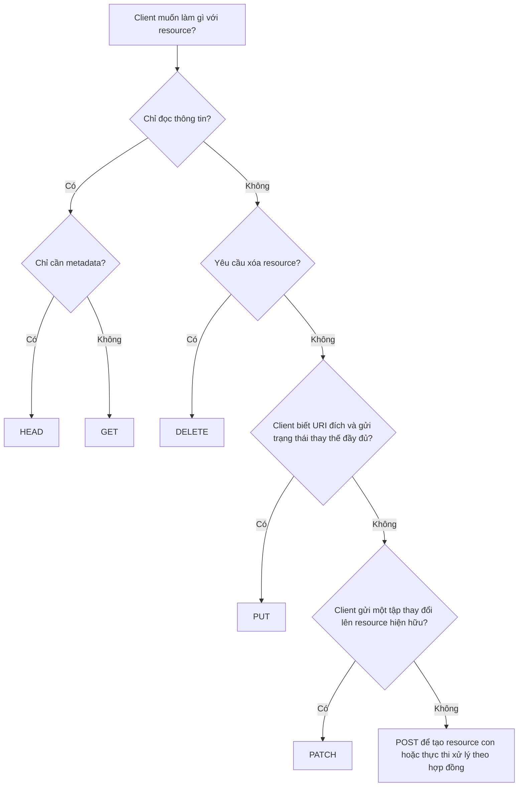
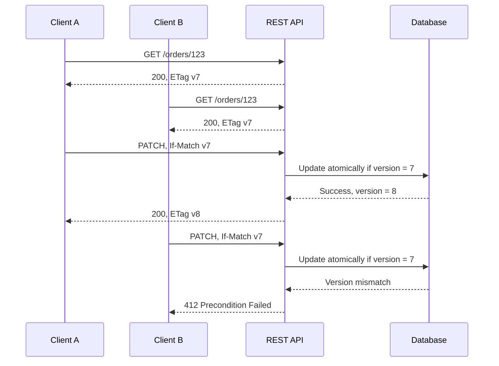

# Chọn phương thức theo ý nghĩa thay vì tên hàm xử lý

## 1. Vì sao tên hàm không quyết định HTTP method?

Trong REST API, một thao tác nghiệp vụ có thể mang tên `getOrder()`, `saveOrder()`, `updateOrder()`, `submitPayment()` hoặc `cancelOrder()` trong mã nguồn. Tuy nhiên, **tên hàm ở controller/service là chi tiết triển khai nội bộ**. Khi thiết kế hợp đồng HTTP, điều cần quyết định là **khách hàng đang yêu cầu điều gì xảy ra đối với resource và trạng thái của hệ thống**.

Ví dụ, một hàm tên `getInvoice()` có thể vừa lấy dữ liệu vừa tạo hóa đơn mới nếu chưa tồn tại. Trường hợp đó không còn là một thao tác đọc thuần túy; đặt `GET /invoices/{id}` lên hàm này có thể khiến trình duyệt, công cụ preview, prefetch hoặc crawler vô tình kích hoạt nghiệp vụ.

Ngược lại, hàm tên `processSearch()` thực hiện truy vấn không làm đổi trạng thái có thể được công khai bằng `GET /products?query=java` nếu đầu vào phù hợp với URI. Không có quy tắc bắt buộc rằng hàm `processX` luôn phải dùng `POST`.

**Nguyên tắc cốt lõi:** chọn phương thức dựa trên **ngữ nghĩa của yêu cầu HTTP** (đọc, tạo/xử lý, thay thế, cập nhật một phần, xóa) và hợp đồng resource; sau đó mới đặt tên hàm cho dễ hiểu.

Bài thuộc nhóm **Phương thức HTTP** trong module **INTEGRATION_API_REST**. Kiến thức này là nền cho thiết kế URI dựa trên resource, sử dụng mã trạng thái HTTP, phân trang, caching, idempotency, xác thực/phân quyền, OpenAPI và kiểm thử với Java/Spring hoặc công nghệ tương đương.

### Mục tiêu học tập

Sau khi học, bạn có thể:

1. Giải thích khác biệt giữa **tên hàm xử lý** và **ý nghĩa của HTTP method** đối với client, gateway, proxy và ứng dụng.
2. Chọn `GET`, `HEAD`, `POST`, `PUT`, `PATCH` hoặc `DELETE` từ **tác động mong muốn lên resource**.
3. Phân biệt **safe**, **idempotent** và **cacheable**; nhận diện những thiết kế làm mất các thuộc tính này.
4. Thiết kế URI/response/header đúng nghĩa, kể cả thao tác nghiệp vụ không đơn thuần CRUD.
5. Kiểm tra hợp đồng bằng các tình huống gửi lại yêu cầu, thay đổi đồng thời và bộ nhớ đệm.

## 2. Bắt đầu từ resource, không bắt đầu từ controller

Resource là khái niệm mà API cho phép nhận diện, ví dụ một đơn hàng, đơn xin hoàn tiền, giỏ hàng, địa chỉ nhận hàng hoặc công việc xuất báo cáo. URI giúp **định danh hoặc chọn tập resource**; HTTP method biểu đạt **ý định tương tác** với chúng.

Ví dụ về thiết kế resource:

| Resource hoặc tập hợp | URI minh họa | Ngữ nghĩa |
|---|---|---|
| Tập đơn hàng | `/orders` | Tìm kiếm, liệt kê, tạo đơn |
| Một đơn hàng | `/orders/123` | Xem, thay thế/cập nhật hoặc xóa khi nghiệp vụ cho phép |
| Tập yêu cầu hoàn tiền của đơn | `/orders/123/refunds` | Xem hoặc gửi một yêu cầu hoàn tiền mới |
| Một yêu cầu hoàn tiền | `/refunds/rf-456` | Kiểm tra trạng thái và kết quả xử lý |
| Công việc xuất báo cáo | `/report-jobs/job-789` | Kiểm tra công việc nền được tạo bởi yêu cầu trước đó |
| Ảnh đại diện của tài khoản | `/users/42/avatar` | Đọc/thay thế một resource với URI xác định |

Các đường dẫn là ví dụ, không phải tiêu chuẩn đặt tên bắt buộc. Nên ưu tiên danh từ ổn định và tên collection dễ hiểu; không cần nhúng tên method của Java vào URI.

So sánh:

```text
Thiết kế bị ràng buộc vào tên hàm:
POST /getOrder
POST /createOrder
POST /updateOrder
POST /deleteOrder

Thiết kế theo resource và ngữ nghĩa:
GET    /orders/123
POST   /orders
PUT    /orders/123
PATCH  /orders/123
DELETE /orders/123
```

Bảng thứ hai chỉ là tập những tương tác **có thể được hỗ trợ**. Không nhất thiết resource nào cũng cho phép tất cả phương thức. Ví dụ, hệ thống kế toán có thể cấm `DELETE` hóa đơn đã phát hành và cung cấp nghiệp vụ hủy theo quy định thay vì xóa dữ liệu lịch sử.

## 3. Ngữ nghĩa chuẩn của những HTTP method quan trọng

| Method | Ý định điển hình | Safe? | Idempotent theo ngữ nghĩa phương thức? | Khả năng cache |
|---|---|---|---|---|
| **GET** | Lấy biểu diễn resource, không yêu cầu làm đổi trạng thái | Có | Có | Thường có thể cache theo metadata và chính sách |
| **HEAD** | Lấy metadata tương tự GET nhưng không có phần thân phản hồi | Có | Có | Có quy tắc cache của HTTP |
| **POST** | Yêu cầu resource đích xử lý representation; thường tạo resource con hoặc bắt đầu tác vụ | Không | Không được đảm bảo | Có thể cache trong một số điều kiện HTTP cụ thể, nhưng hỗ trợ thực tế thường hạn chế |
| **PUT** | Tạo/thay thế trạng thái của resource tại URI đã biết theo representation gửi lên | Không | Có | Response PUT không được cache như response GET |
| **PATCH** | Áp dụng tập thay đổi được mô tả trong request | Không | Không được đảm bảo; có thể thiết kế để idempotent | Response có thể cache trong điều kiện cụ thể, không nên mặc định |
| **DELETE** | Yêu cầu xóa liên kết/chức năng của resource đích theo hợp đồng | Không | Có | Response DELETE không cache |
| **OPTIONS** | Hỏi khả năng giao tiếp/phương thức hỗ trợ, thường thấy trong CORS preflight | Có | Có | Phụ thuộc ngữ cảnh và cơ chế cache cụ thể |

Ngoài ra HTTP còn có `TRACE` và `CONNECT` cho những mục đích chuyên biệt của giao thức. Chúng không phải lựa chọn thông thường để thiết kế endpoint nghiệp vụ REST.

### Safe nghĩa là gì?

Một phương thức **safe** biểu đạt rằng client chỉ yêu cầu một hành vi về cơ bản là **chỉ đọc**. Server có thể ghi access log, metric hoặc thực hiện các tác dụng phụ phụ trợ mà client không yêu cầu; điều đó không làm thay đổi chủ đích safe. Tuy nhiên, **tạo đơn, thu tiền, gửi email, tăng quota tiêu thụ hoặc hủy tài nguyên theo yêu cầu** không được giấu dưới `GET` hay `HEAD`.

Tính safe quan trọng vì client, trình duyệt, crawler, link preview, cache và proxy có thể chủ động truy cập hoặc thử lại phương thức đọc theo cách chúng không nên làm với yêu cầu gây thay đổi nghiệp vụ.

### Idempotent nghĩa là gì?

Một phương thức là **idempotent** khi cùng một yêu cầu được thực hiện nhiều lần có **tác động mong muốn lên trạng thái server giống như thực hiện một lần**. Điều đó **không đòi hỏi**:

- Mỗi lần phản hồi cùng mã HTTP hoặc cùng nội dung.
- Không phát sinh log, metric hay sự kiện kỹ thuật bổ trợ.
- Các yêu cầu khác không được phép làm thay đổi trạng thái giữa hai lần gọi.

Ví dụ, `DELETE /sessions/s1` lần đầu có thể trả `204 No Content`, lần hai trả `404 Not Found` nếu session đã bị xóa. Hai response khác nhau nhưng trạng thái mong muốn “session không còn khả dụng” vẫn là một.

Ngược lại, `POST /payments` có thể tạo **hai giao dịch riêng** khi nhận hai request giống nhau, nên không mặc nhiên idempotent. Khi nghiệp vụ đòi hỏi chống giao dịch trùng, cần thêm cơ chế idempotency có hợp đồng rõ ràng.

### Cacheable nghĩa là gì?

Khả năng cache phụ thuộc cả **ngữ nghĩa phương thức**, mã trạng thái, các header (`Cache-Control`, `ETag`, `Vary`...), chính sách quyền riêng tư và hành vi cache thực tế. Không được suy luận “GET luôn được cache” hoặc “POST không bao giờ được cache”.

Đặc biệt, response chứa dữ liệu cá nhân cần xét cache riêng của client, bộ nhớ đệm dùng chung và yêu cầu xác thực; cache sai có thể làm lộ dữ liệu của người dùng khác. Việc cache response `POST` có điều kiện giao thức chặt và không nên là giả định mặc định của thiết kế REST phổ thông.

## 4. Cây quyết định chọn phương thức



Sơ đồ là **heuristic thiết kế**, không thay thế quy tắc nghiệp vụ. Ví dụ:

- Client biết URI đích nhưng chỉ muốn tăng một giá trị bằng 1: đó là thay đổi theo phép toán, phù hợp với `PATCH` theo định dạng patch có định nghĩa phép toán, hoặc một `POST` cho nghiệp vụ có resource riêng. Không nên ngụy trang bằng `PUT` vì không gửi trạng thái đích hoàn chỉnh.
- Client “xóa” một bản ghi nghiệp vụ cần giữ lịch sử: có thể là yêu cầu hủy hoặc vô hiệu hóa, nên cân nhắc mô hình `PATCH` trạng thái hoặc tạo resource `POST /.../cancellations`, thay vì giả định luôn dùng `DELETE`.
- Một API tìm kiếm với biểu thức quá lớn hoặc nhạy cảm không thích hợp trong query string có thể dùng `POST` để xử lý truy vấn theo hợp đồng; cần chấp nhận khác biệt về caching/semantics và mô tả rõ vì sao.

**Câu hỏi cần đặt không phải “hàm này tên gì?” mà là “một client HTTP đúng chuẩn phải hiểu gì khi gửi yêu cầu này?”**

## 5. GET và HEAD: đọc dữ liệu, tìm kiếm và metadata

### GET nên là thao tác đọc thực sự

Ví dụ:

```http
GET /orders/123 HTTP/1.1
Host: api.example.test
Accept: application/json
Authorization: Bearer <access-token>
```

```http
HTTP/1.1 200 OK
Content-Type: application/json
ETag: "order-123-v7"
Cache-Control: private, no-cache

{"id":"123","status":"CONFIRMED","totalMinor":850000}
```

Header ở ví dụ là minh họa; `Cache-Control: private, no-cache` cho phép lưu trong cache riêng nhưng yêu cầu revalidation trước khi tái sử dụng, không đồng nghĩa “cấm lưu”. Nếu dữ liệu thực sự không được lưu, dùng chính sách như `no-store` theo yêu cầu bảo mật.

Các thao tác đọc cũng thường dùng `GET` khi có lọc, sắp xếp hoặc phân trang:

```text
GET /orders?status=CONFIRMED&page=2&size=20
GET /products?query=usb-c&sort=price,asc
GET /reports/2026-11?format=csv
```

Số trang, cursor, filter và sort là tham số truy vấn; chúng không biến `GET` thành `POST`. Chọn kiểu phân trang theo tính ổn định của dữ liệu và quy mô truy vấn; việc phân trang không phụ thuộc tên hàm `findAllOrders` hay `searchOrders` trong code.

### HEAD để đọc metadata mà không tải body

`HEAD /files/manual.pdf` có thể dùng kiểm tra xem resource có tồn tại, lấy `Content-Type`, `ETag` hoặc thông tin cache. Response của `HEAD` không có nội dung body, kể cả khi `GET` tương ứng trả file lớn.

Server nên gửi các header tương ứng với `GET` khi thích hợp. Một số header phụ thuộc quá trình tạo nội dung (ví dụ thông tin độ dài trong một số trường hợp) có thể được bỏ qua theo quy tắc HTTP; không được giả định mọi hệ thống trả bộ header hoàn toàn giống hệt cho `GET` và `HEAD`.

### Tránh thao tác gây thay đổi bằng GET

Các thiết kế sau có vấn đề:

```text
GET /sendVerificationEmail?userId=42
GET /orders/123/cancel
GET /wallet/withdraw?amount=100000
GET /products/9?decreaseStock=1
```

Nếu việc gửi email, hủy đơn, rút tiền hay giảm tồn kho là hiệu ứng **được client yêu cầu**, chúng không phù hợp với `GET`. Có thể thay bằng resource nghiệp vụ dùng `POST`, cập nhật trạng thái có kiểm soát qua `PATCH`, hoặc cơ chế khác đúng với mục đích.

## 6. POST: tạo resource con hoặc yêu cầu xử lý

### Tạo resource do server cấp URI

`POST /orders` thường dùng khi client gửi dữ liệu tạo mới và **server quyết định định danh**.

```http
POST /orders HTTP/1.1
Host: api.example.test
Content-Type: application/json
Authorization: Bearer <access-token>

{"customerId":"42","items":[{"sku":"A1","quantity":2}]}
```

```http
HTTP/1.1 201 Created
Location: /orders/123
Content-Type: application/json

{"id":"123","status":"PENDING"}
```

`201 Created` cho biết một hoặc nhiều resource đã được tạo thành công; `Location` thường chỉ tới resource chính mới tạo. Không nhất thiết mọi `POST` đều tạo resource hoặc đều trả `201`: server có thể xử lý yêu cầu, cập nhật nghiệp vụ hoặc khởi chạy một tiến trình.

### Lệnh nghiệp vụ không phải CRUD

Một nghiệp vụ “hoàn tiền một phần cho đơn” tạo một **yêu cầu hoàn tiền** với ID, trạng thái và lịch sử riêng:

```text
POST /orders/123/refunds
GET  /refunds/rf-456
```

Một công việc xuất báo cáo mất vài phút:

```http
POST /report-jobs HTTP/1.1
Content-Type: application/json

{"reportType":"monthly-sales","month":"2026-10"}
```

```http
HTTP/1.1 202 Accepted
Location: /report-jobs/job-789
Content-Type: application/json

{"id":"job-789","status":"QUEUED"}
```

`202 Accepted` nghĩa là yêu cầu đã được chấp nhận để xử lý nhưng **chưa bảo đảm xử lý hoàn tất**. Client có thể theo dõi resource công việc qua `GET /report-jobs/job-789`. Không nên hứa đã tạo báo cáo thành công khi tiến trình vẫn chạy.

Nếu nghiệp vụ thực chất là **đưa resource vào một trạng thái mới**, có thể cân nhắc `PATCH` kèm điều kiện đồng thời; nếu nghiệp vụ có tính sự kiện, audit, kết quả bất đồng bộ hoặc nhiều hành động điều phối, mô hình tạo **resource yêu cầu** bằng `POST` có thể rõ ràng hơn.

### Idempotency key cho POST

Các mạng thực tế có timeout và retry. Nếu client gửi yêu cầu thanh toán, server đã xử lý nhưng response bị mất, client có thể gửi lại. `POST` không tự bảo đảm chống thực hiện hai lần.

Một hợp đồng ứng dụng có thể yêu cầu:

```http
POST /payments HTTP/1.1
Content-Type: application/json
Idempotency-Key: checkout-abc-001

{"orderId":"123","amountMinor":850000,"currency":"VND"}
```

Bộ xử lý server cần có quy tắc:

1. Khóa nghiệp vụ nên gắn với **chủ thể/tenant + thao tác + idempotency key**, tránh người dùng khác vô tình dùng cùng khóa.
2. Lưu hash/cấu trúc chuẩn hóa của request và kết quả đã thực thi hoặc trạng thái đang thực thi.
3. Nếu gửi lại **cùng khóa và cùng nội dung hợp lệ**, trả kết quả phù hợp với thao tác ban đầu theo hợp đồng, không tạo giao dịch thứ hai.
4. Nếu **cùng khóa nhưng nội dung khác**, trả lỗi xung đột hoặc lỗi ràng buộc khóa theo hợp đồng, tuyệt đối không lặng lẽ coi là một giao dịch khác.
5. Quy định thời hạn lưu khóa, retry policy, xử lý tác vụ đang chạy và cách khôi phục sau crash để không chạy lại tác dụng phụ.

`Idempotency-Key` là cơ chế ở **hợp đồng ứng dụng** và có thể được chuẩn hóa hoặc hỗ trợ khác nhau tùy API; chỉ đặt header **không làm thao tác tự trở thành idempotent**. Cần lưu trữ trạng thái bền vững và thiết kế giao dịch phù hợp, đặc biệt với cổng thanh toán ngoài.

## 7. PUT: tạo hoặc thay thế trạng thái resource tại URI xác định

`PUT` diễn tả ý định đặt trạng thái của **resource đích** thành representation mà client gửi. Khi ứng dụng cho phép tạo tại URI do client xác định, `PUT` có thể tạo resource chưa tồn tại; khi thay thế resource đã tồn tại, `PUT` thường trả `200 OK` có body hoặc `204 No Content`. Nếu tạo mới tại URI đích, response thành công cần `201 Created`.

Ví dụ: client quản lý trạng thái mong muốn của cấu hình thiết bị `/devices/d-8/configuration`.

```http
PUT /devices/d-8/configuration HTTP/1.1
Content-Type: application/json
If-Match: "cfg-v3"

{"timezone":"Asia/Ho_Chi_Minh","alertsEnabled":true,"samplingSeconds":60}
```

Hợp đồng nói rõ đây là **bản mô tả đầy đủ các trường mà client được phép quản lý**. Những trường do server sinh như `createdAt`, khóa hệ thống, số phiên bản hoặc dữ liệu nội bộ có thể không nằm trong representation do client điều khiển; không nên tự ý xóa chúng khi xử lý `PUT`.

### PUT và tính idempotent

Gửi cùng representation để đặt trạng thái `alertsEnabled = true` nhiều lần dẫn đến cùng trạng thái mong muốn. Do đó `PUT` mang ngữ nghĩa idempotent.

Ngược lại:

```text
PUT /counters/visits/increment
{"by":1}
```

Đây là lệnh **tăng thêm**, không phải thay thế trạng thái, nên không phản ánh đúng ngữ nghĩa `PUT`; lặp request có thể tăng nhiều lần. Cần mô hình lại thành cập nhật giá trị đích với concurrency control, hoặc một operation resource phù hợp dùng `POST`.

### PUT khác PATCH ở “trạng thái đích” và “tập thay đổi”

- `PUT`: “Sau yêu cầu này, trạng thái resource đích cần tương ứng với representation tôi gửi.”
- `PATCH`: “Hãy áp dụng những thay đổi mà tài liệu patch mô tả lên resource đích.”

Không nên dùng `PUT` với payload thiếu trường nhưng lại tự định nghĩa ngầm “chỉ sửa những trường có gửi”. Cách làm đó khiến client không biết một trường vắng mặt có bị xóa, giữ nguyên hay được gán mặc định. Nếu chỉ muốn cập nhật một số trường, dùng `PATCH` với định dạng và quy tắc rõ ràng thường dễ hiểu hơn.

## 8. PATCH: thay đổi một phần và kiểm soát cạnh tranh

Một API cập nhật email thông báo của tài khoản có thể nhận patch:

```http
PATCH /users/42/preferences HTTP/1.1
Content-Type: application/merge-patch+json
If-Match: "prefs-v5"

{"notifications":{"email":false}}
```

**JSON Merge Patch** (`application/merge-patch+json`) diễn tả các thay đổi theo cấu trúc JSON: trường được cung cấp thường thay thế/đệ quy hợp nhất, trường vắng mặt được giữ lại, giá trị `null` thường biểu thị yêu cầu xóa thành viên. Vì vậy, nếu nghiệp vụ cần phân biệt **đặt trường thành null** với **xóa trường**, cần cân nhắc định dạng patch khác hoặc hợp đồng rõ hơn.

**JSON Patch** (`application/json-patch+json`) là danh sách thao tác như `add`, `remove`, `replace`, `move`, `copy` và `test`:

```http
PATCH /users/42/preferences HTTP/1.1
Content-Type: application/json-patch+json
If-Match: "prefs-v5"

[
  {"op":"replace","path":"/notifications/email","value":false}
]
```

Đối với các phép toán phụ thuộc trạng thái trước đó, việc lặp cùng `PATCH` có thể tạo kết quả khác hoặc thất bại. Ví dụ `add` phần tử vào một vị trí trong mảng có thể tiếp tục chèn thêm phần tử nếu áp lại. **PATCH không được mặc định là idempotent**, dù một số yêu cầu patch được thiết kế để có kết quả idempotent.

### Chống lost update bằng ETag/If-Match

Giả sử hai người cùng đọc đơn hàng phiên bản 7:

1. A sửa địa chỉ giao hàng, ghi phiên bản 8.
2. B gửi lại bản dữ liệu đã đọc ở phiên bản 7, vô tình ghi đè thay đổi của A.

Với optimistic concurrency, response `GET` mang `ETag: "order-v7"`. Khi ghi, client gửi `If-Match: "order-v7"`.

- Nếu server thấy representation hiện hành vẫn khớp điều kiện, có thể áp dụng thay đổi và trả ETag mới.
- Nếu không khớp, server trả `412 Precondition Failed` theo điều kiện header, yêu cầu client tải trạng thái mới và xử lý xung đột.
- Nếu server quy định request cập nhật **bắt buộc** có điều kiện mà client không gửi, có thể trả `428 Precondition Required`.

Lưu ý: **ETag không nhất thiết là số phiên bản hiển thị**, và với `If-Match` thường cần một validator mạnh thích hợp cho việc tránh mất cập nhật. Tính nguyên tử giữa kiểm tra điều kiện và cập nhật phải được bảo đảm ở tầng lưu trữ/giao dịch; chỉ so sánh ETag ở controller rồi ghi sau đó mà không khóa/kiểm tra version không ngăn được race condition.



`409 Conflict` cũng có vai trò riêng cho **xung đột trạng thái nghiệp vụ** như cố hủy một đơn đã giao. Khi điều kiện `If-Match` không còn đúng, `412` thể hiện rõ hơn loại lỗi này.

## 9. DELETE: yêu cầu loại bỏ resource, không nhất thiết xóa vật lý

`DELETE /sessions/s-123` biểu thị client yêu cầu hủy bỏ association/chức năng của resource tại URI đích. Server có thể thực hiện xóa vật lý, đánh dấu không còn hoạt động hoặc đưa vào quy trình xóa theo chính sách; hợp đồng cần nói rõ hệ quả mà client quan sát được.

Mã trạng thái thành công điển hình:

- `204 No Content` khi đã thực hiện và không gửi response body.
- `200 OK` khi muốn trả biểu diễn kết quả.
- `202 Accepted` nếu yêu cầu xóa đã được chấp nhận và sẽ xử lý bất đồng bộ.

Sau khi xóa, `GET` vào URI thường trả `404 Not Found` hoặc `410 Gone` nếu server muốn thông báo tài nguyên đã biến mất vĩnh viễn và có cơ sở để biết điều đó; không có quy tắc bắt buộc mọi xóa phải trả `410`.

### Tính idempotent của DELETE

Gửi lại `DELETE /sessions/s-123` không nên làm **một session khác** bị xóa hoặc trừ tiền thêm. Response lần hai có thể khác lần đầu (`204`, `404` hoặc một hành vi được hợp đồng xác định), nhưng mục đích loại bỏ session đó đã được thỏa mãn.

Nếu hàm `deleteOrder(id)` trong thực tế **tạo thêm một phí hủy cho mỗi lần gọi**, không thể xem hành vi đó như một `DELETE` idempotent. Phải tách nghĩa nghiệp vụ và thiết kế cách chống xử lý lặp.

### Đừng xóa dữ liệu khi nghiệp vụ yêu cầu lưu vết

Trong tài chính, hủy giao dịch/hóa đơn thường cần giữ lịch sử, ghi lý do và tác giả. Một resource như:

```text
POST /orders/123/cancellations
{"reason":"CUSTOMER_REQUEST"}

GET /orders/123/cancellations/c-100
```

có thể diễn tả **một yêu cầu hủy** tốt hơn `DELETE /orders/123`. Việc chọn mô hình dựa trên hành vi cần công bố, auditing và trạng thái nghiệp vụ, không dựa vào tên hàm `cancelOrder`.

## 10. Không đồng nhất thao tác CRUD với HTTP method một cách máy móc

Bảng ánh xạ CRUD → POST/GET/PUT/DELETE chỉ hữu ích ở mức sơ nhập. REST API thực tế có hành vi nghiệp vụ phức tạp hơn:

| Ý định của client | URI + method gợi ý | Vì sao? |
|---|---|---|
| Xem đơn hàng | `GET /orders/123` | Lấy biểu diễn, không yêu cầu thay đổi |
| Tìm đơn theo trạng thái | `GET /orders?status=PAID` | Lấy danh sách theo điều kiện |
| Tạo đơn mới, server cấp ID | `POST /orders` | Tạo resource con dưới collection |
| Thay toàn bộ địa chỉ lưu sẵn có URI cố định | `PUT /users/42/shipping-address` | Đặt trạng thái resource đích |
| Chỉ đổi số điện thoại liên hệ | `PATCH /users/42` | Thay đổi một phần |
| Xóa session đăng nhập | `DELETE /sessions/s-123` | Loại bỏ resource được xác định |
| Nộp yêu cầu hoàn tiền | `POST /orders/123/refunds` | Tạo yêu cầu nghiệp vụ có trạng thái và ID |
| Tạo job xuất báo cáo | `POST /report-jobs` | Server tạo job, thường xử lý nền |
| Xem trạng thái job | `GET /report-jobs/job-789` | Đọc trạng thái hiện hành |
| Ngừng đăng ký bằng cách đổi trạng thái | `PATCH /subscriptions/sub-9` | Thay một phần nếu hợp đồng cho phép |
| Tạo lệnh thay đổi trạng thái đăng ký có workflow/audit | `POST /subscriptions/sub-9/change-requests` | Tạo resource yêu cầu thay đổi |

Một thao tác “đặt mật khẩu mới” cũng có thể cần kiểm tra mật khẩu cũ, token hoặc luồng xác thực riêng; một URI resource không tự giải quyết vấn đề bảo mật.

**Mô hình URI và method phải làm rõ hợp đồng**, không nhất thiết loại bỏ mọi danh từ chỉ “operation”. Các nghiệp vụ như `refunds`, `cancellations` hay `report-jobs` có thể là resource hữu ích vì chúng có định danh, trạng thái và vòng đời riêng.

## 11. Vì sao việc chọn method sai gây lỗi thực tế?

### 11.1 Prefetch, crawler và cache vô tình kích hoạt side effect

Một nút “Hủy đơn” là hyperlink `GET /orders/123/cancel` có thể bị công cụ xem trước liên kết, crawler hoặc plugin tự truy cập. Nếu GET thực sự hủy đơn, hành vi client hợp lệ trở thành nguyên nhân gây thay đổi nghiệp vụ.

**Khắc phục:** dùng request không safe để thay đổi và kiểm tra quyền/CSRF phù hợp với cơ chế xác thực; xác nhận những hành động quan trọng khi cần.

### 11.2 Retry và sự cố mạng

HTTP client, gateway hay SDK có thể dựa trên tính idempotent để quyết định khả năng retry tự động. Một yêu cầu `PUT` được thiết kế như “tăng số dư thêm 100” có thể bị xử lý lặp khi response mất; tên phương thức không cứu được một triển khai sai.

**Khắc phục:** bảo toàn ngữ nghĩa idempotent của `PUT`/`DELETE`; với `POST` giao dịch, thêm idempotency key và xử lý bền vững ở server.

### 11.3 Hợp đồng trở nên khó tài liệu hóa

Nếu tất cả endpoint đều là `POST /executeSomething`, OpenAPI khó truyền đạt sự khác biệt giữa đọc và thay đổi. Cơ chế caching, conditional request, monitoring theo method và công cụ client cũng kém hiệu quả.

**Khắc phục:** mô hình resource và HTTP semantics trước khi viết controller, ghi rõ request/response/status/header.

### 11.4 Phân quyền bị hiểu sai

`GET` không mặc nhiên “công khai” và `POST` không mặc nhiên “an toàn hơn”. Mọi thao tác cần authorization theo người dùng và resource; thay đổi dữ liệu cần thêm các điều kiện nghiệp vụ.

**Khắc phục:** kiểm tra quyền theo resource và action, không chỉ theo URL prefix hoặc method. Một user có quyền xem đơn chưa chắc có quyền sửa, xóa hoặc hoàn tiền.

### 11.5 Không kiểm soát cập nhật đồng thời

Hai `PUT` hoặc `PATCH` hợp lệ vẫn có thể ghi đè nhau khi client dùng snapshot cũ. Idempotency khác với concurrency control.

**Khắc phục:** dùng ETag/`If-Match`, optimistic locking hoặc cơ chế nhất quán tương đương tại tầng lưu trữ.

## 12. Status code, header và method phải phối hợp

| Tình huống | Response phổ biến | Ghi chú |
|---|---|---|
| `GET` tìm thấy resource | `200 OK` + body | Có thể trả ETag/Cache-Control |
| `GET` có `If-None-Match` khớp | `304 Not Modified` | Không có response body; cho phép dùng representation cache thích hợp |
| `HEAD` thành công | `200 OK`, không body | Header mô tả resource |
| `POST` tạo resource đồng bộ | `201 Created` + `Location` | Resource được tạo; có thể trả representation |
| `POST` chấp nhận xử lý nền | `202 Accepted` | Cần hướng dẫn theo dõi kết quả |
| `PUT` tạo resource mới tại URI đích | `201 Created` | Khi hợp đồng cho phép tạo |
| `PUT` thay thế resource hiện có | `200 OK` hoặc `204 No Content` | Phụ thuộc việc trả body |
| `PATCH` cập nhật thành công | `200 OK` hoặc `204 No Content` | Phụ thuộc việc trả body |
| `DELETE` hoàn tất, không trả body | `204 No Content` | Không nên trả body với 204 |
| URI resource không tồn tại | `404 Not Found` | Có thể dùng 410 khi biết đã biến mất vĩnh viễn |
| Method không được endpoint hỗ trợ | `405 Method Not Allowed` + `Allow` | Phân biệt với 404 của URI không tồn tại |
| Kiểu payload không hỗ trợ | `415 Unsupported Media Type` | Ví dụ gửi JSON Merge Patch tới endpoint chỉ hỗ trợ JSON Patch |
| Cú pháp request không hợp lệ | `400 Bad Request` | JSON lỗi cú pháp hoặc request sai cấu trúc |
| Nội dung hợp lệ cú pháp nhưng sai quy tắc nghiệp vụ | `422 Unprocessable Content` hoặc `409 Conflict` tùy loại lỗi | Chọn và tài liệu hóa nhất quán |
| Điều kiện `If-Match` thất bại | `412 Precondition Failed` | Khác với lỗi dữ liệu không hợp lệ |
| Bắt buộc có điều kiện mà client không gửi | `428 Precondition Required` | Chính sách tùy API |
| Chưa xác thực hợp lệ | `401 Unauthorized` | Thường kèm thách thức xác thực thích hợp |
| Đã xác thực nhưng không được phép | `403 Forbidden` | Có thể che giấu resource bằng 404 theo chính sách |
| Vượt giới hạn | `429 Too Many Requests` | Có thể có `Retry-After` |

Mã trạng thái là một phần **hợp đồng HTTP**, không thể chọn theo sở thích đặt tên method. Đừng trả `200 OK` với body `{"error":"not found"}` cho mọi lỗi: client, observability và cache sẽ hiểu nhầm đây là phản hồi thành công.

**Các điểm header hay bị bỏ quên:**

- `Allow` trên `405` giúp client biết những phương thức được hỗ trợ cho resource đó.
- `Location` sau `201` chỉ resource mới tạo; sau `202` thường cung cấp hướng đến resource theo dõi khi API dùng mô hình job.
- `ETag` và `If-Match` phối hợp để chống cập nhật dựa trên bản cũ; `If-None-Match` hỗ trợ conditional GET.
- `Accept-Patch` có thể cho biết kiểu patch được hỗ trợ; nếu server hỗ trợ hai định dạng khác nhau, cần tài liệu hóa cú pháp và ý nghĩa của mỗi định dạng.
- `Cache-Control`, `Vary` và các header liên quan phải được thiết kế cùng chính sách dữ liệu, không chỉ bật caching tùy ý.

## 13. Phân biệt idempotency với tính độc lập giao dịch

Xét `POST /payments` tạo thanh toán và `PUT /orders/123` thay thế dữ liệu đơn. Cả hai đều có thể đi qua mạng bất ổn.

| Vấn đề | Idempotency giải quyết gì? | Không tự giải quyết gì? |
|---|---|---|
| Client retry cùng request | Giảm/loại khả năng **tác động mong muốn bị lặp** khi cơ chế được triển khai đúng | Không đảm bảo response luôn giống về byte hoặc status |
| Concurrent update | Có thể giúp một thao tác lặp không tạo thêm hiệu ứng | Không tự ngăn **lost update** giữa hai yêu cầu khác nhau |
| Nhiều hệ thống | Tránh tạo lặp ở một ranh giới nghiệp vụ | Không tự tạo giao dịch ACID xuyên database/payment provider |
| Side effect ngoài hệ thống | Có thể deduplicate theo idempotency key nếu tích hợp đúng | Không thể “undo” mọi email/chuyển tiền đã xảy ra |
| Cache | Không quyết định response có được cache không | Cần chính sách caching riêng |

Ví dụ `PUT` “thay toàn bộ cấu hình thành A” vẫn idempotent cho một request lặp, nhưng nếu hai client lần lượt gửi trạng thái A và B, client sau cùng có thể ghi đè client trước khi không có concurrency control. Vì thế **idempotency** và **optimistic concurrency** giải quyết hai vấn đề khác nhau.

## 14. Triển khai với Java/Spring: route theo resource

Spring MVC sử dụng annotation để ánh xạ method và URI. Tên hàm trong Java có thể đổi mà không ảnh hưởng hợp đồng, miễn annotation, hành vi, request/response và chính sách tương thích vẫn đúng.

Ví dụ controller minh họa cho `GET`, `POST`, `PUT`, `PATCH` và `DELETE` trên resource đơn hàng:

```java
import com.fasterxml.jackson.databind.JsonNode;
import java.net.URI;
import java.util.UUID;
import org.springframework.http.ResponseEntity;
import org.springframework.web.bind.annotation.*;

@RestController
@RequestMapping("/orders")
class OrderController {
    private final OrderService service;

    OrderController(OrderService service) {
        this.service = service;
    }

    @GetMapping("/{id}")
    ResponseEntity<OrderView> findOne(@PathVariable UUID id) {
        OrderView order = service.find(id); // 404 nếu không tồn tại
        return ResponseEntity.ok()
                .eTag(order.etag())
                .body(order);
    }

    @PostMapping
    ResponseEntity<OrderView> createNew(
            @RequestBody CreateOrderRequest input) {
        OrderView created = service.create(input);
        return ResponseEntity
                .created(URI.create("/orders/" + created.id()))
                .body(created);
    }

    @PutMapping("/{id}")
    ResponseEntity<OrderView> overwrite(
            @PathVariable UUID id,
            @RequestHeader("If-Match") String expectedEtag,
            @RequestBody ReplaceOrderRequest input) {
        OrderView updated = service.replace(id, input, expectedEtag);
        return ResponseEntity.ok()
                .eTag(updated.etag())
                .body(updated);
    }

    @PatchMapping(
            path = "/{id}",
            consumes = "application/merge-patch+json")
    ResponseEntity<OrderView> applyChanges(
            @PathVariable UUID id,
            @RequestHeader("If-Match") String expectedEtag,
            @RequestBody JsonNode patch) {
        OrderView updated = service.patch(id, patch, expectedEtag);
        return ResponseEntity.ok()
                .eTag(updated.etag())
                .body(updated);
    }

    @DeleteMapping("/{id}")
    ResponseEntity<Void> remove(@PathVariable UUID id) {
        service.delete(id);
        return ResponseEntity.noContent().build();
    }
}
```

**Giới hạn của ví dụ:** `OrderService` và các kiểu `OrderView`, `CreateOrderRequest`, `ReplaceOrderRequest` là hợp đồng ứng dụng cần định nghĩa; đoạn này **không phải API hoàn chỉnh để sao chép chạy ngay**. Để dùng trong sản phẩm thực, phải xử lý ít nhất:

- Xác thực, phân quyền theo chủ đơn/tenant; validate dữ liệu và quy tắc nghiệp vụ.
- Map exception thành status đúng (`404`, `409`, `412`, `422`...), không trả toàn bộ thành `500`.
- Chặn thay đổi không mong muốn khi `PUT` hoặc `PATCH` đụng trường thuộc quyền quản lý server.
- Kiểm tra `If-Match` và lưu thay đổi **một cách nguyên tử** theo version trong database.
- Không cho `DELETE` tạo tác dụng phụ lặp có hại; nếu đơn hàng cần lưu vết, cung cấp nghiệp vụ hủy theo resource thay vì xóa.
- Xác định loại patch được hỗ trợ và validate từng đường dẫn/trường được phép đổi.

Tên phương thức `findOne`, `createNew`, `overwrite`, `applyChanges`, `remove` hoàn toàn có thể thay bằng tên khác; **hợp đồng đối với client nằm ở annotation cùng hành vi nghiệp vụ**, không ở tên method Java.

### Đừng dùng @PostMapping cho mọi thứ vì “dễ code”

Ví dụ sau hoạt động về mặt HTTP nhưng làm mất ngữ nghĩa tài nguyên:

```java
@PostMapping("/getOrder")
OrderView getOrder(@RequestBody IdRequest request) {
    return service.find(request.id());
}
```

Nếu yêu cầu chỉ đọc theo ID và không có hạn chế đặc biệt, nên dùng `@GetMapping("/{id}")`. Khi cần cấu trúc tìm kiếm phức tạp không thể truyền hợp lý qua URI, `POST` vẫn là lựa chọn được cân nhắc; lý do cần được ghi trong hợp đồng.

## 15. Dùng OpenAPI để diễn đạt ý nghĩa cho client

Tài liệu OpenAPI có thể mô tả từng method/URI, phản hồi, header và media type. Ví dụ **trích đoạn** sau minh họa ý định; chưa đầy đủ phần schema/security cần cho một tài liệu OpenAPI hoàn chỉnh:

```yaml
paths:
  /orders:
    get:
      summary: "Liệt kê đơn hàng mà người dùng được phép xem"
      parameters:
        - name: status
          in: query
          required: false
          schema:
            type: string
      responses:
        "200":
          description: "Danh sách đơn hàng"
    post:
      summary: "Tạo đơn hàng mới"
      responses:
        "201":
          description: "Đơn hàng được tạo"
          headers:
            Location:
              description: "URI của đơn hàng mới"
              schema:
                type: string

  /orders/{orderId}:
    get:
      summary: "Lấy một đơn hàng"
      responses:
        "200":
          description: "Biểu diễn đơn hàng"
        "404":
          description: "Không tìm thấy hoặc không được tiết lộ"
    put:
      summary: "Thay thế representation được phép quản lý"
      responses:
        "200":
          description: "Thay thế thành công"
        "412":
          description: "If-Match không khớp"
    patch:
      summary: "Áp dụng JSON Merge Patch"
      requestBody:
        required: true
        content:
          application/merge-patch+json:
            schema:
              type: object
      responses:
        "200":
          description: "Cập nhật thành công"
        "412":
          description: "If-Match không khớp"
    delete:
      summary: "Xóa resource nếu chính sách cho phép"
      responses:
        "204":
          description: "Không còn nội dung trả về"
```

Để tài liệu thực sự sử dụng được, cần thêm path parameter `orderId`, schema dữ liệu, `requestBody` cho `POST/PUT`, security schemes, error response và các header có điều kiện theo chuẩn OpenAPI phiên bản nhóm sử dụng. Quan trọng nhất, **mô tả và triển khai phải đồng nhất**. Không nên viết `PUT` là “thay thế toàn bộ” trong tài liệu nhưng triển khai chỉ cập nhật những trường có trong payload.

## 16. Kiểm thử ngữ nghĩa HTTP: kiểm tra hành vi, không chỉ mã 200

Kiểm thử REST API nên bao gồm **tác động lên resource**, **phản hồi**, **header**, **quyền** và **tính lặp**. Chỉ gọi endpoint một lần và mong response `200` không chứng minh hợp đồng đúng.

### Ma trận kiểm thử

| Tình huống | Hành vi cần quan sát | Loại lỗi có thể phát hiện |
|---|---|---|
| Gọi `GET /orders/123` nhiều lần | Không tạo/chuyển trạng thái đơn do yêu cầu đọc | GET có side effect |
| Gọi `HEAD` | Status/header phù hợp; không có response body | Sai semantics HEAD |
| `POST /orders` thành công | Có resource mới; `201` và `Location` phù hợp | Không rõ resource được tạo |
| Retry `POST` giao dịch với cùng idempotency key | Không tạo giao dịch thứ hai theo hợp đồng | Duplicate payment/order |
| Dùng cùng key với payload khác | Trả lỗi theo hợp đồng, không âm thầm dùng lại | Deduplication sai |
| Gửi lại cùng `PUT` khi không có thay đổi xen giữa | Trạng thái mong muốn không tăng/giảm tích lũy | PUT không idempotent |
| `PUT` thiếu trường trong representation đầy đủ | Áp dụng quy tắc thay thế đã định nghĩa, không cập nhật ngầm | Dùng PUT như PATCH |
| `PATCH` chỉ sửa một trường | Các trường không liên quan được giữ nguyên đúng quy tắc | Partial update sai |
| `PUT/PATCH` với `If-Match` cũ | `412`, dữ liệu không bị ghi đè | Lost update |
| Gửi `DELETE` lần hai | Resource vẫn không còn hiệu lực; không có side effect lặp | DELETE không idempotent |
| Gửi method không hỗ trợ | `405` và `Allow` thích hợp | Route bắt mọi method |
| Người dùng khác tenant sửa đơn | `403` hoặc `404` theo chính sách; không sửa dữ liệu | Thiếu authorization |
| `GET` với `If-None-Match` phù hợp | `304`, không trả body | Conditional GET sai |

### Ví dụ dùng Spring MockMvc

Đoạn test mô phỏng một controller đã tồn tại, nhằm xác minh **ngữ nghĩa HTTP quan sát được**:

```java
mockMvc.perform(get("/orders/{id}", orderId))
        .andExpect(status().isOk())
        .andExpect(header().exists("ETag"))
        .andExpect(jsonPath("$.id").value(orderId.toString()));

mockMvc.perform(post("/orders")
                .contentType(MediaType.APPLICATION_JSON)
                .content(createOrderJson))
        .andExpect(status().isCreated())
        .andExpect(header().string(
                "Location", org.hamcrest.Matchers.startsWith("/orders/")));

mockMvc.perform(patch("/orders/{id}", orderId)
                .header("If-Match", "\"stale-version\"")
                .contentType("application/merge-patch+json")
                .content("{\"status\":\"CONFIRMED\"}"))
        .andExpect(status().isPreconditionFailed());
```

Test trên giả định application đã cung cấp mockMvc, dữ liệu `orderId`, payload `createOrderJson`, stub/service và response ETag phù hợp. Ngoài kiểm tra response, cần assert trạng thái trong repository hoặc phát hiện side effect để chứng minh một `GET` không đổi đơn, một `POST` có key không nhân đôi giao dịch và một `412` thực sự ngăn ghi.

### Một test đặc biệt quan trọng: xung đột đồng thời

1. Tạo resource ở phiên bản v1, hai client đọc cùng ETag.
2. Client A cập nhật với `If-Match: v1`; nhận ETag v2.
3. Client B cố cập nhật với `If-Match: v1`; phải nhận `412`.
4. Đọc lại resource và kiểm tra thay đổi của A vẫn tồn tại.
5. Thực hiện đồng thời nhiều lần để phát hiện race; so sánh version phải nằm trong cùng thao tác cập nhật nguyên tử ở database.

## 17. Các ngộ nhận phổ biến và cách phản biện

| Ngộ nhận | Vì sao không đúng? | Cách nghĩ đúng |
|---|---|---|
| “Hàm tên `getX` thì dùng GET.” | Hàm có thể tạo resource hoặc gửi email ngầm | Xét tác động client **yêu cầu**, không xét tên |
| “GET luôn phải trả 200.” | Có thể là `304`, `404`, `403`, `206` hoặc lỗi khác | Trạng thái phản ánh kết quả và điều kiện |
| “POST luôn dùng để tạo.” | POST có thể bắt đầu xử lý, tạo job hoặc gửi yêu cầu hành động | Resource đích xử lý representation theo hợp đồng |
| “PUT chỉ dùng để cập nhật.” | PUT có thể tạo resource tại URI đích nếu hợp đồng cho phép | PUT là đặt trạng thái tại URI đã xác định |
| “PUT và PATCH khác nhau do có hay không ID.” | Cả hai thường dùng URI của một resource | Khác nhau ở **thay thế** và **tập thay đổi** |
| “PATCH luôn idempotent.” | Một số phép patch lặp có thể tăng/chèn thêm | Phải xét semantics từng patch document |
| “DELETE idempotent nghĩa là lần hai phải 204.” | Idempotency là về hiệu ứng mong muốn, không ép cùng status | `404` ở lần sau vẫn có thể đúng |
| “Có idempotency key thì thanh toán chắc chắn chỉ chạy một lần.” | Header không thay lưu trữ/đối soát và logic xử lý retry | Triển khai transaction và deduplication bền vững |
| “POST an toàn hơn GET vì có body.” | An toàn phụ thuộc auth, authorization, CSRF, validate | Kiểm soát bảo mật độc lập với method |
| “Status 200 nghĩa là hợp đồng thành công.” | Response có thể sai ngữ nghĩa, body hoặc side effect | Kiểm tra resource state và giao thức |
| “Phương thức không ảnh hưởng caching/retry.” | HTTP intermediaries dùng semantics của method | Thiết kế đúng method để được client hiểu đúng |

## 18. Bài thực hành: sửa một REST API đang dùng POST cho mọi hàm

Giả sử một hệ thống giao hàng hiện có:

```text
POST /getShipment
POST /searchShipments
POST /addShipment
POST /editShipmentAddress
POST /markShipmentDelivered
POST /deleteShipment
POST /downloadShipmentLabel
POST /requestReturn
```

### Yêu cầu

Thiết kế lại URI/method dựa trên resource; giải thích mỗi lựa chọn theo safe/idempotent và tác động nghiệp vụ. Cho biết khi nào cần dùng conditional request hoặc idempotency key. Không giả định mọi nghiệp vụ đều có thể xóa dữ liệu vật lý.

### Một phương án hợp lý

| Endpoint cũ | Endpoint đề xuất | Lý do |
|---|---|---|
| `POST /getShipment` | `GET /shipments/{id}` | Đọc một shipment |
| `POST /searchShipments` | `GET /shipments?status=IN_TRANSIT&page=1` | Truy vấn danh sách theo filter, phù hợp URI |
| `POST /addShipment` | `POST /shipments` | Tạo shipment, server cấp ID |
| `POST /editShipmentAddress` | `PATCH /shipments/{id}` | Chỉ thay một phần thông tin được phép sửa |
| `POST /markShipmentDelivered` | `PATCH /shipments/{id}` hoặc `POST /shipments/{id}/delivery-confirmations` | Nếu chỉ đặt trạng thái thì PATCH; nếu cần xác nhận có ID, bằng chứng và workflow thì tạo resource xác nhận |
| `POST /deleteShipment` | `DELETE /shipments/{id}` hoặc `POST /shipments/{id}/cancellations` | Nếu thực sự loại bỏ resource thì DELETE; nếu hủy có audit thì resource yêu cầu hủy |
| `POST /downloadShipmentLabel` | `GET /shipments/{id}/label` | Tải file đã tồn tại, chỉ đọc |
| `POST /requestReturn` | `POST /shipments/{id}/returns` | Tạo yêu cầu trả hàng có trạng thái, ID và audit |

**Lưu ý với nhãn vận đơn:** Nếu `downloadShipmentLabel` thực sự **tạo nhãn, cấp số vận đơn hoặc thu phí lần đầu**, không nên giả định đó là GET. Có thể dùng `POST /shipments/{id}/labels` để tạo tài nguyên nhãn, sau đó `GET /shipments/{id}/labels/{labelId}` để tải. Hành vi thực mới là yếu tố quyết định.

### Câu hỏi mở rộng

1. Với `POST /shipments/{id}/returns`, mạng timeout sau khi server tạo yêu cầu. Làm sao xử lý retry để không tạo hai yêu cầu trả hàng?
2. Hai nhân viên cùng sửa địa chỉ qua `PATCH`. Cần những header và điều kiện lưu trữ nào để tránh ghi đè?
3. Client dùng `GET /shipments/{id}/label` khi nhãn chưa được tạo. Có nên âm thầm tạo nhãn hay trả trạng thái chưa sẵn sàng và cung cấp luồng tạo riêng?
4. Nếu chỉ muốn ngừng hiển thị shipment mà vẫn phải giữ lịch sử phục vụ audit, có nên dùng `DELETE`? Điều gì phụ thuộc hợp đồng?
5. Một API tìm kiếm có truy vấn JSON lớn hàng chục KB. Khi nào dùng `POST /shipment-searches` hoặc một endpoint POST tìm kiếm được mô tả rõ thay vì `GET`?
6. Cấu hình proxy cache cho label của từng khách hàng cần xét những yếu tố nào để tránh lộ thông tin giữa người dùng?

## 19. Checklist rà soát trước khi phát hành REST API

- [ ] URI mô tả resource/tập resource, không bị ràng buộc vào tên phương thức Java.
- [ ] `GET` và `HEAD` không mang side effect nghiệp vụ do client yêu cầu.
- [ ] `POST` dùng đúng khi tạo resource con hoặc yêu cầu xử lý; response phân biệt tạo xong và đang xử lý.
- [ ] `PUT` đặt trạng thái resource tại URI đã biết, không bị triển khai như phép tăng/tích lũy.
- [ ] `PATCH` có media type và ngữ nghĩa patch được tài liệu hóa; làm rõ trường vắng mặt, `null` và phép thay đổi lặp.
- [ ] `DELETE` biểu đạt tác động loại bỏ resource theo hợp đồng; không làm phát sinh phí/sự kiện nghiệp vụ lặp vô kiểm soát.
- [ ] Status code, `Location`, `Allow`, `ETag` và các header liên quan khớp hành vi.
- [ ] Khi cập nhật có nguy cơ lost update, dùng `If-Match` và kiểm tra version nguyên tử.
- [ ] Với `POST` có hậu quả giao dịch, có chính sách idempotency key và xử lý retry/crash.
- [ ] Cache policy phù hợp loại dữ liệu và authorization; không làm lộ nội dung riêng tư.
- [ ] Mỗi endpoint có xác thực, phân quyền theo resource và validate dữ liệu phù hợp, kể cả với GET.
- [ ] OpenAPI mô tả đúng method, URI, request/response, status lỗi và media type.
- [ ] Test chứng minh tính safe/idempotent, xung đột đồng thời và hành vi sau retry, không chỉ kiểm tra mã 200.
- [ ] Những nghiệp vụ có audit hoặc lifecycle riêng được mô hình thành resource phù hợp.

## 20. Ghi nhớ cốt lõi

**HTTP method là một lời cam kết về ngữ nghĩa đối với client và các thành phần trung gian**, chứ không phải một nhãn thuận tiện của hàm xử lý. `GET/HEAD` dành cho thao tác an toàn, `POST` cho tạo hoặc xử lý theo hợp đồng, `PUT` cho đặt trạng thái resource tại URI đã xác định, `PATCH` cho tập thay đổi và `DELETE` cho yêu cầu loại bỏ resource.

Thiết kế đúng không chỉ làm API dễ đọc hơn. Nó cho phép client xử lý cache và retry phù hợp, giúp kiểm soát cập nhật đồng thời, mô tả OpenAPI chính xác, đánh giá bảo mật rõ ràng và kiểm thử nghiệp vụ tin cậy. **Hãy hỏi client muốn thay đổi điều gì đối với resource và điều gì phải xảy ra khi yêu cầu lặp lại**, rồi mới quyết định annotation hay tên method trong Java/Spring.

