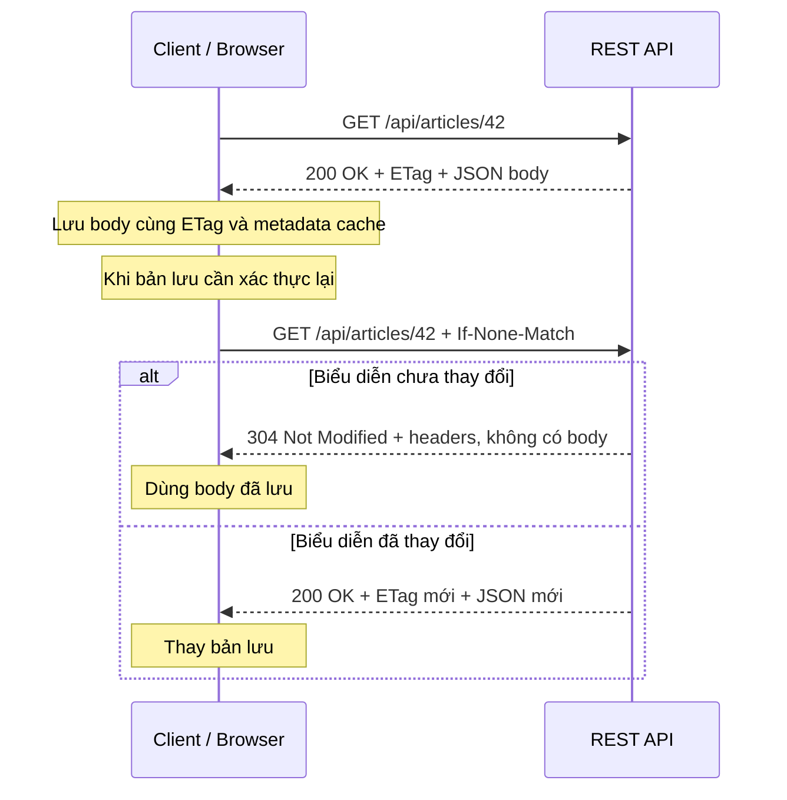
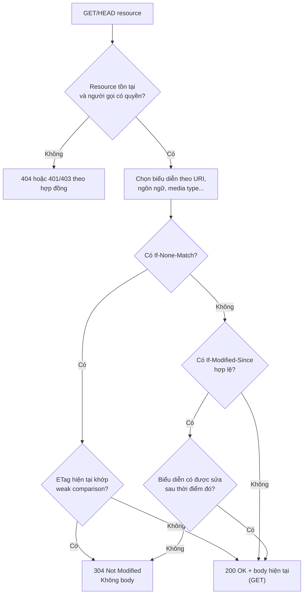
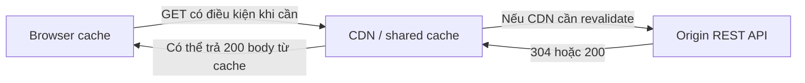

# 304 cho xác thực bộ nhớ đệm và nội dung không thay đổi

> **Module:** INTEGRATION_API_REST — thiết kế REST API theo resource, URI, phương thức và mã trạng thái HTTP; xây dựng hợp đồng dữ liệu rõ ràng, thực hành phân trang, cache, idempotency, OpenAPI, xác thực, phân quyền, xử lý lỗi và kiểm thử API với Java/Spring hoặc công nghệ tương đương.  
> **Chương:** Mã trạng thái.  
> **Trọng tâm bài học:** HTTP `304 Not Modified` dùng để **xác thực lại nội dung đã lưu trong bộ nhớ đệm** (*cache revalidation*) bằng các điều kiện HTTP; biết khi nào phải trả `200 OK`, `304 Not Modified` hoặc `412 Precondition Failed` và triển khai đúng trên REST API.

## 1. Bài toán: đọc tài nguyên nhiều lần nhưng nội dung ít thay đổi

Một ứng dụng web gọi:

```http
GET /api/articles/42 HTTP/1.1
Host: api.example.com
Accept: application/json
```

Server trả về bài viết có tiêu đề, nội dung, tác giả và thời điểm cập nhật. Trong vài phút tiếp theo, người dùng mở lại cùng bài viết nhiều lần. Nếu server liên tục gửi lại toàn bộ JSON, hệ thống sẽ tiêu tốn băng thông, tài nguyên xử lý và thời gian chờ, dù bài viết chưa thay đổi.

HTTP có cơ chế để client hoặc cache trung gian hỏi:

> “Tôi đang giữ phiên bản tài nguyên này. Phiên bản đó còn phù hợp để dùng không?”

Nếu điều kiện kiểm tra cho thấy **biểu diễn được chọn của tài nguyên** (*selected representation*) chưa thay đổi theo bộ xác thực, server có thể trả `304 Not Modified` **không kèm body**. Client dùng bản đã lưu để hiển thị.

Mục tiêu sau khi học:

1. Giải thích đúng ý nghĩa của `304` trong một giao thức request/response REST.
2. Phân biệt **cache freshness** với **cache revalidation**.
3. Thiết kế và đọc header `ETag`, `Last-Modified`, `If-None-Match`, `If-Modified-Since` và `Cache-Control`.
4. Biết quy tắc ưu tiên validator, phản hồi phù hợp cho GET/HEAD và điều kiện sửa dữ liệu.
5. Triển khai conditional GET với Java/Spring và kiểm thử cả nhánh có thay đổi lẫn không thay đổi.
6. Tránh cache nhầm dữ liệu cá nhân, trả 304 sai, hoặc khiến frontend không có body để hiển thị.

## 2. Ý nghĩa chính xác của HTTP 304

**`304 Not Modified`** là mã trong nhóm 3xx, cho biết điều kiện trên yêu cầu `GET` hoặc `HEAD` đã được đánh giá và server không cần chuyển lại nội dung đã được lưu trước đó. Nó phục vụ **tái xác thực bản cache**.

Các điểm cần nhớ:

- `304` **không mang message body**. Không gửi một JSON như `{"message":"Not modified"}` trong phản hồi 304.
- `304` **không phải chuyển hướng** sang URI khác như `301`/`302`. Client vẫn đang làm việc với tài nguyên cũ.
- `304` có ích khi client hoặc cache trung gian **đang có một bản biểu diễn đã lưu phù hợp** để tái sử dụng.
- Server không được dùng `304` như thông báo chung “thao tác thành công nhưng không có dữ liệu”. Trường hợp đó có thể là `204 No Content` hoặc mã khác tùy nghiệp vụ.
- Nếu tài nguyên thay đổi theo validator hoặc request không thỏa điều kiện để 304, một `GET` thông thường có thể trả `200 OK` cùng biểu diễn mới.
- `304` không có nghĩa tài nguyên vĩnh viễn không đổi. Nó nói rằng **điều kiện tái xác thực tại thời điểm đánh giá** không đòi gửi lại biểu diễn.

Tài nguyên là đối tượng logic gắn với URI, còn **biểu diễn** là nội dung cụ thể được trả về sau *content negotiation* (ví dụ JSON theo ngôn ngữ `vi` hoặc `en`, định dạng/nén khác nhau). Validator phải được quản lý phù hợp với biểu diễn đã chọn.

### 2.1. 304 nằm ở đâu trong vòng đời cache?



Cơ chế này có hai mục tiêu khác nhau:

- **Freshness:** khi bản cache còn *fresh* theo chính sách, client có thể dùng ngay mà **không cần gọi server**.
- **Revalidation:** khi cần kiểm tra lại, client gửi conditional request. Nếu nhận 304 thì tái sử dụng body cũ, nhưng vẫn phải trả chi phí một lượt trao đổi header và kết nối mạng.

Vì thế, `304` tiết kiệm **băng thông body** và có thể giảm xử lý truyền tải; nó không nhất thiết nhanh hơn một cache hit được phục vụ hoàn toàn tại trình duyệt.

## 3. Hai validator quan trọng: ETag và Last-Modified

**Validator** là metadata cho phép xác định bản biểu diễn đã lưu còn thích hợp hay không.

| Validator | Response header | Request header đi kèm | Đặc trưng |
|---|---|---|---|
| **Entity Tag (ETag)** | `ETag: "article-42-rev7"` | `If-None-Match: "article-42-rev7"` | Chuỗi mờ đối với client, do server cấp, thường phản ánh phiên bản/biểu diễn |
| **Thời điểm sửa cuối** | `Last-Modified: Tue, 17 Nov 2026 08:00:00 GMT` | `If-Modified-Since: Tue, 17 Nov 2026 08:00:00 GMT` | Dựa vào thời điểm thay đổi, có giới hạn độ chính xác và phụ thuộc đồng hồ |

Server có thể gửi cả hai. Khi client gửi `If-None-Match`, server **ưu tiên điều kiện ETag**; đối với `GET`/`HEAD`, nó không dùng `If-Modified-Since` để ghi đè kết quả đó.

### 3.1. ETag là gì?

`ETag` là giá trị mà server gắn vào **biểu diễn tài nguyên**; client phải coi nó là chuỗi mờ (*opaque*). Server có thể sinh từ revision, version của record, fingerprint nội dung hoặc cơ chế riêng, miễn các thay đổi ảnh hưởng tới biểu diễn được quản lý nhất quán.

Ví dụ response:

```http
HTTP/1.1 200 OK
Content-Type: application/json
Cache-Control: public, max-age=60, must-revalidate
ETag: "article-42-rev7"
Last-Modified: Tue, 17 Nov 2026 08:00:00 GMT
Date: Wed, 18 Nov 2026 09:15:00 GMT

{"id":42,"title":"HTTP caching","revision":7}
```

`"article-42-rev7"` là một **strong ETag** minh họa. Strong validator chỉ thích hợp khi các biểu diễn được coi là có cùng strong ETag thực sự tương đương ở mức byte theo ngữ nghĩa HTTP. Nếu server biến đổi nội dung giữa các encoding hoặc biến thể mà bytes khác nhau, phải bảo đảm validator tương ứng không bị dùng sai.

**Weak ETag** có tiền tố `W/`:

```http
ETag: W/"article-42-rev7"
```

Weak ETag cho phép coi hai biểu diễn là **tương đương về ngữ nghĩa** dù không nhất thiết giống từng byte. Với yêu cầu `If-None-Match` trên GET/HEAD, HTTP dùng **weak comparison**: cùng opaque tag có thể khớp ngay cả khi một bên là weak. Đối với `If-Match` dùng để bảo vệ cập nhật, quy tắc so sánh **strong** được áp dụng; weak ETag không thể dùng thay strong validator cho cùng mục đích kiểm soát đồng thời.

**ETag không nhất thiết là hash mật mã.** Không yêu cầu client giải mã giá trị đó. Không nên đưa email, số định danh nhạy cảm, secret hoặc nội dung riêng tư nguyên văn vào ETag.

### 3.2. Last-Modified và giới hạn thời gian

`Last-Modified` thể hiện thời điểm server tin rằng biểu diễn đã được sửa lần cuối, theo cú pháp ngày giờ HTTP ở GMT.

Ví dụ:

```http
HTTP/1.1 200 OK
Last-Modified: Tue, 17 Nov 2026 08:00:00 GMT
Cache-Control: public, max-age=0, must-revalidate

{"id":42,"title":"HTTP caching"}
```

Lần sau:

```http
GET /api/articles/42 HTTP/1.1
Host: api.example.com
If-Modified-Since: Tue, 17 Nov 2026 08:00:00 GMT
```

Nếu biểu diễn được chọn **không được sửa sau thời điểm nêu trong header**, server có thể trả 304. Nếu đã sửa sau mốc đó, trả biểu diễn mới bằng 200.

**Hạn chế:** HTTP-date có độ chính xác phổ biến tới giây. Hai lần sửa nhanh trong cùng một giây có thể không được phân biệt bằng Last-Modified đơn thuần; lệch đồng hồ giữa các node cũng tạo nguy cơ. Vì vậy ETag phù hợp hơn khi API cập nhật thường xuyên hoặc đòi kiểm soát phiên bản chặt.

### 3.3. Khi nào sinh ETag mới?

Với cùng một URI và một biến thể response, cần thay ETag khi nội dung có thể đã khác theo tiêu chí validator được dùng.

Ví dụ:

| Tình huống | ETag nên xử lý thế nào? |
|---|---|
| Tên bài viết thay đổi, JSON trả về thay đổi | Sinh giá trị mới |
| Chỉ có cập nhật nội bộ không ảnh hưởng biểu diễn API | Có thể giữ weak validator nếu ngữ nghĩa biểu diễn không đổi |
| Thêm field vào JSON body được trả về | Đảm bảo validator phản ánh sự thay đổi |
| API dùng nhiều máy chủ | Cùng biểu diễn phải có quy tắc sinh ETag ổn định giữa các instance |
| Có biến thể `Accept-Language` | Tách biến thể và quản lý ETag tương ứng, kèm `Vary` thích hợp |
| Trả cả compressed và uncompressed body | Không dùng cùng một strong ETag cho các bytes biểu diễn khác nhau do content coding |

Không nên sinh ETag bằng một giá trị ngẫu nhiên ở mỗi request: như vậy mọi lần xác thực đều thấy phiên bản “mới”, làm mất lợi ích cache. Ngược lại, chỉ dùng ID tài nguyên mà không thay theo biểu diễn sẽ tạo **304 sai** sau cập nhật.

## 4. Luồng giao thức đầy đủ: 200 → 304 → 200

Xét tài nguyên công khai `/api/articles/42`. Ban đầu server có revision 7.

### Bước 1 — Lấy lần đầu: 200 kèm nội dung

```http
GET /api/articles/42 HTTP/1.1
Host: api.example.com
Accept: application/json
```

```http
HTTP/1.1 200 OK
Date: Wed, 18 Nov 2026 09:15:00 GMT
Content-Type: application/json
Cache-Control: public, max-age=60, must-revalidate
ETag: W/"article-42-rev7"
Last-Modified: Tue, 17 Nov 2026 08:00:00 GMT

{"id":42,"title":"Kiểm thử API","revision":7}
```

Client lưu body, URL, ETag và các metadata cache cần thiết nếu chính sách cho phép. Trong 60 giây còn *fresh*, cache có thể tái sử dụng trực tiếp mà không gửi request mới.

### Bước 2 — Sau khi cần kiểm tra lại: gửi If-None-Match

```http
GET /api/articles/42 HTTP/1.1
Host: api.example.com
Accept: application/json
If-None-Match: W/"article-42-rev7"
```

Server kiểm tra biểu diễn hiện tại. Nếu vẫn thuộc revision 7:

```http
HTTP/1.1 304 Not Modified
Date: Wed, 18 Nov 2026 09:17:00 GMT
ETag: W/"article-42-rev7"
Cache-Control: public, max-age=60, must-revalidate
```

Không có dòng JSON phía sau header response. **Cache sử dụng body của phản hồi 200 đã lưu**, cập nhật metadata theo quy tắc HTTP caching, rồi cung cấp nội dung cho ứng dụng.

### Bước 3 — Tài nguyên đổi sang revision 8

Giả sử tác giả chỉnh tiêu đề. Client vẫn gửi ETag của revision 7:

```http
GET /api/articles/42 HTTP/1.1
Host: api.example.com
If-None-Match: W/"article-42-rev7"
```

Server không thấy validator khớp và trả:

```http
HTTP/1.1 200 OK
Date: Wed, 18 Nov 2026 09:25:00 GMT
Content-Type: application/json
Cache-Control: public, max-age=60, must-revalidate
ETag: W/"article-42-rev8"
Last-Modified: Wed, 18 Nov 2026 09:20:00 GMT

{"id":42,"title":"Kiểm thử REST API","revision":8}
```

Client lưu body và validator mới. Lần tái xác thực kế tiếp dùng `W/"article-42-rev8"`.

### Bước 4 — Không có bản cache để dùng lại

Nếu cache bị xóa hoặc ứng dụng chỉ biết một ETag nhưng **không còn body**, `304` không cung cấp nội dung để hiển thị. Client cần yêu cầu lại bản đầy đủ (ví dụ một GET không kèm validator). Đây là lý do conditional GET và cache storage phải hoạt động cùng nhau.

## 5. Thuật toán chọn trạng thái HTTP

Một quy trình thực tế cho endpoint GET:



*Sơ đồ tập trung vào GET. Với HEAD, nhánh phản hồi không chuyển body, kể cả khi trạng thái là 200; các HTTP precondition khác như If-Match/If-Unmodified-Since có thứ tự đánh giá riêng.*

### 5.1. Bảng tình huống cốt lõi

| Request | Trạng thái tài nguyên/validator | Phản hồi nên dùng |
|---|---|---|
| `GET` không có điều kiện | Có quyền đọc, tài nguyên tồn tại | Thông thường `200 OK` + body |
| `GET` + `If-None-Match` khớp | Biểu diễn hiện tại phù hợp với tag client gửi | `304 Not Modified`, không body |
| `GET` + `If-None-Match` không khớp | Biểu diễn đã thay đổi | `200 OK` + body và ETag mới |
| `HEAD` + điều kiện cache khớp | Không cần gửi biểu diễn | `304` không body |
| `GET` + `If-Modified-Since` hợp lệ, nội dung không mới hơn | Không có `If-None-Match` và thời gian còn phù hợp | `304` |
| `GET` có cả `If-None-Match` và `If-Modified-Since` | Hai giá trị mâu thuẫn nhau | `If-None-Match` được ưu tiên; không lấy mốc thời gian để bác kết quả ETag |
| `GET` tài nguyên không tồn tại | Không có biểu diễn để xác thực | `404 Not Found` theo hợp đồng API |
| `GET` tài nguyên bị chặn quyền truy cập | Chưa đủ quyền | `401` hoặc `403` theo ngữ nghĩa/auth policy; không dùng 304 để bỏ qua kiểm tra quyền |
| `PUT` + `If-Match` sai | Người dùng cập nhật trên phiên bản cũ | `412 Precondition Failed` |
| `PUT` + `If-None-Match` khớp | Điều kiện “không được tồn tại/không khớp” thất bại | `412 Precondition Failed`, không trả 304 |

Điều kiện HTTP được đánh giá **sau khi** xử lý các kiểm tra bình thường của request, như xác thực, quyền và khả năng tìm tài nguyên. Không trả 304 chỉ vì ETag có vẻ khớp khi resource cần được che khỏi người không đủ quyền.

### 5.2. Ưu tiên giữa If-None-Match và If-Modified-Since

Ví dụ request gửi cả hai:

```http
GET /api/articles/42 HTTP/1.1
Host: api.example.com
If-None-Match: W/"article-42-rev6"
If-Modified-Since: Wed, 18 Nov 2026 09:30:00 GMT
```

Giả sử phiên bản hiện tại là revision 7, dù header ngày gợi ý tài nguyên không mới hơn mốc thời gian nêu, **ETag không khớp** nên GET thông thường trả **200** cùng revision 7. Với GET/HEAD, `If-Modified-Since` bị bỏ qua khi có `If-None-Match`.

Nếu client muốn kiểm tra nhiều tag có sẵn, HTTP hỗ trợ danh sách:

```http
If-None-Match: "article-v5", "article-v6", "article-v7"
```

Server kiểm tra xem **bất kỳ tag nào** khớp biểu diễn hiện tại theo quy tắc dành cho `If-None-Match`. Cú pháp `If-None-Match: *` có nghĩa đặc biệt về sự tồn tại của biểu diễn hiện tại, không phải yêu cầu kiểm tra một revision cụ thể.

### 5.3. 304 và 412: hai mục đích khác nhau

**`If-None-Match` với GET/HEAD** thường dùng để tiết kiệm việc tải lại nội dung: điều kiện khớp → 304.

**`If-Match` với PUT/PATCH/DELETE** thường dùng để tránh **lost update** trong optimistic concurrency control: điều kiện không đạt → 412.

Ví dụ:

```http
PUT /api/articles/42 HTTP/1.1
Host: api.example.com
Content-Type: application/json
If-Match: "article-42-rev7"

{"title":"Phiên bản sửa"}
```

Nếu tài nguyên hiện tại đã là `"article-42-rev8"`, server không được ghi đè dựa trên phiên bản cũ; một phản hồi thích hợp là:

```http
HTTP/1.1 412 Precondition Failed
Content-Type: application/problem+json

{"type":"about:blank","title":"Precondition Failed","status":412,"detail":"Phiên bản tài nguyên đã thay đổi."}
```

Không dùng `304` ở đây vì đây là thao tác sửa tài nguyên. `409 Conflict` cũng có vai trò trong một số xung đột nghiệp vụ, nhưng **precondition HTTP thất bại** được biểu diễn bằng `412`. Nếu dùng `If-Match` để kiểm soát cập nhật, cần **strong ETag** thích hợp.

## 6. Cache-Control: khi nào cần tái xác thực?

ETag cho biết **cách kiểm tra**; `Cache-Control` giúp quyết định **khi nào cache có thể dùng lại** và có thể lưu ở đâu.

| Chỉ thị | Ý nghĩa thực tế | Liên hệ với 304 |
|---|---|---|
| `public` | Cache chia sẻ có thể lưu nếu các điều kiện HTTP khác cho phép | Phù hợp nội dung thực sự công khai |
| `private` | Không lưu trong shared cache; cache riêng của client có thể lưu | Có thể revalidate bằng ETag ở trình duyệt |
| `max-age=60` | Biểu diễn được coi là fresh trong khoảng thời gian quy định theo quy tắc cache | Chỉ cần revalidate khi stale hoặc client buộc xác thực |
| `max-age=0` | Bản lưu thường trở thành stale ngay | Khuyến khích revalidation trước tái sử dụng |
| `no-cache` | **Được phép lưu**, nhưng phải xác thực với origin trước khi dùng lại | 304 là cách revalidation phổ biến |
| `no-store` | Yêu cầu cache **không lưu** request/response theo chỉ thị áp dụng | Không nên trông đợi tái sử dụng body qua 304 |
| `must-revalidate` | Khi stale, cache không được tái sử dụng mà thiếu xác thực thành công theo quy tắc | Giảm khả năng phục vụ dữ liệu cũ khi không revalidate được |
| `s-maxage=300` | Quy định tuổi fresh cho shared cache | Có thể cho CDN khác chính sách trình duyệt |
| `immutable` | Tài nguyên còn fresh được coi là không thay đổi ở URL đó | Phù hợp asset có tên hash; thường giảm nhu cầu revalidate |

**Hai nhầm lẫn phổ biến:**

- `no-cache` **không có nghĩa** “không lưu cache”. Nó yêu cầu tái xác thực trước khi dùng; có thể dẫn tới 304.
- `no-store` khác `no-cache`: khi không lưu body, client thường không có nội dung cũ để ghép với 304.

### 6.1. Chính sách ví dụ theo loại endpoint

| Resource | Header minh họa | Lý do |
|---|---|---|
| `GET /api/articles/42` công khai | `Cache-Control: public, max-age=60, must-revalidate` + ETag | Cân bằng độ mới và số request |
| `GET /api/catalog` công khai | `public, max-age=30, s-maxage=120` + ETag | CDN có thể giữ lâu hơn trình duyệt nếu nghiệp vụ cho phép |
| `GET /api/me` dữ liệu người dùng | `private, no-cache` + ETag nếu rủi ro cho phép | Chỉ cache riêng và phải xác thực lại |
| `GET /api/bank-accounts` nhạy cảm | `no-store` | Không lưu nội dung; không thiết kế luồng 304 dựa trên cache body |
| Asset có tên chứa content hash | `public, max-age=31536000, immutable` | URL thay đổi khi content đổi, cho phép cache dài |

TTL chỉ mang tính minh họa. Chọn TTL phải dựa trên yêu cầu nghiệp vụ, dữ liệu có thể bị sửa, rủi ro dữ liệu cũ, chi phí và đặc điểm client/CDN.

### 6.2. Cache của browser khác cache của CDN



Ví dụ CDN gửi `If-None-Match` tới origin, nhận 304, sau đó kết hợp **body đã lưu tại CDN** và metadata mới để trả **200 body** cho browser. Vì thế việc origin ghi log 304 **không có nghĩa** browser sẽ thấy 304 trong mọi tình huống.

Ngược lại, browser cũng có thể trực tiếp nhận 304 từ CDN nếu browser gửi điều kiện, CDN có đủ thông tin để đánh giá, và phản hồi tương ứng hợp lệ.

Khi một cache nhận 304, nó dùng quy tắc HTTP caching để **cập nhật metadata của bản đã lưu phù hợp**. Những header như `Date`, `ETag`, `Cache-Control`, `Expires`, `Content-Location` và `Vary` cần được cung cấp nhất quán với phản hồi 200 tương ứng khi áp dụng. Không được gửi lại JSON body trong phản hồi 304.

## 7. Vary, content negotiation và thiết kế cache key

REST API có thể trả những biểu diễn khác nhau của cùng resource:

- JSON hoặc XML tùy `Accept`.
- Nội dung tiếng Việt hoặc tiếng Anh tùy `Accept-Language`.
- Biểu diễn nén hay không nén tùy `Accept-Encoding`.

Ví dụ với bài viết hỗ trợ hai ngôn ngữ:

```http
GET /api/articles/42 HTTP/1.1
Host: api.example.com
Accept-Language: vi
```

```http
HTTP/1.1 200 OK
Vary: Accept-Language
ETag: W/"article-42-vi-rev7"
Cache-Control: public, max-age=60
Content-Type: application/json

{"id":42,"title":"Giới thiệu REST API"}
```

Yêu cầu khác:

```http
GET /api/articles/42 HTTP/1.1
Host: api.example.com
Accept-Language: en
```

```http
HTTP/1.1 200 OK
Vary: Accept-Language
ETag: W/"article-42-en-rev7"
Cache-Control: public, max-age=60
Content-Type: application/json

{"id":42,"title":"Introduction to REST APIs"}
```

Nếu cache bỏ qua ngôn ngữ, nó có thể trả tiêu đề tiếng Việt cho client yêu cầu tiếng Anh. `Vary` cho cache biết những header request cần được xem xét khi chọn phản hồi đã lưu. CDN có thể có thêm **cache key policy**; phải thống nhất chính sách này với biến thể mà server thật sự trả.

Đặc biệt chú ý: với nội dung riêng theo người dùng/tenant, **không** tạo bộ đệm chia sẻ chỉ vì đã có ETag. Quyết định cache phải xét phạm vi phân quyền, `Cache-Control: private` hoặc `no-store` theo mức độ nhạy cảm, và không được trộn các tài khoản trong một cache key.

## 8. Triển khai trong Java/Spring MVC

Ví dụ một REST endpoint công khai trả bài viết. Phần lưu trữ và DTO được giả định đã có; trọng tâm là kiểm tra điều kiện và gắn header. Mã minh họa sử dụng Spring MVC, `WebRequest.checkNotModified(...)` và `ResponseEntity`.

```java
import jakarta.servlet.http.HttpServletResponse;
import org.springframework.http.HttpHeaders;
import org.springframework.http.MediaType;
import org.springframework.http.ResponseEntity;
import org.springframework.web.bind.annotation.GetMapping;
import org.springframework.web.bind.annotation.PathVariable;
import org.springframework.web.bind.annotation.RestController;
import org.springframework.web.context.request.WebRequest;

@RestController
public class ArticleController {
    private final ArticleService articleService;

    public ArticleController(ArticleService articleService) {
        this.articleService = articleService;
    }

    @GetMapping(
        path = "/api/articles/{id}",
        produces = MediaType.APPLICATION_JSON_VALUE
    )
    public ResponseEntity<ArticleDto> findById(
            @PathVariable long id,
            WebRequest request,
            HttpServletResponse response) {

        // Chỉ trả bài đã xuất bản, kiểm tra quyền/trạng thái trước khi xét ETag.
        ArticleDto article = articleService.getPublishedArticle(id);

        // Revision thay đổi khi biểu diễn trả về thay đổi.
        // Weak ETag phù hợp tái xác thực ngữ nghĩa trên GET/HEAD.
        String etag = "W/\"article-" + article.id()
                + "-rev" + article.revision() + "\"";

        long lastModifiedMillis = article.updatedAt().toEpochMilli();

        response.setHeader(
                HttpHeaders.CACHE_CONTROL,
                "public, max-age=60, must-revalidate"
        );

        // Spring kiểm tra HTTP preconditions và tự đặt status/header phù hợp.
        // Có thể trả 304 cho GET/HEAD hoặc 412 cho precondition khác.
        if (request.checkNotModified(etag, lastModifiedMillis)) {
            return null; // Response đã được Spring chuẩn bị, không ghi body.
        }

        return ResponseEntity.ok()
                .eTag(etag)
                .lastModified(lastModifiedMillis)
                .body(article);
    }
}
```

**Các giả định của đoạn code:**

1. `ArticleService` và `ArticleDto` là kiểu do dự án định nghĩa; ví dụ giả định DTO có `id()`, `revision()`, `updatedAt()` (chẳng hạn Java record). Có thể thay bằng getter thông thường.
2. Endpoint là **nội dung công khai** và không có khác biệt theo user, tenant hoặc header thương lượng. Nếu có biến thể ngôn ngữ/định dạng, phải chọn đúng biểu diễn và ETag cho biến thể đó, kèm `Vary`.
3. Phần `getPublishedArticle(id)` phải trả 404 phù hợp nếu không tìm thấy hoặc bài chưa công khai; nếu là API riêng tư, phải xác thực và kiểm tra quyền **trước** điều kiện cache.
4. Revision phải được tăng mỗi khi nội dung biểu diễn thay đổi. Nếu có thay đổi body không làm tăng revision, có nguy cơ trả 304 sai; khi cần, tính validator trên biểu diễn đã chuẩn hóa.
5. `WebRequest.checkNotModified` là API của Spring giúp xử lý điều kiện HTTP theo ngữ nghĩa framework. Không tự viết so sánh chuỗi ETag kiểu `if (header.equals(etag))` vì dễ sai với weak tag, danh sách tag, ưu tiên header và các HTTP precondition khác.
6. `return null` là lối xử lý khi Spring đã đặt trạng thái phù hợp cho response; không thay bằng `ResponseEntity.ok().body(null)`, vì như vậy có thể trả 200 với body rỗng.
7. Ví dụ chỉ phác họa HTTP và cache contract; các thành phần production còn cần quan sát, kiểm tra quyền, serialization, lỗi dịch vụ và test tích hợp.

### 8.1. Vì sao dùng weak ETag trong ví dụ?

API mô tả revision của dữ liệu bài viết, không đưa ra lời hứa rằng **từng byte** JSON trên mọi biến thể content coding sẽ giống nhau. Weak ETag thể hiện mục tiêu kiểm tra ngữ nghĩa đã thay đổi hay chưa. Nếu cần strong ETag cho `If-Match` khi sửa tài nguyên, hãy thiết kế validator mạnh và nhất quán ở đường ghi, thay vì dùng weak ETag phía đọc rồi tự coi nó là strong.

### 8.2. Có thể tối ưu để khỏi dựng toàn bộ body không?

Trong ví dụ, service đã tải ArticleDto trước khi xét validator. Với resource lớn hoặc serialization đắt, có thể:

1. Đọc metadata nhẹ như version/timestamp và xác thực quyền.
2. Tính validator hợp lệ cho biểu diễn được chọn.
3. Nếu cache khớp, trả 304 không dựng body.
4. Nếu khác, tải/serialize body và trả 200.

Cần bảo đảm **không có race** làm ETag và body thuộc hai revision khác nhau. Có thể đọc qua snapshot nhất quán, transaction phù hợp hoặc kết hợp version check. Nếu metadata và payload không nhất quán, một request 200/304 có thể tạo cache sai.

## 9. Kiểm thử API với curl và MockMvc

### 9.1. Kiểm tra thủ công bằng curl

Lần đầu lấy ETag:

```bash
curl -i https://api.example.com/api/articles/42
```

Giả sử phản hồi chứa:

```http
HTTP/2 200
etag: W/"article-42-rev7"
cache-control: public, max-age=60, must-revalidate
content-type: application/json

{"id":42,"title":"Kiểm thử API","revision":7}
```

Gửi GET có điều kiện:

```bash
curl -i \
  -H 'If-None-Match: W/"article-42-rev7"' \
  https://api.example.com/api/articles/42
```

Kết quả kỳ vọng khi chưa có cập nhật:

```http
HTTP/2 304
etag: W/"article-42-rev7"
cache-control: public, max-age=60, must-revalidate
```

Nếu bài viết đã đổi sang revision 8, response kỳ vọng là **200 với body và ETag mới**. Không thể mặc định 304 chỉ vì client đã gửi `If-None-Match`.

**Lưu ý về curl:** `curl` chỉ gửi request/hiển thị response theo các tùy chọn được chọn, không tự đảm bảo một bộ nhớ đệm HTTP đầy đủ như trình duyệt. Ví dụ trên dùng để quan sát **giao thức**; việc ghép 304 với body cũ cần một cache/client có lưu trữ tương ứng.

### 9.2. Kiểm thử nhánh 200 và 304 bằng MockMvc

Đoạn kiểm thử minh họa giả định dữ liệu fixture bài `42` đang ở revision 7; dependency và Spring test configuration đã thiết lập:

```java
import org.junit.jupiter.api.Test;
import org.springframework.beans.factory.annotation.Autowired;
import org.springframework.boot.test.autoconfigure.web.servlet.AutoConfigureMockMvc;
import org.springframework.boot.test.context.SpringBootTest;
import org.springframework.http.HttpHeaders;
import org.springframework.test.web.servlet.MockMvc;

import static org.springframework.test.web.servlet.request.MockMvcRequestBuilders.get;
import static org.springframework.test.web.servlet.result.MockMvcResultMatchers.*;

@SpringBootTest
@AutoConfigureMockMvc
class ArticleCacheIntegrationTest {
    @Autowired
    MockMvc mockMvc;

    @Test
    void firstGetReturnsBodyAndValidator() throws Exception {
        mockMvc.perform(get("/api/articles/42"))
                .andExpect(status().isOk())
                .andExpect(header().exists(HttpHeaders.ETAG))
                .andExpect(jsonPath("$.id").value(42));
    }

    @Test
    void matchingEtagReturns304WithoutBody() throws Exception {
        mockMvc.perform(
                get("/api/articles/42")
                    .header(HttpHeaders.IF_NONE_MATCH, "W/\"article-42-rev7\"")
            )
            .andExpect(status().isNotModified())
            .andExpect(content().string(""));
    }

    @Test
    void staleEtagReturnsCurrentRepresentation() throws Exception {
        mockMvc.perform(
                get("/api/articles/42")
                    .header(HttpHeaders.IF_NONE_MATCH, "W/\"article-42-rev6\"")
            )
            .andExpect(status().isOk())
            .andExpect(header().string(HttpHeaders.ETAG,
                    "W/\"article-42-rev7\""))
            .andExpect(jsonPath("$.revision").value(7));
    }
}
```

Đây là **mẫu test sử dụng fixture giả định**. Muốn chạy đúng cần có `ArticleService`, `ArticleDto`, dữ liệu thử và Spring Boot/Spring MVC được cấu hình tương ứng; không được coi snippet là bằng chứng test đã chạy.

### 9.3. Test matrix đầy đủ hơn

| Test ID | Chuẩn bị | Request | Kỳ vọng |
|---|---|---|---|
| T-304-01 | Resource tồn tại | GET không có điều kiện | 200, body, ETag, chính sách cache |
| T-304-02 | Client giữ ETag hiện tại | GET + `If-None-Match` khớp | 304, không body, header cần thiết |
| T-304-03 | Resource có revision mới | GET + ETag cũ | 200, body và ETag mới |
| T-304-04 | Có Last-Modified | GET + `If-Modified-Since` hợp lệ, không sửa sau đó | 304 nếu không có điều kiện khác ưu tiên cao hơn |
| T-304-05 | Cả hai validator có mặt | ETag cũ nhưng thời gian cho kết quả “chưa sửa” | 200 theo điều kiện ETag |
| T-304-06 | Resource không tồn tại | GET + ETag bất kỳ | 404, không tạo 304 giả |
| T-304-07 | Caller không đủ quyền | GET resource riêng tư + ETag biết trước | Không lộ nội dung hoặc tình trạng cache ngoài quyền |
| T-304-08 | Hai biến thể ngôn ngữ | GET theo `Accept-Language` | `Vary` và ETag không làm dùng sai ngôn ngữ |
| T-304-09 | PUT có precondition sai | `If-Match` cũ hoặc `If-None-Match` khớp | 412, không ghi đè dữ liệu |
| T-304-10 | Cache không còn body | GET unconditional sau khi bỏ bản lưu | 200, body đầy đủ |
| T-304-11 | Nhiều instance cùng revision | GET có điều kiện qua nhiều node | Không có ETag thay đổi ngẫu nhiên giữa node |
| T-304-12 | HEAD trên resource | HEAD + validator còn hợp lệ | Phản hồi điều kiện phù hợp, không body |

Cần kiểm thử **header và body cùng lúc**. Một bộ test chỉ assert `status().isNotModified()` mà không kiểm tra body có rỗng hay validator đúng vẫn có thể bỏ lọt lỗi.

## 10. Cách khai báo trong OpenAPI

Ở cấp hợp đồng, tài liệu API cần cho người dùng biết endpoint hỗ trợ conditional request và khi nào 304 xuất hiện.

Ví dụ OpenAPI minh họa:

```yaml
openapi: 3.0.3
info:
  title: Article API
  version: 1.0.0
paths:
  /api/articles/{id}:
    get:
      summary: Xem bài viết theo ID, hỗ trợ xác thực cache
      parameters:
        - name: id
          in: path
          required: true
          schema:
            type: integer
            format: int64
        - name: If-None-Match
          in: header
          required: false
          description: ETag của bản biểu diễn đã lưu
          schema:
            type: string
        - name: If-Modified-Since
          in: header
          required: false
          description: Ngày sửa cuối của bản biểu diễn đã lưu
          schema:
            type: string
      responses:
        '200':
          description: Trả biểu diễn hiện tại
          headers:
            ETag:
              schema:
                type: string
            Last-Modified:
              schema:
                type: string
            Cache-Control:
              schema:
                type: string
          content:
            application/json:
              schema:
                type: object
                properties:
                  id:
                    type: integer
                  title:
                    type: string
        '304':
          description: Validator khớp; client sử dụng bản đã lưu, không có body
          headers:
            ETag:
              schema:
                type: string
            Cache-Control:
              schema:
                type: string
        '404':
          description: Không tìm thấy tài nguyên
```

**Điểm cần lưu ý:** phản hồi `304` không khai báo `content`, bởi nó không có body. Không nên yêu cầu client parse JSON ở mọi response thành công về mặt giao thức, vì code 304 phải được xử lý theo cache logic.

Một số trình sinh client tự động không hỗ trợ cache revalidation đầy đủ. Khi đó ứng dụng phải sử dụng HTTP client hoặc cache implementation có khả năng xử lý 304, hoặc quản lý rõ ràng quá trình lưu body + validator và ghép kết quả.

## 11. Lỗi thiết kế thường gặp

### 11.1. Trả JSON body trong phản hồi 304

**Sai:**

```http
HTTP/1.1 304 Not Modified
Content-Type: application/json

{"message":"Data unchanged"}
```

`304` không được mang body. Nếu muốn trả message nghiệp vụ, chọn phản hồi khác theo hợp đồng. Với conditional GET, chỉ trả header phù hợp rồi kết thúc message.

### 11.2. Dùng 304 để thông báo “không tìm thấy dữ liệu”

Query tìm kiếm trả danh sách rỗng vẫn có thể là response **200** với `[]` nếu hợp đồng định nghĩa như vậy. `404` có thể phù hợp khi resource mục tiêu không tồn tại. `304` chỉ dùng khi **điều kiện tái xác thực** phù hợp, không thay cho kết quả rỗng.

### 11.3. ETag không đổi sau khi body đổi

Nếu version chỉ tăng khi chỉnh tiêu đề nhưng API còn trả tags, permissions hoặc các field khác được sửa riêng, ETag có thể cũ. Client sẽ tiếp tục dùng JSON đã lưu và bỏ lỡ cập nhật. Validator phải bao phủ **biểu diễn và biến thể được kiểm tra**, không chỉ một cột dễ lấy trong database.

### 11.4. Gắn ETag ngẫu nhiên vào mỗi response

Mỗi GET lại sinh tag khác thì không có lần tái xác thực nào khớp. Với hệ thống nhiều instance, phải có quy tắc version ổn định, không lệ thuộc thời điểm process khởi động.

### 11.5. Bỏ qua header If-None-Match khi có If-Modified-Since

`If-None-Match` có ưu tiên cao hơn `If-Modified-Since` trong các conditional GET thông thường. Tự code kiểm tra thời gian trước có thể gây 304 sai khi ETag đã đổi.

### 11.6. Cho cache chung giữ tài nguyên riêng tư

ETag không phải quyền truy cập. Cache `GET /api/me` theo URL và lưu ở CDN chung có thể trộn dữ liệu các tài khoản. Dùng `private` hoặc `no-store` tùy mức độ nhạy cảm, kiểm tra quyền trước điều kiện cache, và thiết kế cache key/Vary theo contract.

### 11.7. Trả 304 dù client không có bản lưu

Ứng dụng tự đặt `If-None-Match` nhưng đã xóa body cache, sau đó không xử lý 304 để lấy lại bản đầy đủ. Cần quản lý vòng đời body và validator nhất quán; nếu cache miss thật sự, gửi GET không điều kiện.

### 11.8. Cố dùng weak ETag để bảo vệ PUT

Weak comparison có thể phù hợp `If-None-Match` của GET/HEAD; `If-Match` dùng strong comparison. Nếu dùng weak tag cho optimistic locking mà không hiểu khác biệt, có thể nhận 412 không mong muốn hoặc tự cài điều kiện sai.

### 11.9. Không xử lý trạng thái của HEAD và cache trung gian

HEAD không có body; 304 cũng không có body. Khi CDN revalidate với origin và nhận 304, nó có thể phục vụ body cũ dưới response 200 tới client khác. Cần phân tích đúng **tầng phát sinh status**, tránh suy diễn từ một log.

### 11.10. Coi 304 là giải pháp cho mọi vấn đề hiệu năng

304 vẫn cần round-trip; việc sinh validator có thể đòi truy vấn database và kiểm tra quyền. Nếu tài nguyên quá lớn hoặc update ít, chính sách freshness phù hợp, ETag từ metadata ổn định và CDN sẽ có ích. Nhưng nếu API có query database rất đắt trước khi so sánh ETag, lợi ích CPU có thể không như kỳ vọng.

## 12. Thiết kế quyết định chọn cache và 304

Khi review endpoint REST, trả lời lần lượt:

1. **Resource có thể lưu cache không?** Nội dung công khai, cá nhân hóa, thuộc tenant hay dữ liệu nhạy cảm?
2. **Độ mới cần đến đâu?** Người dùng chấp nhận nội dung cũ vài giây, vài phút hay phải xác thực mỗi lần?
3. **Biểu diễn thay đổi theo gì?** URI, query, ngôn ngữ, Accept, content coding, user?
4. **Validator đáng tin cậy lấy từ đâu?** Revision/updatedAt, snapshot, fingerprint của body, consistency giữa node?
5. **Ai giữ cache?** Browser, mobile app, proxy, CDN; có `Vary` và cache key phù hợp không?
6. **Có thể trả 304 an toàn không?** Đã xác thực quyền và kiểm tra tồn tại/resource state trước chưa?
7. **Khi version đổi thì sao?** Có trả body, ETag và metadata mới nhất quán không?
8. **Đo hiệu quả thế nào?** Cache hit/revalidation rate, bandwidth saved, origin load, p95 latency, tỷ lệ stale data và lỗi phân quyền.

Ví dụ quyết định cho một API tài liệu công khai:

| Quyết định | Phương án mẫu | Lý do / đánh đổi |
|---|---|---|
| Cache policy | `public, max-age=60, must-revalidate` | Có thể đọc lại nhanh, vẫn xác thực sau 60 giây |
| Validator | Weak ETag theo revision nội dung + locale | Không phụ thuộc từng byte nén; cần quản lý revision đúng |
| Fallback validator | Last-Modified | Tương thích client cũ, nhưng kém chính xác khi cập nhật sát nhau |
| Cache key | URL + ngôn ngữ phù hợp `Vary` | Không phục vụ sai ngôn ngữ |
| Security | Chỉ bài đã công khai mới cache shared | Tránh đưa dữ liệu nhạy cảm vào CDN |
| Verification | 200 → 304 → 200 sau cập nhật | Kiểm tra cả body, header và tính nhất quán |
| Monitoring | 304 rate, origin bandwidth, error rate | Đánh giá lợi ích thực tế; 304 rate cao chưa chắc tối ưu latency |

## 13. Thực hành tổng hợp

### Bài A — Phân tích chuỗi phản hồi

Một client nhận:

```http
HTTP/1.1 200 OK
ETag: "product-7-v3"
Cache-Control: max-age=0, must-revalidate
Content-Type: application/json

{"id":7,"price":120000}
```

Sau đó gửi:

```http
GET /api/products/7 HTTP/1.1
If-None-Match: "product-7-v3"
```

Hãy giải thích:

1. Khi sản phẩm vẫn ở version 3, server nên trả gì và body có hay không?
2. Nếu giá đổi sang 125000 nhưng server vẫn giữ ETag cũ thì client gặp lỗi gì?
3. Nếu sản phẩm bị xóa, server có nên trả 304 không?
4. Nếu tài nguyên thuộc riêng một tenant, cần điều chỉnh cache policy và authorization thế nào?

### Bài B — Ưu tiên điều kiện

Giả sử resource có ETag hiện tại `W/"news-v9"` và `Last-Modified` là 08:00 GMT. Client gửi `If-None-Match: W/"news-v8"` đồng thời `If-Modified-Since` là 09:00 GMT cùng ngày.

Hãy xác định trạng thái cần trả cho GET và giải thích **vì sao không lấy điều kiện thời gian để trả 304**.

### Bài C — Thiết kế Spring endpoint

Thiết kế `GET /api/catalog/items/{id}`:

- Cache public trong 30 giây.
- Mỗi bản biểu diễn có revision và Last-Modified.
- GET có `If-None-Match` đúng trả 304.
- GET có ETag cũ trả 200 kèm JSON mới.
- Người dùng không đủ quyền đọc mục catalog nội bộ không được biết thông tin phiên bản tài nguyên đó.

Hãy viết controller/service pseudocode, OpenAPI responses và tối thiểu sáu test case, bao gồm một test đảm bảo 304 **không có body**.

### Bài D — CDN và quan sát

Một CDN gửi conditional GET đến origin, nhận 304, nhưng người dùng trong trình duyệt nhìn thấy 200 kèm JSON. Hãy vẽ lại luồng dữ liệu và trả lời:

1. 304 phát sinh trên đoạn mạng nào?
2. JSON được lấy từ đâu?
3. Header nào quyết định cache còn fresh?
4. Khi có nội dung riêng theo user, điều gì phải thay đổi để tránh cache chung?

## 14. Checklist review cho mã trạng thái 304

- [ ] Chỉ dùng 304 cho conditional GET/HEAD khi điều kiện HTTP phù hợp.
- [ ] Phản hồi 304 không có body, không giả làm JSON hay redirect.
- [ ] 200 có body, ETag/Last-Modified và Cache-Control nếu API hỗ trợ cache.
- [ ] Nếu có cả If-None-Match và If-Modified-Since, xử lý đúng ưu tiên.
- [ ] Strong/weak ETag được dùng theo đúng mục đích, nhất là khi so sánh với If-Match.
- [ ] Validator thay đổi khi biểu diễn tương ứng thay đổi; không bị ngẫu nhiên giữa instance.
- [ ] Cache key và Vary khớp các biến thể header/query mà server thực sự trả.
- [ ] Kiểm tra resource existence, authentication và authorization trước khi quyết định 304.
- [ ] Dữ liệu cá nhân/nhạy cảm không bị lưu vào shared cache ngoài chính sách cho phép.
- [ ] Client chỉ tái sử dụng 304 khi còn bản cache phù hợp; nếu mất body phải lấy lại 200.
- [ ] Test 200 → 304 → 200 sau cập nhật, 404, 412 và HEAD khi áp dụng.
- [ ] Có log/metric cho hành vi cache nhưng không lộ token, ETag nhạy cảm hoặc dữ liệu cá nhân.

## 15. Ghi nhớ

**HTTP 304 Not Modified** không trả nội dung mới: nó xác nhận rằng bản biểu diễn client/cache đang giữ **vẫn có thể được tái sử dụng** theo điều kiện đã gửi. Cơ chế vận hành dựa vào `ETag`/`Last-Modified` và `If-None-Match`/`If-Modified-Since`; `Cache-Control` quyết định khi nào phải tái xác thực và cache nào được phép lưu.

Khi thiết kế REST API, cần phân biệt 304 với 200, 204 và 412, bảo đảm ETag đúng với biểu diễn/biến thể, kiểm tra quyền truy cập trước conditional response và kiểm thử cả body lẫn header. Một triển khai tốt giảm băng thông không cần thiết trong khi vẫn duy trì **tính đúng dữ liệu, bảo mật và hợp đồng HTTP rõ ràng**.
