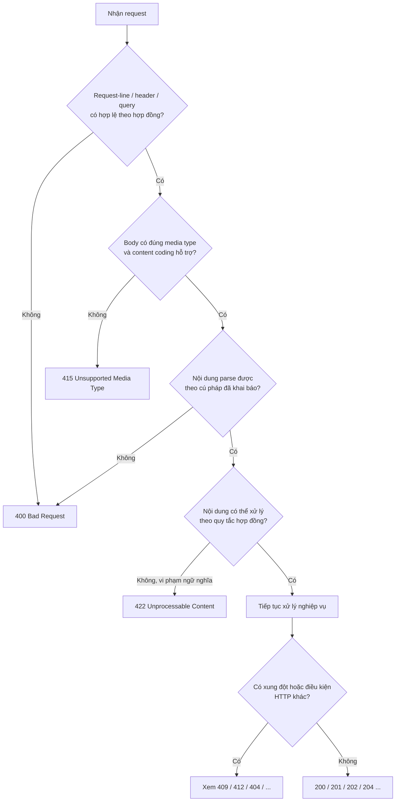

# 400, 415, 422 cho cú pháp, media type và nội dung không xử lý được

## 1. Bài toán: cùng một API, ba loại yêu cầu sai khác nhau

Trong REST API, trả về mã HTTP chính xác giúp client biết **cần sửa điều gì**: sửa cấu trúc yêu cầu, đổi định dạng dữ liệu gửi lên hay điều chỉnh nội dung đã được phân tích cú pháp thành công. Nếu mọi lỗi đều trả `400 Bad Request`, client và đội vận hành phải đoán nguyên nhân. Ngược lại, nếu dùng `422` cho mọi lỗi validation mà bỏ qua `Content-Type`, hợp đồng HTTP trở nên thiếu nhất quán.

Bài này thuộc chương **Mã trạng thái** trong học phần `INTEGRATION_API_REST`. Người học đang thiết kế REST API theo resource, URI, HTTP method, mã trạng thái và hợp đồng dữ liệu; đồng thời thực hành phân trang, cache, idempotency, OpenAPI, xác thực, phân quyền, xử lý lỗi và kiểm thử với Java/Spring hoặc công nghệ tương đương.

Xét endpoint tạo đơn hàng:

```http
POST /orders HTTP/1.1
Host: api.example.test
Content-Type: application/json

{
  "customerId": "cus-128",
  "items": [
    { "sku": "BOOK-01", "quantity": 2 }
  ]
}
```

Server có thể từ chối yêu cầu này vì ba lý do khác nhau:

| Mã | Tên HTTP | Vấn đề cốt lõi | Ví dụ |
| --- | --- | --- | --- |
| **400** | Bad Request | Yêu cầu sai về cấu trúc/cú pháp hoặc không thể xử lý như một request hợp lệ | JSON bị thiếu dấu ngoặc, header hoặc tham số truy vấn sai định dạng |
| **415** | Unsupported Media Type | Định dạng biểu diễn của nội dung yêu cầu hoặc cách mã hóa nội dung không được endpoint hỗ trợ | Gửi `Content-Type: application/xml` khi endpoint chỉ nhận JSON |
| **422** | Unprocessable Content | Server hiểu media type và cú pháp nội dung đúng, nhưng không thể xử lý **chỉ dẫn/ngữ nghĩa** chứa trong nội dung | JSON hợp lệ nhưng `quantity = -2` vi phạm quy tắc tạo đơn |

Tên `422 Unprocessable Content` theo HTTP Semantics (RFC 9110). Tên cũ `422 Unprocessable Entity` còn xuất hiện trong thư viện, enum và tài liệu lịch sử. **Mã số 422 vẫn là cùng một status code**; không cần đổi API chỉ vì thư viện dùng tên cũ.

Mục tiêu sau bài học là đọc được một request, phân loại đúng vấn đề, tạo response có hợp đồng rõ ràng và viết kiểm thử để khóa hành vi 400/415/422.

## 2. Ranh giới kỹ thuật giữa ba mã

### 2.1. `400 Bad Request`: yêu cầu không hợp lệ ở lớp cú pháp/cấu trúc

`400` là mã rộng, diễn tả server không thể hoặc không muốn xử lý request vì một lỗi được coi là ở phía client. HTTP không giới hạn `400` chỉ cho JSON sai cú pháp: request framing sai, cú pháp thông điệp không hợp lệ, định tuyến yêu cầu không phù hợp hoặc tham số query/header sai định dạng cũng thường dùng `400`.

Trong **quy ước của bài học**:

- Body tuyên bố JSON nhưng **không parse được JSON**: `400`.
- Giá trị query `?page=abc` khi hợp đồng yêu cầu số nguyên: `400`.
- Header nghiệp vụ bắt buộc có định dạng sai, ví dụ ngày tháng không parse được: thường `400`.
- Body rỗng khi endpoint yêu cầu có body: thường `400`, trừ khi hợp đồng áp dụng cách biểu diễn/kiểm tra khác.

Ví dụ body không phải JSON hợp lệ:

```http
POST /orders HTTP/1.1
Host: api.example.test
Content-Type: application/json

{"customerId": "cus-128", "items": [
  {"sku": "BOOK-01", "quantity": 2}
```

Thiếu dấu `]` và `}`, nên bộ phân tích JSON thất bại trước khi kiểm tra số lượng hàng hay customer ID:

```http
HTTP/1.1 400 Bad Request
Content-Type: application/problem+json

{
  "type": "https://api.example.test/problems/malformed-json",
  "title": "Nội dung JSON không hợp lệ",
  "status": 400,
  "detail": "Không thể phân tích cú pháp JSON trong request body.",
  "instance": "/orders"
}
```

**Lưu ý:** JSON hợp lệ nhưng thiếu một thuộc tính bắt buộc, ví dụ `{"items":[]}`, là một vấn đề khác với JSON thiếu dấu ngoặc. Quy ước của API có thể trả `422` cho validation về cấu trúc/ngữ nghĩa dữ liệu sau parse; nhiều framework mặc định trả `400`. Hãy chọn và công bố quy ước nhất quán, đồng thời không nhầm lỗi parsing với lỗi validation.

### 2.2. `415 Unsupported Media Type`: biểu diễn gửi lên không được chấp nhận

`415` xảy ra khi server từ chối xử lý vì **định dạng nội dung yêu cầu không được endpoint hỗ trợ**. Căn cứ có thể là `Content-Type`, `Content-Encoding` hoặc kiểm tra trực tiếp định dạng nội dung. `415` nói về *request content*, không nói về định dạng response mà client muốn nhận.

Ví dụ endpoint `POST /orders` chỉ nhận `application/json`:

```http
POST /orders HTTP/1.1
Host: api.example.test
Content-Type: application/xml

<order><customerId>cus-128</customerId></order>
```

Phản hồi:

```http
HTTP/1.1 415 Unsupported Media Type
Content-Type: application/problem+json

{
  "type": "https://api.example.test/problems/unsupported-media-type",
  "title": "Định dạng nội dung không được hỗ trợ",
  "status": 415,
  "detail": "POST /orders chỉ hỗ trợ Content-Type: application/json.",
  "instance": "/orders",
  "supportedMediaTypes": ["application/json"]
}
```

Điều cần phân biệt:

- `Content-Type` **mô tả loại dữ liệu client đang gửi lên**. `application/xml` bị từ chối nếu endpoint chỉ nhận JSON.
- `Content-Encoding` mô tả cách mã hóa nội dung, ví dụ nén. Nếu request dùng content coding mà server không hỗ trợ, `415` cũng có thể phù hợp.
- `Accept` **mô tả loại response client muốn nhận**. Nếu server không tạo được representation thuộc loại chấp nhận được, mã liên quan thường là `406 Not Acceptable`, **không phải 415**.
- `application/problem+json` trong phản hồi mô tả **kiểu dữ liệu lỗi được trả về**, không có nghĩa endpoint chấp nhận `application/problem+json` làm body tạo đơn.

Nếu request có body nhưng **không gửi `Content-Type`**, hành vi phụ thuộc hợp đồng và cách server xác định định dạng; endpoint yêu cầu khai báo rõ JSON có thể từ chối với `415`. Không có quy tắc HTTP bắt buộc mọi request thiếu `Content-Type` đều phải trả `415`. Các API cần mô tả và kiểm thử quyết định này.

### 2.3. `422 Unprocessable Content`: đã đọc hiểu biểu diễn nhưng không thực thi được

Theo ngữ nghĩa HTTP, `422` phù hợp khi server **hiểu content type** và **cú pháp nội dung đúng**, nhưng các chỉ dẫn chứa trong đó không thể được xử lý. Đối với JSON API, đây thường là lỗi validation về ý nghĩa dữ liệu.

Ví dụ JSON đúng cú pháp, header đúng định dạng, nhưng số lượng âm:

```http
POST /orders HTTP/1.1
Host: api.example.test
Content-Type: application/json

{
  "customerId": "cus-128",
  "items": [
    { "sku": "BOOK-01", "quantity": -2 }
  ]
}
```

```http
HTTP/1.1 422 Unprocessable Content
Content-Type: application/problem+json

{
  "type": "https://api.example.test/problems/validation-failed",
  "title": "Dữ liệu không đáp ứng quy tắc tạo đơn",
  "status": 422,
  "detail": "Một hoặc nhiều trường không hợp lệ.",
  "instance": "/orders",
  "errors": [
    {
      "pointer": "/items/0/quantity",
      "code": "must_be_positive",
      "message": "Số lượng phải lớn hơn 0."
    }
  ]
}
```

Các tình huống thường phù hợp với `422` theo **hợp đồng đã chọn**:

- `quantity` âm hoặc bằng 0; `startDate` muộn hơn `endDate`.
- Dữ liệu JSON hợp lệ nhưng `items` không được để rỗng theo business rule.
- Giá trị thuộc tính hợp lệ về cú pháp nhưng vi phạm tổ hợp điều kiện nghiệp vụ, chẳng hạn mức giảm giá vượt giới hạn đơn hàng.
- Một tài liệu JSON Patch hợp lệ về cú pháp và media type nhưng các thao tác trong đó không thể áp dụng theo ngữ nghĩa; lưu ý một số tình huống xung đột tài nguyên nên được phân loại `409` hoặc `412` theo hợp đồng.

**Không tự động trả 422 cho mọi lỗi phía client.** Nếu bản chất là xung đột với trạng thái hiện tại của resource, thiếu xác thực, không có quyền hoặc không tìm thấy resource, các status khác chính xác hơn.

## 3. Quy trình ra quyết định 400 – 415 – 422



Đây là **mô hình suy luận**, không bắt buộc thứ tự xử lý nội bộ của mọi framework. Authentication, authorization, routing, size limit và middleware có thể từ chối request sớm hơn bằng `401`, `403`, `404`, `413`, v.v. Mã cuối cùng phải phản ánh nguyên nhân có ý nghĩa ở giao diện HTTP và không làm lộ thông tin nhạy cảm.

### Bảng quyết định nhanh

| Request gửi đến API chỉ nhận JSON | Điểm sai | Mã gợi ý | Vì sao? |
| --- | --- | --- | --- |
| `Content-Type: application/json`, body `{"a":}` | JSON sai cú pháp | **400** | Không parse thành dữ liệu được |
| `Content-Type: text/plain`, body là chuỗi JSON | Media type sai | **415** | Header khai báo định dạng không được hỗ trợ |
| `Content-Type: application/xml`, body XML hợp lệ | Media type sai | **415** | Endpoint không hỗ trợ XML |
| `Content-Type: application/json`, body `{"quantity":-1}` | Quy tắc giá trị | **422** | Parse được JSON nhưng không thể chấp nhận số lượng |
| `Content-Type: application/json`, body `{"quantity":1}` | Hợp lệ | **201** khi tạo thành công | Có thể tạo resource mới |
| `?limit=abc` trong API đòi số nguyên | Tham số query sai định dạng | **400** | Lỗi cấu trúc/định dạng yêu cầu |
| `Accept: application/xml`, server chỉ sinh JSON | Representation phản hồi không đáp ứng | **406** nếu áp dụng negotiation chặt | `Accept` không phải `Content-Type` |
| Cùng resource đã tồn tại và quy tắc không cho tạo trùng | Xung đột trạng thái resource | **409** | Ngữ cảnh trạng thái hiện tại quan trọng |
| `If-Match` không còn khớp phiên bản resource | Điều kiện HTTP không thỏa | **412** | Thể hiện thất bại của HTTP precondition |
| Token không hợp lệ hoặc thiếu khi yêu cầu xác thực | Authentication | **401** | Không phải lỗi body |

## 4. Khi 400 và 422 cùng có vẻ hợp lý

### 4.1. Validation sau parse và quy ước API

Các framework thường gộp nhiều lỗi request validation vào `400`. Ví dụ Spring MVC mặc định trả `400` cho `MethodArgumentNotValidException` khi tham số `@RequestBody @Valid` không vượt qua Bean Validation. API vẫn có thể nhất quán với HTTP nếu mô tả rõ quy ước này.

Một hợp đồng lựa chọn khác là:

| Lớp kiểm tra | Chính sách minh họa |
| --- | --- |
| Lỗi cú pháp JSON, conversion trước khi có dữ liệu có cấu trúc | `400` |
| Lỗi parse URL/query/header hoặc request framing | `400` |
| Body đúng cú pháp JSON nhưng vi phạm schema/Bean Validation | `422` |
| Body đúng schema nhưng không đáp ứng bất biến nghiệp vụ thuần thuộc nội dung | `422` |
| Body hợp lệ nhưng xung đột trạng thái resource hiện tại | `409` hoặc `412` theo điều kiện |

Với cùng một endpoint, **hãy ghi rõ chính sách thay vì mong client đoán**. Đặc biệt, một kiểu JSON hợp lệ nhưng sai shape:

```json
{
  "customerId": "cus-128",
  "items": "không phải danh sách"
}
```

Không có kết luận phổ quát rằng đây phải là `400` hay `422`. Một thư viện binding có thể ném lỗi deserialize và trả `400`; một tầng validation schema sau khi parse JSON có thể trả `422`. Điều quan trọng là **phân loại theo giai đoạn xử lý có thật**, tài liệu hóa và kiểm thử tương thích.

### 4.2. 422 hay 409 với quy tắc nghiệp vụ?

Phân biệt bằng câu hỏi: lỗi nằm **trong nội dung bản thân request**, hay request hợp lệ nhưng **mâu thuẫn với trạng thái hiện thời của hệ thống**?

- `{"quantity":-2}`: không hợp lệ cho mọi đơn → `422` hợp lý.
- `{"startDate":"2027-06-02","endDate":"2027-05-01"}`: khoảng thời gian ngược → `422`.
- Đặt lại mã đơn đã được tạo và máy chủ không cho phép trùng → thường `409 Conflict`.
- Cập nhật resource với `If-Match` chứa ETag đã cũ → `412 Precondition Failed`.
- Yêu cầu số lượng hợp lệ nhưng kho hiện tại đã hết: tùy mô hình domain, `409` thường truyền đạt rõ xung đột trạng thái tồn kho; một API có thể chọn lỗi miền khác nhưng phải có hợp đồng nhất quán.

Quy tắc lựa chọn là phương tiện truyền thông về **khả năng phục hồi của client**. Client xử lý `422` thường yêu cầu người dùng sửa dữ liệu; với `409`, client thường cần đọc lại trạng thái tài nguyên trước khi quyết định tiếp.

## 5. Những status khác cần tránh nhầm

| Mã | Ngữ nghĩa chính | So sánh với 400/415/422 |
| --- | --- | --- |
| **401 Unauthorized** | Yêu cầu thiếu thông tin xác thực hợp lệ | Không phân loại thành 422 vì token thiếu; với cơ chế challenge, phản hồi có `WWW-Authenticate` thích hợp |
| **403 Forbidden** | Server hiểu request nhưng từ chối cấp quyền | Không nói dữ liệu body sai |
| **404 Not Found** | Không có representation phù hợp cho tài nguyên đích hoặc không muốn tiết lộ sự tồn tại | Khác với một trường JSON không hợp lệ |
| **405 Method Not Allowed** | Resource có nhưng không hỗ trợ HTTP method được gửi | Response cần có `Allow` |
| **406 Not Acceptable** | Không thể cung cấp response đáp ứng `Accept` khi áp dụng negotiation | Liên quan response representation, không phải request body media type |
| **409 Conflict** | Không thể hoàn thành do xung đột trạng thái hiện tại của resource | Cần xử lý trạng thái trước khi gửi lại |
| **412 Precondition Failed** | Một điều kiện HTTP như `If-Match` không thỏa | Dùng cho conditional requests |
| **413 Content Too Large** | Nội dung request lớn hơn giới hạn server chấp nhận | Không phải media type sai hay validation số lượng |
| **428 Precondition Required** | Server yêu cầu client gửi conditional request | Dùng khi muốn ngăn lost update bằng precondition |
| **429 Too Many Requests** | Vượt rate limit | Có thể kèm `Retry-After` nếu xác định được |
| **500 Internal Server Error** | Lỗi server ngoài dự kiến | Không biến bug DB/code thành `422` vì payload hợp lệ |
| **503 Service Unavailable** | Dịch vụ tạm không sẵn sàng | Không nên đổ cho client; có thể kèm `Retry-After` |

Đừng dùng `422` cho lỗi database timeout, queue mất kết nối hoặc null pointer. Những sự cố này không chứng minh dữ liệu của client vô nghĩa.

## 6. Thiết kế lỗi thống nhất với Problem Details

Một mã status chỉ là phần đầu của hợp đồng. Client cần thông tin **đủ ổn định để xử lý bằng mã**, và thông tin **đủ dễ hiểu để hiển thị**.

RFC 9457 định nghĩa định dạng *Problem Details for HTTP APIs*, thường gửi với `Content-Type: application/problem+json`. Các thành phần chính:

| Thuộc tính | Vai trò | Quy ước nên dùng |
| --- | --- | --- |
| `type` | URI nhận diện loại vấn đề; mặc định `about:blank` nếu bỏ qua | Ổn định theo thời gian, tài liệu giải thích |
| `title` | Mô tả ngắn về loại vấn đề | Có thể bản địa hóa; không dùng để phân nhánh logic |
| `status` | Mã HTTP của vấn đề | Khớp HTTP response status; client ưu tiên trạng thái thực trên wire |
| `detail` | Giải thích cụ thể ở lần phát sinh này | Ngắn gọn, an toàn, không lộ thông tin nội bộ |
| `instance` | URI nhận diện lần phát sinh/vị trí vấn đề | Có thể là URI request hoặc URI tương quan phù hợp |
| Thuộc tính mở rộng | Thông tin bổ sung do API định nghĩa | Ví dụ `errors`, `traceId`, `supportedMediaTypes` |

Ví dụ `422` có nhiều lỗi trường:

```http
HTTP/1.1 422 Unprocessable Content
Content-Type: application/problem+json

{
  "type": "https://api.example.test/problems/validation-failed",
  "title": "Dữ liệu không hợp lệ",
  "status": 422,
  "detail": "Vui lòng kiểm tra các trường được đánh dấu.",
  "instance": "/orders",
  "traceId": "req-c8f1",
  "errors": [
    {
      "pointer": "/items/0/quantity",
      "code": "must_be_positive",
      "message": "Số lượng phải lớn hơn 0."
    },
    {
      "pointer": "/items/1/sku",
      "code": "required",
      "message": "Mã hàng là bắt buộc."
    }
  ]
}
```

Mảng `errors` và cách đặt `pointer` ở đây là **extension do API tự định nghĩa**, không phải thuộc tính chuẩn bắt buộc của RFC 9457. Khi dùng JSON Pointer, hãy thống nhất escape ký tự đặc biệt theo cú pháp JSON Pointer; nếu framework chỉ trả đường dẫn Bean Validation như `items[0].quantity`, cần ánh xạ cẩn thận hoặc tài liệu hóa định dạng đó.

Không đưa stack trace, câu SQL, password, token, dữ liệu thẻ thanh toán, thông tin tài khoản nội bộ hoặc exception class không cần thiết vào response. Có thể log chi tiết kỹ thuật phía server với kiểm soát truy cập và gắn `traceId` để điều tra.

### Nội dung phản hồi phải phù hợp ngữ cảnh

- `400`: nêu loại lỗi cú pháp/định dạng. Không cần trả lại toàn bộ body sai cú pháp.
- `415`: chỉ ra loại media type được hỗ trợ. Với `PATCH`, header `Accept-Patch` có thể công bố patch document media types; với content coding không hỗ trợ có thể dùng tín hiệu thích hợp theo đặc tả liên quan.
- `422`: chỉ ra trường nào hoặc quy tắc nào thất bại, dùng **mã lỗi ổn định** để client tạo UX tốt.

Đừng lạm dụng nhiều extension không có mô tả: một hợp đồng rõ ràng tốt hơn response chứa quá nhiều trường tùy hứng.

## 7. Thiết kế hợp đồng OpenAPI cho ba mã

Ví dụ OpenAPI 3.0 mô tả endpoint `POST /orders` chỉ chấp nhận JSON, trả resource mới khi thành công, và trả Problem Details khi có lỗi:

```yaml
openapi: 3.0.3
info:
  title: Orders API
  version: 1.0.0
paths:
  /orders:
    post:
      summary: Tạo đơn hàng
      requestBody:
        required: true
        content:
          application/json:
            schema:
              $ref: '#/components/schemas/CreateOrderRequest'
      responses:
        '201':
          description: Đơn hàng đã được tạo
          headers:
            Location:
              description: URI của đơn hàng mới
              schema:
                type: string
          content:
            application/json:
              schema:
                type: object
                properties:
                  id: { type: string }
        '400':
          description: Cú pháp hoặc cấu trúc request sai
          content:
            application/problem+json:
              schema:
                $ref: '#/components/schemas/Problem'
        '415':
          description: Content-Type hoặc Content-Encoding không hỗ trợ
          content:
            application/problem+json:
              schema:
                $ref: '#/components/schemas/Problem'
        '422':
          description: Nội dung đúng cú pháp nhưng không thỏa quy tắc
          content:
            application/problem+json:
              schema:
                $ref: '#/components/schemas/Problem'
components:
  schemas:
    CreateOrderRequest:
      type: object
      required: [customerId, items]
      properties:
        customerId:
          type: string
          minLength: 1
        items:
          type: array
          minItems: 1
          items:
            type: object
            required: [sku, quantity]
            properties:
              sku: { type: string, minLength: 1 }
              quantity: { type: integer, minimum: 1 }
    Problem:
      type: object
      required: [type, title, status]
      properties:
        type: { type: string, format: uri-reference }
        title: { type: string }
        status: { type: integer }
        detail: { type: string }
        instance: { type: string, format: uri-reference }
        errors:
          type: array
          description: Extension riêng cho lỗi validation
          items:
            type: object
            properties:
              pointer: { type: string }
              code: { type: string }
              message: { type: string }
```

Một số lưu ý khi đọc hợp đồng:

1. `requestBody.content` công bố media type mà thao tác chấp nhận. Nếu endpoint hỗ trợ nhiều media type, phải mô tả và kiểm thử từng loại.
2. OpenAPI schema giúp client hiểu dữ liệu hợp lệ, nhưng **không tự định nghĩa chính sách trả 400 hay 422**. Điều đó thể hiện qua mô tả response và behavior thực.
3. Các response 4xx nên dùng schema chung, nhưng lỗi `415` có thể bổ sung `supportedMediaTypes`, lỗi `422` có `errors`.
4. Nếu hỗ trợ `application/merge-patch+json`, `application/json-patch+json` hoặc vendor media type, hãy ghi media type chính xác; dấu `+json` không có nghĩa endpoint tự động hỗ trợ mọi kiểu có hậu tố đó.
5. OpenAPI không thay thế kiểm thử. Hãy xác minh cả response status, `Content-Type`, body và những trường extension.

## 8. Thực hành triển khai với Java và Spring MVC

Trong Spring MVC, các điểm bắt lỗi thường gặp:

| Giai đoạn | Exception thường gặp | Status mặc định trong nhiều cấu hình Spring MVC | Chính sách bài học |
| --- | --- | --- | --- |
| Kiểm tra media type đầu vào của handler có `consumes` | `HttpMediaTypeNotSupportedException` | 415 | Giữ **415** |
| Đọc/binding body JSON không thành công | `HttpMessageNotReadableException` | 400 | Giữ **400** |
| `@Valid @RequestBody` không đạt Bean Validation | `MethodArgumentNotValidException` | 400 | **Tùy chỉnh 422** để phân biệt validation sau parse |
| Query param không chuyển được sang kiểu mong muốn | `MethodArgumentTypeMismatchException` | 400 | Giữ **400** |
| Bất biến nghiệp vụ không thỏa khi đã có dữ liệu hợp lệ | Exception miền do ứng dụng định nghĩa | Không có mặc định thống nhất | Ánh xạ **422** hoặc status khác đúng ngữ nghĩa |

Các tên exception là ví dụ cho luồng xử lý MVC thông dụng; cách phát sinh cụ thể phụ thuộc message converter, kiểu dữ liệu, validator, cấu hình và phiên bản Spring. Không dùng một handler bắt `Exception` rồi ép tất cả thành `422`.

### 8.1. Controller mô tả media type và validation

```java
// Minh họa Spring MVC và Jakarta Bean Validation.
// Các annotation/import, lớp OrderService/OrderCreated được rút gọn.

record OrderLine(
    @NotBlank String sku,
    @Min(1) int quantity
) {}

record CreateOrderRequest(
    @NotBlank String customerId,
    @NotEmpty List<@Valid OrderLine> items
) {}

@RestController
class OrderController {
    private final OrderService orders;

    OrderController(OrderService orders) {
        this.orders = orders;
    }

    @PostMapping(
        path = "/orders",
        consumes = MediaType.APPLICATION_JSON_VALUE,
        produces = MediaType.APPLICATION_JSON_VALUE
    )
    ResponseEntity<OrderCreated> create(
        @Valid @RequestBody CreateOrderRequest request
    ) {
        OrderCreated result = orders.create(request);
        return ResponseEntity
            .created(URI.create("/orders/" + result.id()))
            .body(result);
    }
}
```

Thuộc tính `consumes` diễn tả request media type; `produces` diễn tả response thành công. Việc trả `application/problem+json` cho response lỗi có thể được Spring xử lý bằng `ProblemDetail` hoặc handler riêng. `@Valid` chỉ kích hoạt validation khi có validator phù hợp trong ứng dụng.

### 8.2. Ánh xạ exception thành Problem Details

```java
// Ví dụ Spring MVC (Spring Framework 6+), rút gọn import.
@RestControllerAdvice
class ApiProblemHandler {

    @ExceptionHandler(HttpMediaTypeNotSupportedException.class)
    ResponseEntity<ProblemDetail> unsupportedMedia(
        HttpMediaTypeNotSupportedException ex
    ) {
        return problem(
            HttpStatus.UNSUPPORTED_MEDIA_TYPE,
            "unsupported-media-type",
            "Định dạng nội dung không được hỗ trợ",
            "Hãy gửi Content-Type: application/json."
        );
    }

    @ExceptionHandler(HttpMessageNotReadableException.class)
    ResponseEntity<ProblemDetail> unreadable(
        HttpMessageNotReadableException ex
    ) {
        return problem(
            HttpStatus.BAD_REQUEST,
            "malformed-request",
            "Nội dung yêu cầu không hợp lệ",
            "Không thể đọc request body theo cú pháp được khai báo."
        );
    }

    @ExceptionHandler(MethodArgumentNotValidException.class)
    ResponseEntity<ProblemDetail> invalidBody(
        MethodArgumentNotValidException ex
    ) {
        ProblemDetail body = ProblemDetail.forStatusAndDetail(
            HttpStatus.UNPROCESSABLE_ENTITY,
            "Một hoặc nhiều trường không thỏa quy tắc."
        );
        body.setTitle("Dữ liệu không hợp lệ");
        body.setType(URI.create(
            "https://api.example.test/problems/validation-failed"
        ));

        // Extension "errors" do API định nghĩa.
        body.setProperty("errors",
            ex.getBindingResult().getFieldErrors().stream()
                .map(e -> Map.of(
                    "field", e.getField(),
                    "code", "invalid_value",
                    "message", "Giá trị không hợp lệ"
                ))
                .toList()
        );
        return ResponseEntity
            .status(HttpStatus.UNPROCESSABLE_ENTITY)
            .contentType(MediaType.parseMediaType("application/problem+json"))
            .body(body);
    }

    private ResponseEntity<ProblemDetail> problem(
        HttpStatus status,
        String code,
        String title,
        String detail
    ) {
        ProblemDetail body = ProblemDetail.forStatusAndDetail(status, detail);
        body.setTitle(title);
        body.setType(URI.create("https://api.example.test/problems/" + code));
        return ResponseEntity.status(status)
            .contentType(MediaType.parseMediaType("application/problem+json"))
            .body(body);
    }
}
```

Đây là **mẫu kỹ thuật để học cơ chế ánh xạ**, chưa bao gồm toàn bộ import, xử lý exception nghiệp vụ, content negotiation, i18n, `instance`, logging và security. `Map.of` không chấp nhận giá trị null; ví dụ cố ý sử dụng chuỗi thông báo cố định để tránh trả về message/null bất ngờ hoặc dữ liệu người dùng nhạy cảm. Trong sản phẩm thực, xây dựng error code có nghĩa và mapping field path (kể cả phần tử danh sách) để client có thể xác định đúng trường.

Spring thường phân loại lỗi JSON deserialize trước Bean Validation. Nếu API chọn `422` cho mọi lỗi JSON Schema sau parse, nhưng dùng DTO không deserialize được kiểu, bạn cần chiến lược validation phù hợp và kiểm thử từng trường hợp; **chỉ thêm một `@ExceptionHandler` không thể tự biến mọi lỗi shape thành 422**.

### 8.3. Ánh xạ lỗi nghiệp vụ

Một ngoại lệ miền như `InvalidOrderPeriod` (ngày kết thúc sớm hơn ngày bắt đầu) có thể ánh xạ `422`. Còn `OrderAlreadyExists` hoặc cập nhật phiên bản stale nên cân nhắc `409`/`412`. Giữ exception miền tách khỏi HTTP ở tầng nghiệp vụ, rồi ánh xạ tại tầng API; tránh để logic domain ném `HttpMessageNotReadableException` hoặc phụ thuộc trực tiếp vào HTTP.

## 9. Kiểm thử API bằng cURL

Các ví dụ dùng cùng endpoint, giả định server hỗ trợ JSON và áp dụng quy ước `422` cho Bean Validation. Thay `https://api.example.test` bằng địa chỉ môi trường thử nghiệm của bạn khi thực thi.

### Test A: JSON sai cú pháp → 400

```bash
curl -i -X POST 'https://api.example.test/orders' \
  -H 'Content-Type: application/json' \
  --data-binary '{"customerId":"cus-128","items":['
```

Kỳ vọng: HTTP **400**, `Content-Type: application/problem+json`, loại lỗi `malformed-request` hoặc `malformed-json` theo hợp đồng.

### Test B: Media type không được hỗ trợ → 415

```bash
curl -i -X POST 'https://api.example.test/orders' \
  -H 'Content-Type: application/xml' \
  --data-binary '<order><customerId>cus-128</customerId></order>'
```

Kỳ vọng: HTTP **415**, body nói rõ media type được chấp nhận. Đừng chỉ kiểm tra nội dung chữ trong `detail`; kiểm tra cả mã và `type`.

### Test C: JSON hợp lệ, quantity âm → 422

```bash
curl -i -X POST 'https://api.example.test/orders' \
  -H 'Content-Type: application/json' \
  --data-binary '{"customerId":"cus-128","items":[{"sku":"BOOK-01","quantity":-2}]}'
```

Kỳ vọng: HTTP **422**, có mã lỗi validation, chỉ ra trường `items[0].quantity` hoặc JSON Pointer tương ứng.

### Test D: JSON hợp lệ → 201

```bash
curl -i -X POST 'https://api.example.test/orders' \
  -H 'Content-Type: application/json' \
  --data-binary '{"customerId":"cus-128","items":[{"sku":"BOOK-01","quantity":2}]}'
```

Kỳ vọng: HTTP **201 Created** nếu nghiệp vụ tạo đơn hoàn tất đồng bộ, có `Location` trỏ tới resource đã tạo. Nếu API thiết kế xử lý bất đồng bộ, có thể trả `202 Accepted` với cơ chế kiểm tra trạng thái theo hợp đồng.

### Kiểm thử tự động phải bao phủ ít nhất

| Kiểm thử | Nội dung đầu vào | Status cần xác nhận | Kiểm tra bổ sung |
| --- | --- | --- | --- |
| Malformed JSON | Thiếu ngoặc / dấu phẩy sai | 400 | `type`, `status`, không lộ parser stack trace |
| Unsupported body media type | `Content-Type: text/plain` | 415 | Tài liệu định dạng hỗ trợ |
| Unsupported content coding | `Content-Encoding` không được hỗ trợ | 415 **nếu server từ chối vì coding** | Không nhầm lỗi giải nén hỏng với unsupported |
| Semantic invalid body | `quantity=-1` | 422 | Đường dẫn trường và error code ổn định |
| Invalid query param | `page=abc` | 400 | Lỗi gắn với query, không nói JSON sai |
| Unsupported response type | `Accept` không thể đáp ứng | 406 nếu endpoint thực hiện strict negotiation | Không dùng 415 |
| Resource state conflict | Đơn trùng/chuyển trạng thái trái phép | 409 theo hợp đồng | Client có hướng giải quyết |
| Optimistic concurrency | `If-Match` không khớp | 412 | ETag/điều kiện chính xác |
| Authentication/authorization | Không token / thiếu quyền | 401 / 403 | Không bị biến thành lỗi validation |
| Valid create | JSON đúng và nghiệp vụ thành công | 201 hoặc 202 theo hợp đồng | Có identifier, `Location` hoặc URL theo dõi |

Một **contract test** tốt kiểm tra status, header, schema và mã lỗi ổn định. Tránh dùng message tiếng Việt/tiếng Anh làm khóa xử lý vì nội dung hiển thị có thể được bản địa hóa.

## 10. Media type trong PATCH, multipart và API phiên bản hóa

Các trường hợp nâng cao khiến `415` thường bị sử dụng sai:

### JSON Patch và Merge Patch

Ví dụ một resource hỗ trợ `PATCH` với `application/json-patch+json`, nhưng client gửi:

```http
PATCH /orders/ord-128 HTTP/1.1
Host: api.example.test
Content-Type: application/merge-patch+json

{"status":"CANCELLED"}
```

Nếu endpoint **không hỗ trợ merge patch**, phản hồi hợp lý là `415`. Server có thể công bố `Accept-Patch: application/json-patch+json` theo giao thức PATCH. Nếu body dùng đúng media type và JSON hợp lệ, nhưng thao tác patch không thể áp dụng vào resource hiện tại, cần phân biệt `422` với `409`/`412` dựa trên nguyên nhân cụ thể và điều kiện HTTP.

### Multipart và tải tệp

`multipart/form-data` chỉ được nhận nếu endpoint có hợp đồng hỗ trợ multipart. Tải file vào endpoint chỉ nhận JSON thường là `415`. Nếu media type đã đúng nhưng ảnh không đạt yêu cầu nghiệp vụ (ví dụ kích thước ảnh trong giới hạn byte nhưng tỉ lệ không được chấp nhận), `422` có thể phù hợp; nếu file vượt giới hạn request body do server đặt ra, cân nhắc `413`.

### Vendor media type

`application/vnd.example.order.v2+json` là media type cụ thể. Một endpoint hỗ trợ `application/json` **không mặc nhiên** hỗ trợ mọi vendor media type có hậu tố `+json`. Hãy ghi rõ danh sách `consumes`, hành vi chuyển đổi version và lỗi `415`.

## 11. Idempotency, cache và khả năng retry sau lỗi

Status 4xx giúp client nhận ra lỗi có thể sửa, nhưng client phải có chiến lược **retry có kiểm soát**:

| Trạng thái | Client thường nên làm gì? | Có nên retry nguyên request? |
| --- | --- | --- |
| 400 | Sửa cấu trúc, cú pháp hoặc tham số | **Không**, nếu input không đổi |
| 415 | Đổi `Content-Type`/`Content-Encoding` và serialization đúng hợp đồng | **Không**, khi gửi lại y hệt |
| 422 | Yêu cầu người dùng sửa trường hoặc giải quyết rule bị vi phạm | **Không**, nếu nội dung không đổi |
| 409 | Nạp trạng thái hiện tại hoặc theo hướng dẫn conflict handling | Chỉ khi đã giải quyết xung đột |
| 429, 503 | Chờ theo chính sách, `Retry-After` nếu có, backoff với jitter | Có thể, khi an toàn và phù hợp hợp đồng |

`POST` có thể gây tác dụng phụ. Nếu client timeout sau khi gửi yêu cầu hợp lệ, **không biết chắc server đã tạo resource hay chưa**. Thiết kế idempotency key và chống trùng là bài toán riêng; việc trả `400`, `415`, `422` chính xác **không giải quyết** được giao dịch bị lặp khi kết nối mất sau commit.

Đối với cache: theo mặc định, không nên cho rằng bất cứ response lỗi 4xx nào cũng có thể được shared cache lưu để phục vụ nhiều người dùng. Chính sách cache phụ thuộc status, header và ngữ cảnh; lỗi chứa thông tin riêng tư nên có điều khiển cache phù hợp, ví dụ `Cache-Control: no-store` khi cần. Đặc biệt không để cache chung lưu các chi tiết validation chứa dữ liệu người dùng.

## 12. Bảo mật và khả năng quan sát khi xử lý lỗi

**Bảo mật:** Mã status đúng không quan trọng bằng việc không rò rỉ thông tin. Với resource nhạy cảm, tầng xác thực/phân quyền có thể từ chối trước khi validate body. Không tiết lộ tồn tại của tài khoản, secret, cấu trúc DB, query SQL hoặc thông tin nội bộ chỉ để response 422 có “đủ detail”.

**Khả năng quan sát:** ghi metrics theo `route`, `method`, `status` và `problem.type`; tránh dùng user ID, URI có giá trị biến động hoặc message tự do làm nhãn metrics vì số lượng giá trị có thể tăng rất lớn. Gắn request ID/trace ID để tìm log nhưng che hoặc loại bỏ payload nhạy cảm.

Một ví dụ log ở phía server:

```json
{
  "timestamp": "2027-01-15T09:15:00Z",
  "level": "INFO",
  "route": "POST /orders",
  "status": 422,
  "problemType": "validation-failed",
  "traceId": "req-c8f1",
  "fieldCodes": ["must_be_positive"]
}
```

Tỷ lệ `400` tăng bất thường có thể do client deploy lỗi hoặc thay đổi parser. `415` tăng có thể là tín hiệu hợp đồng media type chưa được cập nhật cùng SDK/client. `422` tăng có thể liên quan UX, form validation hoặc quy tắc nghiệp vụ mới. Nhưng một làn sóng `422` cũng có thể do bug server vô tình ánh xạ tất cả exception thành 422: luôn phân tích theo nguyên nhân và request sample đã được ẩn dữ liệu.

## 13. Các lỗi thiết kế thường gặp

1. **Trả 422 cho JSON sai cú pháp:** validation nghiệp vụ chưa thể chạy khi parser chưa tạo được dữ liệu. Dùng 400 cho lỗi cú pháp theo quy ước bài học.
2. **Trả 400 khi không hỗ trợ Content-Type nhưng contract đã cam kết 415:** client không biết nên đổi cách serialize; sử dụng 415 khi lỗi thuộc media type.
3. **Trả 415 vì client đặt `Accept` không đúng:** nhầm request representation với response negotiation; kiểm tra 406 nếu hợp đồng áp dụng.
4. **Trả 422 cho DB outage hoặc timeout:** quy trách nhiệm cho client dù lỗi do server/phụ thuộc.
5. **Gộp toàn bộ vi phạm quy tắc vào 422 mà không phân biệt conflict/precondition:** client không biết cần sửa body hay đọc lại trạng thái.
6. **Spring tự động 400 cho `@Valid` dù OpenAPI ghi 422:** tài liệu và runtime không khớp; cần handler phù hợp hoặc sửa tài liệu.
7. **Trả error message không ổn định:** client phải parse ngôn ngữ tự nhiên; cần `type` và `code` có nghĩa.
8. **Trả lỗi trường nhưng không rõ đường dẫn:** khó hiển thị lỗi cho mảng item; dùng field path hoặc JSON Pointer có hợp đồng.
9. **Trả toàn bộ exception hoặc body gốc:** làm lộ dữ liệu nhạy cảm, tăng nguy cơ bảo mật.
10. **Không kiểm tra 4xx trong CI:** đổi framework/message converter làm status thay đổi mà client không được báo trước.

## 14. Bài thực hành phân loại và thiết kế response

Bạn phụ trách `POST /orders`. Hợp đồng chỉ nhận `application/json`, các dòng hàng có `quantity >= 1`, `customerId` không được rỗng, không cho tạo lại đơn với `externalOrderId` đã tồn tại. Định nghĩa chính sách:

- Dữ liệu không parse được hoặc tham số request sai định dạng: `400`.
- Body media type không được hỗ trợ: `415`.
- Dữ liệu body parse được nhưng vi phạm validation: `422`.
- Trùng `externalOrderId` với đơn đang tồn tại: `409`.
- Dữ liệu hợp lệ được tạo đồng bộ: `201`.

### Nhiệm vụ A: phân loại

| # | Tình huống | Đáp án đề xuất | Giải thích |
| --- | --- | --- | --- |
| 1 | `Content-Type: application/json`; body `{"items":[}` | **400** | JSON parse lỗi |
| 2 | `Content-Type: text/plain`; body `{"items":[]}` | **415** | Media type không được hỗ trợ |
| 3 | `Content-Type: application/json`; body `{"customerId":"c1","items":[]}` | **422** | JSON hợp lệ, vi phạm minItems |
| 4 | `Content-Type: application/json`; `quantity:0` | **422** | Quy tắc số lượng |
| 5 | `Content-Type: application/json`; thiếu dấu phẩy giữa hai trường | **400** | Cú pháp sai |
| 6 | `Content-Type: application/xml`; body XML hợp lệ | **415** | Không chấp nhận XML |
| 7 | `Accept: application/xml`; body JSON hợp lệ | **406** nếu không có response representation phù hợp và áp dụng strict negotiation | Đây là thương lượng response |
| 8 | `externalOrderId` đã tồn tại | **409** | Xung đột tài nguyên |
| 9 | Server không kết nối được DB | **5xx** thích hợp | Lỗi phía server, không phải payload |
| 10 | `Content-Type: application/json`; dữ liệu hợp lệ và tạo xong | **201** | Resource mới được tạo |

### Nhiệm vụ B: thiết kế hợp đồng lỗi

Tạo ba Problem Details response cho tình huống 1, 2 và 3. Mỗi response phải có `type`, `title`, `status`, `detail` an toàn. Với 422, thêm mảng `errors` chỉ rõ `/items` và mã `min_items`. Với 415, thêm danh sách media type được hỗ trợ. Nêu rõ các thuộc tính bổ sung nào là extension riêng của API.

### Nhiệm vụ C: triển khai và kiểm thử Spring

Tạo DTO `CreateOrderRequest` sử dụng Bean Validation và endpoint `@PostMapping(consumes = "application/json")`. Viết `@RestControllerAdvice` ánh xạ:

- `HttpMessageNotReadableException` → `400`.
- `HttpMediaTypeNotSupportedException` → `415`.
- `MethodArgumentNotValidException` → `422` theo chính sách bài tập.

Viết ba kiểm thử HTTP gửi sai cú pháp, sai media type, sai `quantity` và kiểm tra cả `status`, `Content-Type`, `problem.type`, `problem.status`. Thêm một kiểm thử `Accept` không hỗ trợ response và một kiểm thử tạo đơn hợp lệ.

### Nhiệm vụ D: review hợp đồng

Kiểm tra OpenAPI đã công bố `requestBody.content` chính xác chưa, status code 400/415/422 có schema lỗi chung chưa, việc thực thi Java/Spring có khớp tài liệu không. Mô tả hành vi retry của client sau từng loại lỗi. Đưa ra ví dụ khiến bạn chọn 409 thay vì 422 và giải thích tại sao.

## 15. Câu hỏi tự kiểm tra

1. Hai request có cùng chuỗi JSON hợp lệ nhưng `Content-Type` khác nhau có thể trả 415 và 422 trong những điều kiện nào?
2. JSON hợp lệ về cú pháp nhưng thiếu trường bắt buộc phải trả 422 trong mọi framework không? Bạn sẽ làm gì để thống nhất hợp đồng?
3. Vì sao `Accept: application/xml` không phải lý do để trả 415?
4. `Content-Encoding` có vai trò gì trong quyết định dùng 415?
5. Khi nào `409 Conflict` truyền đạt đúng hơn `422 Unprocessable Content`?
6. Tại sao lỗi không kết nối được PostgreSQL không nên bị ánh xạ thành 422?
7. Spring MVC thường trả status nào khi `@RequestBody @Valid` không đạt validation? Cần thay đổi gì nếu muốn 422?
8. `type` và `title` trong Problem Details khác nhau thế nào về độ ổn định cho client?
9. Vì sao `errors` có JSON Pointer không tự trở thành thuộc tính chuẩn bắt buộc của RFC 9457?
10. Với thao tác POST tạo đơn, vì sao retry sau timeout cần idempotency dù response 400/415/422 đã được thiết kế rõ?
11. Bạn sẽ dùng những kiểm thử nào để chứng minh contract OpenAPI và code Java/Spring không lệch nhau?
12. Một đợt tăng đột biến 415 sau triển khai mobile app gợi ý điều gì về phối hợp phiên bản client/server?

**Điểm cần ghi nhớ:** `400` nói request không được diễn giải như một yêu cầu hợp lệ ở cấp cú pháp/cấu trúc; `415` nói định dạng nội dung gửi lên không được hỗ trợ; `422` nói server đã hiểu biểu diễn và cú pháp nhưng không thể xử lý ngữ nghĩa nội dung. Trong các tình huống giáp ranh, hãy định nghĩa quy ước, tôn trọng mã HTTP có ý nghĩa riêng như 409/412/406, công bố response lỗi bằng Problem Details và dùng contract test để bảo đảm client có thể xử lý ổn định.
