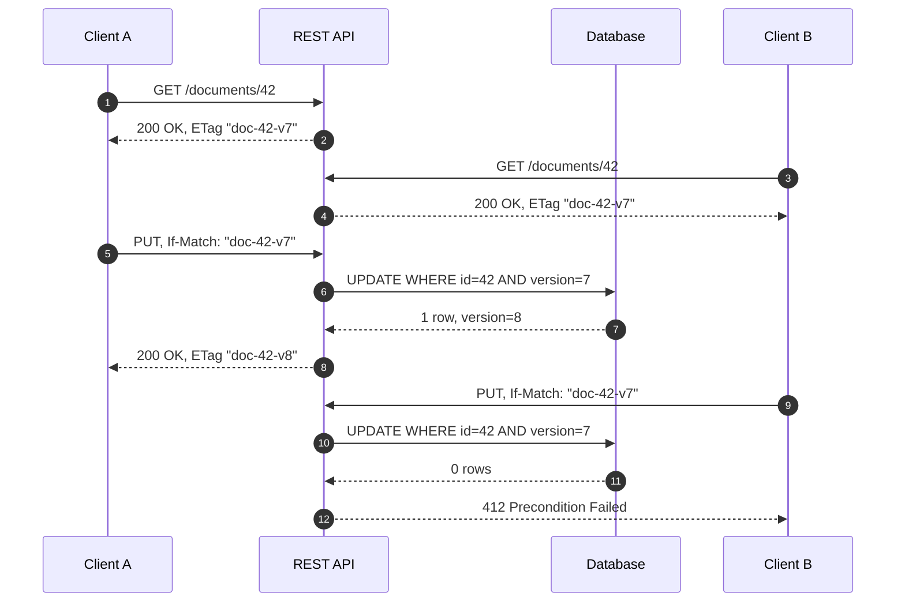
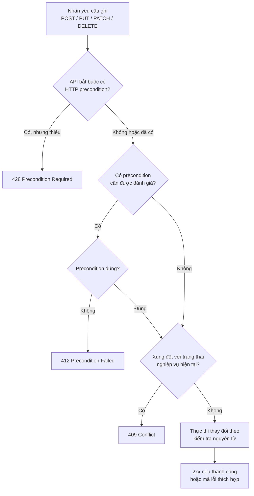

# 409, 412, 428 cho xung đột và yêu cầu có điều kiện

> **Chương:** Mã trạng thái  
> **Module:** `INTEGRATION_API_REST` — thiết kế REST API theo resource, URI, phương thức HTTP và mã trạng thái; xây dựng hợp đồng dữ liệu rõ ràng, idempotency, cache, xác thực, phân quyền, xử lý lỗi, OpenAPI và kiểm thử với Java/Spring hoặc công nghệ tương đương.

Trong một REST API có nhiều người dùng, thao tác ghi không chỉ gặp lỗi do dữ liệu đầu vào sai. Một khách hàng có thể cập nhật tài nguyên dựa trên trạng thái đã cũ, hai yêu cầu có thể tranh nhau tạo cùng một tên, hoặc một hành động chỉ hợp lệ khi đơn hàng đang ở trạng thái cụ thể. Để client hiểu **điều gì đã xảy ra và cần làm gì tiếp**, ba mã **`409 Conflict`**, **`412 Precondition Failed`** và **`428 Precondition Required`** cần được phân biệt cẩn thận.

Đây là bài học về **hợp đồng HTTP và kiểm soát đồng thời**, không chỉ về cách trả một số nguyên. Nếu server trả đúng mã nhưng cập nhật database bằng thao tác đọc rồi ghi không nguyên tử, hệ thống vẫn có thể mất dữ liệu vì ghi đè (lost update).

## Mục tiêu học tập

Sau bài này, bạn có thể:

1. Phân biệt lỗi xung đột trạng thái với lỗi điều kiện HTTP và thiếu điều kiện HTTP.
2. Chọn `409`, `412` hoặc `428` cho các thao tác `POST`, `PUT`, `PATCH`, `DELETE` theo hợp đồng API.
3. Sử dụng `ETag` và `If-Match` để cập nhật có điều kiện, tránh ghi đè phiên bản mới.
4. Giải thích vai trò của `If-None-Match: *`, `If-Unmodified-Since` và sự khác biệt giữa ETag mạnh/yếu.
5. Thiết kế xử lý đồng thời nguyên tử bằng version/compare-and-swap trong database.
6. Viết API Spring mô tả đúng điều kiện và lập bộ test cho lỗi cạnh tranh, replay và xung đột nghiệp vụ.
7. Trình bày cách client phục hồi, cách viết Problem Details và những hạn chế về cache, idempotency, bảo mật.

## 1. Tình huống gốc: hai người cập nhật cùng một tài nguyên

Giả sử hệ thống có tài nguyên:

```http
GET /api/documents/42 HTTP/1.1
Accept: application/json
```

Server trả:

```http
HTTP/1.1 200 OK
Content-Type: application/json
ETag: "doc-42-v7"

{"id":42,"title":"Hợp đồng A","status":"DRAFT"}
```

Người A và B đều đọc tài liệu lúc phiên bản `v7`. A thay tiêu đề thành “Hợp đồng A — bản duyệt” và lưu thành `v8`. B vẫn nhìn thấy `v7`, sau đó gửi cập nhật “Hợp đồng A — bản sửa của B”. Nếu server chấp nhận mù quáng yêu cầu B, thay đổi của A có thể bị ghi đè mà không ai nhận ra.



Ở lần cập nhật thứ hai, điều kiện “chỉ ghi nếu biểu diễn hiện tại vẫn khớp ETag v7” đã sai. **`412` là câu trả lời phù hợp**. Nếu B hoàn toàn không gửi `If-Match` và server yêu cầu tất cả thao tác sửa phải có điều kiện, **`428` là câu trả lời phù hợp**. Nếu B yêu cầu chuyển trạng thái một đơn hàng đã `SHIPPED` về `DRAFT` trái quy tắc nghiệp vụ, dù gửi đúng phiên bản, **`409` có thể là câu trả lời phù hợp**.

## 2. Ý nghĩa chính xác của từng mã

| Mã | Tên chuẩn | Điều gì xảy ra? | Client nên làm gì? |
| --- | --- | --- | --- |
| **409** | **Conflict** | Yêu cầu xung đột với **trạng thái hiện tại của tài nguyên**; ví dụ tên duy nhất đã tồn tại, hoặc chuyển trạng thái không hợp lệ tại thời điểm hiện tại. | Đọc thông tin xung đột, chỉnh yêu cầu hoặc giải quyết trạng thái; chỉ gửi lại khi có thay đổi cần thiết. |
| **412** | **Precondition Failed** | Một hoặc nhiều **điều kiện trong HTTP request headers** được server đánh giá là sai, chẳng hạn `If-Match` chứa ETag cũ. | Đọc lại tài nguyên/ETag, so sánh và quyết định merge hay hủy thay đổi trước khi ghi lại. |
| **428** | **Precondition Required** | Server yêu cầu request phải có **điều kiện HTTP thích hợp** trước khi thực hiện; client thiếu điều kiện đó. | Lấy validator hiện tại, thêm header như `If-Match`, rồi gửi yêu cầu có điều kiện. |

**Không dùng ba mã thay thế cho nhau.** Điểm quyết định là **có điều kiện HTTP hay không và điều kiện đó được đánh giá thế nào**, đồng thời xác định xung đột nằm ở trạng thái nghiệp vụ hay ở validator.

- **`409`** được định nghĩa trong HTTP Semantics (RFC 9110).
- **`412`** là kết quả đánh giá precondition trong HTTP Semantics (RFC 9110).
- **`428`** được định nghĩa trong RFC 6585 để server có thể yêu cầu conditional requests, đặc biệt nhằm phòng ngừa lost update.

### Cây quyết định đơn giản cho thao tác ghi



Sơ đồ trên là **quy trình rút gọn** sau các kiểm tra cần thiết về route, xác thực, quyền truy cập, cú pháp và kiểu nội dung. HTTP quy định thứ tự và điều kiện đánh giá precondition; server **không có nghĩa vụ đánh giá precondition của mọi request nếu request vốn đã phải thất bại vì một lý do khác**. Chẳng hạn, client không có quyền sửa tài liệu có thể nhận `403` dù `If-Match` cũng cũ.

## 3. `409 Conflict`: xung đột với trạng thái tài nguyên

`409` có ý nghĩa khi server hiểu yêu cầu, nhưng không thể thực hiện **trong trạng thái hiện tại** của tài nguyên. Client có thể giải quyết xung đột và gửi lại yêu cầu phù hợp. Cần trả đủ thông tin để người dùng hoặc hệ thống tích hợp có thể xác định bước tiếp theo, nhưng không tiết lộ dữ liệu họ không có quyền xem.

### Trường hợp A — trùng định danh duy nhất khi tạo

```http
POST /api/projects HTTP/1.1
Content-Type: application/json

{"slug":"billing","displayName":"Billing"}
```

Nếu `slug=billing` đã thuộc một project khác và hợp đồng không cho phép tạo bản ghi trùng:

```http
HTTP/1.1 409 Conflict
Content-Type: application/problem+json

{
  "type": "https://api.example.test/problems/slug-conflict",
  "title": "Project slug already exists",
  "status": 409,
  "detail": "The slug 'billing' is already in use.",
  "code": "PROJECT_SLUG_CONFLICT"
}
```

Ở đây không có `If-Match` bị đánh giá sai. Đây là **ràng buộc duy nhất** do trạng thái hiện tại của hệ thống, nên `409` thường phù hợp. Bên dưới cần dùng **unique constraint** trong database để chống hai request đồng thời cùng vượt qua bước kiểm tra tồn tại trước khi ghi.

### Trường hợp B — chuyển trạng thái không hợp lệ

```http
POST /api/orders/900/cancel HTTP/1.1
Content-Type: application/json

{"reason":"CUSTOMER_REQUEST"}
```

Nếu đơn đã giao thành công và hệ thống không cho phép hủy ở trạng thái `DELIVERED`:

```http
HTTP/1.1 409 Conflict
Content-Type: application/problem+json

{
  "type": "https://api.example.test/problems/order-state-conflict",
  "title": "Order cannot be cancelled",
  "status": 409,
  "detail": "Cancellation is unavailable for the current order state.",
  "code": "ORDER_STATE_CONFLICT"
}
```

Client có thể hiển thị trạng thái hiện tại và hành động được phép (ví dụ yêu cầu trả hàng), thay vì tự động retry không giới hạn.

### Khi nào không nên dùng `409`?

- **Thiếu trường bắt buộc, JSON sai cú pháp:** thường là `400 Bad Request`.
- **Dữ liệu đúng cú pháp nhưng vi phạm quy tắc nội dung độc lập với trạng thái hiện tại:** có thể dùng `422 Unprocessable Content` theo hợp đồng API, ví dụ ngày kết thúc trước ngày bắt đầu. Một số API dùng `400`; cần nhất quán.
- **Không tìm thấy tài nguyên:** thường là `404 Not Found`.
- **Không đủ quyền:** `401 Unauthorized` hoặc `403 Forbidden` theo ngữ cảnh xác thực/phân quyền.
- **Precondition `If-Match` được đánh giá là sai:** dùng `412`, không gom mọi lỗi phiên bản thành `409` chỉ vì có hai người chỉnh cùng lúc.

Có những API không dùng conditional HTTP mà nhận `expectedVersion` trong JSON, rồi trả `409` nếu version nghiệp vụ không khớp. Đó là **hợp đồng riêng ở tầng ứng dụng**; không nên mô tả như trường hợp `If-Match` chuẩn HTTP. Khi đã chọn conditional requests, hãy dành `412` cho precondition sai.

## 4. `412 Precondition Failed`: header điều kiện không còn đúng

Một client có thể yêu cầu server **chỉ thực thi thao tác khi một điều kiện HTTP còn đúng**. Với cập nhật, điều kiện phổ biến nhất là `If-Match`.

### Luồng cập nhật có điều kiện

**Bước 1.** Client lấy tài nguyên và ETag:

```http
GET /api/documents/42 HTTP/1.1
Accept: application/json
```

```http
HTTP/1.1 200 OK
Content-Type: application/json
ETag: "doc-42-v7"

{"id":42,"title":"Hợp đồng A","status":"DRAFT"}
```

**Bước 2.** Client cập nhật bằng ETag đang giữ:

```http
PUT /api/documents/42 HTTP/1.1
Content-Type: application/json
If-Match: "doc-42-v7"

{"title":"Hợp đồng A — đã sửa","status":"DRAFT"}
```

Nếu tài nguyên **vẫn là v7**, server thực thi thay đổi. Phản hồi có thể là `200 OK` kèm biểu diễn mới:

```http
HTTP/1.1 200 OK
Content-Type: application/json
ETag: "doc-42-v8"

{"id":42,"title":"Hợp đồng A — đã sửa","status":"DRAFT"}
```

Hoặc `204 No Content` nếu hợp đồng không trả body, và có thể trả ETag mới khi phù hợp với ngữ nghĩa HTTP của phương thức sử dụng. Với `PUT`, **không phát validator trong phản hồi thành công nếu biểu diễn đã được chuyển đổi trước khi lưu theo cách không thỏa điều kiện của chuẩn HTTP**; nếu cần, client có thể `GET` lại để nhận ETag chính xác.

**Bước 3.** Nếu một người khác đã cập nhật thành v8 trước khi request đến, ETag v7 không còn khớp:

```http
HTTP/1.1 412 Precondition Failed
Content-Type: application/problem+json

{
  "type": "https://api.example.test/problems/stale-resource-version",
  "title": "Resource version is no longer current",
  "status": 412,
  "detail": "Reload the resource and review changes before retrying.",
  "code": "STALE_ETAG"
}
```

Một `412` thông thường **không ghi đè tài nguyên**. Server nên thực thi điều kiện và thao tác ghi theo cách nguyên tử để tránh lỗi giữa kiểm tra và cập nhật.

### Ý nghĩa `If-Match`

Header `If-Match` nhận một hoặc nhiều **entity-tag** hoặc ký hiệu `*`, theo cú pháp HTTP. Với danh sách ETag, điều kiện đúng nếu có một tag khớp **theo strong comparison** với ETag hiện tại của representation đã chọn.

```http
If-Match: "doc-42-v7"
```

Được hiểu là: “Tôi chỉ muốn thực hiện thay đổi nếu biểu diễn hiện tại của tài nguyên vẫn ở phiên bản mà tag này đại diện.”

Hai điểm dễ nhầm:

- `If-Match: *` chỉ kiểm tra tài nguyên có biểu diễn hiện tại, **không chứng minh client đã đọc đúng phiên bản cụ thể**. Nếu mục tiêu là ngăn lost update, API nên yêu cầu một validator cụ thể khi thay đổi tài nguyên.
- `If-Match` dùng **strong ETag comparison**. ETag yếu như `W/"v7"` không thể dùng như một strong match; đừng phát ETag yếu rồi mong `If-Match` bảo vệ ghi đè bằng cách so chuỗi đơn thuần.

ETag là giá trị **opaque** với client: client giữ và gửi lại nguyên văn, không cần phân tích ý nghĩa phiên bản. Server chịu trách nhiệm sinh, so sánh và thay đổi validator khi nội dung biểu diễn thay đổi theo ngữ nghĩa yêu cầu.

## 5. `428 Precondition Required`: server bắt buộc có điều kiện

`428` được dùng khi server yêu cầu thao tác phải có điều kiện trước khi tiến hành. Một chính sách phổ biến:

> Đối với `PUT`, `PATCH` và `DELETE` cập nhật/xóa tài nguyên đã tồn tại, client phải gửi `If-Match` chứa strong ETag cụ thể lấy từ lần đọc gần nhất.

Client gửi `PATCH` mà không có `If-Match`:

```http
PATCH /api/documents/42 HTTP/1.1
Content-Type: application/merge-patch+json

{"title":"Hợp đồng B"}
```

Server có thể từ chối:

```http
HTTP/1.1 428 Precondition Required
Content-Type: application/problem+json
Cache-Control: no-store

{
  "type": "https://api.example.test/problems/precondition-required",
  "title": "Conditional update required",
  "status": 428,
  "detail": "Fetch the document ETag and send it in the If-Match header.",
  "code": "IF_MATCH_REQUIRED"
}
```

Theo RFC 6585, **response 428 không được cache lưu trữ**. Có thể thêm `Cache-Control: no-store` để nhấn mạnh ý định không lưu phản hồi lỗi.

### Khác biệt quan trọng giữa `428` và `412`

- **428:** client chưa đưa điều kiện **bắt buộc** (ví dụ thiếu `If-Match`).
- **412:** client đã đưa điều kiện và **điều kiện đó được đánh giá là sai**.

Một server có thể chọn chính sách “mọi `PUT` đều cần `If-Match`” nhưng không phải mọi REST API đều buộc phải dùng `428`. Đây là **chính sách điều kiện do API công bố**, đặc biệt cần thiết với các tác vụ có nguy cơ lost update.

Nếu request có header nhưng **sai cú pháp**, chẳng hạn header hoàn toàn không tuân cú pháp HTTP, thường có thể trả `400` theo hợp đồng và xử lý parser. Không nên đồng nhất mọi header lỗi với `412`. Nếu header hợp lệ nhưng không khớp, đó là `412`.

## 6. So sánh `If-Match`, `If-None-Match` và thời gian sửa đổi

Conditional requests có nhiều dạng. Trong bài này, điều quan trọng là chọn đúng điều kiện cho **ngữ nghĩa thao tác**.

| Header | Điều kiện | Trường hợp điển hình | Phản hồi nếu điều kiện sai |
| --- | --- | --- | --- |
| `If-Match: "tag"` | Chỉ thực hiện nếu ETag hiện tại **khớp mạnh** một tag được gửi. | `PUT`/`PATCH`/`DELETE` có optimistic concurrency. | `412`. |
| `If-Match: *` | Chỉ thực hiện nếu tồn tại biểu diễn hiện tại của tài nguyên. | Yêu cầu phải tồn tại, **không** kiểm tra phiên bản cụ thể. | `412` nếu không có biểu diễn hiện tại, trong phạm vi đánh giá precondition. |
| `If-None-Match: *` | Chỉ thực hiện nếu **chưa tồn tại** biểu diễn hiện tại. | Tạo tài nguyên bằng `PUT /resources/{id}` mà không được ghi đè. | `412` nếu đã tồn tại. |
| `If-None-Match: "tag"` | Chỉ thực hiện nếu ETag hiện tại không khớp theo so sánh yếu. | `GET` để kiểm tra cache; một số thao tác ghi có điều kiện khác. | `304 Not Modified` cho `GET`/`HEAD`; `412` cho phương thức khác khi điều kiện sai. |
| `If-Unmodified-Since` | Chỉ thực hiện nếu tài nguyên không bị sửa sau thời điểm chỉ định. | Dự phòng khi không có ETag phù hợp. | `412` khi điều kiện sai. |

**Ưu tiên ETag mạnh hơn timestamp** khi cần kiểm soát đồng thời chính xác. Trường `Last-Modified` thường có độ phân giải theo giây và có thể không phân biệt hai thay đổi nhanh trong cùng giây; chênh lệch đồng hồ cũng có thể gây vấn đề. `If-Unmodified-Since` được bỏ qua khi `If-Match` có mặt, theo thứ tự đánh giá precondition chuẩn.

### Tạo mới nhưng không được ghi đè

Ví dụ client được phép chọn URI của tài nguyên:

```http
PUT /api/reports/monthly-2026-11 HTTP/1.1
Content-Type: application/json
If-None-Match: *

{"name":"Báo cáo tháng 11"}
```

- Nếu URI chưa có representation: server có thể tạo và trả `201 Created`.
- Nếu URI đã có representation: điều kiện `If-None-Match: *` sai, trả **`412 Precondition Failed`**.
- Nếu không có header và API bắt buộc điều kiện cho thao tác put-if-absent: trả **`428 Precondition Required`**.

Không tự đổi `412` sang `409` trong trường hợp điều kiện HTTP **được gửi và đánh giá sai**, chỉ vì cùng nói về “đã tồn tại”.

### ETag mạnh và ETag yếu

```http
ETag: "doc-42-v7"
ETag: W/"doc-42-v7"
```

Tag đầu là **strong validator**; tag thứ hai là **weak validator**. ETag yếu hữu ích trong một số kịch bản cache/biểu diễn tương đương về ngữ nghĩa, nhưng không dùng làm cơ chế so sánh mạnh của `If-Match`.

Nếu server sinh ETag theo `version` từ DB, hãy bảo đảm **mọi thay đổi có ảnh hưởng đến biểu diễn được trả** đều làm thay đổi version và không tái sử dụng token gây nhầm lẫn. Nếu cùng một row có nhiều representation (khác định dạng, ngôn ngữ, content coding), ETag phải tuân theo ngữ nghĩa validator của từng representation. Không chỉ thêm tiền tố `v` vào số phiên bản rồi tuyên bố chắc chắn đó là strong ETag cho mọi response.

## 7. Bảng tình huống: chọn mã nào?

| Tình huống | Mã thường phù hợp | Vì sao? |
| --- | --- | --- |
| `PUT` sửa tài liệu, server yêu cầu `If-Match` nhưng client không gửi. | **428** | Thiếu precondition bắt buộc. |
| `PUT` có `If-Match: "v4"` nhưng tài liệu đã thành v5. | **412** | Precondition header sai. |
| `PUT` tạo mới có `If-None-Match: *` nhưng URI đã tồn tại. | **412** | Điều kiện “chưa tồn tại” sai. |
| `POST /projects` dùng slug đã được dự án khác giữ, không có điều kiện HTTP. | **409** | Xung đột với uniqueness/trạng thái hiện tại. |
| `POST /orders/{id}/cancel` khi đơn đã giao và không được hủy. | **409** | Xung đột quy tắc vòng đời tài nguyên. |
| `PATCH` có ETag đúng nhưng yêu cầu chuyển trạng thái trái quy tắc. | **409** | Điều kiện phiên bản đạt, nhưng hành động không hợp lệ với trạng thái hiện tại. |
| `GET` có `If-None-Match` trùng ETag hiện tại. | **304** | Conditional retrieval được tối ưu theo cache. |
| Cú pháp JSON request không hợp lệ. | **400** | Lỗi request syntax, không phải precondition. |
| Client không có quyền sửa tài nguyên. | **403** (hoặc `401` nếu cần xác thực) | Vấn đề quyền truy cập được xử lý trước khi cho phép sửa. |
| Tài nguyên cần sửa không tồn tại và không có ngữ nghĩa tạo mới. | **404** | Không tìm thấy tài nguyên trong hợp đồng hiện tại. |
| `If-Match` hợp lệ nhưng ETag không khớp. | **412** | Không thay bằng `409` dù nguyên nhân là người khác vừa sửa. |
| Client gửi lại cùng idempotency key nhưng payload khác request trước. | **409** trong nhiều hợp đồng idempotency | Khóa tái sử dụng gây xung đột; phải được công bố rõ trong API contract. |

Bảng là **định hướng theo hợp đồng API cụ thể**. Nếu có nhiều điều kiện lỗi đồng thời, server phải áp dụng HTTP semantics, thứ tự đánh giá precondition và chính sách kiểm tra quyền/trạng thái phù hợp; không mặc định luôn ưu tiên `428` hay `409` trước các lỗi khác.

## 8. Tính đúng đắn nằm ở cập nhật nguyên tử trong database

Triển khai sau **không an toàn** nếu hai request chạy đồng thời:

```java
// Minh họa chống ví dụ: read-check-write tách biệt, không khóa / CAS.
Document doc = repository.findById(id);
if (doc.getVersion() != expectedVersion) {
    throw new PreconditionFailedException();
}
doc.setTitle(newTitle);
repository.save(doc); // Request khác có thể đã ghi giữa find và save.
```

Cả hai request có thể đều đọc version 7, đều kiểm tra thành công, sau đó lần lượt ghi đè nhau. **`If-Match` ở controller không cứu được logic không nguyên tử**.

### Dùng compare-and-swap (CAS) với version

```sql
UPDATE documents
SET title = :title,
    version = version + 1
WHERE id = :id
  AND version = :expected_version;
```

- Nếu cập nhật được **1 hàng**: request đã giữ đúng phiên bản và chuyển sang phiên bản tiếp theo.
- Nếu cập nhật được **0 hàng**: tài nguyên không tồn tại, hoặc đã thay đổi phiên bản trước khi yêu cầu này ghi. Kiểm tra tồn tại để phân biệt theo hợp đồng `404` và `412`, trong khi vẫn lưu ý các cuộc đua xóa/tạo lại và transaction isolation.
- Nếu thao tác chạm nhiều bảng hoặc có event phát ra, phải thiết kế **giao dịch**, outbox và cơ chế idempotency tương ứng; cập nhật `version` chỉ bảo vệ phần dữ liệu được quản lý trong ranh giới đó.

Trong các hệ thống dùng JPA, có thể dùng `@Version` để áp dụng optimistic locking. Khi gặp `OptimisticLockException`/`ObjectOptimisticLockingFailureException`, cần xử lý đúng trong tầng service và ánh xạ theo **điều kiện HTTP nào được yêu cầu**. Đừng mặc định mọi lỗi optimistic locking đều là `409` hoặc `412` mà không xét hợp đồng đầu vào.

### Một ví dụ Spring Boot với CAS

Ví dụ sau dùng JDBC và tên ETag theo version để minh họa; giả sử toàn bộ biểu diễn tài liệu được thay đổi cùng với `version`, không có nội dung động làm token cũ đại diện cho nội dung mới. Các phần như xác thực, authorization, xử lý schema, audit và Problem Details cần bổ sung trong ứng dụng production.

```java
// Minh họa Spring MVC; các lớp DTO, mapper và exception handler
// được giản lược để tập trung vào conditional updates.

record DocumentDto(long id, String title, long version) {}
record PatchDocumentRequest(String title) {}

@RestController
@RequestMapping("/api/documents")
class DocumentController {
    private final DocumentService service;

    DocumentController(DocumentService service) {
        this.service = service;
    }

    @GetMapping("/{id}")
    ResponseEntity<DocumentDto> get(@PathVariable long id) {
        DocumentDto doc = service.get(id);
        return ResponseEntity.ok()
            .eTag(tagFor(doc.id(), doc.version()))
            .body(doc);
    }

    @PatchMapping("/{id}")
    ResponseEntity<DocumentDto> patch(
            @PathVariable long id,
            @RequestHeader(value = "If-Match", required = false) String ifMatch,
            @RequestBody PatchDocumentRequest body) {

        if (ifMatch == null || ifMatch.isBlank()) {
            throw new ResponseStatusException(
                HttpStatus.PRECONDITION_REQUIRED,
                "Provide If-Match from a prior GET"
            );
        }

        // API minh họa này chỉ hỗ trợ một strong ETag cụ thể.
        // Triển khai hoàn chỉnh cần xử lý cú pháp danh sách ETag
        // và If-Match: * theo hợp đồng HTTP được công bố.
        long expectedVersion = parseSpecificStrongTag(id, ifMatch);
        DocumentDto updated =
            service.patchIfVersionMatches(id, expectedVersion, body.title());

        return ResponseEntity.ok()
            .eTag(tagFor(updated.id(), updated.version()))
            .body(updated);
    }

    private static String tagFor(long id, long version) {
        return "\"doc-" + id + "-v" + version + "\"";
    }

    private static long parseSpecificStrongTag(long id, String header) {
        String prefix = "\"doc-" + id + "-v";
        if (!header.startsWith(prefix) || !header.endsWith("\"")) {
            // Header sai định dạng => 400 theo chính sách API ví dụ.
            throw new ResponseStatusException(HttpStatus.BAD_REQUEST,
                "Unsupported If-Match format");
        }
        String digits = header.substring(prefix.length(), header.length() - 1);
        try {
            return Long.parseLong(digits);
        } catch (NumberFormatException ex) {
            throw new ResponseStatusException(HttpStatus.BAD_REQUEST,
                "Invalid version in If-Match");
        }
    }
}

@Service
class DocumentService {
    private final JdbcTemplate jdbc;

    DocumentService(JdbcTemplate jdbc) {
        this.jdbc = jdbc;
    }

    DocumentDto get(long id) {
        var matches = jdbc.query(
            "SELECT id, title, version FROM documents WHERE id = ?",
            (rs, rowNum) -> new DocumentDto(
                rs.getLong("id"),
                rs.getString("title"),
                rs.getLong("version")
            ),
            id
        );
        if (matches.isEmpty()) {
            throw new ResponseStatusException(HttpStatus.NOT_FOUND);
        }
        return matches.get(0);
    }

    @Transactional
    DocumentDto patchIfVersionMatches(
            long id, long expectedVersion, String newTitle) {
        int rows = jdbc.update(
            "UPDATE documents SET title = ?, version = version + 1 " +
            "WHERE id = ? AND version = ?",
            newTitle, id, expectedVersion
        );

        if (rows == 0) {
            // Kiểm tra sự tồn tại để trả 404 hoặc 412 theo hợp đồng.
            boolean exists = Boolean.TRUE.equals(jdbc.queryForObject(
                "SELECT EXISTS(SELECT 1 FROM documents WHERE id = ?)",
                Boolean.class,
                id
            ));
            if (!exists) {
                throw new ResponseStatusException(HttpStatus.NOT_FOUND);
            }
            throw new ResponseStatusException(
                HttpStatus.PRECONDITION_FAILED,
                "If-Match does not match current representation"
            );
        }

        return get(id);
    }
}
```

**Giới hạn của ví dụ:** `parseSpecificStrongTag` cố ý thu hẹp `If-Match` về một ETag theo format ứng dụng. HTTP cho phép danh sách entity-tag và `*`; một API production nên sử dụng parser điều kiện phù hợp và quyết định rõ chính sách đối với những hình thức hợp lệ nhưng không cung cấp mức bảo vệ phiên bản mong muốn. Không biến ví dụ tối giản thành tuyên bố đã triển khai toàn bộ RFC.

Ngoài ra, ví dụ giả định ETag dựa trên ID/version thực sự thỏa strong validator cho biểu diễn được trả; nếu server có phép biến đổi representation, serialization phụ thuộc tùy chọn hoặc content negotiation, cần thiết kế ETag đúng với biểu diễn thực tế. Việc đặt `@Transactional` không tự giải quyết mọi cuộc đua với tác vụ xóa/tạo hoặc nguồn dữ liệu ngoài transaction; cần kiểm thử trong cơ sở dữ liệu và mức isolation được sử dụng.

### Bảo vệ thao tác DELETE

```http
DELETE /api/documents/42 HTTP/1.1
If-Match: "doc-42-v8"
```

Server có thể thực thi câu lệnh xóa có kiểm tra version:

```sql
DELETE FROM documents
WHERE id = :id
  AND version = :expected_version;
```

Nếu có phiên bản mới hơn, điều kiện sai và client cần nhận `412`. Nếu thiếu header bắt buộc, nhận `428`. Với tài nguyên đã xóa và yêu cầu lặp lại, cần định nghĩa `404`/`204` trong hợp đồng và chú ý thứ tự đánh giá precondition theo HTTP; tính idempotent của `DELETE` **không có nghĩa mọi lần gọi phải trả cùng status**.

## 9. Khi vừa có precondition vừa có quy tắc nghiệp vụ

Giả sử client đang giữ ETag v12 của đơn hàng `900` và gửi:

```http
PATCH /api/orders/900 HTTP/1.1
Content-Type: application/merge-patch+json
If-Match: "order-900-v12"

{"status":"CANCELLED"}
```

Có ba kết quả khác nhau:

1. **Thiếu `If-Match`** trong API bắt buộc điều kiện → `428`.
2. **`If-Match` không khớp** vì đơn đã thành v13 → `412`. Client đọc lại và xác định có nên yêu cầu hủy nữa không.
3. **`If-Match` khớp**, nhưng trạng thái hiện tại là `SHIPPED` và quy tắc không cho chuyển thành `CANCELLED` → `409`. Client cần chọn quy trình trả hàng hoặc hỗ trợ thay vì retry cùng payload.

Một dịch vụ đúng thường kiểm tra tính hợp lệ nghiệp vụ **trên cùng trạng thái được dùng để commit**. Ví dụ, nếu trạng thái `DRAFT` chuyển thành `SHIPPED` trong khi client kiểm tra, server phải đảm bảo phép cập nhật có guard trạng thái/version nguyên tử:

```sql
UPDATE orders
SET status = 'CANCELLED', version = version + 1
WHERE id = :id
  AND version = :expected_version
  AND status IN ('DRAFT', 'CONFIRMED');
```

Khi số hàng ảnh hưởng bằng 0, cần phân biệt **không tồn tại**, **version không khớp** và **trạng thái nghiệp vụ không cho phép** theo hợp đồng. Trong hệ thống có giao dịch và cạnh tranh cao, có thể cần khóa và đọc nhất quán để phân loại chính xác. **Không** chỉ dựa vào kiểm tra trạng thái sớm ở controller rồi thực thi update vô điều kiện.

## 10. 409/412/428 liên quan thế nào đến idempotency?

**Idempotency** và **điều kiện phiên bản** giải quyết hai vấn đề có liên quan nhưng khác nhau:

- **`If-Match`** hỏi: “Tài nguyên hiện tại có còn là phiên bản tôi đã xem không?” Nó giúp phòng **ghi đè thay đổi đồng thời**.
- **Idempotency key** hỏi: “Đây có phải là một lần thử lại của **cùng tác vụ logic** không?” Nó giúp phòng **thực thi lại hiệu ứng nghiệp vụ** khi client không nhận được phản hồi.

Ví dụ thanh toán:

```http
POST /api/payments HTTP/1.1
Content-Type: application/json
Idempotency-Key: pay-order-900-attempt-1

{"orderId":900,"amountMinor":125000}
```

Nếu mạng timeout sau khi server đã tạo khoản thu, client gửi lại **cùng key và payload**. API có thể trả kết quả đã ghi nhận từ lần trước theo hợp đồng. Nếu cùng key nhưng payload khác, một số API trả **`409 Conflict`** vì khóa đại diện cho tác vụ cũ. Cần công bố phạm vi duy nhất của key, thời hạn lưu, cách so request fingerprint và trạng thái request đang xử lý.

Một `PUT` có điều kiện được áp dụng thành công, sau đó retry **với ETag cũ**, thường sẽ nhận `412` vì version đã tăng. Điều này vẫn đúng với ngữ nghĩa phòng ghi đè; nó **không chứng minh** cập nhật đầu tiên thất bại. Client có thể đọc lại để xác minh trạng thái cuối hoặc kết hợp cơ chế idempotency riêng nếu nghiệp vụ cần phân biệt retry với thao tác mới.

Đừng biến `409` thành “mã chung cho mọi retry”. Retry theo backoff chỉ thích hợp khi có bằng chứng xung đột tạm thời và cơ chế chống lặp hiệu ứng. Với `412`, retry mù bằng ETag cũ sẽ tiếp tục thất bại; hãy **lấy trạng thái mới và giải quyết khác biệt**.

## 11. Cách client nên xử lý phản hồi

### Với 428

1. Đọc thông báo điều kiện bắt buộc từ hợp đồng/Problem Details.
2. Gửi `GET` hoặc `HEAD` (nếu API hỗ trợ) để lấy ETag phù hợp; bảo đảm có quyền đọc tài nguyên.
3. Tạo lại yêu cầu sửa với `If-Match` theo validator mới. Không dùng `*` thay ETag phiên bản chỉ để “cho qua” nếu mục đích là tránh lost update.

### Với 412

1. **Không tự động thay ETag** bằng ETag mới rồi gửi y nguyên nội dung ghi đè, vì như vậy vẫn có thể xóa thay đổi của người khác.
2. Đọc lại representation hiện tại và so với bản người dùng bắt đầu chỉnh.
3. Nếu có thể merge an toàn từng trường, hiển thị khác biệt hoặc áp quy tắc merge được nghiệp vụ cho phép.
4. Nếu có xung đột không thể merge, yêu cầu người dùng chọn giữ, hủy hoặc điều chỉnh.
5. Gửi lại bằng ETag mới sau khi đã quyết định, và sẵn sàng xử lý `412` tiếp theo nếu người khác vừa cập nhật.

### Với 409

1. Đọc `type`/`code` để nhận diện xung đột: slug trùng, vòng đời không hợp lệ, tài nguyên khóa bởi tiến trình khác, idempotency key bị tái sử dụng khác payload...
2. Chỉ retry khi nguyên nhân có thể tự biến mất theo thời gian và hợp đồng cho phép; áp dụng giới hạn retry/backoff.
3. Với xung đột không tự hết, trả thông tin đủ rõ cho người dùng chọn phương án hợp lệ.
4. Không chuyển một xung đột nghiệp vụ thành lỗi 500 hoặc lỗi kết nối để client retry vô hạn.

**Lưu ý quyền truy cập:** thông báo lỗi `409`/`412` không được tiết lộ bản ghi, nội dung ETag hoặc thông tin người sở hữu tài nguyên nếu client không được phép biết. Khi cần, server chỉ nên trả thông điệp trung tính cùng mã lỗi ổn định.

## 12. Chuẩn hóa payload lỗi với Problem Details

`application/problem+json` (RFC 9457) tạo cấu trúc dễ tích hợp giữa các API. Các trường chuẩn thường dùng:

- `type`: URI định danh loại lỗi.
- `title`: tóm tắt ngắn của loại lỗi.
- `status`: mã HTTP gợi ý/phản ánh trạng thái.
- `detail`: giải thích cụ thể cho lần lỗi này.
- `instance`: URI định danh một lần xuất hiện lỗi, nếu phù hợp.

Có thể mở rộng bằng `code`, `traceId` hoặc `conflictingFields` nhưng phải tránh dữ liệu nhạy cảm và giữ contract ổn định.

Ví dụ `412`:

```http
HTTP/1.1 412 Precondition Failed
Content-Type: application/problem+json

{
  "type": "https://api.example.test/problems/stale-etag",
  "title": "Precondition failed",
  "status": 412,
  "detail": "The document changed after it was retrieved.",
  "instance": "/errors/req-7d8c",
  "code": "STALE_ETAG",
  "traceId": "req-7d8c"
}
```

Ví dụ `428`:

```http
HTTP/1.1 428 Precondition Required
Content-Type: application/problem+json
Cache-Control: no-store

{
  "type": "https://api.example.test/problems/if-match-required",
  "title": "Precondition required",
  "status": 428,
  "detail": "Send a current, strong ETag in the If-Match header.",
  "code": "IF_MATCH_REQUIRED"
}
```

Ví dụ `409`:

```http
HTTP/1.1 409 Conflict
Content-Type: application/problem+json

{
  "type": "https://api.example.test/problems/state-conflict",
  "title": "Resource state conflict",
  "status": 409,
  "detail": "The order cannot be cancelled in its current state.",
  "code": "ORDER_STATE_CONFLICT",
  "allowedActions": ["REQUEST_RETURN"]
}
```

API contract nên định nghĩa **`code` ổn định**, còn `detail` mang tính người đọc có thể thay đổi ngôn ngữ. Client không nên phân loại lỗi bằng cách so chuỗi `detail`.

## 13. Ví dụ OpenAPI cho cập nhật có điều kiện

Một endpoint nên khai báo header bắt buộc và các phản hồi tiêu biểu để client SDK hiểu cách sử dụng:

```yaml
paths:
  /api/documents/{id}:
    put:
      summary: Replace a document if its version is current
      parameters:
        - in: path
          name: id
          required: true
          schema:
            type: integer
            format: int64
        - in: header
          name: If-Match
          required: true
          description: >
            Strong ETag of the current representation obtained from GET.
            This API requires a specific version tag to prevent lost updates.
          schema:
            type: string
          example: '"doc-42-v7"'
      requestBody:
        required: true
        content:
          application/json:
            schema:
              type: object
              required: [title, status]
              properties:
                title: { type: string }
                status: { type: string }
      responses:
        '200':
          description: Replaced successfully
          headers:
            ETag:
              schema: { type: string }
              description: Validator for the new representation
        '400':
          description: Malformed request or unsupported header syntax
        '401':
          description: Authentication required
        '403':
          description: Forbidden
        '404':
          description: Document not found
        '409':
          description: Business state conflict
        '412':
          description: If-Match precondition evaluated to false
        '428':
          description: If-Match precondition is required
```

Đây là **đoạn OpenAPI minh họa**, chưa gồm `components` schemas, security scheme và thông tin lỗi đầy đủ. Trong triển khai thực, gắn các response `409`/`412`/`428` với schema `application/problem+json` và bổ sung ví dụ của từng `code`.

Không đủ nếu chỉ đánh dấu `If-Match` là `required: true` trong OpenAPI; server vẫn phải **thực thi việc bắt buộc và kiểm tra điều kiện**, rồi thực hiện ghi nguyên tử.

## 14. Kiểm thử đúng ba mã và hành vi đồng thời

Đừng chỉ kiểm tra status bằng một test controller giả lập. Cần test nghiệp vụ và trạng thái database cuối cùng.

| Test | Chuẩn bị | Request | Kết quả mong đợi |
| --- | --- | --- | --- |
| T1 — thiếu điều kiện | Tài liệu 42 tồn tại, API bắt buộc `If-Match`. | `PUT` không có `If-Match`. | **428**; database không đổi. |
| T2 — validator cũ | Tài liệu hiện v8. | `PUT` với `If-Match: "doc-42-v7"`. | **412**; database vẫn v8. |
| T3 — validator đúng | Tài liệu hiện v8. | `PUT` với `If-Match: "doc-42-v8"`. | **2xx**, nội dung cập nhật và ETag thay đổi. |
| T4 — cập nhật cạnh tranh | Hai request cùng thấy v8 và cùng cố ghi. | Hai `PUT` gần đồng thời với ETag v8. | **Một** commit thành công, request còn lại thất bại precondition; không lost update. |
| T5 — xung đột slug | Slug đã tồn tại do dự án khác sở hữu. | `POST` tạo slug giống. | **409**, không có bản ghi trùng. |
| T6 — xung đột vòng đời | Đơn hiện `DELIVERED`. | Yêu cầu `cancel`. | **409**, đơn không bị chuyển trạng thái sai. |
| T7 — create-if-absent | URI đã tồn tại. | `PUT` với `If-None-Match: *`. | **412**; bản ghi cũ không bị ghi đè. |
| T8 — weak ETag | Resource có strong ETag `"doc-42-v8"`. | `PUT` với `If-Match: W/"doc-42-v8"`. | Không được coi là khớp mạnh; không ghi đè. |
| T9 — DELETE có điều kiện | Tài liệu hiện v8. | `DELETE` với ETag v7. | **412** nếu precondition được đánh giá trên biểu diễn hiện tại; tài liệu còn nguyên. |
| T10 — chỉ có quyền đọc | Token không được sửa tài liệu. | `PUT` với ETag bất kỳ. | **401/403** theo contract; không rò rỉ dữ liệu. |
| T11 — idempotency key | Một `POST payment` đã được thực thi. | Lặp lại cùng key và payload, rồi thử payload khác. | Không tạo thu trùng; trường hợp payload khác xử lý theo conflict contract. |
| T12 — response lỗi | Gây `409`, `412`, `428` lần lượt. | Đọc `Content-Type` và JSON. | Problem Details hợp lệ, `code` ổn định, không để lộ PII. |

### Pseudocode kiểm thử cạnh tranh

```java
// Ý tưởng integration test với database thật và đồng bộ hai request.
// Không phải test tự chạy nguyên vẹn khi thiếu cấu hình fixture/executor.

String originalEtag = getEtag("/api/documents/42");

var gate = new CountDownLatch(1);
var tasks = List.of(
    () -> { gate.await(); return putDocument("Bản A", originalEtag); },
    () -> { gate.await(); return putDocument("Bản B", originalEtag); }
);

var results = runConcurrently(tasks, gate);

assertThat(results.stream().filter(r -> r.status() == 200).count())
    .isEqualTo(1);
assertThat(results.stream().filter(r -> r.status() == 412).count())
    .isEqualTo(1);

DocumentDto current = getDocument("/api/documents/42");
assertThat(current.version()).isEqualTo(originalVersion + 1);
// Nội dung cuối khớp đúng một trong hai ghi thành công.
```

Điểm chính là **đọc trạng thái cuối** và kiểm tra không mất cập nhật. Nếu chỉ mock service và xác nhận controller trả `412` khi ETag khác, test không thể phát hiện lỗi race trong SQL.

### Test cả các trường hợp biên

- Thay ETag mạnh bằng ETag yếu, ETag từ resource khác, ETag lỗi cú pháp và ký hiệu `*`.
- Hai request đụng nhau khi một request **xóa**, request còn lại **sửa**.
- Request gặp timeout sau khi DB commit; client gửi lại điều kiện cũ.
- Bản ghi đổi vì background worker, không phải người dùng trực tiếp.
- Proxy/API gateway có bỏ mất header `If-Match` hay không.
- Cùng một tài nguyên có response format khác nhau, ví dụ JSON/compressed response.
- Kiểm tra `428` không bị cache lưu trữ và lỗi không phát hiện là “thành công” trong metrics.

## 15. Những lỗi thiết kế thường gặp

| Sai lầm | Vì sao nguy hiểm? | Cách khắc phục |
| --- | --- | --- |
| Mọi cập nhật cũ đều trả `409` dù request có `If-Match`. | Client không phân biệt được precondition HTTP với xung đột nghiệp vụ. | `412` khi header điều kiện sai; `409` cho xung đột trạng thái. |
| Khi thiếu `If-Match` lại trả `412`. | Chưa có điều kiện để đánh giá là sai. | Nếu API bắt buộc điều kiện, trả `428` và hướng dẫn gửi header. |
| Chỉ so ETag ở controller, sau đó `save()` vô điều kiện. | Hai request đều có thể qua kiểm tra, gây lost update. | CAS/optimistic lock ở transaction/database. |
| Dùng `If-Match: *` để thay thế phiên bản cụ thể. | Chỉ xác nhận sự tồn tại, không ngăn ghi đè thay đổi mới. | Yêu cầu strong ETag cụ thể cho thao tác cần version protection. |
| So ETag yếu như ETag mạnh. | Vi phạm ngữ nghĩa `If-Match`, có nguy cơ chấp nhận trạng thái cũ. | Dùng strong comparison theo HTTP. |
| Trả ETag không thay đổi khi nội dung đã thay đổi. | Client tưởng tài nguyên chưa đổi và gửi ghi trên dữ liệu cũ. | Gắn validator với representation thật và cập nhật khi thay đổi. |
| Client tự retry ngay `412` với ETag mới. | Ghi đè thay đổi người khác mà không giải quyết xung đột. | Fetch, diff, merge và xác nhận trước retry. |
| Dùng `409` cho mọi dữ liệu sai. | Không rõ lỗi do nội dung hay trạng thái hiện tại. | Tách `400`/`422`/`404`/`409` theo contract. |
| Dùng `428` để báo thiếu bất kỳ field JSON nào. | `428` liên quan đến **HTTP precondition**, không phải validation chung. | Dùng `400`/`422` cho thiếu field dữ liệu. |
| Trả `409` với lỗi transaction do DB deadlock mà không hiểu nguyên nhân. | Client không biết retry hay thay request, khó vận hành. | Phân loại sự cố kỹ thuật và xung đột tài nguyên; có retry policy rõ. |
| ETag chứa dữ liệu bí mật hoặc lộ trạng thái không được phép đọc. | Rò rỉ thông tin qua header/problem details. | Validator opaque, authz trước phản hồi chi tiết. |
| Không tài liệu hóa 428 và 412 trong OpenAPI. | Client không biết lấy/gửi ETag, dễ tạo retry không an toàn. | Ghi rõ chính sách header, ví dụ và các phản hồi. |

## 16. Checklist áp dụng cho một REST API

- [ ] Biết resource nào có nguy cơ lost update và chính sách conditional request cần áp dụng.
- [ ] GET/HEAD trả ETag phù hợp với representation; validator thay đổi khi nội dung có ý nghĩa đổi.
- [ ] PUT/PATCH/DELETE cần bảo vệ ghi đè đều yêu cầu precondition cụ thể.
- [ ] Thiếu điều kiện bắt buộc trả `428`, nêu cách lấy và gửi validator.
- [ ] Điều kiện HTTP được đánh giá sai trả `412`; request không thực thi ghi làm hỏng dữ liệu.
- [ ] Xung đột độc lập với precondition như unique constraint/vòng đời trả `409` theo contract.
- [ ] Không nhầm `If-Match` với `If-None-Match` hoặc `If-Match: *`.
- [ ] Sử dụng CAS/optimistic locking/transaction nguyên tử trên nguồn dữ liệu có thẩm quyền.
- [ ] Phân biệt `404`, `400`, `422`, `401`, `403` khi thích hợp.
- [ ] Có `application/problem+json` và mã lỗi ứng dụng ổn định, không lộ dữ liệu nhạy cảm.
- [ ] Xác định quy trình client cho fetch/merge/retry, tránh retry mù `412`.
- [ ] Tách concurrency control khỏi idempotency key của tác vụ có side effect.
- [ ] OpenAPI ghi rõ header, request/response và lỗi, có integration test hai request ghi cùng lúc.
- [ ] Giám sát tỷ lệ `409`/`412`/`428` theo route và nguyên nhân để nhận biết lỗi client hoặc UX.
- [ ] Kiểm tra proxy/CDN/API gateway giữ nguyên conditional headers cần thiết và không cache phản hồi `428`.

## 17. Bài thực hành tổng hợp

Thiết kế `/api/inventory/{sku}` cho một hệ thống quản lý tồn kho. Mỗi SKU có `quantity` và `version`; nhân viên kho có thể điều chỉnh số lượng, còn dịch vụ đặt hàng liên tục trừ tồn. Backend yêu cầu **mọi chỉnh sửa trực tiếp qua API** có `If-Match`, đồng thời không cho phép tồn kho âm.

Dữ liệu ban đầu:

```http
HTTP/1.1 200 OK
ETag: "sku-A100-v15"
Content-Type: application/json

{"sku":"A100","quantity":8,"version":15}
```

Hãy phân tích:

1. Nhân viên gửi `PATCH` giảm số lượng xuống 6 **không có** `If-Match`. Mã gì? Client nên làm gì?
2. Nhân viên gửi `If-Match: "sku-A100-v15"` nhưng hệ thống đặt hàng đã cập nhật SKU lên v16. Mã gì? Có được tự động dùng ETag mới để ghi 6 không?
3. Nhân viên đã đọc v16 và gửi yêu cầu thay quantity thành `-2` với ETag chính xác. Nên dùng lỗi validation hay conflict? Điều gì quyết định lựa chọn?
4. Hai client cùng dùng `If-Match: "sku-A100-v16"` để ghi quantity 7 và 5. Viết SQL CAS; hai kết quả hợp lệ là gì?
5. Thêm endpoint `PUT /api/inventory/new-sku` chỉ tạo SKU nếu chưa tồn tại. Chọn header nào? Nếu SKU đã tồn tại thì trả gì?
6. Đặt tình huống một đơn hàng đã giữ hàng trong hệ thống khác nhưng projection tồn kho cập nhật chậm. Làm sao xác định **nguồn dữ liệu có thẩm quyền**, nguyên tắc giao dịch và yêu cầu đồng nhất để không bán quá số lượng?

### Gợi ý lời giải

| Câu | Hướng xử lý |
| --- | --- |
| 1 | **`428`** vì thiếu điều kiện bắt buộc; client lấy ETag mới và gửi lại khi đã hiểu trạng thái. |
| 2 | **`412`** vì `If-Match` không còn khớp; phải đọc số lượng mới và đánh giá lại thao tác (đặc biệt nếu là thay giá trị tuyệt đối). |
| 3 | Nếu quantity âm là đầu vào vô nghĩa theo quy tắc bất biến, `422` hoặc `400` có thể phù hợp theo validation contract. Nếu thao tác **trừ 10 trên số lượng hiện tại 8** gây thiếu hàng, `409` có thể phù hợp vì xung đột với trạng thái tồn kho; phải định nghĩa API rõ giữa “set quantity” và “decrement quantity”. |
| 4 | `UPDATE inventory SET quantity=?, version=version+1 WHERE sku=? AND version=16`; một request thành công, request còn lại **`412`**. |
| 5 | `If-None-Match: *`; nếu resource đã tồn tại và điều kiện được đánh giá sai → **`412`**. |
| 6 | Phải xác định một nguồn ghi có thẩm quyền, transaction/reservation hoặc cơ chế chống oversell thích hợp; một bảng đọc trễ hoặc cache không tự bảo đảm số lượng đúng. |

**Kết luận học thuật:** `409` báo **xung đột trạng thái tài nguyên**, `412` báo **điều kiện HTTP đã gửi không đúng**, còn `428` báo **server cần điều kiện HTTP nhưng client chưa cung cấp**. Chọn đúng status giúp client xử lý đúng, nhưng muốn bảo toàn dữ liệu khi nhiều request cạnh tranh, server còn phải kiểm tra phiên bản và ghi một cách nguyên tử.
