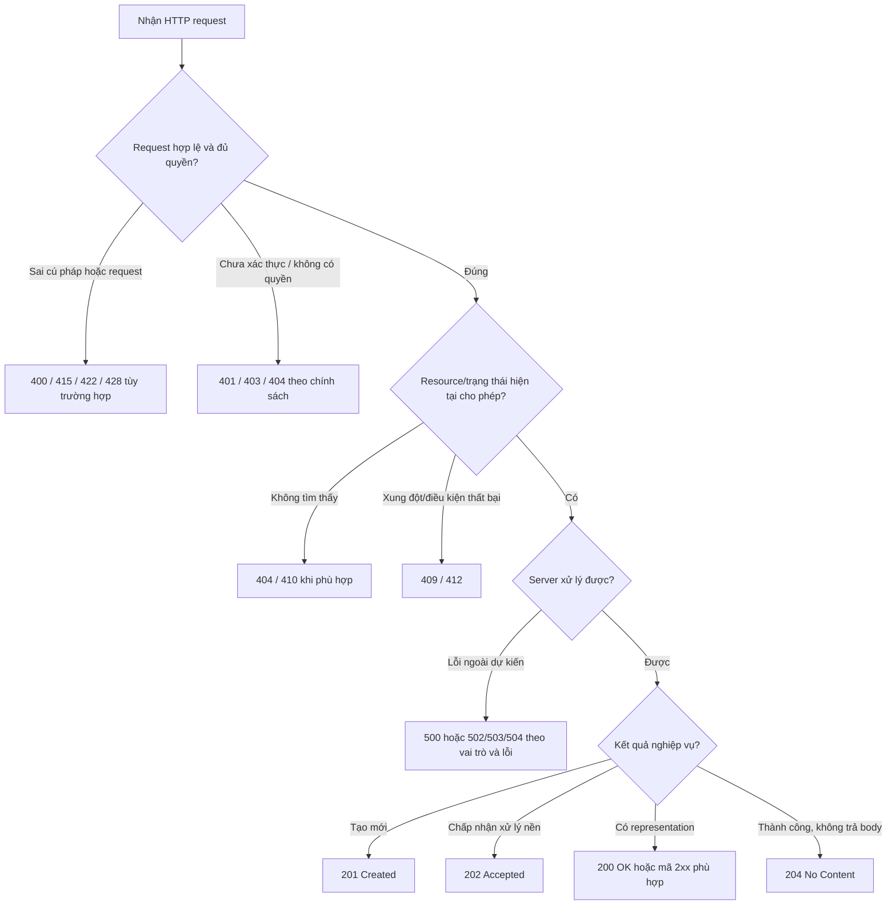
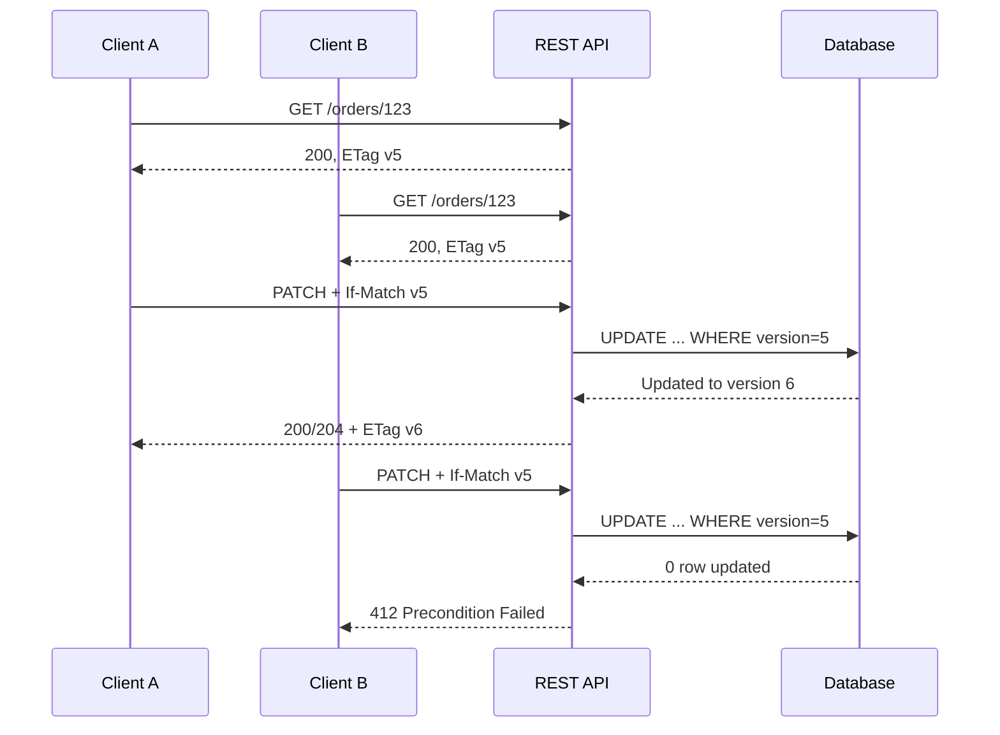

# Chọn status đúng và tránh biến mọi kết quả thành HTTP 200

## 1. Status code là một phần hợp đồng, không phải chi tiết trang trí

Trong một REST API, **HTTP status code** nói cho client, gateway, proxy, cache và hệ thống quan sát biết **kết quả xử lý yêu cầu ở cấp giao thức HTTP**. Phần thân (response body) cung cấp dữ liệu hoặc chi tiết bổ sung. Hai lớp thông tin cần **nhất quán**.

Một phản hồi như sau dễ gây hiểu nhầm:

```http
HTTP/1.1 200 OK
Content-Type: application/json

{
  "success": false,
  "code": "ORDER_NOT_FOUND",
  "message": "Không tìm thấy đơn hàng"
}
```

Client chỉ đọc status sẽ hiểu request **thành công**, trong khi payload tuyên bố lỗi. Dashboard dựa trên tỷ lệ `2xx` cũng có thể báo hệ thống khỏe; một số công cụ retry/caching/monitoring có thể xử lý sai. Hợp đồng API buộc mọi client kiểm tra thêm `success` và có thể đánh mất ý nghĩa chuẩn của HTTP.

Nếu client yêu cầu đọc một đơn hàng có ID cụ thể nhưng resource không tồn tại, phản hồi điển hình là:

```http
HTTP/1.1 404 Not Found
Content-Type: application/problem+json

{
  "type": "https://api.example.test/problems/order-not-found",
  "title": "Order not found",
  "status": 404,
  "detail": "Không tìm thấy đơn hàng được yêu cầu.",
  "code": "ORDER_NOT_FOUND"
}
```

**Status chính là kênh phân loại kết quả đầu tiên**. Dữ liệu lỗi có cấu trúc vẫn hữu ích, nhưng dùng để **làm rõ** status, không thay thế status.

Bài học thuộc chương **Mã trạng thái** của module **INTEGRATION_API_REST**: thiết kế REST dựa trên resource, URI, HTTP methods, hợp đồng dữ liệu; áp dụng phân trang, cache, idempotency, OpenAPI, xác thực, phân quyền, xử lý lỗi và kiểm thử với Java/Spring hoặc công nghệ tương đương.

### Mục tiêu học tập

Sau bài này, bạn có thể:

1. Chọn đúng nhóm và mã HTTP dựa trên **kết quả xử lý yêu cầu**.
2. Phân biệt một kết quả nghiệp vụ “không có dữ liệu” với lỗi HTTP; chọn `200`, `204`, `404` hoặc `422` có căn cứ.
3. Diễn đạt các luồng tạo resource, xử lý bất đồng bộ, điều kiện cập nhật và retry bằng status/header đúng.
4. Tránh mô hình `HTTP 200 + {"success":false}`; thiết kế response lỗi theo **Problem Details**.
5. Ánh xạ exception vào HTTP response bằng Spring, mô tả trong OpenAPI và viết kiểm thử hợp đồng.
6. Giải thích tác động của status đối với caching, retry, bảo mật, monitoring và vận hành.

## 2. Hiểu đúng năm nhóm status

HTTP status là một số nguyên có ba chữ số. **Chữ số đầu** xác định lớp phản hồi.

| Nhóm | Ý nghĩa tổng quát | Ví dụ | Điều client cần hiểu |
|---|---|---|---|
| **1xx — Informational** | Phản hồi trung gian, yêu cầu đang tiếp tục | `100 Continue`, `103 Early Hints` | Chưa phải kết quả cuối của yêu cầu |
| **2xx — Successful** | Yêu cầu đã được tiếp nhận, hiểu và xử lý thành công theo ý nghĩa tương ứng | `200 OK`, `201 Created`, `202 Accepted`, `204 No Content` | Xử lý kết quả thành công; chú ý 202 chưa hoàn tất |
| **3xx — Redirection** | Cần hành động/điều kiện để sử dụng URI khác hoặc nội dung cache | `301 Moved Permanently`, `303 See Other`, `304 Not Modified`, `307 Temporary Redirect` | Theo redirect/conditional caching khi thích hợp |
| **4xx — Client Error** | Yêu cầu không thể/không được xử lý theo trạng thái hoặc điều kiện từ phía client | `400 Bad Request`, `401 Unauthorized`, `404 Not Found`, `409 Conflict` | Sửa yêu cầu, xác thực, xử lý xung đột hoặc áp giới hạn retry |
| **5xx — Server Error** | Server không thực hiện được một yêu cầu mà lẽ ra hợp lệ | `500 Internal Server Error`, `503 Service Unavailable`, `504 Gateway Timeout` | Xử lý lỗi hệ thống, failover hoặc retry có giới hạn khi an toàn |

Tên nhóm chỉ là định hướng. Khi quyết định mã, cần xét **ý nghĩa cụ thể của từng mã**, HTTP method, resource hiện hành và điều kiện kiểm soát lỗi.

Ví dụ `404` không có nghĩa là máy chủ bị lỗi; có thể một đường dẫn/resource không tồn tại. `409` không có nghĩa JSON sai cú pháp; có thể dữ liệu hợp lệ nhưng mâu thuẫn với trạng thái resource. `503` không đồng nghĩa với mọi exception Java phát sinh.

### Không dựa vào câu chữ trong exception

Trong code, một phương thức có thể ném `IllegalArgumentException`, `OrderNotFoundException` hoặc `InventoryUnavailableException`. Tên exception chỉ hữu ích **sau khi** đã xác định ngữ nghĩa lỗi: client gửi sai, trạng thái nghiệp vụ xung đột, phụ thuộc tạm thời hỏng hay server gặp lỗi chưa dự kiến.

Ví dụ lỗi `IllegalArgumentException` do lỗi lập trình phía server tạo ra không nên được ánh xạ vô điều kiện thành `400`; làm vậy sẽ đổ lỗi cho client và che giấu lỗi hệ thống.

## 3. Quy trình chọn status từ kết quả thực sự



Sơ đồ chỉ là **công cụ suy luận**; một số điều kiện có thể xuất hiện theo thứ tự khác hoặc có status cụ thể hơn. Chẳng hạn `GET` với validator cache hợp lệ có thể nhận `304 Not Modified`, còn request có `Range` hợp lệ có thể nhận `206 Partial Content`.

Để chọn đúng, đặt câu hỏi theo thứ tự:

1. **Client yêu cầu điều gì?** Lấy dữ liệu, tạo mới, cập nhật, xóa, hay tạo công việc xử lý lâu?
2. **Yêu cầu có hợp lệ và được phép không?** Cú pháp, kiểu nội dung, authentication/authorization và điều kiện bắt buộc.
3. **Trạng thái hiện hành có đáp ứng điều kiện không?** Resource tồn tại, phiên bản khớp, quy tắc nghiệp vụ cho phép?
4. **Server đã hoàn tất điều gì?** Đã tạo resource, đã áp dụng thay đổi, chỉ mới nhận job hay chưa thể xử lý?
5. **Body và header cần nói gì?** `Location`, `ETag`, `Retry-After`, `WWW-Authenticate`, `Cache-Control`, kiểu lỗi?
6. **Client nên hành động thế nào?** Tiếp tục, đọc trạng thái, sửa dữ liệu, cấp credential, tải lại bản mới, đợi, hay retry an toàn?

## 4. Nhóm 2xx: phân biệt các kiểu thành công

### 4.1 — 200 OK: thành công và có nội dung phù hợp

`200 OK` thường dùng khi `GET` trả representation của một resource, hoặc `POST/PUT/PATCH` thành công và server trả kết quả trong body.

```http
GET /orders/123 HTTP/1.1
Host: api.example.test
Accept: application/json
```

```http
HTTP/1.1 200 OK
Content-Type: application/json
ETag: "order-v5"
Cache-Control: private, no-cache

{"id":"123","status":"PAID","totalMinor":850000}
```

**HTTP 200 là đúng khi thao tác HTTP thực sự thành công**, kể cả khi dữ liệu nghiệp vụ phản ánh trạng thái không lý tưởng. Ví dụ `GET /orders/123` trả đơn hàng có `"status":"PAYMENT_FAILED"` vẫn là `200` nếu client đã lấy thành công representation của đơn. `PAYMENT_FAILED` mô tả **trạng thái của resource**, không phải lỗi của thao tác GET.

Tương tự:

```http
GET /orders?status=PAID HTTP/1.1
```

```http
HTTP/1.1 200 OK
Content-Type: application/json

{"items":[],"totalItems":0}
```

Collection tồn tại và truy vấn hợp lệ nhưng **không có phần tử** thì thường trả `200 OK` với collection rỗng. Không nên mặc định `404` cho danh sách trống; `404` phù hợp hơn khi resource đích theo ID thực sự không có.

### 4.2 — 201 Created: resource đã được tạo

Khi `POST /orders` tạo đơn mới và server cấp ID:

```http
POST /orders HTTP/1.1
Content-Type: application/json

{"customerId":"42","items":[{"sku":"A1","quantity":1}]}
```

```http
HTTP/1.1 201 Created
Location: /orders/123
Content-Type: application/json

{"id":"123","status":"PENDING"}
```

`201 Created` cho biết một hoặc nhiều resource đã được tạo. `Location` xác định URI resource chính mới tạo khi phù hợp. Nếu `PUT /profiles/42` được phép tạo tại URI do client xác định và resource trước đó chưa tồn tại, một response `201` cũng có thể đúng. Do đó **không chọn 201 chỉ vì method là POST**.

Không trả `201` nếu quá trình chỉ mới **nhận yêu cầu tạo** mà chưa thực hiện tạo resource như hợp đồng công bố; trường hợp đó thường phù hợp hơn với `202 Accepted`.

### 4.3 — 202 Accepted: đã nhận, chưa hoàn tất

Khi xử lý báo cáo hay di chuyển dữ liệu mất nhiều thời gian:

```http
POST /export-jobs HTTP/1.1
Content-Type: application/json

{"month":"2026-10","format":"csv"}
```

```http
HTTP/1.1 202 Accepted
Location: /export-jobs/job-789
Content-Type: application/json
Retry-After: 5

{"jobId":"job-789","status":"QUEUED"}
```

`202` nghĩa là request **được chấp nhận để xử lý**, nhưng xử lý **có thể chưa bắt đầu hoặc chưa thành công**. Một resource job giúp client kiểm tra:

```text
GET /export-jobs/job-789
200 OK
{"jobId":"job-789","status":"FAILED","reason":"SOURCE_UNAVAILABLE"}
```

Ở đây `200` là đúng vì **lấy trạng thái job thành công**. `FAILED` là **trạng thái cuối của job**. Nếu thiết kế job phản hồi thêm kết quả lỗi/khôi phục thì cần mô tả rõ. Không đánh đồng `202` với “đã xử lý thành công”; client không được chỉ nhìn `202` rồi cho rằng báo cáo đã xuất xong.

### 4.4 — 204 No Content: thành công và không có body

Một thao tác xóa session hoàn tất mà không cần representation:

```http
DELETE /sessions/s-123 HTTP/1.1
```

```http
HTTP/1.1 204 No Content
```

`204` biểu thị xử lý thành công và **không có nội dung response**. Không gửi JSON như `{"success":true}` hoặc chuỗi rỗng được serialize trong response body của `204`.

`204` cũng dùng được khi `PUT/PATCH` thành công mà client không cần nhận representation mới; khi cần trả dữ liệu đã cập nhật, `200` với body phù hợp hơn.

### 4.5 — 205, 206 và những mã 2xx khác

- **205 Reset Content**: server yêu cầu client reset góc nhìn nhập liệu; response không có content. Không nên dùng làm mã trả thành công mặc định.
- **206 Partial Content**: trả một phần **representation theo range request** hợp lệ (chẳng hạn tải đoạn byte của tệp lớn), kèm các header Range/Content-Range thích hợp. **Không dùng 206 chỉ vì API phân trang**; danh sách `GET /orders?page=2` thường vẫn là `200`.
- **207 Multi-Status**: thuộc bối cảnh WebDAV, không phải lựa chọn chung để gói mọi kết quả batch REST khác nhau. Nếu API batch cần trạng thái từng item, phải định nghĩa hợp đồng rõ ràng và xem xét ngữ nghĩa phương thức, phản hồi tổng thể và khả năng retry.

## 5. Nhóm 3xx: redirect và cache có điều kiện

Các status `3xx` cũng mang ý nghĩa mà client/proxy có thể tự xử lý. Không nên biến mọi redirect thành body `200` chứa `{"redirectTo":"/new"}` trừ khi API có lý do nghiệp vụ để trả dữ liệu cấu hình.

| Mã | Dùng khi | Điều cần lưu ý |
|---|---|---|
| `301 Moved Permanently` | Resource chuyển URI lâu dài | Client có thể ghi nhớ redirect; thay đổi method ở một số client lịch sử có thể phức tạp |
| `302 Found` | Redirect tạm thời | Một số client có hành vi đổi POST sang GET theo lịch sử |
| `303 See Other` | Hướng client xem kết quả ở một URI khác, thường bằng GET | Hữu ích sau POST khi cần chuyển sang resource kết quả |
| `307 Temporary Redirect` | Redirect tạm thời **giữ nguyên method** | Cần xử lý việc gửi lại body và idempotency với request có tác dụng phụ |
| `308 Permanent Redirect` | Redirect lâu dài **giữ nguyên method** | Cân nhắc tương thích và hành vi cache |
| `304 Not Modified` | Điều kiện cache của GET/HEAD cho thấy representation chưa đổi | **Không trả response body**; hỗ trợ dùng bản đã cache |

Ví dụ conditional GET:

```http
GET /orders/123 HTTP/1.1
If-None-Match: "order-v5"
```

```http
HTTP/1.1 304 Not Modified
ETag: "order-v5"
Cache-Control: private, no-cache
```

Response này **không phải lỗi**. Client đã có bản cache tương ứng có thể dùng lại representation sau khi revalidation thành công. Không cần gửi lại JSON body; không thay `304` bằng `200 {"unchanged":true}`.

Việc cache còn phụ thuộc `Cache-Control`, `Vary`, chính sách xác thực, dữ liệu nhạy cảm và các quy tắc HTTP khác. `304` không tự cho phép cache công khai dữ liệu riêng tư.

## 6. Nhóm 4xx: request không đáp ứng điều kiện của API

Phân biệt các lỗi theo **điều client phải thay đổi để thành công**. Một chuỗi điều kiện chung như “nếu lỗi thì trả 400” khiến client khó biết nên sửa payload, đăng nhập hay tải lại trạng thái mới.

### 6.1 — 400 Bad Request và 422 Unprocessable Content

`400 Bad Request` thường phù hợp khi request sai cú pháp hoặc cấu trúc, ví dụ JSON không parse được hoặc tham số không đúng định dạng:

```http
POST /orders HTTP/1.1
Content-Type: application/json

{"quantity":
```

```http
HTTP/1.1 400 Bad Request
Content-Type: application/problem+json

{"type":"about:blank","title":"Bad Request","status":400,"detail":"JSON không hợp lệ."}
```

`422 Unprocessable Content` phù hợp khi server hiểu media type và cú pháp nội dung nhưng **không thể xử lý các chỉ dẫn trong nội dung**, ví dụ số lượng âm, trường nghiệp vụ mâu thuẫn, hoặc dữ liệu không đáp ứng ràng buộc đã công bố:

```http
HTTP/1.1 422 Unprocessable Content
Content-Type: application/problem+json

{
  "type": "https://api.example.test/problems/validation",
  "title": "Validation failed",
  "status": 422,
  "detail": "Một số trường không hợp lệ.",
  "code": "VALIDATION_FAILED",
  "errors": [
    {"field":"items[0].quantity","message":"Phải lớn hơn 0"}
  ]
}
```

Không có quy định mọi lỗi Bean Validation phải dùng `422`. Một số API dùng `400` nhất quán cho cả request validation; điều quan trọng là **quy tắc có căn cứ, được tài liệu hóa và client phân biệt được** lỗi payload với lỗi trạng thái hệ thống. Ví dụ lỗi `quantity` có thể là 422, còn truy cập không được phép vào sản phẩm là 403/404.

### 6.2 — 401 Unauthorized: thiếu hoặc sai thông tin xác thực

Dù tên chuẩn chứa “Unauthorized”, `401` về mặt HTTP chủ yếu báo client cần **thông tin xác thực hợp lệ** cho resource.

```http
HTTP/1.1 401 Unauthorized
WWW-Authenticate: Bearer realm="orders"
Content-Type: application/problem+json

{"type":"about:blank","title":"Unauthorized","status":401}
```

Response `401` cần có `WWW-Authenticate` với challenge áp dụng. Client có thể đăng nhập lại, làm mới token theo quy trình được phép hoặc gửi credential phù hợp. Không nên trả `200 {"message":"Token expired"}` cho endpoint được bảo vệ.

### 6.3 — 403 Forbidden: đã nhận diện nhưng không được phép

Khi client có danh tính hợp lệ nhưng không có quyền hủy đơn hàng:

```http
HTTP/1.1 403 Forbidden
Content-Type: application/problem+json

{"type":"about:blank","title":"Forbidden","status":403}
```

`403` nói server hiểu request nhưng từ chối thực hiện. **Không nên khuyến nghị retry y nguyên** để khắc phục. Trong trường hợp cần che giấu sự tồn tại của resource nhạy cảm, server có thể dùng `404` thay vì tiết lộ rằng resource đó tồn tại.

### 6.4 — 404 Not Found và 410 Gone

`GET /orders/unknown-id` thường trả `404` khi không có representation đáp ứng ở resource đích. `404` không khẳng định resource sẽ không tồn tại trong tương lai. `410 Gone` có thể được dùng khi server biết resource từng tồn tại nhưng giờ đã biến mất và tình trạng đó có tính lâu dài.

**Cần phân biệt**:

- `GET /orders/123` khi ID không tồn tại → thường `404`.
- `GET /orders?status=PAID` nhưng không có item → thường `200` với `[]`/collection rỗng.
- `GET /orders/123` thấy `"status":"CANCELLED"` → vẫn `200` nếu resource tồn tại và GET thành công.
- `POST /orders/123/cancel-requests` khi resource đích theo cha không tồn tại → thường `404`.
- Người dùng không có quyền biết đơn khác tồn tại → có thể trả `404` nhằm tránh lộ thông tin.

Không dùng `404` chỉ vì một business query trả “không có gợi ý sản phẩm”; tùy hợp đồng, đây có thể là kết quả hợp lệ `200` với tập gợi ý rỗng.

### 6.5 — 405 Method Not Allowed

Nếu `/orders/123` hỗ trợ `GET` nhưng không cho `DELETE`:

```http
DELETE /orders/123 HTTP/1.1
```

```http
HTTP/1.1 405 Method Not Allowed
Allow: GET, HEAD, PATCH
```

`405` nói **resource đích có mặt nhưng không hỗ trợ method đã gửi**. Trường `Allow` phải mô tả các method được hỗ trợ ở resource tương ứng theo quy tắc HTTP. Phân biệt với `404` cho URI/resource không tồn tại, cũng như `403` khi method được hỗ trợ nhưng client hiện tại không được quyền dùng.

### 6.6 — 406 Not Acceptable và 415 Unsupported Media Type

- **406 Not Acceptable**: server không thể cung cấp representation thỏa điều kiện thương lượng nội dung từ `Accept` và không chọn cung cấp representation mặc định thay thế.
- **415 Unsupported Media Type**: payload dùng media type hoặc content coding mà endpoint không hỗ trợ; ví dụ endpoint chỉ nhận JSON Patch lại được gửi `application/xml`.

```http
PATCH /users/42 HTTP/1.1
Content-Type: text/plain

email=false
```

```http
HTTP/1.1 415 Unsupported Media Type
Content-Type: application/problem+json

{"type":"about:blank","title":"Unsupported Media Type","status":415}
```

Không map mọi lỗi parse JSON thành `415` nếu media type đã được chấp nhận nhưng nội dung sai cú pháp; trong trường hợp đó `400` thường hợp lý.

### 6.7 — 409 Conflict: trạng thái resource mâu thuẫn với thao tác

Ví dụ đơn đã giao nên không thể hủy:

```http
POST /orders/123/cancellation-requests HTTP/1.1
Content-Type: application/json

{"reason":"CUSTOMER_REQUEST"}
```

```http
HTTP/1.1 409 Conflict
Content-Type: application/problem+json

{
  "type": "https://api.example.test/problems/order-state-conflict",
  "title": "Order state conflict",
  "status": 409,
  "detail": "Không thể yêu cầu hủy khi đơn đã giao.",
  "code": "ORDER_ALREADY_DELIVERED"
}
```

`409` phù hợp với xung đột do **trạng thái hiện tại của resource**. Nó hữu ích khi client cần đọc trạng thái mới, hỏi lại người dùng hoặc thay đổi luồng nghiệp vụ. Không nên dùng `409` cho mọi dữ liệu không hợp lệ; payload sai trường vẫn có thể là `400/422`.

Ví dụ tạo tài nguyên với ID duy nhất đã tồn tại có thể là `409`; nếu API hỗ trợ idempotency key và phát hiện đúng một lần gửi lại của cùng thao tác, server có thể trả lại kết quả trước đó theo hợp đồng, **không nhất thiết trả 409**.

### 6.8 — 412 Precondition Failed và 428 Precondition Required

Hai client cùng đọc resource phiên bản v1. A cập nhật thành v2; B thử ghi dựa trên v1:

```http
PATCH /orders/123 HTTP/1.1
Content-Type: application/merge-patch+json
If-Match: "order-v1"

{"deliveryAddress":"Địa chỉ B"}
```

```http
HTTP/1.1 412 Precondition Failed
Content-Type: application/problem+json

{"type":"about:blank","title":"Precondition Failed","status":412}
```

**412** là phản hồi khi điều kiện HTTP (`If-Match` chẳng hạn) **không đúng**. Nếu server yêu cầu mọi request sửa phải mang điều kiện mà client không cung cấp, có thể trả **428 Precondition Required**.

Chỉ gửi header không đủ: kiểm tra version/ETag và ghi dữ liệu cần là **một thao tác nguyên tử** ở tầng lưu trữ để ngăn lost update.

`409` và `412` đều có thể liên quan đến xung đột, nhưng `412` chính xác hơn khi lỗi xuất phát từ **precondition trong header**. Khi business rule như “đơn đã giao không thể hủy” bị vi phạm, `409` thường diễn đạt rõ hơn.

### 6.9 — 429 Too Many Requests

Khi client vượt giới hạn yêu cầu:

```http
HTTP/1.1 429 Too Many Requests
Retry-After: 30
Content-Type: application/problem+json

{
  "type": "https://api.example.test/problems/rate-limited",
  "title": "Rate limit exceeded",
  "status": 429,
  "code": "RATE_LIMITED"
}
```

`Retry-After` có thể là số giây hoặc ngày giờ hợp lệ; đây là gợi ý **khi nào client nên thử lại**, không đảm bảo lần thử tiếp theo thành công. Hạn mức và chính sách backoff cần được công bố rõ. Nếu cả dịch vụ quá tải hoặc đang bảo trì, `503 Service Unavailable` thường phù hợp hơn `429` theo chính sách giới hạn của một client.

## 7. Nhóm 5xx: lỗi khi server không thực hiện được yêu cầu

**Không bọc 5xx thành 200** chỉ để tránh client nhìn thấy lỗi. Điều đó phá vỡ chỉ số khả dụng, giám sát sự cố và nhiều cơ chế xử lý lỗi của hạ tầng.

| Mã | Khi nào phù hợp | Cách phản ứng |
|---|---|---|
| **500 Internal Server Error** | Server gặp tình huống bất ngờ, không có mã chuyên biệt hơn | Ghi trace, không lộ stack trace; điều tra lỗi |
| **501 Not Implemented** | Server không hỗ trợ chức năng cần để thực hiện request theo nghĩa của mã, thường liên quan method chưa được nhận diện/hỗ trợ rộng | Đừng dùng thay `405` cho method đã biết nhưng không được phép tại một URI |
| **502 Bad Gateway** | Thành phần đóng vai trò gateway/proxy nhận phản hồi không hợp lệ từ upstream | Phân tích dependency, xử lý retry có kiểm soát |
| **503 Service Unavailable** | Dịch vụ tạm thời không sẵn sàng do bảo trì/quá tải hoặc tình huống tương tự | Có thể kèm `Retry-After`; cân nhắc backoff/failover |
| **504 Gateway Timeout** | Gateway/proxy không nhận được phản hồi upstream kịp thời | Kiểm tra deadline/retry; không tự phát lại side effect thiếu idempotency |

Một HTTP service gọi API bên ngoài rồi timeout cần xác định **vai trò** và hợp đồng của nó. Nếu thực sự là gateway/proxy chờ upstream, `504` có thể phù hợp; nếu ứng dụng xử lý nghiệp vụ trực tiếp và phụ thuộc hiện không sẵn sàng, `503` có thể hợp lý. Không có quy tắc máy móc “mọi dependency timeout đều phải trả 504”.

### Không làm lộ chi tiết hạ tầng trong lỗi 5xx

Sai:

```json
{
  "success": false,
  "error": "SQLException at com.shop.internal.OrderDao:114; password=..."
}
```

Tốt hơn:

```http
HTTP/1.1 500 Internal Server Error
Content-Type: application/problem+json

{
  "type": "https://api.example.test/problems/internal",
  "title": "Internal Server Error",
  "status": 500,
  "detail": "Không thể hoàn thành yêu cầu vào lúc này.",
  "code": "INTERNAL_ERROR",
  "traceId": "req-8c91"
}
```

Stack trace, thông tin kết nối, SQL, token và dữ liệu cá nhân phải được bảo vệ trong log/telemetry theo chính sách, không gửi về client. `traceId` cho phép hỗ trợ tìm sự cố mà không tiết lộ nội dung nhạy cảm.

## 8. Bảng tra chọn status theo HTTP method và tình huống

| Method / thao tác | Kết quả | Status thường phù hợp |
|---|---|---|
| `GET /orders/123` | Resource tồn tại, trả JSON | **200** |
| `GET /orders/123` | ID không tồn tại hoặc phải che giấu | **404** |
| `GET /orders?status=NEW` | Truy vấn hợp lệ, danh sách trống | **200** + collection rỗng |
| `GET /orders/123` với validator | Nội dung không đổi với `If-None-Match` | **304** |
| `HEAD /files/guide.pdf` | Metadata hợp lệ, không body | **200** hoặc mã tương ứng |
| `POST /orders` | Tạo đơn và cấp URI | **201** + `Location` |
| `POST /report-jobs` | Đưa việc vào hàng đợi | **202** + cách kiểm tra job |
| `POST /payments` | Payload đúng nhưng vi phạm điều kiện nghiệp vụ | **409** hoặc **422** theo nguồn lỗi/hợp đồng |
| `PUT /profiles/42` | Tạo tại URI xác định | **201** |
| `PUT /profiles/42` | Thay thế thành công, trả representation | **200** |
| `PUT /profiles/42` | Thay thế thành công, không trả body | **204** |
| `PATCH /orders/123` | Thay đổi thành công, không body | **204** |
| `PATCH /orders/123` | `If-Match` đã lỗi thời | **412** |
| `PATCH /orders/123` | Thiếu `If-Match` bắt buộc | **428** |
| `DELETE /sessions/s-123` | Xóa thành công, không body | **204** |
| `DELETE /objects/9` | Đã nhận yêu cầu xóa nền | **202** |
| Bất kỳ endpoint được bảo vệ | Không có credential hợp lệ | **401** + `WWW-Authenticate` |
| Bất kỳ endpoint được bảo vệ | Không có quyền thực hiện | **403** hoặc **404** khi cần ẩn |
| Gửi method không hỗ trợ ở resource tồn tại | `PUT` tới URI chỉ đọc | **405** + `Allow` |
| Gửi body kiểu không được hỗ trợ | XML tới endpoint chỉ nhận JSON | **415** |
| Gửi quá nhiều request | Vượt quota/rate limit | **429** |
| Lỗi nội bộ chưa dự kiến | Null dereference, xử lý exception không mong muốn | **500** |
| Dịch vụ tạm ngừng/quá tải | Không thể xử lý ngay | **503** |
| Gateway chờ upstream quá hạn | Timeout giữa các tầng proxy | **504** |

**Bảng không có nghĩa mỗi endpoint phải hỗ trợ tất cả các trường hợp.** Hợp đồng cần chọn tập status thực sự có thể trả, dựa trên resource, business rule và hành vi triển khai.

## 9. Lỗi nghiệp vụ và lỗi HTTP: tránh hai cực đoan

Có hai kiểu thiết kế lệch thường gặp.

**Cực đoan 1: Mọi kết quả đều HTTP 200.**

```http
HTTP/1.1 200 OK
Content-Type: application/json

{"success":false,"errorCode":"INSUFFICIENT_STOCK"}
```

Nếu client đang **yêu cầu tạo đơn hàng** và server từ chối vì hàng tồn không đủ, HTTP request **không đạt ý định tạo đơn**. Một response `409 Conflict` hoặc `422 Unprocessable Content` được chọn theo hợp đồng sẽ phản ánh thực tế rõ hơn, kèm mã `INSUFFICIENT_STOCK` trong body lỗi.

**Cực đoan 2: Mọi trạng thái nghiệp vụ không thuận lợi đều HTTP lỗi.**

```http
GET /orders/123 HTTP/1.1
```

```http
HTTP/1.1 200 OK
Content-Type: application/json

{"id":"123","status":"REJECTED","rejectionReason":"PAYMENT_DECLINED"}
```

Đây là **thành công HTTP**: đã lấy được trạng thái đơn hàng. Nếu thay bằng `500` hoặc `409` chỉ vì `status=REJECTED`, API mất khả năng mô tả resource đúng nghĩa.

### Ba câu hỏi phân biệt

1. **Operation của request là gì?** Đọc resource hay yêu cầu thay đổi?
2. **Operation có được thực hiện như hợp đồng hay bị từ chối?** Đọc thành công một trạng thái “FAILED” vẫn là thành công; yêu cầu tạo bị từ chối do quy tắc thì không.
3. **Client nên làm gì?** Tiếp tục hiển thị trạng thái, chỉnh payload, đăng nhập, xử lý conflict hay retry sau?

Một resource job ở trạng thái `FAILED` thường được đọc bằng `GET → 200`; một request **tạo job** thất bại do payload sai cần `4xx`, do server không thực thi được cần `5xx`. Sự khác nhau nằm ở **request đang được xử lý**, không nằm ở một từ “FAILED”.

## 10. Empty result, not found, conflict và validation: tình huống biên

| Tình huống | Cách hiểu | Status thường phù hợp |
|---|---|---|
| Tìm kiếm danh sách không có kết quả | Tập resource hợp lệ, truy vấn thành công | `200` với `[]`/danh sách rỗng |
| Lấy resource cụ thể theo ID sai | Resource được định danh không tồn tại | `404` |
| Tài nguyên từng tồn tại, biết đã biến mất lâu dài | Trạng thái đã mất vĩnh viễn theo server | Có thể `410` |
| Gửi số lượng `-1` | Payload không đáp ứng ràng buộc nội dung | `400` hoặc `422` tùy hợp đồng |
| Gửi JSON sai dấu ngoặc | Không thể parse cú pháp | `400` |
| Cập nhật đơn đã giao thành `PENDING` | Xung đột trạng thái nghiệp vụ | `409` |
| Ghi bản cũ với `If-Match` | Precondition sai | `412` |
| Thiếu header đồng thời bắt buộc | API yêu cầu precondition | `428` |
| Gửi token hết hạn | Chưa có xác thực hợp lệ | `401` |
| User không có quyền truy cập resource | Request bị từ chối | `403` hoặc `404` để ẩn |
| Tải báo cáo đã tạo và sẵn sàng | Đọc representation được phép | `200` hoặc `206` khi có range request hợp lệ |
| Job báo cáo đã chạy xong nhưng kết quả rỗng | Trạng thái job/không có dòng báo cáo là dữ liệu nghiệp vụ | `200` với trạng thái/dữ liệu phù hợp |
| Đặt hàng đã tạo nhưng thanh toán chờ xác nhận | Resource đơn tồn tại, trạng thái giao dịch chưa xong | `201` tạo đơn hoặc `202` nếu chỉ nhận xử lý, tùy hợp đồng |

Cần phân biệt **không có dữ liệu** với **không có resource**. Client có thể lọc danh sách ra rỗng; đó là kết quả bình thường. Nhưng `GET /orders/id-sai` không thể tạo representation của resource được yêu cầu.

## 11. Problem Details: chuẩn hóa response lỗi mà không phá vỡ status

**Problem Details for HTTP APIs (RFC 9457)** cung cấp cấu trúc phổ biến cho response lỗi, thường với media type `application/problem+json`. Những trường cơ bản:

- `type`: URI định danh loại vấn đề; `about:blank` biểu thị vấn đề chung gắn với status HTTP.
- `title`: tiêu đề ngắn cho loại vấn đề.
- `status`: mã HTTP liên quan tới vấn đề; phải nhất quán với status response trong tình huống thông thường.
- `detail`: mô tả cụ thể sự cố cho trường hợp hiện tại.
- `instance`: URI tham chiếu lần xuất hiện vấn đề cụ thể, khi hữu ích.

Các trường mở rộng như `code`, `traceId`, `errors` là **hợp đồng của API**, không phải thành phần chuẩn bắt buộc. Ví dụ:

```http
HTTP/1.1 422 Unprocessable Content
Content-Type: application/problem+json

{
  "type": "https://api.example.test/problems/validation",
  "title": "Validation failed",
  "status": 422,
  "detail": "Request chứa dữ liệu không hợp lệ.",
  "instance": "/problems/occurrences/req-8c91",
  "code": "VALIDATION_FAILED",
  "traceId": "req-8c91",
  "errors": [
    {"field":"items[0].quantity","message":"Phải lớn hơn 0"},
    {"field":"shippingAddress.zip","message":"Không đúng định dạng"}
  ]
}
```

**Không dùng `status: 422` trong body nhưng HTTP status là 200.** Điều đó khiến hai tầng thông tin mâu thuẫn.

### Quy tắc thiết kế lỗi có ích cho client

1. **Mỗi lỗi có status đúng và mã lỗi ứng dụng ổn định.** `status` dành cho xử lý HTTP; `code` giúp hiển thị/thực hiện logic nghiệp vụ cụ thể.
2. **`type` định danh loại lỗi**, nên ổn định và có tài liệu mô tả, nhất là khi client công khai phụ thuộc.
3. **`detail` dành cho con người**, có thể thay đổi nội dung/ngôn ngữ; client không nên parse chuỗi `detail` để phân nhánh logic.
4. **Không đưa stack trace, SQL, nội dung token hoặc PII** vào error response.
5. **Giữ trace/correlation ID** để tìm log tương ứng; bảo vệ log theo chính sách.
6. **Không tùy tiện ánh xạ mọi exception thành `200` hay `400`**. Lỗi không được dự kiến nên được nhận diện, ghi nhận và phản hồi phù hợp.

### Có cần envelope chung cho thành công và lỗi?

API có thể chọn cấu trúc nhất quán cho dữ liệu thành công, ví dụ:

```json
{"data":{"id":"123","status":"PAID"},"meta":{"traceId":"req-123"}}
```

Nhưng không vì có `data`/`meta` mà phải bọc lỗi thành `200`. Một cách đơn giản:

- Thành công: status `2xx` với representation của resource (hoặc `204` không body).
- Lỗi: status `4xx/5xx` và body `application/problem+json`.
- Các mã `304`, `1xx` và những trường hợp không có body tuân thủ quy tắc riêng của HTTP.

## 12. Status, caching và tính nhất quán

Một sai lầm khi biến lỗi thành `200` là **cache có thể lưu phản hồi lỗi như một representation thành công** tùy header và chính sách. Điều này đặc biệt nguy hiểm với dữ liệu riêng tư và các lỗi tạm thời.

- **200** với GET có thể được cache nếu điều kiện cache cho phép; cần thiết kế `Cache-Control` và `Vary`.
- **304** là phản hồi xác thực cache, không có body, sử dụng cùng validator thích hợp.
- **404** và **410** có thể có khả năng cache theo quy tắc HTTP; cần kiểm soát thời hạn khi resource có thể xuất hiện hoặc thay đổi.
- **429** và **503** cần thể hiện tình trạng giới hạn/tạm thời rõ, có thể kèm `Retry-After`; không giả định các lỗi này luôn cache được.
- **204** và **304** không có response body; client không nên mong JSON.
- Dữ liệu cần xác thực/nhạy cảm phải được cấu hình cache thận trọng, đặc biệt với bộ nhớ đệm dùng chung.

Ví dụ hóa đơn nhạy cảm:

```http
HTTP/1.1 200 OK
Content-Type: application/json
Cache-Control: private, no-store

{"id":"invoice-99","customerId":"42","amountMinor":600000}
```

`Cache-Control: no-store` yêu cầu cache không lưu response; `private` giới hạn dùng chung khi được cache. Chính sách cụ thể phải phù hợp rủi ro của dữ liệu và yêu cầu vận hành.

## 13. Status, retry và idempotency

Không phải cứ gặp lỗi `5xx` là client có thể phát lại request. Một `POST /payments` có thể **đã thu tiền** nhưng response bị mất, hoặc server trả lỗi do bước ghi nhận trạng thái phụ thất bại. Retry mù quáng có nguy cơ thu tiền hai lần.

### Quy tắc thực tế

| Response / tình huống | Hành động client thường phù hợp | Điều kiện |
|---|---|---|
| `400/422` | Sửa request theo lỗi trả về | Không tự retry y nguyên |
| `401` | Xác thực/lấy token mới theo cơ chế hợp lệ | Tránh vòng lặp refresh token |
| `403/404` | Không retry y nguyên để “chữa lỗi” | Có thể cần cập nhật quyền hoặc resource |
| `409` | Đọc lại trạng thái, xử lý conflict hoặc thay đổi nghiệp vụ | Không retry mù quáng |
| `412` | GET trạng thái/ETag mới, quyết định cập nhật lại | Không ghi đè thay đổi người khác |
| `429` | Tôn trọng `Retry-After`, backoff và hạn mức | Tránh thác retry |
| `503` | Backoff, failover hoặc hiển thị tạm gián đoạn | Chỉ retry khi an toàn về ngữ nghĩa |
| `502/504` | Phân biệt lỗi gateway; kiểm tra deadline | POST có side effect cần idempotency |
| Mất kết nối/timeout trước response | Không biết server đã xử lý chưa | Không suy luận “chưa xử lý” từ thiếu response |

### Dùng idempotency key cho thao tác có tác dụng phụ

```http
POST /payments HTTP/1.1
Content-Type: application/json
Idempotency-Key: payment-order-123-01

{"orderId":"123","amountMinor":850000,"currency":"VND"}
```

Cơ chế chống xử lý lặp nên gắn key với danh tính/tenant/phạm vi thao tác và nội dung request; lưu trạng thái bền vững, bảo đảm đồng bộ và xác định hành vi khi key lặp nhưng payload khác. Khi gặp request giống hệt, server nên trả lại kết quả theo hợp đồng đã công bố thay vì tạo thanh toán mới. Khi payload thay đổi với cùng key, có thể trả `409 Conflict` hoặc mã lỗi phù hợp được tài liệu hóa.

**Không có status code nào tự bảo đảm exactly-once** xuyên các hệ thống. Idempotency, outbox/reconciliation và chính sách xử lý sự cố phải được triển khai ở tầng ứng dụng/giao dịch, đặc biệt với thanh toán hoặc kho vận.

## 14. Cập nhật đồng thời: 409 khác 412

Với REST API nhiều client cùng cập nhật, một lỗi rất phổ biến là **lost update**. Cần phân biệt:

- **409 Conflict**: thao tác xung đột với trạng thái/luật nghiệp vụ hiện hành. Ví dụ yêu cầu hủy đơn đã giao.
- **412 Precondition Failed**: điều kiện HTTP gửi trong request không thỏa mãn. Ví dụ `If-Match: "order-v5"` trong khi resource hiện là v6.
- **428 Precondition Required**: server bắt buộc dùng conditional request mà client chưa cung cấp điều kiện.



`ETag` có thể dùng để liên kết trạng thái đã đọc với lần ghi; không nhất thiết là chuỗi số version. Với `If-Match`, cần dùng validator phù hợp và cập nhật dữ liệu nguyên tử. Không chỉ so sánh chuỗi ETag trong controller rồi ghi dữ liệu bằng một câu SQL khác không có điều kiện vì có thể tạo race condition.

## 15. Thiết kế lỗi với Java/Spring

Spring MVC hỗ trợ truyền status qua `ResponseEntity`, annotation và cơ chế xử lý exception. Với Spring Framework 6 / Spring Boot 3, lớp **`ProblemDetail`** hỗ trợ biểu diễn lỗi theo mô hình Problem Details.

### 15.1 Controller trả kết quả đúng ngữ nghĩa

```java
import java.net.URI;
import java.util.UUID;
import org.springframework.http.ResponseEntity;
import org.springframework.web.bind.annotation.*;

@RestController
@RequestMapping("/orders")
class OrderController {
    private final OrderService orders;

    OrderController(OrderService orders) {
        this.orders = orders;
    }

    @GetMapping("/{id}")
    ResponseEntity<OrderView> get(@PathVariable UUID id) {
        OrderView order = orders.findById(id); // ném OrderNotFoundException
        return ResponseEntity.ok().eTag(order.etag()).body(order);
    }

    @PostMapping
    ResponseEntity<OrderView> create(
            @RequestBody CreateOrderRequest request) {
        OrderView order = orders.create(request);
        return ResponseEntity
                .created(URI.create("/orders/" + order.id()))
                .body(order);
    }

    @DeleteMapping("/{id}")
    ResponseEntity<Void> delete(@PathVariable UUID id) {
        orders.delete(id);
        return ResponseEntity.noContent().build();
    }
}
```

Điểm đáng chú ý:

- `GET` tồn tại → `200`; resource không tồn tại → service ném exception để advice trả `404`.
- `POST` tạo resource → `201` và `Location`.
- `DELETE` thành công, không cần body → `204`.
- Không có nhánh nào trả `200` với body `success:false`.

Các kiểu `OrderService`, `OrderView`, `CreateOrderRequest` và exception là abstraction minh họa cần triển khai riêng. Trong ứng dụng thật còn phải xác thực, kiểm tra quyền resource, validate DTO, quản lý transaction và lựa chọn response cho resource đã bị xóa.

### 15.2 Mapping exception thành ProblemDetail

```java
import java.net.URI;
import org.springframework.http.HttpStatus;
import org.springframework.http.MediaType;
import org.springframework.http.ProblemDetail;
import org.springframework.http.ResponseEntity;
import org.springframework.web.bind.annotation.ExceptionHandler;
import org.springframework.web.bind.annotation.RestControllerAdvice;

@RestControllerAdvice
class ApiExceptionHandler {

    @ExceptionHandler(OrderNotFoundException.class)
    ResponseEntity<ProblemDetail> onNotFound(OrderNotFoundException ex) {
        ProblemDetail p = ProblemDetail.forStatusAndDetail(
                HttpStatus.NOT_FOUND,
                "Không tìm thấy đơn hàng được yêu cầu."
        );
        p.setTitle("Order not found");
        p.setType(URI.create(
                "https://api.example.test/problems/order-not-found"));
        p.setProperty("code", "ORDER_NOT_FOUND");

        return ResponseEntity.status(HttpStatus.NOT_FOUND)
                .contentType(MediaType.valueOf("application/problem+json"))
                .body(p);
    }

    @ExceptionHandler(OrderStateConflictException.class)
    ResponseEntity<ProblemDetail> onConflict(
            OrderStateConflictException ex) {
        ProblemDetail p = ProblemDetail.forStatusAndDetail(
                HttpStatus.CONFLICT,
                "Trạng thái đơn hàng không cho phép thao tác này."
        );
        p.setTitle("Order state conflict");
        p.setType(URI.create(
                "https://api.example.test/problems/order-state-conflict"));
        p.setProperty("code", "ORDER_STATE_CONFLICT");

        return ResponseEntity.status(HttpStatus.CONFLICT)
                .contentType(MediaType.valueOf("application/problem+json"))
                .body(p);
    }
}
```

Đây là ví dụ tổ chức mã theo khái niệm; để chạy thực tế phải định nghĩa exception và service, kiểm tra xử lý validation/authentication/security, các cấu hình Spring phiên bản đang dùng và exception từ lớp hạ tầng. Không tự động phát sinh response `422` cho tất cả lỗi `@Valid` nếu chưa cấu hình handler.

### 15.3 Tránh handler toàn cục trả 200

Thiết kế sai:

```java
@ExceptionHandler(Exception.class)
ResponseEntity<?> handleAny(Exception ex) {
    return ResponseEntity.ok(
        java.util.Map.of("success", false, "message", ex.getMessage()));
}
```

Bất kỳ lỗi nào cũng bị chuyển thành HTTP success, từ ngoại lệ validation đến kết nối database. Tệ hơn, trả `ex.getMessage()` có thể làm lộ dữ liệu nhạy cảm.

Nếu có handler dự phòng cho lỗi chưa dự kiến, nên:

1. Ghi log có kiểm soát với trace/correlation ID và bảo vệ PII.
2. Trả `500` hoặc mã phù hợp theo nguồn lỗi, với ProblemDetail chung không lộ thông tin nội bộ.
3. Cho framework/Spring Security xử lý đúng các lỗi xác thực, quyền, media type và validation theo thiết kế.
4. Đảm bảo status nằm ở HTTP response thực tế; không chỉ nằm trong DTO.

Ví dụ định hướng xử lý fallback (cần ghép vào exception mapping hiện hữu một cách thận trọng):

```java
@ExceptionHandler(UnexpectedServiceException.class)
ResponseEntity<ProblemDetail> onUnexpected(
        UnexpectedServiceException ex) {
    ProblemDetail p = ProblemDetail.forStatusAndDetail(
            HttpStatus.INTERNAL_SERVER_ERROR,
            "Không thể hoàn thành yêu cầu."
    );
    p.setProperty("code", "INTERNAL_ERROR");
    return ResponseEntity
            .status(HttpStatus.INTERNAL_SERVER_ERROR)
            .contentType(MediaType.valueOf("application/problem+json"))
            .body(p);
}
```

Một exception tùy chỉnh ở đây chỉ đại diện cho lỗi server không dự kiến. Không nên tạo `@ExceptionHandler(Exception.class)` mà không hiểu thứ tự các handler và đặc biệt là cơ chế exception của security filter.

## 16. OpenAPI: công bố status và schema để client hiểu đúng

OpenAPI nên liệt kê **status thực sự có thể trả**, bao gồm thành công, lỗi validation, không tìm thấy, xung đột, xác thực và những lỗi hệ thống cần thiết. Ví dụ tài liệu tối giản:

```yaml
paths:
  /orders/{orderId}:
    get:
      summary: Lấy đơn hàng
      parameters:
        - name: orderId
          in: path
          required: true
          schema:
            type: string
      responses:
        "200":
          description: Lấy đơn hàng thành công
          content:
            application/json:
              schema:
                $ref: "#/components/schemas/Order"
        "401":
          description: Cần xác thực
          content:
            application/problem+json:
              schema:
                $ref: "#/components/schemas/Problem"
        "404":
          description: Không tìm thấy đơn hàng
          content:
            application/problem+json:
              schema:
                $ref: "#/components/schemas/Problem"

  /orders:
    post:
      summary: Tạo đơn hàng
      requestBody:
        required: true
        content:
          application/json:
            schema:
              $ref: "#/components/schemas/CreateOrderRequest"
      responses:
        "201":
          description: Đơn hàng đã được tạo
          headers:
            Location:
              description: URI của đơn hàng mới
              schema:
                type: string
        "400":
          description: Request sai cú pháp
        "409":
          description: Xung đột trạng thái nghiệp vụ
        "422":
          description: Dữ liệu hợp lệ cú pháp nhưng không xử lý được
        "503":
          description: Dịch vụ tạm thời không sẵn sàng
```

Đây là **trích đoạn** minh họa, chưa có định nghĩa `components.schemas` và `securitySchemes` nên chưa phải tài liệu OpenAPI hoàn chỉnh. Trong tài liệu thực tế, cần khai báo schema response thành công và lỗi, header (`ETag`/`Retry-After`/`WWW-Authenticate` khi áp dụng), media type, phương thức và security requirements.

Không nên mô tả API chỉ có một response:

```yaml
responses:
  "200":
    description: "Mọi kết quả đều trả HTTP 200"
```

Cách này khiến client code generator, contract test và người dùng API mất cơ sở phân nhánh theo giao thức.

## 17. Kiểm thử status: kiểm tra HTTP response thật

Kiểm thử phải xác minh **mã HTTP, body, header và trạng thái hệ thống**, không chỉ kiểm tra một trường JSON.

### Ma trận kiểm thử tối thiểu

| Tình huống | Kỳ vọng | Điều cần khẳng định thêm |
|---|---|---|
| GET resource tồn tại | `200` | Body đúng và chỉ có dữ liệu được phép |
| GET theo ID không tồn tại | `404` | Problem Details đúng type/code, không lộ dữ liệu |
| GET collection rỗng | `200` | Danh sách rỗng theo schema |
| GET với ETag còn hợp lệ | `304` | Không có body, có validator/cache header phù hợp |
| POST tạo thành công | `201` | `Location` trỏ resource mới; dữ liệu được lưu |
| POST tạo job nền | `202` | Có cách theo dõi, trạng thái khởi đầu rõ |
| PATCH với `If-Match` cũ | `412` | Resource không bị ghi đè |
| POST sai JSON | `400` | Error body nhất quán, không phải 200 |
| POST payload vi phạm nghiệp vụ | `422` hoặc `409` theo hợp đồng | Không có side effect nếu request bị từ chối |
| Thiếu credential | `401` | `WWW-Authenticate` phù hợp |
| Không có quyền | `403` hoặc `404` theo chính sách | Không rò rỉ dữ liệu tenant khác |
| Gửi method không hỗ trợ | `405` | `Allow` đúng |
| Vượt rate limit | `429` | `Retry-After` khi có, không tạo hiệu ứng lặp |
| Server lỗi chưa dự kiến | `500` | Không lộ stack trace, có trace ID |
| Phụ thuộc tạm thời hỏng | `503` hoặc mã phù hợp vai trò | Client biết chính sách retry/backoff |
| DELETE thành công | `204` | Response không có body |

### Ví dụ kiểm thử Spring MockMvc

Các ví dụ dưới giả định controller, test fixture, service/mock và biến `mockMvc`, `orderId` đã được cấu hình.

```java
mockMvc.perform(get("/orders/{id}", orderId))
    .andExpect(status().isOk())
    .andExpect(jsonPath("$.id").value(orderId.toString()));

mockMvc.perform(get("/orders/{id}", missingOrderId))
    .andExpect(status().isNotFound())
    .andExpect(content().contentTypeCompatibleWith(
        "application/problem+json"))
    .andExpect(jsonPath("$.status").value(404))
    .andExpect(jsonPath("$.code").value("ORDER_NOT_FOUND"));

mockMvc.perform(post("/orders")
        .contentType(MediaType.APPLICATION_JSON)
        .content(validCreateOrderJson))
    .andExpect(status().isCreated())
    .andExpect(header().exists("Location"));

mockMvc.perform(delete("/sessions/{id}", sessionId))
    .andExpect(status().isNoContent())
    .andExpect(content().string(""));
```

Các assertion dùng matcher được cung cấp bởi Spring Test và Hamcrest; có thể cần điều chỉnh cú pháp cho phiên bản thư viện. Với Spring, `content().contentTypeCompatibleWith(MediaType.valueOf("application/problem+json"))` là cách diễn đạt tường minh khi overload từ chuỗi không có sẵn trong setup cụ thể.

### Kiểm tra điều HTTP 200 giả che giấu

Một bài test phải cố tình tạo lỗi business, lỗi validation và lỗi hệ thống, sau đó assert:

- **HTTP status đúng**, không phải 200.
- Body có `type/title/status/code` như hợp đồng.
- Mọi lỗi không làm ghi dữ liệu trái ý định.
- Metric/trace phân loại response theo **actual HTTP status**.

Thêm integration/contract test với client HTTP thật và proxy/gateway khi cần, vì controller test đơn thuần chưa chứng minh behavior của Spring Security, reverse proxy, cache và load balancer.

## 18. Observability: vì sao mọi lỗi HTTP 200 làm sai SLI

Giả sử trong 10.000 request, có 500 request bị từ chối vì lỗi nội bộ nhưng ứng dụng đều trả `200 {"success":false}`.

Một dashboard chỉ dựa vào status class `2xx/5xx` sẽ ghi:

| Chỉ số | Khi trả sai 200 | Khi trả 500 đúng |
|---|---:|---:|
| Tổng request | 10.000 | 10.000 |
| Request mang HTTP 5xx | 0 | 500 |
| Tỷ lệ lỗi 5xx quan sát được | 0% | 5% |
| Hình ảnh hệ thống qua chỉ số 5xx | Có vẻ ổn định | Nhận ra lỗi server |

Số liệu này là **ví dụ minh họa**. Việc biến lỗi thành 200 làm nhiễu những cảnh báo, tỷ lệ thành công, burn-rate và error budget **nếu** các phép đo sử dụng HTTP status làm tín hiệu. Nó không có nghĩa rằng mọi 4xx đều tính là lỗi của server.

### Phân loại SLI hợp lý

- Lỗi `5xx` thường phản ánh **server không hoàn thành yêu cầu**, cần xem mức ảnh hưởng tới SLO.
- `4xx` thường phản ánh yêu cầu sai, thiếu quyền, conflict, quota; có thể không tính như lỗi khả dụng của server nhưng cần metric theo mã lỗi ứng dụng để phát hiện sự cố UX hoặc lỗi client.
- `404` tăng đột biến có thể là client dùng sai URL hoặc một release làm mất resource; không nên bỏ qua hoàn toàn.
- `429` có thể là hành vi bảo vệ hệ thống đúng như thiết kế hoặc dấu hiệu thiếu công suất/quota không phù hợp.
- `202` không chứng minh **job nghiệp vụ hoàn tất**; cần đo tỷ lệ job `SUCCEEDED/FAILED` riêng.
- Một `GET 200` có body resource mang trạng thái `FAILED` không phải lỗi HTTP nhưng có thể cần **metric chất lượng nghiệp vụ**.

Nên có ít nhất hai lớp đo:

1. **HTTP SLI**: request rate, latency, status family, 5xx, timeout, retry, saturation.
2. **Business SLI**: số đơn tạo thành công, thanh toán bị từ chối, số job hoàn tất, lỗi nghiệp vụ có thể sửa, tỷ lệ thất bại thực tế.

Hai lớp bổ sung cho nhau; không sử dụng một response envelope `success` để thay thế hoàn toàn HTTP status và telemetry chuẩn.

## 19. Bảo mật và lỗi: đủ thông tin cho client, không để lộ bí mật

- Không đưa chi tiết credential/token vào `401/403`; `WWW-Authenticate` phải theo scheme và có thể nêu lỗi token trong giới hạn an toàn của giao thức.
- Với resource nhạy cảm, có thể trả `404` thay cho `403` để không tiết lộ sự tồn tại; vẫn phải thực sự chặn truy cập.
- Tránh cho phép client suy ra ID có tồn tại hay không bằng sự khác nhau quá chi tiết giữa các lỗi khi chính sách yêu cầu che giấu.
- Không trả SQL, đường dẫn nội bộ, tên server, stack trace, secret hoặc dữ liệu của tenant khác trong `5xx`.
- Log có trace ID và mã lỗi đã chuẩn hóa; kiểm soát dữ liệu cá nhân, thời gian lưu và quyền truy cập log.
- Với endpoint gây thay đổi, kiểm tra CSRF khi phù hợp phương thức xác thực trên trình duyệt; xác thực và phân quyền không tự xuất hiện chỉ vì dùng `POST`.
- Status `405` với `Allow` mô tả những method có thể dùng tại resource theo giao thức; không thay thế kiểm tra quyền theo người dùng.
- Phân biệt từ chối do quota (`429`) và từ chối do quyền (`403`), vì client nên xử lý khác nhau.

Một schema lỗi tốt vừa cho client đủ thông tin để **sửa hành vi hợp lệ**, vừa giới hạn những chi tiết không cần thiết có thể bị khai thác.

## 20. Những phản mẫu và cách sửa

| Phản mẫu | Tác hại | Cách sửa |
|---|---|---|
| Mọi response đều `200`, JSON có `success` | Monitoring, caching, retry và client xử lý sai | Trả status thật; schema lỗi Problem Details |
| Mọi exception đều `400` | Che giấu bug server và sự cố dependency | Phân loại lỗi theo nguyên nhân/cơ chế |
| Không tìm thấy item trong collection → `404` | Client phải xử lý “lỗi” cho kết quả truy vấn hợp lệ | `200` với danh sách rỗng |
| GET resource không tồn tại → `200` với `data:null` | Mất phân biệt giữa resource có/không | `404` theo hợp đồng |
| POST tạo resource xong vẫn luôn `200` | Client thiếu tín hiệu tạo mới và Location | `201 Created` nếu resource đã tạo |
| Trả `202` rồi báo “hoàn tất” | Client hiểu nhầm công việc nền | Resource job có status riêng, theo dõi tiến độ |
| Trả `204` kèm JSON | Vi phạm ngữ nghĩa body của 204 | Không gửi body; cần body dùng 200 |
| PATCH stale version trả `500` | Client không biết phải refresh | `412` khi `If-Match` thất bại |
| 401/403/404 tùy tiện | Sai xử lý auth và có thể lộ dữ liệu | Xác định chính sách quyền/che giấu rõ |
| Rate limit trả `200` hoặc `500` | Retry/alert sai | `429` và chính sách Retry-After khi cần |
| Không phân biệt 503 với lỗi 500 | Khó điều phối retry và bảo trì | Chọn mã đúng trạng thái hạ tầng |
| Lộ exception message trực tiếp | Rò rỉ chi tiết hạ tầng/PII | Chi tiết chung + trace ID + log bảo mật |
| Không công bố status trong OpenAPI | Client codegen và test mơ hồ | Liệt kê response và schema theo status |
| Chỉ test happy path `200` | Không phát hiện lỗi protocol | Ma trận kiểm thử 2xx/3xx/4xx/5xx |

## 21. Case study: thiết kế lại API đơn hàng “trả 200 cho mọi thứ”

Một REST API cũ có những response sau:

```http
# Tìm đơn không tồn tại
HTTP/1.1 200 OK
{"success":false,"code":"ORDER_NOT_FOUND"}

# Đặt hàng thiếu tồn kho
HTTP/1.1 200 OK
{"success":false,"code":"INSUFFICIENT_STOCK"}

# Thanh toán đã nhận xử lý ở hàng đợi
HTTP/1.1 200 OK
{"success":true,"message":"Thanh toán thành công"}

# Database lỗi
HTTP/1.1 200 OK
{"success":false,"code":"DB_ERROR"}
```

### Thiết kế lại hợp đồng

| Tình huống | Status đề xuất | Body/header cần thiết |
|---|---|---|
| `GET /orders/999` không tồn tại | `404` | Problem Details, `code=ORDER_NOT_FOUND` |
| `POST /orders` khi hết tồn kho hoặc không thể giữ tồn kho | `409` nếu xung đột trạng thái kho; có thể `422` nếu dữ liệu request không xử lý được theo hợp đồng | `code=INSUFFICIENT_STOCK`, thông tin an toàn để client xử lý |
| `POST /payments` chỉ đưa vào queue | `202` | `Location` resource payment job hoặc trạng thái theo dõi; không khẳng định thanh toán thành công |
| `POST /orders` đã tạo thành công | `201` | `Location` URI đơn mới, JSON representation nếu cần |
| Database hỏng khiến request không xử lý được | `503` nếu dịch vụ thực sự tạm không sẵn sàng, hoặc `500` với lỗi ngoài dự kiến | Problem Details không lộ nội bộ; telemetry/trace ID |
| `GET /orders?status=PAID` rỗng | `200` | `{"items":[]}` |
| `GET /payments/p-123` cho payment thất bại | `200` | Resource `{"status":"FAILED"}`; không biến kết quả đọc thành 5xx |
| Client gửi lại `POST /payments` đã xử lý | Theo idempotency contract | Cùng key/request không tạo giao dịch mới, phản hồi nhất quán |

### Quy trình chuyển đổi an toàn

1. **Khảo sát client hiện tại**: tìm chỗ client chỉ dựa vào `success`, client chỉ dựa vào status và tích hợp qua proxy/cache.
2. **Thiết kế hợp đồng mới**: định nghĩa bảng mapping status, Problem Details, `code` ổn định, header và chính sách retry.
3. **Tài liệu hóa thay đổi**: cập nhật OpenAPI, ví dụ HTTP và client SDK; xác định những client cũ không chịu được lỗi 4xx/5xx.
4. **Phát hành có kế hoạch tương thích**: nếu đây là breaking change với client đang chạy, dùng versioning/cutover được phê duyệt hoặc lộ trình nâng cấp client, tránh âm thầm làm hỏng ứng dụng.
5. **Kiểm thử end-to-end**: verify status/body/header, circuit breaker, retry/idempotency và logic hiển thị lỗi trên client.
6. **Giám sát sau rollout**: theo dõi tỷ lệ 4xx/5xx, các `code`, số giao dịch nhân đôi, lỗi client không bắt exception và business success rate.
7. **Gỡ bỏ response envelope sai cũ** khi client đã chuyển, tránh duy trì hai semantics không nhất quán vĩnh viễn.

**Lưu ý:** trong những giao thức ứng dụng khác REST HTTP thông thường, như GraphQL over HTTP hoặc hệ thống legacy có convention riêng, có thể có quy tắc mapping HTTP status khác. Không nên áp dụng máy móc bảng REST cho mọi giao thức; bài học tập trung vào **REST API resource-oriented**.

## 22. Bài tập thực hành và câu hỏi tư duy

### Bài tập A — Chọn status

Cho các tình huống sau, chọn mã HTTP, giải thích vì sao và nêu body/header tối thiểu:

1. Client `GET /products?category=unknown`, collection sản phẩm có mặt nhưng không sản phẩm phù hợp.
2. Client `GET /products/id-999`, ID không tồn tại.
3. Client `POST /orders` thành công, server cấp ID mới.
4. Client `POST /exports` và job mất 10 phút.
5. Client `PATCH /orders/123` với `If-Match` v1, server đang ở v2.
6. User đã đăng nhập nhưng gọi API quản trị không có quyền.
7. Client chưa gửi access token đến resource có xác thực.
8. Client gửi request có JSON hỏng cú pháp.
9. Client gửi JSON đúng cú pháp nhưng trường `quantity=-3`.
10. Client vượt 100 request/phút và cần thử lại sau 30 giây.
11. Gateway gọi upstream hết thời gian chờ.
12. `GET /jobs/job-7` thành công và job có `status=FAILED`.
13. `GET` với `If-None-Match` trùng ETag hiện hành.
14. `DELETE /sessions/s-10` thành công, không trả representation.

**Gợi ý đáp án:** (1) 200 với collection rỗng; (2) 404; (3) 201 + Location; (4) 202 + cách theo dõi job; (5) 412; (6) 403, hoặc 404 nếu cần che resource; (7) 401 + WWW-Authenticate; (8) 400; (9) 422 hoặc 400 theo convention; (10) 429 + Retry-After: 30; (11) 504 khi thực sự là gateway timeout; (12) 200 với trạng thái job; (13) 304 không body; (14) 204 không body.

### Bài tập B — Sửa đoạn code phản mẫu

Code cũ:

```java
@PostMapping("/orders")
public ResponseEntity<ApiResult> create(@RequestBody CreateOrderRequest req) {
    try {
        Order o = orderService.create(req);
        return ResponseEntity.ok(new ApiResult(true, o, null));
    } catch (OutOfStockException ex) {
        return ResponseEntity.ok(
                new ApiResult(false, null, "INSUFFICIENT_STOCK"));
    } catch (Exception ex) {
        return ResponseEntity.ok(
                new ApiResult(false, null, ex.getMessage()));
    }
}
```

Hãy thay đổi để:

- Thành công tạo đơn trả `201` và `Location`.
- Không đủ tồn kho trả `409` hoặc `422` theo ý nghĩa/hợp đồng và Problem Details chứa mã ổn định.
- Lỗi ngoài dự kiến trả `500` hoặc status phù hợp với nguồn lỗi, tuyệt đối không lộ `ex.getMessage()` tùy tiện.
- Có cơ chế xử lý exception tập trung và logging/trace hợp lý.
- Viết ít nhất một test chứng minh tình huống hết tồn kho **không còn HTTP 200** và không có đơn được tạo.

### Bài tập C — Thiết kế một response contract

Xây dựng bảng gồm **method + URI + tình huống thành công + tình huống lỗi + status + body + header** cho các luồng:

- Đăng nhập/xác thực và lấy profile.
- Tạo đơn hàng có idempotency key.
- Đặt lại địa chỉ giao hàng với optimistic concurrency.
- Tạo yêu cầu hoàn tiền có thể xử lý nền.
- Tra cứu danh sách đơn có phân trang và filter.
- Tải file lớn có Range request.
- Giới hạn tốc độ theo tenant và xử lý tạm gián đoạn.

Sau đó mô tả các response trong OpenAPI, viết contract test và xác định metric theo dõi. Điểm đạt không nằm ở việc dùng càng nhiều mã càng tốt, mà là **mỗi status đúng ý nghĩa và nhất quán ở mọi request tương tự**.

## 23. Checklist trước khi công bố API

- [ ] Mỗi endpoint có danh sách status thành công/thất bại dựa trên resource và hành vi thực.
- [ ] Không có handler chung trả `200` cho exception hoặc `success:false`.
- [ ] `200` được dùng cho thành công HTTP; collection rỗng là kết quả hợp lệ, resource không tồn tại được phân biệt.
- [ ] `201` chỉ dùng khi resource đã được tạo; `Location` được xác định khi phù hợp.
- [ ] `202` cho công việc chưa hoàn tất, có cơ chế theo dõi; không hứa kết quả nghiệp vụ đã xong.
- [ ] `204` và `304` không có response body; `206` chỉ dùng khi trả partial representation đúng Range semantics.
- [ ] `400`, `415`, `422` phân biệt sai cú pháp/media type/nội dung theo hợp đồng.
- [ ] `401`, `403`, `404` tuân thủ authentication, authorization và chính sách che giấu resource.
- [ ] `405` có `Allow` thích hợp; `409` phân biệt với `412`/`428`.
- [ ] `429` và `503` truyền đạt chính sách quá tải/giới hạn, có `Retry-After` khi hợp lý.
- [ ] `5xx` không tiết lộ chi tiết hạ tầng, có trace ID để điều tra.
- [ ] Error body dùng Problem Details hoặc schema lỗi có cấu trúc, đồng nhất với actual HTTP status.
- [ ] Cache policy và conditional request không lưu/phát nhầm dữ liệu nhạy cảm.
- [ ] Retry policy xét tính idempotent và side effect, nhất là POST thanh toán/đặt hàng.
- [ ] OpenAPI liệt kê response status, header, media type và schema thực tế.
- [ ] Test bao phủ cả happy path, validation, auth, conflict, not found, rate limit và lỗi server.
- [ ] Metric HTTP và metric nghiệp vụ tách biệt để phát hiện lỗi thực.

## 24. Ghi nhớ cốt lõi

**Status code là ngôn ngữ chuẩn giữa REST API và hệ sinh thái HTTP.** Chỉ trả `200` khi request **thành công theo hợp đồng**; dùng `201` khi tạo resource, `202` khi mới chấp nhận xử lý, `204` khi thành công không trả body, `304` cho conditional cache và `4xx/5xx` để diễn đạt đúng loại lỗi.

**Không dùng `HTTP 200 + error object` để che mọi thất bại**, nhưng cũng không biến mọi trạng thái nghiệp vụ không thuận lợi thành HTTP lỗi. Lấy được một resource có `status=FAILED` là một request đọc thành công; yêu cầu tạo/thay đổi bị từ chối mới cần status lỗi phù hợp.

Khi thiết kế, hãy xác định **client yêu cầu điều gì, server đã hoàn thành điều gì, client cần hành động thế nào tiếp theo**. Sau đó giữ nhất quán giữa **status, body, header, cache/retry policy, OpenAPI và kiểm thử Java/Spring**. Đó là nền tảng để API dễ tích hợp, dễ vận hành và đáng tin cậy.

