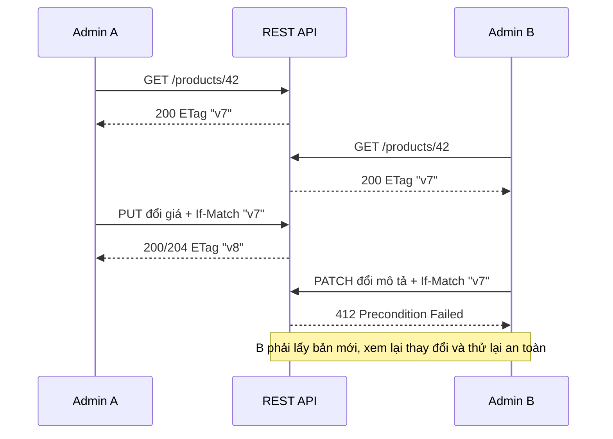

# Thay thế toàn bộ và cập nhật một phần

> **Module:** INTEGRATION_API_REST — thiết kế REST API dựa trên resource, URI, phương thức và mã trạng thái HTTP, với hợp đồng dữ liệu rõ ràng; thực hành phân trang, cache, idempotency, OpenAPI, xác thực, phân quyền, xử lý lỗi và kiểm thử API bằng Java/Spring hoặc công nghệ tương đương.  
> **Chương:** Thao tác tài nguyên.  
> **Chủ đề:** Phân biệt **thay thế toàn bộ** bằng `PUT` và **cập nhật một phần** bằng `PATCH`; xây dựng API có ngữ nghĩa nhất quán, bảo vệ cập nhật đồng thời và kiểm thử được.

## 1. Bài toán thực tế: cập nhật một sản phẩm

Một cửa hàng quản lý tài nguyên sản phẩm:

```http
GET /api/products/42 HTTP/1.1
Host: api.example.com
Accept: application/json
```

Phản hồi:

```http
HTTP/1.1 200 OK
Content-Type: application/json
ETag: "product-42-v7"

{
  "id": 42,
  "name": "Bàn phím cơ",
  "description": "Bản tiêu chuẩn",
  "price": 1200000,
  "active": true
}
```

Có hai nhu cầu khác nhau:

1. Người quản trị muốn **đặt lại toàn bộ trạng thái có thể sửa** của sản phẩm theo một biểu diễn mới: tên, mô tả, giá và trạng thái hoạt động.
2. Người quản trị chỉ muốn **sửa giá** từ 1.200.000 thành 1.150.000, giữ nguyên các trường khác.

Hai nhu cầu này trông gần giống nhau về dữ liệu gửi lên, nhưng có ngữ nghĩa HTTP khác nhau. Nếu dùng chung một cơ chế “field nào được gửi thì cập nhật” cho cả hai, client có thể vô tình xóa dữ liệu, bỏ sót thay đổi, hoặc ghi đè cập nhật của người khác.

**Mục tiêu sau bài học:**

- Chọn `PUT` khi cần thay thế trạng thái tài nguyên theo hợp đồng, `PATCH` khi chỉ muốn áp dụng một tập thay đổi.
- Hiểu chính xác ý nghĩa **trường vắng mặt**, trường có giá trị `null` và trường không cho phép sửa.
- Phân biệt tính **idempotent** của `PUT` với tính idempotent phụ thuộc nội dung của `PATCH`.
- Thiết kế optimistic concurrency với **ETag** và `If-Match`, trả `412 Precondition Failed` khi phiên bản bị cũ.
- Dùng đúng media type `application/json-patch+json` và `application/merge-patch+json`, hoặc mô tả rõ semantics nếu dùng PATCH định dạng riêng.
- Chọn mã trạng thái, kiểm tra phân quyền theo trường, viết hợp đồng OpenAPI và kiểm thử API Java/Spring.

## 2. Khái niệm gốc: resource, representation và phép thay đổi

**Resource** là đối tượng logic được định danh bằng URI, chẳng hạn `/api/products/42`. Một **representation** là dữ liệu thể hiện trạng thái của resource tại thời điểm truy cập, ví dụ JSON do `GET` trả về.

Không phải mọi trường trong GET đều có thể do client sửa. Các trường `id`, `createdAt`, `version`, tổng tiền tính toán hoặc trạng thái hệ thống có thể là **server-managed**. Do đó, “thay thế toàn bộ” trong API phải được hiểu theo **hợp đồng biểu diễn đầu vào**: client cung cấp đầy đủ trạng thái **có thể thay thế**, còn server kiểm soát các thuộc tính do nó quản lý.

Ví dụ, giả sử hợp đồng chỉnh sửa sản phẩm cho phép thay `name`, `description`, `price`, `active` nhưng không cho thay `id` và `version`.

| Thuộc tính | GET response | PUT request | PATCH request |
|---|---|---|---|
| `id` | Có | Do URI xác định; không được thay | Không cho phép sửa |
| `name` | Có | Bắt buộc gửi khi thay thế | Chỉ gửi nếu cần sửa |
| `description` | Có thể có | Theo hợp đồng: có thể thiếu để xóa/đặt mặc định | Phải có quy tắc riêng cho vắng mặt và `null` |
| `price` | Có | Bắt buộc gửi | Chỉ gửi nếu cần sửa |
| `active` | Có | Bắt buộc gửi | Chỉ gửi nếu cần sửa |
| `version` hoặc ETag | Có thể thể hiện | Không tự chọn phiên bản mới | Dùng điều kiện cập nhật để chống mất dữ liệu |

**Không có quy tắc HTTP chung rằng một trường JSON thiếu trong `PUT` luôn trở thành `null`.** Đó là quyết định của resource model và hợp đồng dữ liệu. Với API yêu cầu biểu diễn đầy đủ, thiếu trường bắt buộc là request không hợp lệ; với trường tùy chọn, server phải nêu rõ sẽ xóa, đặt giá trị mặc định hay giữ trạng thái nào. Điều quan trọng là `PUT` không được âm thầm biến thành “chỉ sửa những trường client gửi” khi tài liệu hứa thay thế toàn bộ.

## 3. PUT: thay thế trạng thái của tài nguyên đích

### 3.1. Ngữ nghĩa và ví dụ

`PUT` yêu cầu server **tạo hoặc thay thế trạng thái của resource tại target URI** bằng trạng thái được định nghĩa bởi biểu diễn trong request. Server được phép kiểm tra ràng buộc nghiệp vụ, ánh xạ sang mô hình nội bộ và quản lý trường do hệ thống sinh ra.

```http
PUT /api/products/42 HTTP/1.1
Host: api.example.com
Content-Type: application/json
If-Match: "product-42-v7"

{
  "name": "Bàn phím cơ TKL",
  "description": "Phiên bản 87 phím",
  "price": 1150000,
  "active": true
}
```

Giả sử tài nguyên tồn tại, quyền hợp lệ và ETag còn khớp. Server thay thế **toàn bộ tập thuộc tính có thể thay thế** theo request, lưu trạng thái mới và có thể trả:

```http
HTTP/1.1 200 OK
Content-Type: application/json
ETag: "product-42-v8"

{
  "id": 42,
  "name": "Bàn phím cơ TKL",
  "description": "Phiên bản 87 phím",
  "price": 1150000,
  "active": true
}
```

Hoặc nếu không cần trả body:

```http
HTTP/1.1 204 No Content
ETag: "product-42-v8"
```

Đây đều là kết quả hợp lý khi **thay thế resource đã tồn tại**. Nếu endpoint **cho phép tạo tài nguyên tại URI xác định** và lần PUT đầu thực sự tạo thành công, phản hồi phù hợp là **`201 Created`**. Trong nhiều API có ID do server cấp, `PUT /api/products/{id}` chỉ cho phép cập nhật và trả `404 Not Found` khi ID chưa tồn tại; đó là một hợp đồng hợp lệ và phải được ghi rõ.

### 3.2. PUT là idempotent, nhưng điều đó nghĩa là gì?

Một phương thức **idempotent** có *tác động dự kiến lên trạng thái phía server* tương đương dù client gửi request giống hệt **một lần hay nhiều lần**. `PUT` là phương thức idempotent theo ngữ nghĩa HTTP:

```text
PUT /products/42  {name: "A", price: 100}
PUT /products/42  {name: "A", price: 100}
PUT /products/42  {name: "A", price: 100}

Trạng thái mục tiêu được yêu cầu sau mỗi lần: name = "A", price = 100
```

Điều này **không** yêu cầu từng lần gửi nhận **cùng status code**, không cấm ghi audit log hoặc tăng bộ đếm mạng, và không đảm bảo client không thấy lỗi. Ví dụ PUT đầu có `If-Match: "v7"` có thể thành công và đổi ETag sang `"v8"`; gửi lại đúng request với `If-Match: "v7"` có thể nhận `412`, nhưng thao tác thứ hai không ghi đè phiên bản mới. Tác động dự kiến vẫn idempotent theo tài nguyên.

Nếu luôn tăng revision khi gửi lại cùng payload dù trạng thái nghiệp vụ không đổi, API có thể gây invalidation cache và xung đột không cần thiết; cân nhắc bỏ qua ghi khi biểu diễn mới thực sự giống biểu diễn hiện có.

### 3.3. Những sai lầm với PUT

**Sai ngữ nghĩa nếu hợp đồng là thay thế toàn bộ:**

```http
PUT /api/products/42 HTTP/1.1
Content-Type: application/json

{"price": 1150000}
```

Nếu `name` và `active` là trường bắt buộc của biểu diễn thay thế, request này không đầy đủ; server nên trả lỗi validation theo hợp đồng (thường `400` hoặc `422`), **không** lặng lẽ giữ nguyên các trường còn lại như PATCH.

Cũng không dùng PUT để “tạo thêm một thay đổi giá” kiểu `price = price + 10000`; đó là hành vi không idempotent khi gửi lại, phù hợp với operation hoặc PATCH có semantics được định nghĩa rõ hơn.

## 4. PATCH: áp dụng một tập thay đổi lên tài nguyên

`PATCH` yêu cầu server áp dụng **tập thay đổi được mô tả trong request** vào trạng thái hiện có của resource. Request không nhất thiết là representation đầy đủ; **cách diễn giải thay đổi phụ thuộc vào media type và hợp đồng**.

Ví dụ cần đổi riêng `price`:

```http
PATCH /api/products/42 HTTP/1.1
Host: api.example.com
Content-Type: application/merge-patch+json
If-Match: "product-42-v7"

{"price": 1150000}
```

Nếu áp dụng thành công theo hợp đồng, chỉ giá thay đổi; `name`, `description` và `active` được giữ nguyên.

### 4.1. PATCH có idempotent không?

HTTP **không đảm bảo mọi PATCH đều idempotent**. Tính chất này phụ thuộc vào loại phép thay đổi:

| Tập thay đổi | Gửi lặp cùng payload | Idempotent? |
|---|---|---|
| `{"price":1150000}` theo JSON Merge Patch | Đặt giá thành 1150000 mỗi lần | Thường có, nếu không tính các tác động phụ ngoài trạng thái được mô tả |
| JSON Patch `replace /price 1150000` | Đặt cùng giá trị sau mỗi lần thành công | Có thể idempotent nếu path vẫn hợp lệ và trạng thái khác không làm thất bại |
| JSON Patch `add /tags/- "sale"` | Mỗi lần nối thêm một phần tử | **Không** idempotent |
| Operation nghiệp vụ “tăng số lượng lên 1” | Mỗi lần cộng thêm 1 | **Không** idempotent |

Cả PUT lẫn PATCH đều có thể áp dụng `If-Match` hoặc idempotency key khi cần. **ETag và idempotency key giải quyết hai vấn đề khác nhau**: ETag bảo vệ khỏi **ghi đè phiên bản cũ**; idempotency key giúp nhận diện **một ý định xử lý được client thử lại** nhằm tránh tác động lặp, đặc biệt khi PATCH có thao tác không idempotent.

### 4.2. PATCH cần tính nguyên tử (*atomicity*)

Khi một PATCH gồm nhiều thay đổi, server phải **áp dụng toàn bộ hoặc không áp dụng gì** đối với resource. Không được lưu nửa chừng rồi báo một phần thành công. Các client đang đọc không được quan sát một biểu diễn bị sửa dở.

Ví dụ cập nhật giá và trạng thái:

```json
[
  {"op": "replace", "path": "/price", "value": 1150000},
  {"op": "replace", "path": "/active", "value": false}
]
```

Nếu thao tác thứ hai vi phạm quy tắc nghiệp vụ, server phải giữ nguyên cả giá lẫn trạng thái của tài nguyên, đồng thời trả lỗi. Khi lưu dữ liệu qua nhiều bảng, service cần giao dịch phù hợp hoặc thiết kế xử lý toàn bộ theo ranh giới nhất quán đã định. Với workflow phân tán không có ACID xuyên service, không được tuyên bố một PATCH đơn lẻ tự làm mọi thay đổi liên dịch vụ thành giao dịch nguyên tử.

## 5. Hai định dạng PATCH tiêu chuẩn

HTTP PATCH chỉ định phương thức, **không chỉ định mặc định JSON phải được áp dụng thế nào**. Hai định dạng phổ biến là:

- **JSON Patch** — `application/json-patch+json`, danh sách thao tác theo RFC 6902.
- **JSON Merge Patch** — `application/merge-patch+json`, đối tượng mang những phần cần thêm/thay/xóa theo RFC 7396.

### 5.1. JSON Merge Patch: giống JSON, ít thao tác

Trạng thái gốc:

```json
{
  "name": "Bàn phím cơ",
  "description": "Bản tiêu chuẩn",
  "price": 1200000,
  "active": true,
  "tags": ["keyboard", "mechanical"]
}
```

Request:

```http
PATCH /api/products/42 HTTP/1.1
Host: api.example.com
Content-Type: application/merge-patch+json
If-Match: "product-42-v7"

{
  "price": 1150000,
  "description": null,
  "tags": ["keyboard", "sale"]
}
```

Kết quả logic sau khi áp dụng:

```json
{
  "name": "Bàn phím cơ",
  "price": 1150000,
  "active": true,
  "tags": ["keyboard", "sale"]
}
```

**Quy tắc cốt lõi:**

- Trường **vắng mặt** trong patch được giữ nguyên.
- Giá trị **khác `null`** được thêm hoặc thay thế. Nếu là object và target cũng là object, thuật toán merge đi vào các thành viên con.
- Giá trị **`null` trong patch nghĩa là xóa member** khỏi object target, **không phải “đặt member thành JSON null”**.
- **Array được thay thế như một giá trị toàn khối**, không nối thêm từng phần tử.
- Một patch không phải object có thể thay thế toàn bộ target theo RFC; nhiều API resource có schema object chủ động hạn chế loại patch chấp nhận để giữ invariant.

**Hệ quả quan trọng:** nếu domain cần phân biệt “field hiện diện với giá trị JSON null” và “field bị loại bỏ”, Merge Patch không phù hợp cho phép đặt `null` theo ý nghĩa đó. Cần dùng JSON Patch, format có semantics rõ ràng khác hoặc thiết kế endpoint riêng.

Ví dụ xóa một phần tử khỏi `tags` bằng Merge Patch: client phải gửi **cả mảng mới**. Nếu nhiều người cùng sửa mảng, nguy cơ mất thay đổi cao nếu không dùng `If-Match`.

### 5.2. JSON Patch: danh sách thao tác tường minh

```http
PATCH /api/products/42 HTTP/1.1
Host: api.example.com
Content-Type: application/json-patch+json
If-Match: "product-42-v7"

[
  {"op": "test", "path": "/price", "value": 1200000},
  {"op": "replace", "path": "/price", "value": 1150000},
  {"op": "add", "path": "/tags/-", "value": "sale"}
]
```

Các thao tác thường gặp:

| `op` | Tác dụng | Ghi chú |
|---|---|---|
| `add` | Thêm/ghi một giá trị tại đường dẫn | Có thể thêm vào cuối mảng với `/-` |
| `remove` | Xóa giá trị tại đường dẫn | Đường dẫn đích phải tồn tại theo quy tắc JSON Patch |
| `replace` | Thay một giá trị đang tồn tại | Không tự tạo đường dẫn thiếu |
| `move` | Chuyển giá trị từ `from` sang `path` | Cần kiểm tra hai đường dẫn và ràng buộc schema |
| `copy` | Sao chép giá trị từ `from` sang `path` | Cần bảo vệ field không cho phép ghi |
| `test` | Yêu cầu giá trị tại đường dẫn đúng như mong đợi | Khi test thất bại, không áp dụng các bước còn lại |

Đường dẫn là **JSON Pointer**: `/price`, `/tags/0`, `/details/weight`. Trong tên thành viên, ký tự `~` được biểu diễn bằng `~0`, ký tự `/` bằng `~1`; không được chia path bằng dấu slash đơn giản mà bỏ qua quy tắc escape.

Ví dụ muốn cập nhật chính xác `description` thành **JSON null**, có thể sử dụng:

```json
[
  {"op": "replace", "path": "/description", "value": null}
]
```

Thao tác này khác với **xóa member** bằng `{"op":"remove","path":"/description"}`, miễn schema và hợp đồng API cho phép giữ `null` như một trạng thái hợp lệ.

### 5.3. So sánh hai định dạng

| Tiêu chí | JSON Merge Patch | JSON Patch |
|---|---|---|
| Hình dạng body | JSON có cấu trúc gần trạng thái đích | Array các operation |
| Đổi vài field đơn giản | Dễ đọc, ngắn | Dài hơn một chút |
| Xóa field | Đặt field thành `null` trong patch | `remove` |
| Đặt field thành JSON null | Không biểu đạt trực tiếp khi muốn giữ member null | `replace`/`add` với `value: null` |
| Cập nhật một phần tử mảng | Thường phải thay toàn bộ mảng | Thao tác theo path/index |
| Kiểm tra giá trị trước khi ghi | Thường dùng `If-Match` bên ngoài | Có thêm `test` ở body, vẫn nên dùng `If-Match` |
| Tính idempotent | Thường phù hợp thay field bằng giá trị cố định | Tùy từng operation và trạng thái |
| Rủi ro chính | Null/xóa member, ghi đè cả mảng, object lồng nhau | Đường dẫn không tồn tại, lệch index, chuỗi operation không hợp lệ |

**Không dùng `Content-Type: application/json` rồi ngầm giả định client sẽ hiểu format là RFC 6902 hoặc RFC 7396.** Nếu chọn định dạng PATCH riêng với `application/json`, API phải định nghĩa rõ cách diễn giải omitted/null/arrays/field restrictions trong OpenAPI và test contract. Để tương tác liên hệ thống dễ hơn, thường ưu tiên một media type tiêu chuẩn phù hợp nhu cầu.

### 5.4. Công bố PATCH format được hỗ trợ

Server có thể trả `Accept-Patch`, ví dụ khi client gọi OPTIONS:

```http
OPTIONS /api/products/42 HTTP/1.1
Host: api.example.com
```

```http
HTTP/1.1 204 No Content
Allow: GET, HEAD, PUT, PATCH, OPTIONS
Accept-Patch: application/merge-patch+json, application/json-patch+json
```

`Accept-Patch` thông báo **các định dạng patch được hỗ trợ**. Chỉ quảng bá media type mà endpoint thật sự xử lý. `Allow` cần phản ánh các phương thức được phép theo resource và chính sách xác thực của hệ thống.

## 6. PUT, PATCH và lựa chọn API

| Nhu cầu | Phương thức / định dạng nên cân nhắc | Lý do |
|---|---|---|
| Đồng bộ toàn bộ thông tin chỉnh sửa từ biểu mẫu với payload đầy đủ | `PUT /products/42` | Rõ trạng thái mong muốn sau request |
| Đổi một thuộc tính mà giữ nguyên các trường khác | `PATCH` với Merge Patch | Đơn giản, ngữ nghĩa omitted rõ |
| Thao tác có thứ tự trên mảng, cần kiểm tra tiền điều kiện của giá trị | `PATCH` với JSON Patch | Operation tường minh, `test` và đường dẫn chi tiết |
| “Tăng số lượng lên 1” | Operation có hợp đồng riêng hoặc PATCH được định nghĩa rõ | Có thể không idempotent, cần kiểm soát retry |
| Thêm tài nguyên vào collection, server cấp ID | `POST /products` | Server quyết định URI mới |
| Tạo/thay thế ở URI biết trước, API cho phép client quyết định URI | `PUT /products/client-key` | PUT có thể tạo mới với `201` |
| Xóa tài nguyên | `DELETE /products/42` | Ngữ nghĩa xóa resource |
| Đọc resource | `GET /products/42` | Phương thức an toàn, không yêu cầu thay đổi trạng thái |

Một endpoint không nên dùng `PUT` và `PATCH` với semantics **hoàn toàn giống nhau** chỉ để chiều theo mọi client. Điều đó làm hợp đồng nhập nhằng và tăng rủi ro khi frontend thay đổi cách gửi form.

## 7. Lost update và optimistic concurrency bằng ETag

### 7.1. Lỗi mất cập nhật

Hai người cùng đọc sản phẩm revision 7:



Nếu B bỏ điều kiện version, cập nhật B có thể ghi đè dữ liệu mới của A, đặc biệt khi client gửi toàn bộ biểu diễn cũ bằng PUT. Với PATCH chỉ sửa `description`, khả năng mất thay đổi ở `price` có thể nhỏ hơn nếu service xử lý update theo field, nhưng vẫn còn xung đột ở cùng field và invariant liên trường; không thể coi PATCH tự tránh mọi lost update.

### 7.2. Cách dùng If-Match

Server trả strong ETag:

```http
HTTP/1.1 200 OK
ETag: "product-42-v7"
Content-Type: application/json

{"id":42,"name":"Bàn phím cơ","price":1200000,"active":true}
```

Client khi ghi gửi:

```http
PATCH /api/products/42 HTTP/1.1
Host: api.example.com
Content-Type: application/merge-patch+json
If-Match: "product-42-v7"

{"price":1150000}
```

Server phải kiểm tra điều kiện **cùng ranh giới nhất quán với thao tác ghi**. Nếu revision hiện tại là 8, trả:

```http
HTTP/1.1 412 Precondition Failed
Content-Type: application/problem+json

{
  "type": "about:blank",
  "title": "Precondition Failed",
  "status": 412,
  "detail": "Tài nguyên đã được cập nhật; hãy tải phiên bản mới."
}
```

Client tải bản hiện tại bằng GET, hợp nhất thay đổi theo nghiệp vụ, rồi gửi lại với ETag mới nếu người dùng đồng ý. Không tự động retry bản ghi cũ với ETag mới nếu có nguy cơ xóa thay đổi của người khác.

**Lưu ý về ETag:**

- `If-Match` dùng **strong comparison**. ETag dạng `W/"..."` là weak và **không khớp** với `If-Match` theo quy tắc này.
- ETag có thể dựa trên revision, hash của representation hoặc cơ chế đáng tin cậy; strong validator phải thực sự phù hợp tính chất biểu diễn, không lộ dữ liệu nhạy cảm và nhất quán giữa các node.
- `If-None-Match` trên GET/HEAD thường phục vụ revalidation (có thể trả 304); trên PUT/PATCH khi điều kiện thất bại thì **không trả 304**, mà theo HTTP precondition trả `412` khi phù hợp.
- Nếu API bắt buộc client gửi một điều kiện để tránh lost update, khi thiếu precondition có thể trả **`428 Precondition Required`**. Điều này phải được công bố trong hợp đồng.

### 7.3. So sánh phiên bản phải atomic

**Chưa đủ an toàn:**

```text
current = repository.findById(id)
if current.version == requestedVersion:
    repository.save(changedEntity)
```

Giữa bước đọc và bước lưu, một transaction khác có thể cập nhật cùng bản ghi. Cần optimistic locking của persistence layer (`@Version` với JPA), compare-and-swap trong database hoặc điều kiện ghi `UPDATE ... WHERE id=? AND version=?`. Nếu không cập nhật được vì version đổi, trả lỗi precondition phù hợp.

Ví dụ tư duy transaction:

```sql
UPDATE products
SET name = :name,
    description = :description,
    price = :price,
    active = :active,
    version = version + 1
WHERE id = :id
  AND version = :expected_version;
```

Nếu số bản ghi ảnh hưởng là 0, cần phân biệt tài nguyên không tồn tại với phiên bản bị cũ và ánh xạ thành `404` hoặc `412` theo điều kiện/hợp đồng. Đối với nhiều ràng buộc liên bảng, lựa chọn transaction và isolation cần đảm bảo invariant nghiệp vụ chứ không chỉ kiểm tra một cột.

## 8. Kiểm tra dữ liệu và phân quyền khi cập nhật

### 8.1. Trường bắt buộc và trường tùy chọn

Giả sử hợp đồng PUT yêu cầu:

```json
{
  "name": "Bàn phím cơ TKL",
  "description": "Phiên bản 87 phím",
  "price": 1150000,
  "active": true
}
```

Hãy quy định:

- `name`: không được rỗng.
- `price`: phải là số hợp lệ theo đơn vị tiền tệ/quy tắc nghiệp vụ; không âm.
- `active`: bắt buộc có giá trị boolean, kể cả `false`.
- `description`: cho phép rỗng, xóa hoặc không, theo một quy tắc duy nhất.
- `id`, `createdAt`, `version`, `ownerTenantId`: do server quản lý, không được cập nhật tùy ý.

Với PATCH, validation phải áp dụng **trạng thái cuối sau khi patch**, ngoài việc kiểm tra từng operation. Ví dụ chỉ đổi `price` nhưng business rule yêu cầu sản phẩm có `active=true` phải có giá dương. Nếu payload riêng lẻ hợp lệ nhưng trạng thái kết quả vi phạm quy tắc, request vẫn phải bị từ chối **không có thay đổi dở dang**.

### 8.2. Mass assignment / over-posting

Một lỗ hổng phổ biến là nhận JSON rồi map trực tiếp tất cả thuộc tính sang entity JPA:

```json
{
  "price": 100,
  "ownerTenantId": "other-tenant",
  "adminApproved": true
}
```

Nếu DTO hoặc mapper cho phép ghi `ownerTenantId` hay `adminApproved`, người dùng có thể thay dữ liệu không thuộc quyền. **Không bind toàn bộ request trực tiếp vào entity**. Dùng DTO/command có danh sách field cho phép, áp dụng authorization ở mức resource và field, giữ các field server-managed nằm ngoài request.

Với JSON Patch, không chỉ kiểm tra cú pháp `op`/`path`; cả `move` và `copy` có thể truy cập/ghi trường nhạy cảm qua `from` và `path`. Với Merge Patch, giới hạn cả object lồng nhau, không cho phép sửa `role`, `tenantId`, `approvalStatus` bằng cách chèn JSON bất kỳ.

### 8.3. Khác nhau giữa 401, 403 và 404

- **`401 Unauthorized`:** cần xác thực hoặc credentials không hợp lệ, theo cơ chế authentication.
- **`403 Forbidden`:** đã biết danh tính nhưng không đủ quyền cho thao tác.
- **`404 Not Found`:** resource không tồn tại; một số chính sách có thể dùng 404 để không tiết lộ sự tồn tại của resource bị cấm xem.
  
Kiểm tra auth và quyền **trước khi ghi**; không tiết lộ dữ liệu phiên bản hoặc tên chủ sở hữu từ thông báo lỗi khi caller không có quyền đọc.

## 9. Mã trạng thái phản hồi: hợp đồng nhất quán

| Kết quả | PUT | PATCH | Ghi chú |
|---|---|---|---|
| Đã cập nhật và trả biểu diễn | `200 OK` | `200 OK` | Có body theo hợp đồng |
| Đã cập nhật, không trả body | `204 No Content` | `204 No Content` | Không có JSON body |
| Tạo mới tại URI đích được phép | `201 Created` | Không phải trường hợp thông dụng; PATCH có thể tạo trong điều kiện phù hợp định dạng/hợp đồng | Chỉ dùng khi thực sự tạo mới; có thể kèm `Location` |
| Không tồn tại hoặc không tìm thấy trong phạm vi cho phép | `404 Not Found` | `404 Not Found` | Một số API không hỗ trợ tạo bằng PUT/PATCH |
| Body JSON/cú pháp patch hỏng | `400 Bad Request` | `400 Bad Request` | Ví dụ JSON thiếu dấu ngoặc, operation không hợp lệ |
| Giá trị không đáp ứng quy tắc nội dung | `422 Unprocessable Content` (hoặc 400 theo hợp đồng) | `422 Unprocessable Content` | Body parse được nhưng vi phạm schema/domain |
| Conflict với trạng thái nghiệp vụ | `409 Conflict` | `409 Conflict` | Ví dụ trạng thái business không cho phép chuyển |
| `If-Match` không khớp | `412 Precondition Failed` | `412 Precondition Failed` | Optimistic concurrency |
| Bắt buộc điều kiện nhưng request không gửi | `428 Precondition Required` | `428 Precondition Required` | Chính sách chống lost update |
| Media type không được hỗ trợ | `415 Unsupported Media Type` | `415 Unsupported Media Type` | PATCH phải phân biệt định dạng body |
| Không đủ quyền | `401`/`403` | `401`/`403` | Tùy identity và chính sách |
| Lỗi không mong đợi phía server | `500` hoặc `503` theo nguyên nhân | `500` hoặc `503` | Không “nuốt lỗi” rồi trả 200 |

**`204` không có body.** Nếu cần trả thông tin phiên bản mới, có thể đặt ETag ở response header. Nếu dùng `200`, body và header phải phản ánh cùng phiên bản; không trả body mới kèm ETag cũ.

Mẫu thông báo lỗi theo **Problem Details**:

```http
HTTP/1.1 422 Unprocessable Content
Content-Type: application/problem+json

{
  "type": "https://api.example.com/problems/invalid-product",
  "title": "Validation failed",
  "status": 422,
  "detail": "Giá sản phẩm phải lớn hơn hoặc bằng 0.",
  "instance": "/api/products/42",
  "errors": [{"field": "price", "message": "must be non-negative"}]
}
```

Các extension như `errors` là một lựa chọn hợp đồng riêng của API. Không trả stack trace hay dữ liệu nhạy cảm ra response.

## 10. Thiết kế bằng Java/Spring Boot

Ví dụ áp dụng Spring MVC và Jakarta Validation. Mục tiêu là minh họa **ranh giới request**, **semantics PUT/PATCH**, **ETag** và sự tách biệt xử lý business rule với HTTP layer. Persistence layer và security configuration được giả định đã có.

### 10.1. DTO cho PUT

```java
import java.math.BigDecimal;
import jakarta.validation.constraints.DecimalMin;
import jakarta.validation.constraints.NotBlank;
import jakarta.validation.constraints.NotNull;

public record ProductReplaceRequest(
        @NotBlank String name,
        String description,
        @NotNull @DecimalMin("0.00") BigDecimal price,
        @NotNull Boolean active
) {}

public record ProductResponse(
        long id,
        String name,
        String description,
        BigDecimal price,
        boolean active,
        long version
) {}
```

**Vì sao dùng `Boolean` thay cho `boolean` ở request?** Primitive `boolean` mặc định `false` khi không được truyền qua binding trong nhiều trường hợp, làm mất khả năng phân biệt “client bỏ quên” với “client cố ý đặt false”. `@NotNull Boolean` giúp phát hiện trường bắt buộc bị bỏ sót.

### 10.2. Controller PUT và PATCH có hợp đồng rõ

Ví dụ API dưới đây hỗ trợ:

- `PUT`: **thay thế đầy đủ** với `application/json`, tài nguyên phải tồn tại.
- `PATCH`: **chỉnh sửa có chọn lọc** qua một **định dạng PATCH riêng** dùng `application/json`, trong đó field vắng mặt giữ nguyên và `description: null` nghĩa là xóa mô tả. Đây **không** phải JSON Merge Patch/RFC 7396.
- Cả hai bắt buộc `If-Match` với strong ETag để bảo vệ cập nhật đồng thời.

```java
import com.fasterxml.jackson.databind.JsonNode;
import jakarta.validation.Valid;
import org.springframework.http.MediaType;
import org.springframework.http.ResponseEntity;
import org.springframework.web.bind.annotation.*;

@RestController
@RequestMapping("/api/products")
public class ProductWriteController {
    private final ProductCommandService service;

    public ProductWriteController(ProductCommandService service) {
        this.service = service;
    }

    @PutMapping(path = "/{id}", consumes = MediaType.APPLICATION_JSON_VALUE)
    public ResponseEntity<ProductResponse> replace(
            @PathVariable long id,
            @RequestHeader(name = "If-Match", required = false) String ifMatch,
            @Valid @RequestBody ProductReplaceRequest body) {

        // service kiểm tra auth + If-Match + validation, ghi nguyên tử.
        ProductResponse saved = service.replaceExisting(id, ifMatch, body);
        return ResponseEntity.ok()
                .eTag("\"product-" + saved.id() + "-v" + saved.version() + "\"")
                .body(saved);
    }

    @PatchMapping(path = "/{id}", consumes = MediaType.APPLICATION_JSON_VALUE)
    public ResponseEntity<ProductResponse> updateFields(
            @PathVariable long id,
            @RequestHeader(name = "If-Match", required = false) String ifMatch,
            @RequestBody JsonNode changes) {

        // Request này là custom partial update: field vắng mặt = giữ nguyên.
        // service phải whitelist field và phân biệt missing với null.
        ProductResponse saved = service.updateAllowedFields(id, ifMatch, changes);
        return ResponseEntity.ok()
                .eTag("\"product-" + saved.id() + "-v" + saved.version() + "\"")
                .body(saved);
    }
}
```

**Cần triển khai ở `ProductCommandService`:**

1. Xác thực người dùng và phân quyền với sản phẩm/tenant, gồm quyền sửa từng field.
2. Kiểm tra `If-Match`: nếu thiếu theo chính sách → `428`; nếu khác strong ETag hiện tại → `412`. Không dùng so sánh chuỗi ETag một cách ngây thơ khi có thể có danh sách validator/định dạng.
3. Đọc trạng thái và ghi trong transaction với optimistic locking (`@Version` hoặc compare-and-swap).
4. Với PUT: kiểm tra tất cả thuộc tính bắt buộc, xác định rõ tác động với `description`, **thay thế toàn bộ thuộc tính cho phép**.
5. Với custom PATCH: chỉ cho `name`, `description`, `price`, `active`; kiểm tra `changes.isObject()`, loại field không hỗ trợ; phân biệt `changes.has("price")` với không có field. `description` được phép null theo hợp đồng; price/name/active null phải từ chối.
6. Xác thực trạng thái cuối, áp dụng toàn bộ thay đổi trong một transaction; nếu thất bại không ghi nửa chừng.
7. Ánh xạ exception có kiểm soát sang `400/404/409/412/415/422/428` và Problem Details phù hợp.
8. Sinh strong ETag phù hợp representation thực tế và có quy tắc nhất quán qua mọi instance.

Đây là **mã minh họa ranh giới HTTP**, không phải một dịch vụ Spring Boot chạy độc lập. `ProductCommandService`, kho dữ liệu, bảo mật và exception handler phải được hiện thực và kiểm thử trong ứng dụng thật. Sử dụng media type `application/json` cho custom PATCH là một lựa chọn riêng cần ghi rõ; nếu API tuyên bố hỗ trợ `application/merge-patch+json` hoặc `application/json-patch+json`, service phải thực thi **đúng toàn bộ** semantics của định dạng đó và controller phải dùng `consumes` tương ứng.

### 10.3. Điểm dễ sai khi xử lý PATCH bằng Jackson

Ví dụ JSON:

```json
{"name": "Bàn phím mới", "description": null}
```

- `changes.has("name")` là true; `changes.get("name").asText()` lấy giá trị, nhưng cần xác nhận node có kiểu string và không rỗng.
- `changes.has("description")` là true ngay cả khi node là `NullNode`; `changes.get("description").isNull()` cho biết client yêu cầu xóa/đặt null theo **custom contract**.
- `changes.has("active")` là false, nên **giữ nguyên** active. Nếu chỉ gọi `changes.path("active").asBoolean()` và ghi lại, API có thể vô tình đặt false.
- Với unknown field như `ownerTenantId`, nên từ chối rõ ràng thay vì cho map tự động vào entity.
- Nếu PATCH có object lồng nhau hoặc array, chỉ hỗ trợ phép biến đổi mà hợp đồng định nghĩa; không giả định Jackson `updateValue` tự hiện thực RFC 7396/6902.

## 11. OpenAPI: mô tả được semantics của mỗi phương thức

Trong hợp đồng, mô tả **request body đầy đủ của PUT**, **nghĩa riêng của PATCH**, header precondition và status.

```yaml
openapi: 3.0.3
info:
  title: Product API
  version: 1.0.0
paths:
  /api/products/{id}:
    put:
      summary: Thay thế toàn bộ thuộc tính sản phẩm có thể chỉnh sửa
      parameters:
        - name: id
          in: path
          required: true
          schema: {type: integer, format: int64}
        - name: If-Match
          in: header
          required: true
          description: Strong ETag của phiên bản cần thay thế
          schema: {type: string}
      requestBody:
        required: true
        content:
          application/json:
            schema:
              type: object
              required: [name, price, active]
              additionalProperties: false
              properties:
                name: {type: string, minLength: 1}
                description: {type: string, nullable: true}
                price: {type: number, minimum: 0}
                active: {type: boolean}
      responses:
        '200':
          description: Đã thay thế và trả trạng thái mới
          headers:
            ETag:
              schema: {type: string}
        '404':
          description: Resource không tồn tại
        '412':
          description: If-Match không khớp
        '422':
          description: Validation thất bại
        '428':
          description: Thiếu precondition bắt buộc
    patch:
      summary: Cập nhật một phần với hợp đồng custom JSON
      description: >
        Field không gửi giữ nguyên; description null xóa mô tả.
        Chỉ các field name, description, price, active được cập nhật.
        Đây không phải JSON Merge Patch.
      parameters:
        - name: id
          in: path
          required: true
          schema: {type: integer, format: int64}
        - name: If-Match
          in: header
          required: true
          schema: {type: string}
      requestBody:
        required: true
        content:
          application/json:
            schema:
              type: object
              minProperties: 1
              additionalProperties: false
              properties:
                name: {type: string, minLength: 1}
                description: {type: string, nullable: true}
                price: {type: number, minimum: 0}
                active: {type: boolean}
      responses:
        '200':
          description: Đã cập nhật và trả trạng thái mới
          headers:
            ETag:
              schema: {type: string}
        '400':
          description: JSON malformed
        '404':
          description: Resource không tồn tại
        '409':
          description: Xung đột nghiệp vụ
        '412':
          description: If-Match không khớp
        '415':
          description: Media type không được hỗ trợ
        '422':
          description: Trạng thái cuối không hợp lệ
        '428':
          description: Thiếu precondition bắt buộc
```

Ví dụ OpenAPI này phục vụ **custom PATCH trong controller ở mục 10**. Nếu muốn hỗ trợ RFC 7396/6902, hãy thay hoặc bổ sung media type tương ứng và schema/body ví dụ đúng định dạng. Không quảng bá cả hai tiêu chuẩn nếu backend thực chất chỉ map một object tùy ý.

Với API public, nên mô tả thêm `401`, `403`, media type của Problem Details, security scheme và `404` tùy chính sách ẩn resource. Những chi tiết đó phụ thuộc cấu hình xác thực thực tế.

## 12. Chiến lược kiểm thử API

### 12.1. Bảng kiểm thử hợp đồng

| Test ID | Tình huống | Kỳ vọng |
|---|---|---|
| T-PUT-01 | PUT đầy đủ, If-Match hiện tại | 200/204, dữ liệu phản ánh bản thay thế, ETag mới |
| T-PUT-02 | PUT thiếu trường bắt buộc `active` | Validation error; không thay đổi state |
| T-PUT-03 | PUT lặp cùng trạng thái | Trạng thái mục tiêu không lệch; không phát sinh tác động nghiệp vụ lặp |
| T-PUT-04 | PUT trên ID không tồn tại, API chỉ cập nhật | 404; không tự tạo |
| T-PATCH-01 | PATCH chỉ có `price` | Giá đổi, trường khác giữ nguyên |
| T-PATCH-02 | PATCH `description: null` theo custom contract | Xóa mô tả; field khác giữ nguyên |
| T-PATCH-03 | PATCH object rỗng hoặc unknown field | Theo hợp đồng: từ chối phù hợp; không âm thầm sửa field nhạy cảm |
| T-PATCH-04 | JSON Merge Patch với mảng | Thay toàn bộ mảng; không append ngầm |
| T-PATCH-05 | JSON Patch có thao tác không hợp lệ ở giữa | Không có thay đổi nào được commit |
| T-PATCH-06 | JSON Patch `add /tags/-` gửi hai lần | Hành vi lặp được đánh giá và kiểm soát |
| T-CONC-01 | Hai client cùng ETag cũ | Một cập nhật thành công; cập nhật stale trả 412 |
| T-CONC-02 | Thiếu If-Match khi API bắt buộc | 428 |
| T-SEC-01 | PATCH `ownerTenantId` / `adminApproved` | Từ chối; không nâng quyền hoặc đổi ownership |
| T-SEC-02 | User khác tenant cố sửa resource | 403 hoặc 404 theo chính sách; state không đổi |
| T-STATUS-01 | `204 No Content` | Body rỗng; không trả JSON ngụy trang |
| T-MEDIA-01 | Gửi `application/json-patch+json` tới endpoint chỉ hỗ trợ custom `application/json` | 415 theo hợp đồng |
| T-CACHE-01 | GET sau cập nhật | Body, ETag và validator đều phản ánh phiên bản mới |

### 12.2. MockMvc: kiểm tra PUT/PATCH và precondition

Các snippet sau **giả định** Spring Boot test context có fixture sản phẩm `42` ở version 7, controller/service đã cấu hình và handler lỗi trả đúng status; không phải bằng chứng test đã chạy.

```java
import org.junit.jupiter.api.Test;
import org.springframework.beans.factory.annotation.Autowired;
import org.springframework.boot.test.autoconfigure.web.servlet.AutoConfigureMockMvc;
import org.springframework.boot.test.context.SpringBootTest;
import org.springframework.http.HttpHeaders;
import org.springframework.http.MediaType;
import org.springframework.test.web.servlet.MockMvc;

import static org.springframework.test.web.servlet.request.MockMvcRequestBuilders.*;
import static org.springframework.test.web.servlet.result.MockMvcResultMatchers.*;

@SpringBootTest
@AutoConfigureMockMvc
class ProductWriteContractTest {
    @Autowired
    MockMvc mvc;

    @Test
    void putReplacesAllEditableFields() throws Exception {
        mvc.perform(put("/api/products/42")
                .header(HttpHeaders.IF_MATCH, "\"product-42-v7\"")
                .contentType(MediaType.APPLICATION_JSON)
                .content("""
                    {"name":"Bàn phím TKL","description":"87 phím",
                     "price":1150000,"active":false}
                    """))
            .andExpect(status().isOk())
            .andExpect(jsonPath("$.name").value("Bàn phím TKL"))
            .andExpect(jsonPath("$.active").value(false))
            .andExpect(header().exists(HttpHeaders.ETAG));
    }

    @Test
    void patchOnlyChangesPrice() throws Exception {
        mvc.perform(patch("/api/products/42")
                .header(HttpHeaders.IF_MATCH, "\"product-42-v7\"")
                .contentType(MediaType.APPLICATION_JSON)
                .content("{\"price\":1150000}"))
            .andExpect(status().isOk())
            .andExpect(jsonPath("$.price").value(1150000))
            .andExpect(jsonPath("$.name").value("Bàn phím cơ"));
    }

    @Test
    void staleIfMatchIsRejected() throws Exception {
        mvc.perform(patch("/api/products/42")
                .header(HttpHeaders.IF_MATCH, "\"product-42-v6\"")
                .contentType(MediaType.APPLICATION_JSON)
                .content("{\"price\":1150000}"))
            .andExpect(status().isPreconditionFailed());
    }
}
```

Trong dự án thực, mỗi test cần **fixture độc lập** hoặc rollback/reset DB để thứ tự test không ảnh hưởng ETag/version. Đối với kiểm soát lost update, nên bổ sung test nhiều transaction thực và kiểm tra persistence, vì một MockMvc test tuần tự chưa chứng minh cập nhật cạnh tranh được thực hiện atomic.

### 12.3. Kiểm thử RFC 6902/7396 ở lớp xử lý patch

Nếu server hỗ trợ JSON Patch, ít nhất kiểm tra:

- `test` thất bại làm **toàn bộ patch bị từ chối**, không còn side effect trước đó.
- `remove` trên path không tồn tại bị lỗi đúng.
- `replace` không tự tạo đường dẫn chưa tồn tại.
- `add` vào `/tags/-` làm thay đổi mảng đúng theo thứ tự.
- `move`/`copy` không được phép truy cập field bị cấm.
- Parser xử lý đúng JSON Pointer escaping `~0` và `~1`.

Nếu hỗ trợ Merge Patch, kiểm tra:

- Field không gửi giữ nguyên.
- Member gửi `null` bị xóa.
- Nested object được merge theo semantics RFC.
- Array bị thay **toàn bộ**.
- Root patch không phải object được chấp nhận/từ chối theo **hợp đồng** và có thông báo rõ.
- Toàn bộ kết quả được validate trước khi commit.

## 13. Bài tập thực hành có hướng dẫn

### Bài A — Phân biệt PUT và PATCH

Resource ban đầu:

```json
{
  "id": 42,
  "name": "Chuột không dây",
  "description": "Bản màu đen",
  "price": 500000,
  "active": true
}
```

Hãy phân tích hai request:

**Request 1:**

```http
PUT /api/products/42 HTTP/1.1
Content-Type: application/json

{"price":480000}
```

**Request 2:**

```http
PATCH /api/products/42 HTTP/1.1
Content-Type: application/merge-patch+json

{"price":480000}
```

Câu hỏi:

1. Nếu PUT contract đòi đầy đủ `name`, `price`, `active`, request 1 phải xử lý thế nào?
2. Request 2 phải giữ nguyên các field nào?
3. Nếu PATCH gửi `{"description":null}`, kết quả logic là gì?
4. Nếu muốn **giữ member description với JSON null**, định dạng patch nào phù hợp hơn?

### Bài B — ETag và lost update

Hai client lấy cùng `ETag: "product-42-v7"`. A PUT đổi tên và thành công. B gửi PATCH sửa giá nhưng vẫn `If-Match: "product-42-v7"`.

Hãy mô tả:

1. Mã trạng thái trả cho B.
2. Tại sao tự động thay ETag của B thành v8 rồi retry có thể nguy hiểm.
3. Những cơ chế ở database cần thiết để tránh hai transaction cùng vượt qua bước kiểm tra phiên bản.
4. Trường hợp nào có thể hợp nhất cập nhật của B sau khi đọc v8 mà không làm mất thay đổi của A?

### Bài C — Xử lý mảng bằng hai định dạng PATCH

Resource hiện có:

```json
{"tags":["new","sale"],"metadata":{"color":"black","warrantyMonths":12}}
```

Đề bài: chỉ thêm tag `"featured"` và đổi `metadata.color` thành `"white"`.

Hãy viết:

- Một request **JSON Patch** dùng `add /tags/-` và `replace /metadata/color`.
- Một request **JSON Merge Patch** với toàn bộ giá trị mới của `tags` và object con `metadata`.
- Phân tích điều gì xảy ra nếu client gửi lại mỗi request hai lần và nếu người khác vừa thêm tag cùng lúc.

### Bài D — Thiết kế API Java/Spring

Xây dựng `PUT /api/products/{id}` và `PATCH /api/products/{id}` với các tiêu chí:

1. PUT yêu cầu đủ `name`, `price`, `active`; PATCH chỉ cập nhật field gửi lên.
2. Không client nào được sửa `id`, `ownerTenantId`, `version` trực tiếp.
3. Cả hai có ETag/`If-Match`, kiểm tra optimistic locking trong transaction.
4. Có test để xác nhận PUT thiếu field bị từ chối; PATCH chỉ đổi một field; stale ETag trả 412; hai người sửa đồng thời không mất cập nhật.
5. Mô tả OpenAPI rõ media type, `200/204/404/412/415/422/428`, schema của request và điều kiện lỗi.

**Gợi ý cách đánh giá:** không chỉ xem status code. Kiểm tra lại resource bằng GET, assert các field không liên quan, ETag mới, database state, audit và dữ liệu của tenant khác vẫn giữ nguyên.

## 14. Checklist khi review thiết kế API cập nhật

- [ ] PUT được triển khai đúng nghĩa thay thế trạng thái theo hợp đồng; trường vắng mặt có xử lý rõ ràng.
- [ ] PATCH định nghĩa chính xác dạng thay đổi và media type được hỗ trợ.
- [ ] Nếu dùng JSON Merge Patch, `null` xóa member và array được thay toàn bộ.
- [ ] Nếu dùng JSON Patch, mọi operation và JSON Pointer được xử lý đúng, toàn bộ patch atomic.
- [ ] Những field do server quản lý và field nhạy cảm không được sửa qua mass assignment.
- [ ] AuthN/AuthZ, tenant isolation và field-level permission được kiểm tra trước khi ghi.
- [ ] Có validation của request và **trạng thái cuối** sau cập nhật.
- [ ] Dùng ETag/`If-Match` khi cần chống lost update; check + write nguyên tử.
- [ ] Tính idempotent của PUT và từng loại PATCH được xem xét khi client retry.
- [ ] Kết quả 200/204/201 (nếu có), 404, 409, 412, 415, 422, 428 theo hợp đồng rõ ràng.
- [ ] Response body và ETag phản ánh cùng một phiên bản; 204 không mang body.
- [ ] OpenAPI mô tả đầy đủ request schema, header, content type và response status.
- [ ] Có kiểm thử PUT đầy đủ/thiếu field, PATCH omit/null/array, version stale, concurrent update và quyền truy cập.
- [ ] Đã mô tả xử lý rollback khi một patch gồm nhiều bước thất bại.

## 15. Ghi nhớ

**`PUT` biểu diễn trạng thái đích cần thay thế**, còn **`PATCH` biểu diễn thay đổi cần áp dụng vào trạng thái hiện tại**. PUT có ngữ nghĩa idempotent; PATCH có thể idempotent hoặc không, tùy operation và nội dung patch. JSON Merge Patch dùng object với field vắng mặt là giữ nguyên, `null` là xóa; JSON Patch dùng danh sách thao tác tường minh như `add`, `remove`, `replace` và `test`.

Trong REST API thực tế, điều khó hơn việc chọn tên phương thức là **xác định đúng ranh giới dữ liệu có thể sửa, kiểm soát cập nhật đồng thời, bảo đảm phép thay đổi nguyên tử, trả trạng thái có ngữ nghĩa và có test chứng minh các điều đó**. Một hợp đồng PUT/PATCH rõ ràng giúp client cập nhật chính xác mà không làm mất dữ liệu hoặc vượt quyền.
