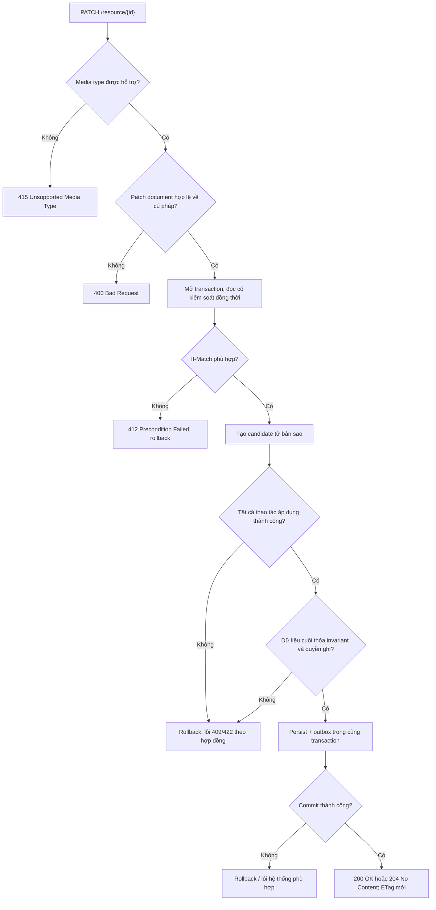

# Kiểm tra tính nguyên tử khi áp dụng bản vá

## 1. Bối cảnh: PATCH cập nhật một phần nhưng không được lưu một nửa

Trong REST API, khách hàng thường chỉ muốn thay đổi một vài thuộc tính của tài nguyên: đổi địa chỉ giao hàng, ghi chú đơn hàng hoặc cập nhật cấu hình tài khoản. Phương thức `PATCH` giúp gửi một **tài liệu mô tả thay đổi** (*patch document*) thay vì gửi lại toàn bộ biểu diễn của tài nguyên. Tuy nhiên, “cập nhật một phần tài nguyên” **không có nghĩa được thực hiện một phần các thao tác của cùng yêu cầu khi xảy ra lỗi**.

Theo ngữ nghĩa HTTP PATCH được mô tả trong **RFC 5789**, máy chủ **phải áp dụng nguyên tử toàn bộ tập thay đổi của một PATCH**: hoặc tất cả thay đổi thành công, hoặc không thay đổi nào được áp dụng. Khi đang xử lý, máy chủ không được cung cấp một biểu diễn chỉ mới được cập nhật một phần của tài nguyên. Nếu tài liệu patch không thể áp dụng trọn vẹn, yêu cầu phải thất bại và tài nguyên cần được giữ ở trạng thái trước yêu cầu đó.

Bài học nằm trong chương **Thao tác tài nguyên** của học phần `INTEGRATION_API_REST`: thiết kế resource, URI, HTTP method, status code và hợp đồng dữ liệu; thực hành xử lý lỗi, idempotency, OpenAPI, kiểm thử REST API với Java/Spring hoặc công nghệ tương đương.

Sau bài, người học có thể:

- Giải thích tính **nguyên tử của một yêu cầu PATCH** và phân biệt với việc cập nhật một phần trường dữ liệu.
- Phân tích thao tác `add`, `remove`, `replace`, `move`, `copy`, `test` của JSON Patch, đặc biệt là lỗi xảy ra giữa chuỗi thao tác.
- Thiết kế thao tác đọc–kiểm tra–sửa–ghi có transaction và điều kiện phiên bản để tránh mất cập nhật.
- Chọn mã HTTP phù hợp cho patch sai cú pháp, sai media type, không thể áp dụng, xung đột và điều kiện `If-Match` không thỏa.
- Viết kiểm thử chứng minh **không thay đổi dữ liệu hoặc phát sự kiện** khi có lỗi ở bất kỳ bước nào của một PATCH.
- Nhận diện giới hạn của transaction khi thao tác tác động tới nhiều dịch vụ, cơ sở dữ liệu và hệ thống ngoài.

## 2. Định nghĩa chính xác: “partial update” và “atomic application”

Xét tài nguyên đơn hàng đang lưu:

```json
{
  "id": "ord-42",
  "status": "DRAFT",
  "shippingAddress": {
    "city": "Hà Nội",
    "street": "1 Trần Phú"
  },
  "note": "Giao buổi sáng",
  "version": 7
}
```

Client muốn đổi `shippingAddress.city` và `note`, không thay đổi những trường khác. Một PATCH có thể chứa hai thao tác liên tiếp:

```http
PATCH /orders/ord-42 HTTP/1.1
Host: api.example.test
Content-Type: application/json-patch+json
If-Match: "order-42-v7"

[
  {"op":"replace","path":"/shippingAddress/city","value":"Đà Nẵng"},
  {"op":"replace","path":"/note","value":"Giao sau 17 giờ"}
]
```

Khi cả hai thao tác hợp lệ, kết quả mong muốn là:

```json
{
  "id": "ord-42",
  "status": "DRAFT",
  "shippingAddress": {
    "city": "Đà Nẵng",
    "street": "1 Trần Phú"
  },
  "note": "Giao sau 17 giờ",
  "version": 8
}
```

Giả sử thao tác đầu đổi thành phố thành công trong bộ nhớ, nhưng thao tác thứ hai thất bại vì đường dẫn không tồn tại. Server **không được commit thành phố mới** rồi trả lỗi cho thao tác sau. Cả tài nguyên phải giữ các giá trị ban đầu, bao gồm số phiên bản. Trong hợp đồng có phát sự kiện `OrderUpdated`, cũng không được phát một sự kiện thông báo “đã đổi thành phố” cho transaction bị hủy.

| Thuật ngữ | Ý nghĩa | Có bắt buộc không? |
| --- | --- | --- |
| Cập nhật một phần (*partial update*) | Client chỉ mô tả một số thay đổi trên tài nguyên | Là mục đích phổ biến của PATCH |
| Áp dụng nguyên tử (*atomic application*) | Cả tập thay đổi được áp dụng, hoặc toàn bộ thất bại | **Yêu cầu của HTTP PATCH** |
| Tính nhất quán nghiệp vụ | Dữ liệu cuối cùng thỏa các bất biến của domain | Phải do hệ thống bảo đảm theo hợp đồng |
| Kiểm soát đồng thời | Ngăn/giải quyết cập nhật ghi đè từ nhiều client | Cần thiết khi có thao tác phụ thuộc phiên bản cũ |
| Tính idempotent | Gửi cùng request nhiều lần có tác dụng giống một lần | PATCH **không được bảo đảm idempotent mặc định** |
| Giao dịch phân tán | Thay đổi nguyên tử qua nhiều tài nguyên/hệ thống độc lập | Không tự có chỉ nhờ dùng PATCH |

Một `PATCH` có thể idempotent nếu logic thay đổi phù hợp, nhưng cũng có thể không. Ví dụ `add` phần tử vào mảng có thể tạo kết quả khác khi lặp lại. Nguyên tử và idempotent là **hai thuộc tính khác nhau**.

## 3. Những định dạng patch cần nhận diện

`PATCH` là HTTP method; ngữ nghĩa của phần body phụ thuộc vào **media type cụ thể của patch document**. Hai định dạng thường gặp:

| Media type | Cách biểu diễn | Đặc trưng | Phù hợp |
| --- | --- | --- | --- |
| `application/json-patch+json` | Mảng các thao tác có `op`, `path`, đôi khi `from`, `value`; RFC 6902 | Có thứ tự thực hiện; hỗ trợ `test` và đường dẫn JSON Pointer | Cần sửa mục tiêu cụ thể, kiểm tra điều kiện trong patch |
| `application/merge-patch+json` | JSON trông như một phần tài nguyên; RFC 7396 | Object field được merge, giá trị `null` biểu thị xóa member; mảng thay cả mảng | Cập nhật các trường đơn giản bằng document kiểu merge |

Ví dụ JSON Merge Patch:

```http
PATCH /orders/ord-42 HTTP/1.1
Content-Type: application/merge-patch+json
If-Match: "order-42-v7"

{
  "shippingAddress": {"city":"Đà Nẵng"},
  "note":"Giao sau 17 giờ"
}
```

Merge Patch **không có thao tác `test` chuẩn**. Nếu cần bảo đảm tài nguyên chưa thay đổi kể từ lần đọc, dùng điều kiện HTTP `If-Match` hoặc cơ chế đồng thời phù hợp. Với merge patch, `null` có ý nghĩa xóa thuộc tính trong object nên khó dùng để biểu đạt “đặt một thuộc tính thành JSON null”; mảng thường được thay thế như một giá trị toàn phần, không có lệnh thêm một phần tử riêng theo chuẩn merge patch.

Endpoint nên công bố media type được hỗ trợ, ví dụ:

```http
OPTIONS /orders/ord-42 HTTP/1.1
Host: api.example.test

HTTP/1.1 204 No Content
Allow: GET, HEAD, OPTIONS, PATCH
Accept-Patch: application/json-patch+json, application/merge-patch+json
```

`Accept-Patch` là header dùng để công bố các kiểu patch được hỗ trợ (RFC 5789). Nếu endpoint chỉ nhận JSON Patch mà client gửi `Content-Type: application/json` hoặc `application/merge-patch+json`, phản hồi thích hợp là **415 Unsupported Media Type** theo hợp đồng đó. Một payload là JSON hợp lệ không đủ để chứng minh media type patch phù hợp.

## 4. JSON Patch: thứ tự thao tác là một phần của hợp đồng

RFC 6902 định nghĩa JSON Patch là **một mảng các operation được đánh giá theo thứ tự**. Mỗi operation làm việc trên trạng thái tài liệu sau các operation thành công trước đó. Khi gặp operation thất bại, quá trình đánh giá phải dừng; quy tắc nguyên tử của HTTP PATCH yêu cầu không commit bất kỳ tác dụng một phần nào.

| Operation | Ý nghĩa | Điều cần chú ý |
| --- | --- | --- |
| `add` | Thêm hoặc thay giá trị tại member object; chèn phần tử tại vị trí mảng hợp lệ | Vị trí `-` đại diện cuối mảng khi dùng với `add` |
| `remove` | Loại bỏ giá trị tại đường dẫn | Đường dẫn đích phải tồn tại; nếu không thì thất bại |
| `replace` | Thay giá trị tại đường dẫn | Đích phải tồn tại trước khi thay |
| `move` | Chuyển một giá trị từ `from` sang `path` | `from` phải tồn tại; không được di chuyển nút vào chính nút con của nó |
| `copy` | Sao chép giá trị từ `from` sang `path` | Nguồn phải tồn tại; cần kiểm soát path được phép |
| `test` | Kiểm tra giá trị tại đường dẫn có bằng giá trị kỳ vọng | Nếu không bằng thì thất bại; hữu ích cho optimistic condition |

Đường dẫn `path` theo cú pháp **JSON Pointer** (RFC 6901): ví dụ `/items/0/quantity`. Ký tự `~` trong một thành phần tên được escape thành `~0`, dấu `/` thành `~1`. Không tự chia chuỗi path theo dấu `/` mà bỏ qua quy tắc escape; nên dùng thư viện chuẩn được kiểm chứng và giới hạn các đường dẫn có thể sửa.

### 4.1. Dùng `test` để làm điều kiện trước khi sửa

Giả sử trước khi chuyển trạng thái, API yêu cầu đơn còn `DRAFT`:

```http
PATCH /orders/ord-42 HTTP/1.1
Content-Type: application/json-patch+json
If-Match: "order-42-v7"

[
  {"op":"test","path":"/status","value":"DRAFT"},
  {"op":"replace","path":"/note","value":"Đã xác nhận địa chỉ"}
]
```

Nếu `status` khác `DRAFT`, `test` thất bại, thao tác `replace` không được commit. `test` không tự bảo đảm một client khác không sửa tài nguyên **sau khi kiểm tra nhưng trước khi commit**. Muốn bảo vệ xuyên suốt cần transaction với lock, optimistic version check hoặc cơ chế tương đương.

### 4.2. Lỗi ở cuối chuỗi vẫn phải rollback thao tác đầu

Giả sử body là:

```json
[
  {"op":"replace","path":"/shippingAddress/city","value":"Đà Nẵng"},
  {"op":"test","path":"/status","value":"CONFIRMED"},
  {"op":"replace","path":"/note","value":"Giao sau 17 giờ"}
]
```

Với trạng thái ban đầu `DRAFT`:

1. Operation 1 tạo trạng thái trung gian trong bộ nhớ: city trở thành “Đà Nẵng”.
2. Operation 2 kiểm tra `status == CONFIRMED` và **thất bại**.
3. Operation 3 **không được thực thi**.
4. Server trả lỗi; trạng thái đã lưu vẫn là city “Hà Nội”, note “Giao buổi sáng”, version 7.

**Đây là ca kiểm thử tối quan trọng.** Nếu API trả lỗi nhưng sau đó GET thấy thành phố “Đà Nẵng”, triển khai đã vi phạm nguyên tử dù mã lỗi HTTP có vẻ hợp lý.

### 4.3. Vì sao không nên vừa đọc JSON Patch vừa ghi DB từng operation?

Ví dụ triển khai nguy hiểm:

```text
for each operation in patch:
    validate(operation)
    UPDATE database immediately
    COMMIT

    // Operation thứ hai lỗi: operation đầu đã được commit!
```

Từng lệnh SQL có thể nguyên tử, nhưng **yêu cầu PATCH gồm nhiều lệnh không nguyên tử** nếu commit từng bước. Cách an toàn là:

- Áp dụng toàn bộ operations trên **bản sao dữ liệu trong bộ nhớ** rồi xác nhận bất biến và commit một transaction; hoặc
- Dùng **một transaction CSDL** bao toàn bộ đọc–kiểm tra–ghi, đảm bảo rollback khi bất kỳ operation nào lỗi, đồng thời ngăn các cập nhật cạnh tranh không phù hợp; hoặc
- Kết hợp cả hai: dựng candidate trong bộ nhớ, validate rồi ghi một lần trong transaction, là phương án thuận lợi cho nhiều API.

Không có chiến lược duy nhất cho mọi CSDL, nhưng **ranh giới transaction phải bao trùm tất cả thay đổi có thể quan sát được của yêu cầu**.

## 5. Sơ đồ đường đi thành công và thất bại



Luồng trên minh họa phương pháp. Authentication/authorization, tìm resource, giới hạn kích thước body và rate limit có thể kết thúc request trước khi bắt đầu transaction. Việc gán mã 409 hay 422 cho lỗi operation cần thống nhất theo hợp đồng; không có quy tắc chung rằng mọi lỗi JSON Patch đều trả đúng một mã.

## 6. HTTP status code và hợp đồng lỗi

Các mã liên quan đến PATCH cần được phân biệt theo **nguyên nhân**:

| Tình huống | Status gợi ý | Lý do |
| --- | --- | --- |
| Body JSON Patch không parse được / không đúng cú pháp tài liệu patch | **400 Bad Request** | Không tạo được patch document hợp lệ |
| Gửi `application/json` tới endpoint chỉ nhận `application/json-patch+json` | **415 Unsupported Media Type** | Kiểu nội dung không hỗ trợ |
| `If-Match` gửi lên không khớp ETag hiện tại | **412 Precondition Failed** | Điều kiện HTTP thất bại |
| Endpoint yêu cầu điều kiện phiên bản nhưng client bỏ `If-Match` | **428 Precondition Required** khi có chính sách đó | Server yêu cầu conditional request |
| Resource ID không tồn tại hoặc không thể truy cập theo chính sách | **404 Not Found** trong trường hợp phù hợp | Không có tài nguyên đích |
| Operation `test` thất bại do trạng thái resource đã khác | **409 Conflict** thường phù hợp | Xung đột trạng thái hiện tại |
| Patch hợp lệ về cú pháp nhưng thao tác không thể xử lý về mặt ngữ nghĩa | **422 Unprocessable Content** có thể phù hợp | Không thể áp dụng patch đã hiểu cú pháp |
| Trường bị cấm sửa theo domain (ví dụ cập nhật `id`, số tiền đã thanh toán) | **422**, **403** hoặc mã khác theo chính sách rõ ràng | Phân biệt dữ liệu không hợp lệ với truy cập không được cấp quyền |
| Validation nghiệp vụ của trạng thái cuối thất bại | **422** hoặc **409** tùy nguyên nhân | Dữ liệu không hợp lệ hoặc xung đột trạng thái |
| Server/DB gặp sự cố khi commit | **5xx** phù hợp, ví dụ 500/503 | Không quy lỗi server thành lỗi phía client |
| Patch thành công, không trả biểu diễn | **204 No Content** | Có thể trả ETag mới |
| Patch thành công, trả biểu diễn mới | **200 OK** | Body mô tả resource sau cập nhật |

Với `PATCH` tạo resource mới nếu API hỗ trợ và hợp đồng cho phép, `201 Created` có thể phù hợp. Không nên suy diễn rằng mọi `PATCH` đều trả 204. Nếu body JSON Patch chứa `replace` cho đường dẫn không tồn tại, đó là lỗi operation; mã cụ thể giữa 409/422 nên được thống nhất và kiểm thử.

### Problem Details cho một PATCH không thể áp dụng

RFC 9457 quy định định dạng Problem Details, thường có `Content-Type: application/problem+json`:

```http
HTTP/1.1 409 Conflict
Content-Type: application/problem+json
Cache-Control: no-store

{
  "type": "https://api.example.test/problems/patch-test-failed",
  "title": "Điều kiện của bản vá không còn đúng",
  "status": 409,
  "detail": "Một phép kiểm tra trong bản vá thất bại; tài nguyên chưa thay đổi.",
  "instance": "/orders/ord-42",
  "operationIndex": 1,
  "code": "patch_test_failed"
}
```

`operationIndex` và `code` là **thuộc tính mở rộng của API**, không phải thành phần bắt buộc trong RFC 9457. Không nên trả lại giá trị trường nhạy cảm hoặc toàn bộ patch body trong lỗi. Nếu request bị từ chối vì `If-Match` cũ, sử dụng `412` thay vì thay thế nó bằng `409`.

## 7. Xử lý cập nhật đồng thời bằng ETag và If-Match

Nguyên tử của từng PATCH **không tự bảo đảm tránh lost update giữa hai yêu cầu riêng biệt**. Ví dụ:

1. Client A và B cùng GET tài nguyên ở phiên bản 7.
2. A gửi PATCH sửa `note`; B gửi PATCH sửa `shippingAddress`.
3. Nếu mỗi request dựa vào bản cũ rồi ghi đè toàn bộ biểu diễn, cập nhật của một client có thể bị mất, dù từng PATCH riêng lẻ là nguyên tử.

Mô hình xử lý an toàn phổ biến là **conditional PATCH** với ETag mạnh:

```http
GET /orders/ord-42 HTTP/1.1

HTTP/1.1 200 OK
Content-Type: application/json
ETag: "order-42-v7"

{"id":"ord-42","status":"DRAFT","note":"Giao buổi sáng"}
```

Client lấy ETag được trả từ phiên bản đã đọc và gửi:

```http
PATCH /orders/ord-42 HTTP/1.1
Content-Type: application/json-patch+json
If-Match: "order-42-v7"

[
  {"op":"replace","path":"/note","value":"Giao sau 17 giờ"}
]
```

Nếu request thành công, server có thể trả:

```http
HTTP/1.1 204 No Content
ETag: "order-42-v8"
```

Client B còn dùng ETag cũ gửi PATCH thì nhận **412 Precondition Failed**. B phải GET lại tài nguyên, hợp nhất thay đổi nếu phù hợp, rồi gửi bản vá với phiên bản mới. Không tự động retry cùng `If-Match` cũ vô hạn.

**Lưu ý về ETag:** `If-Match` sử dụng so sánh **mạnh**. Một giá trị như `"order-42-v7"` chỉ là ETag mạnh hợp lệ trong thiết kế nếu mọi thay đổi của biểu diễn được bảo vệ đều làm thay đổi version và cùng một ETag không được tái sử dụng cho các biểu diễn khác byte trong phạm vi áp dụng. Với biểu diễn tùy biến, nhiều nội dung theo `Accept` hoặc thay đổi không làm tăng version, hãy thiết kế validator thích hợp thay vì mặc định nối số version là đủ. Không dùng weak ETag (có tiền tố `W/`) làm điều kiện `If-Match` cho việc tránh ghi đè.

### Vai trò riêng của `test` và `If-Match`

| Cơ chế | Phạm vi kiểm tra | Điều quan trọng |
| --- | --- | --- |
| `test` trong JSON Patch | Giá trị tại đường dẫn trong tài liệu đang được áp dụng patch | Kiểm tra kỳ vọng ở mức trường, cần áp dụng cùng transaction |
| `If-Match` | Biểu diễn của resource theo HTTP entity tag | Tránh ghi trên một phiên bản tài nguyên đã thay đổi |
| Lock CSDL / optimistic version check | Trạng thái persisted được sửa trong transaction | Đóng khoảng đua giữa đọc, kiểm tra và ghi |

Hai điều kiện có thể bổ sung cho nhau. Ví dụ client dùng `If-Match` cho toàn bộ resource và `test` để nói “chỉ thay đổi ghi chú nếu trạng thái còn DRAFT”. Không được chỉ kiểm tra `If-Match` **bên ngoài** transaction rồi mới đọc/ghi DB mà không khóa hoặc kiểm tra version lần nữa.

## 8. Thiết kế nguyên tử ở tầng ứng dụng và cơ sở dữ liệu

Hãy xem toàn bộ quá trình PATCH là một *unit of work*:

```text
1. Xác thực, phân quyền và kiểm tra media type
2. Parse toàn bộ patch document
3. Kiểm tra số lượng operations, độ sâu, path được phép sửa
4. BEGIN TRANSACTION
5. Đọc trạng thái mới nhất với lock hoặc bảo vệ version
6. So sánh If-Match; nếu sai -> lỗi và ROLLBACK
7. Clone representation cho phép sửa
8. Áp dụng theo thứ tự tất cả operations trên clone
9. Kiểm tra schema, business invariants và quyền tác động
10. Ghi trạng thái cuối + version mới + outbox event cùng transaction
11. COMMIT
12. Trả 200/204 cùng ETag phù hợp
```

**Điểm quan trọng:** tất cả thay đổi dữ liệu được commit như một đơn vị, kể cả thay đổi ở nhiều bảng nếu chúng tham gia cùng transaction của một CSDL. Nếu JSON Patch engine đã sửa entity managed của ORM trước khi gặp lỗi, transaction vẫn phải rollback. Làm việc trên clone giảm nguy cơ tạo trạng thái trung gian trong đối tượng đang được chia sẻ; transaction CSDL bảo vệ phần persisted.

### Ví dụ SQL đơn giản cho cập nhật có điều kiện

Nếu yêu cầu chỉ sửa ghi chú và địa chỉ, có thể dùng giao dịch và kiểm tra version:

```sql
BEGIN;

-- Bản đọc có khóa trong một transaction.
SELECT version, status, note, shipping_city
FROM orders
WHERE id = :order_id
FOR UPDATE;

-- Ứng dụng kiểm tra If-Match và toàn bộ patch operations.
-- Nếu bất kỳ điều kiện nào thất bại: ROLLBACK.

UPDATE orders
SET note = :new_note,
    shipping_city = :new_city,
    version = version + 1
WHERE id = :order_id
  AND version = :expected_version;

-- Kiểm tra đúng một hàng được cập nhật, nếu không: ROLLBACK.
-- Ghi outbox_event cùng transaction nếu cần phát sự kiện.

COMMIT;
```

Nếu CSDL cung cấp conditional update với `WHERE version = ?`, việc kiểm tra số dòng sửa giúp bảo vệ phiên bản ngay tại DB. Đừng dùng một lệnh `SELECT` ngoài transaction rồi `UPDATE` không có điều kiện: client khác có thể ghi chen giữa. Trường hợp nhiều bảng, ràng buộc khóa, transaction isolation và thứ tự cập nhật cần được thiết kế để tránh deadlock và bảo vệ bất biến.

### Ranh giới transaction và tác dụng bên ngoài

Giả sử PATCH cập nhật địa chỉ và gửi ngay yêu cầu đến dịch vụ vận chuyển:

```text
DB transaction:
  UPDATE order -> COMMIT
Sau đó:
  gọi Shipment API -> thất bại
```

Transaction DB **không thể rollback một cuộc gọi bên ngoài đã gửi đi**. Nếu API tuyên bố toàn bộ hai tác động là nguyên tử thì thiết kế này chưa đáp ứng. Một lựa chọn thường dùng:

1. Chỉ cho PATCH cập nhật **trạng thái chuẩn do dịch vụ sở hữu** trong một transaction.
2. Ghi sự kiện vào **transactional outbox** trong cùng transaction đó.
3. Worker phát sự kiện tới dịch vụ vận chuyển với idempotency key, retry và đối soát.
4. Tài liệu API mô tả rõ tác vụ bên ngoài là **bất đồng bộ/eventual consistency** và trạng thái theo dõi.

Outbox giữ thay đổi DB và ý định phát sự kiện trong **cùng transaction local**, nhưng **không biến các hiệu ứng từ xa thành transaction nguyên tử**. Nếu hợp đồng thật sự đòi hỏi một thao tác nguyên tử đồng thời trên nhiều kho dữ liệu, phải dùng cơ chế transaction phân tán được hỗ trợ hoặc thay đổi ranh giới nghiệp vụ/hợp đồng; saga với hành động bù là một mô hình khác, không tương đương rollback nguyên tử.

## 9. Thực hành Java/Spring: transaction bao toàn bộ PATCH

Giả sử REST API cho phép sửa `note` và `shippingAddress.city` của đơn ở trạng thái `DRAFT`. Bảng orders có trường `version` tăng với mọi thay đổi của biểu diễn bảo vệ bởi ETag. Tầng web nhận JSON Patch, tầng application áp dụng patch và ghi CSDL.

### 9.1. Controller nhận đúng media type

```java
// Spring MVC; ví dụ rút gọn các import và DTO.
@RestController
@RequestMapping("/orders")
class OrderController {
    private final OrderPatchService service;

    OrderController(OrderPatchService service) {
        this.service = service;
    }

    @PatchMapping(
        path = "/{id}",
        consumes = "application/json-patch+json"
    )
    ResponseEntity<Void> patchOrder(
            @PathVariable UUID id,
            @RequestHeader("If-Match") String ifMatch,
            @RequestBody JsonNode operations) {
        String newEtag = service.apply(id, ifMatch, operations);
        return ResponseEntity.noContent()
            .eTag(newEtag)
            .build();
    }
}
```

Spring kiểm soát `consumes`, nhưng `JsonNode` chỉ bảo đảm body parse được thành JSON: **không tự xác thực** đây là mảng JSON Patch hợp lệ. Tầng service phải kiểm tra danh sách operations, đường dẫn, quyền ghi và semantics. Mặc định Spring có thể xử lý thiếu `If-Match` thành 400; nếu API yêu cầu 428, cần handler riêng cho trường hợp thiếu precondition.

### 9.2. Repository đọc có khóa

```java
interface OrderRepository extends JpaRepository<OrderEntity, UUID> {
    @Lock(LockModeType.PESSIMISTIC_WRITE)
    @Query("select o from OrderEntity o where o.id = :id")
    Optional<OrderEntity> findForUpdate(@Param("id") UUID id);
}
```

Ví dụ khóa hàng giúp không có hai transaction cùng thay đổi bản ghi qua đường này trong lúc xử lý. Cần cân nhắc transaction isolation, giới hạn thời gian khóa và đường ghi khác có tôn trọng cùng cơ chế. Thay thế bằng optimistic locking cũng được, miễn bảo vệ được kiểm tra phiên bản tại lúc ghi.

### 9.3. Service áp dụng tất cả rồi mới ghi

```java
// Phác thảo thiết kế, không phải ứng dụng độc lập có đủ imports/classes.
@Service
class OrderPatchService {
    private final OrderRepository orders;
    private final PatchEngine patchEngine;
    private final OrderValidator validator;
    private final OutboxRepository outbox;

    // Constructor injection được lược bỏ.

    @Transactional
    public String apply(UUID id, String ifMatch, JsonNode operations) {
        // Kiểm tra shape, giới hạn số op và quyền theo từng operation.
        // /status chỉ được đọc bằng "test", không được thay đổi trực tiếp.
        patchEngine.validateDocumentAndAllowedPaths(
            operations,
            Set.of("/note", "/shippingAddress/city"), // write paths
            Set.of("/note", "/shippingAddress/city", "/status") // test paths
        );

        OrderEntity order = orders.findForUpdate(id)
            .orElseThrow(OrderNotFoundException::new);

        String currentEtag = etagFrom(order); // validator mạnh, theo hợp đồng
        if (!currentEtag.equals(ifMatch)) {
            throw new PreconditionFailedException();
        }
        if (!order.getStatus().equals("DRAFT")) {
            throw new OrderStateConflictException();
        }

        // Snapshot public chứa /status để hỗ trợ "test" nhưng chỉ cho
        // ghi lại các trường nằm trong write allowlist.
        ObjectNode original = order.toPatchableJson();
        JsonNode candidate = patchEngine.applyAll(
            operations, original.deepCopy()
        ); // Lỗi ở bất cứ operation nào -> ném exception.

        OrderChanges changes = validator.validateAndConvert(candidate);
        order.applyAllowedChanges(changes);

        // Ghi outbox trong cùng transaction, không gọi remote API ở đây.
        outbox.save(OrderChangedEvent.forOrder(order.getId()));

        // Cần flush hoặc cơ chế để lấy version mới sau UPDATE;
        // ví dụ này biểu thị bước đó bằng một phương thức có contract.
        orders.flush();
        return etagFrom(order);
    }
}
```

**Cần hoàn thiện khi triển khai thật:** `PatchEngine`, `OrderValidator`, kiểu exception, mapping JPA, logic ETag, quyền theo người dùng, lỗi unique/optimistic lock và cấu hình rollback. Mã này là phác thảo có chủ đích, nhằm làm rõ **ranh giới transaction**. Kiến trúc ORM phải bảo đảm `@Version` hoặc version thủ công thực sự thay đổi khi dữ liệu thay đổi; nếu không, ETag trả sau `flush()` có thể không phản ánh phiên bản mới.

Mặc định `@Transactional` trong Spring rollback với unchecked exception (và Error), nhưng **không mặc định rollback với mọi checked exception**. Nếu thư viện patch ném checked exception mà bạn bắt rồi trả response lỗi bên trong transaction, có thể khiến transaction commit không mong muốn. Hãy chuyển lỗi sang unchecked domain exception hoặc cấu hình `rollbackFor` phù hợp và tránh nuốt lỗi trước khi transaction kết thúc.

Để không có lỗ hổng *mass assignment*, **không** áp dụng JSON Patch tùy ý lên mọi field của JPA entity. Chỉ cho phép các path được định nghĩa, validate kiểu dữ liệu và business invariants. Kiểm tra `test` trên field nhạy cảm cũng cần authorization: không để phản hồi test đúng/sai làm kênh dò thông tin mà caller không có quyền đọc.

### 9.4. Tách lỗi cú pháp, precondition và nghiệp vụ

Một `@RestControllerAdvice` có thể ánh xạ:

```java
@RestControllerAdvice
class PatchProblemHandler {
    @ExceptionHandler(PreconditionFailedException.class)
    ResponseEntity<ProblemDetail> stale() {
        ProblemDetail body = ProblemDetail.forStatus(
            HttpStatus.PRECONDITION_FAILED);
        body.setTitle("Phiên bản tài nguyên đã thay đổi");
        return ResponseEntity.status(412).body(body);
    }

    @ExceptionHandler(OrderStateConflictException.class)
    ResponseEntity<ProblemDetail> conflict() {
        ProblemDetail body = ProblemDetail.forStatus(HttpStatus.CONFLICT);
        body.setTitle("Không thể sửa đơn ở trạng thái hiện tại");
        return ResponseEntity.status(409).body(body);
    }
}
```

Ví dụ trên chỉ minh họa hai exception. Hợp đồng hoàn chỉnh cần xử lý malformed patch, unsupported media type, `test` fail, invalid path, validation fail và lỗi DB mà không tiết lộ stack trace. Khi trả `ProblemDetail`, nên thống nhất `type`, `title`, `status`, `detail` và `application/problem+json` theo RFC 9457.

## 10. Kiểm thử để chứng minh tính nguyên tử, không chỉ kiểm tra mã lỗi

Chỉ assert `status = 409` hoặc `422` là **chưa đủ**. Phải xác minh trạng thái lưu trong DB sau một yêu cầu thất bại bằng cách **GET lại tài nguyên từ nguồn chuẩn**, kiểm tra phiên bản/ETag, event/outbox và tác dụng phụ.

### 10.1. Ma trận kiểm thử bắt buộc

| Ca kiểm thử | Điều kiện/patch | HTTP kỳ vọng | Trạng thái DB / side effect kỳ vọng |
| --- | --- | --- | --- |
| Thành công một op | `replace /note` hợp lệ | 204 hoặc 200 | Note đổi, version tăng đúng một lần |
| Thành công nhiều op | `replace city` rồi `replace note` | 204 hoặc 200 | Cả hai đổi cùng lúc; một update logic |
| Op giữa thất bại | Op 1 đổi city; op 2 `test` sai; op 3 đổi note | 409 theo hợp đồng | **City và note giữ nguyên; ETag giữ nguyên; không outbox** |
| Đường dẫn thiếu | Op 1 thành công; op 2 `remove /unknown` | 422/409 theo hợp đồng | **Không phần nào được commit** |
| Cú pháp sai | JSON patch body không parse được | 400 | Không thay đổi |
| Media type sai | `Content-Type: application/json` | 415 | Không thay đổi |
| Dữ liệu cuối vi phạm business invariant | City hợp lệ; note quá độ dài | 422 | Cả city và note giữ nguyên |
| ETag cũ | `If-Match` không khớp | 412 | Không thay đổi; không event |
| Thiếu precondition bắt buộc | Không có `If-Match` | 428 nếu contract quy định | Không thay đổi |
| Mất kết nối DB/commit thất bại | Chèn failure trong transaction | 5xx phù hợp | Transaction rollback theo khả năng CSDL; đối soát |
| Cập nhật song song | Hai PATCH cùng ETag ban đầu | Một thành công, một 412 (trong mô hình này) | Không có lost update |
| Người dùng thiếu quyền | Sửa thuộc tính không được phép | 403/422 theo hợp đồng | Không thay đổi |
| Gửi lại sau timeout | Request có thể đã commit nhưng client không nhận reply | Phụ thuộc trạng thái thực và precondition | Không tự tạo side effect trùng; client đối chiếu lại |

Test 409/422 cần khớp **chính sách cụ thể của API**. Các giá trị trong bảng là lựa chọn triển khai mẫu, không phải một status bắt buộc duy nhất cho mọi operation error.

### 10.2. Pseudocode cho integration test quan trọng nhất

```java
@Test
void failedSecondOperationDoesNotCommitFirstOperation() {
    UUID id = seedDraftOrder("Hà Nội", "Giao buổi sáng");
    String oldEtag = getOrder(id).etag();
    long oldOutboxCount = countOutboxEvents(id);

    String patch = """
        [
          {"op":"replace","path":"/shippingAddress/city","value":"Đà Nẵng"},
          {"op":"test","path":"/status","value":"CONFIRMED"},
          {"op":"replace","path":"/note","value":"Giao sau 17 giờ"}
        ]
        """;

    patchOrder(id, patch, oldEtag)
        .expectStatus(409);  // Quy ước conflict của API minh họa.

    OrderSnapshot current = getOrder(id);
    assertEquals("Hà Nội", current.city());
    assertEquals("Giao buổi sáng", current.note());
    assertEquals(oldEtag, current.etag());
    assertEquals(oldOutboxCount, countOutboxEvents(id));
}
```

Đây là **pseudocode kiểu JUnit**, với helpers `seedDraftOrder`, `getOrder`, `patchOrder` và `countOutboxEvents` do dự án tự định nghĩa. Test phải gọi HTTP vào ứng dụng thực và đọc lại DB qua transaction mới hoặc API GET để tránh đọc cache của persistence context. Kiểm tra outbox giúp phát hiện trường hợp dữ liệu rollback nhưng hệ thống lại phát sự kiện.

### 10.3. Test cạnh tranh đồng thời

Khởi tạo một đơn ở ETag `"order-42-v7"`. Khởi động hai request song song có cùng `If-Match` và thao tác hợp lệ khác nhau. Khi dùng lock hoặc optimistic concurrency đúng:

- Chính xác **một** request được commit dựa trên version 7.
- Request còn lại phải nhận lỗi precondition hoặc xung đột đã định nghĩa; trong mô hình minh họa là `412`.
- GET sau cùng có các giá trị phù hợp với **một** yêu cầu thành công, không có trạng thái “ghép nửa” từ hai request.
- Số lần cập nhật version và outbox chỉ tương ứng với yêu cầu được commit.

Không xây test chỉ dựa vào `Thread.sleep()` hoặc suy đoán thứ tự mạng; dùng barrier/latch, transaction độc lập và kiểm tra trạng thái persisted cuối. Khi thực thi `PESSIMISTIC_WRITE`, request chờ lock có thể timeout tùy cấu hình; test cần tách lỗi timeout hạ tầng khỏi lỗi precondition.

### 10.4. Test không thấy trạng thái trung gian

Một test nâng cao: dừng có kiểm soát giữa các operation ở transaction đang mở, đồng thời đọc tài nguyên từ một kết nối khác. Theo isolation mà API cam kết, GET **không được thấy** bản biểu diễn chỉ mới áp dụng operation 1. Không nên dựa vào dirty read; cấu hình transaction của DB, transaction propagation và mức isolation cần được kiểm chứng rõ.

## 11. JSON Merge Patch cũng phải nguyên tử

Merge Patch có thể thay nhiều trường trong **một** object, dù không có danh sách op tường minh:

```http
PATCH /orders/ord-42 HTTP/1.1
Content-Type: application/merge-patch+json
If-Match: "order-42-v7"

{
  "shippingAddress": {"city":"Đà Nẵng"},
  "note": "Một ghi chú quá độ dài cho phép theo hợp đồng..."
}
```

Nếu city hợp lệ nhưng note vi phạm giới hạn, toàn bộ PATCH phải thất bại; city không được thay đổi. Cách triển khai nên tạo **candidate document**, merge đầy đủ, validate trạng thái cuối, rồi commit trong một transaction. Với trường hợp `{"note":null}`, ý nghĩa merge patch là **xóa member `note`** của object theo RFC 7396; nếu domain không cho xóa, phải từ chối **toàn bộ** request. Không tự chuyển nó thành chuỗi rỗng khi hợp đồng không quy định.

Khi merge patch với mảng, một mảng mới thường **thay thế cả mảng**, nên việc sửa một phần tử trong danh sách đơn hàng có thể gây mất dữ liệu nếu client dựa vào snapshot cũ. Dùng ETag, giới hạn field writable và cân nhắc JSON Patch hoặc resource con riêng khi cần thao tác theo phần tử.

## 12. Patch trên nhiều tài nguyên: giới hạn của transaction

Trong một số API, một patch document có thể ảnh hưởng tới **nhiều tài nguyên**. RFC 5789 yêu cầu toàn bộ tập thay đổi trong PATCH được áp dụng nguyên tử, nên nếu contract của một PATCH cho phép sửa nhiều tài nguyên liên quan, server phải bảo đảm nguyên tử của tập đó, hoặc thiết kế lại thao tác/phạm vi.

Ví dụ một endpoint cho phép cùng lúc sửa `order` và `inventory` đang được giữ bởi hai dịch vụ độc lập. Không thể tạo tính nguyên tử bằng cách:

```text
PATCH request
  -> gọi Order Service (commit)
  -> gọi Inventory Service (lỗi)
  -> trả 409, nhưng Order đã thay đổi
```

Nếu endpoint tuyên bố một PATCH duy nhất phải cập nhật hai hệ thống nguyên tử, cách trên vi phạm hợp đồng. Các lựa chọn:

1. **Thu hẹp ranh giới PATCH:** chỉ patch tài nguyên thuộc một owner và một transaction; quy trình giữa các dịch vụ là một tác vụ nghiệp vụ riêng.
2. **Cùng transaction CSDL:** nếu dữ liệu thuộc cùng DB và phù hợp ranh giới sở hữu, bảo vệ toàn bộ cập nhật qua một transaction.
3. **Transaction phân tán có hỗ trợ:** chỉ khi thật sự cần, có nền tảng/cơ chế tham gia và chịu được chi phí, timeout, trạng thái in-doubt.
4. **Workflow bất đồng bộ/Saga:** dùng endpoint khởi tạo quy trình có trạng thái rõ ràng, trả `202 Accepted` nếu hợp đồng phù hợp và mô tả eventual consistency; **không mô tả saga như một PATCH nguyên tử đã hoàn thành**.

Điểm mấu chốt là người dùng phải biết **đơn vị giao dịch nào được cam kết là nguyên tử**. Nếu API chỉ nhận PATCH trên một tài nguyên, không tự nguyện mở rộng nó thành chuỗi ghi cross-service rồi trả lỗi sau khi đã commit một phần.

## 13. Bảo mật khi xử lý patch document

Bản vá đặc biệt dễ tạo lỗ hổng khi server ánh xạ đường dẫn JSON thành thuộc tính nội bộ:

| Rủi ro | Ví dụ | Kiểm soát |
| --- | --- | --- |
| Mass assignment / cập nhật trường cấm | `replace /role "ADMIN"`, `replace /paid true` | Allowlist path và kiểm tra quyền theo resource/field |
| Đọc trộm qua `test` | Thử giá trị `/privateEmail` để đoán dữ liệu | Chỉ cho phép test trường có quyền đọc; giới hạn thông tin lỗi |
| Path không được chuẩn hóa | `/a~1b` có thể tham chiếu member tên `a/b` | Dùng thư viện JSON Pointer đúng RFC 6901 |
| Quá nhiều operations | Hàng chục nghìn `copy`/`move` gây CPU/RAM cao | Giới hạn kích thước body, số op, độ sâu, timeout |
| Cập nhật trạng thái nghiệp vụ trái phép | Chuyển trạng thái đơn từ `PAID` sang `DRAFT` | State machine, invariant và domain authorization |
| Vi phạm ranh giới tenant | Patch tài nguyên tenant khác qua ID đoán được | Authorization dựa trên owner của resource |
| Lộ exception và dữ liệu | Response trả raw JSON Patch có PII hoặc stack trace | Problem Details an toàn, log được che dữ liệu |

Authorization phải kiểm tra **trên tài nguyên hiện tại và toàn bộ các thay đổi dự kiến**, không chỉ xác thực token ở đầu request. Một operation `copy`/`move` có thể đọc từ đường dẫn nguồn và ghi sang đích; cả hai phía cần kiểm soát.

## 14. Hiệu năng, quan sát và vận hành

PATCH với nhiều thao tác phức tạp có thể giữ lock CSDL lâu. Cần giới hạn số op và thời gian xử lý, tối ưu cách dựng candidate, tránh các thao tác I/O remote trong transaction, và giảm nguy cơ deadlock. Với resource lớn, có thể tải/ghi tăng dù chỉ sửa một field; cân nhắc hợp đồng resource con hoặc thao tác domain chuyên biệt.

Giám sát nên có:

- Tỷ lệ PATCH theo status (2xx, 400, 409, 412, 415, 422, 5xx) và loại lỗi ổn định.
- Số operation/request, độ trễ parse–validate–transaction–commit, lock wait, optimistic conflict.
- Số lỗi rollback, constraint violation, transaction timeout và outbox lag.
- Tỷ lệ client retry, phản hồi trùng và tình huống precondition cũ.
- Metrics nghiệp vụ: thay đổi trạng thái hợp lệ, tác vụ ngoài được xử lý, sự kiện không trùng.

Ghi correlation/trace ID qua API, DB và worker; không đưa toàn bộ patch body có dữ liệu khách hàng vào metrics hoặc log không được kiểm soát. Khi một transaction thất bại, log nên ghi **loại lỗi, operation index an toàn và transaction outcome**, tránh khẳng định đã rollback nếu transaction outcome còn không xác định do đứt kết nối ở thời điểm commit. Khi client mất kết nối sau khi server có thể đã commit, cần đọc lại trạng thái để xác định kết quả.

## 15. Mẫu OpenAPI mô tả hợp đồng PATCH

Ví dụ rút gọn với media type JSON Patch, điều kiện ETag và response lỗi:

```yaml
openapi: 3.0.3
info:
  title: Orders API
  version: 1.0.0
paths:
  /orders/{id}:
    patch:
      summary: Sửa một số trường của đơn hàng một cách nguyên tử
      description: >
        Tất cả operations phải thành công hoặc không có thay đổi nào được
        lưu. If-Match bắt buộc và phải dùng ETag mạnh của representation.
      parameters:
        - in: path
          name: id
          required: true
          schema: { type: string }
        - in: header
          name: If-Match
          required: true
          schema: { type: string }
          description: Strong ETag trả từ GET gần nhất
      requestBody:
        required: true
        content:
          application/json-patch+json:
            schema:
              type: array
              items:
                type: object
                required: [op, path]
                properties:
                  op:
                    type: string
                    enum: [add, remove, replace, move, copy, test]
                  path: { type: string }
                  from: { type: string }
                  value: {}
      responses:
        '204':
          description: Đã áp dụng toàn bộ patch, không có response body
          headers:
            ETag:
              description: ETag mới của resource
              schema: { type: string }
        '400': { description: Patch document sai cú pháp }
        '404': { description: Không có resource }
        '409': { description: Patch test hoặc trạng thái resource xung đột }
        '412': { description: If-Match không còn khớp }
        '415': { description: Media type patch không được hỗ trợ }
        '422': { description: Patch không thể áp dụng theo quy tắc nội dung }
        '428': { description: Thiếu precondition được yêu cầu }
```

Đây là **schema minh họa**, chưa ràng buộc khác nhau giữa các operation (ví dụ `value` cho `add`/`replace`/`test`, `from` cho `move`/`copy`). Sản phẩm thực nên mô tả bằng `oneOf`/schema theo loại operation hoặc chỉ tới chuẩn RFC 6902, bổ sung `application/problem+json` và các ví dụ response chi tiết. OpenAPI chỉ tài liệu hóa; atomicity vẫn phải được bảo đảm trong code và DB.

## 16. Bài thực hành tổng hợp

Bạn có API `PATCH /profiles/me` cho phép đổi `displayName`, `contact.city` và `preferences.language`; không cho sửa `id`, `roles`, `emailVerified`. Profile có `version` dùng làm ETag. Server nhận `application/json-patch+json`.

### Nhiệm vụ A — Dự đoán kết quả

Profile ban đầu:

```json
{
  "id": "usr-10",
  "displayName": "An",
  "roles": ["USER"],
  "contact": {"city": "Hà Nội"},
  "preferences": {"language": "vi"},
  "version": 12
}
```

Đánh giá các yêu cầu:

| Ca | Patch | Kết quả mong đợi |
| --- | --- | --- |
| A1 | `replace /displayName` thành `"Lan"` | Thành công nếu ETag 12 và người dùng có quyền; version tăng |
| A2 | `replace /contact/city` rồi `test /displayName == "Minh"` | Thất bại; thành phố không đổi |
| A3 | `replace /roles/0` thành `"ADMIN"` | Bị từ chối trước commit; không thay đổi |
| A4 | `remove /unknownField` | Thất bại vì target không tồn tại |
| A5 | `replace /preferences/language` với `"xx"` ngoài danh sách hỗ trợ | 422 theo quy tắc validation; không thay đổi |
| A6 | Hai PATCH song song cùng ETag 12 | Một thành công, một bị từ chối bằng precondition theo thiết kế |

### Nhiệm vụ B — Thiết kế HTTP

1. Viết ví dụ `GET /profiles/me` có `ETag: "profile-12"`.
2. Viết một PATCH gồm **ba** operation: `test`, `replace` displayName, `replace` city.
3. Viết response 204 khi thành công và một Problem Details response 409 hoặc 422 khi operation cuối thất bại.
4. Chỉ rõ việc server giữ nguyên mọi giá trị, ETag và event/outbox khi thất bại.

### Nhiệm vụ C — Triển khai transaction

Sử dụng Java/Spring hoặc tương đương để:

1. Kiểm tra media type và JSON Patch document.
2. Đọc Profile có kiểm soát đồng thời và so khớp `If-Match`.
3. Áp dụng operations lên bản sao, validate allowlist/path và business rules.
4. Commit toàn bộ thay đổi và outbox event trong một transaction.
5. Ánh xạ lỗi thành HTTP phù hợp và không nuốt exception gây commit nửa chừng.

### Nhiệm vụ D — Kiểm thử tự động

Tạo integration tests cho: operation thứ hai/thứ ba thất bại, sai `If-Match`, path không được phép, validation sai, DB transaction rollback, hai request cạnh tranh. Mỗi test phải **GET lại nguồn chuẩn** và assert cả trạng thái, version/ETag, outbox; riêng test lỗi giữa các operations phải chứng minh operation đầu không được lưu.

### Tiêu chí chấm bài (100 điểm)

| Tiêu chí | Điểm |
| --- | ---: |
| Hiểu đúng atomicity của toàn bộ PATCH | 20 |
| Hợp đồng HTTP, media type và status rõ ràng | 15 |
| JSON Patch evaluation và validation path chính xác | 15 |
| Transaction + concurrency / If-Match an toàn | 20 |
| Kiểm thử lỗi giữa chuỗi op và trạng thái persisted | 20 |
| Bảo mật, outbox và khả năng quan sát | 10 |

## 17. Những sai lầm hay gặp

1. **Cập nhật được trường nào thì lưu trường đó:** vi phạm yêu cầu all-or-nothing khi patch có nhiều operation.
2. **Cho rằng PATCH mặc định idempotent:** lặp `add` vào array có thể tạo thay đổi lặp và xung đột.
3. **Chỉ kiểm thử status code:** chưa chứng minh dữ liệu không thay đổi khi request thất bại.
4. **Dùng transaction nhưng bắt lỗi rồi trả bình thường:** có thể commit nếu exception không được đánh dấu rollback.
5. **Kiểm tra If-Match rồi cập nhật ngoài transaction:** tạo khoảng đua làm mất cập nhật.
6. **Chỉ dùng `test` như cơ chế đồng thời:** nếu không khóa/check version tại điểm commit, client khác vẫn có thể ghi chen.
7. **Gọi dịch vụ ngoài trong transaction rồi giả định có rollback chung:** giao dịch DB không hoàn tác HTTP request đã gửi.
8. **Cho phép patch mọi trường của entity:** mass assignment, vượt quyền và làm hỏng bất biến nghiệp vụ.
9. **Dùng `Content-Type: application/json` cho mọi loại patch:** làm mơ hồ ngữ nghĩa của JSON Patch và Merge Patch.
10. **Nhầm 409, 412 và 422:** lỗi HTTP precondition khác với lỗi xung đột trạng thái và nội dung không xử lý được.

## 18. Câu hỏi tự kiểm tra

1. PATCH là “cập nhật một phần” thì tại sao vẫn phải bảo đảm “tất cả hoặc không có gì” đối với tập thay đổi?
2. Với JSON Patch ba thao tác, nếu thao tác thứ hai thất bại sau khi thao tác đầu sửa một object trong bộ nhớ, trạng thái persisted và ETag phải ra sao?
3. Vì sao dùng một transaction cho **mỗi operation** là không đủ để bảo đảm nguyên tử của **một PATCH request**?
4. JSON Patch `test` và HTTP `If-Match` kiểm tra những điều kiện nào? Có thay thế hoàn toàn cho nhau được không?
5. Vì sao PATCH không mặc định idempotent? Nêu ví dụ với mảng.
6. Với `application/merge-patch+json`, giá trị `null` có nghĩa gì? Vì sao cần thận trọng nếu trường thực sự cho phép JSON null?
7. Khi nào trả `415`, `400`, `409`, `412`, `422` hoặc `428` trong quá trình PATCH?
8. Nếu transaction DB đã commit nhưng worker phát sự kiện thất bại, outbox giúp gì và còn giới hạn nào?
9. Nếu một PATCH chạm hai dịch vụ dữ liệu độc lập và service thứ hai thất bại sau khi service thứ nhất commit, server có thể tuyên bố PATCH nguyên tử không?
10. Test nào chứng minh được không có *partial commit* khi operation thứ ba lỗi? Vì sao cần kiểm tra outbox và version?
11. Tại sao field allowlist và authorization theo resource cần kiểm tra trước khi dùng JSON Pointer để cập nhật dữ liệu?
12. Một client timeout sau PATCH có thể biết chắc server đã rollback hay commit không? Client nên kiểm tra trạng thái tiếp theo như thế nào?

**Điểm cần ghi nhớ:** `PATCH` chỉ thay đổi một phần nội dung của tài nguyên, nhưng **toàn bộ những thay đổi được yêu cầu phải áp dụng nguyên tử**. Hãy parse và kiểm tra patch document, áp dụng trên bản sao, bảo vệ đọc–ghi bằng transaction và `If-Match`/version, xác minh bất biến trước commit, rồi kiểm thử các lỗi giữa chuỗi operation bằng cách đọc lại DB, ETag và outbox. Với tác động vượt một transaction, phải thiết kế rõ ranh giới nhất quán và không tuyên bố nguyên tử khi kiến trúc không bảo đảm.
