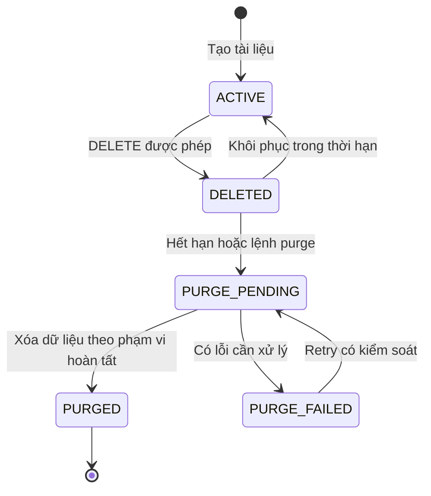
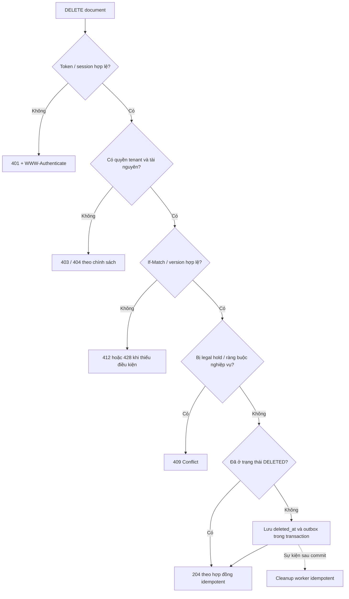
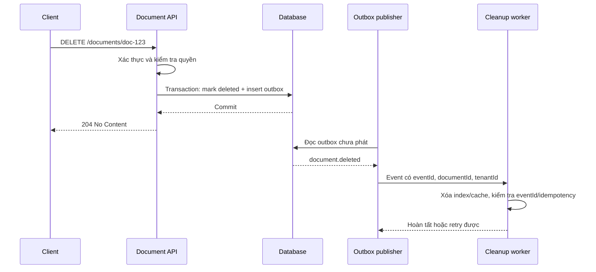
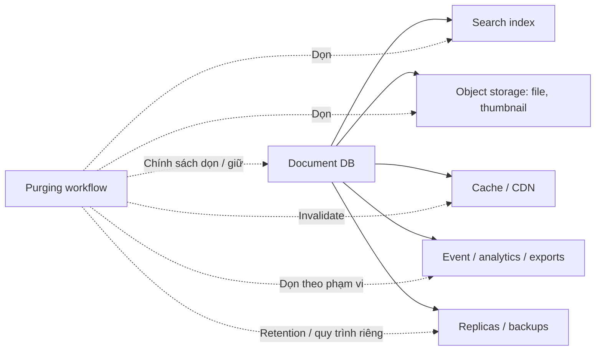

# Xóa mềm, xóa cứng và ý nghĩa hợp đồng API

Một ứng dụng quản lý tài liệu cung cấp nút **Xóa**. Người dùng nhấn nút, nhận phản hồi thành công rồi không còn thấy tài liệu trong danh sách. Nhưng điều gì đã xảy ra phía server: bản ghi được đánh dấu đã xóa, được đưa vào thùng rác trong 30 ngày, hay toàn bộ nội dung bị xóa vĩnh viễn? Nếu client gửi lại yêu cầu vì mất mạng, thao tác có tạo thêm sự kiện hoặc gây lỗi không? Một tài khoản không có quyền có thể dò xem tài liệu của người khác từng tồn tại không?

Những câu hỏi đó thuộc **hợp đồng REST API**. HTTP định nghĩa ý nghĩa của phương thức `DELETE` và cách báo kết quả; HTTP **không quy định** ứng dụng phải xóa vật lý ngay khỏi cơ sở dữ liệu. Kiến trúc sư phải định nghĩa vòng đời tài nguyên, chính sách khôi phục, cách xử lý lỗi, quyền truy cập và mức độ nhất quán của dữ liệu.

Bài thuộc chương **Thao tác tài nguyên** của module **INTEGRATION_API_REST**. Người học sẽ thiết kế tài nguyên/URI, dùng đúng phương thức và mã trạng thái HTTP, quản lý idempotency, cache, hợp đồng OpenAPI, xác thực, phân quyền, xử lý lỗi và kiểm thử với Java/Spring hoặc công nghệ tương đương. Trọng tâm là làm rõ các hệ quả mà client nhìn thấy khi xóa, bất kể cách lưu trữ nội bộ.

## 1. Phân biệt xóa mềm và xóa cứng

| Tiêu chí | Xóa mềm (*soft delete*) | Xóa cứng (*hard delete*) |
|---|---|---|
| Cơ chế thường dùng | Giữ bản ghi và đánh dấu `deleted_at`, `status = DELETED` hoặc chuyển sang trạng thái lưu trữ khác. | Loại bản ghi hoặc đối tượng khỏi kho dữ liệu đang phục vụ; có thể cần dọn nhiều hệ thống. |
| Trải nghiệm thông thường | Không xuất hiện trong danh sách, không đọc được qua API thông thường; có thể có chức năng khôi phục. | Không còn truy cập được qua API; khôi phục thường cần backup hoặc cơ chế ngoài luồng, nếu tồn tại. |
| Rủi ro chính | Truy vấn quên lọc trạng thái xóa, dữ liệu nhạy cảm lưu lâu, xung đột khóa duy nhất, chi phí lưu giữ. | Mất dữ liệu không thể đảo ngược, cascade ngoài ý muốn, khó đối soát hoặc khôi phục. |
| Bảo mật và riêng tư | “Ẩn khỏi giao diện” **không** đồng nghĩa đã đáp ứng yêu cầu xóa dữ liệu thực tế. | Xóa bản ghi chính **không** tự chứng minh dữ liệu đã biến mất khỏi log, cache, bản sao, backup hay đối tác. |
| Vận hành | Cần TTL/retention, cleanup job, kiểm tra khôi phục, dọn tài nguyên phụ trợ. | Cần kiểm soát quyền mạnh, xác minh phụ thuộc, audit và kế hoạch xử lý lỗi từng bước. |
| Phù hợp khi | Sản phẩm có thùng rác, thời gian hoàn tác, lưu lịch sử nghiệp vụ hoặc cần trì hoãn xóa vĩnh viễn. | Dữ liệu hết thời hạn lưu, người dùng yêu cầu xóa vĩnh viễn theo chính sách, dữ liệu tạm hoặc đối tượng không cần khôi phục. |

**Ví dụ:** một tài liệu trong hệ thống cộng tác có thể được đánh dấu xóa trong 30 ngày để chủ sở hữu hoàn tác. Sau thời hạn này, một worker bắt đầu quy trình xóa vĩnh viễn theo chính sách. Ngược lại, một phiên cache tạm có thể được loại bỏ ngay. Đây là **hai quyết định vòng đời dữ liệu**, không phải hai phương thức HTTP riêng biệt.

### 1.1. Xóa mềm khác ẩn, lưu trữ và vô hiệu hóa

Các trạng thái `HIDDEN`, `ARCHIVED`, `DISABLED` và `DELETED` nên có ý nghĩa nghiệp vụ khác nhau:

- **Ẩn (hidden):** dữ liệu vẫn đang hoạt động nhưng không hiển thị ở một giao diện; có thể vẫn tìm kiếm hoặc truy cập qua liên kết.
- **Lưu trữ (archived):** tài nguyên không còn trong luồng công việc hằng ngày, nhưng có thể đọc hoặc đưa trở lại theo quyền.
- **Vô hiệu hóa (disabled):** ngăn một khả năng hoạt động, ví dụ ngăn tài khoản đăng nhập, không nhất thiết xóa hồ sơ.
- **Xóa mềm (deleted):** tài nguyên được xem như đã xóa trong hợp đồng API thông thường; nếu có khôi phục, phải có luồng và quyền riêng.
- **Xóa cứng (purged):** dữ liệu được loại khỏi kho dữ liệu đang phục vụ và các đích liên quan theo phạm vi đã cam kết; có thể vẫn tồn tại trên backup trong giới hạn retention.

Không nên đặt cùng một cờ `is_deleted` để biểu diễn mọi trạng thái nếu chúng có quyền, quy tắc hiển thị và thời hạn lưu khác nhau.

## 2. Ngữ nghĩa DELETE theo HTTP

Theo HTTP Semantics (RFC 9110), `DELETE` yêu cầu origin server loại bỏ **sự liên kết giữa URI đích và chức năng hiện tại của nó**. Cách server thực thi đối với dữ liệu vật lý là chi tiết triển khai. Vì vậy, một API có thể thực hiện soft delete mà vẫn dùng `DELETE /documents/{id}` nếu sau đó tài nguyên không còn hiện diện trong hợp đồng thông thường.

Các thuộc tính cần ghi nhớ:

| Thuộc tính | Ý nghĩa với DELETE |
|---|---|
| **Unsafe** | `DELETE` là thao tác có chủ đích thay đổi trạng thái; khác `GET`/`HEAD` an toàn về ngữ nghĩa. |
| **Idempotent** | Thực hiện cùng một yêu cầu một hay nhiều lần có **hiệu quả dự kiến trên server** như nhau; không có nghĩa các response phải giống hệt. |
| **Không cacheable** | Response của DELETE không phải phản hồi để cache theo HTTP; DELETE thành công còn phải làm vô hiệu các bản cache thích hợp cho URI đích ở cache xử lý request đó. |
| **Không đảm bảo xóa vật lý ngay** | HTTP không yêu cầu xóa bản ghi, file, log, backup và replica đồng thời. |
| **Request body không có ngữ nghĩa chung được định nghĩa** | Không dựa vào body của DELETE để chọn một chế độ xóa tùy tiện; một số trung gian có thể từ chối hoặc xử lý khác nhau. |

**Idempotency là về hiệu ứng dự kiến**, không bắt buộc số lần ghi audit hoặc metric giống nhau. Server có thể ghi nhận hai lần client đã gọi DELETE mà không xóa thêm tài nguyên lần thứ hai. Nếu xóa kích hoạt gửi email, tính phí hoặc tạo job mới mỗi lần gọi, cần thiết kế chống lặp để hiệu quả nghiệp vụ vẫn đúng.

### 2.1. Ví dụ: soft delete đồng bộ

Request:

```http
DELETE /api/v1/documents/doc-123 HTTP/1.1
Host: api.example.com
Authorization: Bearer <access_token>
If-Match: "v7"
```

Nếu server đã kiểm tra quyền và phiên bản, cập nhật trạng thái xóa xong, có thể trả:

```http
HTTP/1.1 204 No Content
Cache-Control: no-store
```

`204` không có response body. Hợp đồng có thể cam kết ngay sau đó:

```http
GET /api/v1/documents/doc-123 HTTP/1.1
Host: api.example.com
Authorization: Bearer <access_token>
```

```http
HTTP/1.1 404 Not Found
Content-Type: application/problem+json
Cache-Control: no-store

{
  "type": "https://api.example.com/problems/document-not-found",
  "title": "Document not found",
  "status": 404
}
```

Ở ví dụ này, `204` có nghĩa server đã thực hiện **hiệu ứng xóa theo hợp đồng**, không chứng minh byte dữ liệu đã biến mất khỏi mọi hệ thống lưu trữ. Các ID ngắn như `doc-123` trong ví dụ HTTP dùng để dễ đọc; mẫu Java, SQL và OpenAPI phía dưới chọn định dạng UUID.

### 2.2. Ví dụ: hard delete bất đồng bộ

Nếu một tài nguyên có file lớn, chỉ mục tìm kiếm và nhiều hệ thống tích hợp, server có thể tiếp nhận yêu cầu rồi xóa dần:

```http
DELETE /api/v1/exports/exp-900 HTTP/1.1
Host: api.example.com
Authorization: Bearer <access_token>
```

```http
HTTP/1.1 202 Accepted
Location: /api/v1/deletion-jobs/job-78
Content-Type: application/json
Cache-Control: no-store

{
  "jobId": "job-78",
  "status": "PENDING",
  "statusUrl": "/api/v1/deletion-jobs/job-78"
}
```

`202 Accepted` cho biết yêu cầu đã được chấp nhận để xử lý và **có thể chưa hoàn tất**. URI theo dõi job là **quy ước do API thiết kế**, không phải điều mà HTTP tự cung cấp. Client gọi `GET /api/v1/deletion-jobs/job-78` theo quyền của mình để xem tiến độ, kết quả hoặc lỗi. Một `202` không phải cam kết rằng tác vụ chắc chắn sẽ thành công.

## 3. Thiết kế hợp đồng: “xóa” có nghĩa gì đối với client?

Trước khi chọn mã trạng thái, mô tả tối thiểu:

1. **Đích xóa:** thao tác trên tài nguyên nào, thuộc ai, có quan hệ phụ thuộc với những tài nguyên nào?
2. **Thời điểm biến mất khỏi API thông thường:** ngay sau `204`, sau khi một job hoàn tất, hay theo trạng thái riêng?
3. **Khả năng phục hồi:** có thùng rác không, ai có thể xem/khôi phục, trong bao lâu và dữ liệu nào được khôi phục?
4. **Thời hạn xóa vĩnh viễn:** dữ liệu nào giữ lại để đối soát/hợp đồng, dữ liệu nào phải dọn và thời hạn cam kết thực tế?
5. **Yêu cầu đồng thời:** có cần `If-Match`, xác nhận người dùng hoặc phê duyệt cho dữ liệu quan trọng không?
6. **Tác động phụ:** file, cache, search index, event, webhook, analytics, backup và bản sao sẽ được xử lý ra sao?
7. **Lỗi và lặp yêu cầu:** client nhận gì nếu tài nguyên đã xóa, đang xóa, không tồn tại, thiếu quyền hoặc không thể xóa?

Một hợp đồng mẫu cho **Document API**:

| Hành động | Endpoint | Ai được gọi? | Hợp đồng hiển thị |
|---|---|---|---|
| Liệt kê tài liệu hoạt động | `GET /api/v1/documents` | Thành viên workspace có quyền đọc | Mặc định không trả tài liệu đã xóa mềm. |
| Đọc tài liệu hoạt động | `GET /api/v1/documents/{id}` | Người được cấp quyền trên tài liệu | Tài liệu đã xóa trả 404 theo chính sách ví dụ. |
| Xóa mềm | `DELETE /api/v1/documents/{id}` | Chủ sở hữu/người có quyền xóa | Trả 204 khi trạng thái xóa đã được lưu bền vững. |
| Liệt kê thùng rác | `GET /api/v1/trash/documents` | Người có quyền xem thùng rác | Chỉ thấy tài liệu đã xóa trong phạm vi quyền. |
| Khôi phục | `POST /api/v1/trash/documents/{id}/restorations` | Người được quyền phục hồi | Tạo yêu cầu khôi phục; ví dụ trả 200 cùng biểu diễn tài liệu hoạt động. |
| Xóa vĩnh viễn có kiểm soát | `DELETE /api/v1/trash/documents/{id}` | Quyền purge riêng | Ví dụ trả 202 kèm URI theo dõi nếu dọn bất đồng bộ. |
| Theo dõi dọn dữ liệu | `GET /api/v1/deletion-jobs/{jobId}` | Chủ yêu cầu hoặc vận hành được cấp quyền | Xem trạng thái `PENDING/RUNNING/COMPLETED/FAILED`, giới hạn nội dung hiển thị. |

Tên URI trong bảng là **một phương án**, không phải quy tắc bắt buộc của REST. Có thể dùng `POST /documents/{id}:restore` hoặc một tài nguyên operation riêng nếu hệ thống đã có quy ước nhất quán. Điều cần tránh là để `GET /documents/{id}` ngầm khôi phục hoặc dùng `DELETE` để thực hiện một thao tác không có ngữ nghĩa xóa.

## 4. Vòng đời tài nguyên và các chuyển trạng thái

Một mô hình tham khảo:



| Trạng thái | Có xuất hiện trong danh sách mặc định? | GET thông thường | Có thể restore? | Ghi chú |
|---|---|---|---|---|
| `ACTIVE` | Có | 200 nếu đủ quyền | Không cần | Cho phép cập nhật theo policy. |
| `DELETED` | Không | Ví dụ 404 | Có trong cửa sổ khôi phục | Dữ liệu vẫn tồn tại để phục hồi; thùng rác có contract riêng. |
| `PURGE_PENDING` | Không | 404 | Thường không; phải xác định chính sách hủy purge | Worker dọn phụ thuộc, có job status. |
| `PURGE_FAILED` | Không | 404 | Theo quy trình vận hành | Cần cảnh báo; không báo “đã xóa vĩnh viễn” cho người dùng nếu chưa hoàn tất. |
| `PURGED` | Không | 404 hoặc 410 có điều kiện | Không | Có thể chỉ còn metadata kiểm toán tối thiểu phù hợp chính sách. |

Không nhất thiết giữ bản ghi `PURGED` trong bảng nghiệp vụ; một deletion-job/tombstone metadata có thể là nguồn theo dõi độc lập. Nếu lưu vĩnh viễn metadata chứa thông tin cá nhân, phải đánh giá lại chính sách riêng tư.

### 4.1. Thời điểm hoàn tất phải rõ ràng

Giả sử `DELETE` đồng bộ chỉ ghi `deleted_at` rồi phát sự kiện để xóa chỉ mục tìm kiếm. Nếu `GET` đọc từ database chính trả 404 nhưng truy vấn search vẫn trả tài liệu trong vài giây, API đang có **độ trễ đồng bộ giữa các biểu diễn**. Hợp đồng cần quy định hệ thống có bảo vệ truy cập tại thời điểm đọc search hay không.

Một thiết kế an toàn thường:

- Ngăn truy cập nội dung gốc ngay khi cờ xóa được lưu thành công.
- Áp dụng bộ lọc trạng thái và phân quyền ở **mỗi điểm đọc**, kể cả search/cache/exports.
- Dùng sự kiện và job để dọn index, thumbnail, cache và đối tác; có retry/idempotency và giám sát backlog.
- Công bố rõ phần nào nhất quán ngay, phần nào nhất quán sau một khoảng thời gian.

Chỉ xóa khỏi database nhưng vẫn cho tải file qua URL cũ không được xem là đã đáp ứng hợp đồng bảo vệ truy cập.

## 5. Chọn mã trạng thái đúng cho DELETE

| Tình huống | Mã thường phù hợp | Phản hồi cần có |
|---|---|---|
| Xóa đồng bộ thành công, không có biểu diễn cần trả | **`204 No Content`** | Không có body. |
| Xóa thành công và trả trạng thái tài nguyên/operation | **`200 OK`** | Có biểu diễn có ý nghĩa, ví dụ trạng thái mới. |
| Đã chấp nhận xử lý bất đồng bộ | **`202 Accepted`** | Mô tả trạng thái/URI theo dõi nếu có; chưa bảo đảm hoàn tất. |
| Không có token hợp lệ cho tài nguyên bảo vệ | **`401 Unauthorized`** | Có `WWW-Authenticate` challenge phù hợp. |
| Có danh tính nhưng thiếu quyền xóa | **`403 Forbidden`** | Không thực hiện xóa; không lộ thông tin nhạy cảm. |
| Không tồn tại hoặc không muốn tiết lộ tài nguyên cho actor | **`404 Not Found`** | Không ghi/sửa gì; hợp đồng nhất quán. |
| Muốn công bố tài nguyên đã bị loại vĩnh viễn | **`410 Gone`** | Chỉ dùng khi **biết** trạng thái đã mất và muốn công bố; không bắt buộc cho soft/hard delete. |
| Xóa bị chặn bởi phụ thuộc/nghiệp vụ hoặc legal hold | **`409 Conflict`** | Nêu điều kiện cần xử lý nếu được phép công bố. |
| Giá trị `If-Match` không còn khớp biểu diễn hiện tại | **`412 Precondition Failed`** | Bảo vệ khỏi thao tác trên phiên bản đã cũ. |
| API yêu cầu client gửi điều kiện trước khi sửa/xóa | **`428 Precondition Required`** | Mô tả yêu cầu `If-Match` hoặc cơ chế precondition tương ứng. |
| Quá hạn mức | **`429 Too Many Requests`** | Có thể dùng `Retry-After` theo chính sách. |
| Hệ thống dọn dữ liệu không khả dụng | `503` hoặc mã 5xx phù hợp | Không báo thành công nếu chưa lưu nhận yêu cầu đáng tin cậy. |

Không có một mã “soft delete” riêng trong HTTP. **`204` không đồng nghĩa hard delete**, cũng như **`202` không mặc nhiên đồng nghĩa soft delete**. Mã biểu diễn kết quả xử lý request, còn phương pháp xóa và lịch sử phục hồi được định nghĩa trong hợp đồng tài nguyên.

### 5.1. Khi DELETE được gửi lặp lại

Ví dụ client gửi:

```http
DELETE /api/v1/documents/doc-123 HTTP/1.1
Host: api.example.com
Authorization: Bearer <access_token>
```

Lần đầu server có thể trả `204`. Lần thứ hai:

- **`204` lần nữa:** phù hợp nếu API định nghĩa “đảm bảo tài nguyên không còn hoạt động” và actor vẫn có quyền thực hiện; không tạo thêm side effect nghiệp vụ.
- **`404`:** cũng có thể phù hợp nếu server nói rằng không còn tài nguyên hiện hữu tại URI; idempotency vẫn được duy trì về hiệu quả dự kiến.
- **`410`:** chỉ phù hợp nếu muốn công bố rằng tài nguyên được biết đã không còn và có chính sách công bố đó.
- **`202`:** có thể hợp lý khi job dọn dữ liệu vẫn đang tiến hành, nhưng nên trả lại cùng operation hoặc cùng trạng thái xử lý thay vì tự tạo job mới mỗi lần.

Điểm quan trọng: **idempotency không bắt buộc response giống hệt nhau**. Một API trả 204 rồi 404 vẫn có thể idempotent; một API trả 202 cả hai lần nhưng tạo hai job gây tác dụng phụ mới có thể vi phạm mục tiêu idempotency ở lớp nghiệp vụ.

### 5.2. 410 Gone không phải “mã cho xóa cứng”

`410` cho biết quyền truy cập tài nguyên đích không còn tại origin server và tình trạng này **có vẻ lâu dài**, nếu server biết điều đó. Nếu không biết chắc tình trạng có vĩnh viễn hay không, `404` vẫn phù hợp. `410` cũng có thể làm lộ rằng một URI từng tồn tại; với tài nguyên người dùng/tenant, cân nhắc chính sách che giấu tồn tại trước khi sử dụng.

Không tạo quy tắc “soft delete trả 404, hard delete trả 410” như thể HTTP yêu cầu. Có thể có sản phẩm dùng 404 cho cả hai, trong khi metadata thùng rác hoặc API quản trị xử lý lịch sử.

## 6. Idempotency, đồng thời và điều kiện If-Match

### 6.1. Vì sao idempotency quan trọng khi client mất mạng?

Client gửi `DELETE`, server đã xóa thành công nhưng kết nối bị ngắt trước khi client nhận response. Client không biết lệnh có thành công hay không và có thể gửi lại. Server nên xử lý sao cho **trạng thái cuối vẫn là đã xóa**, không tạo hai hóa đơn phí hủy, hai email hoặc hai yêu cầu dọn dữ liệu chồng chéo.

Có thể dùng định danh tài nguyên kết hợp trạng thái xóa làm cơ chế chống trùng tự nhiên. Với xử lý bất đồng bộ, lưu một `deletionJobId` duy nhất cho cùng yêu cầu tài nguyên/giai đoạn, đặt unique constraint và xử lý atomic trong transaction. Nếu nghiệp vụ yêu cầu thêm `Idempotency-Key`, cần mô tả rõ phạm vi khóa, thời gian lưu, hành vi khi payload không khớp và cách xử lý race; header này **không tự tạo idempotency**.

### 6.2. Nếu tài nguyên bị sửa giữa lúc xem và xóa?

Người dùng mở `doc-123` khi phiên bản là 7. Trong lúc đó người khác cập nhật nội dung lên phiên bản 8. Nếu xóa luôn, người dùng có thể vô tình xóa một bản vừa được người khác sửa.

Có thể sử dụng **conditional request** với `If-Match`:

```http
DELETE /api/v1/documents/doc-123 HTTP/1.1
Host: api.example.com
Authorization: Bearer <access_token>
If-Match: "v7"
```

Nếu phiên bản hiện tại đã là `"v8"`, server có thể trả:

```http
HTTP/1.1 412 Precondition Failed
Content-Type: application/problem+json

{
  "type": "https://api.example.com/problems/stale-document",
  "title": "Document was modified",
  "status": 412,
  "detail": "Reload the document before deleting it."
}
```

Nếu sản phẩm **bắt buộc** mọi lệnh xóa phải có precondition, có thể trả `428 Precondition Required` khi thiếu `If-Match`. Với concurrent writes, kiểm tra ETag phải gắn vào thao tác cập nhật nguyên tử hoặc transaction có khóa phù hợp; không chỉ kiểm tra version ở bước đọc rồi xóa ở bước ghi sau đó mà không bảo vệ race.

Lưu ý khi kết hợp precondition và idempotency: nếu một lệnh đã thành công rồi client gửi lại cùng `If-Match` cũ, server phải tuân theo quy tắc conditional request đã công bố. Trả `412` trên điều kiện không còn khớp không mặc nhiên phá idempotency của phương thức. Client cần phân biệt “điều kiện thay đổi” với “xóa chưa thực hiện”, tra cứu trạng thái bằng đường được phép hoặc mã operation khi cần.

### 6.3. Race giữa xóa, khôi phục và purge

Các chuyển trạng thái phải được kiểm soát tại storage:

- Hai request xóa cùng lúc: chỉ một request thay trạng thái ACTIVE → DELETED; request còn lại không tạo sự kiện xóa lần hai.
- Khôi phục cạnh tranh với purge: dùng version/row lock hoặc atomic compare-and-set; khi đã vào giai đoạn không thể hoàn tác, restore phải bị từ chối rõ ràng.
- Cập nhật tài liệu cạnh tranh với xóa: thao tác UPDATE cần kiểm tra `deleted_at IS NULL` và version; không được “hồi sinh” tài liệu do lưu bản cập nhật cũ.
- Job purge chạy lặp: xử lý các bước xóa file, index, hàng đợi hoặc metadata theo hướng idempotent; có checkpoint để tiếp tục sau lỗi.

## 7. Thiết kế cấu trúc dữ liệu soft delete

Một bảng đơn giản trong PostgreSQL có thể lưu:

```sql
CREATE TABLE documents (
    id           uuid PRIMARY KEY,
    tenant_id    uuid NOT NULL,
    folder_id    uuid NOT NULL,
    name         text NOT NULL,
    content_ref  text NOT NULL,
    version      bigint NOT NULL DEFAULT 1,
    deleted_at   timestamptz,
    deleted_by   uuid,
    purge_after  timestamptz,
    created_at   timestamptz NOT NULL DEFAULT now(),
    updated_at   timestamptz NOT NULL DEFAULT now(),
    CHECK (
        (deleted_at IS NULL AND purge_after IS NULL)
        OR (deleted_at IS NOT NULL AND purge_after IS NOT NULL)
    )
);

CREATE INDEX idx_documents_active_tenant
    ON documents (tenant_id, folder_id, id)
    WHERE deleted_at IS NULL;
```

Đây là **schema minh họa**, không phải migration sản xuất đầy đủ. `deleted_at` là thời điểm hệ thống đã ghi soft delete; `deleted_by` là actor được kiểm chứng; `purge_after` là mốc đủ điều kiện đưa vào quy trình purge, không đảm bảo đúng mốc đó byte đã bị xóa khỏi mọi hệ thống. Với dữ liệu có legal hold, retention đặc biệt hoặc phụ thuộc pháp lý, cần chính sách phê duyệt trước khi purge.

### 7.1. Truy vấn phải lọc đúng trạng thái và tenant

Sai lầm phổ biến là quên lọc soft delete:

```sql
-- Sai cho danh sách tài liệu đang hoạt động:
SELECT id, name FROM documents WHERE tenant_id = :tenant_id;

-- Đúng cho danh sách hoạt động, với tenant lấy từ ngữ cảnh đã xác minh:
SELECT id, name
FROM documents
WHERE tenant_id = :verified_tenant_id
  AND deleted_at IS NULL
ORDER BY id
LIMIT :limit;
```

Đường tìm kiếm, thống kê, batch, cache, export và API cũ phải có cùng chính sách hiển thị. Một query lọc tenant đúng nhưng quên `deleted_at` vẫn có thể làm lộ tài liệu người dùng tưởng đã xóa.

### 7.2. Xử lý uniqueness khi xóa và khôi phục

Giả sử tên tài liệu phải duy nhất trong một thư mục. Nếu xóa mềm tài liệu `Báo cáo quý 1` rồi tạo tài liệu mới cùng tên, sau đó khôi phục tài liệu cũ, hệ thống gặp **xung đột tên**.

Hai chính sách thường gặp:

1. **Giữ chỗ tên trong thời hạn thùng rác:** unique constraint bao gồm cả bản ghi đã xóa, do đó không thể tạo tài liệu mới cùng tên cho đến khi xóa vĩnh viễn hoặc đổi tên bản cũ.
2. **Cho phép dùng lại tên sau khi xóa:** unique index chỉ áp dụng cho bản ghi hoạt động; thao tác restore phải kiểm tra xung đột và có thể yêu cầu đổi tên trước khi hoàn tất.

Ví dụ PostgreSQL cho phương án thứ hai:

```sql
CREATE UNIQUE INDEX uq_active_document_name
ON documents (tenant_id, folder_id, name)
WHERE deleted_at IS NULL;
```

Không tự động hồi sinh với tên đã bị chiếm hoặc ghi đè tài liệu mới. Trả `409 Conflict` với thông điệp rõ ràng, hoặc cung cấp workflow chọn tên khác. Việc khôi phục quan hệ thư mục, quyền chia sẻ và liên kết tới tài liệu khác cũng cần quy tắc tương tự.

### 7.3. Xóa mềm không miễn trừ việc quản lý dữ liệu nhạy cảm

Dữ liệu xóa mềm vẫn tồn tại, có thể bị đọc bởi truy vấn đặc quyền, log, backup hoặc nhân viên vận hành. Vì thế cần mã hóa, giới hạn quyền truy cập, thời hạn retention, quy tắc xuất/khôi phục và chính sách audit. Không khẳng định đã “xóa vĩnh viễn” chỉ vì `deleted_at` khác `NULL`.

## 8. Thiết kế thao tác xóa nguyên tử và an toàn

Mẫu xử lý khuyến nghị cho `DELETE /documents/{id}`:



Luồng sơ đồ chỉ mô tả một chính sách mẫu; trong triển khai thực tế, kiểm tra tài nguyên, tenant, version và ghi trạng thái phải bảo vệ tính nguyên tử. Với request không có `If-Match` khi precondition không bắt buộc, có thể bỏ nhánh đó. Ở môi trường bảo mật cao, không để nhánh “đã xóa” tiết lộ tài nguyên khác tenant.

### 8.1. SQL cập nhật trạng thái có điều kiện

Nếu đã xác thực người dùng, lấy tenant đáng tin cậy và kiểm tra quyền, ứng dụng có thể dùng câu lệnh:

```sql
UPDATE documents
SET deleted_at  = now(),
    deleted_by  = :verified_actor_id,
    purge_after = now() + interval '30 days',
    updated_at  = now(),
    version     = version + 1
WHERE id = :document_id
  AND tenant_id = :verified_tenant_id
  AND deleted_at IS NULL
  AND version = :expected_version
RETURNING id, version, deleted_at;
```

Nếu trả về 0 dòng, **không thể suy ra ngay** nguyên nhân: tài nguyên không tồn tại, khác tenant, đã bị xóa, hay version không khớp. Muốn trả `204`/`404`/`412` chính xác, cần quy trình đọc/khóa và kiểm tra quyền phù hợp, bảo vệ race. Một mô hình `SELECT ... FOR UPDATE` trong transaction, kiểm tra policy và cập nhật sau đó, là lựa chọn dễ hiểu khi bắt đầu.

### 8.2. Ghi sự kiện bằng transactional outbox

Không nên ghi xóa vào database rồi publish message trực tiếp mà không có phương án xử lý khi publish thất bại. Ví dụ sau khi commit soft delete nhưng trước khi gửi event `document.deleted`, tiến trình bị crash. Database đã ẩn tài liệu, nhưng search index và object phụ trợ vẫn chưa được dọn.

**Transactional outbox** lưu bản ghi thay đổi trạng thái và sự kiện cần phát trong **cùng một database transaction**. Worker đọc outbox, gửi event, retry an toàn và ghi trạng thái phát. Consumer phải chịu được event giao lại, vì cơ chế truyền sự kiện thường có thể tạo trùng.



Chỉ đưa thông tin cần thiết vào event; `tenantId` trong event phải đến từ dữ liệu đã được kiểm chứng. Không dùng event thô từ client làm nguồn sự thật của quyền.

## 9. Ví dụ Java/Spring Boot: soft delete theo hợp đồng

Ví dụ dưới đây dùng Spring Boot 3, Spring Web và transaction management. Các abstraction `DocumentRepository`, `DocumentPolicy`, `TenantContextResolver`, `OutboxRepository` là **thành phần ứng dụng cần hiện thực**; đoạn code tập trung vào vị trí kiểm tra quyền và thao tác transaction.

### 9.1. Controller dùng DELETE

```java
import java.util.UUID;
import org.springframework.http.HttpHeaders;
import org.springframework.http.HttpStatus;
import org.springframework.http.ResponseEntity;
import org.springframework.security.core.Authentication;
import org.springframework.web.bind.annotation.DeleteMapping;
import org.springframework.web.bind.annotation.PathVariable;
import org.springframework.web.bind.annotation.RequestHeader;
import org.springframework.web.bind.annotation.RequestMapping;
import org.springframework.web.bind.annotation.RestController;
import org.springframework.web.server.ResponseStatusException;

@RestController
@RequestMapping("/api/v1/documents")
public class DocumentController {
    private final DocumentLifecycleService lifecycle;

    public DocumentController(DocumentLifecycleService lifecycle) {
        this.lifecycle = lifecycle;
    }

    @DeleteMapping("/{id}")
    public ResponseEntity<Void> deleteDocument(
            @PathVariable UUID id,
            @RequestHeader(value = HttpHeaders.IF_MATCH, required = false)
            String ifMatch,
            Authentication authentication) {
        if (ifMatch == null) {
            throw new ResponseStatusException(
                HttpStatus.PRECONDITION_REQUIRED, "If-Match is required");
        }
        lifecycle.softDelete(id, ifMatch, authentication);
        return ResponseEntity.noContent().build();
    }
}
```

### 9.2. Service kiểm tra tenant và giao dịch

```java
import java.time.Instant;
import java.time.temporal.ChronoUnit;
import java.util.UUID;
import org.springframework.http.HttpStatus;
import org.springframework.security.core.Authentication;
import org.springframework.stereotype.Service;
import org.springframework.transaction.annotation.Transactional;
import org.springframework.web.server.ResponseStatusException;

@Service
public class DocumentLifecycleService {
    private final DocumentRepository repository;
    private final DocumentPolicy policy;
    private final TenantContextResolver tenantResolver;
    private final OutboxRepository outbox;

    public DocumentLifecycleService(
            DocumentRepository repository,
            DocumentPolicy policy,
            TenantContextResolver tenantResolver,
            OutboxRepository outbox) {
        this.repository = repository;
        this.policy = policy;
        this.tenantResolver = tenantResolver;
        this.outbox = outbox;
    }

    @Transactional
    public void softDelete(
            UUID documentId, String ifMatch, Authentication authentication) {
        // Tenant context được giải từ phiên và membership tin cậy.
        UUID tenantId = tenantResolver.requireActiveTenant(authentication);

        // Truy vấn bao gồm bản ghi đã xóa để xử lý DELETE lặp lại.
        // Repository phải khóa hàng trong transaction và giới hạn tenant.
        Document document = repository
            .findIncludingDeletedForUpdate(tenantId, documentId)
            .orElseThrow(() ->
                new ResponseStatusException(HttpStatus.NOT_FOUND));

        // Phân quyền cả tài nguyên, không chỉ role ở API Gateway.
        policy.requireDeletePermission(authentication, document);

        // Ví dụ chỉ chấp nhận một strong ETag dạng "v<version>".
        String currentEtag = "\"v" + document.getVersion() + "\"";
        if (!currentEtag.equals(ifMatch)) {
            throw new ResponseStatusException(
                HttpStatus.PRECONDITION_FAILED, "Document version changed");
        }

        if (document.isDeleted()) {
            return; // Không ghi sự kiện xóa thứ hai.
        }
        if (document.isUnderLegalHold()) {
            throw new ResponseStatusException(
                HttpStatus.CONFLICT, "Deletion is currently restricted");
        }

        Instant now = Instant.now();
        document.markDeleted(now, now.plus(30, ChronoUnit.DAYS),
            authentication.getName());
        repository.save(document);

        // Lưu cùng transaction; một publisher riêng xử lý sau commit.
        outbox.appendDocumentDeleted(
            UUID.randomUUID(), tenantId, documentId, now);
    }
}
```

**Các giả định của ví dụ:** endpoint được bảo vệ bằng Spring Security nên `Authentication` đã hợp lệ; repository có locking phù hợp; chính sách quyền trả lỗi đúng mô hình 403/404; `markDeleted` lưu thông tin cần thiết; outbox và document cùng một nguồn giao dịch. Đây là **mẫu kiến trúc**, chưa phải ứng dụng biên dịch độc lập. Một hệ thống thực cần validator/audience cho token, mapping danh tính actor, migration, lock strategy, thống nhất time source và xử lý exception theo Problem Details.

Để ngắn gọn, đoạn code chỉ nhận **một ETag mạnh** có định dạng `"v<version>"` do chính server phát hành. Triển khai hỗ trợ `If-Match` đầy đủ phải xử lý cú pháp danh sách entity-tag và dấu `*` theo HTTP, không nối phiên bản tùy tiện từ request; ETag phản ánh phiên bản biểu diễn được GET cung cấp. Kiểm tra version trong transaction phải đi cùng khóa hàng/optimistic locking để chống race. Khi DELETE đã thành công nhưng client retry với ETag cũ, 412 có thể là kết quả đúng theo precondition dù hiệu quả xóa vẫn idempotent.

### 9.3. Tránh bộ lọc “ẩn mặc định” che mất đường phục hồi

Trong ORM, có thể cấu hình filter loại bản ghi có `deleted_at`. Cần kiểm tra nó áp dụng cho mọi truy vấn thông thường, quan hệ, join, batch và native SQL. Đường thùng rác/restore bắt buộc phải có cách truy vấn bản ghi đã xóa **có kiểm tra quyền riêng**. Nếu filter toàn cục làm developer không biết tại sao restore không thấy tài liệu, rất dễ nảy sinh lối tắt truy cập database bằng role đặc quyền và làm mất khả năng kiểm soát tenant.

## 10. Khôi phục tài nguyên đã xóa

Khôi phục không phải là hiệu ứng tự nhiên của HTTP DELETE. Đây là một **nghiệp vụ riêng** cần định nghĩa quyền, thời hạn, trạng thái và lỗi:

```http
POST /api/v1/trash/documents/doc-123/restorations HTTP/1.1
Host: api.example.com
Authorization: Bearer <access_token>
Content-Length: 0
```

```http
HTTP/1.1 200 OK
Content-Type: application/json
Cache-Control: no-store

{
  "id": "doc-123",
  "status": "ACTIVE",
  "version": 9
}
```

Vì `POST` không mặc định idempotent theo HTTP, nếu client có thể retry khi mất mạng, hãy quyết định hợp đồng lặp yêu cầu: có thể trả trạng thái tài liệu đã ACTIVE và không tạo side effect lần nữa, hoặc sử dụng operation ID/idempotency key. Khôi phục cần kiểm tra:

- **Quyền:** người gọi thuộc đúng tenant và có quyền restore, có thể khác quyền delete.
- **Thời gian:** trong cửa sổ khôi phục; nếu đang purge hoặc đã purged thì từ chối theo hợp đồng.
- **Quan hệ:** thư mục/parent còn tồn tại, chia sẻ quyền vẫn hợp lệ, file đính kèm và metadata còn đủ.
- **Xung đột:** tên hoặc khóa duy nhất đã được dùng lại; trả 409 và đưa ra cách giải quyết.
- **Bảo mật:** không tự động khôi phục các quyền chia sẻ đã bị thu hồi hoặc khóa tích hợp đã bị vô hiệu hóa.
- **Nhất quán:** search index/cache phải cập nhật, event restore được xử lý idempotent.

Nếu phục hồi mất thời gian, có thể dùng `202 Accepted` và một tài nguyên operation riêng.

## 11. Xóa cứng: không chỉ DELETE FROM bảng chính

Một hệ thống có thể lưu cùng một tài liệu ở nhiều nơi:



**Hard delete khỏi database đang phục vụ không đồng nghĩa mọi bản dữ liệu từng tồn tại đã biến mất.** Có thể còn bản sao ở replica, object storage, log, snapshot, backup, dữ liệu phân tích và bên thứ ba. Cần mô tả rõ:

| Thành phần | Cách xử lý đề xuất | Giới hạn |
|---|---|---|
| Database nghiệp vụ | Xóa row hoặc thực hiện cascade có kiểm soát; bảo vệ referential integrity. | `ON DELETE CASCADE` có thể xóa nhiều hơn dự tính; cần kiểm tra phụ thuộc. |
| Object storage | Xóa file, version/thumbnail theo lifecycle; kiểm tra policy đối với versioning. | Xóa phiên bản hiện hành chưa chắc xóa các phiên bản cũ. |
| Cache/CDN | Invalidate key và đường dẫn liên quan, ngăn tái tạo từ nguồn cũ. | Tính nhất quán có thể bị trễ; cần giới hạn truy cập ngay. |
| Search/analytics | Dọn chỉ mục và dữ liệu xuất theo phạm vi; lưu dấu job và retry. | Một số kho là append-only hoặc có retention riêng. |
| Event, log, audit | Tối thiểu hóa dữ liệu cá nhân, áp dụng retention và chính sách xóa/ẩn danh phù hợp. | Không nên tự ý phá hủy toàn bộ log kiểm toán khi còn nghĩa vụ lưu giữ. |
| Replica | Thao tác xóa thường được nhân bản theo cơ chế storage. | Không thay thế việc quản lý backup lịch sử. |
| Backup | Retention, chính sách khôi phục, cách tránh tái xuất dữ liệu đã xóa khi restore. | Không hứa xóa ngay khỏi bản backup bất biến nếu chính sách lưu giữ không cho phép. |
| Đối tác tích hợp | Gửi yêu cầu xóa/thu hồi quyền theo hợp đồng và ghi nhận kết quả. | Không thể bảo đảm hành động của bên thứ ba chỉ bằng HTTP 204 từ API của mình. |

### 11.1. Right to erasure, retention và legal hold

Các yêu cầu về quyền xóa dữ liệu hoặc nghĩa vụ lưu giữ phụ thuộc loại dữ liệu, hợp đồng và quy định áp dụng. Khi triển khai:

1. Phân loại dữ liệu theo mục đích và thời hạn lưu giữ đã được phê duyệt.
2. Phân biệt “không còn truy cập được qua API” với “đã hoàn tất việc xóa theo phạm vi tổ chức cam kết”.
3. Ghi rõ ngoại lệ như lưu giữ theo nghĩa vụ, tranh chấp hoặc yêu cầu kiểm toán; chỉ lưu tối thiểu cần thiết và bảo vệ quyền.
4. Xem xét backup bất biến: nếu không thể chỉnh bản backup, xác định retention, hạn chế quyền restore và quy trình áp dụng lại yêu cầu xóa sau khôi phục.
5. Lưu bằng chứng thực hiện, thời điểm, hệ thống xử lý và kết quả, nhưng tránh giữ lại dữ liệu cá nhân quá mức trong audit.

**Không đưa ra tuyên bố “đã xóa vĩnh viễn trên mọi hệ thống” khi mới xóa row ở database chính.** Trường hợp pháp lý hoặc cam kết riêng tư cụ thể cần được đánh giá cùng bộ phận phụ trách chính sách dữ liệu.

### 11.2. Vì sao xóa cứng cần workflow?

Xóa một bảng có thể là transaction đơn; xóa database + object storage + search + analytics + đối tác không có một transaction ACID xuyên các hệ thống. Thường phải dùng workflow với các bước idempotent, retry, checkpoint, dead-letter/error state và reconciler để phát hiện dữ liệu sót. Có thể trả `202` cho client và cung cấp trạng thái job. Một job `COMPLETED` phải dựa trên **điều kiện hoàn tất được định nghĩa**, không chỉ dựa vào việc đã gửi message.

## 12. Cache, tìm kiếm và phân trang sau khi xóa

Các hiệu ứng phải được thiết kế theo hợp đồng đọc:

- **GET tài nguyên:** trả 404/410 theo chính sách ngay khi trạng thái soft delete đã bền vững; cache không trả lại phiên bản cũ trái quyền.
- **GET collection:** mặc định loại các phần tử đã xóa; có thể có thùng rác và lọc riêng cho role thích hợp.
- **Phân trang:** nếu client đang đi theo cursor, việc xóa giữa các trang có thể thay đổi số phần tử hiển thị. Ưu tiên cursor ổn định theo khóa sắp xếp, chấp nhận số phần tử thay đổi, không cam kết snapshot đồng nhất nếu chưa có cơ chế.
- **ETag:** đại diện tài nguyên thay đổi hoặc biến mất sau xóa; cache validator cũ không được khiến GET trả nội dung đã xóa.
- **CDN và index:** cần invalidation cùng kiểm tra quyền tại điểm phục vụ để không công bố dữ liệu cũ khi pipeline dọn bất đồng bộ đang chậm.
- **Search count/facets:** bộ lọc trạng thái và quyền phải áp dụng cả số lượng kết quả, không chỉ phần nội dung.

Theo HTTP, một DELETE thành công làm cache ở đường đi xử lý request vô hiệu các phản hồi đã lưu phù hợp cho URI đích, nhưng điều đó **không bảo đảm** mọi CDN, cache ứng dụng, search index và browser ở các đường khác đều cập nhật ngay. Cần cơ chế invalidation chủ động và giới hạn TTL/độ trễ được giám sát.

## 13. Phân quyền và tránh lộ thông tin tài nguyên

Xóa là thao tác nhạy cảm vì mất dữ liệu có thể không đảo ngược:

1. **Authentication:** xác minh token/session và danh tính workload; nếu thiếu credential hợp lệ, trả 401 và `WWW-Authenticate` phù hợp.
2. **Authorization:** kiểm tra actor có quyền `documents:delete`, membership tenant, owner và chính sách tài nguyên. Quyền `documents:read` không tự cho phép xóa.
3. **Scope của bulk delete:** phải kiểm tra quyền trên **từng tài nguyên** hoặc một tập ràng buộc tenant đủ chặt; không để body `tenantId` tự quyết định phạm vi.
4. **Tài nguyên không thuộc quyền:** 403 hoặc 404 theo chính sách che giấu; nhất quán với GET/list/search; không lộ rằng tài liệu khác tenant đã xóa.
5. **Restore và purge:** có thể yêu cầu quyền riêng, MFA/approval cho purge, audit của actor và mục đích. Không cho một API key quyền đọc thực hiện purge.
6. **Rate limiting và abuse detection:** phát hiện thao tác xóa hàng loạt bất thường, giới hạn concurrency và có khả năng vô hiệu hóa quyền khẩn cấp.
7. **Audit có giới hạn:** ai thao tác, tài nguyên/tenant được phép ghi nhận, thời điểm, kết quả và correlation ID; không log token, nội dung nhạy cảm hoặc bí mật.

### 13.1. Không dùng 404 để thay thế phân quyền

Giả sử `DELETE /documents/doc-of-tenant-B` được gọi với token của người thuộc tenant A. Một ứng dụng có thể cố “giấu” sự tồn tại bằng 404 nhưng vẫn xóa bản ghi nếu repository gọi bằng ID trước khi kiểm tra tenant. Đó là lỗi nghiêm trọng. Luồng đúng phải **kiểm tra quyền trước thay đổi dữ liệu**, hoặc sử dụng query mutation ràng buộc tenant/actor đã xác minh và xử lý kết quả an toàn.

## 14. Biểu diễn lỗi với Problem Details

Có thể sử dụng `application/problem+json` theo RFC 9457 để thống nhất lỗi. Ví dụ tài liệu bị legal hold:

```http
HTTP/1.1 409 Conflict
Content-Type: application/problem+json
Cache-Control: no-store

{
  "type": "https://api.example.com/problems/document-locked",
  "title": "Document cannot be deleted",
  "status": 409,
  "detail": "The document is currently protected by a retention rule.",
  "code": "DOCUMENT_LOCKED"
}
```

Các nguyên tắc:

- Dùng mã HTTP phù hợp với nguyên nhân; `status` trong body nếu có phải khớp status thực.
- `type` định danh loại lỗi ổn định; `code` là extension của ứng dụng nếu cần, không phải field bắt buộc của RFC.
- Thông báo cho client chỉ chứa thông tin actor được phép biết, tránh tiết lộ tên tenant khác, policy nội bộ hoặc vị trí storage.
- Không biến mọi lỗi xóa thành `500`; cũng không trả `204` khi transaction ghi trạng thái xóa chưa thành công.
- Nếu API dựa vào ETag, tài liệu hóa `412`, `428` và cách client lấy lại biểu diễn hiện tại.

## 15. Mô tả DELETE, restore và purge bằng OpenAPI

Ví dụ OpenAPI 3.1 dưới đây mô tả phần hợp đồng cốt lõi. Trong dự án thực, bổ sung toàn bộ schema tài liệu, request/response mẫu, tham số phân trang, chính sách lỗi và yêu cầu quyền:

```yaml
openapi: 3.1.0
info:
  title: Document Lifecycle API
  version: 1.0.0
paths:
  /api/v1/documents/{id}:
    delete:
      summary: Soft-delete a document
      description: >
        Makes the document unavailable from normal read/list endpoints.
        An authorized user may restore it during the retention period.
        This operation does not promise immediate physical data removal.
      security:
        - bearerAuth: []
      parameters:
        - name: id
          in: path
          required: true
          schema:
            type: string
            format: uuid
        - name: If-Match
          in: header
          required: true
          schema:
            type: string
          description: ETag of the document representation
      responses:
        "204":
          description: Document soft-deleted; no response content
        "401":
          description: Missing or invalid access token
          headers:
            WWW-Authenticate:
              schema:
                type: string
        "403":
          description: Caller lacks permission to delete
        "404":
          description: Document absent or hidden by access policy
        "409":
          description: Document cannot be deleted in current business state
        "412":
          description: If-Match precondition failed
        "428":
          description: If-Match header is required
  /api/v1/trash/documents/{id}/restorations:
    post:
      summary: Restore a soft-deleted document
      security:
        - bearerAuth: []
      parameters:
        - name: id
          in: path
          required: true
          schema:
            type: string
            format: uuid
      responses:
        "200":
          description: Document restored
        "403":
          description: Caller lacks permission to restore
        "404":
          description: No restorable document found
        "409":
          description: Restore conflicts with another active document or purge
  /api/v1/trash/documents/{id}:
    delete:
      summary: Request permanent deletion
      security:
        - bearerAuth: []
      parameters:
        - name: id
          in: path
          required: true
          schema:
            type: string
            format: uuid
      responses:
        "202":
          description: Purge job accepted; processing may not be complete
          headers:
            Location:
              schema:
                type: string
              description: URI of the deletion job
        "403":
          description: Caller lacks permission to purge
        "404":
          description: Document absent or hidden by access policy
        "409":
          description: Purge currently blocked by retention/legal hold
components:
  securitySchemes:
    bearerAuth:
      type: http
      scheme: bearer
      bearerFormat: JWT
```

**Chú ý về tính nhất quán:** ví dụ OpenAPI **yêu cầu `If-Match`** giống controller Spring; thiếu header trả 428, phiên bản sai trả 412. Phần mã minh họa chỉ xử lý cú pháp ETag đơn giản; nếu triển khai cú pháp HTTP đầy đủ hoặc chuyển sang chính sách không yêu cầu `If-Match`, phải sửa cả code, kiểm thử và đặc tả tương ứng. Không phát hành hợp đồng mâu thuẫn với hành vi thực tế.

Nếu purge bất đồng bộ, cần mô tả thêm `GET /deletion-jobs/{id}`, trạng thái job, quyền theo dõi và tiêu chí `COMPLETED`. Mã `202` không bảo đảm dữ liệu đã được xóa vĩnh viễn tại thời điểm response.

## 16. Kiểm thử API: trạng thái và hệ quả dữ liệu

### 16.1. Ma trận kiểm thử cốt lõi

| Mã | Tình huống | Kết quả mong đợi |
|---|---|---|
| DEL-01 | Owner xóa tài liệu ACTIVE với ETag hiện tại | 204; bản ghi đánh dấu DELETED; GET/list không còn trả dữ liệu. |
| DEL-02 | Gửi lại DELETE không có precondition theo hợp đồng hỗ trợ | 204 hoặc 404 nhất quán; không tạo thêm sự kiện hay tác vụ gây side effect. |
| DEL-03 | DELETE với ETag cũ sau khi tài liệu được sửa | 412; bản ghi không bị xóa. |
| DEL-04 | Thiếu `If-Match` khi contract yêu cầu | 428; tài liệu vẫn ACTIVE. |
| DEL-05 | Actor không có token hợp lệ | 401 + `WWW-Authenticate`; không thay đổi dữ liệu. |
| DEL-06 | Actor có token hợp lệ nhưng thiếu quyền | 403; không thay đổi dữ liệu. |
| DEL-07 | Actor tenant A gửi DELETE tài liệu của B | 403/404 theo policy; dữ liệu B không đổi, không lộ tồn tại. |
| DEL-08 | Document bị retention/legal hold | 409; không đánh dấu xóa, không lập job purge. |
| DEL-09 | Hai DELETE cạnh tranh | Một transition ACTIVE → DELETED, không có hai event nghiệp vụ gây tác dụng phụ. |
| DEL-10 | UPDATE và DELETE chạy đồng thời | Chỉ chuyển trạng thái hợp lệ; không hồi sinh bản ghi đã xóa. |
| RES-01 | Khôi phục trong hạn, đủ quyền, không xung đột | Tài liệu ACTIVE, truy cập trở lại theo policy và audit đúng. |
| RES-02 | Restore bị xung đột tên do tài liệu mới trùng | 409; không ghi đè tài liệu mới. |
| RES-03 | Restore sau khi bắt đầu purge không cho hoàn tác | Từ chối theo contract; không đổi trạng thái sai. |
| PUR-01 | Purge được nhận nhưng worker chưa chạy | 202; job truy vấn được và trạng thái phản ánh thực tế. |
| PUR-02 | Worker crash giữa chừng rồi retry | Hoàn thành các bước còn lại, không gây side effect trùng. |
| PUR-03 | Một file/object phụ trợ không thể xóa | Job chưa được đánh dấu COMPLETED; có retry/cảnh báo. |
| DATA-01 | Search, cache, export sau soft delete | Không rò nội dung tài liệu đã xóa và không lộ dữ liệu khác tenant. |
| DATA-02 | Backup được restore sau khi purge | Quy trình áp dụng lại danh sách yêu cầu xóa theo chính sách; dữ liệu đã bị purge không trở lại API. |

Test phải kiểm tra **response status, header, trạng thái database, event/outbox, cache/search và quyền truy cập**. Một bài test chỉ thấy 204 mà không kiểm tra dữ liệu có thể bỏ qua lỗi “server trả thành công nhưng chưa ghi”.

### 16.2. HTTP smoke test bằng curl

```bash
# Thay UUID và token bằng dữ liệu kiểm thử được phép.
curl -i -X DELETE \
  -H "Authorization: Bearer <access_token>" \
  -H 'If-Match: "v7"' \
  https://api.example.com/api/v1/documents/00000000-0000-4000-8000-000000000123

# Kiểm tra tài nguyên đã biến mất khỏi API đọc thông thường.
curl -i \
  -H "Authorization: Bearer <access_token>" \
  https://api.example.com/api/v1/documents/00000000-0000-4000-8000-000000000123
```

Đây là URL/token minh họa. Khi chạy thật, tránh ghi token vào terminal history, log chia sẻ hoặc CI output. Với `204`, xác minh body rỗng và content-type không khiến client cố parse JSON không có.

### 16.3. Ví dụ MockMvc định hướng hợp đồng

Ví dụ với ứng dụng Spring Security đã có endpoint và policy:

```java
import static org.springframework.security.test.web.servlet.request.SecurityMockMvcRequestPostProcessors.jwt;
import static org.springframework.test.web.servlet.request.MockMvcRequestBuilders.delete;
import static org.springframework.test.web.servlet.result.MockMvcResultMatchers.status;

import org.junit.jupiter.api.Test;
import org.springframework.beans.factory.annotation.Autowired;
import org.springframework.boot.test.autoconfigure.web.servlet.AutoConfigureMockMvc;
import org.springframework.boot.test.context.SpringBootTest;
import org.springframework.test.web.servlet.MockMvc;

@SpringBootTest
@AutoConfigureMockMvc
class DocumentDeletionApiTest {
    @Autowired MockMvc mvc;

    @Test
    void anonymousDeleteRequiresAuthentication() throws Exception {
        mvc.perform(delete("/api/v1/documents/{id}",
                "00000000-0000-4000-8000-000000000123"))
            .andExpect(status().isUnauthorized());
    }

    @Test
    void missingDeleteAuthorityIsForbidden() throws Exception {
        mvc.perform(delete("/api/v1/documents/{id}",
                "00000000-0000-4000-8000-000000000123")
                    .with(jwt().authorities(
                        new org.springframework.security.core.authority
                            .SimpleGrantedAuthority("SCOPE_documents:read"))))
            .andExpect(status().isForbidden());
    }
}
```

Đoạn test này **giả định** security filter thực thi kiểm tra `SCOPE_documents:delete` cho route tương ứng. Nếu chưa cấu hình filter/annotation bảo vệ endpoint, test thứ hai có thể không đạt: đó là phát hiện cần sửa, không phải kết quả được bảo đảm sẵn. `jwt()` mô phỏng ngữ cảnh xác thực, không kiểm chứng chữ ký, issuer/audience của token thật. Cần test tích hợp riêng cho token và kiểm tra thay đổi database/outbox khi DELETE được chấp nhận hoặc bị từ chối.

## 17. Bài tập thiết kế: Thùng rác cho SaaS nhiều tenant

### Đề bài

Một nền tảng SaaS quản lý dự án có tài nguyên `/workspaces/{workspaceId}/tasks/{taskId}`. Mỗi task có bình luận, tệp đính kèm, chỉ mục tìm kiếm và hoạt động kiểm toán. Sản phẩm yêu cầu:

- Thành viên có quyền `tasks:delete` được xóa task, nhưng trong **14 ngày** có thể khôi phục.
- Thành viên không thuộc workspace không được biết task có tồn tại hay không.
- Sau 14 ngày, hệ thống bắt đầu purge dữ liệu theo chính sách; việc xóa file và chỉ mục có thể mất vài phút.
- Một số task có legal hold, không được purge cho tới khi điều kiện lưu giữ kết thúc.
- Người dùng làm việc trên mạng di động và có thể gửi DELETE lặp lại sau timeout.
- Tên task được phép trùng, nhưng số định danh phải không bị tái sử dụng trong cùng workspace.

**Yêu cầu thực hành:**

1. Định nghĩa trạng thái, thời hạn giữ, quyền xóa/khôi phục/purge và hợp đồng `GET`/`DELETE`.
2. Chọn mã trạng thái cho xóa đồng bộ, purge bất đồng bộ, token thiếu, thiếu quyền, task khác workspace, legal hold và `If-Match` sai.
3. Thiết kế schema lưu `deleted_at`, `purge_after`, version và tenant/workspace; trình bày truy vấn lọc task hoạt động.
4. Vẽ luồng xử lý xóa và phát sự kiện đảm bảo không gửi hai lệnh xóa file khi client retry.
5. Thiết kế API restore và quy trình dọn file, search index, cache, backup.
6. Viết OpenAPI tối thiểu và ma trận kiểm thử cho xóa lặp, cập nhật cạnh tranh, tenant isolation và thất bại của worker.

### Gợi ý đáp án

Một phương án hợp lý: `DELETE /workspaces/{workspaceId}/tasks/{taskId}` kiểm tra quyền và trạng thái, sau đó ghi `DELETED` và trả 204; `GET` thông thường trả 404; thùng rác dùng URI riêng có quyền riêng; restore bằng POST trong 14 ngày; purge bằng job sau hạn, nếu legal hold thì giữ dữ liệu và đánh dấu trạng thái chờ theo chính sách. Các sự kiện xóa/khôi phục ghi outbox trong transaction, consumer idempotent và có retry.

Nếu client gửi cùng DELETE hai lần, hiệu quả cuối là một task bị xóa và tối đa một luồng cleanup nghiệp vụ cho lần xóa đó. Nếu actor khác workspace, luôn từ chối **trước thay đổi dữ liệu** và chỉ trả 404 theo chính sách che giấu. Không báo purge hoàn tất cho tới khi các đích dữ liệu cam kết đã được kiểm tra; backup áp dụng retention và quy trình tránh tái xuất dữ liệu đã bị xóa.

Một thiết kế tốt phải giải thích **đánh đổi**: soft delete giúp hoàn tác nhưng tăng nguy cơ lộ dữ liệu và chi phí lưu giữ; hard delete giảm dữ liệu tồn dư nhưng khó khôi phục; bất đồng bộ giảm thời gian chờ request nhưng cần job tracking, đối soát và vận hành.

## 18. Các phản mẫu cần tránh

1. **Gọi DELETE nhưng chỉ ẩn nút trong giao diện:** API khác vẫn đọc được tài liệu, không có trạng thái vòng đời được xác định.
2. **Dùng `GET /documents/{id}/delete`:** GET phải an toàn về ngữ nghĩa; crawler, prefetch hoặc cache có thể vô tình kích hoạt xóa.
3. **Trả 204 ngay trước khi ghi trạng thái xóa:** client tưởng đã hoàn tất nhưng database transaction có thể thất bại.
4. **Mọi DELETE đều xóa vật lý lập tức:** mất cơ hội hoàn tác và có thể vi phạm quy tắc lưu dữ liệu nghiệp vụ.
5. **Coi soft delete là đáp ứng mọi yêu cầu xóa dữ liệu:** bản ghi, file, log và backup vẫn tồn tại.
6. **Không lọc `deleted_at` ở query phụ trợ:** search, export hoặc cache làm lộ tài liệu đã xóa.
7. **Retry tạo job mới vô hạn:** client timeout có thể gây xóa lặp, tăng chi phí và phát sự kiện trùng.
8. **Dùng status code theo hình thức lưu trữ:** quy tắc “204 = hard delete, 202 = soft delete” không có trong HTTP.
9. **Khôi phục mà bỏ qua uniqueness, quyền và phụ thuộc:** vô tình ghi đè dữ liệu mới hoặc mở lại quyền đã thu hồi.
10. **Đánh dấu purge thành công khi mới gửi message:** không phát hiện file, bản sao hoặc chỉ mục vẫn còn.
11. **Dùng một role admin cho mọi xóa:** thiếu least privilege, không phân biệt delete/restore/purge và không bảo vệ tenant.
12. **Không thử xóa cạnh tranh với UPDATE:** thao tác ghi cũ có thể hồi sinh bản ghi đã xóa hoặc làm mất dấu vết.

## 19. Checklist trước khi phát hành

- [ ] Tài liệu API định nghĩa rõ thế nào là xóa mềm, xóa cứng, ẩn/lưu trữ, thời điểm hoàn tất và khả năng khôi phục.
- [ ] `DELETE` xử lý nhất quán, giữ idempotency về hiệu quả dự kiến; không có side effect nghiệp vụ trùng khi retry.
- [ ] API chọn 200/202/204, 401/403/404/410, 409/412/428 theo tình huống; `204` không có body.
- [ ] Mọi thao tác xóa/khôi phục/purge kiểm tra authentication, quyền và ranh giới tenant trước khi thay đổi dữ liệu.
- [ ] Nếu dùng `If-Match`, ETag/version được xác minh nguyên tử với thao tác ghi và OpenAPI khớp triển khai.
- [ ] Schema, index, uniqueness và mọi truy vấn GET/list/search/cache/export biết trạng thái xóa và quyền tương ứng.
- [ ] Restore có API, điều kiện quyền, thời hạn, xử lý xung đột và cơ chế test riêng.
- [ ] Purge có retention, legal hold, kết quả có kiểm chứng, retry/idempotency và cảnh báo job lỗi.
- [ ] Tất cả dữ liệu phụ trợ (file, index, cache, analytics, backup, đối tác) có chính sách xử lý đúng phạm vi cam kết.
- [ ] Trường hợp xóa sau timeout, request đồng thời, race với restore và lỗi worker đã được kiểm thử.
- [ ] Problem Details và OpenAPI diễn đạt lỗi, precondition, security và trạng thái bất đồng bộ rõ ràng.
- [ ] Có audit tối thiểu, khả năng truy dấu, chính sách riêng tư và kế hoạch phản hồi sự cố xóa nhầm.

## 20. Tài liệu tiêu chuẩn để đối chiếu

- **RFC 9110 — HTTP Semantics:** DELETE, tính idempotent, mã 202/204/404/410/409/412 và conditional requests. https://www.rfc-editor.org/rfc/rfc9110.html
- **RFC 9111 — HTTP Caching:** quy tắc cache và tác động của request làm thay đổi trạng thái. https://www.rfc-editor.org/rfc/rfc9111.html
- **RFC 6585 — Additional HTTP Status Codes:** 428 Precondition Required và 429 Too Many Requests. https://www.rfc-editor.org/rfc/rfc6585.html
- **RFC 9457 — Problem Details for HTTP APIs:** phản hồi lỗi có cấu trúc với `application/problem+json`. https://www.rfc-editor.org/rfc/rfc9457.html
- **OpenAPI Specification 3.1:** tài liệu hóa resource operations, security scheme, parameters và responses. https://spec.openapis.org/oas/v3.1.0

**Điểm cần nhớ:** `DELETE` mô tả **ý định loại bỏ tài nguyên tại URI theo hợp đồng HTTP**; nó không chỉ định trực tiếp cách xóa vật lý. Một API tốt phải nói rõ khi nào tài nguyên biến mất, có khôi phục được không, lúc nào purge hoàn tất, cách bảo vệ quyền/tenant và cách xử lý retry, lỗi và các bản sao dữ liệu. Kiểm thử hiệu quả xóa ở cả API và các kho dữ liệu liên quan mới chứng minh hợp đồng hoạt động.
