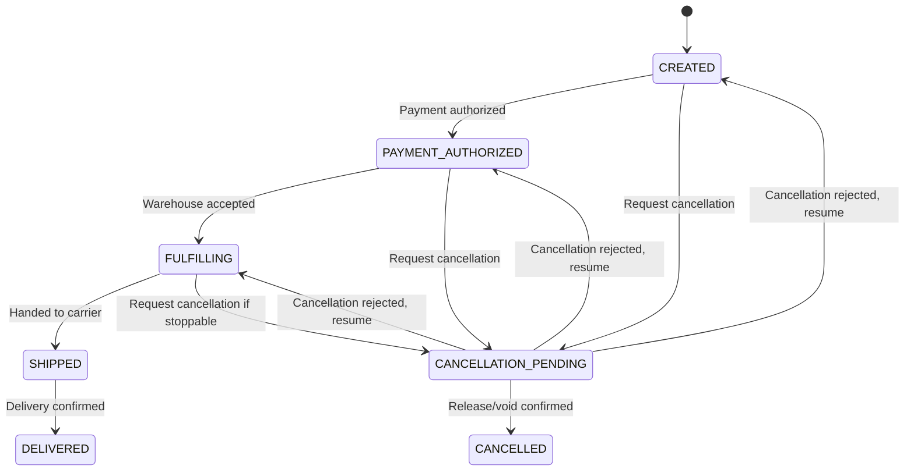
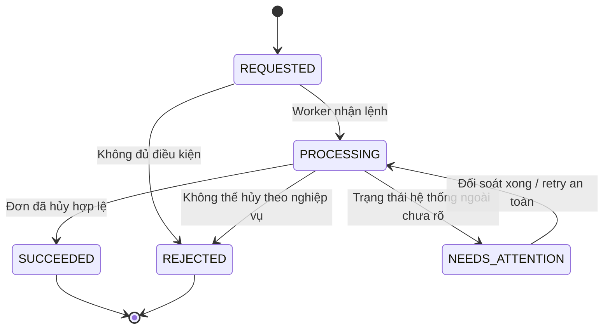
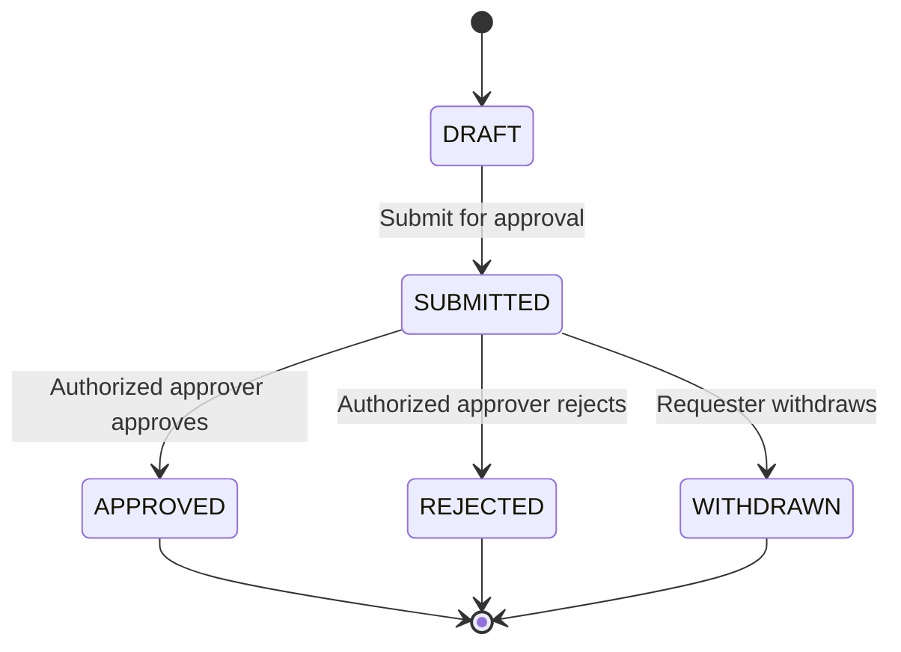
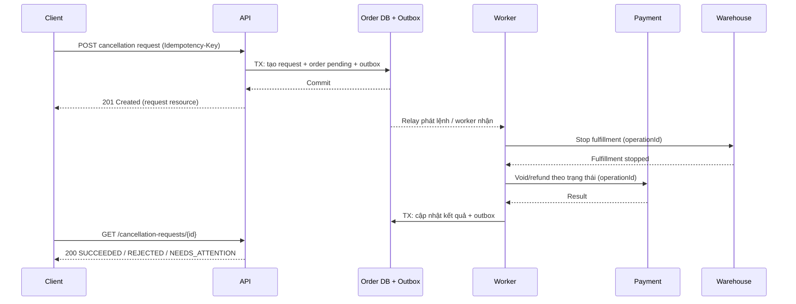
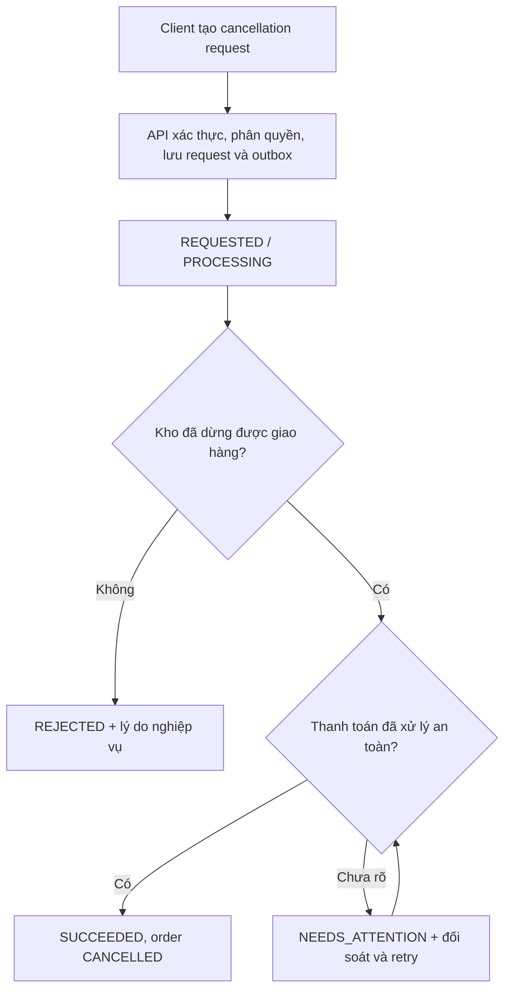

# Yêu cầu hủy, duyệt hoặc chuyển trạng thái nghiệp vụ trong REST API

## 1. Vì sao thao tác nghiệp vụ không chỉ là CRUD?

Thiết kế REST API dựa trên **resource, URI và phương thức HTTP** giúp hệ thống có hợp đồng rõ ràng. Nhưng nhiều quy trình thực tế không đơn giản là tạo, đọc, sửa, xóa một bản ghi:

- Khách hàng **yêu cầu hủy** đơn hàng. Hệ thống phải kiểm tra đã giao hàng chưa, sau đó có thể hoàn trả tồn kho và hủy ủy quyền hoặc hoàn tiền.
- Trưởng bộ phận **duyệt hoặc từ chối** một đề nghị mua hàng. Hệ thống phải kiểm tra vai trò, hạn mức, trạng thái hiện tại và lịch sử phê duyệt.
- Bộ phận kho **chuyển trạng thái** đơn từ `READY_TO_SHIP` sang `SHIPPED`. Chuyển trạng thái có điều kiện và có thể gây tác động đến dịch vụ vận chuyển.

Nếu thiết kế các thao tác trên thành một cập nhật tùy ý như `PATCH /orders/123 {"status":"CANCELLED"}`, client có thể bỏ qua quy tắc nghiệp vụ, tạo trạng thái bất hợp lệ hoặc khiến việc kiểm toán khó khăn. Ngược lại, nếu dùng mọi đường dẫn kiểu `/cancelOrder`, `/approveOrder`, `/setOrderStatus`, API dễ trở thành một tập RPC thiếu cấu trúc tài nguyên.

Bài này thuộc chương **Thao tác tài nguyên** của module **INTEGRATION_API_REST**. Trọng tâm là thiết kế resource và URI cho **yêu cầu hủy, phê duyệt và chuyển trạng thái nghiệp vụ**; lựa chọn đúng `POST`, `PATCH`, `PUT` hoặc `DELETE`; kết hợp HTTP status, idempotency, precondition, bảo mật, OpenAPI và kiểm thử bằng Java/Spring.

**Mục tiêu học tập:** Sau bài này, người học có thể mô hình hóa quy trình nghiệp vụ thành resource và state machine, thiết kế request/response có thể thực thi an toàn, phân biệt lỗi xung đột và quyền truy cập, cũng như triển khai các thao tác có side effect mà không làm mất kiểm soát khi retry hoặc xử lý bất đồng bộ.

## 2. Bắt đầu từ ngôn ngữ nghiệp vụ và các bất biến

Trước khi chọn URL, hãy trả lời:

1. **Đối tượng nào thay đổi?** Đơn hàng, đề nghị mua, bản duyệt, yêu cầu hủy hay sự kiện vận chuyển?
2. **Ai có quyền yêu cầu và ai có quyền quyết định?** Khách hàng, người duyệt, người vận hành kho hay một workflow tự động?
3. **Điều kiện trước là gì?** Trạng thái hiện tại, hạn mức, quyền sở hữu, phiên bản dữ liệu và các tác động bên ngoài.
4. **Kết quả tức thời hay chỉ là đã tiếp nhận?** Một lệnh có thể hoàn thành trong transaction hiện tại hoặc mất nhiều phút để xử lý.
5. **Có tài nguyên lịch sử cần truy vết không?** Yêu cầu hủy và quyết định duyệt thường cần ID, người tạo, thời gian, lý do và kết quả riêng.
6. **Có thể gửi lại cùng yêu cầu không?** Timeout, retry ở gateway và tác vụ nền làm duplicate trở thành tình huống bình thường.

Ví dụ đối với đơn hàng:

| Bất biến | Hệ quả cho API |
| --- | --- |
| Đơn đã bàn giao cho hãng vận chuyển không được hủy bằng quy trình hủy trước giao hàng | Kiểm tra trạng thái và quyền điều phối với kho trước khi xác nhận hủy |
| Một yêu cầu hủy chỉ được xử lý nghiệp vụ một lần, dù POST bị retry | Idempotency key, định danh yêu cầu hủy và lưu kết quả |
| Việc hủy có thể liên quan tồn kho và thanh toán ở các service riêng | Phải có trạng thái `PENDING`/`PROCESSING`, điều phối và bù trừ hoặc đối soát |
| Người dùng chỉ được thao tác trên đơn thuộc phạm vi quyền của họ | Kiểm tra authorization trên từng yêu cầu và trên resource |
| Mọi quyết định hủy/duyệt đều cần kiểm toán | Lưu actor, lý do, trạng thái trước/sau, thời gian, correlation ID |

Một hợp đồng HTTP tốt thể hiện **ý định** của client mà vẫn để server bảo vệ các bất biến. Client không được là nguồn quyết định cuối cùng cho những chuyển trạng thái quan trọng.

## 3. Chọn mô hình endpoint: cập nhật resource hay tạo resource nghiệp vụ?

Không có một URL duy nhất đúng cho mọi sản phẩm. Cách chọn nên dựa vào **bản chất và vòng đời** của thao tác.

| Nhu cầu | Mô hình phù hợp | Ví dụ |
| --- | --- | --- |
| Cập nhật thuộc tính có phạm vi rõ ràng trên resource | `PATCH` với điều kiện và quyền phù hợp | `PATCH /orders/{id}` để sửa ghi chú giao hàng khi còn cho phép |
| Thay thế toàn bộ biểu diễn của resource ở URI đã biết | `PUT`, nếu hợp đồng thực sự hỗ trợ ngữ nghĩa thay thế | `PUT /user-preferences/{userId}` |
| Tạo một **yêu cầu nghiệp vụ** có ID và vòng đời riêng | `POST` tới collection con | `POST /orders/{id}/cancellation-requests` |
| Ghi nhận một **quyết định** có lịch sử độc lập | `POST` tới collection quyết định | `POST /purchase-requests/{id}/decisions` |
| Kích hoạt xử lý không có resource kết quả độc lập | Có thể dùng `POST` tới resource được mô hình hóa rõ, kèm contract | `POST /shipments/{id}/dispatches` |
| Xóa liên kết resource nếu đó thực sự là hành động xóa | `DELETE` tới URI của resource | `DELETE /shopping-carts/{cartId}/items/{itemId}` |

**Không dùng `DELETE /orders/{id}` chỉ vì trong tiếng Việt gọi là “hủy đơn”.** `DELETE` mang ngữ nghĩa loại bỏ liên kết resource với URI theo HTTP, còn hủy đơn có thể giữ nguyên hồ sơ, lập yêu cầu, trả tồn kho và hoàn tiền. Nếu API thực sự thiết kế hủy đơn dưới hình thức `DELETE`, phải giải thích rõ đó là contract xóa và các tác động dự kiến; với quy trình cần audit, resource yêu cầu hủy thường diễn đạt đúng hơn.

Tương tự, một thao tác “duyệt” không nên mặc định là `PUT /requests/{id}` với toàn bộ JSON do client tự ghi. Nếu quyết định duyệt là sự kiện nghiệp vụ có lý do, người duyệt và chính sách riêng, hãy mô hình hóa **decision** thành resource.

### 3.1. Có nên dùng URI có động từ?

Một đường dẫn như `POST /orders/{id}/cancel` có thể là một lựa chọn thực dụng cho **command endpoint** nếu hợp đồng ổn định và thao tác được bảo vệ đầy đủ. Tuy nhiên, khi cần lịch sử, phân biệt nhiều lần yêu cầu, theo dõi bất đồng bộ hoặc tra cứu lý do từ chối, URI tài nguyên như `/cancellation-requests` thường thể hiện mô hình rõ ràng hơn.

Hãy ưu tiên **danh từ có ý nghĩa nghiệp vụ** và tránh nhồi thao tác tổng quát kiểu `POST /execute` với body chứa tên hành động bất kỳ. Khả năng đọc hiểu, phân quyền, theo dõi và bảo trì quan trọng hơn việc cực đoan áp dụng quy tắc “URL không bao giờ có động từ”.

## 4. Thiết kế state machine trước khi viết controller

### 4.1. Trạng thái của đơn hàng và yêu cầu hủy

Giả sử đơn hàng có các trạng thái:



Đây là sơ đồ rút gọn: để quay về trạng thái chính xác sau khi yêu cầu hủy bị từ chối, hệ thống phải **lưu trạng thái trước đó** hoặc có dữ liệu workflow tương đương. Nếu hủy đơn ở giai đoạn `FULFILLING` được cho phép, phải có cơ chế xác nhận **kho chưa bàn giao** trước khi bảo đảm hủy; một kiểm tra trạng thái riêng trong Order DB chưa đủ để loại bỏ race với Shipment Service.

Mỗi **yêu cầu hủy** có vòng đời riêng:



**Phân biệt rõ:** `CANCELLATION_PENDING` là trạng thái của **order**; `REQUESTED`, `PROCESSING`, `SUCCEEDED`... là trạng thái của **cancellation request**. Không đồng nhất “client gửi yêu cầu thành công” với “đơn đã hủy thành công”.

### 4.2. Quy tắc chuyển trạng thái là luật nghiệp vụ

| Trạng thái hiện tại của order | Yêu cầu hủy | Hành vi đề xuất |
| --- | --- | --- |
| `CREATED` | Khách thuộc quyền quản lý đơn yêu cầu hủy | Có thể tiếp nhận; kiểm tra tác động liên quan rồi hoàn tất |
| `PAYMENT_AUTHORIZED` | Yêu cầu hủy | Có thể tiếp nhận; cần xử lý void authorization và release inventory |
| `FULFILLING` | Yêu cầu hủy | Phụ thuộc khả năng dừng fulfillment; có thể bị từ chối hoặc phải xác nhận với kho |
| `SHIPPED` / `DELIVERED` | Yêu cầu hủy trước giao hàng | Từ chối theo nghiệp vụ, hướng sang trả hàng/hoàn tiền nếu có |
| `CANCELLATION_PENDING` | Gửi lại cùng yêu cầu | Trả cùng kết quả idempotency, không tạo tác động mới |
| `CANCELLED` | Gửi yêu cầu hủy mới | Có thể trả trạng thái đã hủy hoặc xung đột, theo hợp đồng; không thực hiện lại side effect |

**Guard** của transition là điều kiện bắt buộc, ví dụ: `currentState == PAYMENT_AUTHORIZED`, chưa giao hàng, actor có quyền, version chưa đổi, không có request trùng hoặc xung đột đang chạy. **Effect** là thay đổi trạng thái, ghi audit, phát event và có thể gọi các dịch vụ khác theo workflow đã định nghĩa.

### 4.3. State machine cho phê duyệt

Giả sử một đề nghị mua hàng có trạng thái:



Một quyết định duyệt chỉ hợp lệ khi resource đang `SUBMITTED`, actor có quyền, chưa có quyết định cuối và quy tắc nghiệp vụ (hạn mức, phân tách người tạo và người duyệt, số cấp duyệt) được thỏa mãn. Nếu quy trình cần **nhiều cấp duyệt**, không thể áp dụng nguyên mô hình một quyết định này: phải mở rộng các vòng/cấp và định nghĩa trạng thái tổng thể từ các bước.

## 5. Hợp đồng API cho yêu cầu hủy

### 5.1. Tạo yêu cầu hủy

Giả sử client có quyền sở hữu order `ord-123`, và API yêu cầu `Idempotency-Key`:

```http
POST /api/orders/ord-123/cancellation-requests HTTP/1.1
Host: api.example.test
Authorization: Bearer <access-token>
Content-Type: application/json
Idempotency-Key: cancel-ord-123-session-45
Expected-Order-Version: 7

{
  "reasonCode": "CUSTOMER_REQUEST",
  "comment": "Khách không còn nhu cầu nhận hàng"
}
```

`Expected-Order-Version` ở đây là **header ứng dụng tự định nghĩa**, không phải header HTTP tiêu chuẩn. Nó yêu cầu server so sánh phiên bản của **order cha** trước khi tạo yêu cầu hủy. Nếu dùng header này, API phải công bố cách lấy version, xử lý version không khớp (thường `409 Conflict`) và cách retry. Nếu không cần client truyền version, server vẫn phải kiểm tra điều kiện chuyển trạng thái **nguyên tử** ở tầng lưu trữ.

Nếu API **đã tạo và lưu bền vững** một resource yêu cầu hủy, phản hồi `201 Created` là lựa chọn phù hợp, **dù việc hủy đơn vẫn đang xử lý bất đồng bộ**:

```http
HTTP/1.1 201 Created
Location: /api/orders/ord-123/cancellation-requests/can-9001
Content-Type: application/json

{
  "id": "can-9001",
  "orderId": "ord-123",
  "status": "REQUESTED",
  "reasonCode": "CUSTOMER_REQUEST",
  "requestedAt": "2026-11-18T08:30:00Z",
  "links": {
    "self": "/api/orders/ord-123/cancellation-requests/can-9001",
    "order": "/api/orders/ord-123"
  }
}
```

Ý nghĩa của `201`: **resource yêu cầu hủy đã được tạo**. Nó **không** có nghĩa đơn hàng đã chuyển sang `CANCELLED`. Dữ liệu ví dụ có ID và thời gian minh họa; server thực tế phải sinh theo hệ thống của mình.

Khi API **chỉ chấp nhận công việc để xử lý sau** và chưa tạo tài nguyên kết quả ngay, `202 Accepted` có thể phù hợp:

```http
HTTP/1.1 202 Accepted
Location: /api/operations/op-455
Content-Type: application/json
Retry-After: 3

{
  "operationId": "op-455",
  "status": "PENDING",
  "statusUrl": "/api/operations/op-455"
}
```

`202` chỉ xác nhận request đã được nhận để xử lý, **không cam kết cuối cùng sẽ thành công**. Một monitor resource hoặc URL kiểm tra trạng thái giúp client theo dõi kết quả. Header `Retry-After` là tùy chọn hướng dẫn thời điểm kiểm tra lại; không phải bắt buộc cho mọi 202.

### 5.2. Tra cứu yêu cầu hủy và trạng thái đơn

```http
GET /api/orders/ord-123/cancellation-requests/can-9001 HTTP/1.1
Authorization: Bearer <access-token>
```

```http
HTTP/1.1 200 OK
Content-Type: application/json

{
  "id": "can-9001",
  "orderId": "ord-123",
  "status": "SUCCEEDED",
  "requestedAt": "2026-11-18T08:30:00Z",
  "completedAt": "2026-11-18T08:31:10Z",
  "result": {
    "orderStatus": "CANCELLED"
  }
}
```

`GET` phải an toàn: việc đọc trạng thái không được khởi chạy thêm xử lý hủy hoặc hoàn tiền. Nếu muốn client nhận cập nhật chủ động, có thể thêm webhook/SSE theo hợp đồng riêng; webhook vẫn phải xác thực và xử lý trùng.

### 5.3. Mã trạng thái theo điều kiện

| HTTP status | Khi dùng | Ví dụ |
| --- | --- | --- |
| `200 OK` | Hoàn tất đồng bộ và trả biểu diễn kết quả | Trả order đã được chuyển trạng thái |
| `201 Created` | Tạo resource yêu cầu hủy hoặc quyết định duyệt | Tạo `cancellation-request` có ID |
| `202 Accepted` | Nhận yêu cầu xử lý bất đồng bộ, kết quả chưa cuối cùng | Tạo operation chờ kho/thanh toán |
| `204 No Content` | Hoàn tất đồng bộ nhưng không trả response body | PATCH cập nhật trạng thái thành công |
| `400 Bad Request` | JSON/cú pháp hoặc tham số request sai | JSON hỏng |
| `401 Unauthorized` | Chưa có xác thực hợp lệ | Thiếu bearer token |
| `403 Forbidden` | Có danh tính nhưng không được phép thao tác | Người dùng không được duyệt yêu cầu của người khác |
| `404 Not Found` | Không tìm thấy resource hoặc chủ đích che giấu sự tồn tại | Order ID không tồn tại |
| `409 Conflict` | Xung đột với **trạng thái nghiệp vụ hiện tại** | Đã giao hàng, không thể hủy theo quy trình này |
| `412 Precondition Failed` | Điều kiện HTTP `If-Match` không khớp biểu diễn **resource đích của request** | `PATCH /orders/{id}` gửi `"order-v7"` trong khi order hiện là v8 |
| `415 Unsupported Media Type` | Request body dùng media type không hỗ trợ | Server chỉ nhận JSON nhưng gửi XML |
| `422 Unprocessable Content` | Nội dung đúng cú pháp, đúng media type nhưng không xử lý được về mặt ngữ nghĩa | `reasonCode` không được hỗ trợ theo hợp đồng |
| `428 Precondition Required` | Server yêu cầu điều kiện HTTP như `If-Match` nhưng client thiếu | `PATCH /orders/{id}` bắt buộc If-Match |
| `429 Too Many Requests` | Vượt giới hạn request | Gửi quá nhiều thao tác trong một khoảng thời gian |

Các status là **lựa chọn cần chuẩn hóa trong API contract**; không nhất thiết mọi hệ thống đều có tất cả. Đặc biệt, `409` diễn tả xung đột nghiệp vụ, còn `412` phản ánh một HTTP conditional request không thỏa mãn. Không trộn hai trường hợp để client không biết nên tải lại resource hay đổi hành động.

Ví dụ `409` với Problem Details:

```http
HTTP/1.1 409 Conflict
Content-Type: application/problem+json

{
  "type": "https://api.example.test/problems/order-not-cancellable",
  "title": "Order cannot be cancelled",
  "status": 409,
  "detail": "The order has already been handed to the carrier.",
  "instance": "/api/orders/ord-123/cancellation-requests",
  "code": "ORDER_ALREADY_SHIPPED"
}
```

Không đưa dữ liệu riêng tư của đơn hàng hoặc thông tin hệ thống nội bộ vào response lỗi. Error code ổn định giúp client quyết định có nên hiển thị hướng dẫn trả hàng hoặc cho người dùng thử lại.

## 6. Hợp đồng API cho phê duyệt và từ chối

Đối với một yêu cầu mua hàng đã gửi duyệt, có thể tạo resource **quyết định**:

```http
POST /api/purchase-requests/pr-42/decisions HTTP/1.1
Authorization: Bearer <access-token>
Content-Type: application/json
Idempotency-Key: approve-pr-42-20261118
Expected-Request-Version: 4

{
  "decision": "APPROVE",
  "comment": "Đúng hạn mức và kế hoạch mua sắm"
}
```

Nếu quyết định được lưu và chuyển trạng thái đồng bộ:

```http
HTTP/1.1 201 Created
Location: /api/purchase-requests/pr-42/decisions/dec-19
Content-Type: application/json

{
  "id": "dec-19",
  "requestId": "pr-42",
  "decision": "APPROVE",
  "statusAfter": "APPROVED",
  "decidedAt": "2026-11-18T09:20:00Z"
}
```

`Expected-Request-Version` cũng là **header ứng dụng** dùng để bảo vệ phiên bản của **purchase request cha** khi endpoint đang `POST` tới collection `decisions`. Nó không tự có ngữ nghĩa `If-Match` của HTTP. Nếu version không khớp, hợp đồng minh họa dùng `409`; nếu muốn dùng `If-Match`/`412` theo chuẩn, áp dụng nó lên **chính resource URI đang được sửa** bằng một method hỗ trợ điều kiện.

Đối với `REJECT`, cùng collection có thể nhận `{"decision":"REJECT","comment":"..."}`. Client không được gửi tùy ý `decidedBy` hoặc `approvedBy` như một quyền đã xác minh; **server lấy actor từ danh tính đã xác thực** và kiểm tra role, hạn mức, chính sách phân tách trách nhiệm. Nếu cần chữ ký số, số cấp duyệt, ủy quyền hoặc xác nhận của nhiều người, đây là các ràng buộc nghiệp vụ bổ sung phải được kiểm thử.

**Mô hình khác:** `PATCH /api/purchase-requests/pr-42` với payload đổi `status` có thể hợp lý khi thao tác là cập nhật thuộc tính được kiểm soát, không cần decision resource riêng. Tuy nhiên, nếu muốn lưu mỗi hành động phê duyệt thành một sự kiện độc lập, `POST /decisions` diễn đạt rõ hơn. Dù chọn cách nào, server phải dùng state machine và authorization để bảo vệ chuyển trạng thái.

### 6.1. Hai người duyệt đồng thời

Giả sử A gửi `APPROVE`, B gửi `REJECT` cho cùng một request đang `SUBMITTED`. Chỉ có **một chuyển trạng thái cuối** được commit khi policy yêu cầu một người ra quyết định:

```text
T0: purchase_request.status = SUBMITTED, version = 4
T1: Approver A đọc v4; Approver B đọc v4
T2: A gửi APPROVE với Expected-Request-Version: 4
T3: B gửi REJECT với Expected-Request-Version: 4
T4: Server commit yêu cầu thắng trước, version tăng lên 5
T5: Yêu cầu còn lại nhận 409 (xung đột phiên bản nghiệp vụ)
```

Nếu không dùng header phiên bản riêng, thay đổi trạng thái cạnh tranh vẫn phải được kiểm soát qua **atomic conditional update** hoặc optimistic locking; xung đột nghiệp vụ có thể được thể hiện bằng `409`. Một request idempotency replay **cùng thao tác đã commit** cần được trả lại kết quả cũ theo contract thay vì tạo decision thứ hai.

## 7. Idempotency cho thao tác tạo yêu cầu và quyết định

### 7.1. POST không idempotent mặc định

Theo HTTP, `GET`, `PUT` và `DELETE` có tính idempotent về **tác động dự kiến**, còn `POST` không tự mang bảo đảm này. Dù vậy, API có thể xây **idempotency ở cấp ứng dụng** để client retry `POST` sau timeout.

Ví dụ cùng request:

```http
POST /api/orders/ord-123/cancellation-requests
Idempotency-Key: key-777
Content-Type: application/json

{"reasonCode":"CUSTOMER_REQUEST"}
```

Lần đầu tạo `can-9001`. Nếu client bị timeout rồi gửi lại **cùng key, cùng principal/phạm vi và cùng payload**, server phải trả **cùng kết quả đã ghi** theo chính sách idempotency đã công bố, thay vì tạo `can-9002` và phát lệnh hoàn tiền thêm lần nữa. Khi cùng key nhưng payload khác, nên trả lỗi xung đột idempotency (ví dụ `409`) với mã lỗi rõ ràng.

### 7.2. Thiết kế idempotency key

| Yêu cầu | Lý do |
| --- | --- |
| Scope khóa theo tenant/principal, operation hoặc resource | Tránh trùng key giữa người dùng và giữa endpoint khác nhau |
| Ghi key và fingerprint của request | Phát hiện dùng lại key cho nội dung khác |
| Kết quả xử lý được lưu bền vững | Retry sau restart hoặc failover vẫn trả cùng resource/kết quả |
| Có unique constraint ở database có thẩm quyền | Hai request đồng thời với cùng key không thể cùng tạo tác động |
| Phân biệt `IN_PROGRESS`, `COMPLETED` và `FAILED` | Tránh xử lý lại thao tác khi kết quả còn chưa rõ |
| Quy định TTL/retention và hành vi khi hết TTL | Client hiểu giới hạn replay; tác động dài hạn vẫn cần dedup ở tầng nghiệp vụ |

Một khóa do client tạo không nên chứa bí mật hoặc dữ liệu cá nhân. Định danh nghiệp vụ như `orderId` và `cancellationRequestId` cần được kiểm tra quyền, không thể dùng idempotency key làm bằng chứng sở hữu.

### 7.3. Retry xuyên dịch vụ

Idempotency tại HTTP edge **không đủ** khi worker gọi Inventory, Payment hoặc Warehouse:



Trong triển khai thật, kết quả từ Warehouse/Payment cần có xử lý **timeout, duplicate, kết quả đến muộn và đối soát**. Payment Service phải dùng idempotency key tương thích với hợp đồng nhà cung cấp. Không được coi HTTP timeout là bằng chứng chắc chắn rằng chưa thanh toán hoặc chưa hoàn tiền.

**Transactional Outbox** giúp lưu thay đổi state và ý định phát event trong cùng transaction cục bộ. Nó không cung cấp chính xác một lần end-to-end: broker có thể giao lại message, nên consumer cần inbox/dedup và command ID ổn định.

## 8. Đồng thời, ETag, If-Match và tính nguyên tử

### 8.1. Vì sao phải bảo vệ race condition?

Một check application kiểu:

```text
if order.status == PAYMENT_AUTHORIZED:
    order.status = CANCELLATION_PENDING
    save(order)
```

có thể sai nếu request khác đồng thời chuyển đơn sang `SHIPPED`. Cả hai đọc trạng thái cũ rồi cùng ghi. Server phải bảo vệ invariant **ngay ở điểm commit**, không chỉ bằng lệnh `if` trên object đã đọc.

### 8.2. Optimistic concurrency với ETag của resource đích

Client đọc đơn:

```http
GET /api/orders/ord-123 HTTP/1.1
```

```http
HTTP/1.1 200 OK
ETag: "order-v7"
Content-Type: application/json

{"id":"ord-123","status":"PAYMENT_AUTHORIZED"}
```

Nếu API hỗ trợ **cập nhật trực tiếp** tài nguyên `order` (ví dụ chỉ cho sửa ghi chú khi còn đủ điều kiện), client gửi request **tới chính URI order** với ETag vừa đọc:

```http
PATCH /api/orders/ord-123 HTTP/1.1
If-Match: "order-v7"
Content-Type: application/merge-patch+json

{"deliveryNote":"Giao tại quầy lễ tân"}
```

Giả sử API đã khai báo và hỗ trợ JSON Merge Patch. Nếu order hiện đã là phiên bản 8, điều kiện `If-Match` sai và server có thể trả:

```http
HTTP/1.1 412 Precondition Failed
ETag: "order-v8"
Content-Type: application/problem+json

{"type":"about:blank","title":"Precondition Failed","status":412}
```

`If-Match` dùng **strong comparison** theo HTTP; không dùng ETag yếu dạng `W/"..."` để bảo vệ ghi quan trọng. ETag phải phản ánh đúng biểu diễn của **resource đích** mà API cho phép sử dụng làm precondition. Với `POST /orders/{id}/cancellation-requests`, target URI là **collection yêu cầu hủy**, nên `If-Match` không tự động mang ý nghĩa ETag của **order cha**. Bởi vậy, hợp đồng ở mục 5 minh họa header ứng dụng `Expected-Order-Version` thay cho việc gán sai ý nghĩa `If-Match`.

Nếu hợp đồng chọn dùng **`PATCH /orders/{id}`** để thực hiện một chuyển trạng thái được phép, `If-Match` của order là một lựa chọn rõ ràng và `412`/`428` có ngữ nghĩa HTTP phù hợp. Với thao tác `POST` dùng header phiên bản ứng dụng, xung đột phiên bản được diễn đạt bằng `409` trong hợp đồng minh họa.

### 8.3. Atomic conditional update

Đoạn SQL sau minh họa guard của order trong **một database transaction**:

```sql
BEGIN;

-- Nếu trạng thái hoặc version đổi, không chuyển trạng thái.
UPDATE orders
SET status = 'CANCELLATION_PENDING',
    version = version + 1
WHERE id = :order_id
  AND version = :expected_version
  AND status IN ('CREATED', 'PAYMENT_AUTHORIZED')
RETURNING id, version;

-- Chỉ khi UPDATE trả đúng một dòng:
-- 1) INSERT cancellation_requests với request_id/idempotency unique.
-- 2) INSERT outbox_events với event_id duy nhất.
-- 3) COMMIT tất cả. Ngược lại ROLLBACK.

COMMIT;
```

`UPDATE ... RETURNING` ở đây sử dụng cú pháp PostgreSQL. Nếu cập nhật trả 0 dòng, handler phải kiểm tra điều kiện nào thất bại và ánh xạ lỗi phù hợp (`409` khi version nghiệp vụ hoặc trạng thái không còn hợp lệ; `404` khi resource không hiện diện/không được tiết lộ). Trong endpoint **PATCH trực tiếp** có `If-Match`, điều kiện HTTP không khớp mới tương ứng `412`. Cơ chế unique key của idempotency cần nằm trong cùng boundary có thẩm quyền. Nếu hai request có key giống nhau cùng chạy, phải xử lý xung đột unique và trả kết quả đã lưu sau khi transaction thắng commit.

**Lưu ý:** Một câu SQL ở Order DB chỉ bảo vệ dữ liệu Order DB. Nếu kho đã bắt đầu giao hàng trên service khác, việc chuyển Order thành `CANCELLATION_PENDING` **không tự ngăn** Warehouse giao tiếp. Cần giao thức reserve/stop/confirm của warehouse, kiểm tra trạng thái và có phương án xử lý khi không dừng kịp.

## 9. Xử lý bất đồng bộ và trạng thái trung gian

Nhiều thao tác nghiệp vụ cần kết nối dịch vụ khác, nên không thể bảo đảm xử lý xong trước khi response HTTP:



Điều quan trọng là **giữ hai mức trạng thái**: trạng thái của yêu cầu xử lý và trạng thái của tài nguyên đích. Ví dụ:

```json
{
  "id": "can-9001",
  "status": "PROCESSING",
  "order": {
    "id": "ord-123",
    "status": "CANCELLATION_PENDING"
  },
  "progress": "WAITING_FOR_PAYMENT_VOID"
}
```

Client không nên tiếp tục gửi POST cùng nội dung một cách vô hạn. Sau khi có `requestId`, hãy `GET` resource yêu cầu hủy hoặc dùng kênh cập nhật có xác thực. Nếu mất response ngay lần đầu, retry **cùng Idempotency-Key** để lấy lại kết quả từ server.

### 9.1. Biến chuyển trạng thái thành workflow có khả năng phục hồi

Một luồng production thường cần:

- Retry có giới hạn, exponential backoff/jitter và dead-letter handling.
- Dedup theo `commandId`/`eventId`, lưu kết quả bền vững.
- Định nghĩa timeout nghiệp vụ, phân biệt thất bại rõ ràng với kết quả chưa biết.
- Hành động bù trừ cho tài nguyên đã được giữ hoặc khoản tiền đã được xử lý.
- Trạng thái cần can thiệp thủ công và quy trình đối soát có người chịu trách nhiệm.
- Bảo vệ trường hợp **thành công đến muộn** sau khi workflow đã đổi trạng thái.

Ví dụ nếu `voidPayment` bị timeout, không tự động phát `refund` mới cho đến khi biết trạng thái thực của PSP. Khi đã capture tiền, logic hoàn tiền khác với void authorization. Các thao tác tài chính cần operation ID ổn định và webhook có xác thực.

## 10. Phân quyền và kiểm toán cho chuyển trạng thái

Định nghĩa **ai được phép yêu cầu**, **ai phê duyệt** và **ai chạy bước kỹ thuật**. Có thể lập ma trận:

| Vai trò | Yêu cầu hủy đơn thuộc quyền mình | Duyệt purchase request | Xác nhận giao hàng |
| --- | --- | --- | --- |
| Khách hàng | Có, nếu điều kiện cho phép | Không | Không |
| Nhân viên hỗ trợ | Có theo phạm vi được cấp | Thường không | Không |
| Người duyệt được phân quyền | Không tự động có quyền hủy đơn | Có trong hạn mức và workflow | Không |
| Nhân viên kho | Không | Không | Có với shipment được phân công |
| Tác vụ hệ thống | Chỉ theo service identity và lệnh hợp lệ | Chỉ khi được thiết kế tự động | Theo tài khoản dịch vụ và quy trình |

HTTP `401` liên quan thiếu/không hợp lệ **xác thực**; `403` khi actor đã được xác thực nhưng **không được phép**. Một số API chủ động trả `404` để che sự tồn tại resource, nhưng chính sách đó phải nhất quán và không làm lộ dữ liệu qua body hoặc timing ngoài dự kiến.

### 10.1. Authorization phải ở service xử lý cuối

Không dựa vào frontend đã ẩn nút hoặc gateway đã xác thực để bỏ qua kiểm tra quyền tại service. Trong thao tác `POST /purchase-requests/{id}/decisions`, server cần kiểm tra:

1. Actor đã đăng nhập và thuộc đúng tenant/đơn vị.
2. Actor có quyền `APPROVE_PURCHASE_REQUEST` trong phạm vi này.
3. Actor không vi phạm chính sách **người lập không tự duyệt** nếu áp dụng.
4. Hạn mức và cấp duyệt phù hợp số tiền/nhóm hàng.
5. Resource vẫn ở trạng thái và phiên bản cho phép.
6. Decision và audit lưu dựa trên danh tính phía server, không tin vào `approvedBy` do client gửi.

Không đặt thông tin truy cập, chữ ký hay dữ liệu nhạy cảm trong URL hoặc event không cần thiết. Nếu có dữ liệu cá nhân trong comment/reason, áp dụng phân quyền đọc và thời hạn lưu trữ tương ứng.

### 10.2. Audit và truy vết

Mỗi decision hoặc transition quan trọng nên có:

| Trường | Mục đích |
| --- | --- |
| `operationId` / `requestId` | Truy vết một yêu cầu xử lý qua các lần retry |
| `actorId` và `actorType` | Xác định người/dịch vụ thực hiện |
| `resourceId`, `tenantId` | Giới hạn phạm vi quyền và đối soát |
| `fromState`, `toState` | Biết thay đổi nào đã xảy ra |
| `reasonCode`, `comment` | Giải thích nghiệp vụ, có thể cần che dữ liệu nhạy cảm |
| `occurredAt`, `correlationId` | Điều tra timeline nhiều service |
| `idempotencyKey` (hoặc hash) | Nhận biết request được gửi lại |
| `policyVersion` | Biết quyết định đã dùng phiên bản quy tắc nào khi cần kiểm toán |

Không xóa lịch sử quyết định chỉ vì resource hiện đã ở trạng thái cuối. Bản ghi audit phải có cơ chế chống sửa ngoài ý muốn và retention phù hợp yêu cầu pháp lý/nghiệp vụ.

## 11. Java/Spring Boot: tách HTTP contract khỏi luật nghiệp vụ

Ví dụ dưới đây sử dụng **Java 17+, Spring Boot 3/Spring MVC 6**, tập trung vào cách định nghĩa endpoint và trách nhiệm của service. Các interface/DTO còn lại là hợp đồng ứng dụng cần triển khai riêng; đoạn mã minh họa kiến trúc, không phải dự án chạy độc lập.

### 11.1. Controller nhận request hủy

```java
package example.orders.api;

import jakarta.validation.Valid;
import jakarta.validation.constraints.NotBlank;
import java.net.URI;

import org.springframework.http.ResponseEntity;
import org.springframework.security.core.Authentication;
import org.springframework.web.bind.annotation.*;

@RestController
@RequestMapping("/api/orders/{orderId}/cancellation-requests")
public class CancellationRequestController {

    private final CancellationApplicationService service;

    public CancellationRequestController(CancellationApplicationService service) {
        this.service = service;
    }

    public record CancellationInput(@NotBlank String reasonCode,
                                    String comment) {}

    public record CancellationView(String id, String orderId,
                                   String status, String reasonCode) {}

    @PostMapping
    public ResponseEntity<CancellationView> requestCancellation(
            @PathVariable String orderId,
            @Valid @RequestBody CancellationInput input,
            @RequestHeader("Idempotency-Key") String idempotencyKey,
            @RequestHeader(value = "Expected-Order-Version", required = false)
                String expectedOrderVersion,
            Authentication principal) {

        // Service kiểm tra quyền, expected version, state transition,
        // idempotency, audit và outbox trong transaction phù hợp.
        CancellationView created = service.create(
                orderId, principal.getName(), idempotencyKey,
                expectedOrderVersion, input);

        URI location = URI.create("/api/orders/" + orderId
                + "/cancellation-requests/" + created.id());
        return ResponseEntity.created(location).body(created);
    }

    @GetMapping("/{requestId}")
    public CancellationView get(
            @PathVariable String orderId,
            @PathVariable String requestId,
            Authentication principal) {
        return service.findVisibleTo(orderId, requestId, principal.getName());
    }
}
```

Phần `Authentication` và `@Valid` phụ thuộc cấu hình Spring Security/Bean Validation của dự án. Service phải **thực sự kiểm tra quyền trên order**: việc lấy `principal.getName()` trong controller chỉ truyền danh tính, chưa phải authorization. Trước khi ghép ID do client truyền vào URI phản hồi, ứng dụng phải xác thực định dạng ID hợp lệ hoặc dùng URI builder/giá trị canonical do server sinh.

### 11.2. Service nghiệp vụ và transaction

Luồng service có thể biểu diễn bằng giả mã:

```text
createCancellation(orderId, actor, key, expectedVersion, payload):
    authorize(actor, "REQUEST_CANCELLATION", orderId)
    validate_request_format(payload)

    begin_transaction()
        previous = find_idempotency_record(actor, orderId, key)
        if previous exists:
            verify_same_payload_or_fail_conflict(previous, payload)
            return previous.recorded_response

        order = load_order_for_update_or_optimistic_version(orderId)
        validate_expected_order_version_if_supplied(order, expectedVersion)
        assert_cancellation_allowed_for_order_state(order)

        request = insert_cancellation_request(...)
        update_order_conditionally_to_CANCELLATION_PENDING(...)
        insert_idempotency_result(actor, orderId, key, payload, request)
        insert_outbox_event("CancellationRequested", request.id, order.id)
    commit_transaction()

    return request_created_response
```

Giả mã thể hiện **một transaction cục bộ**; cài đặt thực tế phải xử lý đồng thời bằng unique constraint, lock/version và ánh xạ exception. Không phát message ra broker **trước** khi transaction commit, cũng không kỳ vọng gọi broker ngay sau commit là nguyên tử với database. Outbox relay phát sự kiện sau commit; worker và các hệ thống downstream xử lý idempotent.

### 11.3. Xử lý lỗi có hợp đồng rõ

Có thể dùng `ProblemDetail` từ Spring để chuẩn hóa lỗi:

```java
@ExceptionHandler(BusinessConflictException.class)
ResponseEntity<ProblemDetail> conflict(BusinessConflictException ex) {
    ProblemDetail body = ProblemDetail.forStatus(409);
    body.setTitle("Business state conflict");
    body.setDetail(ex.getMessage()); // Chỉ dùng thông điệp đã kiểm soát.
    body.setProperty("code", ex.errorCode());
    return ResponseEntity.status(409).body(body);
}
```

Trong thực tế, exception handler nên nằm ở `@RestControllerAdvice` và có mapping riêng cho validation (`400`/`422` theo contract), `412`, `428`, `401`/`403` và lỗi hệ thống. Không trả toàn bộ exception hoặc stack trace cho client. Cần bảo đảm mọi exception sau transaction failure khiến các thay đổi cục bộ **rollback** như dự kiến.

### 11.4. Không nhầm annotation với bảo đảm vận hành

| Công cụ | Giúp gì? | Không tự giải quyết |
| --- | --- | --- |
| `@PostMapping` | Chọn route theo method | Idempotency hoặc xử lý request trùng |
| `@Valid` | Kiểm tra constraint trên DTO | Quy tắc trạng thái giữa nhiều resource |
| `@PreAuthorize` / security filter | Kiểm tra một phần quyền truy cập | Các ràng buộc nghiệp vụ và quyền sở hữu phức tạp nếu chưa triển khai |
| `@Transactional` | Atomicity trong transaction manager/database được cấu hình | Transaction across PSP, broker và service khác |
| JPA `@Version` | Hỗ trợ optimistic locking cho entity | Idempotency end-to-end hoặc fencing tại hệ khác |
| Outbox và message broker | Truyền tác vụ tin cậy hơn sau commit | Exactly-once cho toàn hệ thống |

## 12. OpenAPI mô tả thao tác và trạng thái

Hợp đồng nên thể hiện tài nguyên con, idempotency key, precondition, các HTTP status và schema. Ví dụ OpenAPI 3.1 tối giản:

```yaml
openapi: 3.1.0
info:
  title: Orders API
  version: 1.0.0
paths:
  /api/orders/{orderId}/cancellation-requests:
    post:
      operationId: requestOrderCancellation
      summary: Create a cancellation request
      parameters:
        - in: path
          name: orderId
          required: true
          schema: { type: string }
        - in: header
          name: Idempotency-Key
          required: true
          schema: { type: string, minLength: 1 }
        - in: header
          name: Expected-Order-Version
          required: false
          description: Application-specific version of the parent order
          schema: { type: string }
      requestBody:
        required: true
        content:
          application/json:
            schema:
              type: object
              required: [reasonCode]
              properties:
                reasonCode: { type: string }
                comment: { type: string }
      responses:
        '201':
          description: Cancellation request resource created
          headers:
            Location:
              description: URI of the cancellation request
              schema: { type: string }
        '400': { description: Invalid request }
        '401': { description: Authentication required }
        '403': { description: Not authorized }
        '404': { description: Order not found or hidden }
        '409': { description: Business conflict or idempotency conflict }
  /api/orders/{orderId}/cancellation-requests/{requestId}:
    get:
      operationId: getCancellationRequest
      parameters:
        - in: path
          name: orderId
          required: true
          schema: { type: string }
        - in: path
          name: requestId
          required: true
          schema: { type: string }
      responses:
        '200': { description: Cancellation request status }
        '404': { description: Request not found or hidden }
```

Đây là skeleton để tập trung vào operation/path; trước khi publish, nên bổ sung `securitySchemes`, schema response/error, ví dụ, policy idempotency và mô tả vòng đời bất đồng bộ. Chỉ khai báo status trong OpenAPI **không tự làm cho server thực thi đúng**; phải có contract test và integration test.

## 13. Kiểm thử chuyển trạng thái nghiệp vụ

### 13.1. Ma trận thử nghiệm

| Tình huống | Kiểm tra | Kỳ vọng |
| --- | --- | --- |
| Đơn `CREATED` hợp lệ, actor có quyền | POST yêu cầu hủy | `201`, `Location`, request `REQUESTED`; order có trạng thái trung gian |
| POST lặp cùng key/payload | Gửi 2 lần hoặc đồng thời | Cùng request/kết quả theo contract; chỉ một tác động |
| Cùng key nhưng payload khác | Thay `reasonCode` khi retry | Lỗi xung đột idempotency |
| Đơn đã `SHIPPED` | POST yêu cầu hủy trước giao | `409` với error code nghiệp vụ thích hợp |
| Version nghiệp vụ của order đã cũ | POST hủy với `Expected-Order-Version` không khớp | `409`, không tạo request hay outbox event |
| ETag cũ khi cập nhật trực tiếp order | `PATCH /orders/{id}` gửi `If-Match` không khớp | `412`, không cập nhật order |
| Thiếu precondition HTTP bắt buộc | `PATCH /orders/{id}` bỏ `If-Match` khi policy yêu cầu | `428`, không đổi dữ liệu |
| Chưa đăng nhập | POST hoặc GET resource bảo vệ | `401` theo security contract |
| Không phải chủ đơn | POST hủy đơn người khác | `403` hoặc `404` theo chính sách chống lộ thông tin |
| Người tạo tự duyệt khi policy cấm | POST `APPROVE` | `403`/`409` theo cách phân loại policy đã thống nhất |
| Hai người duyệt ngược nhau | Hai POST cùng version | Một quyết định commit; một lỗi concurrency |
| Worker chết sau commit trước publish | Restart relay | Sự kiện được phát sau restart, không mất thay đổi |
| Event được giao hai lần | Chạy cùng command 2 lần | Không double release tồn kho/void/refund |
| PSP timeout sau khi đã nhận yêu cầu | Đối soát và retry với same operation ID | Không tạo giao dịch tài chính thứ hai |
| Truy vấn request khi đang xử lý | GET `REQUESTED`/`PROCESSING` | `200` với trạng thái thật, không tạo side effect |
| Kết quả từ kho đến muộn sau hủy | Gửi event out-of-order | Workflow có guard và đối soát, không ghi sai trạng thái cuối |

### 13.2. Test nghiệp vụ cốt lõi trước test HTTP

Với state machine, cần kiểm thử chuyển trạng thái hợp lệ và không hợp lệ theo từng trạng thái đầu vào, đồng thời thử concurrency ở transaction boundary. Ví dụ:

```java
// Giả mã test ở tầng service:
// given order.status = SHIPPED
// when createCancellation(orderId, actor, uniqueKey, ...)
// then BusinessConflictException(code = "ORDER_ALREADY_SHIPPED")
// and no cancellation request persisted
// and no payment/warehouse command emitted
```

Controller test xác nhận **status, header, body**; service/DB test xác nhận **bất biến nghiệp vụ, atomicity, unique key và side effect**. Trong hệ thống nhiều service, chạy integration/fault tests ở đường đi qua broker, gateway và PSP sandbox để xác minh retry thực tế.

### 13.3. Checklist review trước khi phát hành

- [ ] Endpoint có resource/URI rõ ràng, hợp đồng method phù hợp ý định nghiệp vụ.
- [ ] State machine liệt kê guard, effect và các transition không hợp lệ.
- [ ] `201` mô tả resource đã tạo; `202` mô tả công việc đang chờ, có URL tra cứu kết quả.
- [ ] `409` cho xung đột nghiệp vụ/phiên bản ứng dụng; `412` và `428` cho conditional request HTTP trên đúng resource đích.
- [ ] `POST` được bảo vệ bằng idempotency và kiểm tra duplicate ở database có thẩm quyền.
- [ ] Thay đổi state/audit/outbox được commit nguyên tử trong một local transaction.
- [ ] Kiểm tra authorization theo actor, role, tenant, quyền sở hữu và chính sách nhiều cấp.
- [ ] Việc đọc trạng thái bằng `GET` không phát sinh side effect.
- [ ] Worker xử lý retry, duplicate, timeout, response muộn và đối soát dịch vụ bên ngoài.
- [ ] OpenAPI, gateway, CORS, controller và tests thể hiện cùng đường dẫn/method.
- [ ] Có correlation ID, metrics trạng thái mắc kẹt, log/audit theo quyền được phép.

## 14. Bài tập tình huống

Một hệ thống chi phí nội bộ có resource `/expense-claims/{id}` với trạng thái `DRAFT`, `SUBMITTED`, `APPROVED`, `REJECTED`, `PAID`. Quy tắc:

- Người tạo có thể submit từ `DRAFT`, nhưng không được tự duyệt.
- Người duyệt có hạn mức 20 triệu đồng.
- Đã `APPROVED` thì không được từ chối lại; đã `PAID` không được xóa lịch sử.
- Thanh toán tiền diễn ra bất đồng bộ và có thể timeout.

**Yêu cầu thực hành:** (1) Đề xuất URI cho submit và quyết định approve/reject; (2) vẽ state machine; (3) chọn status cho yêu cầu duyệt hợp lệ, yêu cầu vượt hạn mức, quyết định đụng phiên bản và lệnh thanh toán đang xử lý; (4) nêu idempotency scope và ít nhất ba test concurrency/failure.

**Gợi ý lời giải:** Có thể dùng `POST /expense-claims/{id}/submissions` để tạo submission resource và `POST /expense-claims/{id}/decisions` để ghi nhận quyết định; `APPROVED` là trạng thái cuối của vòng duyệt, chưa nhất thiết đã `PAID`. Quyết định hợp lệ tạo resource có thể trả `201`; lệnh thanh toán chỉ tiếp nhận có thể trả `202` kèm operation URL; vượt hạn mức phải bị chặn bằng authorization/business policy (`403` hoặc `409` theo hợp đồng rõ ràng). Với `POST /decisions` dùng header phiên bản của resource cha do API tự định nghĩa, version cũ có thể trả `409`; còn `If-Match` sai trên `PATCH /expense-claims/{id}` thì trả `412`. Kiểm thử hai người duyệt đồng thời, duplicate POST cùng key, timeout PSP và callback đến muộn. Nếu workflow phê duyệt nhiều cấp, bổ sung bước duyệt thay vì cho mọi approver đặt trực tiếp trạng thái `APPROVED`.

## 15. Kết luận

Yêu cầu **hủy, duyệt và chuyển trạng thái** là những thao tác nghiệp vụ có điều kiện, lịch sử và có thể kéo theo tác động ngoài một database. Thiết kế REST API nên mô hình hóa **resource đích**, **resource yêu cầu/quyết định** và **vòng đời xử lý** cho rõ; lựa chọn method theo ngữ nghĩa thay vì coi mọi thao tác là CRUD hoặc đổi trạng thái tùy ý từ client.

Một hợp đồng vững cần kết hợp **state machine, authorization, idempotency, concurrency control, mã trạng thái HTTP chính xác, audit, outbox/worker và khả năng tra cứu kết quả bất đồng bộ**. Khi triển khai với Java/Spring, controller chỉ là lớp tiếp nhận giao thức; tính đúng đắn của nghiệp vụ phải được bảo vệ ở transaction boundary và tại các dịch vụ thực hiện side effect, sau đó được chứng minh bằng kiểm thử phù hợp.
