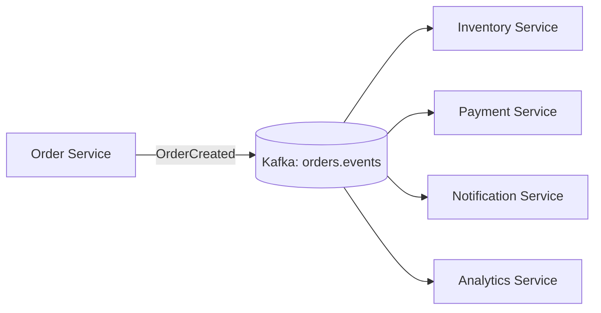

# Kafka là gì và bài toán tích hợp bằng luồng sự kiện

Kafka là nền tảng event streaming phân tán, giúp nhiều hệ thống trao đổi các sự kiện với thông lượng lớn, lưu giữ chúng trong một khoảng thời gian cấu hình được và cho phép nhiều ứng dụng đọc độc lập. Trong module **KAFKA**, người học sẽ đi từ các khái niệm topic, partition, offset, producer và consumer group đến replication, KRaft; sau đó triển khai luồng sự kiện bằng Java/Spring Kafka, xử lý retry, ordering và giao dịch, tích hợp Kafka Connect/Streams, rồi giám sát, tối ưu và phục hồi cụm.

Bài này đặt nền tảng cho toàn bộ module: vì sao các hệ thống cần một cách tích hợp dựa trên sự kiện, Kafka giải quyết phần nào của bài toán, và một luồng sự kiện cơ bản hoạt động ra sao.

## Mục tiêu học tập

Sau bài học, bạn có thể:

- Giải thích sự khác nhau giữa tích hợp đồng bộ bằng lời gọi API và tích hợp bất đồng bộ bằng sự kiện.
- Mô tả Kafka như một nhật ký sự kiện phân tán (distributed event log).
- Nhận diện vai trò của producer, broker, topic, partition, record, offset, consumer và consumer group.
- Giải thích vì sao nhiều consumer group có thể đọc cùng một topic độc lập.
- Chỉ ra giới hạn về ordering, khả năng phát lại, độ trễ và tính nhất quán khi thiết kế luồng sự kiện.
- Phác thảo một luồng tích hợp Kafka cho hệ thống Java/Spring.

## 1. Bài toán tích hợp giữa các hệ thống

Hãy xét một hệ thống thương mại điện tử gồm nhiều dịch vụ:

- **Order Service** tiếp nhận và quản lý đơn hàng.
- **Payment Service** xử lý thanh toán.
- **Inventory Service** giữ và trừ tồn kho.
- **Shipping Service** tạo yêu cầu giao hàng.
- **Notification Service** gửi email hoặc thông báo cho khách.
- **Analytics Service** tổng hợp dữ liệu phục vụ báo cáo.

Khi khách đặt hàng, các dịch vụ cần phối hợp để hoàn thành quy trình. Câu hỏi không chỉ là làm sao gửi dữ liệu từ dịch vụ này sang dịch vụ khác, mà còn là làm sao để chúng phối hợp khi một dịch vụ chậm, tạm ngừng hoặc cần thêm một consumer mới.

### Tích hợp bằng lời gọi đồng bộ

Một cách triển khai quen thuộc là Order Service gọi trực tiếp các API của những dịch vụ còn lại. Ví dụ, sau khi tạo đơn, nó gọi Payment Service, Inventory Service và Notification Service theo thứ tự.

Cách này phù hợp khi bên gọi cần kết quả ngay để trả lời người dùng. Tuy nhiên, khi số lượng tích hợp tăng, một số vấn đề xuất hiện:

1. **Phụ thuộc thời gian (temporal coupling):** dịch vụ nhận phải đang hoạt động và có thể phản hồi tại thời điểm dịch vụ gửi gọi nó.
2. **Lan truyền lỗi:** một dịch vụ chậm hoặc lỗi có thể kéo dài thời gian xử lý hoặc làm hỏng toàn bộ luồng nghiệp vụ.
3. **Phụ thuộc cấu trúc:** bên gửi phải biết địa chỉ, API và cách gọi của từng bên nhận. Khi thêm consumer, bên gửi thường phải thay đổi.
4. **Khó xử lý khi có nhiều bên nhận:** bên gửi phải quản lý fan-out, timeout, retry và trạng thái thành công/thất bại cho từng lời gọi.
5. **Khó phát lại dữ liệu:** nếu một consumer ngừng hoạt động và bỏ lỡ một thay đổi, hệ thống cần cơ chế riêng để đồng bộ lại.

Lời gọi đồng bộ không phải lựa chọn sai. Nó vẫn cần thiết cho các thao tác cần phản hồi tức thì, chẳng hạn truy vấn giá hiện tại hoặc xác thực một yêu cầu. Vấn đề xuất hiện khi dùng lời gọi đồng bộ cho mọi quan hệ tích hợp, kể cả những công việc có thể hoàn thành sau.

### Tích hợp bằng sự kiện

Thay vì yêu cầu dịch vụ khác thực hiện một hành động ngay lập tức, Order Service có thể công bố một sự kiện mô tả điều đã xảy ra:

> OrderCreated: một đơn hàng mới đã được tạo.

Payment Service, Inventory Service, Shipping Service và Notification Service đăng ký nhận sự kiện mà chúng quan tâm. Mỗi dịch vụ xử lý theo tốc độ và trạng thái hoạt động của riêng mình.

Cách tiếp cận này được gọi là **event-driven architecture** (kiến trúc hướng sự kiện). Một sự kiện là thông tin về một sự việc đã xảy ra trong miền nghiệp vụ. Tên sự kiện thường dùng thì quá khứ, ví dụ `OrderCreated`, `PaymentAuthorized`, `InventoryReserved` hoặc `ShipmentDispatched`.

Cần phân biệt:

| Khái niệm | Ý nghĩa | Ví dụ |
|---|---|---|
| Command | Yêu cầu một thành phần thực hiện hành động | `ReserveInventory` |
| Event | Thông báo một sự việc đã xảy ra | `InventoryReserved` |
| Query | Yêu cầu đọc dữ liệu | `GetOrderStatus` |

Command có thể bị từ chối vì điều kiện nghiệp vụ không thỏa mãn. Event là sự thật đã được ghi nhận; consumer không nên tự ý diễn giải nó thành một yêu cầu mới. Một event có thể khiến consumer thực hiện hành động tiếp theo, nhưng bản thân event vẫn mô tả điều đã xảy ra.

### Luồng sự kiện cơ bản

1. Một nghiệp vụ xảy ra trong dịch vụ nguồn, chẳng hạn khách tạo đơn hàng.
2. Dịch vụ nguồn tạo một event có dữ liệu cần thiết để consumer xử lý.
3. Producer gửi event đến Kafka.
4. Kafka lưu record vào một partition của topic.
5. Các consumer thuộc những consumer group khác nhau đọc record và xử lý độc lập.
6. Mỗi consumer group lưu tiến độ đọc của mình để tiếp tục từ vị trí phù hợp sau khi khởi động lại.

Kafka đóng vai trò trung gian lưu giữ và phân phối luồng record. Producer không cần biết có bao nhiêu consumer đang đọc topic, và consumer không cần gọi trực tiếp vào dịch vụ nguồn.

## 2. Apache Kafka là gì?

**Apache Kafka** là một nền tảng event streaming phân tán, có khả năng nhận, lưu trữ và phân phối các luồng record giữa nhiều ứng dụng. Có thể hình dung Kafka như một nhật ký chỉ ghi nối tiếp: producer thêm record vào cuối partition, còn consumer đọc record theo offset.

Kafka thường được dùng làm lớp trung gian cho:

- Tích hợp bất đồng bộ giữa các microservice.
- Thu thập log, telemetry và dữ liệu hoạt động.
- Đồng bộ thay đổi dữ liệu từ hệ thống nguồn (change data capture).
- Xây dựng pipeline dữ liệu và xử lý luồng gần thời gian thực.
- Phân phối một sự kiện đến nhiều ứng dụng độc lập.
- Lưu giữ sự kiện để consumer có thể đọc lại khi cần khôi phục hoặc xây dựng lại trạng thái.

Kafka không tự định nghĩa quy tắc nghiệp vụ của ứng dụng. Ứng dụng vẫn phải quyết định event nào cần phát, dữ liệu nào cần mang theo, consumer xử lý ra sao và lỗi được khôi phục như thế nào.

### Các thành phần cốt lõi

| Thành phần | Vai trò |
|---|---|
| Cluster | Một cụm Kafka gồm nhiều broker phối hợp với nhau. |
| Broker | Một máy chủ Kafka nhận request, lưu partition và phục vụ producer/consumer. |
| Topic | Tên logic dùng để phân loại một luồng record, ví dụ `orders.events`. |
| Partition | Phần log được chia nhỏ bên trong topic; record được ghi nối tiếp trong từng partition. |
| Record | Một thông điệp được lưu trong Kafka, thường gồm key, value, timestamp và header. |
| Offset | Vị trí của record trong một partition, tăng dần theo thứ tự ghi của partition đó. |
| Producer | Ứng dụng gửi record đến topic. |
| Consumer | Ứng dụng đọc record từ topic. |
| Consumer group | Nhóm consumer cùng chia nhau đọc các partition và cùng quản lý tiến độ đọc của nhóm. |

Một topic có thể có một hoặc nhiều partition. Việc chia partition giúp Kafka phân phối lưu trữ và tải xử lý trên nhiều broker, đồng thời cho phép consumer xử lý song song.

Ví dụ, topic `orders.events` có ba partition:

- Partition 0: offset 0, 1, 2, 3, ...
- Partition 1: offset 0, 1, 2, 3, ...
- Partition 2: offset 0, 1, 2, 3, ...

Offset chỉ có ý nghĩa trong phạm vi một partition. Không tồn tại một offset duy nhất đại diện cho thứ tự toàn cục của toàn bộ topic.

### Key và ordering

Producer có thể gửi record cùng một key, chẳng hạn `orderId`. Kafka dùng key và partitioner để xác định partition đích. Với cách phân vùng nhất quán, các event của cùng một đơn hàng thường đi vào cùng partition.

Kafka bảo đảm thứ tự đọc trong một partition theo thứ tự record được ghi vào partition đó. Kafka không bảo đảm thứ tự tổng thể giữa nhiều partition.

Ví dụ, với các event của đơn hàng `ORD-1001`:

1. `OrderCreated`
2. `PaymentAuthorized`
3. `ShipmentRequested`

Nếu cả ba event dùng `orderId=ORD-1001` làm key và được ghi vào cùng partition, consumer có thể đọc chúng theo thứ tự đã ghi. Nếu các event bị phân tán sang nhiều partition, ứng dụng không thể dựa vào Kafka để suy ra thứ tự toàn cục giữa chúng.

Vì vậy, chọn key là quyết định thiết kế quan trọng. Key nên phản ánh thực thể mà ứng dụng cần giữ thứ tự, chẳng hạn `orderId`, `accountId` hoặc `customerId`. Một key quá phổ biến có thể dồn phần lớn tải vào một partition, tạo ra hiện tượng mất cân bằng (hot partition).

### Consumer group và khả năng phát nhiều luồng xử lý

Giả sử topic `orders.events` được ba hệ thống quan tâm:

- Inventory Service cần giữ tồn kho.
- Notification Service cần gửi thông báo.
- Analytics Service cần cập nhật số liệu.

Mỗi hệ thống sử dụng một consumer group riêng. Cả ba group đều có thể đọc cùng một record, nhưng mỗi group theo dõi offset độc lập. Việc Inventory Service đã đọc một event không làm event biến mất khỏi tiến độ đọc của Notification Service.

Bên trong một consumer group, các partition được phân công cho các consumer để chia tải. Một partition tại một thời điểm chỉ được gán cho một consumer trong cùng group. Do đó:

- Nếu topic có 6 partition, một group có tối đa 6 consumer cùng tích cực đọc các partition đó tại một thời điểm.
- Nếu group có 8 consumer nhưng topic chỉ có 6 partition, ít nhất 2 consumer sẽ không được gán partition.
- Nếu group chỉ có 2 consumer, mỗi consumer có thể nhận nhiều partition.

Khi consumer tham gia hoặc rời group, Kafka có thể phân công lại partition (rebalance). Ứng dụng cần xử lý việc consumer khởi động lại và rebalance đúng cách để tránh xử lý trùng hoặc giữ tài nguyên quá lâu.

### Offset và khả năng đọc lại

Consumer duy trì offset để ghi nhận vị trí đã xử lý hoặc vị trí sẽ tiếp tục đọc. Offset được quản lý theo consumer group. Khi consumer dừng rồi chạy lại, nó có thể tiếp tục từ offset đã commit theo cấu hình.

Commit offset không có nghĩa Kafka xóa record. Record được giữ lại theo chính sách retention của topic, thường dựa trên thời gian hoặc dung lượng. Nhờ đó, một consumer group có thể đọc lại dữ liệu trong khoảng thời gian record còn được lưu.

Kafka cũng hỗ trợ log compaction cho những topic cần giữ giá trị mới nhất theo key. Compaction phù hợp với một số luồng biểu diễn trạng thái hiện tại, nhưng khác với retention thông thường và không nên được hiểu là lịch sử đầy đủ sẽ luôn còn nguyên.

## 3. Kafka giải quyết bài toán tích hợp như thế nào?

Một kiến trúc tham khảo cho quy trình tạo đơn hàng:



Order Service công bố một sự kiện. Kafka lưu event trong topic. Mỗi consumer group đọc và thực hiện trách nhiệm riêng. Khi cần thêm Fraud Detection Service, nhóm phát triển có thể tạo một consumer group mới để đọc các event phù hợp mà không cần thêm lời gọi trực tiếp vào Order Service.

Điều này tạo ra một số lợi ích:

**Giảm phụ thuộc trực tiếp:** producer chỉ cần biết topic và cấu trúc event đã thống nhất. Nó không cần biết địa chỉ mạng hay trạng thái của từng consumer.

**Tách biệt thời gian xử lý:** consumer có thể xử lý sau khi event được ghi nhận. Nếu consumer tạm ngừng, record vẫn có thể được giữ lại để xử lý khi consumer hoạt động trở lại, miễn là chưa vượt chính sách retention.

**Một event, nhiều mục đích sử dụng:** nhiều consumer group có thể đọc cùng luồng sự kiện và xây dựng các kết quả khác nhau.

**Có thể phát lại:** consumer group có thể điều chỉnh offset để đọc lại dữ liệu còn được lưu. Điều này hữu ích khi sửa lỗi xử lý hoặc xây dựng lại một read model.

**Mở rộng tải:** topic được chia thành partition và consumer group có thể phân phối việc đọc trên nhiều consumer. Khả năng song song thực tế phụ thuộc số partition, phân bố key và năng lực xử lý của consumer.

Kafka giúp giảm phụ thuộc giữa các hệ thống, nhưng không làm biến mất mọi phụ thuộc. Producer và consumer vẫn phải thống nhất tên topic, schema, ý nghĩa nghiệp vụ, quy tắc tương thích phiên bản và cách xử lý lỗi.

## 4. Thiết kế một event có thể dùng lâu dài

Một event tốt cần diễn đạt rõ một sự việc nghiệp vụ, có định danh để truy vết và có cấu trúc đủ ổn định cho nhiều consumer.

Ví dụ payload JSON của event `OrderCreated`:

```json
{
  "eventId": "evt-7f8c2a",
  "eventType": "OrderCreated",
  "eventVersion": 1,
  "occurredAt": "2026-11-20T10:15:30Z",
  "producer": "order-service",
  "traceId": "trace-91ab",
  "data": {
    "orderId": "ORD-1001",
    "customerId": "CUS-204",
    "currency": "VND",
    "totalAmount": 1250000,
    "items": [
      {
        "productId": "SKU-01",
        "quantity": 2
      }
    ]
  }
}
```

Các trường thường có ý nghĩa như sau:

- `eventId`: định danh duy nhất của event, hữu ích khi phát hiện và loại bỏ xử lý trùng.
- `eventType`: loại sự kiện để consumer định tuyến hoặc chọn logic xử lý.
- `eventVersion`: phiên bản schema hoặc hợp đồng event.
- `occurredAt`: thời điểm nghiệp vụ xảy ra; không nhất thiết trùng với thời điểm Kafka nhận record.
- `producer`: dịch vụ phát event.
- `traceId`: liên kết log và trace qua nhiều dịch vụ.
- `data`: nội dung nghiệp vụ mà consumer cần.

Một số nguyên tắc thiết kế:

1. **Dùng tên thể hiện sự kiện đã xảy ra.** `OrderCreated` rõ nghĩa hơn một tên chung như `OrderMessage`.
2. **Chỉ đưa dữ liệu cần thiết.** Tránh gửi toàn bộ entity hoặc dữ liệu nhạy cảm nếu consumer không cần.
3. **Xác định key có chủ đích.** Chọn key theo thực thể cần giữ thứ tự hoặc phân phối tải.
4. **Quản lý thay đổi schema.** Thêm field tùy chọn thường dễ tương thích hơn đổi kiểu hoặc đổi ý nghĩa field hiện có. Cần có chính sách version và kiểm tra tương thích.
5. **Không phụ thuộc vào thứ tự field JSON.** Consumer nên giải mã theo tên field và hợp đồng schema.
6. **Giữ event bất biến về ý nghĩa.** Khi một event đã được công bố và consumer đã sử dụng, không sửa lại ý nghĩa lịch sử của nó.

Event là hợp đồng tích hợp giữa producer và các consumer. Một thay đổi tưởng như nhỏ trong payload có thể ảnh hưởng đến nhiều nhóm khác nhau, vì thế cần quản lý schema và thông báo thay đổi có chủ đích.

## 5. Kafka khác gì một hàng đợi thông điệp truyền thống?

Kafka thường được so sánh với message queue. Cả hai đều giúp các ứng dụng trao đổi thông điệp mà không cần gọi trực tiếp nhau, nhưng mô hình lưu trữ và tiêu thụ có khác biệt.

| Khía cạnh | Hàng đợi truyền thống | Kafka |
|---|---|---|
| Mô hình thường gặp | Message được giao cho consumer; sau khi xác nhận, message có thể được loại khỏi hàng đợi | Record được ghi vào log của partition và giữ theo retention/compaction |
| Nhiều nhóm nhận cùng dữ liệu | Thường cần cấu hình fan-out hoặc nhiều queue | Các consumer group có offset độc lập cùng đọc một topic |
| Tiến độ đọc | Thường gắn với trạng thái message/acknowledgement | Được biểu diễn bằng offset theo partition và group |
| Phát lại | Tùy broker và cấu hình; thường không phải mục tiêu mặc định | Là khả năng cốt lõi khi record còn trong thời gian lưu |
| Thứ tự | Phụ thuộc queue, số consumer và cách broker phân phối | Được bảo đảm trong phạm vi một partition |
| Phù hợp | Phân phối công việc, command, xử lý từng tác vụ | Event streaming, fan-out, lưu giữ và xử lý luồng dữ liệu |

Đây là mô tả khái quát; các message broker hiện đại có thể hỗ trợ nhiều mô hình hơn. Kafka cũng có thể được dùng để phân phối công việc, nhưng cần hiểu rõ partition, consumer group, offset và chính sách retry để tránh áp dụng máy móc mô hình queue.

## 6. Những giới hạn cần hiểu trước khi áp dụng

Kafka hữu ích khi có luồng sự kiện cần lưu giữ và nhiều consumer cần xử lý độc lập. Tuy vậy, kiến trúc hướng sự kiện kéo theo các vấn đề mà ứng dụng phải giải quyết.

### Bất đồng bộ dẫn đến eventual consistency

Sau khi Order Service công bố `OrderCreated`, Inventory Service có thể chưa xử lý ngay. Trong một khoảng thời gian ngắn, đơn hàng đã tồn tại nhưng trạng thái tồn kho hoặc thông báo chưa được cập nhật.

Đây là **eventual consistency**: các thành phần có thể quan sát trạng thái khác nhau trong một khoảng thời gian, rồi hội tụ khi các event được xử lý thành công. Giao diện và nghiệp vụ cần phản ánh được các trạng thái trung gian như `PENDING`, `PROCESSING` hoặc `CONFIRMED`, thay vì giả định mọi cập nhật xảy ra tức thì.

### Consumer có thể xử lý một event nhiều lần

Một tình huống phổ biến:

1. Consumer đọc event.
2. Consumer ghi dữ liệu vào database thành công.
3. Consumer gặp lỗi trước khi offset được commit.
4. Sau khi khởi động lại, consumer đọc lại event đó.

Vì vậy, consumer cần có tính **idempotent**: xử lý cùng một event nhiều lần vẫn không tạo ra tác động nghiệp vụ lặp. Một cách phổ biến là lưu `eventId` đã xử lý trong database và đặt unique constraint trên trường này. Việc ghi dấu đã xử lý và cập nhật dữ liệu nghiệp vụ cần nằm trong cùng một transaction của database để tránh hai thao tác lệch nhau.

Không nên giả định Kafka tự động bảo đảm một event chỉ được ứng dụng xử lý đúng một lần trong mọi tình huống. Cần phân biệt:

- **At-most-once:** có thể mất event nhưng không xử lý lặp theo cơ chế đã chọn.
- **At-least-once:** ưu tiên không mất event, nhưng consumer có thể nhận lại và phải xử lý trùng an toàn.
- **Exactly-once:** Kafka có cơ chế hỗ trợ giao dịch và xử lý đúng một lần trong phạm vi các thao tác Kafka được cấu hình phù hợp. Khi cập nhật hệ thống ngoài Kafka như database hoặc HTTP API, vẫn cần thiết kế phối hợp riêng.

### Không được đánh đổi ordering một cách vô tình

Nếu các event của một đơn hàng phải được xử lý theo thứ tự, chúng cần cùng key để được đưa vào cùng partition. Tuy nhiên, retry bất đồng bộ bằng một topic retry riêng có thể khiến event sau được xử lý trước event trước. Khi thứ tự là yêu cầu nghiệp vụ, cần chọn chiến lược retry và phân vùng phù hợp, đồng thời xác định cách xử lý event đến muộn.

### Ghi database và gửi Kafka có thể bị lệch nhau

Giả sử Order Service ghi đơn hàng vào database rồi gửi `OrderCreated` đến Kafka. Nếu database commit thành công nhưng gửi Kafka thất bại, đơn hàng tồn tại mà consumer không nhận được event. Nếu gửi event thành công rồi database rollback, consumer có thể xử lý một đơn hàng chưa được lưu.

Đây là bài toán **dual write**. Một giải pháp phổ biến là **transactional outbox**:

1. Trong cùng transaction database, dịch vụ ghi dữ liệu nghiệp vụ và một bản ghi vào bảng outbox.
2. Một tiến trình relay hoặc CDC đọc bản ghi outbox và công bố event lên Kafka.
3. Bản ghi outbox được đánh dấu hoặc quản lý theo cơ chế đã chọn sau khi công bố.

Cách này giúp gắn việc lưu thay đổi nghiệp vụ với việc ghi nhận ý định phát event trong cùng một transaction database. Consumer vẫn nên idempotent vì relay có thể gửi lại khi gặp lỗi.

### Cần có chiến lược lỗi và quan sát

Trong môi trường thực tế, một record có thể lỗi do dữ liệu không hợp lệ, lỗi phụ thuộc bên ngoài hoặc lỗi tạm thời. Consumer cần phân biệt lỗi có thể retry và lỗi không thể khắc phục bằng retry. Có thể dùng retry có backoff và dead-letter topic (DLT/DLQ) để cách ly record lỗi, kèm thông tin nguyên nhân và khả năng phát lại có kiểm soát.

Các chỉ số quan trọng gồm consumer lag, throughput, error rate, thời gian xử lý, số lần retry, số record ở dead-letter topic và tình trạng broker/partition. Nếu chỉ theo dõi broker mà không theo dõi consumer lag, hệ thống có thể vẫn nhận event bình thường trong khi ứng dụng phía sau xử lý ngày càng chậm.

## 7. Ví dụ tích hợp bằng Java/Spring Kafka

Giả sử Order Service cần công bố event khi đơn hàng được tạo. Một DTO tối giản có thể như sau:

```java
import java.math.BigDecimal;
import java.time.Instant;
import java.util.List;

public record OrderCreatedEvent(
    String eventId,
    String orderId,
    BigDecimal totalAmount,
    Instant occurredAt,
    List<OrderItem> items
) {
    public record OrderItem(String productId, int quantity) {}
}
```

Producer dùng `KafkaTemplate` để gửi event đến topic `orders.events`. Chọn `orderId` làm key để các event của cùng đơn hàng được định tuyến nhất quán vào một partition:

```java
import lombok.RequiredArgsConstructor;
import org.springframework.kafka.core.KafkaTemplate;
import org.springframework.stereotype.Component;

@Component
@RequiredArgsConstructor
public class OrderEventPublisher {
    private static final String TOPIC = "orders.events";

    private final KafkaTemplate<String, OrderCreatedEvent> kafkaTemplate;

    public void publish(OrderCreatedEvent event) {
        kafkaTemplate.send(TOPIC, event.orderId(), event);
    }
}
```

Inventory Service có thể đăng ký một listener trong consumer group riêng:

```java
import lombok.RequiredArgsConstructor;
import org.springframework.kafka.annotation.KafkaListener;
import org.springframework.stereotype.Component;

@Component
@RequiredArgsConstructor
public class InventoryEventListener {
    private final InventoryApplicationService inventoryService;

    @KafkaListener(
        topics = "orders.events",
        groupId = "inventory-service"
    )
    public void onOrderCreated(OrderCreatedEvent event) {
        inventoryService.reserveOnce(
            event.eventId(),
            event.orderId(),
            event.items()
        );
    }
}
```

Trong ví dụ, `reserveOnce` đại diện cho logic nghiệp vụ có kiểm soát trùng lặp. Nó cần ghi nhận `eventId` đã xử lý với unique constraint và cập nhật tồn kho trong cùng transaction database. Đây là phần quan trọng để consumer an toàn khi event được giao lại.

Để chạy được ví dụ, ứng dụng cần cấu hình bootstrap server, serializer/deserializer tương thích với kiểu event, trusted package phù hợp và topic tương ứng. Cấu hình cụ thể phụ thuộc phiên bản Spring Kafka và cách triển khai môi trường. Trong production, cần quan sát kết quả gửi bất đồng bộ, cấu hình acknowledgement/commit offset, retry, timeout và bảo mật kết nối. Chỉ khai báo `KafkaTemplate` hoặc `@KafkaListener` chưa đủ để tạo ra một luồng xử lý đáng tin cậy.

## 8. Khi nào nên dùng Kafka?

Kafka thường phù hợp khi:

- Một sự kiện cần được nhiều hệ thống tiêu thụ độc lập.
- Producer và consumer cần tách biệt thời gian hoạt động.
- Lưu lượng dữ liệu lớn hoặc tăng theo thời gian, cần phân phối tải bằng partition.
- Consumer cần đọc lại dữ liệu để khôi phục hoặc tái tạo kết quả.
- Hệ thống cần thu thập event, CDC, analytics hoặc xử lý dữ liệu gần thời gian thực.
- Các nhóm dịch vụ muốn tích hợp qua hợp đồng event thay vì tạo nhiều lời gọi trực tiếp.

Kafka có thể không cần thiết khi:

- Chỉ có một thao tác request/response đơn giản và caller cần kết quả ngay.
- Lưu lượng nhỏ, không cần lưu giữ hoặc phát lại event.
- Một database transaction đơn giản đã đáp ứng đầy đủ nhu cầu.
- Đội vận hành chưa có khả năng quản lý broker, partition, schema, bảo mật và monitoring trong khi một giải pháp nhẹ hơn đã đủ dùng.

Chọn Kafka nên xuất phát từ yêu cầu về luồng dữ liệu, khả năng chịu lỗi, fan-out, replay và quy mô. Không nên đưa Kafka vào chỉ vì hệ thống đang dùng microservice.

## 9. Quy trình tư duy khi thiết kế một luồng sự kiện

Trước khi tạo topic hoặc viết code, hãy trả lời lần lượt các câu hỏi:

1. **Sự kiện nghiệp vụ nào đã xảy ra?** Viết tên và định nghĩa rõ ràng, ví dụ `OrderCreated`.
2. **Ai là producer có thẩm quyền phát sự kiện?** Tránh để nhiều dịch vụ cùng phát một sự kiện với ý nghĩa không thống nhất.
3. **Những consumer nào cần dữ liệu?** Mỗi ứng dụng độc lập thường có consumer group riêng.
4. **Key nào cần dùng để giữ thứ tự?** Chọn theo thực thể nghiệp vụ, đồng thời đánh giá nguy cơ hot partition.
5. **Schema sẽ thay đổi thế nào?** Xác định version, quy tắc tương thích và cách triển khai producer/consumer khi nâng cấp.
6. **Nếu consumer nhận event hai lần thì sao?** Thiết kế idempotency trước khi triển khai.
7. **Nếu consumer ngừng hoạt động thì sao?** Chọn retention đủ dài và theo dõi consumer lag.
8. **Nếu xử lý thất bại thì sao?** Phân loại retryable/non-retryable, backoff và dead-letter topic.
9. **Làm sao bảo đảm dữ liệu nghiệp vụ và event nhất quán?** Xem xét transactional outbox hoặc cơ chế phù hợp.
10. **Làm sao biết luồng đang khỏe?** Đặt chỉ số, log, trace và cảnh báo cho producer, broker lẫn consumer.

## 10. Kết luận

Kafka cung cấp một lớp event streaming phân tán để các hệ thống công bố và tiêu thụ sự kiện thông qua topic. Producer ghi record, broker lưu record trong các partition, còn consumer group đọc theo offset độc lập. Nhờ mô hình log được lưu giữ, nhiều ứng dụng có thể sử dụng cùng một luồng dữ liệu, xử lý bất đồng bộ và phát lại dữ liệu khi cần.

Kafka không tự giải quyết tính đúng đắn của nghiệp vụ. Ứng dụng vẫn phải thiết kế event schema, partition key, idempotency, retry, ordering, giao dịch và quan sát hệ thống. Đây là những vấn đề sẽ được triển khai sâu hơn trong các phần tiếp theo của module KAFKA, từ Java/Spring Kafka đến replication, KRaft, Kafka Connect/Streams và vận hành cụm.

## Thuật ngữ cần nhớ

| Thuật ngữ | Ghi nhớ |
|---|---|
| Event streaming | Thu thập, lưu giữ và xử lý liên tục các luồng sự kiện. |
| Producer | Thành phần ghi record vào Kafka. |
| Consumer | Thành phần đọc và xử lý record. |
| Topic | Luồng logic chứa các record cùng loại hoặc cùng mục đích. |
| Partition | Log con của topic, đơn vị phân phối tải và bảo đảm thứ tự. |
| Offset | Vị trí của record trong một partition. |
| Consumer group | Nhóm consumer chia nhau đọc partition và quản lý tiến độ chung. |
| Consumer lag | Khoảng cách giữa vị trí mới nhất của partition và tiến độ đọc của consumer group. |
| Idempotency | Xử lý lặp cùng một event mà không tạo tác động nghiệp vụ lặp. |
| Eventual consistency | Các thành phần có thể tạm thời khác trạng thái và hội tụ sau khi xử lý xong event. |
| Transactional outbox | Ghi thay đổi nghiệp vụ và ý định phát event trong cùng transaction database. |

## Câu hỏi tự kiểm tra

1. Vì sao một lời gọi API đồng bộ có thể làm tăng phụ thuộc giữa các dịch vụ?
2. Event `OrderCreated` khác command `CreateOrder` ở điểm nào?
3. Vì sao một topic có thể được nhiều consumer group đọc cùng lúc?
4. Offset có phạm vi toàn topic hay chỉ trong một partition?
5. Kafka bảo đảm ordering trong phạm vi nào?
6. Vì sao consumer cần idempotent dù Kafka có cơ chế commit offset?
7. Bài toán dual write là gì và transactional outbox giúp giải quyết phần nào?
8. Khi nào nên dùng Kafka thay cho lời gọi API trực tiếp?

