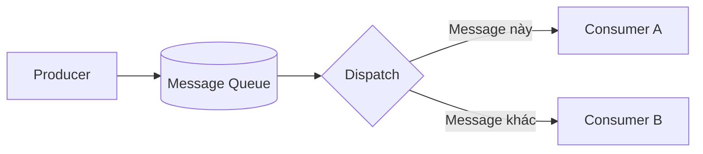
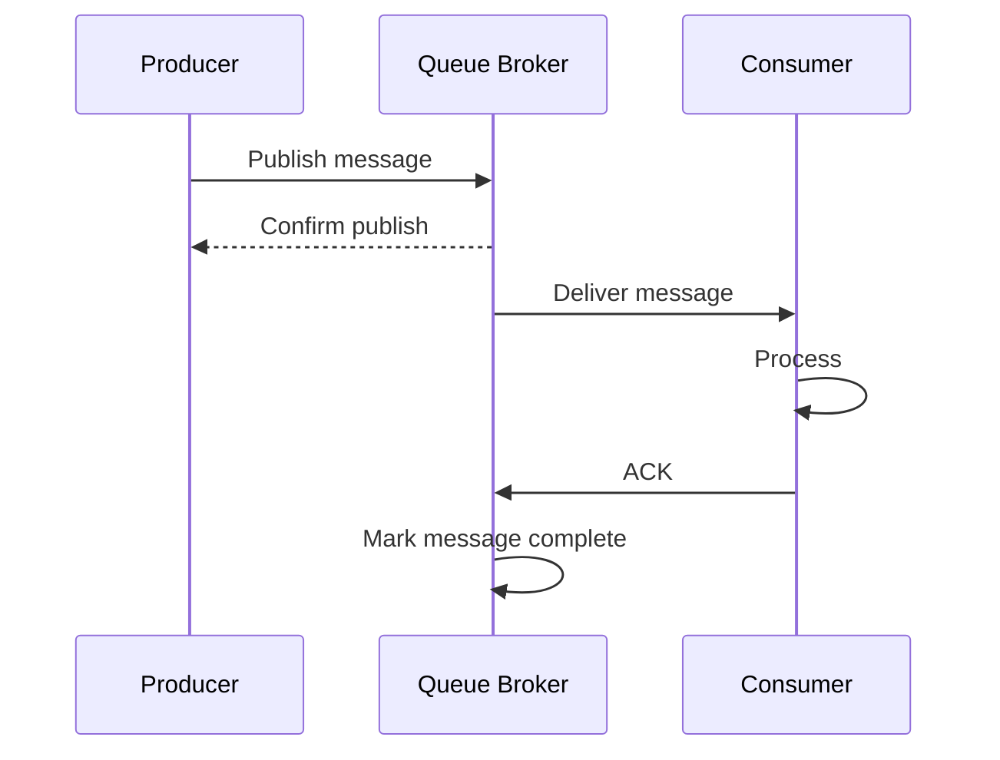
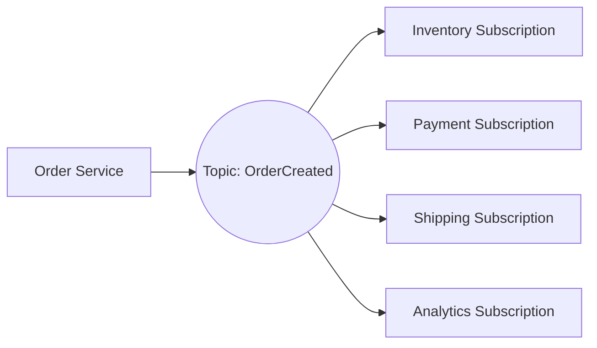
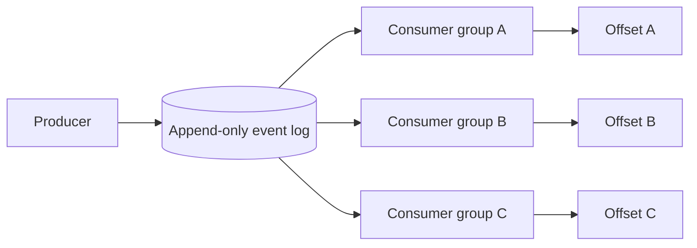
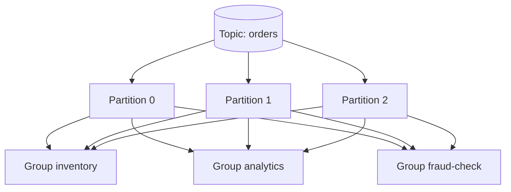
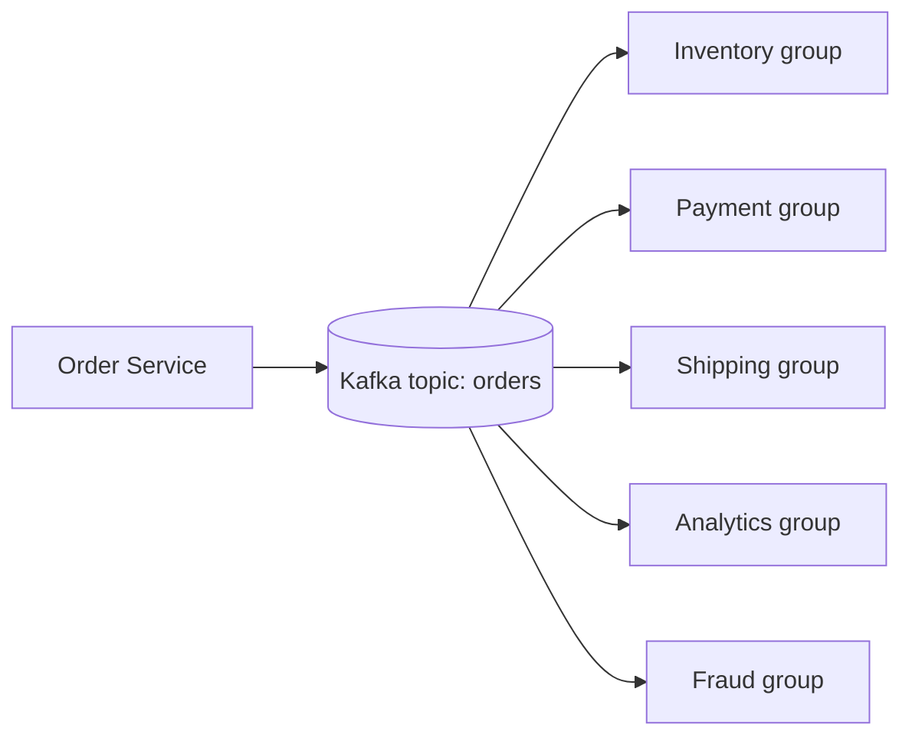
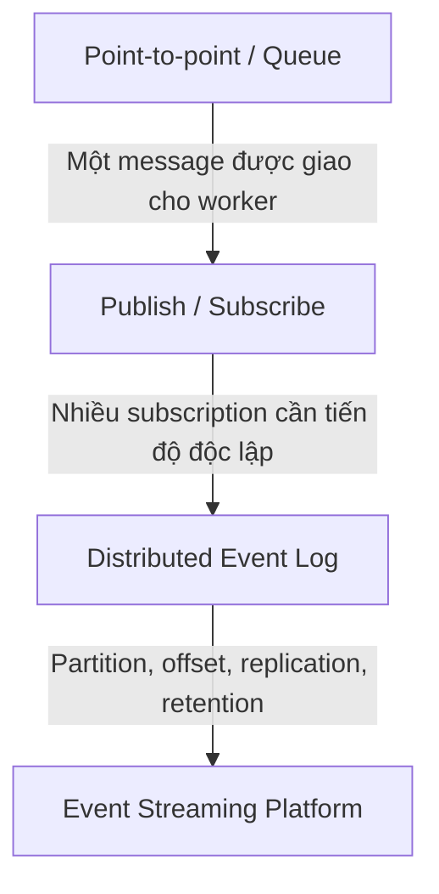

# Từ hàng đợi truyền thống đến nhật ký sự kiện phân tán

Trong một hệ thống phần mềm, các thành phần thường cần trao đổi công việc và dữ liệu mà không nhất thiết phải gọi trực tiếp lẫn nhau. Một service có thể tạo đơn hàng, service khác kiểm tra tồn kho, service tiếp theo xử lý thanh toán, còn hệ thống phân tích cần nhận dữ liệu để cập nhật báo cáo. Nếu tất cả thành phần gọi đồng bộ qua HTTP, chúng dễ bị ràng buộc về thời gian hoạt động, tốc độ xử lý và cấu trúc triển khai.

Hàng đợi thông điệp (message queue) ra đời để tách bên gửi khỏi bên nhận và giúp xử lý công việc bất đồng bộ. Mô hình này giải quyết tốt nhiều bài toán, nhưng khi hệ thống cần nhiều nhóm ứng dụng cùng đọc một dòng sự kiện, cần đọc lại dữ liệu cũ, mở rộng thông lượng và lưu giữ lịch sử trong một khoảng thời gian, cách nhìn về thông điệp bắt đầu thay đổi. Thay vì xem thông điệp là một công việc chờ được lấy khỏi hàng đợi, ta có thể xem nó là một bản ghi được thêm vào nhật ký sự kiện phân tán (distributed event log).

Apache Kafka được xây dựng quanh mô hình nhật ký phân tán này. Kafka vẫn hỗ trợ giao tiếp bất đồng bộ và có thể dùng cho các luồng xử lý giống hàng đợi, nhưng cách lưu trữ, theo dõi tiến độ và phân phối dữ liệu tạo ra những khả năng khác biệt: nhiều consumer group có thể đọc độc lập cùng một topic, consumer có thể quay lại offset cũ để phát lại sự kiện, và dữ liệu được chia partition để phân tán tải trên nhiều broker.

Bài học thuộc phần **Tổng quan** của module **KAFKA**, tập trung vào quá trình chuyển từ queue truyền thống sang distributed event log. Sau bài này, bạn có thể giải thích được vì sao hệ thống cần một mô hình event streaming, phân biệt queue với log, mô tả cách Kafka tổ chức và phân phối sự kiện, đồng thời nhận diện những đánh đổi khi lựa chọn kiến trúc.

## 1. Bài toán giao tiếp bất đồng bộ

### 1.1. Gọi trực tiếp tạo ra sự phụ thuộc thời gian

Giả sử service Đơn hàng nhận yêu cầu mua hàng và gọi lần lượt service Kho, Thanh toán, Vận chuyển. Nếu các lời gọi đều đồng bộ, service Đơn hàng phải chờ từng service phản hồi. Khi service Kho chậm hoặc ngừng hoạt động, yêu cầu tạo đơn có thể bị kéo dài hoặc thất bại dù service Đơn hàng vẫn khỏe mạnh.

Các vấn đề thường gặp gồm:

- **Phụ thuộc thời gian hoạt động:** bên nhận phải sẵn sàng đúng lúc bên gửi gọi.
- **Ghép nối theo giao diện:** bên gửi cần biết endpoint, giao thức và đôi khi cả cấu trúc nội bộ của bên nhận.
- **Khó hấp thụ tải đột biến:** khi lượng yêu cầu tăng nhanh, các service phía sau có thể bị quá tải đồng thời.
- **Khó thêm người tiêu thụ mới:** mỗi service mới có thể yêu cầu sửa service phát sinh dữ liệu hoặc thêm lời gọi trực tiếp.

Giao tiếp bất đồng bộ đặt một trung gian giữa bên phát sinh và bên xử lý. Bên gửi chuyển thông điệp cho trung gian rồi tiếp tục công việc theo chính sách của ứng dụng; bên nhận xử lý khi có khả năng. Trung gian giữ dữ liệu trong thời gian cần thiết và giúp hấp thụ chênh lệch tốc độ giữa hai phía.

### 1.2. Queue tách bên gửi khỏi bên nhận

Với mô hình queue, producer gửi một message vào hàng đợi. Một consumer nhận message, xử lý và xác nhận (acknowledge) khi hoàn thành. Nếu consumer lỗi trước khi xác nhận, broker có thể phân phối lại message theo chính sách của hệ thống.



Trong mô hình competing consumers, nhiều consumer cùng cạnh tranh lấy message từ một queue. Một message thường được giao cho một consumer tại một thời điểm; sau khi xử lý và xác nhận, message được coi là hoàn tất và không còn chờ ở queue. Cách này phù hợp với bài toán phân phối công việc: gửi email, tạo hóa đơn, xử lý ảnh, chạy tác vụ nền hoặc thực thi một lệnh.

Queue tạo ra một ranh giới hữu ích. Producer chỉ cần biết tên queue và hợp đồng message. Consumer có thể tăng hoặc giảm số instance để điều chỉnh năng lực xử lý mà không cần producer biết từng instance.

## 2. Hàng đợi truyền thống hoạt động như thế nào?

### 2.1. Vòng đời message

Một luồng xử lý queue điển hình có các bước:

1. Producer tạo message và gửi vào queue.
2. Broker nhận message, lưu theo chính sách độ bền đã cấu hình và đưa nó vào trạng thái sẵn sàng.
3. Consumer nhận hoặc được broker giao message.
4. Consumer thực hiện nghiệp vụ.
5. Consumer gửi ACK khi xử lý thành công.
6. Broker loại message khỏi trạng thái cần giao lại. Nếu không có ACK, message có thể được giao lại sau timeout hoặc theo chính sách retry.



Chi tiết chính xác phụ thuộc sản phẩm và cấu hình. Một số broker dùng cơ chế push, một số hỗ trợ consumer pull; có broker lưu message bền vững xuống đĩa, có broker cho phép cấu hình mức xác nhận khác nhau. Nhưng ý tưởng phổ biến là message nằm trong hàng đợi để chờ được xử lý và được xác nhận hoàn tất.

### 2.2. ACK, redelivery và dead-letter queue

ACK cho broker biết consumer đã xử lý message. Nếu consumer chết sau khi nhận message nhưng trước khi ACK, broker có thể giao lại. Điều này bảo vệ message trước một số lỗi tiến trình, nhưng cũng tạo khả năng xử lý trùng: consumer có thể đã thực hiện tác động bên ngoài rồi mới gặp sự cố trước ACK.

Vì vậy, consumer cần được thiết kế để xử lý lặp an toàn (idempotent) khi nghiệp vụ có thể bị giao lại. Ví dụ, thay vì cộng tiền vào tài khoản mỗi lần nhận message, hệ thống nên dùng mã giao dịch duy nhất và bảo đảm một giao dịch chỉ được ghi nhận một lần.

Message lỗi lặp đi lặp lại có thể được chuyển vào dead-letter queue (DLQ) để điều tra thay vì chặn toàn bộ luồng. DLQ cần giữ thông tin gốc, nguyên nhân lỗi, số lần thử và thời điểm; đội vận hành cần có quy trình sửa dữ liệu hoặc phát lại có kiểm soát.

### 2.3. Queue rất phù hợp với phân phối công việc

Hãy xét một hệ thống gửi email. Service nghiệp vụ đưa yêu cầu gửi email vào queue. Một nhóm worker nhận các message, gửi thư và ACK. Khi lượng công việc tăng, có thể bổ sung worker. Mỗi yêu cầu thường chỉ cần một worker hoàn thành, do đó mô hình competing consumers phù hợp tự nhiên.

Queue cũng có thể hỗ trợ ưu tiên, delay, retry, giới hạn số message đang xử lý và các cơ chế routing. Đây là những khả năng hữu ích cho task processing. Không nên kết luận rằng queue truyền thống yếu hoặc đã lỗi thời: với tác vụ cần giao một công việc cho một worker, queue thường đơn giản và trực tiếp hơn một nền tảng streaming.

## 3. Khi một message cần nhiều người tiêu thụ

### 3.1. Từ competing consumers sang publish/subscribe

Một hệ thống thương mại điện tử có thể phát sinh sự kiện `OrderCreated`. Nhiều thành phần cần phản ứng với cùng một sự kiện:

- Kho giữ chỗ hàng.
- Thanh toán tạo yêu cầu thu tiền.
- Vận chuyển chuẩn bị quy trình giao hàng.
- Phân tích cập nhật số liệu kinh doanh.
- Chống gian lận đánh giá hành vi bất thường.

Nếu tất cả consumer cùng lấy message từ một queue cạnh tranh, một message có thể chỉ đến một consumer trong nhóm đó. Điều này không đáp ứng yêu cầu mỗi hệ thống con đều nhận được sự kiện.

Mô hình publish/subscribe (pub/sub) giải quyết bằng cách phát message lên một topic và phân phối bản tin tới nhiều subscription. Mỗi subscription theo dõi tiến độ riêng. Tùy hệ thống, broker có thể tạo bản sao message cho từng subscription hoặc lưu message dùng chung và duy trì cursor riêng.



Pub/sub tách producer khỏi số lượng consumer. Khi thêm một subscription mới, producer thường không cần biết hoặc thay đổi. Đây là bước quan trọng từ xử lý công việc sang truyền sự kiện cho nhiều miền nghiệp vụ.

### 3.2. Pub/sub vẫn cần một cách lưu và theo dõi dữ liệu

Khi một subscription tạm ngừng hoạt động, broker phải quyết định giữ message bao lâu. Khi subscription mới xuất hiện, nó có thể chỉ nhận message từ thời điểm đăng ký, hoặc có thể cần lịch sử trước đó. Khi một consumer bị lỗi giữa chừng, hệ thống phải biết nó đã xử lý tới đâu.

Nếu chỉ nghĩ theo mô hình “gửi rồi xóa sau khi mọi người nhận”, việc quản lý nhiều consumer có tiến độ khác nhau trở nên phức tạp. Một cách tiếp cận khác là lưu sự kiện thành một nhật ký có thứ tự và để từng consumer tự ghi nhớ vị trí đã đọc. Đây là ý tưởng trung tâm của distributed event log.

## 4. Nhật ký sự kiện là gì?

### 4.1. Thông điệp trở thành bản ghi trong một dòng dữ liệu

Nhật ký (log) là một chuỗi bản ghi được thêm nối tiếp. Thay vì coi message là một công việc đang chờ được lấy khỏi queue, hệ thống coi mỗi event là một bản ghi đã được ghi vào log. Bản ghi thường không bị xóa chỉ vì một consumer đã đọc nó. Nó được giữ lại theo chính sách lưu trữ, ví dụ trong một khoảng thời gian hoặc tới khi đạt giới hạn dung lượng.

Mỗi bản ghi có vị trí trong log. Consumer lưu vị trí đã xử lý và có thể tiếp tục từ vị trí đó khi khởi động lại. Nhiều consumer có thể đọc cùng một log ở các vị trí khác nhau mà không làm thay đổi tiến độ của nhau.



Đặc điểm “append-only” mô tả cách dữ liệu mới được thêm vào cuối log. Trong thực tế, hệ thống vẫn có thể xóa các segment đã hết hạn hoặc compact log theo key; append-only không có nghĩa dữ liệu được lưu vĩnh viễn hoặc không bao giờ thay đổi trên thiết bị lưu trữ.

### 4.2. Consumer theo dõi vị trí đọc của chính mình

Giả sử log có các bản ghi ở vị trí 0, 1, 2, 3, 4. Consumer A đã xử lý đến vị trí 3, trong khi consumer B mới xử lý đến vị trí 1. Khi A đọc tiếp, B không bị buộc phải nhảy tới vị trí 4. Mỗi consumer duy trì tiến độ riêng.

Điều này tạo ra ba khả năng quan trọng:

- **Đọc độc lập:** nhiều ứng dụng cùng đọc một dòng sự kiện mà không tiêu thụ mất dữ liệu của nhau.
- **Đọc lại:** một consumer có thể quay về vị trí cũ để dựng lại trạng thái hoặc chạy lại một phép tính, miễn là dữ liệu vẫn còn được lưu.
- **Bắt kịp:** consumer tạm dừng có thể tiếp tục từ vị trí đã commit và xử lý phần dữ liệu phát sinh trong lúc nó ngừng hoạt động.

Đọc lại dữ liệu rất hữu ích khi triển khai một consumer mới, sửa lỗi logic xử lý, xây dựng lại chỉ mục tìm kiếm hoặc tính toán lại báo cáo. Tuy nhiên, replay có thể lặp lại tác động nghiệp vụ. Consumer cần idempotency hoặc cơ chế cô lập dữ liệu khi chạy lại để tránh gửi email, thu tiền hay tạo đơn trùng.

### 4.3. Retention tách vòng đời dữ liệu khỏi vòng đời consumer

Trong queue truyền thống, ACK thường là một phần của cơ chế hoàn tất và loại message khỏi tập cần giao. Trong event log, việc consumer đã đọc hay chưa thường không quyết định dữ liệu còn được lưu hay không. Broker giữ bản ghi theo retention policy.

Retention có thể được cấu hình theo thời gian hoặc dung lượng. Ví dụ, topic có thể giữ dữ liệu trong bảy ngày hoặc tối đa một giới hạn dung lượng nhất định. Consumer chậm hơn retention có thể mất cơ hội đọc các bản ghi đã bị xóa; do đó, retention phải được thiết kế dựa trên khả năng downtime, tốc độ phục hồi và nhu cầu replay.

Kafka còn hỗ trợ log compaction. Với topic compacted, broker giữ lại giá trị mới nhất theo key trong quá trình compact, cùng các tombstone theo quy tắc của cơ chế này. Compaction phù hợp với topic biểu diễn trạng thái mới nhất theo khóa, nhưng không tương đương với lưu toàn bộ lịch sử mọi thay đổi.

## 5. Kafka hiện thực hóa distributed event log

### 5.1. Topic, partition, record và offset

Kafka tổ chức luồng sự kiện theo **topic**. Topic là tên logic của một dòng dữ liệu, chẳng hạn `orders`, `payments` hoặc `inventory-events`. Để phân tán tải và tăng khả năng xử lý song song, topic được chia thành một hoặc nhiều **partition**.

Mỗi partition là một log có thứ tự riêng. Producer ghi record vào partition; Kafka gán cho record một **offset** thể hiện vị trí của nó trong partition đó. Offset tăng theo thứ tự bản ghi được thêm vào partition và được dùng để consumer xác định vị trí đọc.

Một record Kafka thường gồm:

- **Key:** khóa tùy chọn dùng để định tuyến record tới partition và giữ các record cùng key ở cùng partition theo partitioner tương ứng.
- **Value:** payload sự kiện, có thể là JSON, Avro, Protobuf, chuỗi hoặc dữ liệu nhị phân.
- **Timestamp:** thời điểm gắn với record theo cấu hình producer/broker.
- **Headers:** các cặp key-value bổ sung như correlation ID, trace ID hoặc thông tin phiên bản schema.
- **Offset:** vị trí của record trong một partition; offset được broker gán khi record được ghi.

Ví dụ, topic `orders` có ba partition:

```text
Topic: orders

Partition 0:  offset 0 -> order-101
              offset 1 -> order-104
              offset 2 -> order-107

Partition 1:  offset 0 -> order-102
              offset 1 -> order-105

Partition 2:  offset 0 -> order-103
              offset 1 -> order-106
```

Offset chỉ có ý nghĩa trong một partition. `orders-0 offset 2` không thể so sánh như một số thứ tự toàn cục với `orders-1 offset 1`. Kafka không cung cấp một thứ tự tổng duy nhất cho mọi record trong topic nhiều partition.

### 5.2. Ordering được bảo đảm trong phạm vi partition

Kafka bảo đảm thứ tự đọc theo log trong từng partition. Nếu ứng dụng cần các sự kiện của cùng một đơn hàng luôn được xử lý theo thứ tự, producer thường đặt `orderId` làm key để các record cùng đơn hàng được định tuyến về cùng partition.

Ví dụ:

```java
ProducerRecord<String, String> event = new ProducerRecord<>(
    "orders",
    orderId,       // key: các sự kiện của cùng đơn hàng đi cùng partition
    eventJson      // value: nội dung sự kiện
);
```

Đây là nguyên tắc thiết kế quan trọng: chọn key theo đơn vị nghiệp vụ cần giữ thứ tự. Nếu không có key hoặc dùng key không phù hợp, các sự kiện liên quan có thể nằm ở nhiều partition và consumer không thể suy ra thứ tự toàn cục đáng tin cậy.

Tăng số partition có thể tăng khả năng song song, nhưng cũng ảnh hưởng cách phân phối key, số consumer có thể hoạt động đồng thời và các giả định về ordering. Việc tăng partition không nên được xem là thay đổi dung lượng hoàn toàn không có tác động tới hợp đồng dữ liệu.

### 5.3. Producer ghi sự kiện vào topic

Producer là ứng dụng gửi record đến Kafka. Producer chọn topic và có thể cung cấp key. Partitioner xác định partition đích; broker leader của partition tiếp nhận record. Tùy cấu hình, producer có thể chờ broker xác nhận trước khi coi việc gửi đã thành công.

Một producer có thể gửi sự kiện cho nhiều consumer group mà không cần biết danh sách consumer. Điều này làm giảm phụ thuộc giữa service phát sinh sự kiện và các service sử dụng nó.

Khi thiết kế producer, cần xác định:

- Sự kiện biểu diễn điều gì và được phát ở thời điểm nào trong vòng đời nghiệp vụ.
- Key nào cần dùng để giữ thứ tự theo thực thể.
- Payload và schema được quản lý, tương thích phiên bản ra sao.
- Mức xác nhận gửi, retry, idempotence và xử lý lỗi được cấu hình như thế nào.
- Có cần transactional outbox để bảo đảm thay đổi cơ sở dữ liệu và việc phát sự kiện không bị lệch nhau hay không.

### 5.4. Consumer và consumer group

Consumer đọc record từ một hoặc nhiều partition. Trong Kafka, nhiều consumer có thể tham gia một **consumer group**. Các partition của topic được phân công cho consumer trong cùng group; tại một thời điểm, mỗi partition trong group thường chỉ được một consumer trong group đó xử lý. Nếu group có ít consumer hơn số partition, một consumer có thể nhận nhiều partition. Nếu số consumer nhiều hơn số partition, một số consumer sẽ không được gán partition.

Consumer group giúp mở rộng xử lý song song. Khi thêm consumer vào group, Kafka có thể phân phối lại partition (rebalance). Rebalance có thể tạm dừng việc tiêu thụ trong quá trình điều phối và cần được tính đến khi thiết kế thời gian xử lý, commit offset và xử lý trạng thái cục bộ.

Điểm khác biệt quan trọng là hai consumer group khác nhau đọc độc lập cùng topic. Ví dụ:



Trong thực tế, mỗi group có các consumer instance nhận partition theo assignment riêng. Sơ đồ chỉ thể hiện rằng mỗi group có thể theo dõi cùng dòng dữ liệu với tiến độ độc lập; nó không có nghĩa một consumer duy nhất đọc đồng thời tất cả partition.

### 5.5. Offset là tiến độ của consumer group

Consumer thường commit offset để ghi nhận vị trí có thể tiếp tục sau khi khởi động lại. Commit quá sớm, trước khi xử lý xong record, có thể dẫn tới bỏ sót xử lý nếu consumer gặp lỗi. Commit sau khi xử lý có thể khiến record được xử lý lại khi tiến trình lỗi trước lúc commit.

Vì vậy, offset gắn chặt với delivery semantics:

- **At-most-once:** commit trước hoặc tại thời điểm xử lý theo cách có thể tránh lặp, nhưng có nguy cơ mất xử lý khi lỗi xảy ra sau commit.
- **At-least-once:** xử lý xong rồi mới commit; có thể xử lý trùng khi lỗi xảy ra trước commit.
- **Exactly-once:** cần phối hợp cơ chế transaction/idempotence trong phạm vi được hỗ trợ. Không thể suy ra rằng mọi tác động tới database, email hay API bên ngoài đều tự động exactly-once chỉ vì dùng Kafka.

Đối với nghiệp vụ quan trọng, hãy kết hợp commit offset phù hợp với idempotent consumer, khóa duy nhất, bảng inbox hoặc transaction ở hệ thống đích. Phạm vi đảm bảo phải được xác định rõ ở từng ranh giới dữ liệu.

### 5.6. Broker, replication và khả năng chịu lỗi

Kafka chạy trên nhiều broker. Partition có thể được cấu hình nhiều replica đặt trên các broker khác nhau. Một replica được bầu làm leader để nhận request đọc/ghi theo cơ chế của partition; các replica follower sao chép dữ liệu từ leader.

Nhóm replica đang theo kịp leader được gọi là **in-sync replicas (ISR)**. Cấu hình producer `acks`, `min.insync.replicas` và replication factor ảnh hưởng mức xác nhận và khả năng chịu lỗi. Ví dụ, `acks=all` yêu cầu chờ các replica trong ISR xác nhận theo giao thức, còn `min.insync.replicas` đặt số replica tối thiểu để broker chấp nhận ghi trong các điều kiện tương ứng. Cần hiểu và kiểm thử các cấu hình này cùng nhau; chỉ tăng replication factor không tự động bảo đảm mọi yêu cầu ghi đều có mức bền vững như mong muốn.

Replication giúp hệ thống tiếp tục hoạt động khi một broker gặp sự cố trong giới hạn replica và chính sách bầu leader. Nó không thay thế backup, kế hoạch phục hồi thảm họa, giám sát ISR hay quy trình xử lý mất dữ liệu. Thiết kế cụm còn cần phân bố replica qua các rack/zone khi hạ tầng hỗ trợ.

Kafka hiện đại sử dụng **KRaft** để quản lý metadata cụm bằng quorum controller, thay cho kiến trúc phụ thuộc ZooKeeper ở các dòng cũ. KRaft là một phần kiến trúc quản lý metadata và điều phối cụm; nó không thay thế vai trò partition replication đối với dữ liệu topic.

## 6. So sánh queue truyền thống và Kafka log

Hai mô hình có thể cùng phục vụ giao tiếp bất đồng bộ, nhưng cách quản lý dữ liệu và tiến độ khác nhau:

| Khía cạnh | Queue truyền thống điển hình | Kafka distributed log |
|---|---|---|
| Đơn vị chính | Message đang chờ được giao/xử lý | Record được thêm vào partition log |
| Sau khi xử lý | ACK thường đánh dấu message hoàn tất và được loại khỏi tập chờ | Consumer commit offset; record vẫn được giữ theo retention/compaction |
| Nhiều consumer | Competing consumers chia nhau công việc; pub/sub có thể dùng subscription riêng | Consumer group chia partition; các group độc lập đọc cùng topic |
| Theo dõi tiến độ | Trạng thái giao nhận/ACK của broker | Offset theo từng partition và consumer group |
| Đọc lại dữ liệu | Thường cần cơ chế lưu trữ, DLQ hoặc replay riêng | Có thể seek về offset cũ khi record còn trong retention |
| Thứ tự | Tùy queue, số consumer và cơ chế broker | Có thứ tự trong một partition; không có thứ tự toàn cục giữa nhiều partition |
| Mở rộng | Thường mở rộng worker và broker theo mô hình queue | Phân vùng topic và phân phối partition trên nhiều broker/consumer |
| Phù hợp | Giao một công việc cho worker, task queue, lệnh nền | Event streaming, nhiều ứng dụng tiêu thụ, lưu lịch sử và xử lý lại |

Đây là so sánh mô hình điển hình, không phải định nghĩa cứng cho mọi sản phẩm. Nhiều message broker hỗ trợ cả queue lẫn pub/sub, lưu trữ bền vững, replay hoặc phân vùng. Khi đánh giá công nghệ, cần so sánh đúng tính năng, giới hạn và cấu hình của sản phẩm cụ thể.

## 7. Ví dụ xuyên suốt: luồng sự kiện đơn hàng

### 7.1. Nếu dùng một queue công việc

Giả sử service Đơn hàng gửi message `ProcessOrder` vào queue. Nhóm worker lấy message và thực hiện toàn bộ quy trình. Cách này phù hợp nếu mỗi đơn hàng chỉ cần một worker xử lý một lần theo workflow được đóng gói.

Nhưng nếu Kho, Thanh toán, Vận chuyển và Phân tích cần xử lý độc lập, ta phải tạo queue riêng hoặc routing tới nhiều subscription. Khi thêm một consumer mới, cần bảo đảm sự kiện được chuyển tới subscription đó. Việc phát lại lịch sử để xây dựng báo cáo cũng cần một cơ chế lưu trữ riêng nếu message đã bị ACK và loại khỏi queue.

### 7.2. Nếu phát sự kiện vào Kafka

Service Đơn hàng phát `OrderCreated` vào topic `orders`. Các nhóm độc lập đọc cùng topic:



Mỗi group có offset riêng. Nếu Analytics ngừng hoạt động trong hai giờ, các group khác vẫn tiếp tục đọc. Khi Analytics hoạt động lại, nó có thể tiếp tục từ offset đã commit nếu các record cần thiết vẫn còn trong retention. Một nhóm mới có thể đọc từ offset mới nhất hoặc từ đầu trong phạm vi dữ liệu còn lưu, tùy chính sách khởi tạo offset.

Giả sử một đơn hàng có các sự kiện `OrderCreated`, `OrderPaid`, `OrderPacked`, `OrderShipped`. Nếu tất cả dùng `orderId` làm key, chúng được định tuyến về cùng partition và consumer có thể đọc theo thứ tự log của partition đó. Tuy nhiên, thứ tự sự kiện vẫn phải được xác định bởi thời điểm producer ghi; nếu nhiều service độc lập cùng phát sự kiện, cần thiết kế rõ nguồn phát, trạng thái hợp lệ và quy tắc xử lý sự kiện đến muộn.

### 7.3. Event log không tự giải quyết toàn bộ nghiệp vụ

Kafka truyền và lưu sự kiện; nó không tự bảo đảm rằng mọi consumer thực hiện nghiệp vụ đúng. Consumer Kho vẫn cần xử lý tồn kho đồng thời. Consumer Thanh toán vẫn cần idempotency với nhà cung cấp thanh toán. Consumer Vận chuyển vẫn cần quy tắc retry và xử lý sự kiện đến sai thứ tự. Hệ thống Phân tích vẫn cần quản lý schema và chất lượng dữ liệu.

Kafka cung cấp nền tảng để các hệ thống trao đổi sự kiện ở quy mô lớn, còn tính đúng đắn của nghiệp vụ phụ thuộc thiết kế producer, consumer, schema, key, transaction và vận hành của toàn hệ thống.

## 8. Kafka có phải là event sourcing không?

Hai khái niệm thường đi cùng nhau nhưng không đồng nghĩa.

- **Event streaming** là việc phát, lưu, xử lý và truyền các dòng sự kiện liên tục giữa các hệ thống.
- **Event sourcing** là cách thiết kế ứng dụng trong đó trạng thái nghiệp vụ được xây dựng từ chuỗi sự kiện đã ghi nhận; trạng thái hiện tại có thể được tái dựng bằng cách phát lại sự kiện.

Kafka có thể làm hạ tầng vận chuyển hoặc lưu trữ một phần event stream cho hệ thống event-sourced. Nhưng việc một topic có các event không tự động biến ứng dụng thành event sourcing. Một ứng dụng có thể dùng Kafka để phát thông báo tích hợp trong khi cơ sở dữ liệu quan hệ vẫn là nguồn dữ liệu chính thức (system of record).

Khi dùng Kafka làm nguồn dữ liệu cho một luồng xử lý, cần xác định rõ:

- Sự kiện là sự thật nghiệp vụ đã xảy ra hay chỉ là thông báo kỹ thuật.
- Ai chịu trách nhiệm phát sự kiện và bảo đảm không bỏ sót khi ghi database.
- Dữ liệu có cần lưu lâu dài, bất biến về mặt nghiệp vụ hoặc lưu trữ pháp lý không.
- Có cần snapshot hoặc cơ chế dựng lại trạng thái hay không.
- Schema cũ được duy trì tương thích với consumer mới như thế nào.

Đặc biệt, thao tác ghi database rồi gửi Kafka bằng hai lệnh độc lập có thể tạo lỗi dual-write: database commit thành công nhưng publish thất bại, hoặc publish thành công nhưng database rollback. Transactional outbox là một mẫu phổ biến: ghi thay đổi nghiệp vụ và bản ghi outbox trong cùng transaction database, sau đó một tiến trình chuyển outbox thành event Kafka. Mẫu này giảm nguy cơ hai hệ thống bị lệch trạng thái.

## 9. Chọn queue hay Kafka cho bài toán thực tế

Không phải hệ thống nào cũng cần event streaming. Hãy chọn theo yêu cầu dữ liệu và cách consumer làm việc.

### Queue thường là lựa chọn phù hợp khi

- Mỗi message đại diện cho một công việc cần được một worker hoàn thành.
- Cần cơ chế ACK, redelivery, delay, ưu tiên hoặc routing theo kiểu task processing.
- Không cần nhiều ứng dụng đọc lại cùng lịch sử sự kiện trong thời gian dài.
- Muốn vận hành một thành phần trung gian đơn giản cho workload vừa phải.

### Kafka thường phù hợp khi

- Một sự kiện cần được nhiều hệ thống độc lập tiêu thụ.
- Cần giữ dữ liệu trong một khoảng thời gian để consumer đọc theo tốc độ riêng.
- Cần replay dữ liệu để khôi phục trạng thái, xây dựng consumer mới hoặc tính toán lại.
- Cần throughput cao bằng cách chia topic thành nhiều partition và phân tán trên cụm broker.
- Cần tích hợp nhiều nguồn và đích dữ liệu qua Kafka Connect, xử lý luồng bằng Kafka Streams hoặc nền tảng stream processing khác.
- Cần quan sát tiến độ consumer qua offset, lag và trạng thái partition.

### Có thể dùng cả hai

Một hệ thống có thể dùng Kafka để phân phối domain events tới nhiều hệ thống, sau đó mỗi consumer đưa công việc cụ thể vào queue riêng để worker xử lý theo chính sách retry, ưu tiên hoặc delay. Ví dụ, topic `orders` phát sự kiện đơn hàng; consumer thông báo chuyển các yêu cầu gửi email sang queue `email-jobs`.

Kiến trúc kết hợp làm tăng số thành phần cần vận hành. Chỉ nên dùng khi lợi ích về phân tách luồng sự kiện và quản lý công việc đủ rõ. Tránh tạo thêm broker chỉ vì một công nghệ đang phổ biến.

## 10. Những việc cần thiết kế khi chuyển từ queue sang Kafka

Chuyển từ queue sang Kafka không chỉ là đổi thư viện producer/consumer. Cần rà soát hợp đồng xử lý và những giả định mà hệ thống cũ đang dựa vào.

1. **Xác định ngữ nghĩa message:** message cũ là lệnh yêu cầu thực hiện công việc hay sự kiện mô tả điều đã xảy ra? Không nên biến một command thành event chỉ bằng cách đổi tên topic.
2. **Chọn topic và key:** phân nhóm theo loại sự kiện, xác định key để giữ thứ tự theo thực thể nghiệp vụ và ước lượng số partition.
3. **Thiết kế schema:** thống nhất tên event, event ID, entity ID, timestamp, version, correlation ID và payload. Quy định cách thêm/bỏ field và kiểm soát tương thích.
4. **Thiết kế consumer group:** mỗi ứng dụng logic cần tiến độ riêng nên có group riêng. Các instance cùng một ứng dụng thường tham gia cùng group để chia partition.
5. **Chọn retention:** dữ liệu cần được giữ đủ lâu cho downtime, phục hồi và replay. Tính cả dung lượng phát sinh và tốc độ tăng trưởng.
6. **Xác định delivery semantics:** chọn thời điểm commit offset, xử lý duplicate, retry và DLQ. Không giả định ACK của queue tương đương trực tiếp với commit offset.
7. **Bảo đảm thứ tự:** chọn key phù hợp và xác định hành vi khi retry, rebalance hoặc nhận sự kiện đến muộn.
8. **Bảo đảm phát sự kiện:** nếu dữ liệu nghiệp vụ nằm trong database, đánh giá transactional outbox hoặc cơ chế CDC để tránh dual-write.
9. **Lập kế hoạch quan sát:** theo dõi producer error, request latency, consumer lag, rebalance, partition skew, ISR và dung lượng đĩa.
10. **Chuyển đổi có kiểm soát:** chạy thử song song hoặc shadow consumer, so sánh kết quả, chọn thời điểm cutover, xác định cách quay lại và tránh phát cùng một tác động nghiệp vụ hai lần.

Một lỗi phổ biến là vừa để queue cũ vừa publish Kafka bằng hai thao tác độc lập rồi cho rằng hai nơi luôn có cùng dữ liệu. Nếu tiến trình dừng giữa hai thao tác, một bên có thể nhận message còn bên kia không. Hãy dùng outbox, CDC hoặc một quy trình đồng bộ có khả năng phát hiện và sửa sai lệch.

## 11. Các hiểu lầm thường gặp

| Hiểu lầm | Cách hiểu chính xác |
|---|---|
| Kafka là một queue thông thường có tốc độ cao | Kafka là distributed log; consumer group có thể dùng để chia tải như queue, nhưng record được giữ theo retention thay vì bị xóa ngay sau ACK của một consumer |
| Một record chỉ có thể được một ứng dụng đọc | Nhiều consumer group độc lập có thể đọc cùng topic |
| Offset là số thứ tự toàn topic | Offset thuộc từng partition; topic nhiều partition không có một thứ tự toàn cục |
| Thêm consumer luôn tăng thông lượng | Consumer trong cùng group chỉ song song theo số partition được gán; consumer dư có thể ở trạng thái idle |
| Kafka bảo đảm mọi nghiệp vụ exactly-once | Exactly-once có phạm vi và điều kiện cụ thể; tác động tới hệ thống ngoài Kafka vẫn cần idempotency hoặc phối hợp transaction |
| Retention dài nghĩa là dữ liệu được lưu vĩnh viễn | Retention phụ thuộc thời gian/dung lượng và có thể bị xóa; replication cũng không thay thế backup |
| Kafka thay thế mọi message queue | Queue vẫn phù hợp cho task dispatch, delay, priority và các workflow dựa trên ACK |
| Dùng Kafka đồng nghĩa ứng dụng là event-sourced | Event streaming và event sourcing là hai khái niệm khác nhau |

## 12. Tóm tắt mô hình tư duy

Quá trình phát triển có thể nhìn qua ba mô hình:



- **Queue:** tập trung vào việc giao một công việc cho consumer và xác nhận hoàn tất.
- **Pub/sub:** tập trung vào việc phát một thông điệp tới nhiều subscription độc lập.
- **Distributed event log:** lưu sự kiện theo thứ tự trong các partition, cho phép consumer theo dõi offset riêng, đọc lại và xử lý ở tốc độ riêng.
- **Kafka:** hiện thực hóa distributed log trên cụm broker, với producer, consumer group, partition, replication, retention và hệ sinh thái tích hợp.

Khi thiết kế hệ thống, hãy bắt đầu từ câu hỏi nghiệp vụ: dữ liệu là công việc cần giao một lần, hay là sự kiện cần được nhiều hệ thống quan sát và xử lý độc lập? Câu trả lời giúp quyết định dùng queue, pub/sub, Kafka hay kết hợp các mô hình.

## 13. Câu hỏi tự kiểm tra

1. Trong queue truyền thống, ACK có ý nghĩa gì và vì sao consumer vẫn cần xử lý idempotent?
2. Vì sao nhiều consumer group có thể đọc cùng một topic Kafka mà không làm mất dữ liệu của nhau?
3. Offset có phạm vi trong một partition hay toàn topic? Điều này ảnh hưởng thế nào tới ordering?
4. Khi một consumer dừng lâu hơn retention, điều gì có thể xảy ra với phần dữ liệu nó chưa đọc?
5. Vì sao thêm consumer vào một group không thể tạo mức song song vượt quá số partition được gán?
6. Kafka replication, retention và backup giải quyết những vấn đề khác nhau như thế nào?
7. Trong luồng tạo đơn hàng, vì sao nên cân nhắc dùng `orderId` làm key?
8. Event streaming khác event sourcing ở điểm nào?
9. Khi chuyển từ queue sang Kafka, vì sao cần xem lại ACK, commit offset, retry và DLQ?
10. Trong trường hợp nào một queue chuyên xử lý công việc vẫn là lựa chọn hợp lý hơn Kafka?

## 14. Tài liệu tham khảo

- Apache Kafka documentation: <https://kafka.apache.org/documentation/> — kiến trúc, topic, partition, producer, consumer và cấu hình broker.
- Apache Kafka design: <https://kafka.apache.org/documentation/#design> — các quyết định thiết kế của Kafka, log, replication và consumer.
- Apache Kafka protocol: <https://kafka.apache.org/protocol> — request/response protocol và API giữa client với broker.
- Apache Kafka operations: <https://kafka.apache.org/documentation/#operations> — vận hành, giám sát và quản lý cụm.

Khi triển khai, hãy đối chiếu tài liệu với release Kafka đang dùng. Các mặc định, API và quy trình vận hành có thể thay đổi giữa các phiên bản; nội dung tổng quan này giải thích mô hình kiến trúc, không thay thế hướng dẫn cấu hình cho một release cụ thể.
