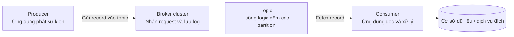

# Vai trò và quan hệ giữa producer, broker, topic và consumer

Apache Kafka tổ chức việc trao đổi sự kiện quanh một luồng dữ liệu được lưu trữ bền vững. Producer tạo và gửi record vào Kafka; broker tiếp nhận request, lưu record và phục vụ các thao tác đọc; topic đặt tên cho luồng sự kiện; consumer đọc record để thực hiện công việc của ứng dụng. Bốn thành phần phối hợp với nhau nhưng có trách nhiệm riêng.

Trong một hệ thống event streaming, dịch vụ đơn hàng có thể phát sự kiện `OrderCreated`, dịch vụ thanh toán đọc sự kiện đó để xử lý thanh toán, còn dịch vụ phân tích đọc cùng luồng để cập nhật báo cáo. Các dịch vụ không cần gọi trực tiếp lẫn nhau. Kafka đóng vai trò trung gian lưu trữ và phân phối sự kiện, giúp producer và consumer hoạt động độc lập hơn về thời gian và năng lực xử lý.

## Mục tiêu bài học

Sau bài học, bạn có thể:

- Giải thích trách nhiệm của producer, broker, topic và consumer.
- Mô tả đường đi của một record từ ứng dụng gửi đến lúc ứng dụng khác đọc.
- Phân biệt topic với broker và hiểu vì sao một topic có thể trải trên nhiều broker.
- Giải thích cách partition, key và offset tham gia vào việc lưu trữ, định tuyến và đọc dữ liệu.
- Nhận diện ranh giới giữa Kafka và logic nghiệp vụ của ứng dụng Java hoặc Spring Kafka.

## 1. Bốn thành phần cốt lõi

### 1.1. Producer: ứng dụng phát sự kiện

Producer là ứng dụng hoặc thành phần ứng dụng tạo record và gửi record đến một topic. Producer thường phát ra sự kiện sau khi một thay đổi nghiệp vụ đã xảy ra, ví dụ đơn hàng được tạo, thanh toán hoàn tất hoặc hàng hóa được nhập kho.

Producer chịu trách nhiệm quyết định nội dung sự kiện và cách biểu diễn nó. Một record có thể chứa:

- **Topic:** tên luồng mà ứng dụng muốn gửi dữ liệu vào, chẳng hạn `orders`.
- **Key:** giá trị giúp nhóm các record liên quan, thường là mã thực thể như `orderId`.
- **Value:** payload sự kiện, ví dụ JSON mô tả đơn hàng vừa được tạo.
- **Headers:** metadata bổ trợ như correlation ID hoặc trace context.
- **Timestamp:** thời điểm của record theo chính sách timestamp đang áp dụng.

Producer cũng cần cấu hình serializer, địa chỉ bootstrap server, mức xác nhận khi gửi và cách xử lý lỗi. Producer có thể chỉ định partition, nhưng thông thường để partitioner của Kafka client chọn dựa trên key và metadata topic.

Producer không cần biết consumer nào sẽ nhận record. Nó chỉ gửi record đến Kafka theo topic và cấu hình đã chọn. Một producer có thể phục vụ nhiều luồng hoặc nhiều consumer độc lập có thể đọc cùng một luồng.

### 1.2. Broker: máy chủ lưu trữ và phục vụ request

Broker là một tiến trình Kafka server tham gia vào cluster. Broker nhận request từ producer và consumer, lưu các record trong log của partition, trả metadata về topic và partition, phục vụ các request đọc, đồng thời tham gia cơ chế replication và vận hành cluster.

Một cluster thường có nhiều broker. Mỗi broker quản lý một phần partition của các topic. Với từng partition, một broker giữ vai trò leader để xử lý request ghi và đọc thông thường; các broker khác có thể giữ replica để tăng khả năng chịu lỗi. Cách phân bố này cho phép Kafka mở rộng dung lượng và thông lượng bằng cách thêm broker và phân phối partition.

Broker không thực hiện nghiệp vụ như tính tổng tiền đơn hàng, xác nhận thanh toán hay gửi email. Broker quản lý việc lưu trữ và truyền record. Ý nghĩa nghiệp vụ của payload thuộc về producer, consumer và hợp đồng sự kiện mà các ứng dụng cùng thống nhất.

### 1.3. Topic: tên logic của một luồng sự kiện

Topic là tên logic dùng để phân loại và tổ chức record. Ví dụ:

| Topic | Loại sự kiện có thể chứa |
|---|---|
| `orders` | Đơn hàng được tạo, cập nhật hoặc hủy |
| `payments` | Thanh toán được yêu cầu, chấp nhận hoặc từ chối |
| `inventory-events` | Tồn kho tăng, giảm hoặc được điều chỉnh |

Topic không phải một file đơn lẻ và cũng không đồng nghĩa với một broker. Một topic được chia thành một hoặc nhiều partition; các partition có thể được phân bố trên nhiều broker trong cluster. Mỗi partition là một log có thứ tự riêng.

Topic có cấu hình ảnh hưởng đến cách dữ liệu được lưu và phục vụ, chẳng hạn số partition, replication factor, retention và cleanup policy. Những cấu hình này tác động đến khả năng mở rộng, độ bền, thứ tự và vòng đời dữ liệu.

### 1.4. Consumer: ứng dụng đọc và xử lý sự kiện

Consumer là ứng dụng hoặc thành phần ứng dụng đọc record từ một hay nhiều topic. Consumer thường dùng dữ liệu nhận được để cập nhật cơ sở dữ liệu, gọi dịch vụ khác, xây dựng read model, gửi thông báo hoặc tạo dữ liệu phân tích.

Consumer chịu trách nhiệm cấu hình deserializer, chọn topic hoặc subscription, xử lý payload, quản lý lỗi và quyết định thời điểm commit offset. Consumer đọc dữ liệu từ Kafka theo vị trí của partition; Kafka không xóa record chỉ vì một consumer đã đọc nó. Vòng đời dữ liệu chủ yếu do retention hoặc cleanup policy quyết định.

Một consumer có thể đọc lại dữ liệu nếu offset được điều chỉnh về vị trí trước đó và record vẫn còn trong log. Khả năng phát lại này hữu ích khi xây dựng lại read model, khôi phục sau sự cố hoặc triển khai phiên bản xử lý mới.

## 2. Các thành phần kết nối với nhau như thế nào?

Luồng cơ bản diễn ra theo trình tự sau:

1. Một hành động nghiệp vụ xảy ra trong ứng dụng producer, chẳng hạn khách hàng tạo đơn hàng.
2. Producer tạo record gồm topic, key, value và headers cần thiết.
3. Kafka producer client lấy metadata của cluster, serialize key/value và xác định partition đích nếu ứng dụng chưa chỉ định partition.
4. Producer gửi request đến broker leader của partition đó.
5. Broker append record vào log của partition và xử lý replication theo cấu hình. Sau khi điều kiện xác nhận ghi được đáp ứng, broker trả kết quả cho producer.
6. Consumer gửi request fetch đến broker để đọc record từ partition mà nó được phép đọc.
7. Consumer deserialize dữ liệu, thực hiện logic ứng dụng và quản lý offset để có thể tiếp tục đọc sau đó.



Sơ đồ thể hiện quan hệ logic. Trên thực tế, topic được triển khai bằng các partition nằm trên broker; producer và consumer dùng metadata của cluster để gửi request đến broker phù hợp. Producer không gửi record trực tiếp cho consumer và consumer cũng không cần duy trì kết nối đến producer.

## 3. Topic, partition và broker trong cluster

Topic là lớp đặt tên cho luồng dữ liệu. Partition là đơn vị log có thứ tự bên trong topic. Broker là tiến trình server lưu trữ và phục vụ các partition đó.

Ví dụ, topic `orders` có ba partition. Cluster có thể phân bố các partition như sau:

```text
Kafka cluster

Broker 1                 Broker 2                 Broker 3
+------------------+     +------------------+     +------------------+
| orders-0 (leader)|     | orders-1 (leader)|     | orders-2 (leader)|
| orders-1 (replica)|    | orders-2 (replica)|    | orders-0 (replica)|
+------------------+     +------------------+     +------------------+

Topic: orders = partition 0 + partition 1 + partition 2
```

Đây là ví dụ minh họa một cách phân bố replica, không phải sơ đồ bắt buộc cho mọi cluster. Leader của mỗi partition có thể nằm trên broker khác nhau; replica được đặt theo replication factor và chính sách phân bố của cluster.

Khi producer gửi record, client sử dụng metadata để biết broker nào đang là leader của partition đích. Khi leader thay đổi, client có thể cập nhật metadata và gửi lại request theo cơ chế retry. Consumer cũng fetch từ broker đang phục vụ partition tương ứng.

### 3.1. Vì sao topic cần partition?

Partition giúp một topic được chia thành nhiều log để phân phối lưu trữ và xử lý. Nhờ đó, nhiều producer request có thể được xử lý trên các partition khác nhau và consumer group có thể đọc nhiều partition song song.

Kafka bảo đảm thứ tự trong phạm vi một partition. Nếu producer ghi record A rồi record B vào cùng partition, consumer đọc partition đó theo thứ tự log sẽ gặp A trước B. Kafka không cung cấp một thứ tự tổng thể giữa các partition khác nhau.

Nếu các sự kiện của cùng một đơn hàng cần được xử lý theo thứ tự, producer thường dùng `orderId` làm key. Partitioner mặc định có thể dùng key để đưa các record cùng key về cùng partition, miễn là các điều kiện phân vùng không thay đổi. Đây là cơ sở quan trọng để thiết kế ordering trong luồng sự kiện.

### 3.2. Replication giúp broker chịu lỗi

Partition có thể có nhiều replica trên các broker khác nhau. Một replica được bầu làm leader; các replica theo kịp leader thuộc tập ISR (in-sync replicas). Replication giúp cluster tiếp tục phục vụ khi một broker gặp sự cố, nếu số replica còn hoạt động và điều kiện xác nhận ghi đáp ứng cấu hình.

Producer có thể cấu hình `acks` để lựa chọn mức xác nhận cần thiết. Với `acks=all`, broker leader chờ các replica thuộc ISR xác nhận theo quy tắc Kafka trước khi trả kết quả thành công. `min.insync.replicas` đặt ngưỡng ISR tối thiểu cho một số thao tác ghi. Hai cấu hình cần được thiết kế cùng replication factor để cân bằng độ bền, khả năng ghi khi có lỗi và độ trễ.

Replication không có nghĩa mọi consumer đều nhận một bản sao riêng. Consumer đọc luồng logic của topic; Kafka quản lý replica ở tầng lưu trữ để bảo vệ dữ liệu và duy trì khả năng phục vụ.

## 4. Consumer group và cách nhiều consumer chia sẻ công việc

Một consumer có thể hoạt động độc lập, nhưng trong hệ thống thực tế thường có nhiều instance cùng đọc một topic. Consumer group cho phép các instance phối hợp xử lý. Trong một group truyền thống, mỗi partition tại một thời điểm được gán cho tối đa một consumer trong group đó. Một consumer có thể được gán nhiều partition nếu số consumer ít hơn số partition.

Ví dụ topic `orders` có sáu partition và group `order-projection` có ba consumer. Kafka có thể gán hai partition cho mỗi consumer. Nếu group có tám consumer, một số consumer sẽ không được gán partition vì số partition chỉ là sáu.

Các group khác nhau có thể đọc cùng một topic độc lập. Ví dụ `order-projection` cập nhật cơ sở dữ liệu đơn hàng, `fraud-detection` kiểm tra rủi ro và `analytics` tổng hợp dữ liệu. Việc một group đọc record không làm record biến mất đối với group khác.

Consumer group lưu tiến độ đọc theo từng partition thông qua committed offset. Offset cho biết vị trí mà group dự định tiếp tục đọc. Commit sau khi xử lý thành công giúp consumer tiếp tục từ tiến độ đã xác nhận khi khởi động lại. Nếu ứng dụng xử lý xong nhưng chưa commit, record có thể được đọc lại; nếu commit trước khi xử lý xong, ứng dụng có nguy cơ bỏ qua công việc sau sự cố. Vì vậy, offset phải được thiết kế cùng retry, idempotency và ngữ nghĩa xử lý.

## 5. Ví dụ luồng sự kiện đơn hàng

Giả sử hệ thống thương mại điện tử có ba ứng dụng:

- `order-service` tạo đơn hàng và phát `OrderCreated` vào topic `orders`.
- `shipping-service` đọc `orders` để chuẩn bị giao hàng.
- `analytics-service` đọc `orders` để cập nhật số liệu bán hàng.

Khi khách hàng tạo đơn `ORD-2026-00421`, `order-service` tạo một record có key là mã đơn hàng và value mô tả sự kiện. Kafka lưu record vào partition tương ứng. Hai consumer group có thể đọc record đó độc lập: một group phục vụ giao hàng, group còn lại phục vụ phân tích.

```text
order-service (producer)
        |
        | key=ORD-2026-00421
        | value=OrderCreated
        v
   Topic: orders
        |
        +------------------------------+
        |                              |
        v                              v
shipping-service                analytics-service
group: shipping                 group: analytics
        |                              |
        v                              v
Tạo yêu cầu giao hàng           Cập nhật báo cáo
```

Producer không cần gọi API của hai dịch vụ consumer để thông báo đơn hàng. Mỗi consumer có thể đọc theo tốc độ riêng, triển khai độc lập và phát lại dữ liệu khi cần, miễn là record vẫn còn trong Kafka và offset được quản lý phù hợp.

Ví dụ này cũng cho thấy topic là hợp đồng trao đổi giữa các ứng dụng. Producer và consumer cần thống nhất schema, ý nghĩa của sự kiện, key và chính sách tương thích. Kafka vận chuyển và lưu record; nó không tự đảm bảo rằng payload có ý nghĩa đúng với nghiệp vụ.

## 6. Minh họa bằng Java Kafka client

### 6.1. Producer gửi record

Ví dụ sau gửi sự kiện đơn hàng vào topic `orders`. Producer dùng `orderId` làm key và JSON string làm value. `bootstrap.servers` là địa chỉ ban đầu để client tìm metadata cluster; sau khi nhận metadata, client có thể gửi request đến broker leader phù hợp.

```java
import java.util.Properties;
import org.apache.kafka.clients.producer.KafkaProducer;
import org.apache.kafka.clients.producer.ProducerConfig;
import org.apache.kafka.clients.producer.ProducerRecord;
import org.apache.kafka.clients.producer.RecordMetadata;
import org.apache.kafka.common.serialization.StringSerializer;

public class OrderProducer {
    public static void main(String[] args) throws Exception {
        Properties props = new Properties();
        props.put(ProducerConfig.BOOTSTRAP_SERVERS_CONFIG, "localhost:9092");
        props.put(ProducerConfig.KEY_SERIALIZER_CLASS_CONFIG,
            StringSerializer.class.getName());
        props.put(ProducerConfig.VALUE_SERIALIZER_CLASS_CONFIG,
            StringSerializer.class.getName());

        try (KafkaProducer<String, String> producer =
                 new KafkaProducer<>(props)) {
            ProducerRecord<String, String> record = new ProducerRecord<>(
                "orders",
                "ORD-2026-00421",
                "{\"eventType\":\"OrderCreated\","
                    + "\"orderId\":\"ORD-2026-00421\","
                    + "\"totalAmount\":1250000}"
            );

            RecordMetadata metadata = producer.send(record).get();
            System.out.printf(
                "topic=%s partition=%d offset=%d%n",
                metadata.topic(), metadata.partition(), metadata.offset()
            );
        }
    }
}
```

`send()` là thao tác bất đồng bộ và trả về một future. Gọi `get()` trong ví dụ giúp chờ kết quả để minh họa metadata do Kafka xác nhận; ứng dụng throughput cao thường xử lý callback hoặc future bất đồng bộ thay vì chặn luồng cho từng record. Cần xử lý exception vì timeout hoặc lỗi mạng có thể khiến producer không nhận được xác nhận, kể cả khi trạng thái ghi ở broker cần được kiểm tra thêm.

### 6.2. Consumer đọc và xử lý record

Consumer đăng ký topic và gọi `poll()` để lấy các record sẵn sàng. Ví dụ dùng một consumer group và commit thủ công sau khi xử lý lô record thành công:

```java
import java.time.Duration;
import java.util.List;
import java.util.Properties;
import org.apache.kafka.clients.consumer.ConsumerConfig;
import org.apache.kafka.clients.consumer.ConsumerRecord;
import org.apache.kafka.clients.consumer.ConsumerRecords;
import org.apache.kafka.clients.consumer.KafkaConsumer;
import org.apache.kafka.common.serialization.StringDeserializer;

public class OrderConsumer {
    public static void main(String[] args) {
        Properties props = new Properties();
        props.put(ConsumerConfig.BOOTSTRAP_SERVERS_CONFIG, "localhost:9092");
        props.put(ConsumerConfig.GROUP_ID_CONFIG, "shipping-service");
        props.put(ConsumerConfig.KEY_DESERIALIZER_CLASS_CONFIG,
            StringDeserializer.class.getName());
        props.put(ConsumerConfig.VALUE_DESERIALIZER_CLASS_CONFIG,
            StringDeserializer.class.getName());
        props.put(ConsumerConfig.ENABLE_AUTO_COMMIT_CONFIG, "false");
        props.put(ConsumerConfig.AUTO_OFFSET_RESET_CONFIG, "earliest");

        try (KafkaConsumer<String, String> consumer =
                 new KafkaConsumer<>(props)) {
            consumer.subscribe(List.of("orders"));

            while (true) {
                ConsumerRecords<String, String> records =
                    consumer.poll(Duration.ofMillis(500));

                for (ConsumerRecord<String, String> record : records) {
                    System.out.printf(
                        "orderKey=%s partition=%d offset=%d value=%s%n",
                        record.key(), record.partition(),
                        record.offset(), record.value()
                    );
                    // Thực hiện xử lý nghiệp vụ và kiểm tra kết quả ở đây.
                }

                if (!records.isEmpty()) {
                    consumer.commitSync();
                }
            }
        }
    }
}
```

Đây là ví dụ minh họa luồng đọc. Trong ứng dụng thật, chỉ commit sau khi mọi thao tác cần thiết của lô đã thành công và có cơ chế xử lý exception phù hợp. Nếu xử lý tạo tác dụng phụ ở hệ thống khác, hãy thiết kế idempotency hoặc cơ chế phối hợp để xử lý trường hợp record được giao lại.

`auto.offset.reset=earliest` chỉ được dùng khi group chưa có committed offset hợp lệ hoặc offset cũ không còn nằm trong log. Nó không buộc consumer đọc lại từ đầu trong mỗi lần khởi động. `commitSync()` lưu tiến độ cho consumer group, không xóa record khỏi topic.

## 7. Spring Kafka thể hiện cùng mô hình

Spring Kafka cung cấp API thuận tiện hơn nhưng các vai trò kiến trúc vẫn giữ nguyên. `KafkaTemplate` giúp producer gửi record; listener container quản lý vòng lặp consumer và gọi phương thức `@KafkaListener` khi có record.

Ví dụ producer:

```java
@Service
public class OrderEventPublisher {
    private final KafkaTemplate<String, String> kafkaTemplate;

    public OrderEventPublisher(KafkaTemplate<String, String> kafkaTemplate) {
        this.kafkaTemplate = kafkaTemplate;
    }

    public void publish(String orderId, String payload) {
        ProducerRecord<String, String> record =
            new ProducerRecord<>("orders", orderId, payload);

        kafkaTemplate.send(record).whenComplete((result, error) -> {
            if (error != null) {
                // Ghi nhận lỗi và chuyển sang chính sách retry phù hợp.
                return;
            }
            RecordMetadata metadata = result.getRecordMetadata();
            // Có thể ghi nhận topic, partition và offset để theo dõi.
        });
    }
}
```

Ví dụ consumer:

```java
@Component
public class OrderEventListener {
    @KafkaListener(topics = "orders", groupId = "shipping-service")
    public void onOrderCreated(ConsumerRecord<String, String> record) {
        String orderId = record.key();
        String payload = record.value();
        // Kiểm tra payload và thực hiện nghiệp vụ giao hàng.
    }
}
```

Các đoạn mã Spring giả định ứng dụng đã cấu hình Kafka client, serializer/deserializer và dependency tương thích. Phiên bản Spring Kafka quyết định kiểu trả về và chi tiết API; cần đối chiếu phiên bản thư viện của dự án khi tích hợp. Dù dùng Java client trực tiếp hay Spring Kafka, producer vẫn gửi record vào topic và consumer vẫn đọc record từ broker.

## 8. Ranh giới trách nhiệm và những hiểu lầm thường gặp

| Hiểu lầm | Cách hiểu đúng |
|---|---|
| Topic là một broker | Topic là luồng logic; partition của topic được lưu trên một hoặc nhiều broker. |
| Producer gửi thẳng đến consumer | Producer gửi record đến broker; consumer đọc record từ broker. Hai ứng dụng không cần biết địa chỉ trực tiếp của nhau. |
| Broker hiểu nội dung nghiệp vụ | Broker xử lý byte, metadata, log và replication; ứng dụng định nghĩa và diễn giải payload. |
| Consumer đọc xong thì record bị xóa | Record vẫn tồn tại theo retention/cleanup policy; consumer group lưu tiến độ đọc bằng offset. |
| Mọi consumer đều nhận cùng một bản ghi trong cùng group | Trong consumer group truyền thống, mỗi partition được gán cho tối đa một consumer tại một thời điểm; các group khác nhau có thể đọc cùng record độc lập. |
| Kafka đảm bảo thứ tự toàn topic | Kafka bảo đảm thứ tự trong từng partition. Muốn giữ thứ tự theo thực thể, cần thiết kế key và partition phù hợp. |
| Gửi thành công nghĩa là mọi consumer đã xử lý xong | Xác nhận producer phản ánh kết quả ghi theo cấu hình; consumer xử lý và commit tiến độ ở một giai đoạn riêng. |

Một hệ thống Kafka tốt phân chia trách nhiệm rõ ràng: producer tạo sự kiện đúng hợp đồng; topic tổ chức luồng; broker lưu trữ, nhân bản và phục vụ request; consumer xử lý sự kiện và quản lý tiến độ. Các quyết định về schema, key, partition, retry, transaction và idempotency thuộc thiết kế ứng dụng và vận hành hệ thống.

## 9. Khi nào cần xem xét thêm các thành phần Kafka khác?

Producer, broker, topic và consumer là mô hình nền tảng. Khi hệ thống lớn hơn, các tính năng khác mở rộng cách phối hợp giữa chúng:

- **Consumer group và rebalance:** phân chia partition giữa các consumer instance và điều chỉnh khi thành viên thay đổi.
- **Replication và KRaft:** duy trì bản sao partition và quản lý metadata cluster.
- **Retry, dead-letter topic và transaction:** xử lý lỗi, kiểm soát tác dụng phụ và phối hợp ghi dữ liệu.
- **Spring Kafka:** tích hợp producer, listener, acknowledgment và error handler vào ứng dụng Spring.
- **Kafka Connect và Kafka Streams:** tích hợp Kafka với hệ thống ngoài hoặc xây dựng luồng xử lý sự kiện.
- **Metrics và vận hành:** theo dõi throughput, latency, consumer lag, replica và tình trạng broker.

Các tính năng này không thay đổi mối quan hệ cơ bản: ứng dụng phát record vào topic, broker quản lý log của partition và ứng dụng consumer đọc record từ Kafka.

## 10. Bài tập tự kiểm tra

Một hệ thống có topic `payments`, ba broker và hai ứng dụng consumer: `accounting-service` và `notification-service`. Hãy trả lời:

1. Ứng dụng nào đóng vai trò producer khi phát sự kiện `PaymentCompleted`?
2. Topic `payments` có bắt buộc phải nằm trên một broker duy nhất không? Giải thích vai trò của partition.
3. Nếu hai consumer service cần xử lý cùng một sự kiện cho hai mục đích khác nhau, chúng nên dùng chung hay khác consumer group?
4. Consumer đã đọc một record nhưng chưa commit offset rồi bị dừng. Khi chạy lại, điều gì có thể xảy ra?
5. Nếu cần giữ thứ tự sự kiện theo một tài khoản, nên cân nhắc chọn key nào và vì sao?
6. Producer nhận được xác nhận ghi thành công có chứng minh `notification-service` đã gửi thông báo chưa? Vì sao?

Gợi ý: producer và consumer là vai trò của ứng dụng; broker lưu và phục vụ partition; topic là tên luồng; consumer group quyết định cách chia việc và theo dõi offset. Ghi thành công và xử lý thành công là hai mốc khác nhau.

## Kết luận

Producer phát record, topic đặt tên cho luồng sự kiện, broker lưu trữ và phục vụ các partition, còn consumer đọc và xử lý record theo tiến độ của mình. Nhiều broker cùng tạo thành cluster để phân bố partition và replica; nhiều consumer group có thể đọc cùng một topic độc lập. Khi nắm rõ mối quan hệ này, bạn có thể thiết kế luồng sự kiện Java/Spring Kafka với ranh giới trách nhiệm, ordering, khả năng phát lại và xử lý lỗi rõ ràng hơn.
