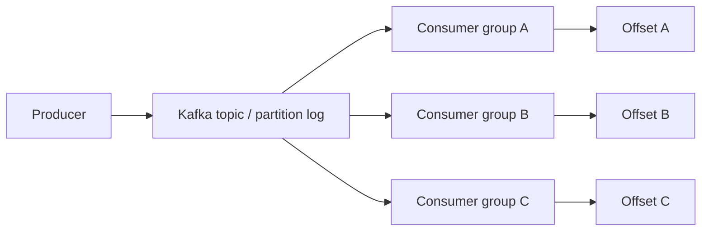
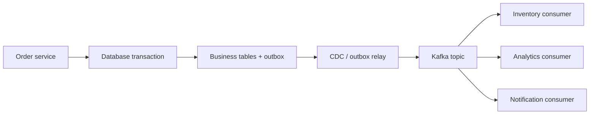
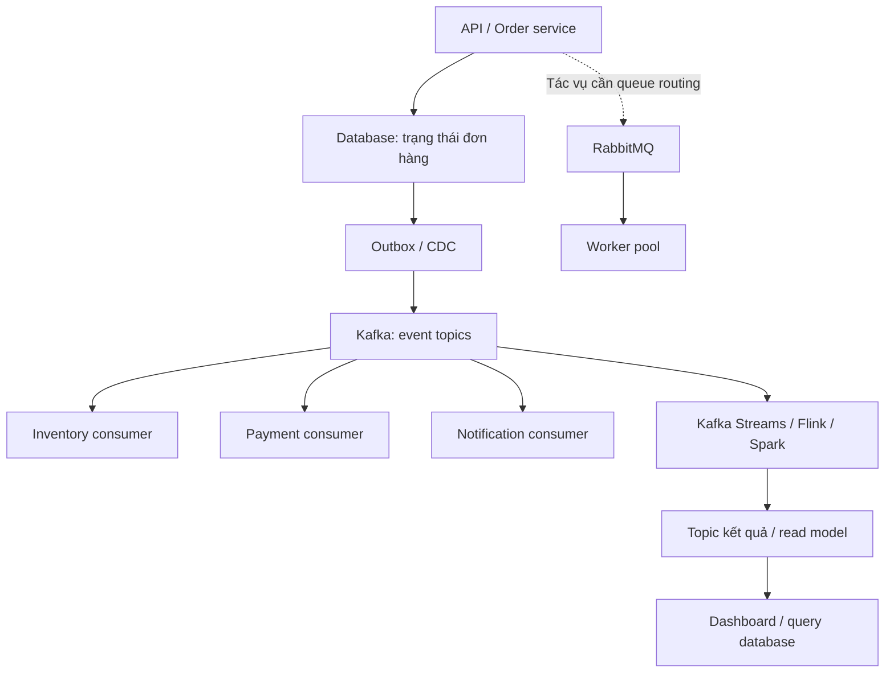

# Phân biệt Kafka với RabbitMQ, cơ sở dữ liệu và công cụ xử lý luồng

Kafka thường được đặt cạnh RabbitMQ, cơ sở dữ liệu hoặc Apache Flink vì các hệ thống này đều có thể xuất hiện trong một kiến trúc xử lý sự kiện. Tuy nhiên, chúng giải quyết những phần việc khác nhau. Kafka là nền tảng event streaming để ghi, lưu giữ, phân phối và phát lại luồng sự kiện. RabbitMQ là message broker mạnh về định tuyến và phân phối message đến hàng đợi. Cơ sở dữ liệu quản lý trạng thái có cấu trúc và truy vấn dữ liệu. Công cụ xử lý luồng biến đổi, kết hợp và tổng hợp dữ liệu đang di chuyển.

Trong module Kafka, mục tiêu không phải là chọn một công nghệ thắng trong mọi tình huống. Người thiết kế cần nhận diện yêu cầu chính: lưu lịch sử sự kiện và cho nhiều hệ thống đọc lại, phân phối công việc, quản lý trạng thái giao dịch, hay tính toán trên luồng dữ liệu. Có thể kết hợp các công nghệ này trong cùng một hệ thống.

## 1. Bốn vai trò cần phân biệt

### Apache Kafka: event streaming platform

Kafka lưu sự kiện trong các topic được chia thành partition. Mỗi partition là một log có thứ tự: producer append record, còn consumer đọc record theo offset. Dữ liệu được giữ theo chính sách retention hoặc compaction, độc lập với việc từng consumer đã đọc đến đâu. Vì vậy, một consumer group mới có thể đọc lại dữ liệu còn được giữ; nhiều consumer group cũng có thể đọc cùng một luồng sự kiện với tiến độ riêng.

Kafka phù hợp khi hệ thống cần thông lượng lớn, nhiều nhóm tiêu thụ độc lập, lưu lịch sử sự kiện trong một khoảng thời gian và có khả năng replay để xây dựng lại dữ liệu dẫn xuất. Replication giúp bảo vệ partition trước lỗi broker; partition cho phép mở rộng lưu trữ và xử lý song song. Thứ tự được bảo đảm trong phạm vi một partition, không phải thứ tự toàn cục giữa tất cả partition của topic.

### RabbitMQ: message broker và queue

RabbitMQ nhận message từ producer, định tuyến message qua exchange đến một hoặc nhiều queue dựa trên loại exchange và binding. Consumer nhận message từ queue và thường gửi acknowledgement sau khi xử lý. Với queue truyền thống, message đã được acknowledge sẽ được loại khỏi queue. Cơ chế prefetch, acknowledgement, retry, dead-letter exchange và routing key hỗ trợ các mô hình phân phối công việc.

RabbitMQ thường phù hợp với lệnh hoặc công việc cần giao cho worker, định tuyến linh hoạt theo routing key, xử lý từng message với acknowledgement và kiểm soát số message đang giao cho consumer. RabbitMQ cũng có các kiểu queue và tính năng bổ sung, trong đó có stream, nhưng mô hình queue/exchange là cách tiếp cận phổ biến khi thiết kế message broker.

### Cơ sở dữ liệu: quản lý trạng thái và truy vấn

Cơ sở dữ liệu lưu trạng thái hiện tại theo mô hình dữ liệu, cung cấp truy vấn, chỉ mục, ràng buộc và giao dịch. Ví dụ, bảng `orders` trả lời đơn hàng hiện tại đang ở trạng thái nào; Kafka có thể lưu các sự kiện `OrderCreated`, `PaymentAuthorized` và `OrderShipped` mô tả những thay đổi đã xảy ra.

Database thường là nơi ứng dụng đọc và cập nhật trạng thái nghiệp vụ có tính nhất quán. Kafka có thể lưu luồng thay đổi và phân phối chúng đến các hệ thống khác, nhưng không thay thế một database có chỉ mục và ngôn ngữ truy vấn phù hợp cho nghiệp vụ. Một topic compacted có thể giữ giá trị mới nhất theo key, nhưng điều đó không biến Kafka thành cơ sở dữ liệu truy vấn tổng quát.

### Công cụ xử lý luồng: tính toán trên dữ liệu đang đến

Công cụ xử lý luồng tiêu thụ sự kiện, thực hiện biến đổi như lọc, chuẩn hóa, join, aggregation, windowing và phát kết quả sang topic hoặc hệ thống đích. Apache Kafka tự đảm nhiệm lưu trữ và phân phối luồng; các thư viện hoặc engine xử lý đảm nhiệm tính toán.

Ví dụ, Kafka Streams là thư viện xử lý luồng có thể chạy bên trong ứng dụng Java; Apache Flink là engine xử lý phân tán có quản lý state, event time và checkpoint; Spark Structured Streaming cung cấp API xử lý luồng dựa trên mô hình DataFrame/SQL. Những công cụ này có thể đọc từ Kafka và ghi kết quả trở lại Kafka.

## 2. Mô hình Kafka khác queue truyền thống ở đâu?

Điểm khác biệt quan trọng nhất là cách consumer tiến triển qua dữ liệu. Trong Kafka, record nằm ở vị trí offset trong partition. Consumer group lưu tiến độ đọc bằng committed offset; broker tiếp tục giữ record theo retention policy, không xóa record chỉ vì một consumer group đã đọc hoặc commit offset. Consumer có thể reset offset và đọc lại nếu record vẫn còn.

Mỗi consumer group có tiến độ riêng. Trong một group, Kafka phân công partition cho các member để xử lý song song; thông thường một partition chỉ được gán cho tối đa một member tại một thời điểm trong group. Nếu topic có sáu partition, group có thể dùng tối đa sáu consumer member hoạt động song song trên topic đó; thêm member vượt quá số partition sẽ không tự tạo thêm partition hay tăng mức song song của topic.

Trong mô hình queue truyền thống của RabbitMQ, nhiều consumer cùng nhận message từ một queue. Khi một consumer acknowledge, message được xem là đã xử lý và được loại khỏi queue. Nếu consumer chết trước acknowledgement, broker có thể đưa message trở lại để phân phối lại. Vì vậy acknowledgement gắn với từng delivery, trong khi Kafka commit offset thường biểu thị vị trí đọc đã hoàn tất trong partition.

Khác biệt này ảnh hưởng đến cách triển khai retry và xử lý lỗi. Với RabbitMQ, có thể dùng nack/requeue, dead-letter exchange và TTL để định tuyến lại message. Với Kafka, ứng dụng thường quản lý retry topic, retry theo thời gian, dead-letter topic hoặc dừng/không commit offset để xử lý lại. Cần thiết kế cẩn thận để một record lỗi không làm chặn cả partition quá lâu.

## 3. Kafka và RabbitMQ: so sánh theo nhu cầu

| Tiêu chí | Apache Kafka | RabbitMQ (mô hình queue phổ biến) |
| --- | --- | --- |
| Mô hình dữ liệu | Log theo partition, record có offset. | Exchange định tuyến message đến queue. |
| Tiến độ consumer | Consumer group quản lý offset đọc. | Consumer acknowledgement cho từng delivery. |
| Sau khi xử lý | Record vẫn được giữ đến khi hết retention hoặc được xử lý theo compaction. | Message đã acknowledge thường được loại khỏi queue. |
| Đọc lại | Có thể reset offset để replay dữ liệu còn retention. | Thường cần giữ, sao chép hoặc publish lại message; queue thông thường không phải lịch sử replay dài hạn. |
| Phân phối cho nhiều ứng dụng | Mỗi consumer group có thể đọc độc lập cùng topic. | Exchange có thể định tuyến bản sao đến nhiều queue. |
| Định tuyến | Chủ yếu chọn topic và partition, thường dựa trên key. | Exchange type, routing key, binding và header hỗ trợ định tuyến linh hoạt. |
| Thứ tự | Có thứ tự trong từng partition. | Queue giữ thứ tự theo cơ chế queue, nhưng nhiều consumer, redelivery hoặc requeue có thể làm thứ tự quan sát thay đổi. |
| Mở rộng song song | Số partition quyết định mức song song tối đa trong một consumer group cho topic đó. | Có thể tăng consumer; mức song song phụ thuộc queue, broker và cách phân phối. |
| Kiểm soát tải | Consumer chủ động fetch và theo dõi lag. | Broker push delivery, có thể giới hạn bằng prefetch và acknowledgement. |
| Trường hợp điển hình | Event backbone, telemetry, audit stream, tích hợp nhiều hệ thống, replay. | Task queue, lệnh, workflow cần routing và acknowledgement theo message. |

Không nên kết luận Kafka luôn nhanh hơn hoặc RabbitMQ luôn có độ trễ thấp hơn. Kết quả thực tế phụ thuộc kích thước message, số queue/partition, durability, replication, xác nhận ghi, routing, topology mạng và cách consumer xử lý. Hãy benchmark bằng tải gần với production nếu hiệu năng là tiêu chí quyết định.

### Ví dụ chọn giữa Kafka và RabbitMQ

Giả sử dịch vụ thương mại điện tử nhận đơn hàng. Sự kiện `OrderCreated` cần được gửi đến hệ thống phân tích, dịch vụ gửi email, hệ thống tồn kho và dịch vụ chống gian lận. Các nhóm này cần đọc độc lập, có thể triển khai ở thời điểm khác nhau và có thể cần replay khi xây dựng lại dữ liệu. Kafka phù hợp để làm event backbone: mỗi hệ thống là một consumer group riêng.

Ngược lại, nếu một dịch vụ cần giao từng tác vụ gửi email cho các worker, giới hạn số tác vụ đang xử lý, retry khi worker lỗi và chuyển tác vụ lỗi sang dead-letter queue, RabbitMQ có thể là lựa chọn tự nhiên hơn. Nếu yêu cầu còn bao gồm lịch sử sự kiện lâu dài và nhiều consumer độc lập, Kafka cũng có thể đảm nhiệm, nhưng nhóm phát triển phải thiết kế retry, idempotency và quản lý offset phù hợp.

## 4. Kafka và cơ sở dữ liệu: bổ trợ cho nhau

Kafka và database lưu dữ liệu với mục tiêu khác nhau:

- Database tối ưu cho đọc/ghi trạng thái theo key, truy vấn có điều kiện, join dữ liệu, index, constraint và transaction.
- Kafka tối ưu cho append và phân phối luồng sự kiện có thứ tự trong partition, nhiều consumer độc lập và replay trong thời gian retention.

Ví dụ, dịch vụ Order cập nhật bản ghi đơn hàng trong PostgreSQL. Các hệ thống khác cần nhận sự kiện về thay đổi đơn hàng. Nếu ứng dụng ghi database rồi publish Kafka bằng hai thao tác độc lập, có thể xảy ra lỗi dual-write: database commit thành công nhưng publish thất bại, hoặc publish thành công nhưng transaction database rollback.

Một cách xử lý phổ biến là transactional outbox. Ứng dụng ghi thay đổi nghiệp vụ và một bản ghi outbox trong cùng transaction database. Một tiến trình relay hoặc CDC connector đọc outbox rồi publish sự kiện sang Kafka. Khi đó, việc cập nhật trạng thái nghiệp vụ và ghi nhận ý định phát sự kiện được ràng buộc trong cùng transaction; consumer vẫn cần idempotent vì thông điệp có thể được phát lại.

Database cũng có thể được cập nhật từ Kafka. Ví dụ, một consumer đọc `OrderCreated` và cập nhật read model phục vụ truy vấn. Đây là mô hình materialized view hoặc CQRS: luồng sự kiện phân phối thay đổi, còn database/read store phục vụ truy vấn theo nhu cầu của ứng dụng. Read model có thể trễ hơn nguồn phát sự kiện trong một khoảng thời gian, nên API cần xác định rõ yêu cầu nhất quán.

Không nên dùng Kafka làm nơi thay thế database chỉ vì Kafka có thể lưu dữ liệu bền vững. Kafka không cung cấp truy vấn tùy ý trên toàn bộ sự kiện như SQL database; việc tìm record thường dựa vào partition, offset, key và các hệ thống xử lý/index bên ngoài. Ngược lại, không nên dùng database polling cho mọi luồng sự kiện tần suất cao nếu event streaming giải quyết tốt hơn yêu cầu phân phối và replay.

## 5. Kafka và công cụ xử lý luồng: lưu trữ khác với tính toán

Kafka broker nhận, lưu, replication và phục vụ record. Nó không tự thực hiện các phép tính nghiệp vụ phức tạp như join hai luồng theo event time, tổng hợp doanh thu theo cửa sổ 5 phút hay phát hiện chuỗi sự kiện bất thường. Các phép tính này thuộc về ứng dụng hoặc engine xử lý luồng.

| Công nghệ | Vai trò chính | Khi thường cân nhắc |
| --- | --- | --- |
| Kafka broker | Lưu trữ và phân phối event log. | Cần event backbone bền vững, nhiều consumer và replay. |
| Kafka Streams | Thư viện Java xử lý stream/table, stateful processing và topology; chạy cùng ứng dụng. | Đội Java muốn xây dựng dịch vụ xử lý gắn chặt với Kafka, triển khai như ứng dụng thông thường. |
| Apache Flink | Engine xử lý phân tán, hỗ trợ state lớn, event time, window, checkpoint và xử lý luồng phức tạp. | Cần xử lý stateful phức tạp, độ trễ thấp, nhiều nguồn/đích hoặc kiểm soát event time. |
| Spark Structured Streaming | API xử lý stream bằng DataFrame/SQL trong hệ sinh thái Spark; mặc định thường chạy theo micro-batch. | Muốn kết hợp xử lý luồng với hệ sinh thái Spark, SQL, batch và phân tích dữ liệu. |

Kafka Streams không phải một broker khác. Đây là thư viện nhúng trong ứng dụng, thường đọc từ Kafka và ghi kết quả về Kafka. Nó có thể quản lý state store cục bộ và changelog topic để phục hồi state. Flink và Spark là các engine xử lý riêng, có runtime và cách quản lý tài nguyên của chúng; Kafka thường đóng vai trò nguồn hoặc đích dữ liệu.

Ví dụ, hệ thống giám sát giao dịch nhận `PaymentAuthorized` và `PaymentFailed`. Kafka lưu các sự kiện để nhiều hệ thống tiêu thụ. Một ứng dụng Kafka Streams có thể nhóm theo tài khoản và tính tổng giao dịch trong cửa sổ thời gian. Nếu cần join nhiều luồng với event time, xử lý state lớn và kiểm soát checkpoint trên cụm tính toán phân tán, có thể cân nhắc Flink. Nếu dữ liệu cần đi qua pipeline phân tích dựa trên Spark SQL và các tác vụ batch hiện hữu, Structured Streaming có thể phù hợp.

Kafka Connect cũng cần được phân biệt với công cụ xử lý luồng. Connect dùng connector để đưa dữ liệu vào Kafka (source) hoặc đẩy dữ liệu ra hệ thống khác (sink), ví dụ từ database, object storage hoặc search engine. Connect chủ yếu giải quyết tích hợp và di chuyển dữ liệu; nó không thay thế một engine dùng để thực hiện join, window hay thuật toán xử lý nghiệp vụ.

## 6. Bảng chọn công nghệ theo bài toán

| Nhu cầu chính | Lựa chọn nên xem xét trước | Lý do |
| --- | --- | --- |
| Phân phối tác vụ cho worker, ack từng message, routing linh hoạt, retry/DLQ tích hợp | RabbitMQ | Queue/exchange và cơ chế delivery phù hợp với work dispatch. |
| Lưu luồng sự kiện dùng chung cho nhiều hệ thống, consumer độc lập, replay | Kafka | Topic/partition, retention và consumer group hỗ trợ event streaming. |
| Lưu trạng thái đơn hàng, truy vấn theo khách hàng, transaction nghiệp vụ | Database | Mô hình bảng/document, index, transaction và truy vấn phù hợp. |
| Tổng hợp, join, window và enrichment trên dữ liệu liên tục | Kafka Streams, Flink hoặc Spark Structured Streaming | Đây là nhóm công cụ tính toán trên stream. |
| Đồng bộ dữ liệu từ database hoặc ứng dụng SaaS vào Kafka | Kafka Connect hoặc CDC phù hợp | Connector và cơ chế tích hợp giảm phần code kết nối tự viết. |
| Phân phối sự kiện đến nhiều dịch vụ và đồng thời duy trì trạng thái truy vấn | Database + outbox/CDC + Kafka + consumer/read model | Mỗi thành phần đảm nhiệm một vai trò rõ ràng. |

Đây là điểm xuất phát để đánh giá, không phải quy tắc cứng. Hãy xét thêm quy mô dữ liệu, yêu cầu latency, thời gian lưu, khả năng replay, routing, thứ tự, mức chịu lỗi, kỹ năng vận hành và chi phí cụm.

## 7. Một kiến trúc kết hợp điển hình

Trong hệ thống đặt hàng, database lưu trạng thái đơn hàng chuẩn. Outbox/CDC chuyển thay đổi sang Kafka. Kafka phân phối sự kiện đến các consumer group độc lập: tồn kho, thanh toán, thông báo và phân tích. Một dịch vụ xử lý luồng có thể tổng hợp dữ liệu theo thời gian rồi ghi kết quả vào topic khác hoặc database phục vụ dashboard. Một hàng đợi RabbitMQ có thể được dùng riêng cho tác vụ nội bộ cần routing và acknowledgement theo từng delivery.

Trong kiến trúc này, cần quy định rõ ai là nguồn dữ liệu chuẩn cho từng loại trạng thái, schema của event, khóa partition, chính sách retention, cách retry và hành vi khi consumer xử lý trùng. Ví dụ, `orderId` thường là key hợp lý nếu cần các sự kiện của cùng đơn hàng được đưa vào cùng partition để giữ thứ tự tương đối. Nếu key phân tán kém, một số partition có thể nóng và giới hạn thông lượng.

Đừng giả định việc dùng Kafka đồng nghĩa toàn hệ thống có exactly-once. Kafka hỗ trợ idempotent producer và transaction cho một số luồng đọc/ghi Kafka; nhưng khi side effect đi ra database, email hoặc API ngoài Kafka, ứng dụng vẫn phải phối hợp transaction, idempotency key, outbox hoặc cơ chế deduplication ở đích để kiểm soát tác động lặp.

## 8. Các câu hỏi nên trả lời trước khi chọn

Trước khi chọn Kafka, RabbitMQ, database hay stream processor, hãy làm rõ:

1. Dữ liệu là sự kiện đã xảy ra, lệnh cần thực thi, hay trạng thái hiện tại cần truy vấn?
2. Có bao nhiêu hệ thống tiêu thụ độc lập? Chúng có cần đọc lại dữ liệu cũ không?
3. Cần giữ dữ liệu bao lâu? Khi consumer ngừng hoạt động, dữ liệu cần được giữ lại đến khi nào?
4. Thứ tự cần bảo đảm trên toàn hệ thống, theo một thực thể như `orderId`, hay không cần thứ tự?
5. Retry, acknowledgement, dead-letter và xử lý trùng cần hành vi nào?
6. Có phép tính stateful, join, window hoặc event-time phức tạp không?
7. Hệ thống nào là nguồn dữ liệu chuẩn và transaction nghiệp vụ nằm ở đâu?
8. Đội ngũ có thể vận hành, giám sát và khôi phục những thành phần nào?

Những câu trả lời này quan trọng hơn việc so sánh một chỉ số benchmark đơn lẻ. Một giải pháp có throughput cao nhưng không đáp ứng yêu cầu replay, routing hoặc transaction vẫn là lựa chọn sai.

## 9. Ghi nhớ

- Kafka là nền tảng event streaming: record được lưu trong partition log, consumer group theo dõi offset và có thể replay khi dữ liệu còn retention.
- RabbitMQ là message broker: exchange và binding định tuyến message đến queue; acknowledgement, prefetch và dead-letter hỗ trợ phân phối công việc.
- Database quản lý trạng thái và truy vấn; Kafka phân phối lịch sử thay đổi. Outbox/CDC giúp đồng bộ database với event stream an toàn hơn.
- Kafka broker lưu và phân phối sự kiện; Kafka Streams, Flink và Spark Structured Streaming thực hiện tính toán trên stream.
- Kafka Connect tập trung vào tích hợp nguồn và đích dữ liệu; Connect không thay thế engine xử lý stream.
- Các công nghệ có thể kết hợp. Hãy chọn theo semantics của dữ liệu, cách consumer xử lý, yêu cầu replay, thứ tự, transaction và năng lực vận hành.

Khi thiết kế một hệ thống event-driven, hãy bắt đầu bằng việc xác định sự kiện nào được phát, ai sở hữu trạng thái chuẩn và consumer cần hành vi gì. Từ đó mới quyết định phần nào cần queue, phần nào cần event log, phần nào cần database và phần nào cần stream processor.
